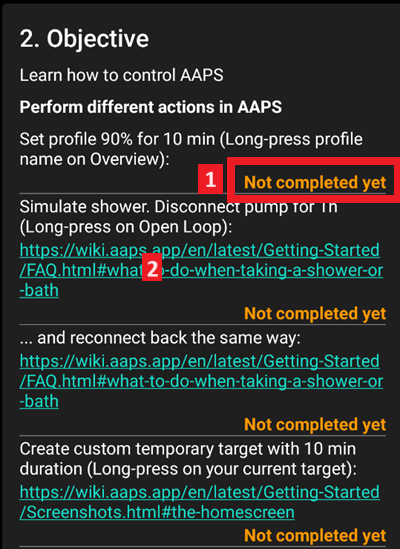
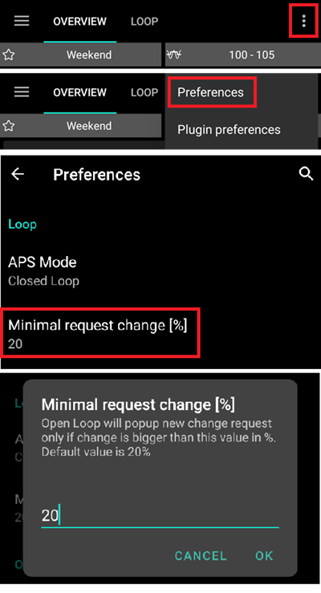
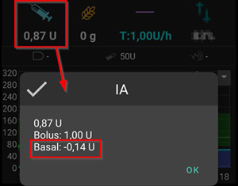
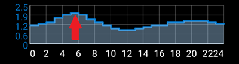
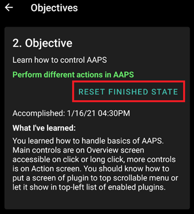

# Abschließen der Ziele (Objectives)

**AAPS** hat eine Reihe von **Zielen** (Objectives), die abgeschlossen werden müssen, um Dir so auf dem Weg vom einfachen Open Looping zu einem hybriden Closed Loop und den vollständigen **AAPS**-Funktionalitäten zu helfen. Das Abschließen der **Ziele** soll sicherstellen, dass Du:

* alles in Deinem **AAPS**-Einstellungen richtig konfiguriert hast,
* die wesentlichen **AAPS**-Funktionen kennengelernt hast und
* ein grundlegendes Verständnis dessen, was Dein System kann, hast und so Vertrauen zu **AAPS** aufbaust.

Wenn **AAPS** zum ersten Mal installiert wird, muss jedes Ziel erreicht und abgeschlossen werden, bevor das nächste in Angriff genommen werden kann. Mit dem Erreichen der **Ziele** werden nach und nach neue Funktionalitäten freigeschaltet.

**Ziel 1 bis 8** führen Dich von der **AAPS**-Konfiguration auf Deinem Smartphone hin zum „einfachen“ Hybrid-Closed-Loop. Es wird ungefähr 6 Wochen dauern diese Ziele abzuschließen. Bis zum **Ziel 5** kannst Du eine virtuelle Pumpe einsetzen (und in der Zwischenzeit einen anderen Weg für die Insulinabgabe nutzen). **Objectives 9 and 10** are designed to test more advanced **AAPS** features with the aim of better control of your diabetes, and will take up to 3 months to complete, possibly longer. Eine genauere Aufstellung darüber, wie viel Zeit für die einzelnen Ziele einzuplanen ist, findest Du hier: [Wie lange dauert es?](#preparing-how-long-will-it-take)

Neben dem Vorangehen durch die **Ziele**, kannst Du - bei Bedarf - auch einzelne, bereits abgeschlossene, Ziele zurücksetzen und damit erneut durchlaufen: [zurück zu einem früheren Ziel](#go-back-in-objectives).

## Einstellungen sichern

```{admonition} Note
:class: note

Das Exportieren Deiner **AAPS**-Einstellungen wird insbesondere nach dem Erreichen eines jeden **Ziels** dringend empfohlen!
```

Es wird dringend nach Abschluss jedes Ziels empfohlen [deine Einstellungen zu exportieren](../Maintenance/ExportImportSettings.md), um zu vermeiden, dass irgendwelche Fortschritte in **AAPS** verloren gehen. Beim Exportieren wird ein **Datei mit den Einstellungen** (.json) erstellt, die Du an einem oder mehreren sicheren Orten als Backup speichern solltest (z.B. Google Drive, Festplatte, Email-Anhang _etc._). Damit wird sichergestellt, dass Dein **AAPS**-Fortschritt gespeichert wird. Wenn Dein Smartphone verloren geht oder Du versehentlich Deinen Fortschritt löschst, kann die json-Datei wieder in **AAPS** geladen werden, indem Du die letzte Einstellungsdatei importierst. Eine Sicherungsdatei der **Einstellungen** wird auch benötigt, wenn ein neues **AAPS**-Smartphone aus irgendeinem Grund benötigt wird (Upgrade/Verlust/Defekt des Smartphones _etc._)

In der **Einstellungsdatei** wird nicht nur Dein Fortschritt bei den **Zielen**, sondern auch alle Deine **AAPS**-Einstellungen wie **max bolus** _etc._, gespeichert.

Wenn etwas mit Deinem **AAPS**-Smartphone passiert und Du keine Sicherung Deiner Einstellungen hast, musst Du die **Ziele** von vorne beginnen. Der Fortschritt durch die **Ziele** braucht Zeit und die Situation diese erneut durchlaufen zu müssen, weil Du beispielsweise Dein Smartphone verloren hast, sollte am besten vermieden werden.

(objectives-objective1)=
## Objective 1: Setting up visualization and monitoring, analyzing basals and ratios

**Ziel 1** fordert die Einrichtung Deiner technischen Grundausstattung in **AAPS**. No progress can be made until this step has been completed.

- Select the correct CGM/FGM in [Configuration → BG Source](#Config-Builder-bg-source). Siehe [BZ-Quelle](../Getting-Started/CompatiblesCgms.md) für weitere Informationen.
- Select the correct Pump in [Configuration → Pump](#Config-Builder-pump) to ensure your pump can communicate with **AAPS**. Wähle eine **virtuelle Pumpe** aus, wenn Du ein Pumpenmodell für das Loopen nutzt, das keine **AAPS**-Unterstützung hat oder wenn Du Dich durch die ersten **Ziele** arbeiten möchtest ohne Dein aktuelles Setup nutzen zu wollen. Siehe [Insulinpumpen](../Getting-Started/CompatiblePumps.md) für weitere Informationen.
- If using Nightscout:
  - Befolge die Anleitung auf der [Nightscout](../SettingUpAaps/Nightscout.md)-Seite, damit ** Nightscout** **AAPS**-Daten empfangen und anzeigen kann.
  - Note that the URL in **NSClientV3** must be **_without_ "/api/v1/"** at the end - see [Settings → NSClientV3](#Preferences-nsclient).
- If using Tidepool:
  - Befolge die Anleitung auf der [Tidepool](../SettingUpAaps/Tidepool.md)-Seite, damit ** Tidepool** **AAPS**-Daten empfangen und anzeigen kann.

Note - *You may need to wait for the next sensor glucose reading to arrive before **AAPS** will recognize it.*

(objectives-objective2)=
## Ziel 2: Lerne, wie AAPS bedient wird

**Objective 2** requires several ‘tasks’ to be actioned as shown in the screenshot below. Each task shows its status (**1**): the orange "**Not completed yet**" turns into "**Completed, well done!**" as soon as **AAPS** has registered the action. Tap **Hint** (**2**) underneath a task to open the related documentation, in case you are not familiar with a specific action yet.



Aufgaben, die zum Abschließen des **Ziel 2** notwendig sind, sind:
- Setze Dein **Profil** für 10 Min. auf 90%.
  - _Hint_: Tap your Profile name on the main screen to open the **Profile** screen, then use the **Activate** (▶) button and set percentage and duration. Weitere Informationen findest Du unter [Profilwechsel & Prozentuale Profilanpassung](../DailyLifeWithAaps/ProfileSwitch-ProfilePercentage.md).
  - _Hinweis_: **AAPS** akzeptiert keine Basalraten, die kleiner als 0,05 IU/h sind. Sollte Dein aktuelles **Profil** eine Basalrate, die 0,06 IE/h oder kleiner ist enthalten, erstelle ein temporäres **Profil** mit höheren Basalraten, bevor Du das Ziel abschließt. Nach Abschluss des Ziels, wechsele auf Dein reguläres **Profil** zurück.
- Simulate "taking a shower" by [disconnecting your pump](#AapsScreens-loop-status) in **AAPS** for a duration of 1h.
  - _Hint_: press the loop icon on the main screen to open the Loop dialog, then choose a duration under **Disconnect pump**.
- End "taking a shower" by reconnecting your pump.
  - _Hint_: press the "disconnected"-icon to open the loop dialog again and choose **Reconnect Pump**.
- Setze ein selbstgewähltes [**temporäres Ziel**](../DailyLifeWithAaps/TempTargets.md) mit einer Dauer von 10 Min.
  - _Hint_: press the target range on the main screen to bring up the temporary target screen.
- Zeige den Inhalt des **Loop**-Moduls (sog. Plugin) an.
  - _Hint_: open **Configuration → Loop** and tap "**Open plugin**".
- Use scroll or zoom on the BG chart to look at larger or smaller time frames.


(objectives-objective3)=
## Ziel 3: Belege Dein Wissen

In **Ziel 3** muss eine Multiple-Choice-Prüfung, die dazu gedacht ist Dein **AAPS**-Wissen zu testen, bestanden werden.

Der Abschluss dieses **Ziel 3** wird von manchem Menschen als eine der schwierigsten Aufgaben empfunden. Bitte lies die zu den gestellten Fragen gehörenden Abschnitte in der **AAPS**-Dokumentation. Wenn Du trotz intensiver Recherche mit Hilfe der **AAPS**-Dokumentation nicht weiterkommst, suche in den [Facebook](https://www.facebook.com/groups/AndroidAPSUsers)- oder [Discord](https://discord.gg/4fQUWHZ4Mw)Gruppen nach „Objective 3“. Es ist sehr wahrscheinlich, dass Deine Frage bereits einmal gestellt und durch die Gruppe beantwortet worden ist. Diese Gruppen können Dir kleine Hinweise geben oder Dir die relevanten Stellen der **AAPS**-Dokumentation nennen.

In the meantime :
- To reduce the number of notifications / decisions you are asked to make (temporary basal rates) while in Open Loop, set a wide target range in your **Profile** _e.g._ 90 - 150 mg/dL or 5.0 - 8.5 mmol/L.
- Ggf. kannst Du nachts auch das obere Limit höher setzen oder den Open Loop ganz pausieren.

To proceed with **Objective 3**, tap a question row to open it. Bitte lies jede einzelne Frage und wähle dann Deine Antwort(en) aus.

Bei jeder Frage kann es mehr als eine richtige Antwort geben! If an incorrect answer is selected, the question will be time-locked for 1 hour before you can go back and answer the question again. Wenn Du einen neuen Anlauf unternimmst, die Fragen zu beantworten kann es möglicherweise sein, dass sich die Reihenfolge der Antworten geändert hat. Das soll dazuführen, dass Du sie sorgfältig liest und wirklich verstehst warum sie richtig (oder falsch) sind.

```{admonition} __What happens if new question(s) are added to an Objective when I update to a newer version of AAPS?__
:class: note
From time to time, new features are added to **AAPS** which may require a new question to be added to the **Objectives**, particularly **Objective 3**. Alle zu **Ziel 3** neu hinzugefügten und von **AAPS** geforderten Fragen werden als „noch nicht abgeschlossen“ angezeigt. Da die **Ziele** an sich unabhängig voneinander sind, **behältst Du**, sofern diese erledigt bleiben, alle **bereits vorhandenen AAPS-Funktionalitäten**.
```

## Ziel 4: Starte den Open Loop

The purpose of **Objective 4** is to recognize how often **AAPS** will evaluate the user's basal rate against glucose levels, and recommend temporary basal rate adjustments. Im Rahmen dieses **Ziels** wirst Du das erste Mal den Open Loop aktivieren und 20 vorgeschlagene temporäre Basalraten-Anpassungen akzeptieren. Wenn es notwendig sein sollte, übernimmst Du die Änderungen manuell in Deine Pumpe. Du wirst die Auswirkungen von [**temporären Zielen**](../DailyLifeWithAaps/TempTargets.md) erkennen und erleben. If you are not familiar with setting a temporary basal rate change in **AAPS** yet, see the pump actions in the **Manage** sheet ([Where did the Actions tab go?](#screens-action-tab)).

Das Ziel kann frühestens nach **7 Tagen** abgeschlossen werden. Das ist eine Pflichtwartezeit. Auch wenn alle Basalraten-Änderungen gemacht wurden, ist es vorher nicht möglich mit dem nächsten **Ziel** zu starten.

- Select Open Loop by pressing the [Loop icon](#AapsScreens-loop-status) on the main screen and choosing **Open Loop** as running mode.
- Bestätige in einem Zeitraum von 7 Tagen mindestens 20 der vorgeschlagenen temporären Basalratenanpassungen; gib diese (physisch) in der Pumpe ein und bestätige in AAPS, dass Du den Vorschlag akzeptierst hast. Vergewissere Dich, dass die Basalraten-Anpassungen sowohl in **AAPS** als auch in **Nightscout** angezeigt werden.
- Wenn nötig, nutze [**temporäre Ziele**](../DailyLifeWithAaps/TempTargets.md). After treating a hypo, use the predefined "hypo temp target" to prevent the system from overcorrecting upon the bounce back.
- Wenn Du noch im [Einfachen Modus](#preferences-simple-mode) unterwegs bist, ist es jetzt wahrscheinlich ein guter Zeitpunkt, um ihn auszuschalten.

Um die Anzahl der vorgeschlagenen Basalrate-Änderungen im Open Loop zu reduzieren, helfen die Tipps des [** Ziel 3**](#objective-3-prove-your-knowledge). Additionally, you can change the minimum percentage for recommended basal rate changes with the "**Open mode minimum change**" setting in **Settings → Loop**. The higher the value, the fewer change notifications you will receive.



```{admonition} Note
:class: note

You don't need to action each and every system recommendation!
```
(objectives-objective5)=
## Ziel 5: Open Loop inklusive der temporären Basalratenvorschläge verstehen

Im **Ziel 5**, wirst Du kennen- und verstehen lernen, wie sich die temporären Basalraten-Empfehlungen herleiten. This includes the [determination of basal logic](#aaps-screens-how-predictions-become-a-dosing-decision), analyzing the impact by observing [prediction lines in **AAPS Overview**](#aaps-screens-prediction-lines) (or Nightscout) and looking at the detailed calculations shown on the **OpenAPS SMB** plugin screen (**Configuration → APS → Open plugin**).

Um das Ziel abzuschließen, werden ungefähr **7 Tage ** benötigt.

In diesem **Ziel** musst Du Deinen Wert für „Maximales Basal-IOB, das OpenAPS abgeben darf \[IE\] (OpenAPS “max-iob”)“, wie es im Abschnitt [OpenAPS Funktionen](#Open-APS-features-max-u-h-a-temp-basal-can-be-set-to) beschrieben ist, ermitteln. This value can be set in [Settings → OpenAPS SMB](#Preferences-openaps-smb-settings). In [simple mode](#preferences-simple-mode), **AAPS** sets this value automatically and you don't need to change it. Wenn Du an dieser stelle noch eine virtuelle Pumpe nutzt, stelle sicher, dass diese Sicherheitseinstellung sowohl in **AAPS**, als auch in Deiner Insulinpumpe eingestellt ist.

Eventuell setzt Du, bis Du mit den **AAPS**-Berechnungen und Einstellungen zufrieden bist, in Deinem [**Profil** ein Glukosewert-Ziel](#profile-glucose-targets), das über Deinem üblichen Ziel liegt. You may wish to experiment with adjusting your **BG target** in your **Profile** being in a tighter range (say, 1 or less mmol/L [20 mg/dL or less] wide) and observe the resulting behavior.


```{admonition} If you have been using a virtual pump, change to a real insulin pump now!
:class: note

Wenn Du den Open Loop mit einer virtuellen Pumpe nutzt, ist hier die Stelle an der Du **nicht weitergehen** darfst. Klicke am Ende dieses **Ziels** nur dann auf verifizieren, wenn Du eine „echte“ Pumpe für die Insulinabgabe nutzt.

```


(objectives-objective6)=
## Ziel 6: Closed Loop mit Abschaltung bei niedrigen Glukose-Werten


```{admonition} Closed loop will not correct high **BG** values in **Objective 6** as it is limited to **Low Glucose Suspend** only!
:class: note
You will still need to correct high BG values by yourself (manually with corrections by pump or pen)!
```

Im Verlauf des **Ziel 6** wirst Du in den Closed Lopp übergehen und dessen **Low Glucose Suspend** (LGS)-Modus (dt. Abschaltung vor Niedrig) aktivieren. [Max IOB](#Open-APS-features-maximum-total-iob-openaps-cant-go-over) wird dabei auf Null gesetzt. Du kannst das **Ziel** abschließen, wenn Du 5 Tage im LGS-Modus gewesen bist. Du solltest diese Zeit nutzen, um Deine **Profil**-Einstellungen soweit zu korrigieren, dass LGS-Ereignisse nur selten auftreten.

Das Ziel kann frühestens nach **5 Tagen** abgeschlossen werden. Das ist eine Pflichtwartezeit. Das nächste **Ziel** kann erst dann gestartet werden, wenn die Wartezeit abgelaufen ist.

Es ist wichtig, dass Dein aktuelles **Profil** (Basalraten, Korrektur- und Mahlzeitenfaktoren) gut getestet ist, bevor Du den Loop im **LGS**-Modus schließt. Falsche **Profil**-Einstellungen können Dich in Hypo-Situationen bringen, die Du selbst manuell auflösen musst. Ein gutes und passendes **Profil** reduziert den Bedarf, niedrige Glukosewerte in den 5 Tagen behandeln zu müssen.

**If you still observe frequent or severe low glucose episodes consider refining your [insulin type's DIA](#Config-Builder-insulin-dia), basal, ISF and carb ratios.** Please refer to the [Facebook](https://www.facebook.com/groups/AndroidAPSUsers) or [Discord](https://discord.gg/4fQUWHZ4Mw) group which has much discussion on this.


Während Du im **Ziel 6**bist, überschreibt **AAPS** den eingestellten maxIOB-Wert und setzt ihn auf Null. **Dieses Überschreiben endet mit dem Start des Ziel 7.**

Das heißt, während Du Dich im **Ziel 6** befindest, wird **AAPS** bei fallenden Glukosewerten Deine Basalrate für Dich reduzieren oder bzw. aussetzen. But, if sensor glucose levels are rising, **AAPS** will increase the basal rate above your **Profile** value only if **basal IOB** is negative as a result of a previous **LGS**. In anderen Situationen wird **AAPS** das Basal nicht - auch nicht bei steigenden Glukosewerten - über den Profilwert hinaus anheben. Diese Vorsichtsmaßnahme soll insbesondere während der **AAPS**-Lernphase Hypos vermeiden.

**Hohe Werte müssen deshalb von Dir manuell mit einem Korrekturbolus korrigiert werden.**

- Wenn Dein IOB negativ ist (siehe Screenshot unten), kann auch in **Ziel 6** eine temporäre Basalrate (TBR) > 100% gesetzt werden.



- Nutze einen zusätzlichen Sicherheitspuffer, in dem Du Deinen Zielbereich etwas höher setzt, als Du es normalerweise tun würdest.
- Enable 'Low Glucose Suspend' mode by pressing the Loop icon on the main screen and choosing **Low Glucose Suspend** as running mode.
- Aktive temporäre Basalraten erkennst Du an der hellblauen Textfarbe auf dem Startbildschirm und an der hellblauen Basallinie in der Grafik.
- Wenn du eine Hypo mit Kohlenhydraten korrigierst, kann es vorkommen, dass danach Spitzen auftreten, die Du nicht durch das Erhöhen der Basalrate abfangen kannst.

(objectives-objective7)=
## Ziel 7: Justiere den Closed Loop, erhöhe maxIOB über 0 und setze den Zielbereich langsam herunter

Um **Ziel 7** abzuschließen, musst Du den Loop schließen (Closed Loop) und Deinen [maxIOB](#Open-APS-features-maximum-total-iob-openaps-cant-go-over)-Wert erhöhen. **maxIOB** wurde in **Ziel 6** wegen des Low-Glucose-Suspend-Modus automatisch ausgesetzt. Das ist jetzt nicht mehr nötig. **AAPS** wird ab jetzt Deinen hinterlegten maxIOB-Wert nutzen, um hohe Glukosewerte zu korrigieren. In [simple mode](#preferences-simple-mode), **AAPS** sets maxIOB automatically and you don't need to change it.

Das Ziel kann frühestens nach **einem Tag** abgeschlossen werden. Das ist eine Pflichtwartezeit. Das nächste **Ziel** kann erst dann gestartet werden, wenn die Wartezeit abgelaufen ist.

- Select **Closed Loop** by pressing the [Loop icon](#AapsScreens-loop-status) on the main screen and choosing **Closed Loop** as running mode. Bleibe einen Tag im **Closed Loop**-Modus.

- Slowly raise your 'Maximum total IOB OpenAPS can’t go over' (in OpenAPS called 'max-iob') above 0, until you find the settings that work best for you.

Die Standardempfehlung für diese Einstellung ist „**durchschnittlicher Mahlzeitenbolus + 3x maximale Basalrate**“, wobei „maximale Basalrate“ die höchste stündliche Basalrate Deines Tagesprofils ist.



Betrachte diese Empfehlung als Ausgangspunkt. If you use this rule but are experiencing AAPS delivering too much insulin as glucose levels rise, you may need to :
* lower the "Maximum total IOB OpenAPS can’t go over" value;
* Verändere die Parameter Deines **Profils** nur einzeln (nicht mehrere Änderungen auf einmal).

Wenn Du sehr insulinresistent bist, hebe den **maxIOB** -Wert sehr vorsichtig an.

Wenn Du den zu Deinen Loop-Gewohnheiten passenden **maxIOB**-Wert gefunden hast, senke Dein **Glukosewert-Ziel** auf Dein angestrebtes (tatsächliches) Ziel ab.

(objectives-objective8)=
## Objective 8: Adjust basals and ratios if needed, and then enable Autosens

In diesem **Ziel**, wirst Du erneut auf die Performance Deines **Profils** schauen und die [Autosens](#Open-APS-features-autosens)-Funktionalität als einen Indikator für falsche Einstellungen einsetzen.

Das Ziel kann frühestens nach **7 Tagen** abgeschlossen werden. Das ist eine Pflichtwartezeit. Das nächste **Ziel** kann erst dann gestartet werden, wenn die Wartezeit abgelaufen ist.

Enable [Autosens](../DailyLifeWithAaps/KeyAapsFeatures.md) over a period of 7 days (in [simple mode](#preferences-simple-mode) it is enabled by default) and watch [**Overview**'s graph white line](#AapsScreens-section-g-additional-graphs) showing your insulin sensitivity rising or falling due to exercise or hormones etc. Keep an eye on the **OpenAPS SMB** plugin screen (**Configuration → APS → Open plugin**) which shows **AAPS** adjusting the sensitivity, basals and targets accordingly.

Dies ist ein guter Zeitpunkt, um Deine Einstellungen zur [Sensitivitätserkennung](#Config-Builder-sensitivity-detection) zu überprüfen. You can view your sensitivity on the main screen in an [additional graph](#AapsScreens-section-g-additional-graphs).

Additionally, you can use [Autotune](#autotune-how-autotune-calculates-adjustments) as a one off to check your basals remain accurate or do a traditional basal test.

(objectives-objective9)=
## Ziel 9: Aktiviere zusätzliche oref1 Funktionen zum täglichen Gebrauch, wie z. B. den super micro bolus (SMB)

In **Ziel 9** wirst Du Dich mit dem **"Super Micro Bolus (SMB)"** als einer Kernfunktionalität befassen und sie auch einsetzen. After working through the mandatory readings you will have a good understanding of what SMBs are, how these work, and why basal is set to zero temporarily after SMBs are given (zero-temping).

Das Ziel kann frühestens nach **28 Tagen** abgeschlossen werden. Das ist eine Pflichtwartezeit. You can’t proceed to the next Objective before this time is up.

- Der [SMB-Abschnitt in dieser Dokumentation](#Open-APS-features-super-micro-bolus-smb) und die [oref1-Beschreibung in der openAPS-Dokumentation](https://openaps.readthedocs.io/en/latest/docs/Customize-Iterate/oref1.html) sind Pflichtlektüren, um **SMB** und das Konzept von **Zero-Temping** (dt. temporäres Aussetzen der Basalrate) zu verstehen.
- Danach kannst Du den [maxIOB-Wert erhöhen](#Open-APS-features-maximum-total-iob-openaps-cant-go-over) und damit **SMBs** effektiver arbeiten lassen. maxIOB enthält nun das gesamte **IOB** und nicht nur das hinzugefügte (zusätzliche) Basalinsulin. Dieser Schwellwert pausiert **SMBs** solange bis das IOB unter diesen Wert fällt (_z.B._ **maxIOB** ist auf 7 IE eingestellt und es wird ein Mahlzeiten-Bolus von 8 IE abgegeben: SMBs werden dann so lange pausiert und nicht abgegeben, bis das **IOB** unter 7 IE fällt). Ein guter Ausgangspunkt ist **maxIOB** =„**durchschnittlicher Mahlzeitenbolus + 3x maximale Basalrate**“ zusetzen, wobei „maximale Basalrate“ die höchste stündliche Basalrate Deines Tagesprofils ist. Vgl. hierzu auch [Ziel 7](#objective-7-tuning-the-closed-loop-raising-maxiob-above-0-and-gradually-lowering-bg-targets).
- Evaluate your carb absorption rate and consider changing the “min_5m_carbimpact”-parameter in [Settings → Absorption settings → min_5m_carbimpact](#Preferences-min_5m_carbimpact) if you find it too slow or too fast.

(objectives-objective10)=
## Ziel 10: Automatisierung

**Automatisierungen** werden mit Start des **Ziel 10** möglich.

Das Ziel kann frühestens nach **28 Tagen** abgeschlossen werden. Das ist eine Pflichtwartezeit. You can’t proceed to the next Objective before this time is up.

Lies vorab die Dokumentation zu [Automatisierungen](../DailyLifeWithAaps/Automations.md).

Set up the most basic automation rule; for example trigger an Android notification in a few minutes:
- Open **Manage → Automation** and tap the **+** button (**Add rule**).
- Enter a **Task name**, for example "My first automation notification".
- Under **Condition**, tap "**EDIT**".
  - Tap "**Add trigger**" and select "**Time**". **AAPS** creates an entry for today at the current time.
  - Change the time so that it triggers in a few minutes.
  - Tap the **Save** icon (top right) to go back to the rule.
- Under **Action**, tap "**ADD**" and select "**Notification**".
  - Enter a message in the action card, for example "My first automation".
- Tap the **Save** icon (top right) and make sure the rule is **Enabled**.
- Wait until the time triggers the notification (note that depending on your phone, it can be a few minutes late)

Du kannst ein wenig damit herumexperimentieren sinnvollere **Automationen** zu erstellen. Die Dokumentationsseite gibt ein paar Beispiele, und Du kannst Screenshots von Automatisierungen durch eine Suche mit dem Stichwort „automation“ in der [Facebook](https://www.facebook.com/groups/AndroidAPSUsers)-Gruppe finden. Es gibt zu diesem Thema auch einen eigenen Kanal in der [Discord](https://discord.gg/4fQUWHZ4Mw)-Community.

Wenn Du beispielsweise jeden Morgen vor der Arbeit/Schule das Gleiche isst, kannst Du eine **Automation** (z.B. mit dem Namen „Ziel vor dem Frühstück“) erstellen, die ein etwas niedrigeres **Temporäres Ziel** 30 Minuten vor dem Frühstück setzt. In einem solchen Fall besteht Deine Bedingung wahrscheinlich aus der Auswahl bestimmter Wochentage (Montag, Dienstag, Mittwoch, Donnerstag, Freitag) und einer bestimmten Uhrzeit (06:30 Uhr). The action will consist of "Start temp target" with a lower than usual target value and a 30 minutes duration.

## When all objectives are completed

Once you have accomplished all the **Objectives**, the list shows each of them with a tick and the date it was accomplished. The **Objectives** item disappears from the bottom navigation; you can still open the list with **Configuration → Constraints → Objectives → Open plugin**.


Press "**More**" under an objective to see its tasks again:


(CompletingTheObjectives-go-back-in-objectives)=
## Objective (Ziel) neu starten

If you wish to go back in the **Objectives** for whatever reason, open the finished **Objective** with "**More**" and tap "**Reset finished state**":



In the same way, the **Objective** you are currently working on can be restarted with "**Reset started state**".
