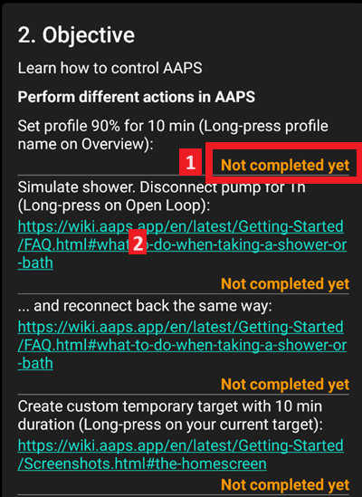
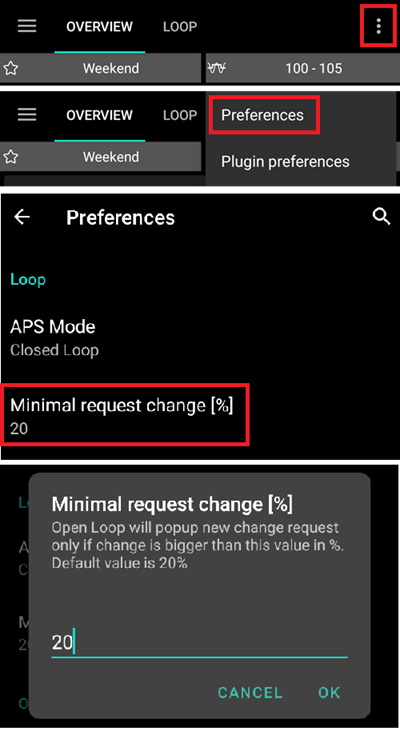
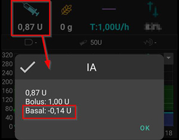
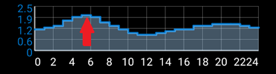
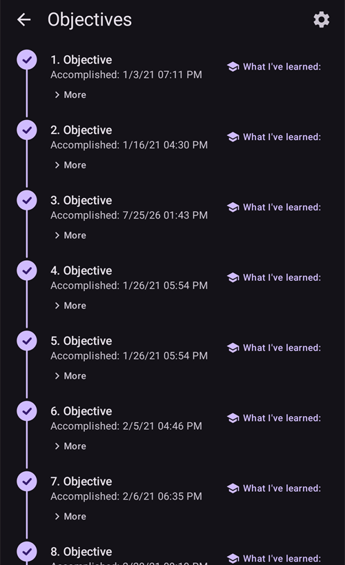
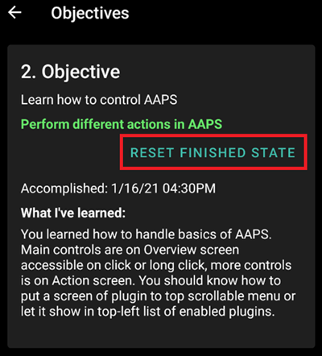

# Abschließen der Ziele (Objectives)

**AAPS** hat eine Reihe von **Zielen** (Objectives), die abgeschlossen werden müssen, um Dir so auf dem Weg vom einfachen Open Looping zu einem hybriden Closed Loop und den vollständigen **AAPS**-Funktionalitäten zu helfen. Das Abschließen der **Ziele** soll sicherstellen, dass Du:

* alles in Deinem **AAPS**-Einstellungen richtig konfiguriert hast,
* die wesentlichen **AAPS**-Funktionen kennengelernt hast und
* ein grundlegendes Verständnis dessen, was Dein System kann, hast und so Vertrauen zu **AAPS** aufbaust.

Wenn **AAPS** zum ersten Mal installiert wird, muss jedes Ziel erreicht und abgeschlossen werden, bevor das nächste in Angriff genommen werden kann. Mit dem Erreichen der **Ziele** werden nach und nach neue Funktionalitäten freigeschaltet.

**Ziel 1 bis 8** führen Dich von der **AAPS**-Konfiguration auf Deinem Smartphone hin zum „einfachen“ Hybrid-Closed-Loop. Es wird ungefähr 6 Wochen dauern diese Ziele abzuschließen. Bis zum **Ziel 5** kannst Du eine virtuelle Pumpe einsetzen (und in der Zwischenzeit einen anderen Weg für die Insulinabgabe nutzen). **Ziel 9 und 10** sind dafür gedacht, sich mit erweiterten **AAPS**-Funktionen vertraut zu machen, mit denen eine noch bessere Kontrolle Deines Diabetes möglich sein kann. Es dauert bis zu 3 Monate (oder möglicherweise noch länger), diese Ziele abzuschließen. Eine genauere Aufstellung darüber, wie viel Zeit für die einzelnen Ziele einzuplanen ist, findest Du hier: [Wie lange dauert es?](#preparing-how-long-will-it-take)

Neben dem Vorangehen durch die **Ziele**, kannst Du - bei Bedarf - auch einzelne, bereits abgeschlossene, Ziele zurücksetzen und damit erneut durchlaufen: [zurück zu einem früheren Ziel](#CompletingTheObjectives-go-back-in-objectives).

## Einstellungen sichern

```{admonition} Note
:class: note

Das Exportieren Deiner **AAPS**-Einstellungen wird insbesondere nach dem Erreichen eines jeden **Ziels** dringend empfohlen!
```

Es wird dringend nach Abschluss jedes Ziels empfohlen [deine Einstellungen zu exportieren](../Maintenance/ExportImportSettings.md), um zu vermeiden, dass irgendwelche Fortschritte in **AAPS** verloren gehen. Beim Exportieren wird ein **Datei mit den Einstellungen** (.json) erstellt, die Du an einem oder mehreren sicheren Orten als Backup speichern solltest (z.B. Google Drive, Festplatte, Email-Anhang _etc._). Damit wird sichergestellt, dass Dein **AAPS**-Fortschritt gespeichert wird. Wenn Dein Smartphone verloren geht oder Du versehentlich Deinen Fortschritt löschst, kann die json-Datei wieder in **AAPS** geladen werden, indem Du die letzte Einstellungsdatei importierst. Eine Sicherungsdatei der **Einstellungen** wird auch benötigt, wenn ein neues **AAPS**-Smartphone aus irgendeinem Grund benötigt wird (Upgrade/Verlust/Defekt des Smartphones _etc._)

In der **Einstellungsdatei** wird nicht nur Dein Fortschritt bei den **Zielen**, sondern auch alle Deine **AAPS**-Einstellungen wie **max bolus** _etc._, gespeichert.

Wenn etwas mit Deinem **AAPS**-Smartphone passiert und Du keine Sicherung Deiner Einstellungen hast, musst Du die **Ziele** von vorne beginnen. Der Fortschritt durch die **Ziele** braucht Zeit und die Situation diese erneut durchlaufen zu müssen, weil Du beispielsweise Dein Smartphone verloren hast, sollte am besten vermieden werden.

(objectives-objective1)=
## Ziel 1: Einrichten der Darstellung und Überwachung sowie Analysieren der Basalraten und Verhältnisse

**Ziel 1** fordert die Einrichtung Deiner technischen Grundausstattung in **AAPS**. Du kannst nicht weitermachen, bevor dieser Schritt abgeschlossen ist.

- Wähle das richtige CGM/FGM unter [Konfiguration → BZ-Quelle](#Config-Builder-bg-source) aus. Siehe [BZ-Quelle](../Getting-Started/CompatiblesCgms.md) für weitere Informationen.
- Wähle die richtige Pumpe unter [Konfiguration → Pumpe](#Config-Builder-pump) aus, um sicherzustellen, dass Deine Pumpe mit **AAPS** kommunizieren kann. Wähle eine **virtuelle Pumpe** aus, wenn Du ein Pumpenmodell für das Loopen nutzt, das keine **AAPS**-Unterstützung hat oder wenn Du Dich durch die ersten **Ziele** arbeiten möchtest ohne Dein aktuelles Setup nutzen zu wollen. Siehe [Insulinpumpen](../Getting-Started/CompatiblePumps.md) für weitere Informationen.
- Bei Verwendung von Nightscout:
  - Befolge die Anleitung auf der [Nightscout](../SettingUpAaps/Nightscout.md)-Seite, damit ** Nightscout** **AAPS**-Daten empfangen und anzeigen kann.
  - Beachte, dass die URL in **NSClientV3** am Ende **_kein_ „/api/v1/“** enthalten darf – siehe [Einstellungen → NSClientV3](#Preferences-nsclient).
- Bei Verwendung von Tidepool:
  - Befolge die Anleitung auf der [Tidepool](../SettingUpAaps/Tidepool.md)-Seite, damit ** Tidepool** **AAPS**-Daten empfangen und anzeigen kann.

Hinweis: *Es kann sein, dass Du auf den nächsten Sensor-Glukosewert warten musst, bevor **AAPS** ihn erkennt.*

(objectives-objective2)=
## Ziel 2: Lerne, wie AAPS bedient wird

Für **Ziel 2** müssen mehrere „Aufgaben“ erledigt werden, wie im Screenshot unten gezeigt. Jede Aufgabe zeigt ihren Status (**1**): Das orangefarbene „**Noch nicht abgeschlossen**“ wird zu „**Abgeschlossen, gut gemacht!**“, sobald **AAPS** die Aktion registriert hat. Tippe unter einer Aufgabe auf **Hinweis** (**2**), um die passende Dokumentation zu öffnen, falls Dir eine Aktion noch nicht vertraut ist.



Aufgaben, die zum Abschließen des **Ziel 2** notwendig sind, sind:
- Setze Dein **Profil** für 10 Min. auf 90%.
  - _Hinweis_: Tippe auf dem Startbildschirm auf Deinen Profilnamen, um den Bildschirm **Profil** zu öffnen, verwende dann den Knopf **Aktivieren** (▶) und lege Prozentsatz und Dauer fest. Weitere Informationen findest Du unter [Profilwechsel & Prozentuale Profilanpassung](../DailyLifeWithAaps/ProfileSwitch-ProfilePercentage.md).
  - _Hinweis_: **AAPS** akzeptiert keine Basalraten, die kleiner als 0,05 IU/h sind. Enthält Dein **Profil** Basalraten von 0,05 IE/h oder weniger, musst Du ein temporäres **Profil** mit höheren Basalraten erstellen, bevor Du diese Aufgabe abschließt. Nach Abschluss des Ziels, wechsele auf Dein reguläres **Profil** zurück.
- Simuliere „duschen gehen“, indem Du in **AAPS** [die Pumpe für eine Dauer von 1h trennst](#AapsScreens-loop-status).
  - _Hinweis_: Tippe auf dem Startbildschirm auf das Loop-Symbol, um den Loop-Dialog zu öffnen, und wähle dann unter **Pumpe trennen** eine Dauer.
- Beende das „Duschen“, indem Du Deine Pumpe wieder verbindest.
  - _Hinweis_: Tippe auf das Symbol „getrennt“, um den Loop-Dialog erneut zu öffnen, und wähle **Pumpe erneut verbinden**.
- Setze ein selbstgewähltes [**temporäres Ziel**](../DailyLifeWithAaps/TempTargets.md) mit einer Dauer von 10 Min.
  - _Hinweis_: Tippe auf dem Startbildschirm auf den Zielbereich, um den Bildschirm für temporäre Ziele zu öffnen.
- Zeige den Inhalt des **Loop**-Moduls (sog. Plugin) an.
  - _Hinweis_: Öffne **Konfiguration → Loop** und tippe auf „**Modul öffnen**“.
- Scrolle oder zoome im Glukosediagramm, um größere oder kleinere Zeiträume anzusehen.


(objectives-objective3)=
## Ziel 3: Belege Dein Wissen

In **Ziel 3** muss eine Multiple-Choice-Prüfung, die dazu gedacht ist Dein **AAPS**-Wissen zu testen, bestanden werden.

Der Abschluss dieses **Ziel 3** wird von manchem Menschen als eine der schwierigsten Aufgaben empfunden. Bitte lies die zu den gestellten Fragen gehörenden Abschnitte in der **AAPS**-Dokumentation. Wenn Du trotz intensiver Recherche mit Hilfe der **AAPS**-Dokumentation nicht weiterkommst, suche in den [Facebook](https://www.facebook.com/groups/AndroidAPSUsers)- oder [Discord](https://discord.gg/4fQUWHZ4Mw)Gruppen nach „Objective 3“. Es ist sehr wahrscheinlich, dass Deine Frage bereits einmal gestellt und durch die Gruppe beantwortet worden ist. Diese Gruppen können Dir kleine Hinweise geben oder Dir die relevanten Stellen der **AAPS**-Dokumentation nennen.

In der Zwischenzeit:
- Um die Anzahl der Benachrichtigungen / Entscheidungen (temporäre Basalraten) zu verringern, die Du im Open Loop treffen sollst, stelle in Deinem **Profil** einen breiten Zielbereich ein, _z. B._ 90 - 150 mg/dl oder 5,0 - 8,5 mmol/l.
- Ggf. kannst Du nachts auch das obere Limit höher setzen oder den Open Loop ganz pausieren.

Um mit **Ziel 3** weiterzumachen, tippe auf eine Fragezeile, um sie zu öffnen. Bitte lies jede einzelne Frage und wähle dann Deine Antwort(en) aus.

Bei jeder Frage kann es mehr als eine richtige Antwort geben! Wählst Du eine falsche Antwort, wird die Frage für eine Stunde gesperrt. Erst danach kannst Du sie erneut beantworten. Wenn Du einen neuen Anlauf unternimmst, die Fragen zu beantworten kann es möglicherweise sein, dass sich die Reihenfolge der Antworten geändert hat. Das soll dazuführen, dass Du sie sorgfältig liest und wirklich verstehst warum sie richtig (oder falsch) sind.

```{admonition} __What happens if new question(s) are added to an Objective when I update to a newer version of AAPS?__
:class: note
Von Zeit zu Zeit wird **AAPS** um neue Funktionen ergänzt. Dadurch können auch neue Fragen zu den **Zielen** nötig werden, insbesondere zu **Ziel 3**. Alle zu **Ziel 3** neu hinzugefügten und von **AAPS** geforderten Fragen werden als „noch nicht abgeschlossen“ angezeigt. Da die **Ziele** an sich unabhängig voneinander sind, **behältst Du**, sofern diese erledigt bleiben, alle **bereits vorhandenen AAPS-Funktionalitäten**.
```

## Ziel 4: Starte den Open Loop

Der Sinn von **Ziel 4** ist zu erkennen, wie oft **AAPS** die Basalrate mit den Glukosewerten abgleicht und daraus Empfehlungen für temporäre Anpassungen der Basalrate gibt. Im Rahmen dieses **Ziels** wirst Du das erste Mal den Open Loop aktivieren und 20 vorgeschlagene temporäre Basalraten-Anpassungen akzeptieren. Wenn es notwendig sein sollte, übernimmst Du die Änderungen manuell in Deine Pumpe. Du wirst die Auswirkungen von [**temporären Zielen**](../DailyLifeWithAaps/TempTargets.md) erkennen und erleben. Wenn Du noch nicht weißt, wie Du in **AAPS** eine temporäre Basalrate setzt, sieh Dir die Pumpenaktionen im Fenster **Verwalten** an ([Wo ist der Reiter Aktionen geblieben?](#screens-action-tab)).

Das Ziel kann frühestens nach **7 Tagen** abgeschlossen werden. Das ist eine Pflichtwartezeit. Auch wenn alle Basalraten-Änderungen gemacht wurden, ist es vorher nicht möglich mit dem nächsten **Ziel** zu starten.

- Wähle den Open Loop, indem Du auf dem Startbildschirm auf das [Loop-Symbol](#AapsScreens-loop-status) tippst und **Open Loop** als AAPS-Modus wählst.
- Bestätige in einem Zeitraum von 7 Tagen mindestens 20 der vorgeschlagenen temporären Basalratenanpassungen; gib diese (physisch) in der Pumpe ein und bestätige in AAPS, dass Du den Vorschlag akzeptierst hast. Vergewissere Dich, dass die Basalraten-Anpassungen sowohl in **AAPS** als auch in **Nightscout** angezeigt werden.
- Wenn nötig, nutze [**temporäre Ziele**](../DailyLifeWithAaps/TempTargets.md). Verwende nach der Behandlung einer Unterzuckerung das vordefinierte „Hypo-TT“, damit das System beim anschließenden Wiederanstieg nicht überkorrigiert.
- Wenn Du noch im [Einfachen Modus](#preferences-simple-mode) unterwegs bist, ist es jetzt wahrscheinlich ein guter Zeitpunkt, um ihn auszuschalten.

Um die Anzahl der vorgeschlagenen Basalrate-Änderungen im Open Loop zu reduzieren, helfen die Tipps des [** Ziel 3**](#objectives-objective3). Zusätzlich kannst Du mit der Einstellung „**Minimale Änderung im Open-Modus**“ unter **Einstellungen → Loop** den Mindest-Prozentsatz für empfohlene Änderungen der Basalrate festlegen. Je höher der Wert, desto weniger Benachrichtigungen über Änderungsvorschläge erhältst Du.



```{admonition} Note
:class: note

Du musst nicht jede einzelne Empfehlung des Systems umsetzen!
```
(objectives-objective5)=
## Ziel 5: Open Loop inklusive der temporären Basalratenvorschläge verstehen

Im **Ziel 5**, wirst Du kennen- und verstehen lernen, wie sich die temporären Basalraten-Empfehlungen herleiten. Dazu gehören die [Logik der Basalraten-Entscheidung](#aaps-screens-how-predictions-become-a-dosing-decision), die Beobachtung der Auswirkungen anhand der [Vorhersagelinien in der **AAPS-Übersicht**](#aaps-screens-prediction-lines) (oder in Nightscout) und der Blick auf die ausführlichen Berechnungen im Bildschirm des Moduls **OpenAPS SMB** (**Konfiguration → APS → Modul öffnen**).

Um das Ziel abzuschließen, werden ungefähr **7 Tage ** benötigt.

In diesem **Ziel** musst Du Deinen Wert für die „Maximale Basalrate“ (max-basal) ermitteln und einstellen, wie im Abschnitt [OpenAPS-Funktionen](#Open-APS-features-max-u-h-a-temp-basal-can-be-set-to) beschrieben. Dieser Wert lässt sich unter [Einstellungen → OpenAPS SMB](#Preferences-openaps-smb-settings) einstellen. Im [Einfachen Modus](#preferences-simple-mode) stellt **AAPS** diesen Wert automatisch ein, und Du musst ihn nicht ändern. Wenn Du an dieser stelle noch eine virtuelle Pumpe nutzt, stelle sicher, dass diese Sicherheitseinstellung sowohl in **AAPS**, als auch in Deiner Insulinpumpe eingestellt ist.

Eventuell setzt Du, bis Du mit den **AAPS**-Berechnungen und Einstellungen zufrieden bist, in Deinem [**Profil** ein Glukosewert-Ziel](#profile-glucose-targets), das über Deinem üblichen Ziel liegt. Du kannst damit experimentieren, Dein **Glukoseziel** in Deinem **Profil** enger einzustellen (z. B. 1 mmol/l oder weniger [20 mg/dl oder weniger] breit), und beobachten, wie sich das auswirkt.


```{admonition} If you have been using a virtual pump, change to a real insulin pump now!
:class: note

Wenn Du den Open Loop mit einer virtuellen Pumpe nutzt, ist hier die Stelle an der Du **nicht weitergehen** darfst. Tippe am Ende dieses **Ziels** erst dann auf **Bestätigen**, wenn Du eine „echte“ Pumpe verwendest, die Insulin abgibt.

```


(objectives-objective6)=
## Ziel 6: Closed Loop mit Abschaltung bei niedrigen Glukose-Werten


```{admonition} Closed loop will not correct high **BG** values in **Objective 6** as it is limited to **Low Glucose Suspend** only!
:class: note
Hohe Glukosewerte musst Du weiterhin selbst korrigieren (manuell mit Korrekturen über die Pumpe oder per Pen)!
```

Im Verlauf des **Ziel 6** wirst Du in den Closed Lopp übergehen und dessen **Low Glucose Suspend** (LGS)-Modus (dt. Abschaltung vor Niedrig) aktivieren. [Max IOB](#Open-APS-features-maximum-total-iob-openaps-cant-go-over) wird dabei auf Null gesetzt. Du kannst das **Ziel** abschließen, wenn Du 5 Tage im LGS-Modus gewesen bist. Du solltest diese Zeit nutzen, um Deine **Profil**-Einstellungen soweit zu korrigieren, dass LGS-Ereignisse nur selten auftreten.

Das Ziel kann frühestens nach **5 Tagen** abgeschlossen werden. Das ist eine Pflichtwartezeit. Das nächste **Ziel** kann erst dann gestartet werden, wenn die Wartezeit abgelaufen ist.

Es ist wichtig, dass Dein aktuelles **Profil** (Basalraten, Korrektur- und Mahlzeitenfaktoren) gut getestet ist, bevor Du den Loop im **LGS**-Modus schließt. Falsche **Profil**-Einstellungen können Dich in Hypo-Situationen bringen, die Du selbst manuell auflösen musst. Ein gutes und passendes **Profil** reduziert den Bedarf, niedrige Glukosewerte in den 5 Tagen behandeln zu müssen.

**Hast Du noch immer häufige oder schwere Unterzuckerungen, prüfe die [DIA Deines Insulins](#Config-Builder-insulin-dia), die Basalrate, den ISF und das IC noch einmal genauer.** In den [Facebook](https://www.facebook.com/groups/AndroidAPSUsers)- und [Discord](https://discord.gg/4fQUWHZ4Mw)-Gruppen wird dieses Thema ausführlich diskutiert.


Während Du im **Ziel 6**bist, überschreibt **AAPS** den eingestellten maxIOB-Wert und setzt ihn auf Null. **Dieses Überschreiben endet mit dem Start des Ziel 7.**

Das heißt, während Du Dich im **Ziel 6** befindest, wird **AAPS** bei fallenden Glukosewerten Deine Basalrate für Dich reduzieren oder bzw. aussetzen. Steigen die Sensor-Glukosewerte aber, erhöht **AAPS** die Basalrate nur dann über den Wert in Deinem **Profil**, wenn das **Basal-IOB** wegen einer vorherigen **LGS** negativ ist. In anderen Situationen wird **AAPS** das Basal nicht - auch nicht bei steigenden Glukosewerten - über den Profilwert hinaus anheben. Diese Vorsichtsmaßnahme soll insbesondere während der **AAPS**-Lernphase Hypos vermeiden.

**Hohe Werte müssen deshalb von Dir manuell mit einem Korrekturbolus korrigiert werden.**

- Wenn Dein IOB negativ ist (siehe Screenshot unten), kann auch in **Ziel 6** eine temporäre Basalrate (TBR) > 100% gesetzt werden.



- Nutze einen zusätzlichen Sicherheitspuffer, in dem Du Deinen Zielbereich etwas höher setzt, als Du es normalerweise tun würdest.
- Aktiviere den Modus „Unterbrechung bei niedrigem BZ (LGS)“, indem Du auf dem Startbildschirm auf das Loop-Symbol tippst und **Unterbrechung bei niedrigem BZ (LGS)** als AAPS-Modus wählst.
- Aktive temporäre Basalraten erkennst Du an der hellblauen Textfarbe auf dem Startbildschirm und an der hellblauen Basallinie in der Grafik.
- Wenn du eine Hypo mit Kohlenhydraten korrigierst, kann es vorkommen, dass danach Spitzen auftreten, die Du nicht durch das Erhöhen der Basalrate abfangen kannst.

(objectives-objective7)=
## Ziel 7: Justiere den Closed Loop, erhöhe maxIOB über 0 und setze den Zielbereich langsam herunter

Um **Ziel 7** abzuschließen, musst Du den Loop schließen (Closed Loop) und Deinen [maxIOB](#Open-APS-features-maximum-total-iob-openaps-cant-go-over)-Wert erhöhen. **maxIOB** wurde in **Ziel 6** wegen des Low-Glucose-Suspend-Modus automatisch ausgesetzt. Das ist jetzt nicht mehr nötig. **AAPS** wird ab jetzt Deinen hinterlegten maxIOB-Wert nutzen, um hohe Glukosewerte zu korrigieren. Im [Einfachen Modus](#preferences-simple-mode) stellt **AAPS** maxIOB automatisch ein, und Du musst es nicht ändern.

Das Ziel kann frühestens nach **einem Tag** abgeschlossen werden. Das ist eine Pflichtwartezeit. Das nächste **Ziel** kann erst dann gestartet werden, wenn die Wartezeit abgelaufen ist.

- Wähle den **Closed Loop**, indem Du auf dem Startbildschirm auf das [Loop-Symbol](#AapsScreens-loop-status) tippst und **Closed Loop** als AAPS-Modus wählst. Bleibe einen Tag im **Closed Loop**-Modus.

- Erhöhe Deinen Wert „Max. IOB für SMB“ (in OpenAPS „max-iob“ genannt) langsam über 0, bis Du die Einstellungen gefunden hast, die für Dich am besten funktionieren.

Die Standardempfehlung für diese Einstellung ist „**durchschnittlicher Mahlzeitenbolus + 3x maximale Basalrate**“, wobei „maximale Basalrate“ die höchste stündliche Basalrate Deines Tagesprofils ist.



Betrachte diese Empfehlung als Ausgangspunkt. Wenn Du diese Regel anwendest, AAPS bei steigenden Glukosewerten aber zu viel Insulin abgibt, musst Du möglicherweise:
* verringere den Wert „Max. IOB für SMB“;
* Verändere die Parameter Deines **Profils** nur einzeln (nicht mehrere Änderungen auf einmal).

Wenn Du sehr insulinresistent bist, hebe den **maxIOB** -Wert sehr vorsichtig an.

Wenn Du den zu Deinen Loop-Gewohnheiten passenden **maxIOB**-Wert gefunden hast, senke Dein **Glukosewert-Ziel** auf Dein angestrebtes (tatsächliches) Ziel ab.

(objectives-objective8)=
## Ziel 8: Bei Bedarf Basalraten und Verhältnisse anpassen und anschließend Autosens aktivieren

In diesem **Ziel**, wirst Du erneut auf die Performance Deines **Profils** schauen und die [Autosens](#Open-APS-features-autosens)-Funktionalität als einen Indikator für falsche Einstellungen einsetzen.

Das Ziel kann frühestens nach **7 Tagen** abgeschlossen werden. Das ist eine Pflichtwartezeit. Das nächste **Ziel** kann erst dann gestartet werden, wenn die Wartezeit abgelaufen ist.

Aktiviere [Autosens](../DailyLifeWithAaps/KeyAapsFeatures.md) für 7 Tage (im [Einfachen Modus](#preferences-simple-mode) ist es standardmäßig aktiviert) und beobachte die [weiße Linie im Diagramm der **Übersicht**](#AapsScreens-section-g-additional-graphs), die zeigt, wie Deine Insulinempfindlichkeit durch Sport, Hormone usw. steigt oder sinkt. Behalte den Bildschirm des Moduls **OpenAPS SMB** (**Konfiguration → APS → Modul öffnen**) im Auge; er zeigt, wie **AAPS** Empfindlichkeit, Basalraten und Zielwerte entsprechend anpasst.

Dies ist ein guter Zeitpunkt, um Deine Einstellungen zur [Sensitivitätserkennung](#Config-Builder-sensitivity-detection) zu überprüfen. Deine Insulinempfindlichkeit kannst Du auf dem Startbildschirm in einem [zusätzlichen Diagramm](#AapsScreens-section-g-additional-graphs) ansehen.

Darüber hinaus kannst Du entweder [Autotune](#autotune-how-autotune-calculates-adjustments) nutzen, um einmalig zu prüfen, ob Deine Basalrate noch passend ist oder Du machst einen herkömmlichen Basalratentest.

(objectives-objective9)=
## Ziel 9: Aktiviere zusätzliche oref1 Funktionen zum täglichen Gebrauch, wie z. B. den super micro bolus (SMB)

In **Ziel 9** wirst Du Dich mit dem **"Super Micro Bolus (SMB)"** als einer Kernfunktionalität befassen und sie auch einsetzen. Nachdem Du die Pflichtlektüre durchgearbeitet hast, weißt Du, was SMBs sind, wie sie funktionieren und warum die Basalrate nach der Abgabe von SMBs vorübergehend auf null gesetzt wird („zero-temping“).

Das Ziel kann frühestens nach **28 Tagen** abgeschlossen werden. Das ist eine Pflichtwartezeit. Du kannst erst zum nächsten Ziel wechseln, wenn diese Zeit abgelaufen ist.

- Der [SMB-Abschnitt in dieser Dokumentation](#Open-APS-features-super-micro-bolus-smb) und die [oref1-Beschreibung in der openAPS-Dokumentation](https://openaps.readthedocs.io/en/latest/docs/Customize-Iterate/oref1.html) sind Pflichtlektüren, um **SMB** und das Konzept von **Zero-Temping** (dt. temporäres Aussetzen der Basalrate) zu verstehen.
- Danach kannst Du den [maxIOB-Wert erhöhen](#Open-APS-features-maximum-total-iob-openaps-cant-go-over) und damit **SMBs** effektiver arbeiten lassen. maxIOB enthält nun das gesamte **IOB** und nicht nur das hinzugefügte (zusätzliche) Basalinsulin. Dieser Schwellwert pausiert **SMBs** solange bis das IOB unter diesen Wert fällt (_z.B._ **maxIOB** ist auf 7 IE eingestellt und es wird ein Mahlzeiten-Bolus von 8 IE abgegeben: SMBs werden dann so lange pausiert und nicht abgegeben, bis das **IOB** unter 7 IE fällt). Ein guter Ausgangspunkt ist **maxIOB** =„**durchschnittlicher Mahlzeitenbolus + 3x maximale Basalrate**“ zusetzen, wobei „maximale Basalrate“ die höchste stündliche Basalrate Deines Tagesprofils ist. Vgl. hierzu auch [Ziel 7](#objectives-objective7).
- Prüfe, wie schnell Deine Kohlenhydrate resorbiert werden, und ändere gegebenenfalls den Parameter „min_5m_carbimpact“ unter [Einstellungen → Resorptions-Einstellungen → min_5m_carbimpact](#Preferences-min_5m_carbimpact), wenn Dir die Resorption zu langsam oder zu schnell erscheint.

(objectives-objective10)=
## Ziel 10: Automatisierung

**Automatisierungen** werden mit Start des **Ziel 10** möglich.

Das Ziel kann frühestens nach **28 Tagen** abgeschlossen werden. Das ist eine Pflichtwartezeit. Du kannst erst zum nächsten Ziel wechseln, wenn diese Zeit abgelaufen ist.

Lies vorab die Dokumentation zu [Automatisierungen](../DailyLifeWithAaps/Automations.md).

Richte die einfachste Automatisierungsregel ein, zum Beispiel eine Android-Benachrichtigung in ein paar Minuten:
- Öffne **Verwalten → Automatisierung** und tippe auf den Knopf **+** (**Regel hinzufügen**).
- Gib einen **Namen der Aufgabe** ein, zum Beispiel „Meine erste Automatisierungs-Benachrichtigung“.
- Tippe unter **Bedingung** auf „**BEARBEITEN**“.
  - Tippe auf „**Trigger (Auslöser) hinzufügen**“ und wähle „**Zeit**“. **AAPS** legt einen Eintrag für heute mit der aktuellen Uhrzeit an.
  - Ändere die Uhrzeit so, dass die Regel in ein paar Minuten auslöst.
  - Tippe auf das Symbol **Speichern** (oben rechts), um zur Regel zurückzukehren.
- Tippe unter **Aktion** auf „**HINZUFÜGEN**“ und wähle „**Benachrichtigung**“.
  - Gib in der Karte der Aktion eine Nachricht ein, zum Beispiel „Meine erste Automatisierung“.
- Tippe auf das Symbol **Speichern** (oben rechts) und achte darauf, dass die Regel **Aktiviert** ist.
- Warte, bis die Benachrichtigung zur eingestellten Zeit ausgelöst wird (je nach Smartphone kann sie einige Minuten später kommen)

Du kannst ein wenig damit herumexperimentieren sinnvollere **Automationen** zu erstellen. Die Dokumentationsseite gibt ein paar Beispiele, und Du kannst Screenshots von Automatisierungen durch eine Suche mit dem Stichwort „automation“ in der [Facebook](https://www.facebook.com/groups/AndroidAPSUsers)-Gruppe finden. Es gibt zu diesem Thema auch einen eigenen Kanal in der [Discord](https://discord.gg/4fQUWHZ4Mw)-Community.

Wenn Du beispielsweise jeden Morgen vor der Arbeit/Schule das Gleiche isst, kannst Du eine **Automation** (z.B. mit dem Namen „Ziel vor dem Frühstück“) erstellen, die ein etwas niedrigeres **Temporäres Ziel** 30 Minuten vor dem Frühstück setzt. In einem solchen Fall besteht Deine Bedingung wahrscheinlich aus der Auswahl bestimmter Wochentage (Montag, Dienstag, Mittwoch, Donnerstag, Freitag) und einer bestimmten Uhrzeit (06:30 Uhr). Die Aktion besteht aus „Temporäres Ziel (TT) starten“ mit einem niedrigeren Zielwert als üblich und einer Dauer von 30 Minuten.

## Wenn alle Ziele abgeschlossen sind

Hast Du alle **Ziele** erreicht, zeigt die Liste jedes davon mit einem Haken und dem Datum, an dem es erreicht wurde. Der Eintrag **Objectives (Ziele)** verschwindet aus der unteren Navigationsleiste; Du kannst die Liste aber weiterhin über **Konfiguration → Beschränkungen → Objectives (Ziele) → Plugin öffnen** öffnen.



Tippe unter einem Ziel auf „**Mehr**“, um seine Aufgaben wieder zu sehen:


(CompletingTheObjectives-go-back-in-objectives)=
## Go back in objectives

Möchtest Du aus irgendeinem Grund in den **Zielen** zurückgehen, öffne das abgeschlossene **Ziel** mit „**Mehr**“ und tippe auf „**Ziel erneut öffnen**“:



Auf die gleiche Weise kannst Du das **Ziel**, an dem Du gerade arbeitest, mit „**Ziel neu starten**“ neu beginnen.
