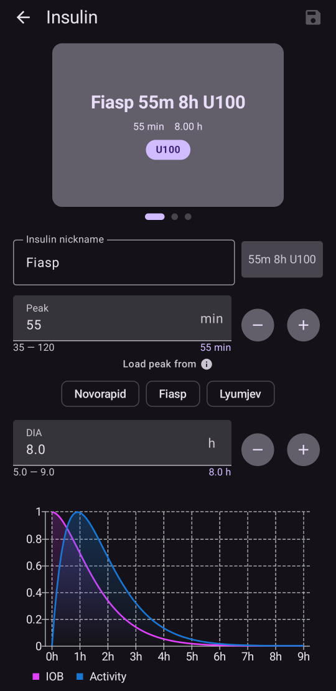
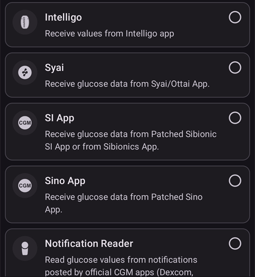
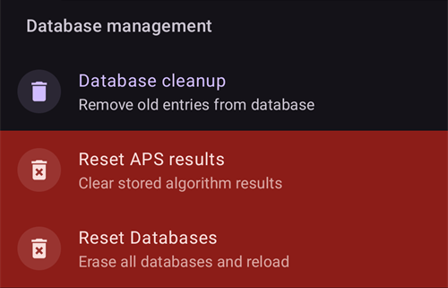

# Konfiguration (Config Builder)

```{admonition} Coming from AAPS v3?
:class: note
Der **Config Builder** heißt jetzt **Konfiguration** und befindet sich im **Menü** (☰). Siehe [Änderungen mit AAPS Version 4](#v4-changes).
```

In der **Konfiguration** wählst Du aus, welche Module aktiv sind (CGM, Pumpe, APS-Algorithmus, Erkennung der Insulinempfindlichkeit, Synchronisierung …), und öffnest jedes Modul und seine Einstellungen. Die [Schritt-für-Schritt-Beschreibung](#configuration-v4) folgt unten; der Rest dieser Seite beschreibt jeden Abschnitt im Detail.

(configuration-v4)=
## Konfiguration in AAPS v4

Tippe in **AAPS** v4 **oben links** auf dem Startbildschirm auf das **Menü** (☰) und wähle **Konfiguration** (_„Richte CGM, Pumpe und weitere Komponenten ein und aktiviere Funktionen“_).


Die Module sind nach **Kategorien** gruppiert, zum Beispiel _Glättung_, _Kalibrierung_, _Erkennung der Insulinempfindlichkeit_, _APS_, _Kommunikation_ und _Allgemeines_. Jede Zeile zeigt den Namen der Kategorie und das **gerade aktive** Modul (z. B. _APS → OpenAPS SMB_). Tippe auf eine Zeile, um eine Kategorie zu öffnen.


In einer Kategorie siehst Du die Module, die dafür verfügbar sind. In Kategorien mit nur einer Auswahl wählst Du das aktive Modul aus; in manchen Kategorien sind mehrere möglich (_„Wähle die gewünschten Plugins aus.“_). Jedes Modul bietet zwei Aktionen:

- **Plugin öffnen** – öffnet den eigenen Bildschirm des Moduls.
- **Einstellungen** – öffnet die Einstellungen des Moduls (sie können in aufklappbaren Abschnitten gruppiert sein).


(configuration_sync_icon)=
### Das Smartphone-Symbol – „vom Master synchronisiert“

Ein kleines **Smartphone-Symbol** neben einer Kategorie oder Einstellung bedeutet, dass dieser Eintrag **vom Master synchronisiert** wird – sein Wert bzw. seine Auswahl wird über den Kanal NSClientV3 (Nightscout) an dieses Gerät übertragen.

Auf einem **Client** (**AAPSClient**) werden diese Einträge **mit dem Master synchron gehalten**. Das Symbol wird nur auf einem Client angezeigt und ist deshalb im Screenshot oben, der in der Haupt-App **AAPS** aufgenommen wurde, nicht zu sehen. Auf einem Client erscheint es meist bei _Glättung_, _Kalibrierung_, _Erkennung der Insulinempfindlichkeit_ und _APS_. Wie genau Master und Clients aufeinander abgestimmt bleiben – und welche Einstellungen Du von welcher Seite aus ändern kannst –, steht unter [Master ↔ Client-Steuerung](#client-master-config-prefs).

Dasselbe Symbol erscheint auch **in den Einstellungen**, neben den einzelnen Einstellungen, die synchronisiert werden. Im Beispiel unten trägt _Maximale Dauer der Essens-Resorption_ das Symbol; Einstellungen ohne das Symbol werden pro Gerät festgelegt:


Einträge **ohne** das Symbol werden **pro Gerät** festgelegt. Das wichtigste Beispiel ist die Verbindung **NSClientV3 (Kommunikation)** selbst – **Nightscout-URL**, **Zugriffstoken** und **Websockets** werden auf jedem Smartphone einzeln eingestellt und zeigen deshalb **kein** Smartphone-Symbol.

---

(Config-Builder-tab-or-hamburger-menu)=
## Einen Modul-Bildschirm öffnen

Jeder Modul-Bildschirm lässt sich auf einem dieser Wege öffnen (die Reiter und das Augen-Kästchen aus **AAPS** v3 gibt es nicht mehr, siehe [Änderungen mit AAPS Version 4](#v4-changes)):

- **Konfiguration** → die Kategorie des Moduls → **Plugin öffnen**,
- das Fenster **Verwalten** in der unteren Navigationsleiste, für die Bildschirme, die Du am häufigsten nutzt (Profil, Insulineinstellungen, Pumpe, Automatisierung, Lebensmittel …),
- ein [Schnellstart](../DailyLifeWithAaps/QuickLaunch.md)-Knopf, den Du selbst hinzufügst,
- das **Suchfeld** auf dem Startbildschirm.

```{contents}
:backlinks: entry
:depth: 2
```

(ConfigBuilder_Profile)=

## Profil

Dieses Modul kann nicht deaktiviert werden, da es ein zentraler Bestandteil von **AAPS** ist.

Unter [Dein AAPS-Profil](../SettingUpAaps/YourAapsProfile.md) erfährst Du grundsätzlich, was zu Deinem **Profil** gehört.

(insulin)=
(Config-Builder-insulin)=
## Insulin


In **AAPS** 4 ist das Insulin kein Modul mehr, das in der **Konfiguration** ausgewählt wird. Öffne **Verwalten → Insulineinstellungen**, um das Insulin einzurichten, das Du verwendest.

Im Insulin-Editor kannst Du:

- dem Insulin eine **Insulin-Kurzbezeichnung** geben, damit Du es leicht wiedererkennst,
- das **Wirkmaximum** (Zeit bis zur höchsten Insulinaktivität, in Minuten) und die **DIA** (Insulinwirkdauer, in Stunden) einstellen, entweder durch Eingabe des Werts oder mit den Knöpfen **–** / **+**,
- auf eine Vorlage unter **Wirkmaximum laden aus** tippen – **Novorapid** (75 min), **Fiasp** (55 min) oder **Lyumjev** (45 min) –, um die übliche Zeit bis zum Wirkmaximum für dieses Insulin in einem Schritt einzutragen.

Die erlaubten Bereiche sind für jedes Insulin gleich:

- **DIA**: 5 bis 9 Stunden (5 bis 10 Stunden, wenn als Patiententyp **Schwangerschaft** eingestellt ist). Siehe [Insulinwirkdauer (DIA) und Wirkmaximum](#Config-Builder-insulin-dia), um einen Wert zu wählen.
- **Wirkmaximum**: 35 bis 120 Minuten.

Die Kurven für **IOB** (aktives Insulin) und **Aktivität** unten im Editor ändern sich, während Du die Werte änderst, so siehst Du sofort, wie Deine Einstellungen die Insulinwirkung formen.

Weitergehende Informationen zum Verständnis des Insulin-Profils, wie es in **AAPS** dargestellt ist, findest Du [hier](#AapsScreens-insulin-profile).

(Config-Builder-insulin-change-active)=
### Das verwendete Insulin ändern (DIA oder Wirkmaximum)

Das mit **AKTIV** markierte Insulin ist das, welches Dein laufendes Profil verwendet. Seine Felder sind ausgegraut: Du kannst es weder bearbeiten noch löschen. So passt der Insulinname in Deinem laufenden Profil immer zu den Einstellungen, die tatsächlich verwendet werden.

So änderst Du die DIA oder das Wirkmaximum, die Du verwendest:

1. Öffne **Verwalten → Insulin-Einstellungen**. Öffnet sich der Bildschirm schreibgeschützt (ein **✏️ Stift** in der oberen Leiste), tippe auf den Stift und entsperre Deine Einstellungen.
2. Tippe auf **+** (_Neues Insulin hinzufügen_). **AAPS** legt eine Kopie des angezeigten Insulins an.
3. Stelle das neue **Wirkmaximum** und/oder die neue **DIA** ein und tippe dann auf das Speichern-Symbol (oben rechts).
4. Tippe auf **▶** (_Insulin aktivieren_) und bestätige. Das neue Insulin wird **AKTIV**.

```{admonition} The name includes peak and DIA
:class: note
**AAPS** ergänzt den Insulinnamen automatisch um Wirkmaximum, DIA und Konzentration (zum Beispiel _Fiasp 55m 8h U100_), damit Du Deine Konfigurationen auf einen Blick unterscheiden kannst.
```

Das alte Insulin kannst Du löschen, sobald es nicht mehr aktiv ist.

### Die Vorlagen unter „Wirkmaximum laden aus“

In **AAPS** 4 gibt es keine Liste von Insulinarten mehr, aus der Du wählst. Jedes Insulin verwendet dieselbe exponentielle Wirkkurve; nur **Wirkmaximum** und **DIA** unterscheiden sich. Die Vorlagen unter **Wirkmaximum laden aus** im Insulin-Editor tragen mit einem Tippen das empfohlene Wirkmaximum für die gängigsten Insuline ein (das kleine ⓘ neben **Wirkmaximum laden aus** listet sie mit ihren Werten auf). **Wirkmaximum** und **DIA** kannst Du danach weiterhin anpassen.

Ändere das Wirkmaximum nur dann gegenüber dem empfohlenen Wert, wenn Du die Auswirkungen verstehst. Die [Grafik der Insulinkurve](#AapsScreens-insulin-profile) hilft Dir, die Kurven zu verstehen.

#### Novorapid


- empfohlen für Humalog, Novolog und Novorapid (in **AAPS** v3 _Rapid-Acting Oref_ genannt)
- Wirkmaximum = 75 Minuten nach der Injektion

#### Fiasp



- empfohlen für Fiasp (in **AAPS** v3 _Ultra-Rapid Oref_ genannt)
- Wirkmaximum = 55 Minuten nach der Injektion

(Config-Builder-lyumjev)=
#### Lyumjev


- empfohlen für Lyumjev
- Wirkmaximum = 45 Minuten nach der Injektion

#### Eigenes Wirkmaximum

- In **AAPS** 4 gibt es keine eigene Insulinart „Free-Peak Oref“ mehr: Gib ein beliebiges **Wirkmaximum** (35 bis 120 Minuten) direkt im [Insulin-Editor](#Config-Builder-insulin) ein, ohne eine Vorlage zu verwenden.
- Ein eigenes Wirkmaximum ist sinnvoll, wenn Du ein Insulin verwendest, das nicht in der Liste steht, oder eine Mischung verschiedener Insuline.

(Config-Builder-insulin-dia)=
### Insulinwirkdauer (DIA) und Wirkmaximum

```{warning}
Beim Loopen erhöht eine kürzere DIA oder ein früheres Wirkmaximum immer die abgegebene Insulinmenge. Die DIA funktioniert in AAPS anders als in kommerziellen AID-Systemen, und unbedachte Änderungen an diesen Einstellungen können die Insulindosierung viel stärker oder schwächer verändern als erwartet.
```

AAPS bildet den zeitlichen Verlauf der Insulinwirkung mit einer mathematischen Formel ab, die über die Einstellungen **DIA** und das eng damit verbundene **Wirkmaximum** festgelegt wird. Die DIA ist die theoretische Dauer, bis das IOB null erreicht, und das Wirkmaximum ist der Zeitpunkt, an dem die Wirkung des Insulins am stärksten ist. Daraus ergeben sich eine IOB-Kurve und eine Aktivitätskurve, die einfach die **Geschwindigkeit** angibt, mit der das IOB abnimmt.

Bedenke, dass es beim Loopen normal ist, Phasen mit [Null-Temps](#Open-APS-features-super-micro-bolus-smb) (temporäre Basalrate von 0) zu haben. Dieses fehlende Basalinsulin wird vollständig vom IOB abgezogen. Deshalb erreicht das IOB in der Praxis viele Stunden früher null als die eingestellte DIA. Bolus-IOB und Basal-IOB kannst Du auf dem Startbildschirm [getrennt ansehen](#aaps-screens-iob-cob-basal-sens).

Um DIA und Wirkmaximum einzustellen, tippe auf dem Startbildschirm auf **Verwalten** und dann auf **Insulineinstellungen**. AAPS zeigt die aktive Insulinkonfiguration so an:


In diesem Beispiel ist das Wirkmaximum auf 55 Minuten eingestellt, die DIA auf 8 Stunden, und die [Insulinkonzentration](#Insulin-Concentration) ist der Standard von 100 IE/ml.

Wegen des oben erklärten Einflusses der Null-Temps und der Formel, mit der AAPS das IOB abbaut, stellen die meisten Anwender eine deutlich höhere DIA ein als in kommerziellen Systemen. Allgemein kommen viele mit einer **DIA** von 9 h gut zurecht. Wenn Du mehr Erfahrung mit AAPS und ein gut eingestelltes Profil hast, kannst Du mit den folgenden Informationen versuchen, Deine persönlichen Werte für DIA und Wirkmaximum zu finden.

````{admonition} Details on the impact of DIA and peak configuration
:class: dropdown

Da die Basalrate in AAPS indirekt beeinflusst, wie schnell das IOB abnimmt, können zu hohe Basalraten eine zu hohe DIA verdecken und umgekehrt. Es ist sinnvoll, zuerst die Basalraten sorgfältig einzustellen, bevor Du DIA und Wirkmaximum anpasst. Bedenke außerdem, dass DIA und Wirkmaximum zusammenwirken: Die Wirkung der DIA hängt vom Wirkmaximum ab und umgekehrt.

Diese Diagramme zeigen genau, wie sich DIA und Wirkmaximum über den Bereich der erlaubten Werte auf die IOB-Kurven auswirken.

DIA anpassen:

```{image} ../images/iob_remaining_static_peak.png
:width: 400px
```

Wirkmaximum anpassen:

```{image} ../images/iob_remaining_static_dia.png
:width: 400px
```

Zum Schluss ein Vergleich, bei dem DIA und Wirkmaximum gleichzeitig angepasst werden. Dabei werden beide Werte im gleichen Verhältnis geändert, sodass `49/35 ~ 7/5`. Oder ebenso `120/93 ~ 9/7`. Die Abstände bleiben unabhängig von der Ausgangs-DIA oder dem Ausgangs-Wirkmaximum gleich, solange die relative Änderung für beide gleich ist.

```{image} ../images/iob_remaining_uniform.png
:width: 400px
```

Werden DIA und Wirkmaximum auf diese Weise angepasst, verschiebt sich jeder Punkt der Kurve um denselben relativen Betrag.

````

#### Weitere Informationen zu DIA und Wirkmaximum

- [Technische Details und historischer Hintergrund von OpenAPS, dem Vorgänger von AAPS](https://openaps.readthedocs.io/en/latest/docs/While%20You%20Wait%20For%20Gear/understanding-insulin-on-board-calculations.html#understanding-the-new-iob-curves-based-on-exponential-activity-curves) (englisch).
- [Why we are regularly wrong in the duration of insulin action (DIA) times we use, and why it matters…](https://www.diabettech.com/insulin/why-we-are-regularly-wrong-in-the-duration-of-insulin-action-dia-times-we-use-and-why-it-matters/) auf Diabettech (englisch).
- [Exponential Insulin Curves + Fiasp](https://web.archive.org/web/20220630154425/http://seemycgm.com/2017/10/21/exponential-insulin-curves-fiasp/) auf See My CGM (Archiv, englisch).
- [Revised Humalog model in a closed loop](https://bionicwookiee.com/2022/04/13/revised-humalog-model-in-a-closed-loop/) und weitere Artikel auf Bionic Wookie, die eine DIA von 9 h für Lyumjev, Fiasp, NovoRapid und Humalog empfehlen (englisch).

(Config-Builder-bg-source)=
## BZ-Quelle
Wähle hier die von Dir genutzte Glukosewert-Quelle aus. Weitere Informationen zur Einrichtung findest Du auf der Seite [BZ-Quelle](../Getting-Started/CompatiblesCgms.md).


Scrolle nach unten, um die weiteren Quellen zu sehen:




- [xDrip+ BZ](../CompatibleCgms/xDrip.md) – auch für kompatible Apps wie [Juggluco](../CompatibleCgms/Juggluco.md)
- [Nightscout-Client BZ](../CompatibleCgms/CgmNightscoutUpload.md) – nur, wenn Du weißt, was Du tust, siehe [BZ-Quelle](../Getting-Started/CompatiblesCgms.md).
- [MM640g](../CompatibleCgms/MM640g.md)
- Glimp - es werden nur Versionen 4.15.57 und neuer unterstützt
- [BYODA (Build Your Own Dexcom App)](#DexcomG6-if-using-g6-with-build-your-own-dexcom-app).
- MicroTech CGM App – für das CGM Aidex / LinX
- [Poctech](../CompatibleCgms/PocTech.md)
- Tomato (MiaoMiao) – Tomato-App für das MiaoMiao-Gerät
- [Glunovo](https://infinovo.com/) – Glunovo-App für das CGM-System Glunovo
- Intelligo – Intelligo-App
- Syai/Ottai – für die Apps Syai und Ottai (siehe [Syai Tag](../CompatibleCgms/SyaiTagX1.md) und [Ottai](../CompatibleCgms/OttaiM8.md))
- SI App – gepatchte SI App oder Sibionics-App für das CGM Sibionics
- Sino App – gepatchte App für das CGM Sinocare
- Notification Reader – liest Glukosewerte aus den Benachrichtigungen der offiziellen CGM-Apps (Dexcom, Medtronic, Eversense usw.)
- Instara – Instara-App
- Zufalls-BZ – erzeugt zufällige Glukosedaten zum Testen. Das Modul kann nur in einem Engineering-Build (Entwickler-Build) mit der **Virtuellen Pumpe** aktiviert werden und ist deshalb in einer normalen **AAPS**-Installation nicht nutzbar.

## Glättung


Siehe [Glättung der Glukosewerte](../CompatibleCgms/SmoothingBloodGlucoseData.md).

## Kalibrierung

Wähle aus, wie **AAPS** die Werte behandelt, die es von Deinem Sensor erhält:

- **Keine Kalibrierung**: Die Sensorwerte werden unverändert verwendet. Wähle das, wenn der Sensor bereits werkseitig kalibriert und genau ist. Das ist die Standardeinstellung.
- **Lineare Kalibrierung**: **AAPS** korrigiert die Sensorwerte mit einer Steigung und einem Versatz, die es aus Deinen blutigen Messungen am Finger berechnet.

So verwendest Du die **Lineare Kalibrierung**:

1. Wähle in der Kategorie **Kalibrierung** die **Lineare Kalibrierung** aus.
2. Wenn Du einen neuen Sensor setzt, dokumentiere den Sensorwechsel: Verwende **Sensorwechsel protokollieren** im Kalibrierungsbildschirm oder erfasse im Careportal ein „Sensor gesetzt“. Damit weiß **AAPS**, wann die Sensorsitzung begonnen hat. Bemerkt **AAPS** eine Lücke von mehr als 30 Minuten in den Messwerten, fragt es Dich eventuell, ob Du einen Sensorwechsel markieren möchtest; diese Abfrage erscheint nur auf dem Master, nicht auf einem Client.
3. Öffne das Modul und tippe auf **Kalibrieren**. Gib Deinen blutig gemessenen Wert ein. **AAPS** bildet daraus ein Paar mit dem Sensorwert der letzten 10 Minuten.

Eine Kalibrierung wird nur angenommen, wenn:

- ein Sensorwechsel dokumentiert ist und seitdem mindestens **2 Stunden** vergangen sind (Aufwärmphase),
- Dein Glukosewert stabil ist. Ändert er sich zu schnell, sagt Dir der Dialog das und zeigt den Grenzwert an,
- es einen CGM-Wert aus den letzten 10 Minuten gibt,
- sie für den aktuellen Zeitpunkt gilt. Ältere blutig gemessene Werte kannst Du nicht eingeben.

So funktioniert die Korrektur:

- **AAPS** legt eine Gerade durch die Paare des aktuellen Sensors: `corrected value = slope × sensor value + offset`.
- Neuere Paare zählen mehr als ältere: Ein 2 Tage altes Paar zählt etwa 37 %, ein 4 Tage altes Paar etwa 14 %. Die Gerade folgt Deinem Sensor also, wenn er driftet.
- Es werden mindestens **2 Paare** benötigt.
- Liegen die Paare nah beieinander (weniger als 54 mg/dl / 3 mmol/l auseinander), werden die Werte nur verschoben (Versatz, keine Steigung).
- Die Steigung wird zwischen 0,55 und 1,6 gehalten. Eine Steigung außerhalb dieses Bereichs wird auf den nächstgelegenen Wert begrenzt.
- Sicherheitsgrenze: Wäre die Korrektur bei 100 mg/dl (5,5 mmol/l) größer als ±30 mg/dl (1,7 mmol/l), wird keine Korrektur angewendet. Das schützt Dich vor einer falschen Eingabe.

Was sich dadurch ändert:

- Der korrigierte Wert wird überall verwendet: als Glukosewert auf dem Startbildschirm, im Diagramm und im Loop. Die Sensorwerte selbst werden nicht verändert. Die Korrektur wird zusätzlich angewendet, auch auf die früheren Werte des aktuellen Sensors.
- Mit einem neuen Sensorwechsel beginnt alles von vorn. Paare von früheren Sensoren zählen dann nicht mehr.
- Im Diagramm wird eine Kalibrierung als Markierung beim blutig gemessenen Wert angezeigt.
- Kalibrierungen werden über Nightscout synchronisiert, sodass Deine Clients dieselben korrigierten Werte anzeigen.

Einträge prüfen und entfernen:

- **Plugin öffnen** zeigt den Status (zum Beispiel _Steigung 0,85, Korrektur im mittleren Messbereich -0,4_), ein Diagramm Deiner Paare mit der Geraden und die Liste der Einträge.
- Ist ein Eintrag falsch (zum Beispiel weil Zucker an Deinem Finger war), tippe auf das Mülleimer-Symbol daneben. Die Gerade wird sofort neu berechnet.

```{admonition} Using xDrip+ as BG source?
:class: note
xDrip+ hat eine eigene Kalibrierung. Kalibriere nur an einer Stelle, damit die Sensorwerte nicht doppelt korrigiert werden.
```

```{admonition} Calibrate with care
:class: warning
Ein falscher blutig gemessener Wert führt zu falschen Glukosewerten und damit zu einer falschen Insulindosierung. Wasch Dir vor dem Messen die Hände und kalibriere nicht, während sich Dein Glukosewert schnell ändert.
```


(Config-Builder-pump)=
## Pumpe
Wähle die von dir genutzte Pumpe. Weiterführende Informationen zur Einrichtung findest Du auf der Seite [Kompatible Pumpen](../Getting-Started/CompatiblePumps.md).


Scrolle nach unten, um alle Pumpentreiber zu sehen:


Wenn Du eine andere Pumpe auswählst, bittet Dich **AAPS**, den Wechsel zu bestätigen:


- [Dana R](../CompatiblePumps/DanaR-Insulin-Pump.md)
- DanaR Korean (koreanische Version der DanaR)
- Dana Rv2 (DanaR mit inoffiziellem Firmware Upgrade)
- [Dana-i/RS](../CompatiblePumps/DanaRS-Insulin-Pump.md)
- [Accu Chek Insight](../CompatiblePumps/Accu-Chek-Insight-Pump.md)
- [Accu Chek Combo](../CompatiblePumps/Accu-Chek-Combo-Pump-v2.md)
- Omnipod für [Omnipod Eros](../CompatiblePumps/OmnipodEros.md)
- Dash für [Omnipod DASH](../CompatiblePumps/OmnipodDASH.md)
- [Medtronic](../CompatiblePumps/MedtronicPump.md)
- [Diaconn G8](../CompatiblePumps/DiaconnG8.md)
- [EOPatch2](../CompatiblePumps/EOPatch2.md)
- [Medtrum](../CompatiblePumps/MedtrumNano.md)
- [Equil 5.3](../CompatiblePumps/Equil5.3.md)
- [Carelevo](../CompatiblePumps/CareLevo.md)
- Virtuelle Pumpe: Open Loop – **AAPS** macht ausschließlich Vorschläge
  - während Deiner ersten Schritte mit **AAPS** in den ersten [Zielen](../SettingUpAaps/CompletingTheObjectives.md)
  - für Pumpen, die noch nicht kompatibel sind

(config-builder-wrong-pump-data)=
### Meldung: „Daten kommen von einer anderen Pumpe“

**AAPS** merkt sich die Pumpe, mit der es verbunden ist (Pumpentyp und Seriennummer). Erhält es Daten von einer anderen Pumpe, zum Beispiel nachdem Deine Pumpe durch eine neue desselben Modells ersetzt wurde, zeigt es diese Meldung an und ignoriert die Daten dieser Pumpe:


Um die neue Pumpe zu verwenden, wechsle den Pumpentreiber: Wähle **Virtuelle Pumpe**, bestätige und wähle dann wieder Deine Pumpe aus. **AAPS** registriert dann die Pumpe, mit der es jetzt verbunden ist.

(Config-Builder-sensitivity-detection)=

## Sensitivitätserkennung


Hier kannst du auswählen, nach welchem Algorythmus AAPS die Insulinempfindlichkeit berechnen soll. Mehr zu den einzelnen Designs kannst Du [hier nachlesen](../DailyLifeWithAaps/SensitivityDetectionAndCob.md). Bei der Empfindlichkeitserkennung werden historische Daten "on the go" analysiert und Anpassungen vorgenommen, falls der Algorithmus feststellt, dass du sensibler oder weniger empfindlich auf das Insulin reagierst als üblich. Mehr dazu, wie der Faktor für die Insulinempfindlichkeit selbst berechnet wird, findest Du unter [AAPS-Funktionen > Autosens](#Open-APS-features-autosens).

Deine Insulinempfindlichkeit kannst Du auf dem Startbildschirm in einem [zusätzlichen Diagramm](#AapsScreens-section-g-additional-graphs) ansehen, indem Du SENS% auswählst und die weiße Linie beobachtest. Hinweis: Du musst im [Ziel 8](#objectives-objective8) sein, um durch die Empfindlichkeitserkennung/[Autosens](#Open-APS-features-autosens) die abzugebende Insulinmenge automatisch anpassen zu lassen. So lange Du diese Ziel (objective) noch nicht erreicht hast, wird der Autosens-Prozentsatz bzw. die Autosens-Kurve nur zu Deiner Information angezeigt. AAPS nimmt keine Änderungen vor.

### Resorptions-Einstellungen
Wenn Du Oref1 mit **SMB** nutzt, musst Du **min_5m_carbimpact** auf 8 ändern. Dieser Wert wird nur dann verwendet, wenn keine **CGM**-Werte empfangen werden oder körperliche Aktivitäten den Glukosewert-Anstieg „kompensieren“, den **AAPS** normalerweise zur Berechnung des Kohlenhydratabbaus verwendet. So lange der [Kohlenhydratabbau](../DailyLifeWithAaps/CobCalculation.md) nicht dynamisch aus den Veränderungen des Glukosewerts ermittelt werden kann, wird ein Standardwert für den Abbau angesetzt. Im Prinzip ist es eine Notlauffunktion.

(Config-Builder-aps)=
## APS


Wähle den gewünschten APS-Algorithmus für Therapie-Anpassungen. Mit **Plugin öffnen** kannst Du die aktuellen Details des gewählten Algorithmus ansehen.
- OpenAPS AMA
  - Advanced-Meal-Assistent: älterer, nicht mehr empfohlener, Algorithmus.
  - Kurz gesagt: Der Vorteil ist, dass das System schneller mit einer Erhöhung der Basalrate reagieren kann, nachdem Du einen Mahlzeitenbolus abgegeben hast.
- [OpenAPS SMB](#Open-APS-features-super-micro-bolus-smb)
  - Super Micro Bolus: der neueste Algorithmus, der für alle empfohlen wird.
  - Im Gegensatz zu AMA arbeitet SMB nicht so stark mit temporären Basalraten, sondern hauptsächlich mit **kleinen Super-Mikro-Boli**.
  - Hinweis: Es wird empfohlen, diesen Algorithmus von Anfang an zu verwenden, auch wenn er bis zum [Ziel 9](#objectives-objective9) keine SMB abgeben kann.
- [Auto ISF](#Open-APS-features-auto-isf)
  - Experimenteller Algorithmus für fortgeschrittene Anwender. Er wird erst angezeigt, wenn die Ziele abgeschlossen sind.

Wenn Du vom AMA- zum SMB-Algorithmus wechselst, musst Du _min_5m_carbimpact_ in den [Einstellungen → Resorptions-Einstellungen](#Preferences-min_5m_carbimpact) von Hand auf **8** ändern (Standardwert für SMB).

## Loop

Dieses Modul kann nicht deaktiviert werden, da es ein zentraler Bestandteil von **AAPS** ist.


## Beschränkungen


### Objectives (Ziele)

**AAPS** hat ein Lernprogramm (mit einer Reihe von Zwischenzielen, die Du nacheinander abschließen musst). Dies soll dich sicher durch die Einrichtung eines Closed Loop Systems führen.

Weitere Informationen findest Du auf der Seite [Ziele](../SettingUpAaps/CompletingTheObjectives.md).

## Kommunikation

In dieser Kategorie (in **AAPS** v3 **Synchronisierung** genannt) legst Du fest, ob und wohin **AAPS** Deine Daten senden soll.


Scrolle nach unten, um den Rest der Liste zu sehen:


### NSClientV3

Kann als [Server für Berichte](../SettingUpAaps/SettingUpTheReportingServer.md) und/oder zur [Fernüberwachung](../RemoteFeatures/RemoteMonitoring.md) und [Remote-Steuerung](../RemoteFeatures/RemoteControl.md) verwendet werden.

Wie Du die Synchronisierung mit NSClientV3 einrichtest, steht unter [Synchronisierung mit dem Reporting-Server](#SetupWizard-synchronization-with-the-reporting-server-and-more).

### Tidepool

Kann als [Server für Berichte](../SettingUpAaps/SettingUpTheReportingServer.md) verwendet werden.

Siehe [Tidepool](../SettingUpAaps/Tidepool.md).

### xDrip+

Wird verwendet, um Daten wie Glukosewerte und Behandlungen an xDrip+ auf demselben Smartphone zu **senden**. In seinen Einstellungen findest Du auch **Status an xDrip+ senden**, eine Statuszeile mit IOB und COB, die xDrip+ und einige Begleit-Apps für Smartwatches anzeigen.

### Open Humans

Siehe [Open Humans](../SupportingAaps/OpenHumans.md).

(Config-Builder-wear)=
### Wear
**AAPS** von einer Wear OS-Smartwatch aus überwachen und steuern. Wie Du die Smartwatch einrichtest, steht unter [Wear OS-Smartwatch](../WearOS/WearOsSmartwatch.md). Nachdem Du das Modul aktiviert hast, wähle seine Optionen unter [Einstellungen > Wear](#preferences-wear). Wie Du die Smartwatch benutzt, steht unter [AAPS über Deine Wear OS-Smartwatch bedienen](../RemoteFeatures/RemoteControlWearOS.md).

(external-companion-apps)=
### Externe Begleit-Apps

Sendet Statusdaten von **AAPS** auf dem Smartphone, damit andere dort installierte Apps sie anzeigen können – zum Beispiel Begleit-Apps für Smartwatches oder Widgets. Gesendet werden Glukosewert und Trend, IOB, COB, Basalrate und temporäre Basalrate, Profilname, Loop-Status, Akku von Smartphone und Pumpe, Reservoirstand und Bolusfortschritt. Aktiviere es nur, wenn eine Begleit-App, die Du verwendest, diese Daten benötigt.

Bekannte Apps, die diese Daten lesen, sind [WatchDrip+](https://bigdigital.home.blog/) (Smartwatches von Xiaomi und Amazfit), [GlucoDataHandler](https://github.com/pachi81/GlucoDataHandler) (Wear OS-Komplikationen und Widgets sowie Android Auto über GlucoDataAuto) und die App G-Watch. Ihre Einrichtung ist unter [Smartwatches und AAPS](#watches-external-companion-apps) beschrieben. Einige davon verwenden zusätzlich **Status an xDrip+ senden** aus dem Modul **xDrip** oben für eine Statuszeile mit IOB und COB.

In früheren Versionen hieß dieses Modul **Samsung Tizen**, nach der [App G-Watch für Samsung-Tizen-Smartwatches](#Watchfaces-tizen), für die es ursprünglich entwickelt wurde.

### Garmin

Verbindung zu einem Garmin-Gerät (Fenix, Edge, …)
## Behandlungen
Öffne das **Menü** (☰) und wähle [Behandlungsverlauf](#aaps-screens-treatments), um die erfassten Behandlungen zu sehen. Möchtest Du einen Eintrag bearbeiten oder löschen (z. B. weil Du weniger Kohlenhydrate gegessen hast als erwartet), wähle „Entfernen“ und gib den neuen Wert (bei Bedarf mit geänderter Uhrzeit) über **Behandlungen → Kohlenhydrate** in der unteren Navigationsleiste ein (siehe [Kohlenhydrate](#screens-bolus-carbs)).

## Allgemein

In **AAPS** 4 enthält die Kategorie **Allgemeines** der **Konfiguration** nur noch **Autotune**. Die anderen unten beschriebenen Funktionen sind immer verfügbar und müssen hier nicht mehr aktiviert werden; jeder Absatz sagt, wo Du sie findest.


### Übersicht

Der [Startbildschirm](#AapsScreens-the-homescreen) von **AAPS** ist kein Modul mehr und hat in der **Konfiguration** keine eigenen Einstellungen. Die Optionen, die früher hier waren, stehen jetzt in den **Einstellungen** (Zahnrad-Symbol): [Notizen in Dialogen anzeigen](#Preferences-show-notes-field-in-treatments-dialogs), [Statusanzeige](#Preferences-status-lights) und der [Bolus-Prozentsatz](#Preferences-deliver-this-part-of-bolus-wizard-result), den der Bolus-Rechner verwendet. Die Superbolus-Option aus **AAPS** 3.x ist in **AAPS** 4 [nicht als Einstellung verfügbar](#Preferences-advanced-settings-overview).

(Config-Builder-actions)=
### Aktionen

Den Reiter „Aktionen“ aus **AAPS** 3.x gibt es nicht mehr. Seine Knöpfe befinden sich jetzt im Fenster **Verwalten** – siehe [Wo ist der Reiter Aktionen geblieben?](#screens-action-tab).

### Automatisierung

Unter **Verwalten → Automatisierung** verwaltest Du Deine [Automatisierungen](../DailyLifeWithAaps/Automations.md), ab [Ziel 10](#objectives-objective10).

(Config-Builder-sms-communicator)=
### SMS Kommunikator
Der SMS-Kommunikator erlaubt die Remote-Steuerung einiger **AAPS**-Funktionen per SMS. Weitere Informationen zur Einrichtung findest Du auf der Seite [SMS-Befehle](../RemoteFeatures/SMSCommands.md).

### Essen
**Verwalten → Lebensmittel** zeigt die Lebensmittel-Vorlagen aus der Nightscout-Lebensmittel-Datenbank an; weitere Informationen zur Einrichtung findest Du in der [Nightscout-Readme](https://github.com/nightscout/cgm-remote-monitor#food-custom-foods).

Hinweis: Die Einträge können nicht im **AAPS**-Bolus-Rechner verwendet werden. (reine Anzeigefunktion)

(Config-Builder-autotune)=
### Autotune

Du kannst Autotune aktivieren, siehe [hier](../AdvancedOptions/Autotune.md).

### Wartung

Öffne das **Menü** (☰) und wähle **Wartung**, um Einstellungen zu exportieren oder zu importieren und Logdateien zu verwalten.




### Konfiguration (Konfigurations-Generator)

Heißt jetzt **Konfiguration**: diese Seite.