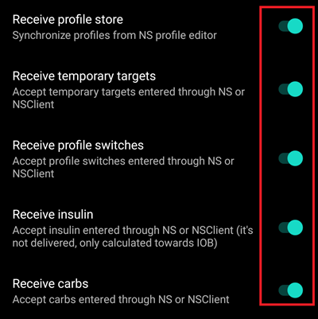

# Nightscout

(Nightscout-security-considerations)=

## Sicherheitsüberlegungen

Nightscout ist der Reporting- und Überwachungsserver von **AAPS**: **AAPS** lädt Deine Daten dorthin hoch, und Du oder Deine Betreuenden sehen sie sich auf der Nightscout-Webseite oder in Follower-Apps an. Dort liegen Deine medizinischen Daten, Profile und Behandlungen, deshalb lohnt es sich, über die Absicherung Deiner Nightscout-Webseite nachzudenken.

In **AAPS** 4 läuft die Remote-Steuerung nicht über die Nightscout-Webseite. Solange die Client-Steuerung eingeschaltet ist ([Geschützter Modus](#client-master-control-hardened-mode)), werden Behandlungen oder Zielwerte, die direkt in Nightscout eingegeben werden, von **AAPS** **nicht übernommen**. Remote-Befehle kommen stattdessen von einem gekoppelten **AAPSClient** – siehe [Master ↔ Client-Steuerung](#client-master-control).

Sei äußerst vorsichtig, wenn Du Nightscout als Glukosequelle für AAPS verwendest.

### Nightscout Einstellungen

Du kannst den öffentlichen Zugang zu Deinen Nightscout-Daten verweigern, indem Du [authentication roles](https://nightscout.github.io/nightscout/security) (Authentifizierungsrollen) verwendest: stelle sicher, dass Du Deinen URL mit einem `readable` (nur lesen) Token zur Verfügung stellst und niemals mit einem `admin` (Administrator) Token.

Das Nightscout `API_SECRET` ist das Hauptpasswort für Deinen Nightscout-Server, mache es keinesfalls öffentlich zugänglich.

(Nightscout-aaps-settings)=

### AAPS-Einstellungen

Das Annehmen von Daten aus Nightscout (Profiländerungen, Behandlungen …) ist optional und standardmäßig ausgeschaltet. Die unten beschriebenen Schalter sind ausgeblendet, solange die Client-Steuerung eingeschaltet ist (Geschützter Modus), und im [Einfachen Modus](#preferences-simple-mode).

* Die Einstellungen **Synchronisierung** des Moduls NSClientV3 erreichst Du entweder über 1) **Einstellungen** (Zahnrad-Symbol auf dem Startbildschirm) -> **NSClientV3** -> **Synchronisierung** oder 2) **Konfiguration** (Menü ☰) -> **Kommunikation** -> „**Einstellungen**“ unter NSClientV3.
* Aktiviere „Daten zu NS hochladen“.
* „Glukosewerte zu Nightscout hochladen“ findest Du in den Einstellungen Deiner BZ-Quelle (**Konfiguration → BZ-Quelle → Einstellungen**). Aktiviere es, es sei denn, Deine Glukosequelle für AAPS ist Nightscout: In diesem Fall aktiviere es **nicht**.
* Aktiviere „CGM Daten von NS empfangen“ nur, wenn Nightscout Deine Glukosequelle ist.

#### Do not sync from Nightscout (Nicht von Nightscout synchronisieren)

Sind alle Optionen „… von NS empfangen“ ausgeschaltet, stellt das sicher, dass AAPS keine Änderung aus Nightscout verwendet:

#### Accept changes from Nightscout (Änderungen von Nightscout übernehmen)

Mit diesen Optionen kannst Du AAPS-Einstellungen über Nightscout ändern, zum Beispiel Profile bearbeiten und wechseln, temporäre Ziele setzen und Kohlenhydrate eingeben, die AAPS dann berücksichtigt. Sie werden nur angezeigt, wenn Client-Steuerung und einfacher Modus ausgeschaltet sind.  
Beachte, dass Insulin-Behandlungen nur für Berechnungen wie „Bolus wird nur aufgezeichnet (Die Pumpe gibt kein Insulin ab!)“ verwendet werden.

### Weitere Sicherheitseinstellungen

Halte Dein Smartphone, wie in den [Sicherheitshinweisen](#preparing-safety-first) beschrieben, auf dem neuesten Stand.

(Nightscout-manual-nightscout-setup)=

## Manuelles Nightscout-Setup

Es wird vorausgesetzt, dass Du schon eine Nightscout-Seite hast; falls nicht, findest Du auf der Seite [Nightscout](http://nightscout.github.io/nightscout/new_user/) eine vollständige Anleitung zur Einrichtung. Die folgenden Anweisungen sind dann Einstellungen, die Du zusätzlich in Deiner Nightscout-Seite vornehmen musst. Deine Nightscout-Seite muss mindestens Version 15 haben. Prüfe deshalb, ob Du die [neueste Version](https://nightscout.github.io/update/update/#updating-your-site-to-the-latest-version) verwendest, sonst erhältst Du in der AAPS-App eine Fehlermeldung.

* [Deine Variablen bearbeiten](https://nightscout.github.io/nightscout/setup_variables/#nightscout-configuration)

* Variablen hinzufügen oder wie folgt ändern:
  
  * `ENABLE` = `careportal boluscalc food bwp cage sage iage iob cob basal dbsize pushover pump openaps`
  * `DEVICESTATUS_ADVANCED` = `true`
  * `SHOW_FORECAST` = `openaps`
  * `PUMP_FIELDS` = `reservoir battery clock`
  * Ein Alarm bei [niedrigem Pumpen-Batteriestand](https://github.com/nightscout/cgm-remote-monitor#pump-pump-monitoring) in % kann wie folgt aktiviert werden: 
    * `PUMP_WARN_BATT_P` = `51`
    * `PUMP_URGENT_BATT_P` = `26` 

* Speicher die Änderungen. Deine Nightscout-Seite sollte nun die Anzeige der "Pillen" zulassen. Du kannst die Anzeige erzwingen, indem Du sie in `SHOW_PLUGINS` hinzufügst.
  
  * `SHOW_PLUGINS` = `careportal boluscalc food bwp cage sage iage iob cob basal dbsize pushover pump openaps`
  
  

## Nightscout von einem Bezahlservice (Software as a Service - SaaS)

Verwende des Webschnittstelle des jeweiligen Anbieters, um die Variablen zu setzen. Wende Dich bei Bedarf an den Support des Anbieters.