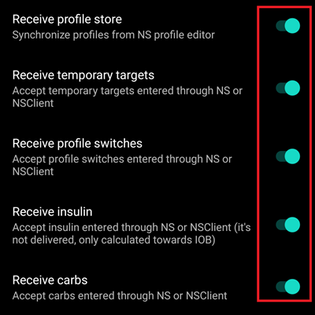

# Nightscout

(Nightscout-security-considerations)=

## Sicherheitsüberlegungen

Nightscout is the reporting and monitoring server of **AAPS**: **AAPS** uploads your data to it, and you or your caregivers look at it on the Nightscout website or in follower apps. It holds your medical data, profiles and treatments, so it is worth thinking about securing your Nightscout website.

In **AAPS** 4, remote control does not go through the Nightscout website. While client control is on ([hardened mode](#client-master-control-hardened-mode)), treatments or targets typed directly into Nightscout are **not applied** by **AAPS**. Remote commands come from a paired **AAPSClient** instead — see [Master ↔ Client control](#client-master-control).

Exercise maximum caution if using Nightscout as your AAPS BG data source.

### Nightscout Einstellungen

Du kannst den öffentlichen Zugang zu Deinen Nightscout-Daten verweigern, indem Du [authentication roles](https://nightscout.github.io/nightscout/security) (Authentifizierungsrollen) verwendest: stelle sicher, dass Du Deinen URL mit einem `readable` (nur lesen) Token zur Verfügung stellst und niemals mit einem `admin` (Administrator) Token.

Das Nightscout `API_SECRET` ist das Hauptpasswort für Deinen Nightscout-Server, mache es keinesfalls öffentlich zugänglich.

(Nightscout-aaps-settings)=

### AAPS-Einstellungen

Accepting data from Nightscout (profile changes, treatments, ...) is optional and turned off by default. The switches described below are hidden while client control is on (hardened mode) and in [simple mode](#preferences-simple-mode).

* Access the **Synchronization** settings of the NSClientV3 plugin with either 1) **Settings** (gear icon on the main screen) -> **NSClientV3** -> **Synchronization**, or 2) **Configuration** (☰ menu) -> **Communication** -> "**Settings**" under NSClientV3.
* Enable "Upload data to NS".
* "Upload BG data to NS" is in the settings of your BG source (**Configuration → BG Source → Settings**). Enable it, unless your AAPS BG data source is Nightscout: in that case **do not** enable it.
* Do not enable "Receive CGM data from NS" unless Nightscout is your BG data source.

#### Do not sync from Nightscout (Nicht von Nightscout synchronisieren)

Keeping all the "Receive ... from NS" options disabled makes sure no Nightscout change will be used by AAPS:

#### Accept changes from Nightscout (Änderungen von Nightscout übernehmen)

Enabling these options allows you to change AAPS settings through Nightscout, like profiles modifications and switch, temporary targets and adding carbs that will be taken into account by AAPS. They are only shown when client control and simple mode are off.  
Note that insulin treatments will only be used for calculations like "Do not bolus, record only".

### Weitere Sicherheitseinstellungen

Halte Dein Smartphone, wie in den [Sicherheitshinweisen](#preparing-safety-first) beschrieben, auf dem neuesten Stand.

(Nightscout-manual-nightscout-setup)=

## Manuelles Nightscout-Setup

It is assumed you already have a Nightscout site, if not visit the [Nightscout](http://nightscout.github.io/nightscout/new_user/) page for full instructions on setup. The instructions below are then settings you will also need to add to your Nightscout site. Your Nightscout site needs to be at least version 15, so please check you are running the [latest version](https://nightscout.github.io/update/update/#updating-your-site-to-the-latest-version) otherwise you will get an error message on your AAPS app.

* [Deine Variablen bearbeiten](https://nightscout.github.io/nightscout/setup_variables/#nightscout-configuration)

* Variablen hinzufügen oder wie folgt ändern:
  
  * `ENABLE` = `careportal boluscalc food bwp cage sage iage iob cob basal dbsize pushover pump openaps`
  * `DEVICESTATUS_ADVANCED` = `true`
  * `SHOW_FORECAST` = `openaps`
  * `PUMP_FIELDS` = `reservoir battery clock`
  * Ein Alarm bei [niedrigem Pumpen-Batteriestand](https://github.com/nightscout/cgm-remote-monitor#pump-pump-monitoring) in % kann wie folgt aktiviert werden: 
    * `PUMP_WARN_BATT_P` = `51`
    * `PUMP_URGENT_BATT_P` = `26` 

* Speicher die Änderungen. Deine Nightscout-Seite sollte nun die Anzeige der "Pillen" zulassen. Du kannst die Anzeige erzwingen, indem Du sie in `SHOW_PLUGINS` hinzufügst.
  
  * `SHOW_PLUGINS` = `careportal boluscalc food bwp cage sage iage iob cob basal dbsize pushover pump openaps`
  
  

## Nightscout von einem Bezahlservice (Software as a Service - SaaS)

Verwende des Webschnittstelle des jeweiligen Anbieters, um die Variablen zu setzen. Wende Dich bei Bedarf an den Support des Anbieters.