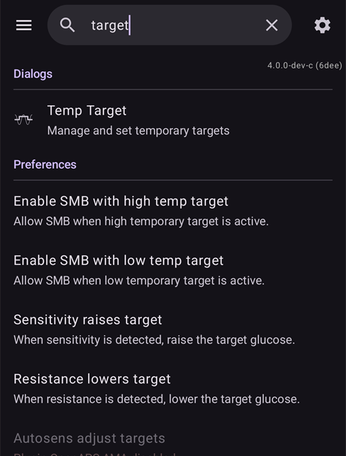
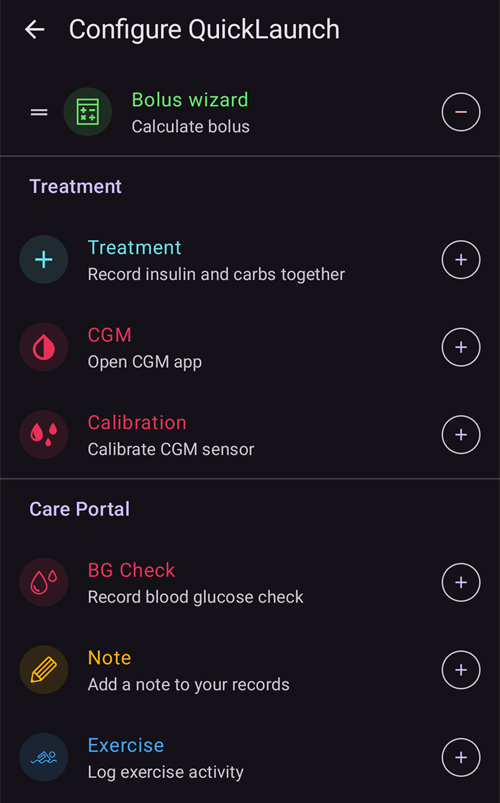
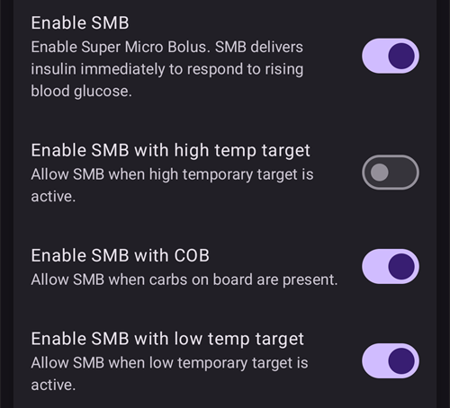
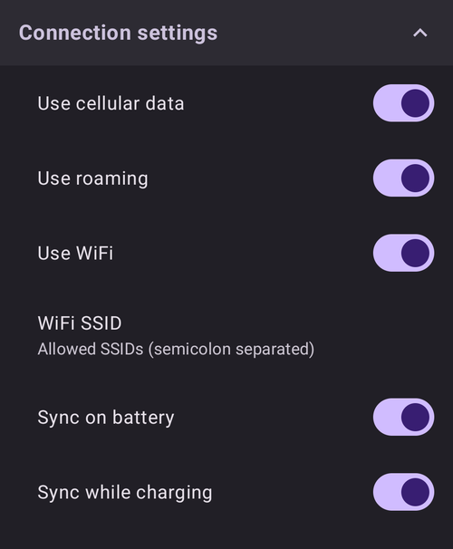
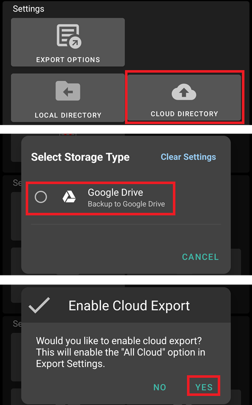
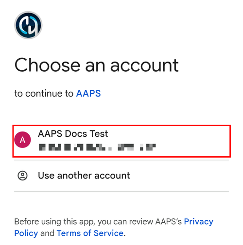

# Settings (Preferences)

In **AAPS** v4 the preferences are found on the **Settings** screen. There are three routes to reach them — see [Making changes to your AAPS' configuration](../SettingUpAaps/ChangeAapsConfiguration.md) for details:

1. Tap the **Settings** (gear) icon in the top-right corner of the main screen: all settings, grouped into expandable sections.
2. In **Configuration**, tap "**Settings**" underneath an active plugin: only that plugin's settings.
3. Use the **search bar** on top of the main screen: just start typing part of the text you are looking for. This finds individual settings (even those not visible in the Settings screen), dialogs and documentation.



- **Sections** are opened and closed by tapping them. The sections you see depend on the plugins you have enabled and on [Simple mode](#preferences-simple-mode).


```{contents}
:backlinks: entry
:depth: 2
```

(Preferences-general)=
## Allgemein


**Einheiten**

- Set units to mmol/L or mg/dL depending on your preferences.

**Sprache**

- Neue Option, um die Standardsprache des Smartphones zu verwenden (empfohlen).

- Falls Du **AAPS** in einer anderen Sprache als der Standardsprache Deines Smartphones nutzen möchtest, kannst Du zwischen vielen verschiedenen Sprachen wählen.

- When you change the language, the texts of **AAPS** switch to the new language straight away. If some texts still show the old language, restart **AAPS**.
- Einstellung ist im [einfachen Modus](#preferences-simple-mode) versteckt.

(preferences-simple-mode)= **Einfacher Modus**

Wenn Du **AAPS** zum ersten Mal installierst, wird standardmäßig der **Einfache Modus** aktiviert. Im **einfachen Modus** werden viele Einstellungen versteckt und die Einstellungen durch vordefinierte Werte ersetzt. Sobald Du Dich mit der **AAPS**-Benutzeroberfläche und den Einstellungen vertraut gemacht hast, solltest Du den einfachen Modus deaktivieren.

**Insulin concentration support**

- Enables support for different insulin concentrations (U50, U200, ...). Only enable this if you really use a concentration other than U100, and read the warnings carefully.
- Einstellung ist im [einfachen Modus](#preferences-simple-mode) versteckt.

**Bildschirm aktiv lassen**

- Forces Android to keep the screen on at all times. Dies ist z.B. zu Präsentationszwecken hilfreich,  es verbraucht aber sehr viel Batterie.  Deshalb wird empfohlen, das Smartphone an ein Ladekabel anzuschließen.

**Instance name**

- The name of the person using this phone. It tells this **AAPS** instance apart in reports and synchronization, for example if two children with type 1 diabetes in your family use **AAPS**.
- Used in the names of exported settings files.
- Wird auf dem [Dual Watchface](../WearOS/WearOsSmartwatch.md) angezeigt.

(Preferences-skin)=
### Erscheinungsbild

The skin selection from **AAPS** 3.x (Original, Low resolution, Large display...) no longer exists in **AAPS** 4. The new interface adapts to your screen automatically, and the color scheme can be changed in [Appearance](#preferences-appearance).

(preferences-appearance)=
## Appearance


(Preferences-range-for-visualization)=
### Zielbereich für die Grafikanzeige

Choose the high and low marks for the BG-graph on **AAPS** main screen and smartwatch. Dies dient nur der Anzeige und ist nicht der Zielwert für Deinen Blutzucker. Example: 70 - 180 mg/dL or 3.9 - 10 mmol/L

(Preferences-show-notes-field-in-treatments-dialogs)=
### Show notes in dialogs

Gibt dir die Möglichkeit, kurze Textnotizen zu Deinen Behandlungen hinzuzufügen (z.B. im Bolus-Rechner, den Buttons für Insulin und Kohlenhydrate etc.)

Einstellung ist im [einfachen Modus](#preferences-simple-mode) versteckt.

### App Color Scheme

Choose between the light theme, the dark theme, or following the phone's system setting.

(Preferences-protection)=
## Schutz


(Preferences-master-password)=
### Master-Passwort

Da ab Version 2.7 die Einstellungen verschlüsselt sind, wird ein Passwort benötigt, um die [Einstellungen exportieren](../Maintenance/ExportImportSettings.md) zu können.

**Biometrischer Schutz funktioniert unter Umständen nicht auf OnePlus-Smartphones. Dies ist ein bekanntes Problem von OnePlus auf einigen Telefonen.**


(Preferences-settings-protection)=
### Schutz der Einstellungen

- Schütze Deine Einstellungen mit einem Passwort oder einer biometrischen Authentifizierung (d. h. [**AAPS**-Nutzung durch Kinder](../RemoteFeatures/RemoteMonitoring.md)). If you enable this feature, you will be prompted for authentication each time you want to access any Settings related view.

- The management screens (**Profile**, **Insulin settings**, **Temp Target**, **QuickWizard**) then open **read-only**. You can still activate or use an entry, but adding, editing, cloning and deleting are hidden until you unlock your settings. See [Settings protection now also locks the management screens](#v4changes-read-only-management).

- Custom password should be used if you want to use master password just for securing [exported settings](../Maintenance/ExportImportSettings.md), and use a different one for editing the settings.

- Wenn Du ein „benutzerdefiniertes Kennwort“ verwendest, klicke auf die Zeile „Passwort für Einstellungen“, um das Kennwort wie [oben beschrieben](#Preferences-master-password) festzulegen.

### Schutz der App

If the app is protected, you must enter the password or use the phone's biometric authentication to open **AAPS**, and again when you come back to it after the [protection timeout](#Preferences-password-and-pin-retention).

**AAPS** wird sofort geschlossen, wenn ein falsches Kennwort eingegeben wurde. AAPS wird aber trotzdem im Hintergrund weiter ausgeführt, wenn AAPS zuvor erfolgreich geöffnet worden war.

### Bolus-Schutz

- Bolus-Schutz könnte nützlich sein, wenn **AAPS** von einem kleinen Kind verwendet wird und Du [SMS für Boli](../RemoteFeatures/SMSCommands.md) verwendest.

- **Bolus protection** can only be selected once **Settings protection** (Level 2) is set.

- In the example below, bolus protection uses the **Master password**: **AAPS** asks for it before opening a treatment dialog such as **Insulin**. With **Biometric**, if biometric authentication does not work, you can enter the master password instead.


(Preferences-password-and-pin-retention)=
### Passwort und PIN-Sperrung

**Protection timeout** defines how long (in seconds) the settings or bolus functionalities remain unlocked after you successfully enter the password.

## Sicherheitseinstellungen der Behandlungen


(preferences-patient-type)=
### Patient age

- Sicherheitsgrenzwerte werden auf der Grundlage des Alters festgelegt, das Du in dieser Einstellung auswählst.
- Wenn du an diese festen Grenzen (z.B. Maximal-Bolus) kommst, ist es an der Zeit, einen Schritt weiter zu gehen.
- Es ist keine gute Idee, ein höheres Alter als das echte Alter. Dies kann zu einer Überdosierung aufgrund von Falscheingaben (z.B. das Weglassen des Dezimalpunktes) im Bolus-Dialog führen.
- Wenn Du die Werte für diese fest eingestellten Sicherheitsgrenzen wissen möchtest, scrolle auf [dieser Seite](../DailyLifeWithAaps/KeyAapsFeatures.md) zu der Algorithmenfunktion, die Du verwendest.

(Preferences-maximum-bolus)=
### Maximum bolus

- Legt die maximale Bolusgröße (in IE) fest, die **AAPS** als Einzelbolus abgeben darf.
- Diese Einstellung ist eine Sicherheitsgrenze, um die Abgabe eines massiven Bolus aufgrund einer versehentlichen Eingabe oder eines Benutzerfehlers zu verhinden.
- Es wird empfohlen, das auf eine vernünftige Menge zu setzen, die ungefähr der maximalen Abgabemenge von Bolus Insulin entspricht, das Du für eine Mahlzeitenkorrektur brauchst.
- Diese Einschränkung gilt auch für die Ergebnisse des Bolus-Rechners.

### Maximum carbs allowed

- Legt die maximale Kohlenhydratmenge, für die der **AAPS**-Bolus-Rechner einen Bolus abgeben darf, fest.
- Diese Einstellung ist eine Sicherheitsgrenze, um die Abgabe eines massiven Bolus aufgrund einer versehentlichen Eingabe oder eines Benutzerfehlers zu verhinden.
- Es wird empfohlen, das auf eine vernünftige Menge zu setzen, die ungefähr der maximalen Menge an Kohlenhydraten entspricht, die du vermutlich jemals für eine Mahlzeit brauchen wirst.

## BZ-Quelle

The settings of your selected [BG source](#Config-Builder-bg-source) appear as their own section. For example with **xDrip+ BG**:


- **Upload BG data to NS**: let **AAPS** upload the received BG values to Nightscout. Only enable this if the CGM app itself is not already uploading them.
- **Log sensor change**: create a sensor change therapy event automatically when the sensor is inserted.

## The main screen

In **AAPS** 3.x these settings were grouped in an "Overview" section. In **AAPS** 4 they are configured directly from the main screen elements they belong to.

(Preferences-buttons)=
### QuickLaunch buttons

Define which action buttons are visible on the main screen: tap the small **gear** at the bottom center of the main screen ("Configure QuickLaunch") and **Add** the actions you want quick access to (treatments, CGM actions, careportal entries...).



(Preferences-quick-wizard)=
### Quick Wizard

Create customized buttons for certain standard meals or snacks which will be displayed on the main screen. Das macht es einfacher, wenn Du häufig dasselbe isst.

Für jede der Schaltflächen kannst Du die entsprechenden Kohlenhydrate und die Art wie der Bolus berechnet werden soll festlegen. Then, you define during which time period the button will be visible on your main screen - just one button per period. Außerhalb der eingestellten Zeiträume wird die Schaltfläche nicht angezeigt. Gleiches gilt, wenn genug aktives Insulin (IOB) zur Verfügung steht, um die in den Schaltflächeneinstellungen definierte Kohlenhydratmenge abzudecken. If different times are specified for the different meals you will always have the appropriate standard meal button on the main screen, depending on the time of day.

To manage your Quick Wizard presets, type "QuickWizard" in the main screen search bar and open **QuickWizard - Manage quick wizard presets**.

Wenn Du auf den QuickWizard-Button klickst, berechnet **AAPS** basierend auf Deinen aktuellen Faktoren, dem aktuellen Glukosewert und dem aktiven Insulin (wenn entsprechend hinterlegt) für diese Kohlenhydratmenge einen Bolus und schlägt ihn Dir vor.

Der Vorschlag muss bestätigt werden, bevor Insulin abgegeben wird.

(Preferences-default-temp-targets)=
### Vordefinierte temporäre Ziele

[Temporäre Ziele](../DailyLifeWithAaps/TempTargets.md) (sog. Temp Targets (TT)) erlauben es Dir, Dein Glukoseziel für einen bestimmten Zeitraum zu ändern. Mit dem Setzen eines Standard-TT kannst Du Dein Ziel für Aktivität, Bald essen usw. einfach verändern.

Tap the **target range** on the main screen to open the **Temp Target** screen. Swipe through the preset cards (Eating Soon, Activity, Hypo) and change the target and the duration of each preset under **Preset Settings**. Voreingestellte Werte sind:

* Eating soon: target 90 mg/dL / 5.0 mmol/L, duration 45 min
* Activity: target 140 mg/dL / 7.8 mmol/L, duration 90 min
* Hypo: target 160 mg/dL / 8.9 mmol/L, duration 60 min


Lerne [hier, wie Du temporäre Ziele aktivierst](#TempTargets-where-can-i-select-a-temp-target).

### Füll-/Vorfüll-Standardmengen

If you want to fill the tube or prime the cannula through **AAPS** you can do this with the **Prime/Fill** buttons in the expanded status panel of the main screen.

The default amounts of the three fill buttons can be defined in the **Prime/Fill** settings, depending on the length of your catheter. Type "prime" in the main screen search bar to open them.


(Preferences-status-lights)=
### Statusanzeige

Status Anzeigen geben eine optische Warnung für:

- Sensoralter
- Insulinalter (Tage Reservoirverwendung)
- Reservoirstand (Einheiten)
- Kanülenalter
- Alter der Pumpenbatterie
- Stand (%) der Pumpenbatterie

Wenn die Warnschwelle überschritten wird, werden die Werte in Gelb angezeigt. Wenn der kritische Schwellenwert überschritten wird, werden die Werte in Rot angezeigt.

To change the thresholds, expand the status panel on the main screen (chevron on the right of the status row) and tap the small **Settings** icon next to "Status":


Tap an item (**Cannula**, **Insulin**, **Sensor** or **Pump battery**) to open its warning and critical thresholds:


Mit der letzten Option kannst Du diese Einstellungen, wenn Du sie definiert hast, aus Nightscout importieren. Weitere Informationen findest Du in der [Nightscout-Dokumentation](https://nightscout.github.io/nightscout/setup_variables/#age-pills).

(Preferences-deliver-this-part-of-bolus-wizard-result)=
### Bolus wizard settings

Type "bolus" in the main screen search bar to open the **Bolus wizard** settings:


**Bolus percentage** sets the [default percentage](#AapsScreens-section-j) of the bolus calculated when using the bolus wizard.

Standard ist 100%: ohne Korrektur. Auch wenn Du hier einen anderen Wert setzt, kannst Du das im Bolus-Rechner immer noch anpassen. Wenn Du z.B. 75% einstellst und eigentlich 10 IE bolen solltest, wird der Bolus-Rechner nur einen Mahlzeitenbolus von 7,5 IE vorschlagen.

Bei der Verwendung von [SMB](#objectives-objective9) geben viele Menschen nicht den vollen (100%) Mahlzeitenbolus ab, sondern nur einen Teil davon (d.h. 75 %). Den Rest lassen sie durch SMBs mit UAM-Erkennung (engl. unannounced meal) erledigen. Ein Wert, der unter 100% liegt, kann hier helfen:
* für Menschen mit langsamer Verdauung: Ein voller Vorab-Bolus kann eine Hypo zur Folge haben, da die Insulinwirkung schneller eintritt, als die die Kohlenhydrate verdaut werden.
* um **AAPS** mehr Spielraum für den Umgang mit **Glukosewertanstiegen** zu geben. Sobald es sinnvoll erscheint, wird **AAPS** in beiden Fällen den fehlenden Bolus-Teil mit SMBs ausgleichen.

**Use bolus advisor**

When enabled, if you use the bolus wizard while you are in hyperglycemia, you will get a warning, prompting you if you wish to pre-bolus and eat later, when your **BG** gets back in range.

(Preferences-advanced-settings-overview)=
### Superbolus

The Superbolus option of **AAPS** 3.x is not available as a setting in **AAPS** 4.

## Loop

See [AAPS screens > The main screen > Loop status](#AapsScreens-loop-status) to change loop mode now.

(Preferences-minimal-request-change)=
### Open mode minimum change

Wenn Du im **Open Loop** bist, erhältst Du jedes Mal, wenn **AAPS** eine Basalraten-Anpassung empfiehlt, eine Benachrichtigung. To reduce the number of notifications you can either use a [wider bg target range](#profile-glucose-targets) or increase the percentage of the "**Open mode minimum change**" setting. Diese definiert, wie hoch die relative Änderung sein muss, damit eine Benachrichtigung erscheint.


## Advanced Meal Assist (AMA) oder Super Micro Bolus (SMB)

Depending on your settings in [Configuration > APS](../SettingUpAaps/ConfigBuilder.md) you can choose between two algorithms:

- [Advanced Meal Assist (OpenAPS AMA)](#Open-APS-features-advanced-meal-assist-ama) - Stand des Algorithmus in 2017
- [Super Micro Bolus (OpenAPS SMB)](#Open-APS-features-super-micro-bolus-smb) - der neueste für Anfänger empfohlene Algorithmus

Ab [**AAPS** Version 3.3](#version3300) wurde [Dynamischer ISF](../DailyLifeWithAaps/DynamicISF.md) in den Abschnitt OpenAPS SMB verschoben.

### OpenAPS AMA

Alle OpenAPS AMA-Einstellungen sind im eigenen Abschnitt in [OpenAPS Funktionen > Erweiterter Mahlzeit-Assistent (AMA)](#Open-APS-features-advanced-meal-assist-ama) beschrieben.

(Preferences-openaps-smb-settings)=
### OpenAPS SMB

Alle OpenAPS AMA-Einstellungen sind im eigenen Abschnitt in [OpenAPS Funktionen > Erweiterter Mahlzeit-Assistent (AMA)](#Open-APS-features-super-micro-bolus-smb) beschrieben.

The list of settings you see depends on your progress in the [Objectives](../SettingUpAaps/CompletingTheObjectives.md) and on [Simple mode](#preferences-simple-mode). On a new installation only **Use dynamic sensitivity** is shown. Once the objectives are completed, the section looks like this:





**Advanced Settings** at the bottom of the section holds values that you normally do not have to change:


## Resorptions-Einstellungen


(Preferences-min_5m_carbimpact)=
### SMB min 5m carbs impact (min_5m_carbimpact)

Einstellung ist im [einfachen Modus](#preferences-simple-mode) versteckt.

Der Algorithmus verwendet die Auswirkungen auf den Blutzuckerspiegel (BGI - blood glucose impact), um zu bestimmen, wann [Kohlenhydrate absorbiert werden](../DailyLifeWithAaps/CobCalculation.md).

So lange der Kohlenhydratabbau nicht dynamisch aus den Veränderungen des Glukosewertes ermittelt werden kann, setzt **AAPS** für den Abbau einen Standardwert an. Im Prinzip ist es eine Notlauffunktion. Dieser Wert wird nur dann verwendet, wenn keine **CGM**-Werte empfangen werden oder körperliche Aktivitäten den Blutzuckeranstieg "kompensieren", den **AAPS** normalerweise zur Berechnung des Kohlenhydratabbaus verwendet.

Einfach gesagt: Der Algorithmus „weiß“, wie sich Deine Glukosewerte unter Berücksichtigung der aktuellen Insulindosis etc. *entwickeln sollten*. Whenever there is a positive deviation from the expected behavior, some carbs are absorbed/decayed. Große Abweichung = viele Kohlenhydrate etc.

Das min_5m_carbimpact definiert die Standard-Kohlenhydrat-Resorptionswirkung pro 5 Minuten. For the full parameter reference see [OpenAPS's preferences and safety settings documentation](https://openaps.readthedocs.io/en/latest/docs/While%20You%20Wait%20For%20Gear/preferences-and-safety-settings.html?highlight=carbimpact#min-5m-carbimpact).

Standard value for AMA is 3, for SMB it's 8.

The COB graph on the main screen indicates when min_5m_carbimpact is being used by putting orange dots along the top of the COB curve.


### Absorption cutoff

Time at which any meal is considered absorbed; remaining carbs will be cut off. Wenn du oft Mahlzeiten mit viel Fett oder Eiweiß zu dir nimmst, wirst du die Resorptionszeit für das Essen erhöhen müssen.

### Erweiterte Einstellungen - Autosens-Faktoren


- Lege das min. und max. [Autosens](#Open-APS-features-autosens)-Verhältnis fest.
- Die Standardwerte (max. 1.2 und min. 0.7) sollten nicht verändert werden.

## Pumpe


### BT Watchdog

Bei Bedarf aktiviere BT Watchdog (z.B. bei Dana Pumpen). It switches off Bluetooth for one second if no connection to the pump is possible. This may help on some phones where the Bluetooth stack freezes.

## Pumpen-Einstellungen

The options here will vary depending on which pump driver you have selected in [Configuration > Pump](#Config-Builder-pump). Pair and set up your pump according to the [pump-related instructions](../Getting-Started/CompatiblePumps.md).

For example with the **Virtual Pump**, the section is called **Virtual pump settings**. You choose the **Pump type** the virtual pump imitates, and whether its status is uploaded to Nightscout:


## Tidepool

Mehr Informationen findest Du auf der [Tidepool](../SettingUpAaps/Tidepool.md)-Seite.

(Preferences-nsclient)=
## Nightscout-Client


The NSClient plugin (shown as **NSClientV3** in the configuration menu) synchronizes your data with Nightscout. It uses the Nightscout API v3.

```{admonition} Data uploaders
:class: warning

When using NSClientV3, all uploaders must use the Nightscout API v3. If another uploader (for example your CGM app) is not API v3 compliant, **let **AAPS** upload all data** (BG, treatments, ...) to Nightscout and disable that uploader.
```

- Lege Deine *Nightscout URL* (z.B. [https://deineseite.deinprovider.com](https://yoursitename.yourplaform.dom)) fest.
- **Stelle sicher, dass die URL NICHT mit /api/v1/ endet.**
- In Nightscout, create an *[Admin token](https://nightscout.github.io/nightscout/security/#create-a-token)* (requires [Nightscout 15](https://nightscout.github.io/update/update/) to use the V3 API) and enter it in the **Nightscout access token** (not your API Secret!). On **AAPSClient** you can scan the main phone's QR code instead, which sets up a token of the client's own. A client paired with the PIN gets its own token from the main phone after pairing. See [The client's own Nightscout token](#client-master-control-own-token).
- Dadurch kann **AAPS** Daten von Nightscout lesen und auch schreiben.
- Überprüfe die Eingaben auf Tippfehler, wenn du bei Ziel 1 hängen bleibst.
- Leave "Use websockets" enabled (recommended).

(Preferences-nsclient-synchronization)=
### Synchronisierung


Die Art der Synchronisierung hängt davon ab, wie Du **AAPS** nutzen möchtest.

Du kannst festlegen welche Informationen [von und zu Nightscout hoch- bzw. heruntergeladen werden sollen](#Nightscout-aaps-settings).

While client control is on (always in Simple Mode), these settings are hidden: **AAPS** is then in [hardened mode](#client-master-control-hardened-mode), takes no changes made directly in Nightscout and uploads all its data.

### Alarm-Optionen


- In den Alarm-Optionen legst Du fest, welche Standard-Nightscout-Alarme in AAPS genutzt werden sollen. **AAPS** wird dann alarmieren, wenn Nightscout einen Alarm auslöst.
- Damit die Alarme ausgelöst werden können, musst Du in den [Nightscout-Variablen](https://nightscout.github.io/nightscout/setup_variables/#alarms) Werte für Urgent High, High, Low und Urgent Low Alarme setzen.
- They will only work while you have a connection to Nightscout and are intended for parent/caregivers.
- If you have the **CGM** source on your phone (i.e. xDrip or BYODA) then use those alarms instead of Nightscout Alarms.
- NS announcements will echo Nightscout [announcements](https://nightscout.github.io/nightscout/discover/#announcement) in the **AAPS** notifications.
- Du kannst die Schwellenwerte für veraltete Daten und stark veraltete Alarme ändern, wenn nach einer bestimmten Zeit keine Daten von Nightscout empfangen werden.

### Remote-Steuerung

The switch "**Allow client control**" is no longer in these settings: it is at the top of **Manage → Authorized clients**, where the paired clients are managed. See the dedicated [Client / Master control](../RemoteFeatures/ClientMasterControl.md) page, including [hardened mode](#client-master-control-hardened-mode), which this switch turns on.

### Verbindungseinstellungen



- Verbindungseinstellungen legen fest auf welchem Weg (z.B. WLAN oder Mobilfunknetz) eine Nightscout-Verbindung aufgebaut werden darf.
- Beschränken den Nightscout-Upload auf WLAN-Verbindungen oder sogar auf bestimmte WLAN-SSIDs.
- Wenn Du nur ein bestimmtes WLAN-Netzwerk verwenden möchtest, kannst Du dessen WLAN SSID eingeben.
- Mehrere SSIDs können durch Semikolon (Strichpunkt) getrennt werden.
- Gib zum Löschen aller SSIDs ein Leerzeichen in das Feld ein.

(Preferences-advanced-settings-nsclient)=
### Erweiterte Einstellungen (Nightscout-Client)


Die Optionen in den erweiterten Einstellungen sind selbsterklärend.

## SMS Kommunikator

Mehr Informationen findest Du auf der Seite [SMS-Befehle](../RemoteFeatures/SMSCommands.md).

(preferences-wear)=
## Wear

This section is shown when the **Wear** plugin is enabled in [Configuration > Communication](#Config-Builder-wear). More information on the dedicated [Wear OS smartwatch](../WearOS/WearOsSmartwatch.md) and [Operation of AAPS via your Wear OS smartwatch](../RemoteFeatures/RemoteControlWearOS.md) pages.


- **Wear control**: allow treatments and other actions to be sent from the watch. Without it, the watch only displays data: the phone refuses any command from the watch, and tapping a complication that would open a control screen opens the **AAPS** menu on the watch instead.

**Wear Wizard Settings** defines which calculations are included in the result of the bolus wizard on the watch. On the watch you only enter the carbs; these switches replace the choices you would make in the bolus wizard on the phone:

- **Include BG in wizard**: add a correction for the difference between your current glucose and your target.
- **Include temp target in wizard**: use the running temp target instead of the profile target for this correction.
- **Include trend in wizard**: take the current glucose trend into account.
- **Include COB in wizard**: add insulin for the carbs that are still on board.
- **Include IOB in wizard**: subtract the insulin that is still on board.


**Custom Watchface Settings** contains **Authorize custom watchfaces**. A custom watchface file can include values for some watch settings. When this switch is on, loading such a watchface is allowed to change those settings on the watch; when it is off, the watchface is loaded but the settings stay as they are:


**General Settings** contains **Notify on SMB**, to get a notification on the watch each time an SMB is delivered:


## Autotune

This section is shown when the **Autotune** plugin is enabled in [Configuration > General](#Config-Builder-autotune). The settings are described on the dedicated [Autotune](../AdvancedOptions/Autotune.md) page.


## Automatisierung


Wähle aus, welcher Standortdienst verwendet werden soll:

- Passiven Standort verwenden: **AAPS** nutzt den Standort nur dann, wenn er von anderen Apps angefordert wird
- Netzwerkstandort: Standort Deines WLAN
- GPS-Standort (Achtung! Kann zu übermäßigen Akkuverbrauch führen!)

## Lokale Alarme


Einstellungen sollten selbsterklärend sein.

(preferences-maintenance-settings)=
## Wartungseinstellungen


**E-Mail-Empfänger**: Standardempfänger für Protokolldateien (sog. Logs) ist <logs@aaps.app>.

**Number of logs to send**: how many of the most recent log files are attached when you send logs.

**Datenübermittlung**


Du kannst bei der Weiterentwicklung von **AAPS** unterstützen, indem Du Absturzberichte an die Entwickler sendest.

**Automatischer Export der Einstellungen**<br/> Durch Aktivieren dieser Funktion lässt Du zu, dass **AAPS** Deine Einstellungen ohne manuellen Eingriff exportiert. Dazu wird das Master-Passwort beim nächsten manuellen Export sicher auf Deinem Smartphone (und nur dort) gespeichert. Das gespeicherte Passwort wird für bis zu 4 Wochen verwendet. Nach 4 Wochen erhältst Du eine Information, dass das Passwort bald ablaufen wird. Während einer einwöchigen Übergangsfrist kann das Passwort dann aktualisiert werden, indem die Einstellungen manuell über das Wartungsmenü exportiert werden.

Nach Ablauf der einwöchigen Übergangsfrist, läuft das gespeicherte Passwort ab und alle automatisierten Exporte der Einstellungen werden gestoppt. Du wirst darüber informiert und aufgefordert das Passwort erneut einzugeben. [(**Automated settings exports**)](../DailyLifeWithAaps/Automations.md#automating-preference-settings-export) will be logged to the **AAPS** 'Careportal' and 'User entry' lists under Treatments.

Nach dem Aktivieren dieser Option exportiere die Einstellungen manuell, sodass Du zur Passworteingabe aufgefordert wirst und **AAPS** es dann speichern kann.

### Log-Dateien / Protokolldateien

AAPS speichert zur Fehlerbehebung Protokolldateien.

Deaktiviere die Funktion nicht: Sie hilft im Fehlerfall nachzuvollziehen was und warum etwas schiefgelaufen ist.

If you need to send the logs to the developers, make sure you accurately describe the issue in the email. Schicke die Protokolldatei idealerweise nur nach Aufforderung und nachdem Du einen [Issue Report in GitHub](https://github.com/nightscout/AndroidAPS/issues) eröffnet hast.

Die AAPS-Logs sind in Deinem Smartphonespeicher unter -> Android -> Daten -> info.nightscout.androidaps -> Dateien zu finden.

Log handling (log settings, sending and deleting logs) and file management are found on the **Maintenance** screen, opened from the **menu** (☰) in the top-left corner of the main screen:


(preferences-maintenance-logdirectory)=

### Lokales AAPS-Verzeichnis festlegen

The **Maintenance** screen also includes the **AAPS directory**. Diese Einstellung erlaubt es Dir, ein Verzeichnis auf Deinem Smartphone auszuwählen, in dem **AAPS** Einstellungen, Logs und andere Dateien speichert. Once a directory is chosen, its path (for example `Documents/AAPS`) is shown below **AAPS directory**, so you can always see where your files are saved.

Es wird dringend empfohlen, ein Verzeichnis direkt im Hauptverzeichnis des Smartphonespeichers zu nutzen. Standard ist AAPS.


Wenn Du ein Unterverzeichnis von AAPS auswählst, wirst Du eine Fehlermeldung bekommen. Tippe auf "OK" und versuche es erneut, wähle das richtige Verzeichnis (eins höher). Wähle nicht "VERWERFEN", es sei denn, Du weißt sehr genau, was Du tust.


Android can silently take the directory permission away, for example after you reinstall **AAPS** or clear its storage. When that happens, **AAPS** shows a persistent **Access to the AAPS directory was lost** notification and local settings export stops working until you come back here and select the directory again. Do this promptly, otherwise your backups on the phone are no longer refreshed.

(preferences-maintenance-cloud)=

### Cloud-Verzeichnis festlegen

Du kannst Deine Einstellungen, Protokolldateien und CSV-Daten in einen Cloud-Dienst exportieren.

1. Open the **menu** (☰), select **Maintenance** and tap **Cloud Directory** (under **File management**).

   

2. In **Select Storage Type**, select **Google Drive**.

   

3. A Google sign-in page opens. Choose the Google account that will hold your backups (you can use a [dedicated Google account](../UsefulLinks/DedicatedGoogleAccountForAaps.md)).

   

4. Check that the account is the right one and tap **Continue** to give **AAPS** access. If you set up the cloud directory before, the page says that **AAPS** already has some access.

   

5. Back in **AAPS**, the message **Cloud storage authentication successful** appears at the bottom of the main screen:

   

   In the **Maintenance** menu, **Cloud Directory** now has a green dot, and the **Cloud** buttons next to **Send logs**, **Export settings**, **Import settings** and **Export User Entries to Excel (csv)** are available.

   

To stop exporting to the cloud, tap the **✕** (**Clear Settings**) icon at the end of the **Cloud Directory** row in the **Maintenance** menu (it is shown once a cloud service is set up) and confirm **Clear Cloud Settings**. This switches back to local storage and clears the authorization.

## Open Humans

Du kannst die Community unterstützen, indem Du Deine Daten für Forschungsprojekte zur Verfügung stellst. Details sind auf der [Open Humans-Seite](../SupportingAaps/OpenHumans.md) beschrieben.

In **Settings → Open Humans**, you can define when data shall be uploaded
- nur über WLAN-Verbindungen
- nur während des Ladens
