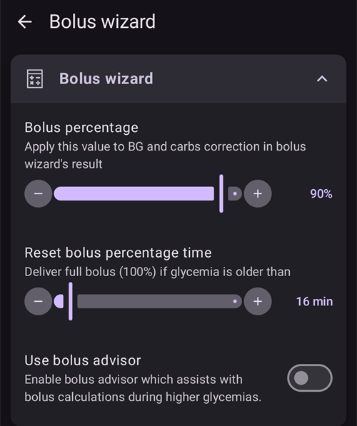
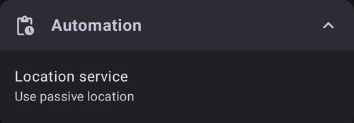
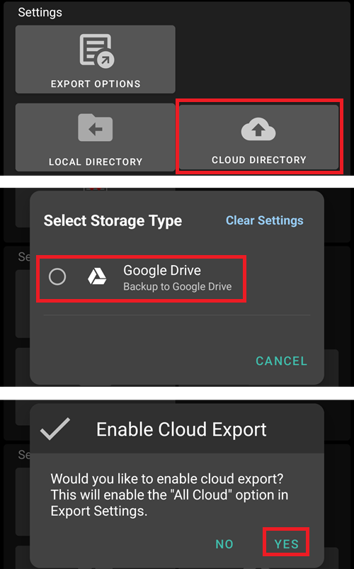

# Einstellungen

In **AAPS** v4 findest Du die Einstellungen im Bildschirm **Einstellungen**. Es gibt drei Wege dorthin – Details findest Du unter [Änderungen an der Konfiguration von AAPS](../SettingUpAaps/ChangeAapsConfiguration.md):

1. Tippe oben rechts auf dem Startbildschirm auf das Symbol **Einstellungen** (Zahnrad): alle Einstellungen, in aufklappbaren Abschnitten gruppiert.
2. Tippe in der **Konfiguration** unter einem aktiven Modul auf „**Einstellungen**“: nur die Einstellungen dieses Moduls.
3. Verwende das **Suchfeld** oben auf dem Startbildschirm: Fang einfach an, einen Teil des gesuchten Textes einzugeben. So findest Du einzelne Einstellungen (auch solche, die im Bildschirm Einstellungen nicht sichtbar sind), Dialoge und die Dokumentation.


- **Abschnitte** öffnest und schließt Du durch Antippen. Welche Abschnitte Du siehst, hängt von den aktivierten Modulen und vom [Einfachen Modus](#preferences-simple-mode) ab.


```{contents}
:backlinks: entry
:depth: 2
```

(Preferences-general)=
## Allgemein


**Einheiten**

- Stelle die Einheiten je nach Vorliebe auf mmol/l oder mg/dl ein.

**Sprache**

- Standardmäßig folgt **AAPS** der Sprache des Smartphones (empfohlen).

- Möchtest Du **AAPS** in einer anderen Sprache als das Smartphone verwenden, wähle sie hier aus. Ab Android 13 registriert **AAPS** sie in Android als eigene App-Sprache, sodass alle Bildschirme, der Startbildschirm, die Widgets und die Schreibweise von Zahlen ihr folgen.

- Wenn Du die Sprache änderst, werden die Texte von **AAPS** sofort in der neuen Sprache angezeigt. Zeigen einige Texte noch die alte Sprache, starte **AAPS** neu.
- Unter Android 12 wird diese Einstellung nicht angezeigt: **AAPS** verwendet immer die Sprache des Smartphones.
- Einstellung ist im [einfachen Modus](#preferences-simple-mode) versteckt.

(preferences-simple-mode)= **Einfacher Modus**

Wenn Du **AAPS** zum ersten Mal installierst, wird standardmäßig der **Einfache Modus** aktiviert. Im **einfachen Modus** werden viele Einstellungen versteckt und die Einstellungen durch vordefinierte Werte ersetzt. Sobald Du Dich mit der **AAPS**-Benutzeroberfläche und den Einstellungen vertraut gemacht hast, solltest Du den einfachen Modus deaktivieren.

**Unterstützung verschiedener Insulin Konzentration**

- Aktiviert die Unterstützung verschiedener Insulinkonzentrationen (U50, U200 …). Aktiviere das nur, wenn Du wirklich eine andere Konzentration als U100 verwendest, und lies die Warnungen sorgfältig.
- Einstellung ist im [einfachen Modus](#preferences-simple-mode) versteckt.

**Bildschirm aktiv lassen**

- Zwingt Android, den Bildschirm dauerhaft eingeschaltet zu lassen. Dies ist z.B. zu Präsentationszwecken hilfreich,  es verbraucht aber sehr viel Batterie.  Deshalb wird empfohlen, das Smartphone an ein Ladekabel anzuschließen.

**Instanzname**

- Der Name der Person, die dieses Smartphone nutzt. Er unterscheidet diese **AAPS**-Instanz in Berichten und bei der Synchronisierung, zum Beispiel wenn in Deiner Familie zwei Kinder mit Typ-1-Diabetes **AAPS** verwenden.
- Wird im Namen exportierter Einstellungsdateien verwendet.
- Wird auf dem [Dual Watchface](../WearOS/WearOsSmartwatch.md) angezeigt.

(Preferences-skin)=
### Erscheinungsbild

Die Auswahl der Oberfläche (Skin) aus **AAPS** 3.x (Original, Niedrige Auflösung, Großes Display …) gibt es in **AAPS** 4 nicht mehr. Die neue Oberfläche passt sich automatisch an Deinen Bildschirm an, und das Farbschema kannst Du unter [Darstellung](#preferences-appearance) ändern.

(preferences-appearance)=
## Darstellung


(Preferences-range-for-visualization)=
### Zielbereich für die Grafikanzeige

Wähle die obere und untere Grenze des Zielbereichs für das Glukosediagramm auf dem Startbildschirm von **AAPS** und auf der Smartwatch. Dies dient nur der Anzeige und ist nicht der Zielwert für Deinen Blutzucker. Beispiel: 70 - 180 mg/dl oder 3,9 - 10 mmol/l

(Preferences-show-notes-field-in-treatments-dialogs)=
### Notizen in Dialogen anzeigen

Gibt dir die Möglichkeit, kurze Textnotizen zu Deinen Behandlungen hinzuzufügen (z.B. im Bolus-Rechner, den Buttons für Insulin und Kohlenhydrate etc.)

Einstellung ist im [einfachen Modus](#preferences-simple-mode) versteckt.

### App-Farbschema

Wähle zwischen dem hellen Design, dem dunklen Design oder der Systemeinstellung des Smartphones.

(Preferences-protection)=
## Schutz


(Preferences-master-password)=
### Master-Passwort

Da ab Version 2.7 die Einstellungen verschlüsselt sind, wird ein Passwort benötigt, um die [Einstellungen exportieren](../Maintenance/ExportImportSettings.md) zu können.

**Biometrischer Schutz funktioniert unter Umständen nicht auf OnePlus-Smartphones. Dies ist ein bekanntes Problem von OnePlus auf einigen Telefonen.**


(Preferences-settings-protection)=
### Schutz der Einstellungen

- Schütze Deine Einstellungen mit einem Passwort oder einer biometrischen Authentifizierung (d. h. [**AAPS**-Nutzung durch Kinder](../RemoteFeatures/RemoteMonitoring.md)). Ist diese Option aktiviert, wirst Du jedes Mal, wenn Du einen Bildschirm mit Einstellungen öffnen möchtest, zur Authentifizierung aufgefordert.

- Die Verwaltungsbildschirme (**Profil**, **Insulineinstellungen**, **Temporäre Ziele**, **QuickWizard**) öffnen sich dann **schreibgeschützt**. Du kannst einen Eintrag weiterhin aktivieren oder verwenden, aber Hinzufügen, Bearbeiten, Klonen und Löschen sind ausgeblendet, bis Du Deine Einstellungen entsperrst. Siehe [Schutz der Einstellungen sperrt jetzt auch die Verwaltungsbildschirme](#v4changes-read-only-management).

- Ein benutzerdefiniertes Passwort solltest Du verwenden, wenn Du das Master-Passwort nur zur Absicherung der [exportierten Einstellungen](../Maintenance/ExportImportSettings.md) nutzen und für das Ändern der Einstellungen ein anderes verwenden möchtest.

- Wenn Du ein „benutzerdefiniertes Kennwort“ verwendest, klicke auf die Zeile „Passwort für Einstellungen“, um das Kennwort wie [oben beschrieben](#Preferences-master-password) festzulegen.

### Schutz der App

Ist die App geschützt, musst Du das Passwort eingeben oder die biometrische Authentifizierung des Smartphones verwenden, um **AAPS** zu öffnen, und erneut, wenn Du nach Ablauf der [Zeit bis zur erneuten Authentifizierung](#Preferences-password-and-pin-retention) zurückkehrst.

**AAPS** wird sofort geschlossen, wenn ein falsches Kennwort eingegeben wurde. AAPS wird aber trotzdem im Hintergrund weiter ausgeführt, wenn AAPS zuvor erfolgreich geöffnet worden war.

### Bolus-Schutz

- Bolus-Schutz könnte nützlich sein, wenn **AAPS** von einem kleinen Kind verwendet wird und Du [SMS für Boli](../RemoteFeatures/SMSCommands.md) verwendest.

- **Bolus-Schutz** kann erst ausgewählt werden, wenn **Schutz der Einstellungen** (Level 2) eingerichtet ist.

- Im Beispiel unten verwendet der Bolus-Schutz das **Master-Passwort**: **AAPS** fragt danach, bevor ein Behandlungsdialog wie **Insulin** geöffnet wird. Bei **Biometrisch** kannst Du stattdessen das Master-Passwort eingeben, wenn die biometrische Authentifizierung nicht funktioniert.


(Preferences-password-and-pin-retention)=
### Passwort und PIN-Sperrung

**Zeit bis zur erneuten Authentifizierung** legt fest, wie lange (in Sekunden) die Einstellungen bzw. die Bolus-Funktionen entsperrt bleiben, nachdem Du das Passwort richtig eingegeben hast.

## Sicherheitseinstellungen der Behandlungen


(preferences-patient-type)=
### Patientenalter

- Sicherheitsgrenzwerte werden auf der Grundlage des Alters festgelegt, das Du in dieser Einstellung auswählst.
- Wenn du an diese festen Grenzen (z.B. Maximal-Bolus) kommst, ist es an der Zeit, einen Schritt weiter zu gehen.
- Es ist keine gute Idee, ein höheres Alter als das tatsächliche zu wählen, denn das kann durch eine Falscheingabe im Insulin-Dialog (zum Beispiel ein vergessenes Dezimaltrennzeichen) zu einer Überdosierung führen.
- Wenn Du die Werte für diese fest eingestellten Sicherheitsgrenzen wissen möchtest, scrolle auf [dieser Seite](../DailyLifeWithAaps/KeyAapsFeatures.md) zu der Algorithmenfunktion, die Du verwendest.

(Preferences-maximum-bolus)=
### Maximaler Bolus

- Legt die maximale Bolusgröße (in IE) fest, die **AAPS** als Einzelbolus abgeben darf.
- Diese Einstellung ist eine Sicherheitsgrenze, um die Abgabe eines massiven Bolus aufgrund einer versehentlichen Eingabe oder eines Benutzerfehlers zu verhinden.
- Es wird empfohlen, das auf eine vernünftige Menge zu setzen, die ungefähr der maximalen Abgabemenge von Bolus Insulin entspricht, das Du für eine Mahlzeitenkorrektur brauchst.
- Diese Einschränkung gilt auch für die Ergebnisse des Bolus-Rechners.

### Maximal erlaubte Kohlenhydrate

- Legt die maximale Kohlenhydratmenge, für die der **AAPS**-Bolus-Rechner einen Bolus abgeben darf, fest.
- Diese Einstellung ist eine Sicherheitsgrenze, um die Abgabe eines massiven Bolus aufgrund einer versehentlichen Eingabe oder eines Benutzerfehlers zu verhinden.
- Es wird empfohlen, das auf eine vernünftige Menge zu setzen, die ungefähr der maximalen Menge an Kohlenhydraten entspricht, die du vermutlich jemals für eine Mahlzeit brauchen wirst.

## BZ-Quelle

Die Einstellungen der ausgewählten [BZ-Quelle](#Config-Builder-bg-source) erscheinen als eigener Abschnitt. Zum Beispiel bei **xDrip+ BZ**:


- **Glukosewerte zu Nightscout hochladen**: **AAPS** lädt die empfangenen Glukosewerte zu Nightscout hoch. Aktiviere das nur, wenn die CGM-App sie nicht schon selbst hochlädt.
- **Sensorwechsel dokumentieren**: legt beim Setzen des Sensors automatisch ein Therapieereignis „Sensorwechsel“ an.

## Der Startbildschirm

In **AAPS** 3.x waren diese Einstellungen im Abschnitt „Übersicht“ zusammengefasst. In **AAPS** 4 stellst Du sie direkt an den Elementen des Startbildschirms ein, zu denen sie gehören.

(Preferences-buttons)=
### Schnellstart-Knöpfe

Lege fest, welche Aktionsknöpfe auf dem Startbildschirm sichtbar sind: Tippe unten in der Mitte des Startbildschirms auf das kleine **Zahnrad** („Schnellstart konfigurieren“) und füge mit **Hinzufügen** die Aktionen hinzu, die Du schnell erreichen möchtest (Behandlungen, CGM-Aktionen, Careportal-Einträge …).


(Preferences-quick-wizard)=
### Quick Wizard

Lege eigene Knöpfe für bestimmte Standardmahlzeiten oder Snacks an, die auf dem Startbildschirm angezeigt werden. Das macht es einfacher, wenn Du häufig dasselbe isst.

Für jede der Schaltflächen kannst Du die entsprechenden Kohlenhydrate und die Art wie der Bolus berechnet werden soll festlegen. Danach legst Du fest, in welchem Zeitraum der Knopf auf dem Startbildschirm zu sehen sein soll – nur ein Knopf pro Zeitraum. Außerhalb der eingestellten Zeiträume wird die Schaltfläche nicht angezeigt. Gleiches gilt, wenn genug aktives Insulin (IOB) zur Verfügung steht, um die in den Schaltflächeneinstellungen definierte Kohlenhydratmenge abzudecken. Wenn Du für die verschiedenen Mahlzeiten verschiedene Zeiten angibst, hast Du je nach Tageszeit auf dem Startbildschirm immer den passenden Knopf für die Standardmahlzeit.

Um Deine QuickWizard-Vorlagen zu verwalten, gib „QuickWizard“ in das Suchfeld auf dem Startbildschirm ein und öffne **QuickWizard - QuickWizard-Voreinstellungen verwalten**.

Wenn Du auf den QuickWizard-Button klickst, berechnet **AAPS** basierend auf Deinen aktuellen Faktoren, dem aktuellen Glukosewert und dem aktiven Insulin (wenn entsprechend hinterlegt) für diese Kohlenhydratmenge einen Bolus und schlägt ihn Dir vor.

Der Vorschlag muss bestätigt werden, bevor Insulin abgegeben wird.

(Preferences-default-temp-targets)=
### Vordefinierte temporäre Ziele

[Temporäre Ziele](../DailyLifeWithAaps/TempTargets.md) (sog. Temp Targets (TT)) erlauben es Dir, Dein Glukoseziel für einen bestimmten Zeitraum zu ändern. Mit dem Setzen eines Standard-TT kannst Du Dein Ziel für Aktivität, Bald essen usw. einfach verändern.

Tippe auf dem Startbildschirm auf den **Zielbereich**, um den Bildschirm **Temporäres Ziel** zu öffnen. Wische durch die Karten der Vorlagen (Bald essen, Aktivität, Hypo) und ändere Zielwert und Dauer jeder Vorlage unter **Einstellungen für Voreinstellungen**. Voreingestellte Werte sind:

* Bald essen: Zielwert 90 mg/dl / 5,0 mmol/l, Dauer 45 min
* Aktivität: Zielwert 140 mg/dl / 7,8 mmol/l, Dauer 90 min
* Hypo: Zielwert 160 mg/dl / 8,9 mmol/l, Dauer 60 min


Lerne [hier, wie Du temporäre Ziele aktivierst](#TempTargets-where-can-i-select-a-temp-target).

### Füll-/Vorfüll-Standardmengen

Wenn Du den Schlauch füllen oder die Kanüle über **AAPS** befüllen möchtest, kannst Du das mit den Knöpfen **Nadelwechsel/Füllen** im aufgeklappten Statusbereich des Startbildschirms tun.

Die Standardmengen der drei Füll-Knöpfe kannst Du je nach Länge Deines Katheters in den Einstellungen **Nadelwechsel/Füllen** festlegen. Gib „prime“ in das Suchfeld auf dem Startbildschirm ein, um sie zu öffnen.


(Preferences-status-lights)=
### Statusanzeige

Status Anzeigen geben eine optische Warnung für:

- Sensoralter
- Insulinalter (Tage Reservoirverwendung)
- Reservoirstand (Einheiten)
- Kanülenalter
- Alter der Pumpenbatterie
- Stand (%) der Pumpenbatterie

Wenn die Warnschwelle überschritten wird, werden die Werte in Gelb angezeigt. Wenn der kritische Schwellenwert überschritten wird, werden die Werte in Rot angezeigt.

Um die Schwellenwerte zu ändern, klappe den Statusbereich auf dem Startbildschirm auf (Pfeil rechts in der Statuszeile) und tippe auf das kleine Symbol **Einstellungen** neben „Status“:


Tippe auf einen Eintrag (**Kanüle**, **Insulin**, **Sensor** oder **Pumpenbatterie**), um seine Schwellenwerte für Warnung und kritischen Zustand zu öffnen:


Mit der letzten Option kannst Du diese Einstellungen, wenn Du sie definiert hast, aus Nightscout importieren. Weitere Informationen findest Du in der [Nightscout-Dokumentation](https://nightscout.github.io/nightscout/setup_variables/#age-pills).

(Preferences-deliver-this-part-of-bolus-wizard-result)=
### Einstellungen des Bolus-Rechners

Gib „bolus“ in das Suchfeld auf dem Startbildschirm ein, um die Einstellungen des **Bolus-Rechners** zu öffnen:



**Bolus-Prozentsatz** legt den [Standard-Prozentsatz](#AapsScreens-section-j) des Bolus fest, den der Bolus-Rechner berechnet.

Standard ist 100%: ohne Korrektur. Auch wenn Du hier einen anderen Wert setzt, kannst Du das im Bolus-Rechner immer noch anpassen. Wenn Du z.B. 75% einstellst und eigentlich 10 IE bolen solltest, wird der Bolus-Rechner nur einen Mahlzeitenbolus von 7,5 IE vorschlagen.

Bei der Verwendung von [SMB](#objectives-objective9) geben viele Menschen nicht den vollen (100%) Mahlzeitenbolus ab, sondern nur einen Teil davon (d.h. 75 %). Den Rest lassen sie durch SMBs mit UAM-Erkennung (engl. unannounced meal) erledigen. Ein Wert, der unter 100% liegt, kann hier helfen:
* für Menschen mit langsamer Verdauung: Ein voller Vorab-Bolus kann eine Hypo zur Folge haben, da die Insulinwirkung schneller eintritt, als die die Kohlenhydrate verdaut werden.
* um **AAPS** mehr Spielraum für den Umgang mit **Glukosewertanstiegen** zu geben. Sobald es sinnvoll erscheint, wird **AAPS** in beiden Fällen den fehlenden Bolus-Teil mit SMBs ausgleichen.

**Bolus-Rechner aktivieren**

Ist die Option aktiviert und verwendest Du den Bolus-Rechner, während Du in einer Hyperglykämie bist, erhältst Du eine Warnung und wirst gefragt, ob Du einen Vorab-Bolus abgeben und später essen möchtest, wenn Dein **Glukosewert** wieder im Zielbereich ist.

(Preferences-advanced-settings-overview)=
### Superbolus

Die Superbolus-Option aus **AAPS** 3.x ist in **AAPS** 4 nicht als Einstellung verfügbar.

## Loop

Wie Du den Loop-Modus jetzt änderst, steht unter [AAPS-Bildschirme > Der Startbildschirm > Loop-Status](#AapsScreens-loop-status).

(Preferences-minimal-request-change)=
### Minimale Änderung im Open-Modus

Wenn Du im **Open Loop** bist, erhältst Du jedes Mal, wenn **AAPS** eine Basalraten-Anpassung empfiehlt, eine Benachrichtigung. Um die Zahl der Benachrichtigungen zu verringern, kannst Du entweder einen [breiteren Zielbereich](#profile-glucose-targets) verwenden oder den Prozentsatz der Einstellung „**Minimale Änderung im Open-Modus**“ erhöhen. Diese definiert, wie hoch die relative Änderung sein muss, damit eine Benachrichtigung erscheint.


## Advanced Meal Assist (AMA) oder Super Micro Bolus (SMB)

Abhängig von Deinen Einstellungen in [Konfiguration > APS](../SettingUpAaps/ConfigBuilder.md) kannst Du zwischen zwei Algorithmen wählen:

- [Advanced Meal Assist (OpenAPS AMA)](#Open-APS-features-advanced-meal-assist-ama) - Stand des Algorithmus in 2017
- [Super Micro Bolus (OpenAPS SMB)](#Open-APS-features-super-micro-bolus-smb) - der neueste für Anfänger empfohlene Algorithmus

Ab [**AAPS** Version 3.3](#version3300) ist die Funktion [Dynamischer ISF](../DailyLifeWithAaps/DynamicISF.md) in OpenAPS SMB integriert.

### OpenAPS AMA

Alle OpenAPS AMA-Einstellungen sind im eigenen Abschnitt in [OpenAPS Funktionen > Erweiterter Mahlzeit-Assistent (AMA)](#Open-APS-features-advanced-meal-assist-ama) beschrieben.

(Preferences-openaps-smb-settings)=
### OpenAPS SMB

Alle OpenAPS AMA-Einstellungen sind im eigenen Abschnitt in [OpenAPS Funktionen > Erweiterter Mahlzeit-Assistent (AMA)](#Open-APS-features-super-micro-bolus-smb) beschrieben.

Welche Einstellungen Du siehst, hängt von Deinem Fortschritt bei den [Zielen](../SettingUpAaps/CompletingTheObjectives.md) und vom [Einfachen Modus](#preferences-simple-mode) ab. Bei einer neuen Installation wird nur **Dynamische Empfindlichkeit verwenden** angezeigt. Sobald die Ziele abgeschlossen sind, sieht der Abschnitt so aus:


**Erweiterte Einstellungen** unten im Abschnitt enthält Werte, die Du normalerweise nicht ändern musst:


## Resorptions-Einstellungen


(Preferences-min_5m_carbimpact)=
### SMB: minimale KH-Wirkung pro 5 Minuten (min_5m_carbimpact)

Einstellung ist im [einfachen Modus](#preferences-simple-mode) versteckt.

Der Algorithmus verwendet die Auswirkungen auf den Blutzuckerspiegel (BGI - blood glucose impact), um zu bestimmen, wann [Kohlenhydrate absorbiert werden](../DailyLifeWithAaps/CobCalculation.md).

So lange der Kohlenhydratabbau nicht dynamisch aus den Veränderungen des Glukosewertes ermittelt werden kann, setzt **AAPS** für den Abbau einen Standardwert an. Im Prinzip ist es eine Notlauffunktion. Dieser Wert wird nur dann verwendet, wenn keine **CGM**-Werte empfangen werden oder körperliche Aktivitäten den Blutzuckeranstieg "kompensieren", den **AAPS** normalerweise zur Berechnung des Kohlenhydratabbaus verwendet.

Einfach gesagt: Der Algorithmus „weiß“, wie sich Deine Glukosewerte unter Berücksichtigung der aktuellen Insulindosis etc. *entwickeln sollten*. Immer wenn es eine positive Abweichung vom erwarteten Verhalten gibt, werden einige Kohlenhydrate als resorbiert betrachtet. Große Abweichung = viele Kohlenhydrate etc.

Das min_5m_carbimpact definiert die Standard-Kohlenhydrat-Resorptionswirkung pro 5 Minuten. Die vollständige Beschreibung des Parameters findest Du in der [OpenAPS-Dokumentation zu Einstellungen und Sicherheitseinstellungen](https://openaps.readthedocs.io/en/latest/docs/While%20You%20Wait%20For%20Gear/preferences-and-safety-settings.html?highlight=carbimpact#min-5m-carbimpact) (englisch).

Der Standardwert für AMA ist 3, für SMB ist es 8.

Das COB-Diagramm auf dem Startbildschirm zeigt mit orangefarbenen Punkten oben an der COB-Kurve an, wann min_5m_carbimpact verwendet wird.


### Maximale Dauer der Essens-Resorption

Zeit, nach der jede Mahlzeit als resorbiert gilt; verbleibende Kohlenhydrate werden danach nicht mehr berücksichtigt. Wenn du oft Mahlzeiten mit viel Fett oder Eiweiß zu dir nimmst, wirst du die Resorptionszeit für das Essen erhöhen müssen.

### Erweiterte Einstellungen - Autosens-Faktoren


- Lege das min. und max. [Autosens](#Open-APS-features-autosens)-Verhältnis fest.
- Die Standardwerte (max. 1.2 und min. 0.7) sollten nicht verändert werden.

## Pumpe


### BT Watchdog

Bei Bedarf aktiviere BT Watchdog (z.B. bei Dana Pumpen). Er schaltet Bluetooth für eine Sekunde aus, wenn keine Verbindung zur Pumpe möglich ist. Das kann bei manchen Smartphones helfen, bei denen der Bluetooth-Stack hängen bleibt.

## Pumpen-Einstellungen

Die Optionen hier unterscheiden sich je nach Pumpentreiber, den Du in der [Konfiguration > Pumpe](#Config-Builder-pump) ausgewählt hast. Kopple Deine Pumpe und richte sie entsprechend der [pumpenspezifischen Anleitung](../Getting-Started/CompatiblePumps.md) ein.

Bei der **Virtuellen Pumpe** heißt der Abschnitt zum Beispiel **Einstellungen der virtuellen Pumpe**. Du wählst den **Pumpentyp**, den die virtuelle Pumpe nachahmt, und ob ihr Status zu Nightscout hochgeladen wird:


## Tidepool

Mehr Informationen findest Du auf der [Tidepool](../SettingUpAaps/Tidepool.md)-Seite.

(Preferences-nsclient)=
## NSClientV3


Das Modul NSClient (im Konfigurationsmenü als **NSClientV3** angezeigt) synchronisiert Deine Daten mit Nightscout. Es verwendet die Nightscout-API v3.

```{admonition} Data uploaders
:class: warning

Wenn Du NSClientV3 verwendest, müssen alle Uploader die Nightscout-API v3 verwenden. Ist ein anderer Uploader (zum Beispiel Deine CGM-App) nicht kompatibel mit API v3, **lass AAPS alle Daten** (Glukosewerte, Behandlungen …) zu Nightscout hochladen und deaktiviere diesen Uploader.
```

- Lege Deine *Nightscout-URL* fest (z. B. [https://deineseite.deinprovider.com](https://yoursitename.yourplatform.dom)).
- **Stelle sicher, dass die URL NICHT mit /api/v1/ endet.**
- Erzeuge in Nightscout ein *[Admin-Token](https://nightscout.github.io/nightscout/security/#create-a-token)* (die V3-API setzt [Nightscout 15](https://nightscout.github.io/update/update/) voraus) und gib es als **Nightscout Zugriffstoken** ein (nicht Dein API Secret!). Auf dem **AAPSClient** kannst Du stattdessen den QR-Code des Haupt-Smartphones scannen; damit wird ein eigenes Token für den Client eingerichtet. Ein Client, der mit der PIN gekoppelt wurde, erhält nach der Kopplung ein eigenes Token vom Haupt-Smartphone. Siehe [Das eigene Nightscout-Token des Clients](#client-master-control-own-token).
- Dadurch kann **AAPS** Daten von Nightscout lesen und auch schreiben.
- Überprüfe die Eingaben auf Tippfehler, wenn du bei Ziel 1 hängen bleibst.
- Lass „Websockets verwenden“ eingeschaltet (empfohlen). Websockets sind für die Remote-Steuerung des **AAPSClient** auf beiden Smartphones **zwingend**.

(Preferences-nsclient-synchronization)=
### Synchronisierung


Die Art der Synchronisierung hängt davon ab, wie Du **AAPS** nutzen möchtest.

Du kannst festlegen welche Informationen [von und zu Nightscout hoch- bzw. heruntergeladen werden sollen](#Nightscout-aaps-settings).

Solange die Client-Steuerung eingeschaltet ist (im Einfachen Modus immer), sind diese Einstellungen ausgeblendet: **AAPS** ist dann im [Geschützten Modus](#client-master-control-hardened-mode), übernimmt keine Änderungen, die direkt in Nightscout gemacht werden, und lädt alle seine Daten hoch.

### Alarm-Optionen


- In den Alarm-Optionen legst Du fest, welche Standard-Nightscout-Alarme in AAPS genutzt werden sollen. **AAPS** wird dann alarmieren, wenn Nightscout einen Alarm auslöst.
- Damit die Alarme ausgelöst werden können, musst Du in den [Nightscout-Variablen](https://nightscout.github.io/nightscout/setup_variables/#alarms) Werte für Urgent High, High, Low und Urgent Low Alarme setzen.
- Sie funktionieren nur, solange Du eine Verbindung zu Nightscout hast, und sind für Eltern und Betreuende gedacht.
- Wenn Du die **CGM**-Quelle auf Deinem Smartphone hast (z. B. xDrip oder BYODA), verwende deren Alarme statt der Nightscout-Alarme.
- NS Ankündigungen zeigt [Ankündigungen](https://nightscout.github.io/nightscout/discover/#announcement) aus Nightscout als Benachrichtigungen in **AAPS** an.
- Du kannst die Schwellenwerte für veraltete Daten und stark veraltete Alarme ändern, wenn nach einer bestimmten Zeit keine Daten von Nightscout empfangen werden.

### Remote-Steuerung

Der Schalter „**Client-Steuerung erlauben**“ befindet sich nicht mehr in diesen Einstellungen: Er steht oben unter **Verwalten → Autorisierte Clients**, wo die gekoppelten Clients verwaltet werden. Siehe die eigene Seite [Client-/Master-Steuerung](../RemoteFeatures/ClientMasterControl.md), auch zum [Geschützten Modus](#client-master-control-hardened-mode), den dieser Schalter einschaltet.

### Verbindungseinstellungen


- Verbindungseinstellungen legen fest auf welchem Weg (z.B. WLAN oder Mobilfunknetz) eine Nightscout-Verbindung aufgebaut werden darf.
- Beschränken den Nightscout-Upload auf WLAN-Verbindungen oder sogar auf bestimmte WLAN-SSIDs.
- Wenn Du nur ein bestimmtes WLAN-Netzwerk verwenden möchtest, kannst Du dessen WLAN SSID eingeben.
- Mehrere SSIDs können durch Semikolon (Strichpunkt) getrennt werden.
- Gib zum Löschen aller SSIDs ein Leerzeichen in das Feld ein.

(Preferences-advanced-settings-nsclient)=
### Erweiterte Einstellungen (NSClientV3)


Die Optionen in den erweiterten Einstellungen sind selbsterklärend.

## SMS Kommunikator

Mehr Informationen findest Du auf der Seite [SMS-Befehle](../RemoteFeatures/SMSCommands.md).

(preferences-wear)=
## Wear

Dieser Abschnitt wird angezeigt, wenn das Modul **Wear** in der [Konfiguration > Kommunikation](#Config-Builder-wear) aktiviert ist. Mehr Informationen findest Du auf den Seiten [Wear OS-Smartwatch](../WearOS/WearOsSmartwatch.md) und [AAPS über Deine Wear OS-Smartwatch bedienen](../RemoteFeatures/RemoteControlWearOS.md).


- **Steuerung über Wear OS**: erlaubt, Behandlungen und andere Aktionen von der Smartwatch aus zu senden. Ohne diese Option zeigt die Smartwatch nur Daten an: Das Smartphone lehnt alle Befehle der Smartwatch ab, und ein Tippen auf eine Komplikation, die einen Steuerungsbildschirm öffnen würde, öffnet stattdessen das **AAPS**-Menü auf der Smartwatch.

**Wear-Bolusrechner-Einstellungen** legt fest, welche Berechnungen in das Ergebnis des Bolus-Rechners auf der Smartwatch einfließen. Auf der Smartwatch gibst Du nur die Kohlenhydrate ein; diese Schalter ersetzen die Auswahl, die Du im Bolus-Rechner auf dem Smartphone treffen würdest:

- **BZ im Assistenten berücksichtigen**: fügt eine Korrektur für die Differenz zwischen Deinem aktuellen Glukosewert und Deinem Zielwert hinzu.
- **Temporäres Ziel im Bolusrechner berücksichtigen**: verwendet für diese Korrektur das laufende temporäre Ziel statt des Zielwerts aus dem Profil.
- **Trend im Bolusrechner berücksichtigen**: berücksichtigt den aktuellen Glukosetrend.
- **COB im Bolusrechner berücksichtigen**: fügt Insulin für die noch aktiven Kohlenhydrate hinzu.
- **IOB im Bolusrechner berücksichtigen**: zieht das noch aktive Insulin ab.


**Benutzerdefinierte Watchface Einstellungen** enthält **Benutzerdefinierte Watchfaces zulassen**. Eine Datei mit einem benutzerdefinierten Watchface kann Werte für einige Einstellungen der Smartwatch enthalten. Ist dieser Schalter eingeschaltet, darf das Laden eines solchen Watchfaces diese Einstellungen auf der Smartwatch ändern; ist er ausgeschaltet, wird das Watchface geladen, die Einstellungen bleiben aber, wie sie sind:


**Allgemeine Einstellungen** enthält **Bei SMB benachrichtigen**, um auf der Smartwatch jedes Mal eine Benachrichtigung zu erhalten, wenn ein SMB abgegeben wird:


## Autotune

Dieser Abschnitt wird angezeigt, wenn das Modul **Autotune** in der [Konfiguration > Allgemeines](#Config-Builder-autotune) aktiviert ist. Die Einstellungen sind auf der eigenen Seite [Autotune](../AdvancedOptions/Autotune.md) beschrieben.


## Automatisierung



Wähle aus, welcher Standortdienst verwendet werden soll:

- Passiven Standort verwenden: **AAPS** nutzt den Standort nur dann, wenn er von anderen Apps angefordert wird
- Netzwerkstandort: Standort Deines WLAN
- GPS-Standort (Achtung! Kann zu übermäßigen Akkuverbrauch führen!)

## Lokale Alarme


Einstellungen sollten selbsterklärend sein.

**„Nicht stören“-Modus übergehen** (standardmäßig eingeschaltet): Die Alarme von **AAPS** klingeln auch dann, wenn das Smartphone stumm geschaltet oder im Modus „Nicht stören“ ist. Schalte die Option aus, wenn **AAPS** diese Modi beachten soll: Die Alarme klingeln dann nicht, und im Modus „Nicht stören“ vibrieren sie nur, auf dem Smartphone und auf der Smartwatch. Loop-Vorschläge, die während „Nicht stören“ eintreffen, werden ohne Ton angezeigt.

Wenn ein Alarm klingelt, bietet der Alarmbildschirm **Alarm stummschalten** (der Bildschirm bleibt offen, damit Du die Meldung lesen kannst) und **Stummschalten und schließen** an. Wischst Du die Alarm-Benachrichtigung in der Benachrichtigungsleiste weg, wird der Alarm stummgeschaltet. Öffnest Du **AAPS** später, wird ein Alarm, auf den Du nicht reagiert hast, erneut angezeigt.

(preferences-maintenance-settings)=
## Wartungseinstellungen


**E-Mail-Empfänger**: Standardempfänger für Protokolldateien (sog. Logs) ist <logs@aaps.app>.

**Anzahl der zu sendenden Logs**: wie viele der neuesten Logdateien angehängt werden, wenn Du Logs sendest.

**Datenübermittlung**


Du kannst bei der Weiterentwicklung von **AAPS** unterstützen, indem Du Absturzberichte an die Entwickler sendest.

**Automatischer Export der Einstellungen**<br/> Durch Aktivieren dieser Funktion lässt Du zu, dass **AAPS** Deine Einstellungen ohne manuellen Eingriff exportiert. Dazu wird das Master-Passwort beim nächsten manuellen Export sicher auf Deinem Smartphone (und nur dort) gespeichert. Das gespeicherte Passwort wird für bis zu 4 Wochen verwendet. Nach 4 Wochen erhältst Du eine Information, dass das Passwort bald ablaufen wird. Während einer einwöchigen Übergangsfrist kann das Passwort dann aktualisiert werden, indem die Einstellungen manuell über das Wartungsmenü exportiert werden.

Nach Ablauf der einwöchigen Übergangsfrist, läuft das gespeicherte Passwort ab und alle automatisierten Exporte der Einstellungen werden gestoppt. Du wirst darüber informiert und aufgefordert das Passwort erneut einzugeben. [(**Einstellungen automatisiert exportiert**)](../DailyLifeWithAaps/Automations.md#automating-preference-settings-export) wird in **AAPS** unter Behandlungen in den Listen „Careportal“ und „Benutzereingabe“ protokolliert.

Nach dem Aktivieren dieser Option exportiere die Einstellungen manuell, sodass Du zur Passworteingabe aufgefordert wirst und **AAPS** es dann speichern kann.

### Log-Dateien / Protokolldateien

AAPS speichert zur Fehlerbehebung Protokolldateien.

Deaktiviere die Funktion nicht: Sie hilft im Fehlerfall nachzuvollziehen was und warum etwas schiefgelaufen ist.

Wenn Du die Logs an die Entwickler senden musst, beschreibe das Problem in der E-Mail genau. Schicke die Protokolldatei idealerweise nur nach Aufforderung und nachdem Du einen [Issue Report in GitHub](https://github.com/nightscout/AndroidAPS/issues) eröffnet hast.

Die AAPS-Logs sind in Deinem Smartphonespeicher unter -> Android -> Daten -> info.nightscout.androidaps -> Dateien zu finden.

Die Verwaltung der Logs (Log-Einstellungen, Logs senden und löschen) und die Dateiverwaltung findest Du im Bildschirm **Wartung**, den Du über das **Menü** (☰) oben links auf dem Startbildschirm öffnest:


(preferences-maintenance-logdirectory)=

### Lokales AAPS-Verzeichnis festlegen

Der Bildschirm **Wartung** enthält auch das **AAPS-Verzeichnis**. Diese Einstellung erlaubt es Dir, ein Verzeichnis auf Deinem Smartphone auszuwählen, in dem **AAPS** Einstellungen, Logs und andere Dateien speichert. Sobald ein Verzeichnis ausgewählt ist, wird sein Pfad (zum Beispiel `Documents/AAPS`) unter **AAPS-Verzeichnis** angezeigt, sodass Du immer siehst, wo Deine Dateien gespeichert werden.

Es wird dringend empfohlen, ein Verzeichnis direkt im Hauptverzeichnis des Smartphonespeichers zu nutzen. Standard ist AAPS.


Wenn Du ein Unterverzeichnis von AAPS auswählst, wirst Du eine Fehlermeldung bekommen. Tippe auf "OK" und versuche es erneut, wähle das richtige Verzeichnis (eins höher). Wähle nicht "VERWERFEN", es sei denn, Du weißt sehr genau, was Du tust.


Android kann die Berechtigung für das Verzeichnis ohne Hinweis entziehen, zum Beispiel nachdem Du **AAPS** neu installiert oder seinen Speicher gelöscht hast. Passiert das, zeigt **AAPS** dauerhaft die Benachrichtigung **Zugriff auf das AAPS-Verzeichnis verloren** an, und der lokale Export der Einstellungen funktioniert nicht mehr, bis Du hierher zurückkehrst und das Verzeichnis erneut auswählst. Erledige das zeitnah, sonst werden Deine Sicherungen auf dem Smartphone nicht mehr aktualisiert.

(preferences-maintenance-cloud)=

### Cloud-Verzeichnis festlegen

Du kannst Deine Einstellungen, Protokolldateien und CSV-Daten in einen Cloud-Dienst exportieren.

1. Öffne das **Menü** (☰), wähle **Wartung** und tippe auf **Cloud-Ordner** (unter **Dateiverwaltung**).

   

2. Wähle unter **Speichertyp auswählen** die Option **Google Drive**.

   

3. Eine Google-Anmeldeseite öffnet sich. Wähle das Google-Konto aus, in dem Deine Sicherungen liegen sollen (Du kannst ein [eigenes Google-Konto](../UsefulLinks/DedicatedGoogleAccountForAaps.md) dafür verwenden).

   

4. Prüfe, ob es das richtige Konto ist, und tippe auf **Weiter**, um **AAPS** Zugriff zu gewähren. Hast Du den Cloud-Ordner schon früher eingerichtet, zeigt die Seite an, dass **AAPS** bereits teilweise Zugriff hat.

   

5. Zurück in **AAPS** erscheint unten auf dem Startbildschirm die Meldung **Cloud-Speicher-Authentifizierung erfolgreich**:

   

   Im Menü **Wartung** hat **Cloud-Ordner** jetzt einen grünen Punkt, und die Knöpfe **Cloud** neben **Protokolle senden**, **Einstellungen exportieren**, **Einstellungen importieren** und **Benutzereinträge nach Excel exportieren (csv)** sind verfügbar.

   

Um den Export in die Cloud zu beenden, tippe im Menü **Wartung** am Ende der Zeile **Cloud-Ordner** auf das Symbol **✕** (**Einstellungen löschen**; es wird angezeigt, sobald ein Cloud-Dienst eingerichtet ist) und bestätige **Cloud-Einstellungen löschen**. Damit wird wieder auf lokale Speicherung umgestellt und die Berechtigung gelöscht.

## Open Humans

Du kannst die Community unterstützen, indem Du Deine Daten für Forschungsprojekte zur Verfügung stellst. Details sind auf der [Open Humans-Seite](../SupportingAaps/OpenHumans.md) beschrieben.

Unter **Einstellungen → Open Humans** kannst Du festlegen, wann Daten hochgeladen werden sollen
- nur über WLAN-Verbindungen
- nur während des Ladens
