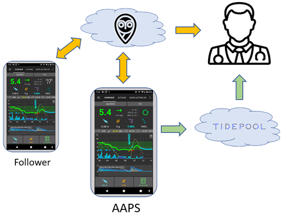

# Einen Server für Berichte einrichten

Derzeit können zwei Berichtsserver mit **AAPS** genutzt werden:

- [Nightscout](https://nightscout.github.io/)
- [Tidepool](https://www.tidepool.org/)



Wir empfehlen Nightscout zu nutzen.

(SettingUpTheReportingServer-nightscout)=
## Nightscout

Nightscout ist eine Web-Anwendung, die Deine CGM-Daten und **AAPS**-Daten protokolliert, anzeigen und daraus Berichte erstellt. Es ist eine leistungsstarke Plattform, die seit vielen Jahren in **AAPS** integriert ist. Es ermöglicht Nutzern und Betreuungspersonen, die Diabetes-Daten des Patienten nahezu in Echtzeit zu verfolgen (bei einer ausreichenden Internetverbindung zwischen allen beteiligten Komponenten können zwischen dem Empfang und der Bereitstellung der Daten nur wenige Sekunden vergehen). Er überträgt auch die Remote-Befehle, die Betreuende von **AAPSClient** aus an **AAPS** senden (siehe [Master ↔ Client-Steuerung](#client-master-control)).

Nightscout steht als Open-Source-Software zur Verfügung. Jeder kann einen Nightscout-Server erstellen und betreiben, entweder kostenlos oder als kostenpflichtiger Dienst.

Mehr Informationen hierzu findest Du auf der [Website des Nightscout-Projekts](http://nightscout.github.io/).

### Option 1 - Richte Deinen Nightscout-Server selbst ein

Das Einrichten Deines Nightscout-Berichtsservers kann eine oder mehrere webbasierte Anwendungen erfordern, die gepflegt werden wollen. Um einen vollständig kostenlosen Service zu haben, musst Du im Fall, dass ein Anbieter seinen Service nicht mehr kostenfrei anbietet, Deine Nightscout-Website und Deine Daten umziehen (migrieren).

Eine Beschreibung, wie Du Nightscout erstellen kannst, welche Vor- und Nachteile die verschiedenen Pflege- und Betriebsoptionen (und die damit verbundenen Kosten) haben, findest Du [hier](https://nightscout.github.io/nightscout/new_user/#free-diy).

### Option 2 - Nutze einen gehosteten Nightscout-Bezahldienst

Es gibt auch Optionen von verschiedenen Dienstleistern, die Nightscout für eine monatliche Gebühr für Dich hosten. Die Kosten sind überschaubar, und der Vorteil einer gehosteten Option besteht darin, dass Du ohne IT-Kenntnisse auskommst und auch keine eigene technische Infrastruktur haben musst.


Von Zeit zu Zeit schauen sich bestehende Nightscout-Nutzende an, wie und wo ihr Nightscout-Server gehostet wird und steigen auf andere Optionen um, wenn diese für sie besser passen.

Einige der gehosteten Services für Nightscout („Bezahldienste“) sind [hier](https://nightscout.github.io/nightscout/new_user/#vendors-comparison-table) gelistet.

### Weitere Konfiguration von Nightscout

Sobald Du Deine Nightscout-Seite installiert und lauffähig hast, gehe zur [Nightscout-Konfigurationsseite](../SettingUpAaps/Nightscout.md), um weitere Einstellmöglichkeiten kennenzulernen.

(SettingUpTheReportingServer-tidepool)=
## Tidepool

Tidepool ist erst seit der Ende 2023 erschienenen Version 3.2 in **AAPS** verfügbar.

```{admonition} Tidepool with **AAPS** is only for reporting
:class: danger
Da es bei der Verwendung von **AAPS** zwischen Dateneingang und Datenanzeige eine Verzögerung von drei Stunden gibt, ist Tidepool nicht geeignet, um Echtzeit-Informationen mit Betreuenden zu teilen.  
Auf der anderen Seite kann Tidepool eine großartige Lösung sein, wenn Berichte mit dem Diabetes-Team geteilt werden sollen, und Nightscout dort keine akzeptierte Lösung ist.  
```

Tidepool ist ein [Open-Source](https://github.com/tidepool-org)-Projekt. Es bietet die kostenlose Nutzung eines Accounts auf den Tidepool-Servern.

Weitere Informationen, um Tidepool mit AAPS einzurichten, findest Du [hier](../SettingUpAaps/Tidepool.md).

```{admonition} **AAPS** has the uploader for Tidepool integrated
:class: note
Du brauchst die Tidepool Uploadedr App ** nicht nutzen: **AAPS** lädt die Glukosewerte, die Behandlungs- und die Basalinformationen für Dich hoch. Du brauchst nur ein eigenes Tidepool-Konto. Lade Deine Daten nicht mit Tidepools separaten Upload-Tool hoch, da dies zu doppelten Werten führen wird.  
```

## Nächster Schritt

Sobald Du Deinen Reporting-Server eingerichtet hast, kannst Du **AAPS** auf Deinem Smartphone mit dem [Einrichtungsassistenten](./SetupWizard.md) konfigurieren, der **AAPS** auch mit Deinem Reporting-Server verbindet.