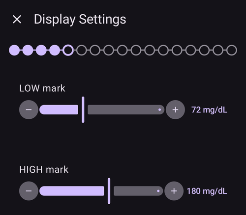
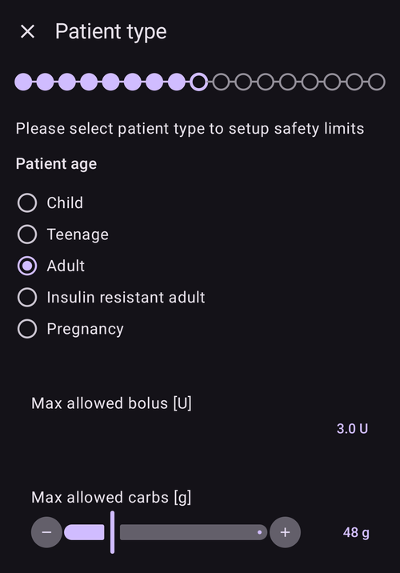
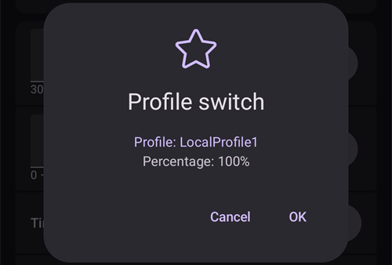
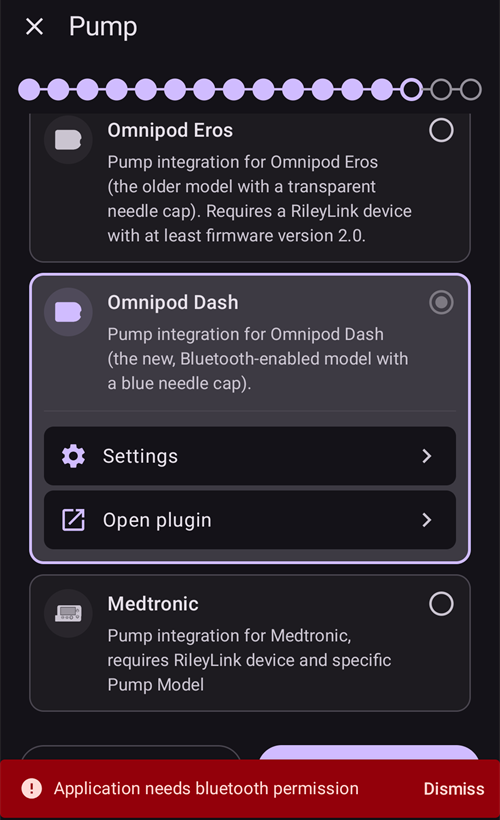

# AAPS Einrichtungsassistent

```{contents} In this page
:backlinks: entry
:depth: 2
```

Wenn Du **AAPS** das erste Mal startest, wird Dich der **Einrichtungsassistent** vollständig durch die Basis-Konfiguration der App leiten. Der **Einrichtungsassistent** führt Dich durch den Prozess, damit nichts Wesentliches vergessen bzw. übersehen wird. Die **Berechtigungseinstellungen** beispielsweise sind für die korrekte **AAPS**-Einrichtung von fundamentaler Bedeutung.

Allerdings muss im ersten Durchlauf mit dem **Einrichtungsassistenten** nicht alles vollständig konfiguriert werden. Du kannst den Assistenten einfach zwischendurch verlassen und die Konfiguration später fortsetzen. There are three routes available after the **Setup Wizard** to further optimize/change the configuration. Diese werden im nächsten Abschnitt erläutert. Deswegen ist es auch OK einige Punkte im Einrichtungsassistenten zu überspringen. Du kannst diese Punkte später (nach-)konfigurieren.

Während und direkt nach dem Du den **Einrichtungsassistenten** genutzt hast, wirst möglicherweise keine signifikanten sichtbaren Veränderungen in **AAPS** bemerken. Um Deinen **AAPS**-Loop zu aktivieren, musst Du **Ziele** (Objectives) bearbeiten und abschließen, damit Funktionalität um Funktionalität freigeschaltet wird. Du startest mit dem **Ziel 1** am Ende des Einrichtungsassistenten. Du bist der „Herr“ über **AAPS**, nicht umgekehrt.

```{admonition} Preview Objectives
:class: note
Wenn Du wissen willst, wie Ziele aufgebaut sind, lies gerne den Abschnitt [Abschließen der Ziele (Objectives)](../SettingUpAaps/CompletingTheObjectives.md) und komme danach hierhin zurück, um den Einrichtungsassistenten als Erstes zu durchlaufen.

```

Aus den Erfahrungen wissen wir, dass neu Beginnende sich oft unter Druck setzen **AAPS** so schnell wie möglich einzurichten. Da aber dabei eine steile Lernkurve durchlaufen werden muss, führt das unter Umständen zu Frustration.

Nimm Dir bitte Zeit, um Deinen Loop zu konfigurieren, die Vorteile eines gut funktionierenden **AAPS**-Loops sind immens.

```{admonition} Ask for Help
:class: note
If there is an error in the documentation or you have a better idea for how something can be explained, you can ask for help from the community as explained at [Connect with other users](../GettingHelp/WhereCanIGetHelp.md).
```
## Begrüßungstext

When the Setup Wizard opens, it greets you with a short welcome message and immediately shows a "**Permissions Required**" panel at the bottom of the screen (see next section).

Once you have granted the permissions, the panel closes and the welcome screen shows a "**Next**" button. Press "**NEXT**" to continue:


## Erforderliche Berechtigungen

**AAPS** needs a few permissions to operate correctly. The Wizard groups them on a single "**Permissions Required**" panel, each with its own "**Grant**" button. Grant them one by one — the icon next to each item turns into a tick once it is done.


### Battery optimization

Der Akkuverbrauch ist bei Smartphones immer noch ein Thema, da die Akku-Kapazität noch ziemlich begrenzt ist. Daher ist das Android-Betriebssystem auf Deinem Smartphone ziemlich restriktiv, was die Ausführung von Anwendungen und den Verbrauch von CPU-Zeit und damit des Akkus betrifft.

**AAPS** muss regelmäßig ausgeführt werden, _z.B._ um die Glukosewerte alle paar Minuten zu empfangen und dann den Algorithmus anzuwenden, der basierend auf Deinen Spezifikationen entscheidet, wie mit Deinen Glukosewerten umzugehen ist. Therefore it must be excluded from battery optimization.

Press "**Grant**" next to "**Battery Optimization**", then select "**Allow**" on the "Let app always run in background?" dialog:


(SetupWizard-StoragePermission)=

### AAPS Directory

**AAPS** needs to store its settings and log information on the permanent storage of your smartphone. Permanenter Speicher bedeutet, dass es auch nach dem Neustarten Deines Smartphones verfügbar sein wird. Andere Informationen gehen einfach verloren, da sie nicht im permanenten Speicher abgelegt sind.

Press "**Grant**" next to "**AAPS Directory**". This opens the file system on your phone and lets you choose where **AAPS** stores its information.

```{tip}
Es wird empfohlen das AAPS-Standardverzeichnis zu nutzen.</br>
Wähle **kein** AAPS-Unterverzeichnis aus.
```

Das Standardverzeichnis ist **AAPS**, aber Du kannst jedes beliebige Verzeichnis nutzen. Create the directory if necessary, enter it and choose "**USE THIS FOLDER**":


Confirm with "**ALLOW**" that you wish to grant access to **AAPS** to the selected directory:


### Benachrichtigungen

Wenn Apps Benachrichtigungen senden möchten, benötigt Android hierfür eine besondere Berechtigung.

While it is a good feature to disable notifications _e.g._ from social media apps, it is essential that you allow **AAPS** to send you notifications.

Press "**Grant**" next to "**Notifications**" and select "**Allow**" at the system prompt:


### Alarms and reminders

On **Android 14 and newer**, **AAPS** needs the "**Alarms and reminders**" permission so that alarms can wake the screen while **AAPS** is in the background, and so that reminders (for example from an **Automation**) ring on time.

This item is only shown while it is needed. Once **AAPS** is excluded from battery optimization (see above), Android grants exact alarms automatically and the item disappears. If it is still listed, press "**Grant**" next to "**Alarms and reminders**". This opens a system settings screen for **AAPS**; enable the toggle and return to **AAPS**. On Android 13 and older this item does not appear and no action is needed.

Once all the permissions show a tick (three, or four on Android 14 and newer), the "**Permissions Required**" panel closes by itself and you can press "**NEXT**" on the welcome screen to continue.

(setup-wizard-bluetooth-battery-optimisation)=
### Bluetooth battery optimization

```{admonition} Extra Android setting, not part of the Wizard
:class: note
The following is additional Android configuration done outside of the Setup Wizard. It is not one of the "Grant" buttons above, but it is important for a reliable pump connection.
```

Newer versions of Android have added battery optimization to the system Bluetooth application too.

As well as disabling battery optimization for **AAPS**, you will likely need to also disable this for the Bluetooth system app. Falls das nicht gemacht wird, kann das zu Pumpen-Verbindungsabbrüchen und anderen Problemen führen.

***HINWEIS: Die xDrip-Dokumentation beschreibt hier ([xDrip-Dokumentation](https://navid200.github.io/xDrip/docs/BluetoothBatteryOpt.html)) genau, wie Du vorgehen musst:***

Follow these steps on Android 16; other versions will vary slightly from the provided screenshots:

1. Öffne die Android-Einstellungen und suche nach **Apps** und öffne die App-Einstellungen.

   

2. Du wirst einige App-Einstellungen sehen, allerdings müssen auch die verborgenen angezeigt werden, damit wir alle Apps sehen können. Tippe auf **Alle Apps**, um alle einzublenden.

   

3. As the Bluetooth app is a system app, it's hidden by default, so we need to show system apps. Click on the **three dots** (⋮) on the top right (1). Then click on **Show system** (2).

   

4. Suche die `Bluetooth`-App und tippe `Bluetooth` und/oder `Legacy Bluetooth`, wenn es beide geben sollte. Achte darauf, dass die Anpassungen für beide Apps erfolgen.

   ***HINWEIS: Du kannst den `Bluetooth MIDI Service` ignorieren. Dieser wird von AAPS nicht genutzt***

           

   1. Bei Android 12 tippe auf `Akku`, Android 13+ tippe auf `Akkuverbrauch`,

   )   

5. Bei Android 12+ wähle `Nicht eingeschränkt` als Option aus, auf Android 15+ musst Du `Hintergrundnutzung zulassen` konfigurieren. Um das zu tun, tippe auf den rot hervorgehobenen Bereich. Zum Abschließen befolge den Schritt 6.

       

6. Bei Android 16 wähle `Nicht eingeschränkt` aus

   

## Lizenzvereinbarung

In der Endbenutzer-Lizenzvereinbarung gibt es wichtige Informationen über die rechtlichen Aspekte zur **AAPS**-Nutzung. Bitte lies diese sorgfältig.

Wenn Du die Endnutzer-Lizenzvereinbarung nicht verstehst oder sie nicht akzeptierst, nutze **AAPS** bitte überhaupt nicht!

If you understand and agree, please press the "**I UNDERSTAND AND AGREE**" button and follow the Setup Wizard:


A "**Next**" button appears once you have agreed. Press "**NEXT**".

The next screen, "**Permissions**", lists the permissions again. They should all show a tick, as you granted them at the start. If one is missing, press "**Grant**" next to it. Press "**NEXT**" to continue:


## Master-Passwort

As the configuration of **AAPS** contains some sensitive data (_e.g._ the access token for your Nightscout server) it is encrypted by a password you set here.

The Wizard shows "**Password not set**". Press "**Set**":


This opens the "**Protection**" screen. Press "**Master password**" (shown as "Password not set"):


Enter the same password in both fields and press "**OK**":


Go back with the arrow in the top left corner. The Wizard now shows "**Password set!**":


```{admonition} Do not lose your Master Password
:class: danger
Please **DO NOT LOSE YOUR MASTER PASSWORD**. Make a note of it _e.g._ on Google Drive, which is a good place as it is backed up by Google for you. Dein Smartphone oder Dein PC kann abstürzen und Du hast dann möglicherweise keine aktuelle Kopie zur Hand. Wenn Du Dein Master-Passwort vergessen hast, wird es schwierig, Deine Profilkonfiguration wiederherzustellen und den Fortschritt bei der Bearbeitung der **Ziele** (Objectives) später zu rekonstruieren.
```

When you are done, press "**NEXT**" to go to the next screen.

(setup-wizard-import-settings)=
## Importiere die Einstellungen

This screen is only shown when **AAPS** finds settings exported earlier in the **AAPS** directory ("Stored settings found"), for example when you reinstall the app or move to a new phone.

- To restore your previous configuration, press "**Import settings**" — see [Export & import settings](../Maintenance/ExportImportSettings.md).
- To start with a new configuration, press "**NEXT**" and continue with the Wizard.


## Einheiten (mg/dl <-> mmol/l)

Please select if your glucose values are in mg/dL or mmol/L, then press the "**NEXT**" button:


## Display Settings

Here you set the "**LOW mark**" and "**HIGH mark**" for the sensor glucose display. Glucose values between these two marks are shown as "in range". You can leave the default values (72 and 180 mg/dL) for now, and edit them later.

Die gewählten Werte wirken sich nur auf die Darstellung in Grafik aus. Weitere Auswirkungen haben sie nicht.

Dein eigentliches Glukoseziel (Zielbereich) ist _beispielsweise_ separat in Deinem Profil festgelegt.

Der für die Analyse der TIR (Time In Range) relevante Bereich wird separat in Deinem Auswertungsserver festgelegt.

Adjust the marks with the "−" / "+" buttons if needed, then press the "**NEXT**" button:



(SetupWizard-synchronization-with-the-reporting-server-and-more)=
## Communication

The "**Communication**" screen lists the plugins used to upload, synchronize and broadcast your data:

- **SMS Communicator** – remote control of **AAPS** using SMS commands
- **NSClientV3** – synchronizes your data with Nightscout using the v3 API
- **Tidepool** – uploads data to Tidepool
- **xDrip** – sends data to xDrip
- **Open Humans** – upload and donate your diabetes data to scientific projects
- **Wear** – monitor and control **AAPS** from a WearOS watch
- **External Companion Apps** – data broadcasting to various external apps
- **Garmin** – connection to a Garmin device


Scroll down to see the rest of the list:


You could configure several of these now, but for the first run we will just focus on the reporting server. If you are not able to set it up at the moment, skip it for now — you can configure it later.

In this example we use Nightscout as reporting server. Tick the box on the right of "**NSClientV3**" to enable it. Für Tidepool ist es sogar noch einfacher, da Du nur Deine persönlichen Login-Daten benötigst.

Once enabled, press "**Settings**" below NSClientV3 to configure it:


Here you configure the Nightscout reporting server. The NSClientV3 settings are shown as one scrollable page:


Press "**Nightscout URL**" and enter your personal Nightscout server address (the URL you set up yourself, or were given by your service provider). Confirm with "**OK**".

Press "**Nightscout access token**" and enter the access token for your Nightscout server. Ohne dieses Token, wird der Zugriff nicht funktionieren. If you don't have it yet, please check the documentation for setting up the reporting server.

Leave "**Use websockets**" enabled for real-time communication with Nightscout.

The remaining sections can be left at their defaults for now. They are described here so you know where to find them later:

**Alarm options** — Nightscout alarms, announcements and stale-data thresholds. Leave the switches off for now; we only open them so you are aware of the options.

**Connection settings** — choose how data is transferred. Caregivers must enable "**Use cellular data**", otherwise the phone of the person they care for (_e.g._ a child) cannot upload outside Wi-Fi range, _e.g._ on the way to school. Other users can disable cellular transfer to save data or battery. If in doubt, leave everything enabled.


**Advanced Settings** — enable "**Log app start event**" if you want to see in Nightscout when the app restarts (useful for caregivers). Keep "**Create announcements from errors**" and "**Create announcements from carbs required**" enabled. Leave "**Use slow sync**" off; you would only use it if the Nightscout server is slow to process a large amount of data.


Go back to the list of plugins and press "**NEXT**" to go to the next screen.

## Client control

From **AAPS** version 4, client devices running **AAPSClient** can be **paired** with this phone (the **master**) and control it with signed commands sent over Nightscout. This is the new recommended way to control **AAPS** remotely — see [Master ↔ Client control](../RemoteFeatures/ClientMasterControl.md) for the full explanation and setup.

There is nothing you have to configure on this screen now; you can pair clients at any time later from **Manage → Authorized clients**. There you add a client with a **QR code** (it sets up Nightscout on the client too) or with a **PIN**, and give it a **role**.

- "**Authorized clients**" — manage the paired client devices allowed to control this master.
- "**Nightscout data acceptance**" — accepting treatments and data entered directly in Nightscout (the old, less secure way) is now turned off by default. Only open these settings if you still need it, _e.g._ to enter data through Nightscout or third-party apps.

When client control is already on — always in [Simple Mode](#preferences-simple-mode) — this phone is in [hardened mode](#client-master-control-hardened-mode): it takes changes only from paired clients, so the screen explains hardened mode instead of offering the "**Nightscout data acceptance**" settings.


"**Nightscout data acceptance**" opens the "**Synchronization**" settings, where each kind of data received from Nightscout has its own switch:


Press "**NEXT**" to go to the next screen.

(setup-wizard-instance-name)=
## Who is using this phone?

Here you enter the name of the person using this phone. It tells this **AAPS** instance apart from others in reports and when synchronizing, for example if two children in your family use **AAPS**. It is also used in the names of exported settings files and shown on the watch.

Das kann alles sein. You can change it later in **Settings → General → Instance name**.

Press "**NEXT**" to go to the next screen.


## Patiententyp

Hier legst Du den „Patiententyp“ fest, der dazu führt, dass die **AAPS**-Software je nach Alter des Patienten unterschiedliche Grenzwerte berücksichtigt. Dies ist aus Sicherheits- und Schutzgründen wichtig.

An dieser Stelle wird auch die **maximal erlaubte Bolusgröße** für eine Mahlzeit festgelegt. Das ist der größte Bolus, der üblicherweise zum Abdecken einer Mahlzeit benötigt wird. It's a security feature to help avoid accidentally overdosing when you are bolusing for a meal.

Das zweite Limit ist ähnlich konzipiert und bezieht sich auf die maximale zu erwartende Kohlenhydrataufnahme.

After setting these values, press "**NEXT**" to go to the next screen:



## Insulin

Here you configure the insulin used in your pump. New insulin profiles require a **DIA of at least 5 h**.

Press the "**Insulin**" button to open the insulin editor:


In the editor you can give the insulin a **nickname** and set its **Peak** (in minutes) and **DIA** (in hours). The quickest way is to load a preset with "**Load peak from**" — choose **Novorapid**, **Fiasp** or **Lyumjev** — and the peak is filled in for you. The graph at the bottom previews the resulting insulin activity curve.


Pick the preset that matches your insulin, for example **Fiasp**:


```{admonition} Use your insulin brand's preset peak
:class: danger
Please don't change the peak unless you are an expert — usually the preset values work well for each branded insulin.
```

If you are a new **AAPS** user, set **DIA** to 9 hours — see [Duration of insulin action (DIA) and peak](#Config-Builder-insulin-dia) to understand why.

```{admonition} "Insulin configuration changed" dialog
:class: note
If a paired client (_e.g._ another phone) has changed the insulin configuration, a dialog appears. Press **OK** to load their changes, or **Cancel** to keep editing (your next save will overwrite theirs).
```


Press the save icon (top right), then press "**NEXT**" to go to the next screen.

## Blutzucker-Quelle

Here you select where **AAPS** gets its glucose data from. Zum Thema [BZ-Quelle](../Getting-Started/CompatiblesCgms.md) lies bitte die Dokumentation.

Many sources are available — scroll through the list and select the one you use:


Once you select a source, its card expands and shows two buttons: "**Settings**" to adjust how the data is received, and "**Open plugin**" to open the source's own screen. In the example below, **BYODA** is selected. Some sources have nothing to configure at this stage, so you can usually go straight to the next screen:


After making your selection, press "**NEXT**" to go to the next screen.

(setup-wizard-profile)=
## Profil

Wir kommen jetzt zu einem sehr wichtigen Bereich des Einrichtungsassistenten.

Bitte lies die Dokumentation zu den [Profilen](../SettingUpAaps/YourAapsProfile.md), bevor Du versuchst Deine Profildetails auf der folgenden Seite einzugeben.

```{admonition} Working profile required - no exceptions here !
:class: danger
Ein genau passendes Profil ist notwendig, damit **AAPS** sicher arbeiten kann.

Es ist erforderlich, dass Du Dein Profil mit Deiner Ärztin oder Deinem Arzt bestimmt und besprochen hast. Basalrate, Korrekturfaktoren (ISF) und Essensfaktoren (IC) müssen ausgetestet sein und sich bewiesen haben!

Wenn ein Roboter eine falsche Eingabe bekommt, wird er versagen - immer wieder. **AAPS** kann nur mit den zur Verfügung gestellten Informationen arbeiten. Wenn Dein Profil zu stark ist, riskierst Du Hypoglykämien, und wenn es zu schwach ist, riskierst Du Hyperglykämien. 
```

Press the "**Profile**" button to open the profile editor:


The editor opens empty ("No records available"). Press the "**+**" button at the bottom to create a new profile:


Auf lange Sicht kannst Du - wenn nötig - mehrere Profile haben. Wir erstellen hier nur eines.

```{admonition} Profile only for tutorial - not for your usage
:class: note
The example profile here is only to show you how to enter data.

It is not intended to be an accurate profile or something very well optimized, because each person's needs are so different.

Verwende es nicht zum echten Loopen!
```

The new profile (for example "**LocalProfile1**") has four tabs: **IC**, **ISF**, **BAS** and **TARG**. Press the pencil next to the profile name to rename it. Fill in every tab — a tab stays red and shows an error message until it contains valid values:


Press "**IC**" and enter your [IC](#your-aaps-profile-insulin-to-carbs-ratio) values. Use the "**+**" button to add more time blocks:


Press "**ISF**" and enter your [ISF values](#your-aaps-profile-insulin-sensitivity-factor):


Press "**BAS**" and enter your [basal values](#your-aaps-profile-basal-rates):


Press "**TARG**" and enter your blood sugar target values.

Für offenes Looping kann dieser Zielbereich breiter sein, da **AAPS** Dich sonst ständig darauf hinweisen wird, die temporäre Basalrate oder eine andere Einstellung zu ändern. Das kann sehr anstrengend werden.

Im Cloosed Loop hast Du später in der Regel nur einen einzigen Wert (keinen Bereich) für oben und unten. Das erleichtert es **AAPS**, das Ziel zu erreichen und bietet und erlaubt eine insgesamt bessere Steuerung des Diabetes.


When all four tabs are valid, the **save icon** (top right) becomes active. Press it to save the profile:


Close the editor with the "**X**" in the top left corner. The profile summary then shows its name, its total daily basal (∑), the units and the IC and ISF values with their graphs:


```{admonition} Several defined but only one active profile
:class: note
You can have several profiles defined, but only one activated profile running at any given time.
```

Press the "**▶**" (activate) button at the bottom right. The "**Activate**" screen opens. As no insulin is in use yet, it first asks you to select the insulin you are using, so that the profile switch can record it. The "**Activate**" button stays greyed out until you do:


Press "**Select Insulin**" and choose the insulin you configured earlier. Leave the percentage at 100 % and press "**Activate**":


A profile switch dialog appears. In this case let it stay as preset and confirm with "**OK**":

```{admonition} Profile switch dialog
:class: note
You will learn later how to use this general dialog to handle situations like illness or sport, where you need to change your profile to suit the circumstances.
```



Your profile is now active. Press "**NEXT**" to go to the next screen.

## Insulinpumpe

Now you select your insulin pump. Bitte lies die Dokumentation zu Deiner [Insulinpumpe](../Getting-Started/CompatiblePumps.md).

Scroll the list and select your pump. In this example we use the "**Virtual Pump**", which is useful while you are still learning and have not connected a real pump yet:


Many pumps are supported — scroll down to find yours:


When you select a real pump, **AAPS** asks for a confirmation, because it will copy the basal rates of your profile to the pump and overwrite the basal rates stored there. Press "**OK**" only if the basal rates in your **AAPS** profile are correct; otherwise press "**Cancel**" and switch to the pump later:


If the pump you select communicates over Bluetooth, **AAPS** asks for permission to connect to nearby devices once you finish the Wizard (see [Bluetooth permission](#bluetooth-permission)).

If you have already set up your profile and know how to connect your pump, feel free to connect it now. Otherwise leave it on **Virtual Pump** for the moment — you can change it anytime, or leave the Setup Wizard using the arrow in the top left corner and let **AAPS** first show you some blood glucose values.

Press "**NEXT**" to go to the next screen.

## Der APS Algorithmus

Nutze den OpenAPS SMB-Algorithmus als Deinen APS-Algorithmus. Despite the name, the SMB feature of the algorithm is disabled until you are familiar with AAPS and have worked through the first objectives. OpenAPS SMB is newer and generally better than OpenAPS AMA anyway.

SMB is disabled at the start because the SMB feature reacts faster to a blood sugar increase, using a Super Micro Bolus instead of increasing the basal rate percentage. Because your profile is generally not as good in the beginning as it is after some experience, the feature is disabled at first.

```{admonition} Only use the older algorithm **OpenAPS AMA** if you know what you are doing
:class: note
OpenAPS AMA is the most basic algorithm which does not support micro boluses to correct high values. Es könnte Situationen geben, in denen es besser ist, diesen Algorithmus zu verwenden, aber das ist nicht die Empfehlung.
```

Select "**OpenAPS SMB**", then press "**Settings**" to see the details:


The only option here is "**Use dynamic sensitivity**". Leave it off and change nothing for now — just read the text.

Aufgrund der Einschränkungen, die durch die**Ziele** eingeführt werden, kannst Du im Moment sowieso weder „Closed Loop“ noch „SMB-Funktionalitäten“ verwenden.

Go back and press "**NEXT**" to go to the next screen:


## Empfindlichkeitserkennung

Leave "**Sensitivity Oref1**" selected as the standard sensitivity plugin:


If you press "**Settings**" you can review the absorption settings; the defaults (_e.g._ a 6 h absorption cutoff) are fine for now.


Press "**NEXT**" to go to the next screen.

## Starte das erste Ziel (Objective 1)

You are now entering the Objectives — the qualification for access to further **AAPS** features.

Press "**Open Objectives**":


Hier beginnen wir jetzt mit dem ersten Ziel (Objective 1), auch wenn unser Setup im Moment noch nicht vollständig ist, um dieses Ziel erfolgreich abzuschließen. Aber das ist der Beginn.

Press the "**Start**" button next to "**1. Objective**":


The objective expands to show its individual checks. You can see that you already made some progress, while other items are still to be done:


Go back, then press "**FINISH**" to complete the Setup Wizard:


After pressing "**FINISH**" you arrive at the main screen of **AAPS**. A "**Notification**" panel may open with information messages, for example about the profile switch you just made — press "**Dismiss**" below each message to clear it.

Solltest Du versehentlich den Einrichtungsassistenten verlassen haben, kannst Du ihn entweder einfach neu starten oder die [Konfiguration des AAPS Loop](../SettingUpAaps/ChangeAapsConfiguration.md) manuell vornehmen.

## Bluetooth permission

If you select a pump that connects over Bluetooth (for example **Omnipod Dash**), a banner reminds you that **AAPS** needs Bluetooth permission. You can press "**Dismiss**" for now — the permission is granted after you finish the Wizard:



Once the Setup Wizard is finished, the **AAPS** main screen shows a "**Permissions Required**" panel. The other permissions are already granted; press "**Grant**" next to "**Bluetooth**":


Select "**Allow**" so **AAPS** can find and connect to your pump:


Wenn Dein **AAPS**-Loop nun fertig eingerichtet ist, gehe zum nächsten Abschnitt [„Abschließen der Ziele (Objectives)“](../SettingUpAaps/CompletingTheObjectives.md).
