# AAPS Einrichtungsassistent

```{contents} In this page
:backlinks: entry
:depth: 2
```

Wenn Du **AAPS** das erste Mal startest, wird Dich der **Einrichtungsassistent** vollständig durch die Basis-Konfiguration der App leiten. Der **Einrichtungsassistent** führt Dich durch den Prozess, damit nichts Wesentliches vergessen bzw. übersehen wird. Die **Berechtigungseinstellungen** beispielsweise sind für die korrekte **AAPS**-Einrichtung von fundamentaler Bedeutung.

Allerdings muss im ersten Durchlauf mit dem **Einrichtungsassistenten** nicht alles vollständig konfiguriert werden. Du kannst den Assistenten einfach zwischendurch verlassen und die Konfiguration später fortsetzen. Nach dem **Einrichtungsassistenten** gibt es drei Wege, die Konfiguration weiter zu optimieren oder zu ändern. Diese werden im nächsten Abschnitt erläutert. Deswegen ist es auch OK einige Punkte im Einrichtungsassistenten zu überspringen. Du kannst diese Punkte später (nach-)konfigurieren.

Während und direkt nach dem Du den **Einrichtungsassistenten** genutzt hast, wirst möglicherweise keine signifikanten sichtbaren Veränderungen in **AAPS** bemerken. Um Deinen **AAPS**-Loop zu aktivieren, musst Du **Ziele** (Objectives) bearbeiten und abschließen, damit Funktionalität um Funktionalität freigeschaltet wird. Du startest mit dem **Ziel 1** am Ende des Einrichtungsassistenten. Du bist der „Herr“ über **AAPS**, nicht umgekehrt.

```{admonition} Preview Objectives
:class: note
Wenn Du wissen willst, wie Ziele aufgebaut sind, lies gerne den Abschnitt [Abschließen der Ziele (Objectives)](../SettingUpAaps/CompletingTheObjectives.md) und komme danach hierhin zurück, um den Einrichtungsassistenten als Erstes zu durchlaufen.

```

Aus den Erfahrungen wissen wir, dass neu Beginnende sich oft unter Druck setzen **AAPS** so schnell wie möglich einzurichten. Da aber dabei eine steile Lernkurve durchlaufen werden muss, führt das unter Umständen zu Frustration.

Nimm Dir bitte Zeit, um Deinen Loop zu konfigurieren, die Vorteile eines gut funktionierenden **AAPS**-Loops sind immens.

```{admonition} Ask for Help
:class: note
Findest Du einen Fehler in der Dokumentation oder hast Du eine Idee, wie sich etwas besser erklären lässt, kannst Du die Community um Hilfe bitten, wie unter [Mit anderen Nutzenden vernetzen](../GettingHelp/WhereCanIGetHelp.md) beschrieben.
```
## Begrüßungstext

Wenn der Einrichtungsassistent startet, begrüßt er Dich mit einer kurzen Willkommensnachricht und zeigt sofort unten auf dem Bildschirm das Fenster „**Berechtigungen erforderlich**“ an (siehe nächster Abschnitt).

Sobald Du die Berechtigungen erteilt hast, schließt sich das Fenster, und der Willkommensbildschirm zeigt den Knopf „**Weiter**“. Tippe auf „**WEITER**“, um fortzufahren:


## Erforderliche Berechtigungen

**AAPS** benötigt einige Berechtigungen, um richtig zu funktionieren. Der Assistent fasst sie im Fenster „**Berechtigungen erforderlich**“ zusammen, jede mit einem eigenen Knopf „**Berechtigung erteilen**“. Erteile sie nacheinander – das Symbol neben jedem Eintrag wird zu einem Haken, sobald es erledigt ist.


### Akku-Optimierung

Der Akkuverbrauch ist bei Smartphones immer noch ein Thema, da die Akku-Kapazität noch ziemlich begrenzt ist. Daher ist das Android-Betriebssystem auf Deinem Smartphone ziemlich restriktiv, was die Ausführung von Anwendungen und den Verbrauch von CPU-Zeit und damit des Akkus betrifft.

**AAPS** muss regelmäßig ausgeführt werden, _z.B._ um die Glukosewerte alle paar Minuten zu empfangen und dann den Algorithmus anzuwenden, der basierend auf Deinen Spezifikationen entscheidet, wie mit Deinen Glukosewerten umzugehen ist. Deshalb muss es von der Akku-Optimierung ausgenommen werden.

Tippe neben „**Akku-Optimierung**“ auf „**Berechtigung erteilen**“ und wähle dann im Dialog „App immer im Hintergrund ausführen lassen?“ die Option „**Zulassen**“:

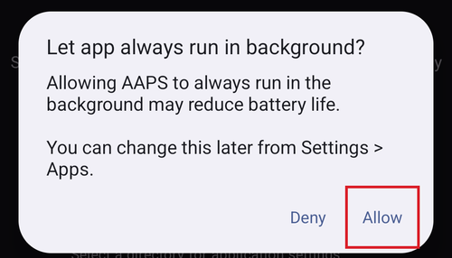

(SetupWizard-StoragePermission)=

### AAPS Directory

**AAPS** muss seine Einstellungen und Log-Informationen im permanenten Speicher Deines Smartphones ablegen. Permanenter Speicher bedeutet, dass es auch nach dem Neustarten Deines Smartphones verfügbar sein wird. Andere Informationen gehen einfach verloren, da sie nicht im permanenten Speicher abgelegt sind.

Tippe neben „**AAPS-Verzeichnis**“ auf „**Berechtigung erteilen**“. Damit öffnet sich das Dateisystem Deines Smartphones, und Du kannst auswählen, wo **AAPS** seine Informationen speichert.

```{tip}
Es wird empfohlen das AAPS-Standardverzeichnis zu nutzen.</br>
Wähle **kein** AAPS-Unterverzeichnis aus.
```

Das Standardverzeichnis ist **AAPS**, aber Du kannst jedes beliebige Verzeichnis nutzen. Lege das Verzeichnis bei Bedarf an, öffne es und wähle „**DIESEN ORDNER VERWENDEN**“:


Bestätige mit „**ZULASSEN**“, dass Du **AAPS** Zugriff auf das ausgewählte Verzeichnis gewähren möchtest:


### Benachrichtigungen

Wenn Apps Benachrichtigungen senden möchten, benötigt Android hierfür eine besondere Berechtigung.

Auch wenn es grundsätzlich sinnvoll ist, Benachrichtigungen _z. B._ von Social-Media-Apps zu deaktivieren, ist es zwingend notwendig, dass Du **AAPS** erlaubst, Dir Benachrichtigungen zu senden.

Tippe neben „**Benachrichtigungen**“ auf „**Berechtigung erteilen**“ und wähle in der Systemabfrage „**Zulassen**“:


### Alarme und Erinnerungen

Ab **Android 14** benötigt **AAPS** die Berechtigung „**Alarme und Erinnerungen**“, damit Alarme den Bildschirm einschalten können, während **AAPS** im Hintergrund läuft, und damit Erinnerungen (zum Beispiel aus einer **Automatisierung**) pünktlich klingeln.

Dieser Eintrag wird nur angezeigt, solange er benötigt wird. Sobald **AAPS** von der Akku-Optimierung ausgenommen ist (siehe oben), erteilt Android die Berechtigung für exakte Alarme automatisch, und der Eintrag verschwindet. Wird er noch angezeigt, tippe neben „**Alarme und Erinnerungen**“ auf „**Berechtigung erteilen**“. Damit öffnet sich ein Bildschirm der Systemeinstellungen für **AAPS**; schalte den Schalter ein und kehre zu **AAPS** zurück. Unter Android 13 und älter erscheint dieser Eintrag nicht, und Du musst nichts tun.

Sobald alle Berechtigungen einen Haken zeigen (drei, ab Android 14 vier), schließt sich das Fenster „**Berechtigungen erforderlich**“ von selbst, und Du kannst auf dem Willkommensbildschirm auf „**WEITER**“ tippen, um fortzufahren.

(setup-wizard-bluetooth-battery-optimisation)=
### Bluetooth-Akku-Optimierung

```{admonition} Extra Android setting, not part of the Wizard
:class: note
Das Folgende ist eine zusätzliche Android-Einstellung außerhalb des Einrichtungsassistenten. Sie gehört nicht zu den Knöpfen „Berechtigung erteilen“ oben, ist aber wichtig für eine zuverlässige Verbindung zur Pumpe.
```

Neuere Android-Versionen haben auch für die Bluetooth-Systemanwendung eine Akku-Optimierung eingeführt.

Neben der Deaktivierung der Akku-Optimierung für **AAPS** musst Du sehr wahrscheinlich auch die Akku-Optimierung für die Bluetooth-System-App deaktivieren. Falls das nicht gemacht wird, kann das zu Pumpen-Verbindungsabbrüchen und anderen Problemen führen.

***HINWEIS: Die xDrip-Dokumentation beschreibt hier ([xDrip-Dokumentation](https://navid200.github.io/xDrip/docs/BluetoothBatteryOpt.html)) genau, wie Du vorgehen musst:***

Arbeite unter Android 16 die folgenden Schritte ab. Bei anderen Versionen können die Bildschirme leicht von den gezeigten Screenshots abweichen:

1. Öffne die Android-Einstellungen und suche nach **Apps** und öffne die App-Einstellungen.

   

2. Du wirst einige App-Einstellungen sehen, allerdings müssen auch die verborgenen angezeigt werden, damit wir alle Apps sehen können. Tippe auf **Alle Apps**, um alle einzublenden.

   

3. Da die Bluetooth-App eine Systemanwendung ist, ist sie standardmäßig ausgeblendet. Deshalb müssen wir die Systemanwendungen einblenden. Tippe oben rechts auf die **drei Punkte** (⋮) (1). Tippe danach auf **Systemanwendungen anzeigen** (2).

   

4. Suche die `Bluetooth`-App und tippe `Bluetooth` und/oder `Legacy Bluetooth`, wenn es beide geben sollte. Achte darauf, dass die Anpassungen für beide Apps erfolgen.

   ***HINWEIS: Du kannst den `Bluetooth MIDI Service` ignorieren. Dieser wird von AAPS nicht genutzt***

   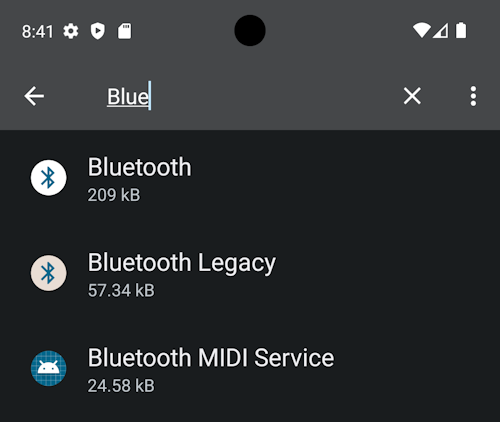        

   1. Tippe unter Android 12 auf `Akku`, ab Android 13 auf `Akkuverbrauch`.

      

5. Bei Android 12+ wähle `Nicht eingeschränkt` als Option aus, auf Android 15+ musst Du `Hintergrundnutzung zulassen` konfigurieren. Um das zu tun, tippe auf den rot hervorgehobenen Bereich. Zum Abschließen befolge den Schritt 6.

       

6. Bei Android 16 wähle `Nicht eingeschränkt` aus

   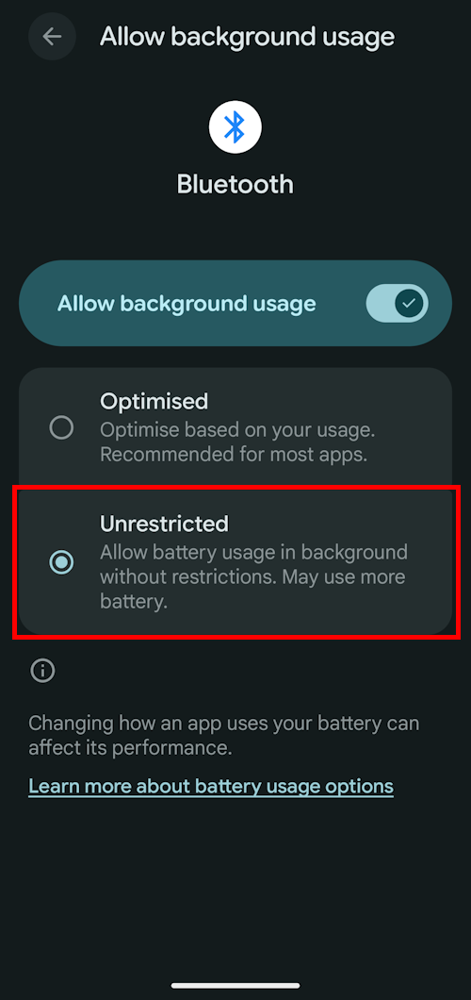

## Lizenzvereinbarung

In der Endbenutzer-Lizenzvereinbarung gibt es wichtige Informationen über die rechtlichen Aspekte zur **AAPS**-Nutzung. Bitte lies diese sorgfältig.

Wenn Du die Endnutzer-Lizenzvereinbarung nicht verstehst oder sie nicht akzeptierst, nutze **AAPS** bitte überhaupt nicht!

Wenn Du sie verstehst und ihr zustimmst, tippe auf „**Ich verstehe und stimme zu.**“ und folge dem Einrichtungsassistenten:

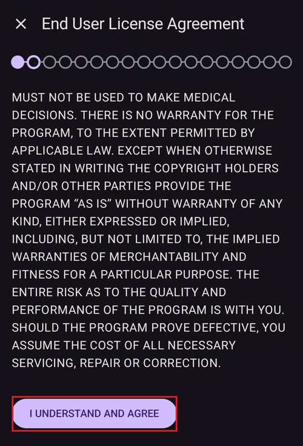

Sobald Du zugestimmt hast, erscheint der Knopf „**Weiter**“. Tippe auf „**WEITER**“.

Der nächste Bildschirm, „**Berechtigungen**“, listet die Berechtigungen noch einmal auf. Sie sollten alle einen Haken zeigen, da Du sie schon am Anfang erteilt hast. Fehlt eine, tippe daneben auf „**Berechtigung erteilen**“. Tippe auf „**WEITER**“, um fortzufahren:


## Master-Passwort

Da die Konfiguration von **AAPS** einige sensible Daten enthält (_z. B._ das Zugriffstoken für Deinen Nightscout-Server), wird sie mit einem Passwort verschlüsselt, das Du hier festlegst.

Der Assistent zeigt „**Passwort nicht festgelegt**“. Tippe auf „**Festlegen**“:


Damit öffnet sich der Bildschirm „**Zugriffsschutz**“. Tippe auf „**Master-Passwort**“ (angezeigt als „Passwort nicht festgelegt“):


Gib in beide Felder dasselbe Passwort ein und tippe auf „**OK**“:


Gehe mit dem Pfeil oben links zurück. Der Assistent zeigt jetzt „**Passwort festgelegt!**“:


```{admonition} Do not lose your Master Password
:class: danger
Bitte **VERLIERE DEIN MASTER-PASSWORT NICHT**. Notiere es Dir _z. B._ in Google Drive; das ist ein guter Ort, weil Google es für Dich sichert. Dein Smartphone oder Dein PC kann abstürzen und Du hast dann möglicherweise keine aktuelle Kopie zur Hand. Wenn Du Dein Master-Passwort vergessen hast, wird es schwierig, Deine Profilkonfiguration wiederherzustellen und den Fortschritt bei der Bearbeitung der **Ziele** (Objectives) später zu rekonstruieren. Siehe [Wie setze ich das Master-Passwort zurück?](#FAQ-reset-master-password)
```

Wenn Du fertig bist, tippe auf „**WEITER**“, um zum nächsten Bildschirm zu gelangen.

(setup-wizard-import-settings)=
## Importiere die Einstellungen

Dieser Bildschirm wird nur angezeigt, wenn **AAPS** im **AAPS**-Verzeichnis früher exportierte Einstellungen findet („Gespeicherte Einstellungen gefunden“), zum Beispiel wenn Du die App neu installierst oder auf ein neues Smartphone wechselst.

- Um Deine bisherige Konfiguration wiederherzustellen, tippe auf „**Einstellungen importieren**“ – siehe [Einstellungen exportieren & importieren](../Maintenance/ExportImportSettings.md).
- Um mit einer neuen Konfiguration zu beginnen, tippe auf „**WEITER**“ und fahre mit dem Assistenten fort.


## Einheiten (mg/dl <-> mmol/l)

Wähle aus, ob Deine Glukosewerte in mg/dl oder mmol/l angegeben sind, und tippe dann auf „**WEITER**“:


## Anzeigeeinstellungen

Hier legst Du die „**Niedrig-Markierung**“ und die „**Hoch-Markierung**“ für die Anzeige der Sensor-Glukosewerte fest. Glukosewerte zwischen diesen beiden Markierungen werden als „im Zielbereich“ angezeigt. Du kannst die Standardwerte (72 und 180 mg/dl) vorerst so lassen und später ändern.

Die gewählten Werte wirken sich nur auf die Darstellung in Grafik aus. Weitere Auswirkungen haben sie nicht.

Dein eigentliches Glukoseziel (Zielbereich) ist _beispielsweise_ separat in Deinem Profil festgelegt.

Der für die Analyse der TIR (Time In Range) relevante Bereich wird separat in Deinem Auswertungsserver festgelegt.

Passe die Markierungen bei Bedarf mit den Knöpfen „−“ / „+“ an und tippe dann auf „**WEITER**“:


(SetupWizard-synchronization-with-the-reporting-server-and-more)=
## Kommunikation

Der Bildschirm „**Kommunikation**“ listet die Module auf, mit denen Deine Daten hochgeladen, synchronisiert und weitergegeben werden:

- **SMS-Kommunikator** – Remote-Steuerung von **AAPS** über SMS-Befehle
- **NSClientV3** – synchronisiert Deine Daten über die API v3 mit Nightscout
- **Tidepool** – lädt Daten zu Tidepool hoch
- **xDrip** – sendet Daten an xDrip
- **Open Humans** – Deine Diabetesdaten hochladen und wissenschaftlichen Projekten spenden
- **Wear** – **AAPS** von einer Wear OS-Smartwatch aus überwachen und steuern
- **Externe Begleit-Apps** – Datenübertragung an verschiedene externe Apps
- **Garmin** – Verbindung zu einem Garmin-Gerät


Scrolle nach unten, um den Rest der Liste zu sehen:


Du könntest jetzt mehrere davon einrichten, aber beim ersten Durchlauf konzentrieren wir uns nur auf den Reporting-Server. Kannst Du ihn gerade nicht einrichten, überspringe ihn vorerst – Du kannst ihn später konfigurieren.

In diesem Beispiel verwenden wir Nightscout als Reporting-Server. Setze rechts neben „**NSClientV3**“ den Haken, um es zu aktivieren. Für Tidepool ist es sogar noch einfacher, da Du nur Deine persönlichen Login-Daten benötigst.

Ist es aktiviert, tippe unter NSClientV3 auf „**Einstellungen**“, um es zu konfigurieren:

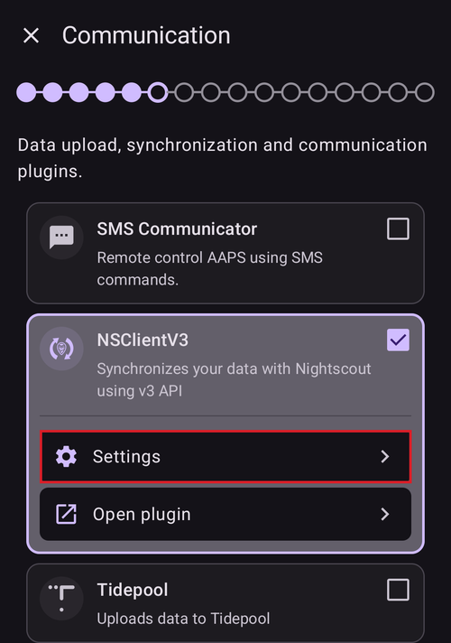

Hier konfigurierst Du den Nightscout-Reporting-Server. Die Einstellungen von NSClientV3 werden als eine scrollbare Seite angezeigt:


Tippe auf „**Nightscout-URL**“ und gib die Adresse Deines persönlichen Nightscout-Servers ein (die URL, die Du selbst eingerichtet oder von Deinem Anbieter erhalten hast). Bestätige mit „**OK**“.

Tippe auf „**Nightscout Zugriffstoken**“ und gib das Zugriffstoken für Deinen Nightscout-Server ein. Ohne dieses Token, wird der Zugriff nicht funktionieren. Hast Du es noch nicht, lies bitte in der Dokumentation zur Einrichtung des Reporting-Servers nach.

Lass „**Websockets verwenden**“ für die Echtzeitkommunikation mit Nightscout eingeschaltet. Websockets sind für die Remote-Steuerung des **AAPSClient** auf beiden Smartphones **zwingend**.

Die übrigen Abschnitte kannst Du vorerst auf ihren Standardwerten lassen. Sie werden hier beschrieben, damit Du später weißt, wo Du sie findest:

**Alarm-Optionen** – Nightscout-Alarme, Ankündigungen und Schwellenwerte für veraltete Daten. Lass die Schalter vorerst ausgeschaltet; wir öffnen sie nur, damit Du die Optionen kennst.

**Verbindungs-Einstellungen** – lege fest, wie Daten übertragen werden. Betreuende müssen „**Mobile Daten verwenden**“ aktivieren, sonst kann das Smartphone der betreuten Person (_z. B._ eines Kindes) außerhalb der WLAN-Reichweite keine Daten hochladen, _z. B._ auf dem Weg zur Schule. Andere Anwender können die Übertragung über Mobilfunk deaktivieren, um Datenvolumen oder Akku zu sparen. Im Zweifel lass alles aktiviert.

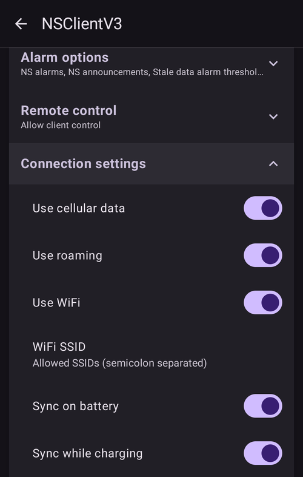

**Erweiterte Einstellungen** – aktiviere „**App-Start protokollieren**“, wenn Du in Nightscout sehen möchtest, wann die App neu startet (nützlich für Betreuende). Lass „**Ankündigungen aus Fehlern generieren**“ und „**Meldungen zum Kohlenhydratbedarf erstellen**“ aktiviert. Lass „**Langsame Synchronisation verwenden**“ ausgeschaltet; das brauchst Du nur, wenn der Nightscout-Server eine große Datenmenge nur langsam verarbeitet.


Gehe zurück zur Liste der Module und tippe auf „**WEITER**“, um zum nächsten Bildschirm zu gelangen.

## Client-Steuerung

Ab **AAPS** Version 4 können Client-Geräte mit **AAPSClient** mit diesem Smartphone (dem **Master**) **gekoppelt** werden und es über signierte Befehle steuern, die über Nightscout gesendet werden. Das ist der neue empfohlene Weg, **AAPS** fernzusteuern – die vollständige Erklärung und Einrichtung findest Du unter [Master ↔ Client-Steuerung](../RemoteFeatures/ClientMasterControl.md).

Auf diesem Bildschirm musst Du jetzt nichts einstellen; Clients kannst Du jederzeit später unter **Verwalten → Autorisierte Clients** koppeln. Dort fügst Du einen Client mit einem **QR-Code** (damit wird auch Nightscout auf dem Client eingerichtet) oder mit einer **PIN** hinzu und gibst ihm eine **Rolle**.

- „**Autorisierte Clients**“ – verwaltet die gekoppelten Client-Geräte, die diesen Master steuern dürfen.
- „**Annahme von Nightscout-Daten**“ – das Annehmen von Behandlungen und Daten, die direkt in Nightscout eingegeben werden (der alte, weniger sichere Weg), ist jetzt standardmäßig ausgeschaltet. Öffne diese Einstellungen nur, wenn Du das noch brauchst, _z. B._ um Daten über Nightscout oder Apps von Drittanbietern einzugeben.

Ist die Client-Steuerung bereits eingeschaltet – im [Einfachen Modus](#preferences-simple-mode) immer –, ist dieses Smartphone im [Geschützten Modus](#client-master-control-hardened-mode): Es übernimmt Änderungen nur von gekoppelten Clients, deshalb erklärt der Bildschirm den Geschützten Modus, statt die Einstellungen „**Annahme von Nightscout-Daten**“ anzubieten.


„**Annahme von Nightscout-Daten**“ öffnet die Einstellungen „**Synchronisierung**“, in denen jede Art von Daten, die von Nightscout empfangen werden, einen eigenen Schalter hat:


Tippe auf „**WEITER**“, um zum nächsten Bildschirm zu gelangen.

(setup-wizard-instance-name)=
## Wer nutzt dieses Smartphone?

Hier gibst Du den Namen der Person ein, die dieses Smartphone nutzt. Er unterscheidet diese **AAPS**-Instanz in Berichten und bei der Synchronisierung von anderen, zum Beispiel wenn in Deiner Familie zwei Kinder **AAPS** verwenden. Er wird auch im Namen exportierter Einstellungsdateien verwendet und auf der Smartwatch angezeigt.

Das kann alles sein. Du kannst ihn später unter **Einstellungen → Allgemeines → Instanzname** ändern.

Tippe auf „**WEITER**“, um zum nächsten Bildschirm zu gelangen.


## Patiententyp

Hier legst Du den „Patiententyp“ fest, der dazu führt, dass die **AAPS**-Software je nach Alter des Patienten unterschiedliche Grenzwerte berücksichtigt. Dies ist aus Sicherheits- und Schutzgründen wichtig.

An dieser Stelle wird auch die **maximal erlaubte Bolusgröße** für eine Mahlzeit festgelegt. Das ist der größte Bolus, der üblicherweise zum Abdecken einer Mahlzeit benötigt wird. Diese Sicherheitsfunktion hilft, eine versehentliche Überdosierung beim Bolen für eine Mahlzeit zu vermeiden.

Das zweite Limit ist ähnlich konzipiert und bezieht sich auf die maximale zu erwartende Kohlenhydrataufnahme.

Wenn Du die Werte festgelegt hast, tippe auf „**WEITER**“, um zum nächsten Bildschirm zu gelangen:

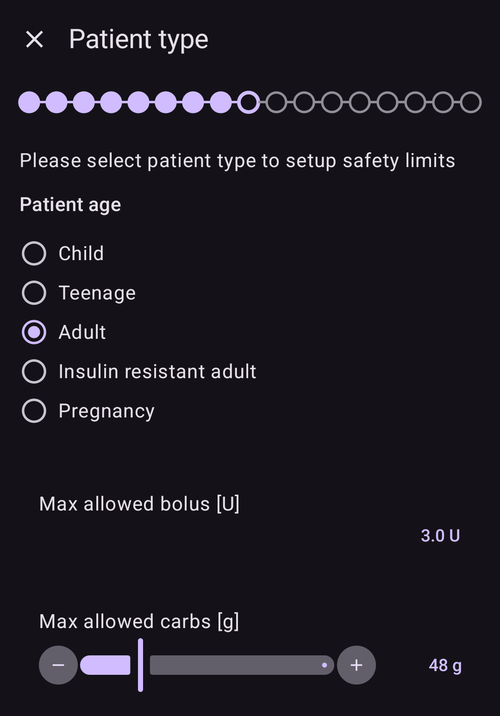

## Insulin

Hier konfigurierst Du das Insulin, das in Deiner Pumpe verwendet wird. Neue Insulinprofile benötigen eine **DIA von mindestens 5 h**.

Tippe auf den Knopf „**Insulin**“, um den Insulin-Editor zu öffnen:


Im Editor kannst Du dem Insulin eine **Kurzbezeichnung** geben und sein **Wirkmaximum** (in Minuten) und die **DIA** (in Stunden) festlegen. Am schnellsten lädst Du mit „**Wirkmaximum laden aus**“ eine Vorlage – wähle **Novorapid**, **Fiasp** oder **Lyumjev** –, dann wird das Wirkmaximum für Dich eingetragen. Die Grafik unten zeigt eine Vorschau der sich ergebenden Insulin-Wirkkurve.


Wähle die Vorlage, die zu Deinem Insulin passt, zum Beispiel **Fiasp**:


```{admonition} Use your insulin brand's preset peak
:class: danger
Bitte ändere das Wirkmaximum nur, wenn Du Experte bist – normalerweise funktionieren die Vorlagewerte für jedes Markeninsulin gut.
```

Wenn Du neu bei **AAPS** bist, stelle die **DIA** auf 9 Stunden ein – warum, erfährst Du unter [Insulinwirkdauer (DIA) und Wirkmaximum](#Config-Builder-insulin-dia).

```{admonition} "Insulin configuration changed" dialog
:class: note
Hat ein gekoppelter Client (_z. B._ ein anderes Smartphone) die Insulinkonfiguration geändert, erscheint ein Dialog. Tippe auf **OK**, um seine Änderungen zu laden, oder auf **Abbrechen**, um weiter zu bearbeiten (Dein nächstes Speichern überschreibt dann seine Änderungen).
```


Tippe auf das Speichern-Symbol (oben rechts) und dann auf „**WEITER**“, um zum nächsten Bildschirm zu gelangen.

## Blutzucker-Quelle

Hier wählst Du aus, woher **AAPS** seine Glukosedaten bekommt. Zum Thema [BZ-Quelle](../Getting-Started/CompatiblesCgms.md) lies bitte die Dokumentation.

Es gibt viele Quellen – scrolle durch die Liste und wähle die aus, die Du verwendest:


Sobald Du eine Quelle auswählst, klappt ihre Karte auf und zeigt zwei Knöpfe: „**Einstellungen**“, um anzupassen, wie die Daten empfangen werden, und „**Modul öffnen**“, um den eigenen Bildschirm der Quelle zu öffnen. Im Beispiel unten ist **BYODA** ausgewählt. Bei manchen Quellen gibt es an dieser Stelle nichts einzustellen, Du kannst also meist direkt zum nächsten Bildschirm gehen:


Nachdem Du Deine Auswahl getroffen hast, tippe auf „**WEITER**“, um zum nächsten Bildschirm zu gelangen.

(setup-wizard-profile)=
## Profil

Wir kommen jetzt zu einem sehr wichtigen Bereich des Einrichtungsassistenten.

Bitte lies die Dokumentation zu den [Profilen](../SettingUpAaps/YourAapsProfile.md), bevor Du versuchst Deine Profildetails auf der folgenden Seite einzugeben.

```{admonition} Working profile required - no exceptions here !
:class: danger
Ein genau passendes Profil ist notwendig, damit **AAPS** sicher arbeiten kann.

Es ist erforderlich, dass Du Dein Profil mit Deiner Ärztin oder Deinem Arzt bestimmt und besprochen hast. Basalrate, Korrekturfaktoren (ISF) und Essensfaktoren (IC) müssen ausgetestet sein und sich bewiesen haben!

Wenn ein Roboter eine falsche Eingabe bekommt, wird er versagen - immer wieder. **AAPS** kann nur mit den zur Verfügung gestellten Informationen arbeiten. Wenn Dein Profil zu stark ist, riskierst Du Hypoglykämien, und wenn es zu schwach ist, riskierst Du Hyperglykämien. 
```

Tippe auf den Knopf „**Profil**“, um den Profil-Editor zu öffnen:


Der Editor öffnet sich leer („Keine Datensätze verfügbar“). Tippe unten auf den Knopf „**+**“, um ein neues Profil anzulegen:


Auf lange Sicht kannst Du - wenn nötig - mehrere Profile haben. Wir erstellen hier nur eines.

```{admonition} Profile only for tutorial - not for your usage
:class: note
Das Beispielprofil hier soll Dir nur zeigen, wie Du die Daten eingibst.

Der Bedarf ist für jede Person sehr unterschiedlich, daher soll und kann dies kein genaues oder besonders gut optimiertes Profil sein.

Verwende es nicht zum echten Loopen!
```

Das neue Profil (zum Beispiel „**LocalProfile1**“) hat vier Reiter: **IC**, **ISF**, **BAS** und **TARG**. Tippe auf den Stift neben dem Profilnamen, um es umzubenennen. Fülle jeden Reiter aus – ein Reiter bleibt rot und zeigt eine Fehlermeldung, bis er gültige Werte enthält:


Tippe auf „**IC**“ und gib Deine [IC](#your-aaps-profile-insulin-to-carbs-ratio)-Werte ein. Mit dem Knopf „**+**“ fügst Du weitere Zeitblöcke hinzu:

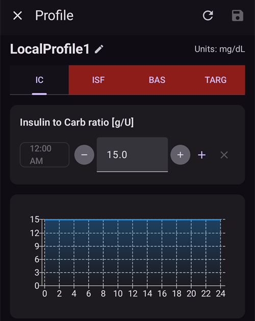

Tippe auf „**ISF**“ und gib Deine [ISF-Werte](#your-aaps-profile-insulin-sensitivity-factor) ein:


Tippe auf „**BAS**“ und gib Deine [Basalwerte](#your-aaps-profile-basal-rates) ein:


Tippe auf „**TARG**“ und gib Deine Glukose-Zielwerte ein.

Für offenes Looping kann dieser Zielbereich breiter sein, da **AAPS** Dich sonst ständig darauf hinweisen wird, die temporäre Basalrate oder eine andere Einstellung zu ändern. Das kann sehr anstrengend werden.

Im Cloosed Loop hast Du später in der Regel nur einen einzigen Wert (keinen Bereich) für oben und unten. Das erleichtert es **AAPS**, das Ziel zu erreichen und bietet und erlaubt eine insgesamt bessere Steuerung des Diabetes.


Sind alle vier Reiter gültig, wird das **Speichern-Symbol** (oben rechts) aktiv. Tippe darauf, um das Profil zu speichern:

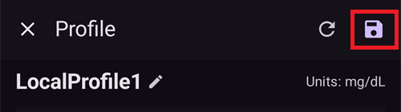

Schließe den Editor mit dem „**X**“ oben links. Die Profilübersicht zeigt dann den Namen, die gesamte tägliche Basalmenge (∑), die Einheiten sowie die IC- und ISF-Werte mit ihren Graphen:


```{admonition} Several defined but only one active profile
:class: note
Du kannst mehrere Profile anlegen, aber es läuft immer nur ein aktiviertes Profil.
```

Tippe unten rechts auf den Knopf „**▶**“ (Aktivieren). Der Bildschirm „**Aktivieren**“ öffnet sich. Da noch kein Insulin verwendet wird, fordert er Dich zuerst auf, das Insulin auszuwählen, das Du verwendest, damit der Profilwechsel es speichern kann. Der Knopf „**Aktivieren**“ bleibt ausgegraut, bis Du das getan hast:


Tippe auf „**Insulin auswählen**“ und wähle das Insulin, das Du vorher konfiguriert hast. Lass den Prozentsatz auf 100 % und tippe auf „**Aktivieren**“:


Ein Dialog zum Profilwechsel erscheint. Lass die Vorgaben in diesem Fall unverändert und bestätige mit „**OK**“:

```{admonition} Profile switch dialog
:class: note
Später lernst Du, wie Du diesen allgemeinen Dialog nutzt, um das Profil an besondere Situationen wie Krankheit oder Sport anzupassen.
```

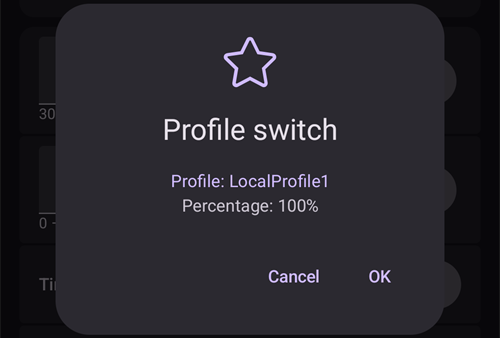

Dein Profil ist jetzt aktiv. Tippe auf „**WEITER**“, um zum nächsten Bildschirm zu gelangen.

## Insulinpumpe

Jetzt wählst Du Deine Insulinpumpe aus. Bitte lies die Dokumentation zu Deiner [Insulinpumpe](../Getting-Started/CompatiblePumps.md).

Scrolle durch die Liste und wähle Deine Pumpe aus. In diesem Beispiel verwenden wir die „**Virtuelle Pumpe**“, die nützlich ist, solange Du noch lernst und noch keine echte Pumpe verbunden hast:


Viele Pumpen werden unterstützt – scrolle nach unten, um Deine zu finden:


Wenn Du eine echte Pumpe auswählst, fragt **AAPS** nach einer Bestätigung, weil es die Basalraten Deines Profils in die Pumpe kopiert und die dort gespeicherten Basalraten überschreibt. Tippe nur dann auf „**OK**“, wenn die Basalraten in Deinem **AAPS**-Profil stimmen; tippe sonst auf „**Abbrechen**“ und wechsle die Pumpe später:


Kommuniziert die ausgewählte Pumpe über Bluetooth, bittet **AAPS** nach Abschluss des Assistenten um die Berechtigung, sich mit Geräten in der Nähe zu verbinden (siehe [Bluetooth-Berechtigung](#setup-wizard-bluetooth-permission)).

Wenn Du Dein Profil schon eingerichtet hast und weißt, wie Du Deine Pumpe verbindest, kannst Du sie jetzt gern verbinden. Lass sie andernfalls vorerst auf **Virtuelle Pumpe** – Du kannst das jederzeit ändern oder den Einrichtungsassistenten mit dem Pfeil oben links verlassen und Dir von **AAPS** zuerst einige Glukosewerte anzeigen lassen.

Tippe auf „**WEITER**“, um zum nächsten Bildschirm zu gelangen.

## Der APS Algorithmus

Nutze den OpenAPS SMB-Algorithmus als Deinen APS-Algorithmus. Trotz des Namens ist die SMB-Funktion des Algorithmus deaktiviert, bis Du mit AAPS vertraut bist und die ersten Ziele abgeschlossen hast. OpenAPS SMB ist ohnehin neuer und im Allgemeinen besser als OpenAPS AMA.

SMB ist anfangs deaktiviert, weil die SMB-Funktion schneller auf einen Glukoseanstieg reagiert, indem sie einen Super Micro Bolus gibt, statt den Prozentsatz der Basalrate zu erhöhen. Weil Dein Profil am Anfang meist noch nicht so gut ist wie nach einiger Erfahrung, ist die Funktion zunächst deaktiviert.

```{admonition} Only use the older algorithm **OpenAPS AMA** if you know what you are doing
:class: note
OpenAPS AMA ist der einfachste Algorithmus und unterstützt keine Micro-Boli zur Korrektur hoher Werte. Es könnte Situationen geben, in denen es besser ist, diesen Algorithmus zu verwenden, aber das ist nicht die Empfehlung.
```

Wähle „**OpenAPS SMB**“ und tippe dann auf „**Einstellungen**“, um die Details zu sehen:


Die einzige Option hier ist „**Dynamische Empfindlichkeit verwenden**“. Lass sie ausgeschaltet und ändere vorerst nichts – lies nur den Text.

Aufgrund der Einschränkungen, die durch die**Ziele** eingeführt werden, kannst Du im Moment sowieso weder „Closed Loop“ noch „SMB-Funktionalitäten“ verwenden.

Gehe zurück und tippe auf „**WEITER**“, um zum nächsten Bildschirm zu gelangen:


## Empfindlichkeitserkennung

Lass „**Sensitivität Oref1**“ als Standardmodul für die Insulinempfindlichkeit ausgewählt:

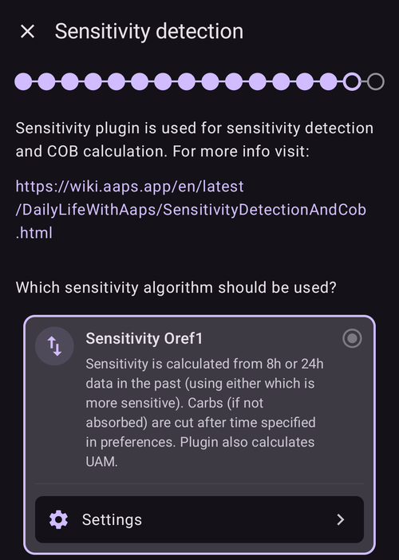

Wenn Du auf „**Einstellungen**“ tippst, kannst Du Dir die Resorptions-Einstellungen ansehen; die Standardwerte (_z. B._ 6 h als maximale Resorptionszeit) passen vorerst.


Tippe auf „**WEITER**“, um zum nächsten Bildschirm zu gelangen.

## Starte das erste Ziel (Objective 1)

Jetzt kommst Du zu den Zielen (Objectives) – der Qualifikation für den Zugang zu weiteren Funktionen von **AAPS**.

Tippe auf „**Ziele öffnen**“:


Hier beginnen wir jetzt mit dem ersten Ziel (Objective 1), auch wenn unser Setup im Moment noch nicht vollständig ist, um dieses Ziel erfolgreich abzuschließen. Aber das ist der Beginn.

Tippe bei **Ziel 1** auf den Knopf „**Start**“:


Das Ziel klappt auf und zeigt seine einzelnen Prüfpunkte. Du siehst, dass Du schon einige Fortschritte gemacht hast, während andere Punkte noch zu erledigen sind:

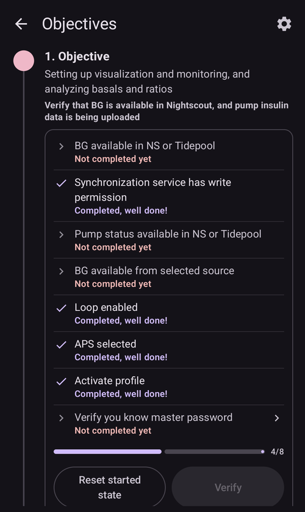

Gehe zurück und tippe dann auf „**FERTIG**“, um den Einrichtungsassistenten abzuschließen:

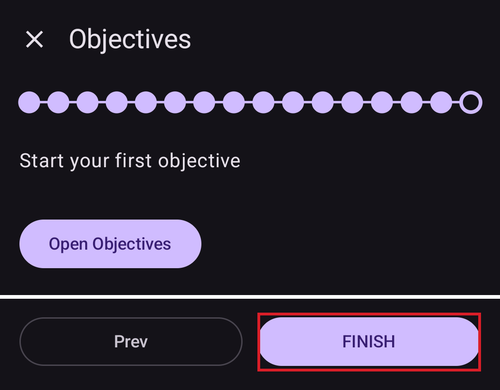

Nachdem Du auf „**FERTIG**“ getippt hast, gelangst Du zum Startbildschirm von **AAPS**. Eventuell öffnet sich ein Fenster „**Benachrichtigung**“ mit Hinweisen, zum Beispiel zum gerade durchgeführten Profilwechsel – tippe unter jeder Meldung auf „**Schließen**“, um sie zu entfernen.

Solltest Du versehentlich den Einrichtungsassistenten verlassen haben, kannst Du ihn entweder einfach neu starten oder die [Konfiguration des AAPS Loop](../SettingUpAaps/ChangeAapsConfiguration.md) manuell vornehmen.

(setup-wizard-bluetooth-permission)=
## Bluetooth-Berechtigung

Wenn Du eine Pumpe auswählst, die sich über Bluetooth verbindet (zum Beispiel **Omnipod Dash**), erinnert Dich ein Banner daran, dass **AAPS** die Bluetooth-Berechtigung benötigt. Du kannst vorerst auf „**Schließen**“ tippen – die Berechtigung wird erteilt, nachdem Du den Assistenten abgeschlossen hast:


Sobald der Einrichtungsassistent abgeschlossen ist, zeigt der Startbildschirm von **AAPS** das Fenster „**Berechtigungen erforderlich**“. Die anderen Berechtigungen sind schon erteilt; tippe neben „**Bluetooth**“ auf „**Berechtigung erteilen**“:


Wähle „**Zulassen**“, damit **AAPS** Deine Pumpe finden und sich mit ihr verbinden kann:


Wenn Dein **AAPS**-Loop nun fertig eingerichtet ist, gehe zum nächsten Abschnitt [„Abschließen der Ziele (Objectives)“](../SettingUpAaps/CompletingTheObjectives.md).
