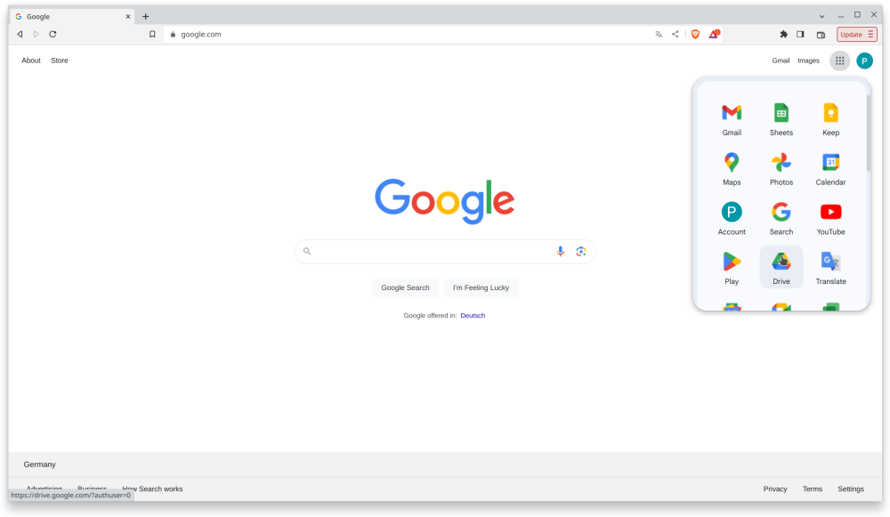
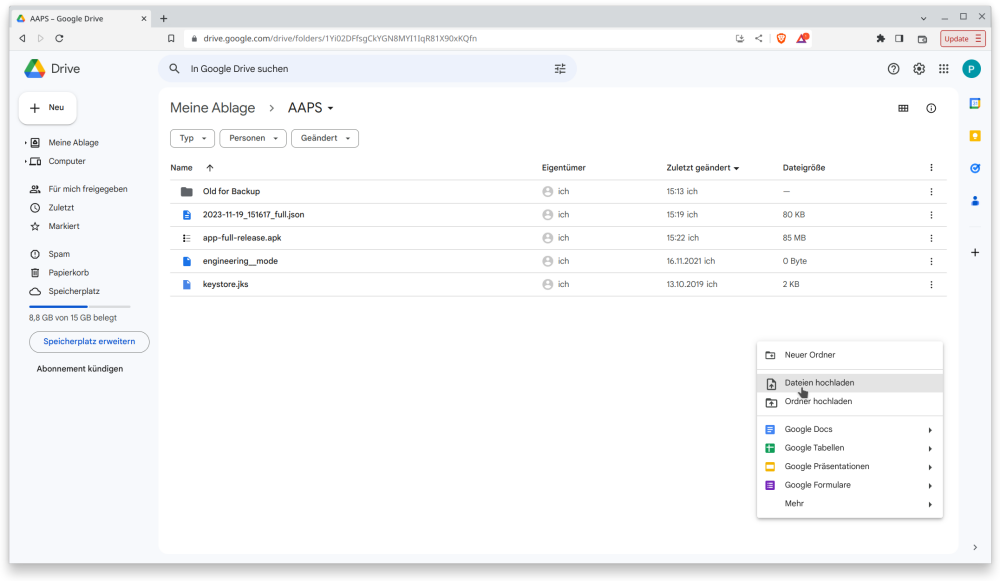
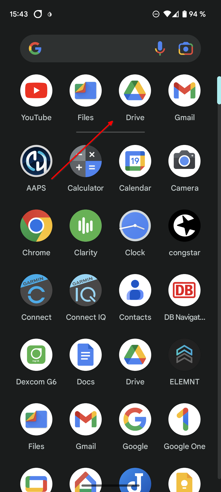
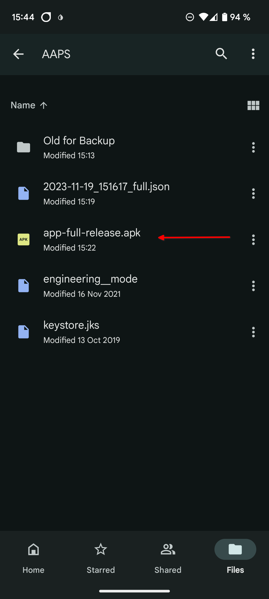
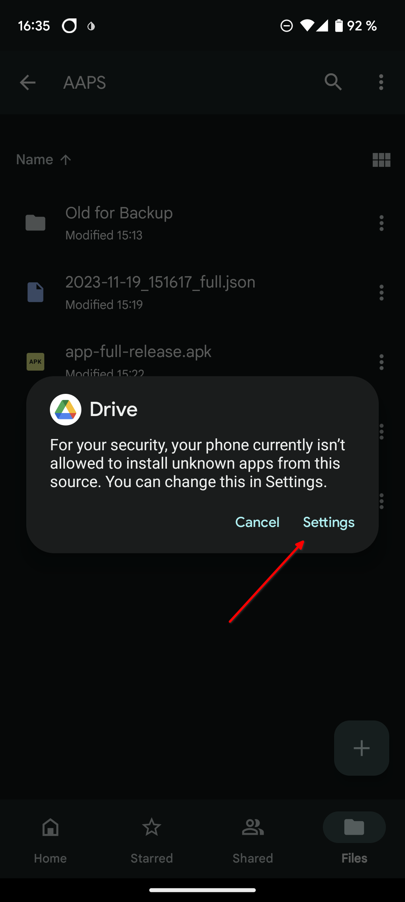
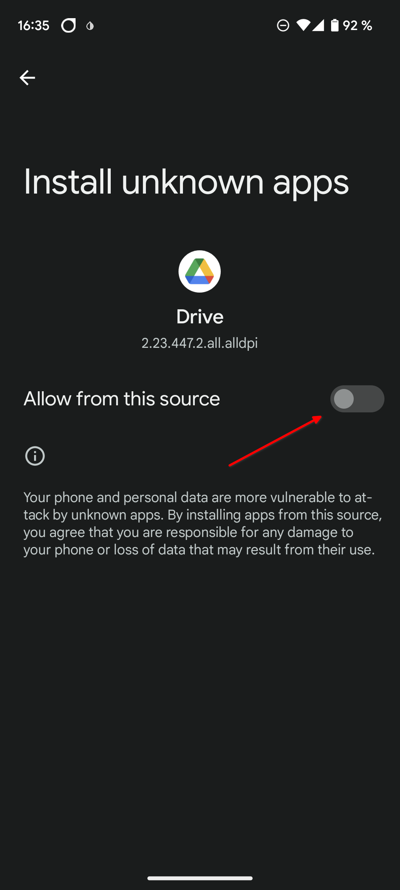
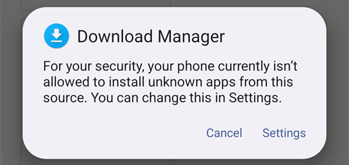
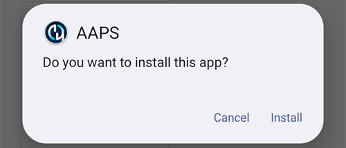
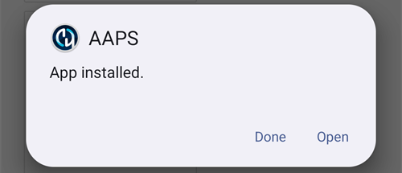

# AAPS auf Dein Smartphone übertragen und installieren

Im vorherigen Abschnitt [**AAPS** erstellen](../SettingUpAaps/BuildingAaps.md), hast Du die **AAPS**-App (eine .apk-Datei) auf einem Computer erstellt (gebaut).

Die nächsten Schritte sind, die **AAPS**-APK-Datei (sowie andere Apps, die Du eventuell benötigst, wie BYODA, xDrip oder eine andere CGM-App) auf Dein Android-Smartphone zu **übertragen** und sie dann zu **installieren**. Nachdem Du **AAPS** auf dem Smartphone installiert hast, können wir dann mit der [**Konfiguration des AAPS-Loop**](../SettingUpAaps/SetupWizard.md) weiter machen.

Diese Seite erklärt außerdem die [Android-Entwicklerverifizierung](#android-developer-verification), eine Änderung, die Google ab September 2026 einführt und die das Installieren selbst erstellter Apps betrifft, sowie die [kostenlosen Installationswege](#android-developer-verification-free-methods), die auch nach der Änderung funktionieren.

```{contents} Table of contents
:depth: 1
:local: true
```

## AAPS durch Tippen auf die APK-Datei installieren

Heute installierst Du **AAPS**, indem Du die APK-Datei auf Dein Smartphone überträgst und sie dort öffnest (darauf „tippst“). Es gibt mehrere Möglichkeiten, **AAPS**-APK-Datei von Deinem Computer auf das Smartphone zu übertragen. Hier erklären wir zwei davon:

* Option 1 -  Google-Laufwerk (Goggle Drive) verwenden
* Option 2 - USB-Kabel verwenden

Bitte beachte, dass die Übertragung per E-Mail zu Schwierigkeiten führen kann und daher nicht empfohlen wird.

```{admonition} Android developer verification
:class: warning
Google führt die [Android-Entwicklerverifizierung](#android-developer-verification) ab September 2026 ein (zuerst in Brasilien, Indonesien, Singapur und Thailand, weltweit 2027). Wo sie gilt, wird die Installation einer APK durch Tippen auf die Datei – wie bei beiden Optionen unten beschrieben – blockiert. Verwende in diesem Fall einen der [kostenlosen Installationswege](#android-developer-verification-free-methods) weiter unten auf dieser Seite.
```

### Option 1. Google-Laufwerk zum Übertragen von Dateien verwenden

Öffne in einem Webbrowser [Google.com](https://www.google.com/) und logge Dich in Dein Google-Konto ein.

Wähle in der rechten oberen Ecke im Google-Menü die Drive-App aus.



Klicke oben links auf **Neu** (oder klicke mit der rechten Maustaste in einen leeren Bereich unter Deinen Dateien und Ordnern) und wähle **Datei hochladen**.



Die APK-Datei sollte jetzt auf Google Drive hochgeladen werden.

#### Nutze die Google Drive-App, um die APK-Datei für die Installation auszuführen

Wechsel zu Deinem Mobilgerät und starte dort die Google Drive-App. Es handelt sich um eine vorinstallierte App und Du findest sie dort wo auch die anderen Google-Apps sind oder Du suchst mit dem App-Namen danach.



Starte die APK-Installation durch Tippen auf den Dateinamen in der Google Drive App des Smartphones.



Falls Du eine Sicherheitswarnung bekommst, dass Du im Moment keine Apps aus Google Drive installieren darfst, tippe auf „Einstellungen“ und erteile die Erlaubnis für diesen kurzen Moment. Entziehe sie anschließend wieder, da es ein Sicherheitsrisiko darstellt, sie dauerhaft aktiviert zu lassen.





Nach Abschluss der Installation bist Du mit diesem Schritt fertig.

Du solltest das **AAPS**-Icon nun sehen und die App öffnen können.

```{warning}
**WICHTIGER SICHERHEITSHINWEIS**
Hast Du daran gedacht, die Installation über Google Drive wieder zu verbieten?
```

Bitte mache jetzt mit der [Konfiguration des AAPS-Loop](../SettingUpAaps/SetupWizard.md) weiter.

### Option 2. USB-Kabel zum Übertragen von Dateien verwenden

Die zweite Möglichkeit, die AAPS-APK-Datei zu übertragen, ist ein [USB-Kabel](https://support.google.com/android/answer/9064445?hl=en).

Übertrage die Datei von Deinem Computer in den „Downloads“-Ordner auf dem Smartphone.

Auf dem Smartphone musst Du die Installation aus unbekannten Quellen zulassen. Erläuterungen dazu findest Du im Internet (_z.B._ [hier](https://www.expressvpn.com/de/support/vpn-setup/enable-apk-installs-android/) oder [hier](https://www.androidcentral.com/unknown-sources)).

Wenn Du die Datei per Drag & Drop übertragen hast, öffne auf dem Smartphone den Ordner „Downloads“ und tippe auf die AAPS-APK-Datei:


Beim ersten Mal meldet Android, dass auf dem Smartphone keine unbekannten Apps aus dieser Quelle installiert werden dürfen. Tippe auf „**Einstellungen**“:



Aktiviere „**Dieser Quelle vertrauen**“ und gehe dann zurück:


Tippe erneut auf die APK-Datei und wähle „**Installieren**“:



Wenn die Installation abgeschlossen ist, tippe auf „**Öffnen**“, um **AAPS** zu starten, oder auf „**Fertig**“, um es später zu öffnen:



```{warning}
**WICHTIGER SICHERHEITSHINWEIS**
Denke daran, „Dieser Quelle vertrauen“ nach der Installation wieder zu deaktivieren, da es ein Sicherheitsrisiko darstellt, die Einstellung dauerhaft aktiviert zu lassen.
```

Bitte mache jetzt mit der [Konfiguration des AAPS-Loop](../SettingUpAaps/SetupWizard.md) weiter.

(transferring-installing-play-protect-warning)=
## Google Play Protect Warnung

Wenn Du **AAPS** installierst, warnt Google Play Protect möglicherweise, dass die App unsicher ist, für eine ältere Android-Version entwickelt wurde und nicht die neuesten Datenschutzfunktionen enthält.


Bei einer selbst erstellten App ist das zu erwarten. Tippe auf **Weitere Details** und dann auf **Trotzdem installieren**.

Wird die Installation mit einer Meldung über einen nicht verifizierten Entwickler **blockiert** (und nicht nur gewarnt), lies unten den Abschnitt [Android-Entwicklerverifizierung](#android-developer-verification).

(android-developer-verification)=

## Android-Entwicklerverifizierung

Google führt die **Android-Entwicklerverifizierung** ein: Auf den meisten Android-Smartphones lassen sich dann nur noch Apps installieren, die ein verifizierter Entwickler bei Google registriert hat. Das gilt auch für Apps, die aus einer APK-Datei installiert werden („Sideloading“) – und genau so installierst Du die **AAPS**-App, die Du selbst erstellt hast.

### Was sich ändert

Wenn Du **AAPS** auf einem Smartphone mit Google-Diensten installierst (einem „zertifizierten“ Android-Gerät – praktisch jedes Smartphone, das mit dem Play Store verkauft wird), prüft Android, ob die App von einem bei Google registrierten Entwickler stammt. Ist das nicht der Fall, wird die normale Installation durch Tippen auf die APK-Datei blockiert.

**Die Prüfung erfolgt, wenn eine App installiert oder aktualisiert wird.** Bereits installierte und laufende Apps werden nicht entfernt.

Google führt das schrittweise ein:

| Wenn               | Was passiert                                                                                                                                                         |
| ------------------ | -------------------------------------------------------------------------------------------------------------------------------------------------------------------- |
| August 2026        | Kostenlose Entwicklerkonten für „eingeschränkten Vertrieb“ stehen weltweit offen, und der „erweiterte Ablauf“ wird nach und nach auf die Smartphones verteilt        |
| 30. September 2026 | Die Verifizierung wird in **Brasilien, Indonesien, Singapur und Thailand** zwingend, für Apps, die aus Google Play und einigen anderen App-Stores installiert werden |
| 2027               | Der Zwang wird auf die **übrige Welt** und auf **alle Installationen** ausgeweitet, auch auf APK-Dateien                                                             |

Details veröffentlicht Google auf den Seiten zur [Android-Entwicklerverifizierung](https://developer.android.com/developer-verification), darunter ein [FAQ](https://developer.android.com/developer-verification/guides/faq). Google kann Termine und Details noch ändern; diese Seite wird im Laufe der Einführung aktualisiert.

### Betrifft mich das?

- **Das Erstellen von AAPS ist überhaupt nicht betroffen.** Der [Browser-Build](#browser-build), der [Build mit Android Studio](ComputerBuild.md) und der [CLI-Build](CLIBuild.md) funktionieren genau wie bisher, und Dein Keystore ändert sich nicht.
- **Dein aktuelles AAPS läuft weiter.** Die Verifizierung wird nur beim Installieren oder Aktualisieren einer App geprüft.
- **Wenn Du in Brasilien, Indonesien, Singapur oder Thailand lebst:** Ab dem 30. September 2026 wird die Verifizierung für Apps verpflichtend, die aus Google Play und einigen anderen App-Stores installiert werden. Laut Google ist die direkte Installation einer APK-Datei von diesem ersten Schritt nicht betroffen, **AAPS** sollte sich also weiterhin wie gewohnt installieren lassen. Richte trotzdem jetzt einen der [kostenlosen Installationswege](#android-developer-verification-free-methods) unten ein, damit Du nicht überrascht wirst, falls sich das ändert.
- **Wenn Du anderswo lebst:** Vor 2027 ändert sich für Dich nichts, und vorerst nichts zu tun, ist eine legitime Entscheidung. Richte aber einen der [kostenlosen Installationswege](#android-developer-verification-free-methods) unten ein, solange alles funktioniert: Die Sperre erst an dem Tag zu bemerken, an dem ein Update abgelehnt wird, und dann noch die 24 Stunden Wartezeit des [erweiterten Ablaufs](#android-developer-verification-advanced-flow) vor Dir zu haben, ist der falsche Moment.
- **Alte Smartphones:** Die Verifizierung gilt für Smartphones ab Android 7, also für jedes Smartphone, auf dem **AAPS** laufen kann.

(android-developer-verification-free-methods)=

## Kostenlose Wege, AAPS zu installieren

Du musst Google **nichts** bezahlen, um **AAPS** weiter zu nutzen. Es gibt mehrere kostenlose Wege; wähle den, der zu Deiner Situation passt.

```{admonition} Which method should I use?
:class: tip
- Du hast einen **Computer** (egal, wie Du **AAPS** erstellt hast): Verwende [ADB](#android-developer-verification-adb) oder, wenn Du die Kommandozeile lieber meiden möchtest, den [Web-Installer](#android-developer-verification-web). Beide sind von der Verifizierung ausgenommen, haben keine Beschränkungen und brauchen kein Google-Konto.
- Du hast **gar keinen Computer**: Verwende den [erweiterten Ablauf](#android-developer-verification-advanced-flow) auf Deinem Smartphone.
- Du möchtest Dich lieber bei Google registrieren, damit die normale Installation durch „Tippen auf die APK“ weiter funktioniert: Es gibt ein [kostenloses Konto für eingeschränkten Vertrieb](#android-developer-verification-limited-account), das aber mit **AAPS** noch nicht getestet ist.
```

(android-developer-verification-adb)=

### Option 1: Mit ADB installieren (Computer nötig)

ADB (Android Debug Bridge) ist Googles offizielles Werkzeug, um Apps über ein USB-Kabel von einem Computer auf ein Smartphone zu installieren. Google hat bestätigt, dass **mit ADB installierte Apps keine Verifizierung benötigen** – es gibt keine Wartezeit, keine Begrenzung der Geräte und keine Registrierung.

Einmalige Vorbereitung:

1. Aktiviere auf Deinem Smartphone die versteckten Entwickleroptionen: Gehe zu **Einstellungen** > **Über das Telefon** (auf manchen Smartphones **Softwareinformationen**) und tippe siebenmal auf **Build-Nummer**, bis das Smartphone bestätigt, dass Du jetzt Entwickler bist.
1. Gehe zurück in die **Einstellungen**, öffne den neuen Eintrag **Entwickleroptionen** und aktiviere **USB-Debugging**.
1. Stelle auf Deinem Computer sicher, dass ADB verfügbar ist:
   - Wenn Du **Android Studio** verwendest, ist ADB schon mit installiert.
   - Andernfalls lade Googles kostenlose [SDK Platform Tools](https://developer.android.com/tools/releases/platform-tools) herunter und entpacke den Ordner. Eine Installation ist nicht nötig; ADB ist das Programm `adb` in diesem Ordner.

**AAPS** installieren (und später aktualisieren):

1. Verbinde das Smartphone über ein USB-Kabel mit dem Computer. Du musst die APK-Datei vorher nicht auf das Smartphone übertragen: ADB schickt sie direkt vom Computer.
1. Bestätige auf dem Smartphone die Meldung **USB-Debugging zulassen?** (nur beim ersten Mal).
1. Öffne auf dem Computer ein Terminal (Eingabeaufforderung) in dem Ordner, in dem ADB und die **AAPS**-APK-Datei liegen, und führe aus:

   ```
   adb install -r app-full-release.apk
   ```

   Ersetze `app-full-release.apk` durch den tatsächlichen Namen Deiner APK-Datei. Die Option `-r` aktualisiert ein bereits installiertes **AAPS** und behält dabei alle Daten und Einstellungen.

1. Warte, bis `Success` angezeigt wird. **AAPS** ist jetzt auf Deinem Smartphone installiert.

Für jedes künftige Update verwendest Du denselben Befehl. Die [Wear OS-Seiten](../WearOS/WearOsSmartwatch.md) verwenden ADB schon auf die gleiche Weise, um die Smartwatch-App zu installieren.

Wenn Du lieber kein Kabel verwenden möchtest: Ab Android 11 kann **Debugging über WLAN** (ebenfalls unter **Entwickleroptionen**) dasselbe über WLAN, nach einer einmaligen Kopplung mit einem Code, der auf dem Smartphone angezeigt wird.

(android-developer-verification-web)=

### Option 2: Über eine Webseite installieren (Computer, keine Kommandozeile)

Wenn die Kommandozeile nichts für Dich ist, kann eine Webseite genau das tun, was ADB tut, direkt aus Deinem Browser. Weil sie über denselben Mechanismus wie ADB mit dem Smartphone kommuniziert, gilt für sie **dieselbe Ausnahme von der Verifizierung** – aber es gibt nichts herunterzuladen, keinen Ordner zu entpacken und keinen Befehl einzutippen.

Das ist der einfachste Weg, wenn Du den [Browser-Build](#browser-build) verwendet und noch nie eine Kommandozeile geöffnet hast.

1. Aktiviere **USB-Debugging** auf dem Smartphone (Schritte 1 und 2 der [ADB-Methode](#android-developer-verification-adb) oben – einmalige Einrichtung).
1. Öffne den **[AAPS-Web-Installer](#web-installer)** in Deinem Browser.
1. Verbinde das Smartphone über ein USB-Kabel und folge den Anweisungen auf der Seite: verbinden, APK-Datei auswählen und installieren.

Drei Dinge solltest Du wissen:

- Er funktioniert nur in **Chrome, Edge oder Opera**. Firefox und Safari können nicht mit USB-Geräten kommunizieren.
- Es kann immer nur ein Programm die ADB-Verbindung des Smartphones nutzen. **Schließe deshalb vor dem Verbinden Android Studio** (oder alles andere, was ADB verwendet).
- Eine Webseite, die auf diese Weise verbunden ist, erhält die volle Kontrolle über Dein Smartphone. **Verwende nur die Adresse oben** aus der **AAPS**-Dokumentation – niemals eine Installer-Seite, die Du über eine Suchmaschine gefunden hast. Der **AAPS**-Web-Installer läuft vollständig in Deinem Browser: Deine APK-Datei wird nirgendwohin hochgeladen.

```{admonition} No computer? A second phone works too
:class: tip
Der Web-Installer funktioniert auch in **Chrome auf einem anderen Android-Smartphone** mit einem Kabel USB-C auf USB-C – so können Eltern **AAPS** auf dem Smartphone ihres Kindes installieren, ohne dass ein Computer im Haus ist.
```

(android-developer-verification-advanced-flow)=

### Option 3: Der „erweiterte Ablauf“ auf Deinem Smartphone (kein Computer nötig)

Google bietet erfahrenen Nutzern, die die Risiken der Installation nicht verifizierter Apps kennen, einen Ausweg an, den **erweiterten Ablauf**. Google hat im August 2026 begonnen, ihn noch vor der Verpflichtung auf die Smartphones zu verteilen, Du kannst ihn also jetzt schon einrichten. Es ist eine einmalige Einrichtung auf dem Smartphone selbst, die **24 Stunden dauert**:

1. Aktiviere die versteckten Entwickleroptionen (siehe Schritt 1 der ADB-Methode oben) und öffne dann **Einstellungen** > **Entwickleroptionen** > **Apps von nicht verifizierten Entwicklern**.
1. Schalte **Apps von nicht verifizierten Entwicklern zulassen** ein. Das Smartphone fragt nach Deiner Displaysperre, um zu bestätigen, dass Du es bist.
1. Das Smartphone fragt, ob jemand Dich auffordert, diese Einstellung einzuschalten, und erklärt, dass Banken, Behörden oder die Polizei Dich niemals darum bitten würden. Lies die Warnung und bestätige, dass Dich niemand unter Druck setzt oder anleitet (das ist ein Schutz vor Betrügern).
1. **Starte Dein Smartphone neu.** Damit beginnt eine einmalige **Wartezeit von 24 Stunden**.
1. Gehe nach 24 Stunden wieder zu **Einstellungen** > **Entwickleroptionen** > **Apps von nicht verifizierten Entwicklern**, um die Einrichtung abzuschließen.
1. Wähle, ob Du nicht verifizierte Apps für **7 Tage** oder **unbegrenzt** zulassen möchtest. Wähle für **AAPS** **unbegrenzt**, sonst wird Dein nächstes Update blockiert, sobald die 7 Tage vorbei sind.

Nach dieser Einrichtung funktioniert das Installieren oder Aktualisieren der **AAPS**-APK wie heute, mit einer zusätzlichen Warnung, dass die App von einem nicht verifizierten Entwickler stammt – tippe auf **Trotzdem installieren**.

Gut zu wissen:

- Du kannst die **Entwickleroptionen** danach wieder ausschalten: Der erweiterte Ablauf bleibt aktiviert. Google gibt Apps (zum Beispiel Banking-Apps) auch keine Möglichkeit festzustellen, dass der erweiterte Ablauf aktiviert ist.
- Schaltest Du den erweiterten Ablauf aus, wird das Installieren **oder Aktualisieren** von **AAPS** wieder blockiert (Dein installiertes **AAPS** läuft weiter). Du hast dann 10 Minuten Zeit, ihn wieder einzuschalten; danach beginnt die Wartezeit von 24 Stunden von vorn.
- Die Uhrzeit des Smartphones zu ändern verkürzt die Wartezeit nicht, und ADB kann sie auch nicht überspringen.
- Laut Google folgt Deine Entscheidung Deinem Google-Konto auf Deine anderen Geräte, ein neues Smartphone sollte also keine weitere Wartezeit von 24 Stunden bedeuten.
- Wenn Du **Apps von nicht verifizierten Entwicklern** in den Entwickleroptionen nicht findest, hat Dein Smartphone die Funktion noch nicht erhalten. Sie wird über eine Systemkomponente namens **Android Developer Verifier** ausgeliefert, die Google schrittweise über den Play Store verteilt. Du kannst nachhelfen, indem Du **Android Developer Verifier** im Play Store öffnest.

```{note}
Google beschreibt das als erste Version und kann die Bildschirme und Schritte noch ändern; dieser Abschnitt wird mit Screenshots ergänzt, sobald die endgültige Version verfügbar ist.
```

(android-developer-verification-limited-account)=

### Option 4: Bei Google registrieren (kostenloses Konto für eingeschränkten Vertrieb)

Google bietet für Hobby- und private Nutzung eine **kostenlose** Art von Entwicklerkonto an, das **Konto für eingeschränkten Vertrieb** (limited distribution account), das seit August 2026 allen offensteht:

- **Kein amtlicher Ausweis** und **keine Gebühr** (anders als beim kostenpflichtigen Entwicklerkonto, das für die private Nutzung von **AAPS** nicht nötig ist). Du brauchst aber ein Google-Konto mit Bestätigung in zwei Schritten, ein Google-Zahlungsprofil mit Deinem rechtlichen Namen und Deiner Adresse sowie eine Kontakt-E-Mail-Adresse.
- Du registrierst den Paketnamen Deiner App in Googles Android Developer Console und autorisierst die Smartphones, auf denen sie installiert werden darf, bis zu **20 Geräte**, über einen Abgleich per QR-Code oder Link zwischen Smartphone und Konsole.
- Nach der Registrierung funktioniert die normale Installation (Tippen auf die APK-Datei) auf den autorisierten Smartphones wieder, ohne ADB und ohne den erweiterten Ablauf.
- Ein Konto für eingeschränkten Vertrieb kann später zu einem vollständigen Konto erweitert werden, aber nicht umgekehrt.

```{warning}
Google hat nicht erklärt, wie die Registrierung funktioniert, wenn viele Menschen dieselbe Open-Source-App erstellen: Jedes selbst erstellte **AAPS** verwendet denselben Paketnamen (`info.nightscout.androidaps`) mit einem anderen Signaturschlüssel, und laut Googles FAQ kann ein Paketname, den bereits andere verwenden, nicht einfach beansprucht werden, sondern erfordert eine zusätzliche Prüfung. Wie eine solche Prüfung ausgeht, ist unbekannt, und das kostenpflichtige Entwicklerkonto (25 $ und ein amtlicher Ausweis) hilft hier nicht: Die Bezahlung hebt nur die Grenze von 20 Geräten auf, nicht die Prüfung des Paketnamens.

Deshalb kann noch keine Schritt-für-Schritt-Anleitung geschrieben werden. Dieser Abschnitt wird ergänzt, sobald die Registrierung mit **AAPS** getestet wurde. Bis dahin sind ADB, der Web-Installer und der erweiterte Ablauf oben zuverlässige Alternativen.
```

## Was sich nicht ändert

- **AAPS** selbst zu erstellen, mit jeder der drei [Build-Methoden](BuildingAaps.md).
- Dein GitHub-Konto, Dein Build-Repository (AAPS Builder) oder Fork und Dein Keystore.
- Deine installierte **AAPS**-App, Deine Einstellungen und Deine [Ziele](CompletingTheObjectives.md).
- Smartphones ohne Google-Dienste und [Installationen mit ADB](#android-developer-verification-adb) allgemein.

## Wo ich Hilfe bekomme

1. **Lies** Googles [FAQ zur Entwicklerverifizierung](https://developer.android.com/developer-verification/guides/faq) bei Fragen zur Verifizierung selbst.
2. **Frag** im Kanal *#AAPS* auf [Discord](https://discord.gg/4fQUWHZ4Mw) oder in einem der anderen [Community-Kanäle](../GettingHelp/WhereCanIGetHelp.md) nach, wenn eine Installation blockiert wird.
3. Gib bei Fragen Hersteller und Modell Deines Smartphones, die Android-Version, Dein Land und die genaue Meldung an, die angezeigt wird, wenn die Installation fehlschlägt.

```{toctree}
:hidden:

AAPS-Web-Installer <WebInstaller.md>
```
