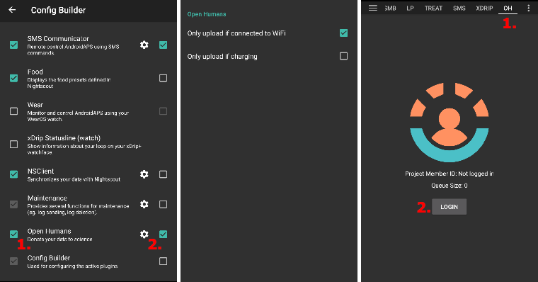
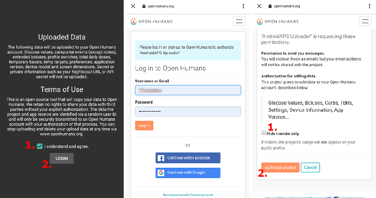
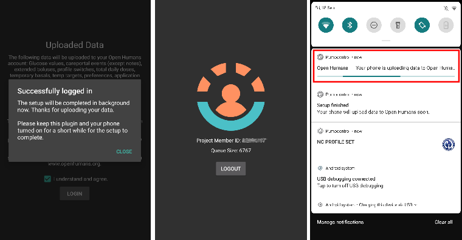

# Open Humans Uploader

## Spende deine Daten an die Wissenschaft

Du kannst die Community unterstützen, indem Du Deine Daten für Forschungsprojekte zur Verfügung stellst. Dies hilft Wissenschaftlern, die Dinge voranzutreiben, neue wissenschaftliche Ideen zu entwickeln und die Offenheit gegenüber Open Source Closed Loop Systemen zu fördern. AAPS kann Deine Daten mit [Open Humans](https://www.openhumans.org), synchronisieren. Open Humans ist eine Plattform, auf die Du Deine persönlichen Daten (z.B. Gesundheitsdaten und Aktivitäten) hochladen, sie teilen und speichern kannst.

Du behältst die volle Kontrolle darüber, was mit Deinen Daten geschieht und welche Projekte Du unterstützen möchtest, indem Du ihnen den Zugriff auf Deine Daten ermöglichst. Abhängig vom Projekt, dem Du beitrittst, werden Daten ausgewertet und vom Projekt auf unterschiedliche Art und Weise und in unterschiedlichem Umfang genutzt.

Die folgenden Daten werden zu Deinem Open-Humans-Konto hochgeladen:

- Glukosewerte
- Careportal-Ereignisse (mit Ausnahme von Notizen)
- Verzögerte Boli
- Profilwechsel
- Tägliche Gesamtdosis (TDD)
- Temporäre Basalraten
- Temporäre Ziele
- Einstellungen
- AAPS Version
- Gerätemodell
- Bildschirmgröße

Vertrauliche oder private Informationen wie z. B. Deine Nightscout-URL oder das API-Secret werden nicht hochgeladen.

## Einrichtung

1. Erstelle ein Konto bei [Open Humans](https://www.openhumans.org), falls Du dies noch nicht getan hast. Zur Anmeldung kannst Du auch Dein Google- oder Facebook-Konto verwenden, wenn Du dies möchtest.
2. Enable the **Open Humans** plugin in [**Configuration** > **Communication**](../SettingUpAaps/ConfigBuilder.md).



3. Tap **Settings** on the **Open Humans** card. You can restrict uploads to times when the phone uses Wi-Fi (**WiFi only**) and/or is charging (**Charging only**).


4. Tap **Open plugin** on the **Open Humans** card, then tap **Setup**.


5. On the **Welcome to Open Humans** screen, tap **Next**. Read the **Consent** screen carefully: it shows the terms of use and which data is uploaded and not uploaded.
6. Switch on **I understand and agree.** (1) and tap **Login to Open Humans** (2).



7. Die Open Humans Webseite wird geöffnet. Melde Dich mit Deinen Zugangsdaten an.
8. Decide whether you want to hide your AAPS Uploader membership in your public Open Humans profile (1).
9. Click **Authorize project** (2).


```{admonition} Older screenshot
:class: note
The screenshots above show an earlier version of the Open Humans website and still use the old project name **AndroidAPS Uploader**. The steps are the same.
```

10. Back in **AAPS**, the **Final touches** screen asks whether you want to proceed. Tap **Proceed**.
11. Wait until **We're done!** appears, then tap **Close**. From now on, your phone uploads data in the background from time to time.
12. The **Open Humans** plugin screen now shows your **Project Member ID**. Tap **Upload now** if you want to start an upload right away.
13. Tap **Logout** if you want to stop uploading data to Open Humans.
14. Der laufende Upload wird in den Android-Benachrichtigungen angezeigt.



```{admonition} Older screenshot
:class: note
The screenshot above is from an earlier **AAPS** version. In **AAPS** 4 the confirmation screens are **Final touches** and **We're done!**, there is no queue size, and the buttons are **Upload now** and **Logout**.
```

15. Deine Daten kannst Du auf der [Open Humans Website](https://www.openhumans.org) verwalten.


## Möglichkeiten zum Teilen Deiner Daten

### [Das 'OPEN' Projekt](https://www.open-diabetes.eu/)

Das “OPEN” Projekt besteht aus einem internationalen und bereichsübergreifenden Konsortium, das Patienten-Innovatoren, Kliniker, Sozialwissenschaftler, Informatiker und Patientenorganisationen zusammenführt, um eine Evidenzbasis rund um die Auswirkungen von Do-it-yourself Artificial Pancreas Systemen (DIY APS) auf Menschen mit Diabetes und verschiedene Gesundheitssysteme zu schaffen. Weitere Informationen findest Du auf der [OPEN Website](https://www.open-diabetes.eu/).

Im September 2020 hat das 'OPEN' Projekt einen [Fragebogen](https://survey.open-diabetes.eu/) veröffentlich und damit die Möglichkeit verknüpft, Deine zu Open Humans hochgeladenen Daten an das 'OPEN' Projekt zu spenden. Eine detaillierte [Anleitung](https://open-diabetes.eu/en/open-survey/survey-tutorials/), wie Du Deine Daten teilen kannst ist sowohl im Fragebogen als auch auf der 'OPEN' Webseite verfügbar.

### [OpenAPS Data Commons](https://www.openhumans.org/activity/openaps-data-commons/)

Die OpenAPS Data Commons wurden erstellt, um einen einfachen Weg zu schaffen, Daten aus der DIYAPS-Community mit Forschern zu teilen. Die Daten werden sowohl mit traditionellen Forschern, die traditionelle Forschungsstudien erstellen, als auch mit Gruppen oder Einzelpersonen aus der Community, die Daten im Rahmen ihrer eigenen Forschungsprojekte überprüfen wollen, gemeinsam genutzt. OpenAPS Data Commons verwendet die 'Open Humans' -Plattform, um es den Menschen zu ermöglichen, ihre Daten von DIYAPS einschließlich AAPS, Loop und OpenAPS einfach hochzuladen und gemeinsam zu nutzen.

Du kannst Deine Daten über einen der folgenden drei Wege zu Open Humans hochladen:

1. Nutze den oben beschriebenen Open Humans Uploader in AAPS.
2. Verwende Nightscout Data Transfer, um die Daten zu übermitteln.
3. Lade Daten manuell zu Open Humans hoch.

Sobald Du ein Konto eingerichtet hast und Deine Daten hochgeladen werden, solltest Du diese mit den OpenAPS Data Commons verbinden, wenn Du Deine Daten für Forschungszwecke spenden willst.

## Nutzungsbedingungen

Dies ist ein Open-Source-Tool, das Deine Daten zu [Open Humans](https://www.openhumans.org) hochlädt. Wir behalten uns keine Rechte vor, Deine Daten ohne Deine ausdrückliche Genehmigung an Dritte weiterzugeben. Die Daten, die das Projekt und die Anwendung erhalten, werden über eine zufällige Benutzer-ID identifiziert und nur nach Deiner Zustimmung sicher auf ein Open Humans-Konto übertragen. Du kannst das Hochladen beenden und Deine hochgeladenen Daten jederzeit über [www.openhumans.org](https://www.openhumans.org) löschen. Sei Dir bewusst, dass es Projekte auf Open Humans geben kann, die das Löschen bereits gespendeter Daten nicht ermöglichen.

Schaue Dir auch die [Open Humans Nutzungsbedingungen](https://www.openhumans.org/terms/) an.

## Datenschutz

Open Humans schützt Deine Privatsphäre, indem Dir für jedes Projekt eine nummerische ID zugewiesen wird. Dadurch kann Dich das Projekt wiedererkennen aber nicht identifizieren. Die von AAPS hochgeladene Anwendungs-ID funktioniert ähnlich und hilft nur bei der Datenverwaltung. Weitere Informationen findest Du hier:

- [Open Humans Data Use Policy](https://www.openhumans.org/data-use/)
- [Open Humans GDPR](https://www.openhumans.org/gdpr/)
