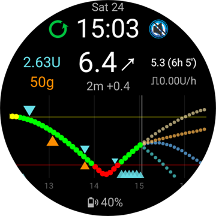
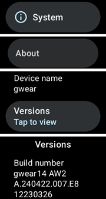

# AAPS auf Deiner Wear OS-Smartwatch einrichten

Die folgenden Anweisungen gelten für die durch Dich zu erstellende **AAPS Wear**-APK. Solltest Du es zum ersten Mal machen, hilft Dir die [Anleitung](../WearOS/BuildingAapsWearOS.md) weiter. Im Erstellprozess ist es wichtig, dass Du die gleiche Keystore-Datei nutzt, die Du schon beim Erstellen der **AAPS**-APK für das Smartphone genutzt hast.

Einige der Informationen können auch für die **AAPSClient**- und die **PumpControl**-**Wear**-APK genutzt werden. Jede **Wear**-App kommuniziert mit der zugehörigen Smartphone-App. Beispiel: Die **AAPSClient Wear**-App kann **AAPSClient**-Daten anzeigen, aber keine **AAPS**-Daten. Sind mehrere Client-Varianten (**AAPSClient**, **AAPSClient2**, **AAPSClient3**) nebeneinander installiert, tragen die Kacheln jeder Variante eine kleine Kopfzeile in deren Akzentfarbe, damit Du sie beim Wischen unterscheiden kannst.

## Wear OS-Versionen und Kompatibilität

(wearos-watchface-changes)=

### Änderungen an Watchfaces in Wear OS (Auswirkungen auf AAPS-Watchfaces)

```{admonition} Why newer Wear OS watches break AAPS watchfaces
:class: warning

Im Juni 2025 hat Google [Änderungen angekündigt](https://android-developers.googleblog.com/2025/06/upcoming-changes-to-wear-os-watch-faces.html), mit denen die alte Watchface-Engine (die AndroidX-/Wearable-Support-Library- oder „WSL“-Engine) zugunsten des neueren deklarativen **Watch Face Format** ausläuft. Die eigenen **AAPS**-Watchfaces beruhen auf der alten Engine. Je neuer die Wear OS-Version, desto wahrscheinlicher funktioniert ein AAPS-Watchface fehlerhaft oder gar nicht mehr.

Das betrifft speziell die **Watchfaces**. AAPS-**Komplikationen**, Kacheln und die Funktionen zur Remote-Steuerung sind nicht betroffen. Deshalb kann auch **ein Firmware-/Systemupdate auf einer Wear OS-Smartwatch AAPS-Watchfaces unbrauchbar machen**, und eine Smartwatch lässt sich danach nicht auf eine ältere Wear OS-Version zurücksetzen. Wenn Dein AAPS-Watchface zurzeit funktioniert, **schalte automatische Updates der Smartwatch aus**.
```

Die folgende Tabelle fasst zusammen, wie sich Googles Änderung je nach Wear OS-Version auf die AAPS-Watchfaces (alte Engine) auswirkt:

| Wear OS-Version         | Android-Basis | API-Level | Auswirkung auf AAPS-Watchfaces (alte Engine)                                                                                                                                                                              |
| ----------------------- | ------------- | --------- | ------------------------------------------------------------------------------------------------------------------------------------------------------------------------------------------------------------------------- |
| Wear OS 6               | Android 16    | 36        | **Alte Watchfaces nicht mehr verfügbar** – AAPS installiert stattdessen ein [Watchface im Watch Face Format](#wearos-aaps-v4-watchface): Dein benutzerdefiniertes Watchface oder das AAPS-V4-Watchface mit Komplikationen |
| Wear OS 5               | Android 14    | 34        | **Stark** – der aktive (interaktive) Modus versagt oft, Komplikationen frieren ein, Animationen stoppen                                                                                                                   |
| Wear OS 4               | Android 13    | 33        | **Mittel** – Drosselung, verpasste Aktualisierungen, teilweise Ausfälle                                                                                                                                                   |
| Wear OS 3.0 / 3.2 / 3.5 | Android 11    | 30        | **Gering** – alte Engine wird noch unterstützt                                                                                                                                                                            |

Wenn auf Deiner Smartwatch eine Version läuft, auf der AAPS-Watchfaces unzuverlässig sind, kannst Du AAPS-Daten stattdessen über **Komplikationen** auf einem passenden Watchface anzeigen oder [GlucoDataHandler](https://play.google.com/store/apps/details?id=de.michelinside.glucodatahandler) mit einer Komplikation nutzen, gespeist vom Modul [Externe Begleit-Apps](#external-companion-apps) in **AAPS**. Unter **Wear OS 6 und neuer** installiert AAPS ein Ersatz-Watchface im neuen Format, siehe unten.

(wearos-aaps-v4-watchface)=

### Wear OS 6 und neuer – das Watchface, das AAPS installiert

Smartwatches mit **Wear OS 6 oder neuer** können die klassischen AAPS-Watchfaces nicht mehr als Watchface ausführen. Für diese Smartwatches bringt die AAPS-Smartwatch-App zwei Watchfaces im neuen **Watch Face Format** von Google mit. Wear OS erlaubt einer App nur **ein** Watchface, deshalb wählst Du, welches der beiden auf der Smartwatch ist:

- **Benutzerdefiniertes Watchface** (Standard): zeigt das benutzerdefinierte Watchface, das Du vom Smartphone aus mit **Watchface laden** geladen hast (siehe [Wechsel zu einem AAPS-Watchface](#WearOS_changing-to-AAPS-watchface)). Die Smartwatch zeichnet Dein Design als Bild, deshalb funktioniert jedes vorhandene benutzerdefinierte Watchface. Die Komplikationsplätze, die ein benutzerdefiniertes Watchface festlegen kann, sind in diesem Bild **nicht verfügbar**, weil Wear OS Komplikationsdaten nur an ein echtes Watchface liefert. Tippe lange auf das Watchface, um seine einzige Einstellung zu erreichen: ob das Always-on-Display eine einfache Uhr oder Dein eigenes Design gedimmt zeigt.
- **Watchface mit Komplikationen** (das Watchface **AAPS V4**): Seine **sieben Komplikationsplätze** sind **mit AAPS-Daten vorbelegt**: Glukosewert, IOB, COB, die [Komplikation Glukose-Diagramm](#Watchfaces-complications), Basalrate / temporäres Ziel und das Symbol **AAPS-Modus** im Platz oben links (tippe darauf, um den Loop-Modus von der Smartwatch aus zu ändern). Tippe oben auf die Uhrzeit, um die Wecker-App der Smartwatch zu öffnen. Was jeder Platz anzeigt, kannst Du im Watchface-Editor ändern.

Die Auswahl triffst Du auf dem Smartphone: Öffne das Modul **Wear** und wähle unter **Watchface auf Smartwatch installiert** eines der beiden aus. Diese Karte wird nur angezeigt, solange eine Smartwatch mit Wear OS 6 oder neuer verbunden ist. **AAPS** fragt nach einer Bestätigung, weil die Smartwatch ihr Watchface sofort austauscht. Wenn Du vom **Watchface mit Komplikationen** wegwechselst, werden auch die Komplikationen, die Du im Watchface-Editor geändert hast, auf die Standardwerte zurückgesetzt. Die Bestätigung weist darauf hin. Solange das **Watchface mit Komplikationen** ausgewählt ist, sind die Knöpfe für benutzerdefinierte Watchfaces ausgeblendet, und stattdessen wird eine Vorschau des Watchface gezeigt. Wenn Du ein benutzerdefiniertes Watchface lädst, während das **Watchface mit Komplikationen** ausgewählt ist, erinnert Dich **AAPS** daran, auf **Benutzerdefiniertes Watchface** umzuschalten, damit Du es auf der Smartwatch siehst.

- Das ausgewählte Watchface wird beim ersten Start der AAPS-Smartwatch-App auf einer solchen Smartwatch **automatisch installiert und aktiviert** und zusammen mit der Smartwatch-App **automatisch aktualisiert**.
- Hast Du das Watchface entfernt, erscheint unten im AAPS-**Hauptmenü** der Smartwatch der Eintrag **Watchface installieren**. Tippe darauf, um es neu zu installieren.

Solange eine Smartwatch mit Wear OS 5 oder älter verbunden ist, wird die Karte **Watchface auf Smartwatch installiert** gar nicht angezeigt (der zugrunde liegende Mechanismus braucht Wear OS 6); die klassischen Watchfaces laufen dort wie bisher.

(wearos-complications-watchface-setup)=

### Watchface mit Komplikationen – empfohlene Einrichtung

Das **Watchface mit Komplikationen** hat sieben Komplikationsplätze. Tippe lange auf das Watchface, tippe auf **Anpassen** und wähle für jeden Platz eine Datenquelle. Die Plätze sind wie im Watchface-Editor nummeriert: **1** links, **2** Mitte, **3** rechts, **4** das Diagramm, **5** unten, **6** oben links und **7** oben rechts.

| Standard-Einrichtung                                                                            | Alternative Einrichtung                                                                                 |
| ----------------------------------------------------------------------------------------------- | ------------------------------------------------------------------------------------------------------- |
|  |  |

| Platz | Position    | Standard                                                                           | Alternative                                |
| ----- | ----------- | ---------------------------------------------------------------------------------- | ------------------------------------------ |
| 1     | Links       | IoB-Symbol                                                                         | CoB & IoB                                  |
| 2     | Mitte       | Blutzucker                                                                         | Blutzucker                                 |
| 3     | Rechts      | CoB-Symbol                                                                         | BR & Target                                |
| 4     | Diagramm    | BG-Graph                                                                           | BG-Graph                                   |
| 5     | Unten       | BR & Target                                                                        | Uploader/Smartphone-Akkustand              |
| 6     | Oben links  | AAPS-Modus                                                                         | AAPS-Modus                                 |
| 7     | Oben rechts | Uploader/Smartphone-Akkustand oder eine App-Verknüpfung zu **AAPS Schlummeralarm** | App-Verknüpfung zu **AAPS Schlummeralarm** |

Die Verknüpfung **AAPS Schlummeralarm** wählst Du aus den Komplikationen **App-Verknüpfung** der Smartwatch selbst. Ein Tippen darauf schaltet den Alarm, der gerade auf dem Smartphone ertönt, stumm (Schlummern).

```{tip}
Schalte auf der Smartwatch **Always On Display** ein (**Einstellungen** > **Anzeige**). Das Watchface zeigt dann Deinen Glukosewert weiter an, wenn das Handgelenk unten ist, statt eines leeren Bildschirms oder einer einfachen Uhr.
```

```{admonition} No complication data while the watch is locked
:class: note
Wenn unter **Einstellungen** > **Sicherheit und Datenschutz** ein **Sperrtyp** festgelegt ist, blendet die Smartwatch Komplikationsdaten aus, solange sie gesperrt ist, und das Watchface zeigt leere Plätze, bis Du sie entsperrst. Damit die Daten sichtbar bleiben, schalte im selben Menü **Informationen ausblenden** aus.
```

### Wear OS 3

Installiere die **AAPS Wear**-APK mit [Wear Installer 2](https://youtu.be/abgN4jQqHb0?si=5L7WUeYMSd_8IdPV), Easy Fire Tools (weiter unten beschrieben) oder ADB.  
Keine Einschränkung bei **AAPS Wear-** Operationen.

(BuildingAapsWearOs-WearOS5)=

### Wear OS 4 und Wear OS 5

Beispiel: Galaxy Watch 4, 5, 6, 7 und Ultra oder Pixel Watch, die **noch nicht** auf Wear OS 6 aktualisiert wurden. Die Version findest Du unter **Einstellungen** > **Info zur Uhr** > **Software**.

Installiere die **AAPS Wear**-APK mit [Wear Installer 2](https://youtu.be/abgN4jQqHb0?si=5L7WUeYMSd_8IdPV) (für Wear OS 5 folge [diesem Video](https://www.youtube.com/watch?v=yef_qGvcCnk)). Alle Funktionen von **AAPS Wear** funktionieren, die klassischen **AAPS**-Watchfaces sind aber wie in der Tabelle oben beschrieben eingeschränkt: gedrosselt unter Wear OS 4, oft fehlerhaft unter Wear OS 5.

```{admonition} Wear OS 5
:class: warning
Unter Wear OS 5 muss das AAPS-Watchface direkt nach der Installation der Wear-App mit Wear Installer 2 ausgewählt werden: Der Installer bietet am Ende der Installation das Watchface **AAPS (Custom)** an. Wechselst Du versehentlich zu einem anderen Watchface, wiederhole die Installation. Die Einstellungen des Watchface (Dunkel, Querbalken farbgleich usw.) lassen sich eventuell nicht ändern.

Wenn das klassische Watchface bei Dir zurzeit funktioniert, **schalte automatische Updates der Smartwatch aus**: Das nächste Firmware-Update macht es wahrscheinlich unbrauchbar. Wenn Du trotzdem auf Wear OS 6 aktualisierst, lies den Abschnitt oben: **AAPS** installiert dann sein eigenes Watchface im neuen Format.
```

Ist das Watchface zu unzuverlässig, nutze stattdessen [GlucoDataHandler](https://play.google.com/store/apps/details?id=de.michelinside.glucodatahandler) mit einer Komplikation. Dafür muss in **AAPS** das Modul [Externe Begleit-Apps](#external-companion-apps) aktiviert sein.

### Wear OS 6 und neuer

Beispiel: Galaxy Watch 4 und neuer mit One UI 8 Watch, Pixel Watch nach dem Update 2025. Die meisten Galaxy- und Pixel-Smartwatches haben dieses Update erhalten.

Installiere die **AAPS Wear**-APK mit [Wear Installer 2](https://youtu.be/abgN4jQqHb0?si=5L7WUeYMSd_8IdPV). Die klassischen Watchfaces sind nicht verfügbar; **AAPS** installiert automatisch das auf dem Smartphone ausgewählte Watchface, siehe [Das Watchface, das AAPS installiert](#wearos-aaps-v4-watchface). Keine Einschränkungen bei den Funktionen von **AAPS Wear**.

## So richtest Du eine Samsung Galaxy Watch 4 mit **AAPS** ein

Dieser Abschnitt ist für Neulinge im Umgang mit Smartwatches und gibt zunächst einen ersten Überblick über die beliebte **Galaxy Watch 4** und danach eine Schritt-für-Schritt Anleitung, um **AAPS** auf der Smartwatch einzurichten.

_Diese Anleitung wurde für eine Galaxy Watch mit Wear OS 3 geschrieben._ Ab Wear OS 4 fragt die Smartwatch nach einem **Kopplungscode**, wenn sich ein Smartphone oder Computer über ADB verbindet. Wear Installer 2 und das Verfahren im Terminal [weiter unten](#BuildingAapsWearOs-WearOS5-TShoot) unterstützen das beide.

Hier sind die Anleitungen zur Einrichtung der [Galaxy Watch 5](https://www.youtube.com/watch?v=Y5upzOIxwTU) und der [Galaxy Watch 6](https://www.youtube.com/watch?v=D6bq20KzPW0)

## Mit der Smartwatch vertraut machen

Wenn Du die Smartwatch nach dem Video oben grundlegend eingerichtet hast, öffne auf dem Smartphone den Play Store und lade folgende Apps herunter: „Galaxy Wearable“, „Samsung“ und entweder „Easy Fire tools“ oder „Wear Installer 2“.

Es gibt eine Reihe von YouTube-Videos von Drittanbietern, die Dir helfen werden, Dich mit Deiner neuen Smartwatch vertraut zu machen, zum Beispiel:

[https://www.youtube.com/watch?v=tSVkqWNmO2c](https://www.youtube.com/watch?v=tSVkqWNmO2c)

Die App „Galaxy Wearable“ enthält auch ein Benutzerhandbuch. Öffne die Galaxy Wearable App auf Deinem Smartphone, suche unter dem Punkt "Neues Gerät hinzufügen" nach Deiner Smartwatch und versuche diese mir dem Smartphone zu koppeln. Je nach Version wirst Du eventuell aufgefordert, noch eine weitere App aus dem Play Store zu installieren, das „Galaxy Watch 4 Plugin“ (der Download dauert eine Weile). Installiere diese auf Deinem Smartphone und versuche danach die beiden Geräte in der Galaxy Wearable App zu koppeln. Gehe durch die verschiedenen Menüs und wähle Deine persönlichen Voreinstellungen aus.

## Samsung-Konto einrichten

Stelle sicher, dass in dem eMail-Konto, das Du zur Einrichtung des Samsung-Kontos verwendest, ein Geburtsdatum älter als 13 Jahre hinterlegt ist, da die notwendigen Samsung Berechtigungen sonst nur schwer genehmigt werden können. Du kannst ein Gmail Konto eines Kindes (unter 13 Jahren) nicht problemlos in das eines Erwachsenen ändern. Ein möglicher Weg, das zu umgehen ist, das Geburtsdatum auf ein Alter von 12 Jahren und 364 Tagen zu ändern. Am folgenden Tag wird das Konto in ein Erwachsenen-Konto umgewandelt, und Du kannst mit der Einrichtung des Samsung-Kontos weiter machen.

(remote-control-transferring-the-aaps-wear-app-onto-your-aaps-phone)=

## Übertragen der **AAPS** Wear-App auf Dein **AAPS**-Smartphone

Die wear.apk kann über mehrere Wege aus dem Android Studio auf Dein Smartphone übertragen werden:

a) Mit einem USB-Kabel, um die **AAPS** wear apk Datei auf das Smartphone zu bringen und sie dann über "Sideloading" auf die Smartwatch zu laden. Übertrage die Wear.apk auf das Smartphone über USB in den „Downloads“-Ordner oder

b) Schneide die Wear.apk aus Android Studio aus und füge sie in Dein Google Drive Laufwerk ein.


Um AAPS über „sideloading“ auf die Smartwatch zu bekommen, kannst Du eines der folgenden Tools nutzen: 1) Wear-Installer 2 2) Easy Fire Tools 3) Android Debug Bridge (ADB) Wir empfehlen den Wear Installer 2, weil die einzelnen Schritte und Prozesse im Video klar und gut erklärt werden. Wenn Wear Installer 2 bei Dir nicht funktioniert, versuche Easy Fire Tools oder ADB, beides wird unten beschrieben.

### Wear Installer 2 zum „Sideloading“ von **AAPS** Wear vom Smartphone auf die Smartwatch nutzen

 

Wear Installer 2, das von [Malcolm Bryant](https://www.youtube.com/@Freepoc) entwickelt wurde, kann aus dem Play Store auf Dein Smartphone heruntergeladen und zum Sideloading der AAPS Wear App auf die Smartwatch genutzt werden. Die App hat auch ein praktisches „Wie mache ich ein Sideloading“ [Video](https://youtu.be/abgN4jQqHb0?si=5L7WUeYMSd_8IdPV).

```{tip}
Für Wear OS 5 Smartwatches gibt es eine [Videoanleitung](https://www.youtube.com/watch?v=yef_qGvcCnk).
Siehe die Empfehlungen zur Fehlerbehebung [weiter unten](#BuildingAapsWearOs-WearOS5-TShoot).
```

Dort ist alles Nötige ausführlich erklärt (öffne das Video am besten auf einem anderen Gerät, damit Du es beim Einrichten des Smartphones ansehen kannst).

Um die Akkulaufzeit zu verlängern, schalte - wie auch im Video gezeigt - auf der Smartwatch das ADB Debugging aus.

Alternativ, allerdings nicht für Wear OS 5, kannst Du:

### Easy Fire Tools zum „Sideloading“ von **AAPS**-Wear auf die Smartwatch nutzen

1) Lade _[Easy Fire Tools](https://play.google.com/store/apps/details?id=de.agondev.easyfiretools&hl=en)_ aus dem Play Store auf Dein Smartphone herunter


2) Bringe die Smartwatch (sobald die Einrichtung abgeschlossen ist und sie mit dem Smartphone verbunden ist) in den Entwicklermodus:

Gehe zu **Einstellungen** > **System** > **Info** > **Versionen** (die Menünamen unterscheiden sich je nach Smartwatch-Marke, bei manchen heißt es **Info zur Uhr** > **Softwareinformationen** > **Softwareversion**).



Tippe mehrmals schnell auf **Buildnummer** (bzw. **Softwareversion**), bis eine Meldung anzeigt, dass Du jetzt Entwickler bist.


Gehe zurück zu **Einstellungen** > **System**: Jetzt wird das neue Menü **Entwickleroptionen** angezeigt.

Schalte in den **Entwickleroptionen** **ADB-Debugging** und **Debugging über WLAN** ein und bestätige die Abfragen. Unter „Debugging über WLAN“ siehst Du dann die **IP-Adresse & den Port** der Smartwatch, etwa: **192.168.1.214** : 5555. Du brauchst nur die IP-Adresse (hier **192.168.1.214**), nicht die Portnummer nach dem Doppelpunkt. Beachte, dass sich die IP-Adresse ändern kann, zum Beispiel jedes Mal, wenn Du für AAPS auf ein neues Smartphone wechselst.


Schritt 3) Gib die IP-Adresse _z. B. _ **192.168.1.214** in Easy Fire Tools auf Deinem Smartphone ein (gehe dazu auf das linke Hamburger-Menü, Einstellungen und gib die IP-Adresse ein).


Klicke dann auf das plug socket Icon oben rechts. Sobald es verbunden ist, wird es grün.


Schritt 4) Folge den [Sideloading-Anweisungen](https://wearablestouse.com/blog/2022/01/04/install-apps-apk-samsung-galaxy-watch-4/?utm_content=cmp-true) (d. h. dem Transfer der aaps.wear.apk mit Hilfe der Easy Fire Tools auf die Smartwatch).


(BuildingAapsWearOs-WearOS5-TShoot)=

### Benutzen des Terminals
Verbinde Deine Smartwatch und Deinen Computer mit dem gleichen WLAN-Netzwerk.

- Um ADB zu installieren, lade es zunächst hier herunter: https://developer.android.com/tools/releases/platform-tools
- Öffne ein Terminal.
- Für Windows erstelle auf Deiner Festplatte `C:` den Ordner `adb`. Öffne die heruntergeladene Datei `platform-tools-latest-windows.zip`. Kopiere alle Dateien aus dem Ordner `Plattform-Tools` nach `C:\adb` und öffne diesen Ordner mit einer Eingabeaufforderung (Rechtsklick und „Öffnen“ im Terminal). Gebe dann den folgenden Befehl ein, um den Pfad zum Ordner in dem sich ADB befindet zu setzen: `setx PATH "%PATH%;C:\adb"`
- Für den Mac kannst Du statt der manuellen Installation auch Homebrew nutzen: `brew install android-platform-tools`

Auf der Smartwatch:
- Gehe in die Einstellungen → Info zur Uhr → **Software-Informationen**
- Tippe 7-mal auf die Software-Version (bis der Entwicklermodus aktiviert ist).
- Gehe in die Einstellungen → Entwickleroptionen. Aktiviere **ADB-Debugging**
- Gehe in die Einstellungen → Entwickleroptionen → Drahtloses Debugging → **Neues Gerät koppeln**

Es erscheinen ein WLAN-Kopplungscode sowie IP-Adresse und Port:


- Im Terminal: `adb pair ipaddress:port` z B. `adb pair 10.10.1.125:36299`
- Du wirst nach dem Koppelungscode gefragt werden. Gib ihn ein.
- Du wirst die Rückmeldung bekommen:<br> `Successfully paired to 10.10.1.125:36299 [guid=adb-RXXXW20LMKJY-eh5zBj]`<br>
- Gib im Terminal ein: <br>`adb devices`.<br> Es sollte ungefähr das erscheinen:<br> `List of devices attached`<br> `10.10.1.125:36299  offline`<br> `adb-RFAW20LMKJY-eh5zBj._adb-tls-connect._tcp   device`<br>

- Gehe jetzt auf Deinem Computer in den Ordner, der die Wear-APKenthält und gib <br> `adb install wear-full.apk` ein, <br>wobei Du wear-full.apk durch den Namen Deiner APK-Datei ersetzt.
- Es erscheint:<br> `Performing Streamed Install`<br> `Success`


(wear-os-5-troubleshooting)=

### Allgemeine Empfehlungen zur Fehlerbehebung bei Wear OS 5

- WLAN Tethering nicht verwenden. Das wird nicht funktionieren.
- ADB-Debugging muss nicht auf dem Smartphone aktiviert werden (nur auf der Smartwatch). Deaktiviere das ADB Debugging auf dem Smartphone.
- Achte darauf, dass Du Dich mit Deinem lokalen Netzwerk verbindest, in dem sich das Smartphone und die Smartwatch gegenseitig „sehen“ können (verwende nicht Dein WLAN-Gästenetzwerk).
- Achte darauf, dass sowohl die Smartwatch als auch das Smartphone im gleichen Netzwerk und auf dem gleichen WLAN-Gerät sind. Insbesondere WLAN-Repeater oder Access Points können Probleme verursachen.
- Achte darauf, dass Du in der Nähe des Haupt-Routers bist, und starte dann Smartphone und Smartwatch neu.

**Koppeln:**

- Smartwatch: Drahtloses Debugging: Notiere die IP-Adresse.
- Wear Installer: Gib die IP-Adresse in der App Wear Installer ein.
- Tippe auf „Pair new“ und notiere den Pairing Code und die Port-Nummer, die angezeigt werden.
- Wear Installer: Gib den Kopplungscode + Leerzeichen + Portnummer ein.
- Der Wear Installer sollte „pairing successful“ zurückmelden. Falls nicht, schließe den Wear Installer und versuche es erneut.

Sobald Du gekoppelt bist, solltest Du die AAPS Wear-APK installieren können:

- Beende/schließe den Wear Installer und starte ihn dann neu.
- Bei drahtlosem Debugging notiere die IP und Port-Nummer und überprüfe bzw. gib die IP und die Port-Nummer im Wear Installer ein.
- Hinweis: Die Port-Nummer ist eine andere, als die die Du zum Koppeln genutzt hast!

## Die Verbindung zwischen der Smartwatch und Smartphone aus **AAPS** heraus einrichten

Der letzte Schritt ist es, **AAPS** auf dem Smartphone so einzurichten, so dass es mit **Wear.apk** auf der Smartwatch interagiert. Aktiviere dazu das Modul Wear:

* Gehe zur **AAPS**-App auf dem Smartphone

* Öffne oben links das **Menü** (☰) und gehe zu **Konfiguration** > **Kommunikation**

* Setze den Haken bei **Wear**


Um von der Smartwatch aus Boli abzugeben oder andere Aktionen auszuführen, schalte außerdem **Wear Steuerung** unter [Einstellungen > Wear](#preferences-wear) ein.

Um zu einem anderen **AAPS**-Watchface zu wechseln, tippe auf dem Startbildschirm der Smartwatch lange auf das Watchface und dann auf **Anpassen**. Wische dann nach rechts, bis Du die **AAPS**-Watchfaces erreicht hast.

Wenn das Sideloading der **AAPS** Wear.apk auf die Smartwatch erfolgreich war, sieht es ungefähr so aus:


Bei bestimmten Smartwatches wie der Samsung Galaxy muss unter „Erweiterte Funktionen“ der Samsung Galaxy die Option „Remote-Verbindung“ **eingeschaltet** sein, damit Du **Wear.apk** & **AAPS** remote über WLAN nutzen kannst.


(wear-os-watch-phone-communication)=

### Verbindungsprobleme zwischen **AAPS** Smartwatch und **AAPS** Smartphone beheben

1.  Wenn Easy Fire Tools sich nicht verbindet oder Du die Meldung "authorisation failed" erhälst > Überprüfe, ob die IP-Adresse korrekt eingegeben wurde.
2.  Überprüfe, ob die Smartwatch mit dem Internet (und nicht nur über Bluetooth mit dem Smartphone) verbunden ist.
3.  Überprüfe, ob das **AAPS** Smartphone und die Smartwatch in der Samsung App miteinander gekoppelt bzw. verbunden sind.
4.  Es kann auch helfen, einen harten Neustart von Smartphone und Smartwatch durchzuführen (d. h. Smartphone aus- und wieder einschalten)
5.  Angenommen, Du hast die Wear.apk auf Dein Smartphone heruntergeladen, bekommst aber keine Glukosewerte: _Prüfe_, ob Du die richtige **AAPS** Wear-APK auf die Smartwatch übertragen hast. Die Smartwatch-App eines Browser-Builds ist die Datei `aaps-wear-….apk`, siehe [Die Wear-App erstellen](../WearOS/BuildingAapsWearOS.md). Wenn die installierte Datei eine der folgenden ist: a) eine **AAPSClient** Wear-APK (während auf dem Smartphone **AAPS** läuft); b) eine `.aab`-Datei; oder c) eine Datei mit dem Wort „debug“ im Namen, hast Du beim Build nicht die richtige Wear OS-APK ausgewählt.
6.  Überprüfe, dass Dein Router die Geräte nicht voneinander isoliert (IP Isolation).

Weitere Tipps zur Fehlerbehebung findest Du [hier](https://freepoc.org/wear-installer-help-page/#:~:text=If%20you%20are%20having%20problems,your%20phone%20and%20your%20watch.)

(WearOS_changing-to-AAPS-watchface)=

## Wechsel zu einem AAPS-Watchface auf Deiner WearOS-Smartwatch

In der Basisversion der AAPS Wear OS APK sind schon eine Vielzahl von Watchfaces enthalten. Nach der Installation der AAPS Wear APK, kannst Du diese nutzen. Die einzelnen Schritte zur Auswahl eines Watchface sind:

1. Durch langes Drücken auf das aktuelle Watchface öffnest Du die Watchface-Auswahl auf Deiner Smartwatch (sofern es eine WearOS-Uhr ist).


2. Scrolle durch die Liste, bis Du „AAPS (Custom)“ findest (je nach Smartwatch stehen die Watchfaces installierter Apps unter „Heruntergeladen“ oder nach App gruppiert), und klicke in die Mitte des Bildes, um es zu Deiner Auswahlliste der aktuellen Watchfaces hinzuzufügen. Keine Angst, das Aussehen des „AAPS (Custom)“-Watchface kannst Du im nächsten Schritt noch anpassen.


3. Öffne jetzt AAPS auf Deinem Smartphone und dann das Modul Wear: **Konfiguration** > **Kommunikation** > **Wear** > **Plugin öffnen** (setze zuerst den Haken bei **Wear**, falls es nicht aktiviert ist).


4. Klicke auf „Watchface laden“ und wähle das gewünschte Watchface aus.


5. Das „AAPS (Custom)“-Watchface sollte im ausgewählten Design auf Deiner Smartwatch angezeigt werden. Das Laden kann einige Sekunden dauern. Der Bildschirm **Wear** auf dem Smartphone zeigt jetzt den Namen des geladenen Watchface und eine Vorschau. **Infos Watchface** listet seine Details und die enthaltenen Felder auf, und **Mehr AAPS Watchfaces** öffnet die [Austausch-Plattform](../ExchangeSiteCustomWatchfaces/index.md), auf der Du weitere benutzerdefinierte Watchfaces herunterladen kannst. Du kannst jetzt die „Complications“ anpassen, in dem Du lange auf das Watchface drückst und dann auf „Anpassen“ tippst.

```{admonition} Complications on a custom watchface
:class: note
Benutzerdefinierte Watchfaces ab Version 3.0 des Formats können bis zu fünf Komplikationsplätze enthalten, deren Position und Größe das Watchface festlegt (**Komplikations-Layout**). Tippe auf der Smartwatch lange auf das Watchface, tippe auf **Anpassen** und dann auf **Komplikation 1** bis **Komplikation 5**, um die Datenquelle für jeden Platz zu wählen. Dieselben Zeilen stehen in der AAPS-App der Smartwatch unter **Einstellungen** > **AAPS(Custom)**; ein Tippen dort öffnet dieselbe Auswahl. **Priorität von Komplikationstypen** legt fest, ob ein Platz einen Wert bzw. eine Anzeige, Text oder ein Symbol bevorzugt, wenn die Datenquelle mehreres anbietet. Eine geänderte Priorität gilt erst, wenn Du für diesen Platz das nächste Mal eine Datenquelle auswählst.

Diese Plätze funktionieren nur auf Smartwatches mit **Wear OS 5 oder älter**, auf denen das benutzerdefinierte Watchface als echtes Watchface läuft. Unter **Wear OS 6 und neuer** wird das benutzerdefinierte Watchface als Bild ohne seine Komplikationsplätze gezeigt, und die Schritte 1 und 2 oben entfallen: Achte darauf, dass im Modul **Wear** auf dem Smartphone unter **Watchface auf Smartwatch installiert** die Option **Benutzerdefiniertes Watchface** ausgewählt ist (siehe [Das Watchface, das AAPS installiert](#wearos-aaps-v4-watchface)).
```

## AAPSv2 Watchface - Legende


A - Zeit seit der letzten Loop-Aktion

B - CGM Wert

C - Minuten seit dem letzten CGM-Wert

D - Änderung gegenüber dem letzten CGM-Wert (in mmol oder mg/dl)

E - Durchschnittliche Änderung der CGM-Werte in den letzten 15 Minuten

F - Batteriestatus des Smartphones

G - Basalrate (Anzeige in IE/Std. bei Standard-BR und in % während einer TBR)

H - BGI (Blood Glucose Impact) -> wie stark der Glukosewert allein aufgrund der Insulinwirkung steigen oder fallen „sollte“.

I - Kohlenhydrate (carbs on board | e-carbs in der Zukunft)

J - Insulin on board (aus Boli | aus Basal)
