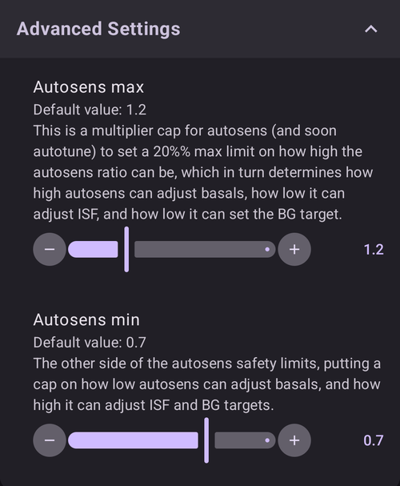

# Πώς να χρησιμοποιήσετε το πρόσθετο Autotune

Το πρόσθετο Autotune είναι μια υλοποίηση του αλγορίθμου autotune του OpenAPS μέσα στο AAPS. Αναλύει το πρόσφατο ιστορικό σας στο AAPS και προτείνει αλλαγές στους βασικούς ρυθμούς, στο ISF και στην αναλογία υδατανθράκων.

Autotune Plugin is available in AAPS releases since [3.4](#version3400) but is hidden by default.

(autotune-how-autotune-calculates-adjustments)=
## Πώς υπολογίζει το Autotune τις αλλαγές

Το Autotune κοιτάζει το πρόσφατο ιστορικό σας στο AAPS — μετρήσεις CGM, bolus, υδατάνθρακες και προσωρινούς βασικούς ρυθμούς — και βρίσκει πού το **Προφίλ** σας (βασικοί ρυθμοί, ISF, αναλογία υδατανθράκων) δεν ταιριάζει ακριβώς με αυτό που πραγματικά έγινε με τη γλυκόζη αίματός σας.

Για κάθε σημείο δεδομένων των 5 λεπτών, συγκρίνει την **πραγματική μεταβολή της BG** με τη μεταβολή που πρόβλεψε το Προφίλ σας και βάζει την απόκλιση που προκύπτει σε μία από τρεις ομάδες:

* αποκλίσεις που έγιναν χωρίς ενεργούς υδατάνθρακες και χωρίς δράση ινσουλίνης (χρησιμοποιούνται για τον συντονισμό των **βασικών ρυθμών**, ώρα προς ώρα),
* αποκλίσεις που έγιναν μετά από bolus/διόρθωση χωρίς υδατάνθρακες (χρησιμοποιούνται για τον συντονισμό του **ISF**), ή
* αποκλίσεις που έγιναν ενώ απορροφούνταν υδατάνθρακες (χρησιμοποιούνται για τον συντονισμό της **αναλογίας υδατανθράκων**).

Μετά εξετάζει το μοτίβο των αποκλίσεων σε κάθε ομάδα (με εκατοστημόρια και όχι με απλό μέσο όρο, ώστε λίγα σημεία με θόρυβο να μην αλλοιώνουν το αποτέλεσμα) και προτείνει μια νέα τιμή για αυτή την ώρα/παράμετρο.

Για να μη γίνεται υπερβολική διόρθωση σε μία μόνο εκτέλεση, κάθε εκτέλεση του Autotune μετακινεί μια τιμή μόνο ένα μέρος της απόστασης προς αυτό που δείχνουν τα δεδομένα: έως 10% για το ISF και την αναλογία υδατανθράκων, και έως 20% για κάθε τμήμα του βασικού ρυθμού. Η συνολική μεταβολή περιορίζεται επιπλέον από τις ρυθμίσεις **Max autosens ratio** / **Min autosens ratio** (μέγιστη / ελάχιστη αναλογία autosens· δείτε παρακάτω την ενότητα [Άλλες ρυθμίσεις](#autotune-other-settings)) — τα ίδια όρια που περιορίζουν το Autosens. Γι' αυτό το Autotune είναι φτιαγμένο για να εκτελείται ξανά και ξανά (μέρα με τη μέρα ή κάθε νύχτα) και όχι για να το εμπιστεύεστε μετά από μία μόνο εκτέλεση: τα αποτελέσματα πρέπει να συγκλίνουν σιγά σιγά, και ένα μεγάλο άλμα σε μία εκτέλεση είναι σημάδι ότι πρέπει να ελέγξετε ξανά τα δεδομένα σας (υδατάνθρακες που δεν καταχωρήθηκαν, μια κακή ημέρα του αισθητήρα, _κ.λπ._) και όχι να το εμπιστευτείτε τυφλά.

Το Autotune μπορεί να εκτελεστεί με τρεις τρόπους: χειροκίνητα, μία φορά, μέσα από το πρόσθετο (όπως περιγράφεται παρακάτω), αυτόματα κάθε νύχτα με έναν [κανόνα αυτοματισμού](#autotune-run-autotune-with-an-automation-rule), ή — εντελώς έξω από το AAPS — ως αυτόνομο εργαλείο γραμμής εντολών πάνω σε εξαγόμενα δεδομένα· έτσι περιγράφουν κάποιοι οδηγοί της κοινότητας τη χρήση του χωρίς τηλέφωνο που τρέχει το AAPS.

*Για τον βασικό αλγόριθμο oref0 με όλες τις μαθηματικές λεπτομέρειες, δείτε την [τεκμηρίωση του Autotune του OpenAPS](https://openaps.readthedocs.io/en/latest/docs/Customize-Iterate/autotune.html).*

## Εμφάνιση του πρόσθετου Autotune

Δημιουργήστε ένα κενό αρχείο με όνομα `enable_autotune` στον υποφάκελο `extra` του [φακέλου AAPS](#preferences-maintenance-settings) στο τηλέφωνό σας.

***ΣΗΜΕΙΩΣΗ: Ελέγξτε στις ρυθμίσεις του AAPS πού είναι ο φάκελος AAPS σας και ότι βάλατε το αρχείο στον σωστό φάκελο. Αρκετοί χρήστες έχουν βάλει το αρχείο σε λάθος φάκελο.***


Κάντε επανεκκίνηση του **AAPS**. Μετά ανοίξτε το **μενού** (☰), επιλέξτε **Διαμόρφωση**, μετά την κατηγορία **Γενικά** και τσεκάρετε το **Autotune**. Η κάρτα τότε δείχνει **Ρυθμίσεις** και **Άνοιγμα πρόσθετου**:


## Περιβάλλον χρήστη του Autotune

Πατήστε **Άνοιγμα πρόσθετου** στην κάρτα **Autotune** για να ανοίξετε την οθόνη του Autotune:


- Στο αναπτυσσόμενο μενού Προφίλ μπορείτε να επιλέξετε το προφίλ εισόδου που θέλετε να συντονίσετε (από προεπιλογή είναι επιλεγμένο το τρέχον ενεργό προφίλ σας)
  - Σημείωση: Κάθε φορά που επιλέγετε νέο προφίλ, τα προηγούμενα αποτελέσματα διαγράφονται και ο **Αριθμός ημερών δεδομένων** παίρνει την προεπιλεγμένη τιμή του
- Μετά, με τον **Αριθμό ημερών δεδομένων** (σε παλιότερες εκδόσεις λέγεται **Ημέρες συντονισμού**) επιλέγετε πόσες ημέρες θα χρησιμοποιηθούν στον υπολογισμό για τον συντονισμό του προφίλ σας. Η ελάχιστη τιμή είναι 1 ημέρα και η μέγιστη 30 ημέρες. Αυτός ο αριθμός δεν πρέπει να είναι πολύ μικρός, ώστε να έχετε σωστά επαναληπτικά και ομαλά αποτελέσματα (πάνω από 7 ημέρες για κάθε υπολογισμό)
  - Σημείωση: Κάθε φορά που αλλάζετε τον **Αριθμό ημερών δεδομένων**, τα προηγούμενα αποτελέσματα διαγράφονται
- Η Τελευταία εκτέλεση είναι ένας σύνδεσμος που επαναφέρει τον τελευταίο έγκυρο υπολογισμό σας. Αν δεν εκτελέσατε το Autotune την τρέχουσα ημέρα ή αν τα προηγούμενα αποτελέσματα διαγράφηκαν επειδή αλλάξατε μια παράμετρο υπολογισμού παραπάνω, μπορείτε να επαναφέρετε τις παραμέτρους και τα αποτελέσματα της τελευταίας επιτυχημένης εκτέλεσης.
- Η Προειδοποίηση σας δείχνει, για παράδειγμα, κάποιες πληροφορίες για το επιλεγμένο προφίλ (αν έχετε πολλές τιμές IC ή πολλές τιμές ISF)
  - Σημείωση: Ο υπολογισμός του Autotune δουλεύει μόνο με μία τιμή IC και μία τιμή ISF. Αυτή τη στιγμή δεν υπάρχει αλγόριθμος Autotune που να συντονίζει IC ή ISF με ημερήσια διακύμανση. Αν το προφίλ εισόδου σας έχει πολλές τιμές, στην ενότητα της προειδοποίησης βλέπετε τη μέση τιμή που λαμβάνεται υπόψη για τον συντονισμό του προφίλ σας.
- Το κουμπί «Έλεγχος προφίλ εισόδου» ανοίγει την προβολή προφίλ, ώστε να ελέγξετε γρήγορα το προφίλ σας (Μονάδες, IC, ISF, βασικός ρυθμός και στόχος)
  - Σημείωση: Το Autotune συντονίζει μόνο το IC σας (μία τιμή), το ISF σας (μία τιμή) και τον βασικό ρυθμό (με ημερήσια διακύμανση). Οι μονάδες και ο στόχος μένουν ίδιοι στο προφίλ εξόδου.

- Το «Εκτέλεση Autotune» ξεκινά τον υπολογισμό του Autotune με το επιλεγμένο προφίλ και τον επιλεγμένο αριθμό ημερών δεδομένων
  - Σημείωση: Ο υπολογισμός του Autotune μπορεί να διαρκέσει πολύ. Μόλις ξεκινήσει, μπορείτε να πάτε σε άλλη οθόνη (αρχική, ...) και να επιστρέψετε αργότερα στο πρόσθετο Autotune για να δείτε τα αποτελέσματα

  

- Στη συνέχεια, κατά την εκτέλεση θα βλέπετε ενδιάμεσα αποτελέσματα από κάτω

  - Σημείωση: Κατά την εκτέλεση οι ρυθμίσεις είναι κλειδωμένες, οπότε δεν μπορείτε πια να αλλάξετε το επιλεγμένο προφίλ εισόδου ή τον αριθμό των ημερών. Αν θέλετε να ξεκινήσετε άλλη εκτέλεση με άλλες παραμέτρους, πρέπει να περιμένετε να τελειώσει ο τρέχων υπολογισμός.

  

- Όταν τελειώσει ο υπολογισμός του Autotune, θα δείτε το αποτέλεσμα (Συντονισμένο προφίλ) και τέσσερα κουμπιά από κάτω.

  

- Είναι σημαντικό να συγκρίνετε πάντα το προφίλ εισόδου (στήλη «Προφίλ»), το προφίλ εξόδου (στήλη «Συντονισμένο») και το ποσοστό μεταβολής για κάθε τιμή (στήλη «%»).

- Για τους βασικούς ρυθμούς βλέπετε επίσης τον αριθμό των «χαμένων ημερών». Έχετε χαμένες ημέρες όταν το Autotune δεν έχει αρκετά δεδομένα στην κατηγορία «Βασικός ρυθμός» για να συντονίσει τον βασικό ρυθμό για αυτή την περίοδο (για παράδειγμα μετά από κάθε γεύμα, όταν έχετε απορρόφηση υδατανθράκων). Αυτός ο αριθμός πρέπει να είναι όσο το δυνατόν πιο μικρός, ειδικά όταν ο βασικός ρυθμός είναι σημαντικός (για παράδειγμα κατά τη διάρκεια της νύχτας ή στο τέλος του απογεύματος)

- Το κουμπί «Σύγκριση προφίλ» ανοίγει την οθόνη σύγκρισης προφίλ. Το προφίλ εισόδου είναι με μπλε και το προφίλ εξόδου (με όνομα «Συντονισμένο») είναι με κόκκινο.

  - Σημείωση: Στο παρακάτω παράδειγμα το προφίλ εισόδου έχει ημερήσια διακύμανση για IC και ISF, αλλά το υπολογισμένο προφίλ εξόδου έχει μία μόνο τιμή. Αν είναι σημαντικό για εσάς να πάρετε προφίλ εξόδου με ημερήσια διακύμανση, δείτε παρακάτω την ενότητα [Προφίλ IC ή ISF με ημερήσια διακύμανση](#autotune-circadian-ic-or-isf-profile).

  

- Αν εμπιστεύεστε τα αποτελέσματα (μικρό ποσοστό μεταβολής ανάμεσα στο προφίλ εισόδου και στο προφίλ εξόδου), μπορείτε να πατήσετε το κουμπί «Ενεργοποίηση προφίλ» και μετά OK για επιβεβαίωση.

  - Η ενεργοποίηση του Συντονισμένου προφίλ δημιουργεί αυτόματα ένα νέο προφίλ «Συντονισμένο» στη λίστα των προφίλ σας (**Διαχείριση → Προφίλ**).
  - Αν έχετε ήδη ένα προφίλ με όνομα «Συντονισμένο» στη **Διαχείριση → Προφίλ**, τότε αυτό το προφίλ ενημερώνεται με το υπολογισμένο προφίλ του Autotune πριν από την ενεργοποίηση

  

- Αν πιστεύετε ότι το Συντονισμένο προφίλ χρειάζεται διόρθωση (για παράδειγμα αν πιστεύετε ότι κάποιες μεταβολές είναι πολύ μεγάλες), μπορείτε να πατήσετε το κουμπί «Αντιγραφή στο τοπικό προφίλ»

  - Ένα νέο προφίλ με το πρόθεμα «Συντονισμένο» και την ημερομηνία και ώρα της εκτέλεσης θα δημιουργηθεί στη **Διαχείριση → Προφίλ**

  

- Μετά μπορείτε να επεξεργαστείτε το Συντονισμένο προφίλ: ανοίξτε **Διαχείριση** > **Προφίλ**, σύρετε στην κάρτα με όνομα «Συντονισμένο» και την ημερομηνία και ώρα της εκτέλεσης και πατήστε το κουμπί **Επεξεργασία** (μολύβι)

  - οι τιμές του προφίλ θα στρογγυλοποιηθούν στο περιβάλλον χρήστη σύμφωνα με τις δυνατότητες της αντλίας σας

  

- Αν θέλετε να αντικαταστήσετε το προφίλ εισόδου σας με το αποτέλεσμα του Autotune, πατήστε το κουμπί «Ενημέρωση προφίλ εισόδου» και επιβεβαιώστε το αναδυόμενο παράθυρο με OK

  - Σημείωση: Αν πατήσετε «Ενεργοποίηση προφίλ» μετά από «Ενημέρωση προφίλ εισόδου», τότε θα ενεργοποιήσετε το ενημερωμένο προφίλ σας και όχι το προεπιλεγμένο προφίλ «Συντονισμένο».

  

- Αν έχετε ενημερώσει το προφίλ εισόδου σας, τότε το κουμπί «Ενημέρωση προφίλ εισόδου» αντικαθίσταται από το κουμπί «Επαναφορά προφίλ εισόδου» (δείτε την εικόνα παρακάτω). Έτσι βλέπετε αμέσως αν το τρέχον προφίλ εισόδου σας στη **Διαχείριση → Προφίλ** περιέχει ήδη το αποτέλεσμα της τελευταίας εκτέλεσης ή όχι. Με αυτό το κουμπί μπορείτε επίσης να επαναφέρετε το προφίλ εισόδου σας χωρίς το αποτέλεσμα του Autotune

  


## Ρυθμίσεις Autotune

(autotune-plugin-settings)=

### Ρυθμίσεις του πρόσθετου Autotune

  

```{admonition} Only DEV
:class: note
Η λειτουργία **Αυτόματη αλλαγή προφίλ** υπάρχει μόνο σε Dev/Engineering mode.
```

- **Αυτόματη αλλαγή προφίλ** (προεπιλογή Ανενεργό): δείτε παρακάτω την ενότητα [Εκτέλεση του Autotune με κανόνα αυτοματισμού](#autotune-run-autotune-with-an-automation-rule). Αν αλλάξετε αυτή τη ρύθμιση σε Ενεργό, το προφίλ εισόδου θα ενημερώνεται αυτόματα με το Συντονισμένο προφίλ και θα ενεργοποιείται.
  - **Προσοχή: πρέπει να εμπιστεύεστε και να ελέγχετε για αρκετές επόμενες ημέρες ότι, μετά από ενημέρωση και ενεργοποίηση του Συντονισμένου προφίλ χωρίς αλλαγές, το κύκλωμά σας βελτιώνεται**

- **UAM ως βασικός ρυθμός** (προεπιλογή Ανενεργό): Αυτή η ρύθμιση είναι για χρήστες που χρησιμοποιούν το AndroidAPS χωρίς να καταχωρούν καθόλου υδατάνθρακες (Full UAM). Όταν είναι Ανενεργό, εμποδίζει την κατάταξη του UAM ως βασικού ρυθμού.
  - Σημείωση: Αν μέσα σε μία ημέρα εντοπιστεί τουλάχιστον μία ώρα απορρόφησης υδατανθράκων, τότε όλα τα δεδομένα στην κατηγορία «UAM» θα καταταγούν ως βασικός ρυθμός, όποια κι αν είναι αυτή η ρύθμιση (Ενεργό ή Ανενεργό)
- **Προεπιλεγμένες ημέρες ρύθμισης** (προεπιλογή 5): Με αυτή τη ρύθμιση ορίζετε την προεπιλεγμένη τιμή. Κάθε φορά που επιλέγετε νέο προφίλ στο πρόσθετο Autotune, ο **Αριθμός ημερών δεδομένων** αντικαθίσταται από αυτή την προεπιλεγμένη τιμή
- **Χρήση ημερήσιας διακύμανσης IC/ISF** (προεπιλογή Ανενεργό): δείτε παρακάτω την ενότητα [Προφίλ IC ή ISF με ημερήσια διακύμανση](#autotune-circadian-ic-or-isf-profile).

(autotune-other-settings)=
### Άλλες ρυθμίσεις

- Το Autotune χρησιμοποιεί επίσης τη μέγιστη και την ελάχιστη αναλογία autosens (Max autosens ratio και Min autosens ratio) για να περιορίσει τη μεταβολή. Αυτές τις τιμές μπορείτε να τις δείτε και να τις αλλάξετε στις [**Ρυθμίσεις** > **Ρύθμιση απορρόφησης** > **Ρυθμίσεις για Προχωρημένους**](../SettingUpAaps/Preferences.md) (**Autosens μέγιστο** και **Autosens ελάχιστο**).

  


## Προχωρημένη λειτουργία

(autotune-circadian-ic-or-isf-profile)=

### Προφίλ IC ή ISF με ημερήσια διακύμανση

- Αν έχετε μεγάλη διακύμανση του IC και/ή του ISF στο προφίλ σας και εμπιστεύεστε πλήρως τις ώρες και τη διακύμανση μέσα στη μέρα, τότε μπορείτε να ενεργοποιήσετε τη **Χρήση ημερήσιας διακύμανσης IC/ISF** (σε παλιότερες εκδόσεις λεγόταν «Apply average result in circadian IC/ISF»)

  - Να ξέρετε ότι ο υπολογισμός του Autotune γίνεται πάντα με μία μόνο τιμή και ότι το Autotune δεν συντονίζει την ημερήσια διακύμανση. Αυτή η ρύθμιση εφαρμόζει μόνο τη μέση μεταβολή που υπολογίστηκε για IC και/ή ISF στις τιμές σας με ημερήσια διακύμανση

- Δείτε στην παρακάτω εικόνα το Συντονισμένο προφίλ με την εφαρμογή της μέσης μεταβολής Ανενεργή (αριστερά) και Ενεργή (δεξιά)

  


### Συντονισμός συγκεκριμένων ημερών της εβδομάδας

- Αν πατήσετε το εικονίδιο **μάτι** στα δεξιά του πεδίου **Αριθμός ημερών δεδομένων**, θα δείτε την επιλογή ημερών. Μπορείτε να ορίσετε ποιες ημέρες της εβδομάδας θα μπουν στον υπολογισμό του Autotune (στην παρακάτω εικόνα βλέπετε ένα παράδειγμα για «εργάσιμες ημέρες», όπου το Σάββατο και η Κυριακή έχουν αφαιρεθεί από τον υπολογισμό του Autotune)
  - Αν ο αριθμός των ημερών που μπαίνουν στον υπολογισμό του Autotune είναι μικρότερος από τον **Αριθμό ημερών δεδομένων**, τότε θα δείτε πόσες ημέρες θα μπουν, στα δεξιά της επιλογής ημερών (10 ημέρες στο παρακάτω παράδειγμα)
  - Αυτή η ρύθμιση δίνει καλά αποτελέσματα μόνο αν ο αριθμός των ημερών που μένουν δεν είναι πολύ μικρός (για παράδειγμα, αν συντονίζετε ένα συγκεκριμένο προφίλ για Σαββατοκύριακα με επιλεγμένα μόνο την Κυριακή και το Σάββατο, πρέπει να ορίσετε τον **Αριθμό ημερών δεδομένων** σε τουλάχιστον 21 ή 28, ώστε να μπουν 6 ή 8 ημέρες στον υπολογισμό του Autotune)

  

- Κατά τον υπολογισμό του Autotune βλέπετε την πρόοδο των υπολογισμών («Ημέρα μερικού αποτελέσματος 1 / 4 ρυθμίστηκε» στο παρακάτω παράδειγμα, με το Σάββατο και την Κυριακή εξαιρεμένα)

  


(autotune-run-autotune-with-an-automation-rule)=

## Εκτέλεση του Autotune με κανόνα αυτοματισμού

```{admonition} Only DEV
:class: note
Η λειτουργία **Αυτόματη αλλαγή προφίλ** υπάρχει μόνο σε Dev/Engineering mode.
```

Το πρώτο βήμα είναι να ορίσετε τη σωστή σκανδάλη (trigger) για έναν κανόνα αυτοματισμού με το Autotune:

Σημείωση: Για περισσότερες πληροφορίες για το πώς ορίζετε έναν κανόνα αυτοματισμού, δείτε [εδώ](../DailyLifeWithAaps/Automations.md).

- Πρέπει να επιλέξετε τη σκανδάλη «Χρόνος επαναλαμβανόμενων»: εκτελείτε το Autotune μόνο μία φορά την ημέρα· το Autotune είναι φτιαγμένο για να εκτελείται καθημερινά (με κάθε νέα εκτέλεση μετακινείστε μία ημέρα αργότερα και γρήγορα οι αλλαγές στο προφίλ πρέπει να γίνονται πολύ μικρές)

  

- Στην αρχή είναι καλύτερο να εκτελείτε το Autotune κατά τη διάρκεια της ημέρας, ώστε να μπορείτε να ελέγχετε τα αποτελέσματα. Αν θέλετε να εκτελείτε το Autotune τη νύχτα, πρέπει να επιλέξετε στη σκανδάλη 4 π.μ. ή αργότερα, ώστε η τρέχουσα ημέρα να μπει στον επόμενο υπολογισμό του Autotune.

  

- Μετά μπορείτε να επιλέξετε την ενέργεια **Προφίλ Autotune** (στην ομάδα **Κύκλωμα & ινσουλίνη**)

  

- Μετά μπορείτε να ρυθμίσετε τις παραμέτρους της ενέργειας για την εκτέλεσή σας. Σε μια νέα ενέργεια, το **Επιλέξτε προφίλ για συντονισμό** δείχνει το πρώτο προφίλ της λίστας τοπικών προφίλ σας, το πεδίο **Ημέρες συντονισμού** είναι κενό και όλες οι ημέρες είναι επιλεγμένες. Επιλέξτε το προφίλ για συντονισμό και εισάγετε τον αριθμό **Ημέρες συντονισμού** (1 έως 30).

  

- Μετά από λίγες ημέρες, αν εμπιστεύεστε πλήρως τα αποτελέσματα του Autotune και το ποσοστό μεταβολής είναι μικρό, μπορείτε να ενεργοποιήσετε στις [Ρυθμίσεις του Autotune](#autotune-plugin-settings) την «**Αυτόματη αλλαγή προφίλ**», ώστε το συντονισμένο προφίλ να ενημερώνεται και να ενεργοποιείται αυτόματα μετά τον υπολογισμό.

Σημείωση: Αν θέλετε να συντονίζετε αυτόματα προφίλ για συγκεκριμένες ημέρες της εβδομάδας (για παράδειγμα ένα προφίλ για «Σαββατοκύριακα» και ένα άλλο για «Εργάσιμες ημέρες»), τότε δημιουργήστε έναν κανόνα για κάθε προφίλ, επιλέξτε τις ίδιες ημέρες στη Σκανδάλη και στην Ενέργεια του Autotune, οι ημέρες συντονισμού πρέπει να είναι αρκετές ώστε ο συντονισμός να γίνεται με τουλάχιστον 6 ή 8 ημέρες, και μην ξεχάσετε να επιλέξετε ώρα μετά τις 4 π.μ. στη σκανδάλη...

- Παρακάτω βλέπετε ένα παράδειγμα κανόνα που εκτελείται κάθε εργάσιμη ημέρα (Δευτέρα έως Παρασκευή) στις 04:00 και συντονίζει το προφίλ «Normal» με 14 **Ημέρες συντονισμού**, μόνο εργάσιμες ημέρες (οπότε στον υπολογισμό του Autotune μπαίνουν μόνο 10 ημέρες).

  


## Συμβουλές και κόλπα

Το Autotune δουλεύει με τις πληροφορίες που υπάρχουν στη βάση δεδομένων σας, οπότε αν μόλις εγκαταστήσατε το AAPS σε νέο τηλέφωνο, θα πρέπει να περιμένετε αρκετές ημέρες πριν μπορέσετε να εκτελέσετε το Autotune με αρκετές ημέρες για να πάρετε χρήσιμα αποτελέσματα.

Το Autotune είναι μόνο μια βοήθεια· είναι σημαντικό να ελέγχετε τακτικά αν συμφωνείτε με το υπολογισμένο προφίλ. Αν έχετε οποιαδήποτε αμφιβολία, αλλάξτε τις ρυθμίσεις του Autotune (για παράδειγμα τον αριθμό των ημερών) ή αντιγράψτε τα αποτελέσματα στο τοπικό προφίλ και διορθώστε το προφίλ πριν το χρησιμοποιήσετε.

Εκτελείτε πάντα το Autotune χειροκίνητα για αρκετές ημέρες, για να ελέγξετε τα αποτελέσματα πριν τα εφαρμόσετε. Και μόνο όταν εμπιστεύεστε πλήρως τα αποτελέσματα του Autotune και η μεταβολή ανάμεσα στο προηγούμενο και στο υπολογισμένο προφίλ γίνει πολύ μικρή, αρχίζετε να χρησιμοποιείτε τον Αυτοματισμό (Ποτέ πριν)

- Το Autotune μπορεί να δουλεύει πολύ καλά για κάποιους χρήστες και όχι για άλλους, γι' αυτό **αν δεν εμπιστεύεστε το αποτέλεσμα του Autotune, μην το χρησιμοποιείτε**

Είναι επίσης σημαντικό να αναλύετε τα αποτελέσματα του Autotune για να καταλάβετε (ή να προσπαθήσετε να καταλάβετε) γιατί το Autotune προτείνει αυτές τις αλλαγές

- μπορεί να έχετε συνολική αύξηση ή μείωση της έντασης του προφίλ σας (για παράδειγμα αύξηση του συνολικού βασικού ρυθμού μαζί με μείωση των τιμών ISF και IC). μπορεί να συνδέεται με αρκετές επόμενες ημέρες με διόρθωση autosens πάνω από 100% (χρειάζεται πιο επιθετική ρύθμιση) ή κάτω από 100% (είστε πιο ευαίσθητοι)
- Μερικές φορές το Autotune προτείνει διαφορετική ισορροπία ανάμεσα στους βασικούς ρυθμούς και στα IC/ISF (για παράδειγμα χαμηλότερο βασικό ρυθμό και πιο επιθετικά IC/ISF)

Σας συνιστούμε να μη χρησιμοποιείτε το Autotune στις παρακάτω περιπτώσεις:

- Δεν καταχωρείτε όλους τους υδατάνθρακές σας
  - Αν δεν καταχωρείτε τους υδατάνθρακες που παίρνετε για να διορθώσετε μια υπογλυκαιμία, το Autotune θα δει μια απρόσμενη άνοδο της τιμής γλυκόζης αίματος και θα αυξήσει τους βασικούς ρυθμούς σας 4 ώρες νωρίτερα· αυτό μπορεί να είναι το αντίθετο από ό,τι χρειάζεστε για να αποφύγετε την υπογλυκαιμία, ειδικά αν είναι στη μέση της νύχτας. Γι' αυτό είναι σημαντικό να καταχωρείτε όλους τους υδατάνθρακες, ειδικά αυτούς για τη διόρθωση υπογλυκαιμίας.
- Έχετε πολλές περιόδους με UAM που εντοπίζεται κατά τη διάρκεια της ημέρας.
  - Έχετε καταχωρήσει όλους τους υδατάνθρακές σας και τους έχετε υπολογίσει σωστά;
  - Όλες οι περίοδοι UAM (εκτός αν δεν καταχωρήσετε καθόλου υδατάνθρακες σε μία ημέρα και η κατάταξη του UAM ως βασικού ρυθμού είναι απενεργοποιημένη): όλες οι περίοδοι UAM θα καταταγούν ως βασικός ρυθμός και αυτό μπορεί να αυξήσει πολύ τον βασικό ρυθμό σας (πολύ περισσότερο από όσο χρειάζεται)

- Η απορρόφηση των υδατανθράκων σας είναι πολύ αργή: αν το μεγαλύτερο μέρος της απορρόφησης υδατανθράκων υπολογίζεται με την παράμετρο min_5m_carbimpact (αυτές τις περιόδους τις βλέπετε με μια μικρή πορτοκαλί τελεία στο πάνω μέρος της καμπύλης COB), ο υπολογισμός του COB μπορεί να είναι λάθος και να οδηγεί σε λάθος αποτελέσματα.
  - Όταν αθλείστε, συνήθως είστε πιο ευαίσθητοι και η γλυκόζη αίματος (BG) δεν ανεβαίνει πολύ, οπότε κατά τη διάρκεια ή μετά την άσκηση είναι συνηθισμένο να βλέπετε κάποιες περιόδους με αργούς υδατάνθρακες. Αν όμως έχετε πολύ συχνά απρόσμενα αργή απορρόφηση υδατανθράκων, τότε μπορεί να χρειάζεστε διόρθωση του προφίλ (μεγαλύτερη τιμή IC) ή το min_5m_carbimpact σας να είναι λίγο πολύ υψηλό.
- Έχετε «πολύ κακές ημέρες», για παράδειγμα μείνατε αρκετές ώρες σε υπεργλυκαιμία και χρειάστηκε τεράστια ποσότητα ινσουλίνης για να πέσετε μέσα στο εύρος, ή μετά από αλλαγή αισθητήρα έχετε μεγάλες περιόδους με λάθος τιμές γλυκόζης αίματος. Αν τις τελευταίες εβδομάδες έχετε μόνο μία ή 2 «κακές ημέρες», μπορείτε να απενεργοποιήσετε χειροκίνητα αυτές τις ημέρες στον υπολογισμό του Autotune για να τις εξαιρέσετε, και πάλι **ελέγξτε προσεκτικά αν μπορείτε να εμπιστευτείτε τα αποτελέσματα**
- Αν το ποσοστό μεταβολής είναι πολύ μεγάλο
  - Μπορείτε να δοκιμάσετε να αυξήσετε τον αριθμό των ημερών για να πάρετε πιο ομαλά αποτελέσματα
