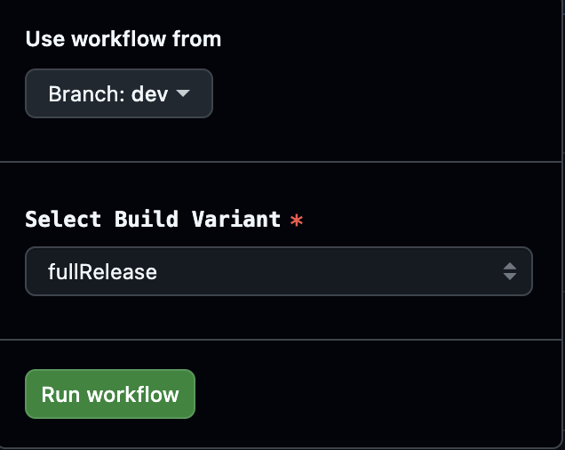

# Κλάδος ανάπτυξης (dev)

```{warning}
Ο κλάδος dev προορίζεται μόνο για την περαιτέρω ανάπτυξη του AAPS. Πρέπει να χρησιμοποιείται σε ξεχωριστό τηλέφωνο για δοκιμές <font color="#FF0000">**όχι για πραγματική χρήση του κυκλώματος!**</font>
```

Η πιο σταθερή έκδοση του AAPS για χρήση είναι αυτή στον [κλάδο Master](https://github.com/nightscout/AndroidAPS/tree/master). Για την πραγματική χρήση του κυκλώματος συνιστάται να μείνετε στον κλάδο Master.

Η έκδοση dev του AAPS είναι μόνο για προγραμματιστές και δοκιμαστές που μπορούν να διαβάσουν stacktraces, να ψάξουν σε αρχεία καταγραφής και ίσως να ξεκινήσουν τον debugger, ώστε να γράψουν αναφορές σφαλμάτων που βοηθούν τους προγραμματιστές (με λίγα λόγια: άνθρωποι που ξέρουν τι κάνουν χωρίς βοήθεια!). Γι' αυτό πολλές ημιτελείς λειτουργίες είναι απενεργοποιημένες. Για να ενεργοποιήσετε αυτές τις λειτουργίες, μπείτε στη **Engineering Mode** (λειτουργία μηχανικού): δημιουργήστε ένα αρχείο με όνομα `engineering_mode` στον φάκελο /AAPS/extra . Η ενεργοποίηση της Engineering Mode μπορεί να χαλάσει εντελώς το κύκλωμα.

Ωστόσο, ο κλάδος dev είναι ένα καλό μέρος για να δείτε ποιες λειτουργίες δοκιμάζονται, να βοηθήσετε να διορθωθούν τα σφάλματα και να πείτε πώς δουλεύουν οι νέες λειτουργίες στην πράξη. Συχνά οι χρήστες δοκιμάζουν τον κλάδο dev σε ένα παλιό τηλέφωνο και μια παλιά αντλία, μέχρι να είναι σίγουροι ότι είναι σταθερός - κάθε χρήση του είναι με δική σας ευθύνη. Όταν δοκιμάζετε νέες λειτουργίες, να θυμάστε ότι επιλέγετε να δοκιμάσετε μια λειτουργία που είναι ακόμα υπό ανάπτυξη. Κάντε το με δική σας ευθύνη & με τη σωστή προσοχή, ώστε να είστε ασφαλείς.

Αν βρείτε ένα σφάλμα ή πιστεύετε ότι κάτι πήγε λάθος όταν χρησιμοποιείτε τον κλάδο dev, δείτε την [καρτέλα issues](https://github.com/nightscout/AndroidAPS/issues) για να ελέγξετε αν κάποιος άλλος το έχει ήδη βρει, ή προσθέστε το εσείς αν όχι. Όσο περισσότερες πληροφορίες μπορείτε να δώσετε εδώ, τόσο καλύτερα (μην ξεχάσετε ότι ίσως χρειαστεί να μοιραστείτε τα [αρχεία καταγραφής](../GettingHelp/AccessingLogFiles.md) σας). Για τις νέες λειτουργίες μπορείτε επίσης να συζητήσετε στο [discord](https://discord.gg/4fQUWHZ4Mw).

Μια έκδοση dev έχει ημερομηνία λήξης. Αυτό φαίνεται άβολο όταν η έκδοση δουλεύει καλά, αλλά έχει έναν σκοπό. Όταν κυκλοφορεί μόνο μία έκδοση dev, είναι πιο εύκολο να παρακολουθούνται τα σφάλματα που αναφέρουν οι χρήστες. Οι προγραμματιστές δεν θέλουν να υπάρχουν τρεις εκδόσεις dev σε χρήση, όπου τα σφάλματα έχουν διορθωθεί σε κάποιες και όχι σε άλλες, και οι χρήστες συνεχίζουν να αναφέρουν σφάλματα που έχουν ήδη διορθωθεί.

(branch-ci-test)=

## Δοκιμή ενός συγκεκριμένου κλάδου (branch-ci)

Για να κάνετε build έναν δοκιμαστικό κλάδο, επιλέξτε branch-ci, που σας επιτρέπει να διαλέξετε έναν συγκεκριμένο κλάδο για τη δημιουργία του APK. Μπορείτε να χρησιμοποιήσετε αυτόν τον τρόπο όταν χρειάζεται να δοκιμάσετε τον κλάδο dev.




(github-pr-test)=

## Δοκιμή αλλαγών από ένα pull request (ανάπτυξη με GitHub CI actions)

Διαθέσιμο από την έκδοση 3.3.2.1.dev

- Κατάλληλο για δοκιμαστές ή για όσους βοηθούν στις δοκιμές.

```{eval-rst}
.. raw:: html

    <!--crowdin: exclude-->
    <div align="center" style="max-width: 360px; margin: auto; margin-bottom: 2em;">
      <div style="position: relative; width: 100%; aspect-ratio: 9/16;">
        <iframe
          src="https://geo.dailymotion.com/player/x9rdx1q.html?video=x9rdx1q&loop=true&mute=true"
          loading="lazy"
          style="position: absolute; top: 0; left: 0; width: 100%; height: 100%;"
          frameborder="0"
          allowfullscreen>
        </iframe>
      </div>
    </div>
```


- Target repository: το αποθετήριο που περιέχει το PR, στη μορφή owner/repo. Αφήστε την προεπιλογή **nightscout/AndroidAPS**, εκτός αν σας είπαν να χρησιμοποιήσετε άλλο αποθετήριο (αυτό πρέπει να το κάνουν μόνο προγραμματιστές).

- PR number: Εισάγετε τον αριθμό του PR που θέλετε να δοκιμάσετε.

- PR reference types: Οι τύποι αναφοράς PR έχουν δύο επιλογές:
    
    - head:
    - Παίρνει το πραγματικό περιεχόμενο από τον κλάδο (branch) του συντάκτη του PR (δηλαδή το αρχικό ιστορικό των commits χωρίς καμία συγχώνευση).
    - Αυτό αντιστοιχεί στην αρχική κατάσταση του κλάδου του PR, σαν να το παίρνατε απευθείας από ένα fork ή έναν κλάδο λειτουργίας (feature branch).
    
    - merge:
    
    - Παίρνει το αποτέλεσμα της συγχώνευσης (merge) του PR στον κλάδο-στόχο (π.χ. dev), που το GitHub έχει προσομοιώσει από πριν.
    - Αυτό είναι ένα εικονικό merge commit που δημιουργεί αυτόματα το GitHub.
    - Αυτό το commit υπάρχει μόνο όταν το PR δεν έχει συγκρούσεις (conflicts) και μπορεί να συγχωνευτεί.
    
    - variant:
    
    - Δείτε την ενότητα [variant](#browserbuild-variant)