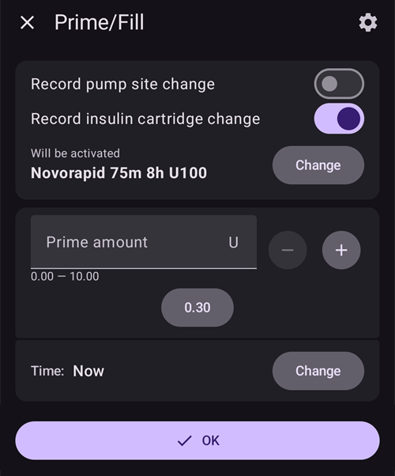

(Insulin-Concentration)=
# Συγκέντρωση ινσουλίνης

```{warning}
Όλες οι εμπορικές αντλίες είναι σχεδιασμένες για χρήση **ΜΟΝΟ** με ινσουλίνη U100. Η χρήση άλλης συγκέντρωσης ινσουλίνης σε μια αντλία μπορεί να είναι επικίνδυνη. Αν και όλο και περισσότεροι χρήστες χρησιμοποιούν το AAPS με άλλες συγκεντρώσεις, η μετατροπή πρέπει πάντα να γίνεται με προσοχή και συχνά οδηγεί σε λάθη (ακόμη και για πολύ έμπειρους χρήστες!).
```

## Υπενθύμιση των βασικών για την ινσουλίνη

Αυτό το κεφάλαιο καλύπτει τις βασικές έννοιες για τη μέτρηση και τη χορήγηση της ινσουλίνης.

### Η μονάδα ινσουλίνης: ένα μέτρο της δράσης

Η ινσουλίνη μετριέται σε **Διεθνείς Μονάδες (IU)**, που μετρούν τη βιολογική της δράση (πόσο μειώνει το σάκχαρο αίματος) και όχι μόνο τη φυσική της μάζα.

- **Ορισμός:** 1 IU αντιστοιχεί στη δράση μιας συγκεκριμένης ποσότητας ινσουλίνης, τυποποιημένης σε **περίπου 0,04167 mg**.
- **Βασικό σημείο:** Μια «μονάδα» σημαίνει την ίδια βιολογική δράση σε όλους τους τύπους ινσουλίνης, ώστε η δοσολογία να είναι σταθερή.

### Συγκεντρώσεις ινσουλίνης

Η ινσουλίνη υπάρχει σε διάφορες περιεκτικότητες, που ορίζονται από τον αριθμό μονάδων ανά χιλιοστόλιτρο (ml).

- **U100:** Το παγκόσμιο πρότυπο, περιέχει **100 IU/ml**.
- **U200-U500:** Πιο πυκνές ινσουλίνες (π.χ. η U200 έχει 200 IU/ml) για μικρότερους όγκους ένεσης.
- **U40/U50:** Λιγότερο συνηθισμένες, παλαιότερες συγκεντρώσεις (40 IU/ml και 50 IU/ml). **Η U40 απαιτεί σύριγγες ειδικές για U40.**
- **Χειροκίνητη αραίωση:** Κλινική πρακτική για τη δημιουργία πολύ αραιωμένης ινσουλίνης (π.χ. U50, U10) για σπάνιες περιπτώσεις, όπως σε νεογνά ή σε πολύ μεγάλη ευαισθησία. Αυτό απαιτεί πολύ προσεκτική προετοιμασία από φαρμακείο.

```{admonition} Critical Warning
:class: danger
Η χρήση μιας συγκέντρωσης με συσκευή που δεν ταιριάζει είναι εξαιρετικά επικίνδυνη και μπορεί να προκαλέσει σοβαρή υπερδοσολογία ή υποδοσολογία. **Ελέγχετε πάντα τρεις φορές ότι η συγκέντρωση της ινσουλίνης ταιριάζει με τις προδιαγραφές της σύριγγας, της πένας ή της αντλίας.**
```

## When is a non-standard concentration used?

Αν και οι αντλίες ινσουλίνης είναι σχεδιασμένες για ινσουλίνη U100, ορισμένες ειδικές ιατρικές καταστάσεις απαιτούν μη τυπικές συγκεντρώσεις. Αυτές οι περιπτώσεις απαιτούν εξαιρετική προσοχή και πολύ προσεκτική διαχείριση.

### Περίπτωση 1: αραιωμένη ινσουλίνη για πολύ μικρές δόσεις

- **Σενάριο:** Διαχείριση του διαβήτη τύπου 1 σε πολύ μικρά μωρά και νήπια.
- **Πρόβλημα:** Οι ανάγκες τους σε ινσουλίνη είναι τόσο μικρές, ώστε η ελάχιστη δόση που μπορεί να δώσει η αντλία (π.χ. 0,05 U) μπορεί να είναι ακόμη πολύ μεγάλη. Αυτό δυσκολεύει τον ακριβή έλεγχο της γλυκόζης και αυξάνει πολύ τον κίνδυνο υπογλυκαιμίας.
- **Λύση:** Χρησιμοποιήστε πολύ αραιωμένη ινσουλίνη (π.χ. U10, δηλαδή 10 IU/ml).
- **Αποτέλεσμα:** Αυξάνεται ο όγκος υγρού που χορηγείται ανά μονάδα ινσουλίνης. Όταν τα «πακέτα» ινσουλίνης έχουν μεγαλύτερο όγκο αλλά μικρότερη συγκέντρωση, είναι δυνατές πολύ πιο λεπτές ρυθμίσεις και μεγαλύτερη ακρίβεια στη δόση με τις υπάρχουσες ρυθμίσεις της αντλίας.

```{admonition} Critical Safety Note on Dilution
:class: danger
Η αραίωση ινσουλίνης είναι διαδικασία υψηλού κινδύνου και δεν πρέπει ποτέ να γίνεται στο σπίτι χωρίς ειδική εκπαίδευση και ιατρική επίβλεψη. Πρέπει να γίνεται από επαγγελματία υγείας ή εκπαιδευμένο φροντιστή, με αποστειρωμένο αραιωτικό που είναι ειδικά σχεδιασμένο για τον συγκεκριμένο τύπο ινσουλίνης. **Μη χρησιμοποιείτε ποτέ νερό βρύσης, φυσιολογικό ορό ή οποιοδήποτε άλλο υγρό**, γιατί αυτό μπορεί να απενεργοποιήσει την ινσουλίνη, να αλλάξει τη δράση της και να εισάγει επικίνδυνους μολυσματικούς παράγοντες.
```

### Περίπτωση 2: πυκνή ινσουλίνη για μεγάλες ανάγκες σε ινσουλίνη ή σημαντική αντίσταση στην ινσουλίνη

- **Σενάριο:** Διαχείριση ενηλίκων ή εφήβων με σημαντική αντίσταση στην ινσουλίνη ή ατόμων που έχουν τοπικό πόνο από τα πρόσθετα συστατικά της τυπικής ινσουλίνης.
- **Πρόβλημα:**
  1. **Μεγάλες ανάγκες:** Πολύ μεγάλες ημερήσιες ανάγκες σε ινσουλίνη μπορεί να ξεπερνούν το μέγιστο bolus ή τα ημερήσια όρια χορήγησης της αντλίας.
  1. **Πόνος:** Τα συντηρητικά της ινσουλίνης μπορεί να προκαλέσουν τσούξιμο ή ερεθισμό κατά την έγχυση.
- **Λύση:** Χρησιμοποιήστε πιο πυκνή ινσουλίνη, όπως U200 (200 IU/ml).
- **Αποτέλεσμα:** Η απαιτούμενη δόση ινσουλίνης χορηγείται στον μισό όγκο. Για τον χρήστη, οι εσωτερικές ρυθμίσεις της αντλίας πρέπει να προσαρμοστούν (π.χ. βασικοί ρυθμοί και bolus στο μισό) λόγω της διπλάσιας συγκέντρωσης, ώστε να χορηγείται ο σωστός αριθμός μονάδων. Αυτό μειώνει επίσης τον όγκο του υγρού που μπορεί να προκαλεί ερεθισμό και χορηγείται υποδόρια.

## Πώς να διαχειριστείτε τη συγκέντρωση ινσουλίνης με το AAPS (AAPS 3 και παλαιότερα);

Η χρήση ινσουλίνης που δεν είναι U100 σε κύκλωμα AAPS απαιτεί πολύ προσεκτική διαμόρφωση, ώστε οι υπολογισμοί του λογισμικού να ταιριάζουν με την ινσουλίνη που χορηγείται πραγματικά. Μια συνηθισμένη μέθοδος είναι η «Χρήση τροποποιημένου προφίλ».

### Χρήση τροποποιημένου προφίλ

Με αυτή τη μέθοδο «ξεγελάτε» το AAPS, ώστε να πιστεύει ότι ο ασθενής χρειάζεται λιγότερη ινσουλίνη από όση χρειάζεται, για να αντισταθμιστεί το ότι η αντλία χορηγεί πιο πυκνή ινσουλίνη από αυτή για την οποία είναι σχεδιασμένη. Το παρακάτω παράδειγμα αφορά ινσουλίνη συγκέντρωσης U200 σε αντλία σχεδιασμένη για U100.

- **Το βασικό πρόβλημα:** Μια αντλία σχεδιασμένη για U100 είναι βαθμονομημένη να χορηγεί **10 µL** για **1 μονάδα**. Αν τη γεμίσετε με U200 (1 μονάδα U200 αντιστοιχεί σε **5 µL** ινσουλίνης), όταν επιλέγετε **1 μονάδα** στην αντλία, αυτή χορηγεί **10 µL** ινσουλίνης, αλλά αυτός ο όγκος περιέχει τώρα **2 μονάδες ινσουλίνης U200**. Αυτό οδηγεί σε υπερδοσολογία 100%.
- **Η λύση «Αλλαγή Προφίλ 50%»:** Για να διορθωθεί αυτό, όλο το θεραπευτικό προφίλ του ασθενούς γίνεται «δύο φορές πιο αδύναμο» μέσα στο AAPS.
  1. Ο χρήστης δημιουργεί ένα νέο προφίλ με βάση το κανονικό του προφίλ U100, με τη λειτουργία «Αλλαγή Προφίλ **50%**».
  1. Έτσι δημιουργείται ένα νέο προφίλ όπου:
     - Οι **βασικοί ρυθμοί** μειώνονται στο μισό.
     - Η **Αναλογία Ινσουλίνης προς Υδατάνθρακες (IC)** διπλασιάζεται (π.χ. το 1:10g γίνεται 1:20g).
     - Ο **Συντελεστής Ευαισθησίας στην Ινσουλίνη (ISF)** διπλασιάζεται (π.χ. το «1 μονάδα μειώνει τη BG κατά 50 mg/dl (2,8 mmol/l)» γίνεται «1 μονάδα τη μειώνει κατά 100 mg/dl (5,6 mmol/l)»).
- **Το διορθωμένο αποτέλεσμα:** Το AAPS τώρα πιστεύει ότι ο ασθενής χρειάζεται μόνο τη μισή ινσουλίνη. Όταν υπολογίζει και δίνει εντολή για bolus **1 μονάδας**, η αντλία (σχεδιασμένη για U100 αλλά γεμάτη με U200) χορηγεί τα **10 µL**, που περιέχουν **2 πραγματικές μονάδες ινσουλίνης U200**. Επειδή το AAPS υπολόγισε αυτή τη δόση με βάση ένα προφίλ «μισής ισχύος», αυτή η χορήγηση **2 πραγματικών μονάδων** είναι η σωστή, επιθυμητή δόση. Τα μαθηματικά «μισής ισχύος» του κυκλώματος ταιριάζουν με τη χορήγηση «διπλής ισχύος» της αντλίας.

```{admonition} Critical Risks and Common Errors
:class: caution

Αυτή η μέθοδος έχει σημαντικούς κινδύνους, γιατί δημιουργεί μια μόνιμη διαφορά ανάμεσα στα δεδομένα της εφαρμογής και στη φυσική πραγματικότητα.

**Το κύριο λάθος: η ασυμφωνία του «εξωτερικού bolus»**

Το πιο συχνό λάθος γίνεται όταν χορηγείτε και καταγράφετε ινσουλίνη **έξω** από το σύστημα AAPS-αντλίας.

- **Το σενάριο:** Το AAPS, με το τροποποιημένο προφίλ, υπολογίζει bolus **5 μονάδων** για ένα γεύμα. Ο χρήστης το κάνει ένεση με πένα U200.
- **Το διπλό λάθος:**
  1. **Λάθος επιλογή δόσης:** Ο χρήστης σκέφτεται «το AAPS υπολογίζει 5 μονάδες» και, λόγω της πένας U200, περιμένει να χορηγήσει **5 πραγματικές μονάδες U200** χωρίς καμία μετατροπή. Όμως, επειδή το προφίλ είναι στο μισό, ο οργανισμός χρειάζεται στην πραγματικότητα **10 πραγματικές μονάδες**. Αυτό είναι **υποδοσολογία 50%**, που μπορεί να οδηγήσει σε υπεργλυκαιμία.
  1. **Λάθος υπολογισμός ινσουλίνης σε δράση (IOB) (υπερεκτιμημένο IOB):** Όταν ο χρήστης καταγράφει αυτό το εξωτερικό bolus στο AAPS, καταχωρεί **5 μονάδες**. Αυτό είναι λάθος. Επειδή το προφίλ του AAPS είναι για U200, **1 μονάδα στο AAPS ισούται με 2 πραγματικές μονάδες**. Επομένως, οι 5 πραγματικές μονάδες που χορήγησε η πένα πρέπει να καταγραφούν ως **2,5 μονάδες** στην εφαρμογή. Καταγράφοντας 5 μονάδες, ο χρήστης υπερεκτιμά το IOB κατά 100%. Το AAPS πιστεύει τώρα ότι υπάρχουν 5 «πυκνές μονάδες» σε δράση (ίσες με 10 πραγματικές μονάδες), ενώ δρουν μόνο 5 πραγματικές μονάδες. Αυτό μπορεί να κάνει το κύκλωμα να μειώσει τη βασική ινσουλίνη ή τα επόμενα bolus, και να αυξήσει τον κίνδυνο υπεργλυκαιμίας από την αρχική υποδοσολογία.

**Άλλοι κίνδυνοι:**

- **Παραπλανητικά δεδομένα και αναφορές:** Όλα τα δεδομένα στο AAPS ή στο Nightscout - μαζί με το IOB, τη συνολική ημερήσια δόση (TDD) και τις ιστορικές αναφορές - είναι σε «πυκνές μονάδες». Αυτό δίνει μια παραμορφωμένη εικόνα στον χρήστη και στην ιατρική του ομάδα. Ένας γιατρός που ελέγχει μια αναφορά μπορεί να δει TDD 30 μονάδων και να μην καταλάβει ότι ο ασθενής πήρε στην πραγματικότητα 60 πραγματικές μονάδες. Αυτό οδηγεί σε λάθος αξιολόγηση της θεραπείας.
- **Αλλαγμένος τρόπος σκέψης:** Μετά από μεγάλη χρήση, ο χρήστης αρχίζει να «σκέφτεται» με τις μισές τιμές της εφαρμογής. Συνηθίζει ότι η ISF του είναι 100 mg/dl (5,6 mmol/l) ή ο βασικός ρυθμός του 0,5 U/ώρα, και ξεχνά ότι αυτές είναι «πυκνές» τιμές. Αυτό δημιουργεί μια επικίνδυνη εξάρτηση από το σύστημα και χάνεται η επαφή με τις πραγματικές ανάγκες σε ινσουλίνη. Αυτό είναι κρίσιμο για την ασφάλεια όταν η αντλία χαλάσει ή η εφαρμογή έχει προβλήματα.

**Συμπέρασμα:** Αυτή η μέθοδος απαιτεί απόλυτη προσοχή, γιατί ο χρήστης πρέπει συνεχώς να μετατρέπει τιμές ανάμεσα σε έναν «πυκνό κόσμο» στην εφαρμογή και στον φυσικό κόσμο. Κάθε εξωτερική χορήγηση ινσουλίνης ή έλεγχος δεδομένων σπάει αυτόν τον τρόπο σκέψης και είναι σοβαρός κίνδυνος. Αλλάζει από τη βάση το νόημα κάθε αριθμού στο σύστημα.
```

## Χρήση της παραμέτρου συγκέντρωσης (νέα λειτουργία στο AAPS 4.0)

Για να μειωθούν οι κίνδυνοι από τη χρήση τροποποιημένου προφίλ, μια νέα λειτουργία διαχειρίζεται τη συγκέντρωση ινσουλίνης απευθείας μέσα στο AAPS. Αυτή η λειτουργία κάνει τις μετατροπές αυτόματα, ώστε η κύρια εφαρμογή να λειτουργεί πάντα σε **Πραγματικές Διεθνείς Μονάδες (IU)**.

### Πώς λειτουργεί: αυτόματη μετατροπή

Η βασική αρχή είναι ο σαφής διαχωρισμός ανάμεσα στη λογική της εφαρμογής και στην επικοινωνία με την αντλία:

- **Το AAPS χρησιμοποιεί Διεθνείς Μονάδες:** Η κύρια βάση δεδομένων, οι αλγόριθμοι, οι αναφορές και τα αρχεία καταγραφής του AAPS **χρησιμοποιούν πάντα Πραγματικές IU**. Αυτό σημαίνει ότι το IOB, η TDD και οι ρυθμίσεις θεραπείας σας (βασικός ρυθμός, ISF, IC) δείχνουν τις πραγματικές βιολογικές μονάδες ινσουλίνης.
- **Ο οδηγός αντλίας χρησιμοποιεί Πυκνές Μονάδες:** Όλες οι τιμές που στέλνονται ή λαμβάνονται από τον οδηγό αντλίας μετατρέπονται αυτόματα σε «Πυκνές Μονάδες» μέσα στον οδηγό αντλίας, με βάση την επιλεγμένη συγκέντρωση.
  - **Παράδειγμα με U200:** Όταν ο χρήστης ζητά **bolus 1 μονάδας**, ο οδηγός αντλίας λαμβάνει **0,5 CU (Πυκνές Μονάδες)** πριν το στείλει στην αντλία. Η αντλία (ρυθμισμένη για U100) χορηγεί τότε **5 µL**, που περιέχουν **1 IU ινσουλίνης U200**.

### Οφέλη και κίνδυνοι που παραμένουν

**Οφέλη:**

- Δεν χρειάζεται πια τροποποιημένο προφίλ, ούτε οι νοητικές μετατροπές που οδηγούν σε λάθη.
- Οι χρήστες μπορούν πάντα να «σκέφτονται» σε Πραγματικές IU.
- Για εξωτερικό bolus με πένα, απλώς επιλέξτε στην πένα την ποσότητα ινσουλίνης που θέλετε (όποια κι αν είναι η πένα και η συγκέντρωση της ινσουλίνης). Δεν χρειάζεται καμία μετατροπή, γιατί οι πένες U100 και U200 χρησιμοποιούν πάντα IU για την επιλογή μονάδων.
- Όλες οι αναφορές και τα δεδομένα του AAPS (TDD, IOB) είναι σε Πραγματικές IU, και είναι σαφή για τον χρήστη και την ιατρική του ομάδα.
- Δεν υπάρχει πια κίνδυνος λάθους υπολογισμού των εξωτερικών bolus, γιατί καταγράφονται σε Πραγματικές IU.

**Κίνδυνοι που παραμένουν:**

- **Αλλαγή τρόπου σκέψης:** Οι χρήστες που αλλάζουν από τη μέθοδο «τροποποιημένου προφίλ» πρέπει να επαναφέρουν το προφίλ τους στο σωστό πραγματικό προφίλ (δηλαδή δύο φορές πιο ισχυρό αν έρχονται από U200) και χρειάζονται χρόνο για να προσαρμόσουν τον **τρόπο σκέψης** τους. Αφού έχουν συνηθίσει τις «πυκνές» τιμές στην εφαρμογή, πρέπει να μάθουν ξανά να εμπιστεύονται τις **πραγματικές, φανερές τιμές IU** που εμφανίζονται παντού. Αυτή η περίοδος προσαρμογής έχει κίνδυνο λάθος ερμηνείας.
- **Χειροκίνητο bolus από την αντλία:** Αν χρησιμοποιήσετε τη λειτουργία bolus της ίδιας της αντλίας (χωρίς το AAPS), το αποτέλεσμα είναι υπερδοσολογία 100%, γιατί η αντλία χορηγεί ινσουλίνη U200 με υπολογισμούς όγκου για U100.
- **Γενική προειδοποίηση:** Η χρήση μη τυπικών συγκεντρώσεων παραμένει μια προχωρημένη διαδικασία με κινδύνους και δεν συνιστάται επίσημα.

```{admonition} Never use the pump's own interface (tube pump users) to deliver a bolus manually
:class: danger
Κολλήστε μια μόνιμη ετικέτα **«Ινσουλίνη U200»** στην αντλία σας ως υπενθύμιση, για να μην το ξεχάσετε ποτέ!
```

### Εμφάνιση στο περιβάλλον χρήστη

Για σαφήνεια, το περιβάλλον χρήστη δείχνει και τις πραγματικές και τις πυκνές μονάδες όπου χρειάζεται. Σημειώστε ότι το περιβάλλον χρήστη δεν αλλάζει αν η τρέχουσα ινσουλίνη είναι U100.

**Παραδείγματα εμφάνισης:**

- **Παράθυρο Πρόοδος Bolus:**
  - Το παράθυρο Πρόοδος Bolus είναι μέρος της κύριας εφαρμογής AAPS, οπότε εμφανίζονται μόνο οι πληροφορίες σε IU (όπως επέλεξε ο χρήστης): **`Χορηγήθηκαν 2,50 U / 10,00 U`**
- **Περιβάλλον οδηγού αντλίας (τρέχουσα κατάσταση):**
  - Στην επισκόπηση της αντλίας, η χορηγημένη ποσότητα εμφανίζεται και στις δύο μονάδες. Για παράδειγμα, αν έχει επιλεγεί `U200`: **`Τελευταίο Bolus: 10 U (5 CU) (10')`**

**Σημείωση:** Και οι δύο μονάδες (U και CU) φαίνονται μόνο στην κύρια επισκόπηση της αντλίας. Ανάλογα με την αντλία σας, μπορεί να έχετε άλλες οθόνες όπου εμφανίζονται μόνο οι Πυκνές Μονάδες. Τα ιστορικά δεδομένα μέσα στους οδηγούς αντλιών συνήθως παραμένουν σε «Πυκνές Μονάδες».

### Ενεργοποίηση της λειτουργίας

Λόγω των κινδύνων για την ασφάλεια, αυτή η παράμετρος δεν είναι ενεργοποιημένη από προεπιλογή. Για να την ενεργοποιήσετε, ολοκληρώστε το Βήμα 3 και ενεργοποιήστε την **Υποστήριξη συγκέντρωσης ινσουλίνης** στις Γενικές Ρυθμίσεις.

### Δημιουργία νέας ινσουλίνης με άλλη συγκέντρωση

Για να δημιουργήσετε ινσουλίνη με άλλη συγκέντρωση, ανοίξτε πρώτα τη **Διαχείριση → Ρυθμίσεις ινσουλίνης**.

- Πατήστε το εικονίδιο "+" στο κάτω μέρος της οθόνης.
- Επιλέξτε τη νέα συγκέντρωση από το αναπτυσσόμενο μενού (διαθέσιμες είναι οι U10, U20, U50, U100, U200).
  - Οι αραιωμένες συγκεντρώσεις όπως U10, U20 ή U50 είναι για παιδιά με πολύ χαμηλούς βασικούς ρυθμούς.
  - Η U200 είναι κυρίως για ενήλικες με μεγάλες ανάγκες σε ινσουλίνη.

  

- Προσαρμόστε τον χρόνο κορύφωσης, τη Διάρκεια Δράσης Ινσουλίνης (DIA) και, αν θέλετε, το Ψευδώνυμο ινσουλίνης.
- Πατήστε το κουμπί αποθήκευσης πάνω δεξιά στην οθόνη.

Σε αυτό το βήμα η ινσουλίνη έχει δημιουργηθεί, αλλά δεν μπορεί να επιλεγεί απευθείας από τις **Ρυθμίσεις ινσουλίνης**.

### Αλλαγή συγκέντρωσης από U100 σε Uxxx (AAPS 4)

```{admonition} Switching concentration is only allowed during a reservoir or patch/pod change
:class: warning
Για λόγους ασφαλείας, το AAPS καταγράφει αλλαγή συγκέντρωσης μόνο κατά την αλλαγή δεξαμενής ή την αλλαγή Patch/Pod.
```

Όταν ξεκινάτε από ινσουλίνη U100, όλο το προφίλ σας, τα ιστορικά δεδομένα και οι αναφορές συμφωνούν με το πρότυπο των Διεθνών Μονάδων, οπότε η αλλαγή είναι πολύ «εύκολη»:

- Για αντλία Patch/Pod, υπάρχει ειδικό βήμα κατά την αλλαγή της αντλίας, για να επιλέξετε την ινσουλίνη που βάλατε μέσα.
- Για αντλία με σωληνάκι, πατήστε το κουμπί Πλήρωση/Γέμισμα (για αλλαγή ινσουλίνης) στην Επισκόπηση (ανοιγμένη γραμμή κατάστασης) και μετά πατήστε το κουμπί «Αλλαγή».

1. Επιλέξτε τη συγκέντρωση που θέλετε στο αναπτυσσόμενο μενού (π.χ. `U200`).
1. Μετά επιλέξτε τη σωστή ινσουλίνη από κάτω. Μέχρι να επιβεβαιώσετε, η λεζάντα πάνω από το όνομά της γράφει **Θα ενεργοποιηθεί** (αντί για **Ενεργή τώρα**).

   

1. **Σημαντικό:** η αλλαγή συγκέντρωσης καταγράφεται στο AAPS μόνο αφού εφαρμοστεί η Αλλαγή Προφίλ στην αντλία.
   - Αυτό το βήμα είναι υποχρεωτικό για όλες τις αντλίες Patch/Pod.
   - Για αντλίες με σωληνάκι, περιμένετε να εφαρμοστεί η Αλλαγή Προφίλ στην αντλία, ή μέσα από τη **Διαχείριση → Προφίλ** ή τις **Ρυθμίσεις ινσουλίνης**.

Αυτό είναι όλο!

Αν μια προσωρινή **Αλλαγή Προφίλ** (με διάρκεια) είναι ενεργή όταν αλλάζετε την ινσουλίνη, η νέα ινσουλίνη δίνεται και στο προφίλ που επιστρέφει όταν τελειώσει η προσωρινή αλλαγή. Η παλιά ινσουλίνη δεν επιστρέφει.

### Αλλαγή συγκέντρωσης για χρήστες με ινσουλίνη U200 και προφίλ 50% (AAPS 4)

Όταν ξεκινάτε με U200 που ήδη χρησιμοποιείτε στην αντλία σας, αλλά μαζί με προφίλ 50%, πρέπει να κάνετε επιπλέον βήματα σε σύγκριση με την κανονική αλλαγή από ινσουλίνη U100.

Έχετε υπόψη ότι το πιο δύσκολο μέρος μάλλον δεν θα είναι η σωστή διαχείριση της αλλαγής στο AAPS, αλλά να μάθετε ξανά το μυαλό σας να σκέφτεται σε «IU» αντί για «CU». Όλες οι συνηθισμένες τιμές bolus (πρωινό, μεσημεριανό, βραδινό...) θα είναι διπλάσιες, το ίδιο και οι TDD, οι βασικοί ρυθμοί κ.λπ. Πρέπει να προσέχετε πολύ να μην κάνετε λάθη τις πρώτες εβδομάδες, μέχρι να «σκέφτεστε ξανά» σε Διεθνείς Μονάδες.

- Πρώτα, ετοιμάστε ένα νέο προφίλ με όλες τις τιμές σε Διεθνείς Μονάδες:
  - Κάντε μια προσωρινή Αλλαγή Προφίλ 200% του κανονικού προφίλ που τρέχει.
  - Ανοίξτε το μενού (☰) → **Θεραπείες**, πηγαίνετε στην καρτέλα **Αλλαγή Προφίλ** και κλωνοποιήστε το νέο προφίλ 200% (δείτε [Κλωνοποίηση μιας Αλλαγής Προφίλ](#your-aaps-profile-clone-profile-switch)).
  - Επιστρέψτε στο κανονικό σας προφίλ μέχρι την επόμενη αλλαγή δεξαμενής ή Patch.
  - Πηγαίνετε στη **Διαχείριση → Προφίλ** και μετονομάστε αυτό το νέο προφίλ με ένα σαφές όνομα (θα είναι το μελλοντικό σας προφίλ για την ινσουλίνη U200 που ορίζεται στο AAPS 4).
- Αν χρησιμοποιείτε τη λειτουργία Δυναμική ISF (DynISF), πρέπει να την απενεργοποιήσετε για τουλάχιστον μία εβδομάδα:
  - Όλο το ιστορικό σας στο AAPS ή στο Nightscout είναι σε λάθος μονάδες (CU), δηλαδή στο μισό της πραγματικής τιμής σε Διεθνείς Μονάδες. Περιμένετε τουλάχιστον μία εβδομάδα με την ινσουλίνη U200 σε χρήση πριν την ενεργοποιήσετε ξανά.
- Τώρα είστε έτοιμοι να αλλάξετε ινσουλίνη (με μια νέα U200 ορισμένη στις **Ρυθμίσεις ινσουλίνης**) στην επόμενη αλλαγή ινσουλίνης ή αλλαγή Pod.
- Μόλις εφαρμοστεί σωστά η νέα ινσουλίνη U200, μην ξεχάσετε να εφαρμόσετε το νέο κανονικό προφίλ που ορίσατε στο πρώτο βήμα.

## Πώς να διαχειριστείτε εξωτερικά bolus με διαφορετικές πένες;

### Με ινσουλίνη U200 και προφίλ 50% (AAPS 3)

Έχετε υπόψη ότι όλες οι διαβαθμίσεις των πενών είναι σε Διεθνείς Μονάδες. Άρα, όποια πένα κι αν χρησιμοποιείτε (U100, U200), αν χρησιμοποιείτε πένα για εξωτερικό bolus, πρέπει να κάνετε μετατροπή και προς τις δύο κατευθύνσεις:

- Από το AAPS στην πένα: αν ο Υπολογιστής προτείνει ένα bolus ή αν έχετε στο μυαλό σας μια συγκεκριμένη ποσότητα, πολλαπλασιάστε επί 2 όταν επιλέγετε την ποσότητα στην πένα, σε σύγκριση με το ίδιο bolus από το AAPS.
- Από την πένα στο AAPS: αν επιλέξατε μια ποσότητα στην πένα για εξωτερικό bolus, διαιρέστε την ποσότητα αυτή με το 2 για να καταγράψετε τη σωστή ποσότητα στο AAPS (κουμπί Ινσουλίνη, εξωτερικό bolus), ώστε να υπολογιστεί σωστά το IOB σε CU (Πυκνές Μονάδες).

### Με ινσουλίνη U200 και τη διαχείριση συγκέντρωσης του AAPS 4

Τα πράγματα είναι πολύ πιο απλά με την ενσωματωμένη διαχείριση συγκέντρωσης στο AAPS: απλώς επιλέξτε την ποσότητα που θέλετε στην πένα (όποια κι αν είναι η πένα και η αντίστοιχη ινσουλίνη) και καταγράψτε την στο AAPS.

- Στο κουμπί Ινσουλίνη, αν επιλέξετε εξωτερικό bolus, μπορείτε να επιλέξετε οποιονδήποτε τύπο ινσουλίνης έχει οριστεί στις **Ρυθμίσεις ινσουλίνης** (κυρίως U100, U200 για πένες). Έτσι ο υπολογισμός του IOB είναι πολύ ακριβής, ακόμη κι αν η κορύφωση/DIA της ινσουλίνης της πένας είναι πολύ διαφορετική από την κορύφωση/DIA που χρησιμοποιείται στην αντλία.
