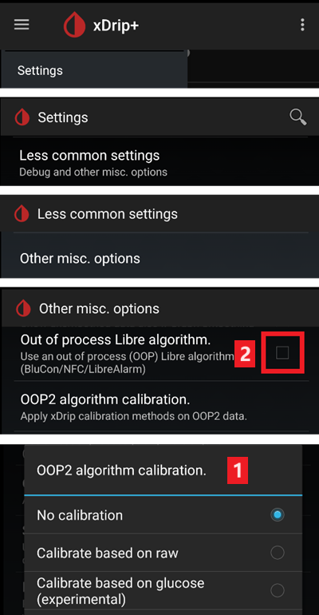

# Freestyle Libre 2 και 2+

Ο αισθητήρας Freestyle Libre 2 είναι πλέον πραγματικό CGM, ακόμα και με την επίσημη εφαρμογή. Παρόλα αυτά, το LibreLink δεν μπορεί να στείλει δεδομένα στο AAPS. Υπάρχουν διάφορες λύσεις για να το χρησιμοποιήσετε με το AAPS.

## 1. Χρήση γέφυρας Bluetooth και OOP

Οι πομποί Bluetooth μπορούν να χρησιμοποιηθούν με το Libre 2 (EU) ή 2+ (EU) και μια εφαρμογή με εξωτερικό αλγόριθμο (out of process algorithm, OOP). Μπορείτε να λαμβάνετε τιμές σακχάρου αίματος κάθε 5 λεπτά, όπως με το [Libre 1](./Libre1.md).

Ελέγξτε ότι η γέφυρα και η εφαρμογή που θέλετε να χρησιμοποιήσετε είναι συμβατές με τον αισθητήρα σας και με το xDrip.

Το Libre2 OOP (θα το βρείτε [εδώ](#Libre2_OOP2)) δημιουργεί τις ίδιες τιμές BG με την αρχική συσκευή ανάγνωσης (reader). Το AAPS με το Libre 2 κάνει εξομάλυνση 10 έως 25 λεπτών, για να αποφύγει ορισμένα απότομα άλματα. Δείτε παρακάτω [Εξομάλυνση τιμών & ακατέργαστες τιμές](#libre2-value-smoothing-raw-values). Το OOP δημιουργεί μετρήσεις κάθε 5 λεπτά με τον μέσο όρο των τελευταίων 5 λεπτών. Γι' αυτό οι μετρήσεις BG δεν είναι τόσο ομαλές, αλλά ταιριάζουν με την αρχική συσκευή ανάγνωσης (reader) και ακολουθούν πιο γρήγορα τις «πραγματικές» τιμές BG. Αν θέλετε να χρησιμοποιήσετε το κύκλωμα με OOP, ενεργοποιήστε όλες τις ρυθμίσεις εξομάλυνσης στο xDrip.

Υπάρχουν μερικοί καλοί λόγοι για να χρησιμοποιήσετε πομπό Bluetooth:

-   Μπορείτε να επιλέξετε διάφορες στρατηγικές βαθμονόμησης OOP2 (1): να έχετε τις τιμές του reader με "no calibration", να βαθμονομήσετε τον αισθητήρα σαν Libre 1 με "calibrate based on raw" ή, τέλος, να βαθμονομήσετε τις τιμές τύπου reader με "calibrate based on glucose".  
  Αφήστε το OOP1 απενεργοποιημένο (2).

    → Hamburger Menu → Settings → Less common settings → Other misc. options



-   Ο αισθητήρας Libre 2 μπορεί να χρησιμοποιηθεί 14,5 ημέρες, όπως το Libre 1
-   Η συμπλήρωση 8 ωρών εκ των υστέρων (backfilling) υποστηρίζεται πλήρως

Σημείωση: Ο πομπός μπορεί να χρησιμοποιηθεί παράλληλα με την εφαρμογή LibreLink, χωρίς να την επηρεάζει.

### Ξεκινήστε τον αισθητήρα

- → Hamburger Menu (1) → Start sensor (2) → Start sensor (3) → Απαντήστε "Not Today" (4).


Αυτό δεν ξεκινά στην πραγματικότητα κανέναν αισθητήρα Libre2 και δεν επικοινωνεί με αυτόν με κανέναν τρόπο. Αυτό απλώς ενημερώνει το xDrip ότι ένας νέος αισθητήρας στέλνει τιμές σακχάρου αίματος. Αν είναι δυνατόν, εισάγετε δύο τιμές μέτρησης αίματος για την αρχική βαθμονόμηση. Τώρα οι τιμές γλυκόζης αίματος πρέπει να εμφανίζονται στο xDrip κάθε 5 λεπτά. Τιμές που χάθηκαν, π.χ. επειδή ήσασταν πολύ μακριά από το τηλέφωνό σας, δεν συμπληρώνονται εκ των υστέρων.

Μετά από αλλαγή αισθητήρα, το xDrip αναγνωρίζει αυτόματα τον νέο αισθητήρα και διαγράφει όλα τα δεδομένα βαθμονόμησης. Μπορείτε να ελέγξετε τη γλυκόζη αίματος μετά την ενεργοποίηση και να κάνετε νέα αρχική βαθμονόμηση.

### Ρύθμιση του AAPS (μόνο για λειτουργία κυκλώματος)

-   Στο **AAPS**, ανοίξτε το **Μενού** (☰) πάνω αριστερά, πηγαίνετε στη **Διαμόρφωση** > **Πηγή BG** και επιλέξτε **xDrip+**


-   Αν το AAPS δεν λαμβάνει τιμές BG όταν το τηλέφωνο είναι σε λειτουργία πτήσης, χρησιμοποιήστε το 'Identify receiver', όπως περιγράφεται στη [σελίδα ρυθμίσεων του xDrip](#xdrip-identify-receiver).

## 2. Χρήση άμεσης σύνδεσης του xDrip

```{admonition} Libre 2 EU only
:class: warning
Το xDrip δεν υποστηρίζει άμεση σύνδεση με τα Libre 2 US και AUS.
Μόνο τα μοντέλα Libre 2 και 2+ **EU**.
```

- Ακολουθήστε [αυτές τις οδηγίες](./Libre2MinimalL00per.md) για να ρυθμίσετε το xDrip, γιατί η αρχική τεκμηρίωση δείχνει σε μια παλιά έκδοση του OOP2.
- Ακολουθήστε τις οδηγίες ρύθμισης στη [σελίδα ρυθμίσεων του xDrip](../CompatibleCgms/xDrip.md).

-   Επιλέξτε xDrip+ στη [Διαμόρφωση > Πηγή BG](#Config-Builder-bg-source).

(libre2-value-smoothing-raw-values)=

### Εξομάλυνση τιμών & ακατέργαστες τιμές

Τεχνικά, η τρέχουσα τιμή σακχάρου αίματος στέλνεται στο xDrip κάθε λεπτό. Ένα φίλτρο σταθμισμένου μέσου όρου υπολογίζει από προεπιλογή μια εξομαλυμένη τιμή για τα τελευταία 25 λεπτά. Μπορείτε να αλλάξετε το χρονικό διάστημα στο μενού NFC Scan features.

→ Hamburger menu → Settings → NFC Scan features → Smooth libre 3 data when using xxx method


Αυτό είναι υποχρεωτικό για τη λειτουργία του κυκλώματος. Οι καμπύλες είναι ομαλές και τα αποτελέσματα του κυκλώματος είναι πολύ καλά. Οι ακατέργαστες τιμές, στις οποίες βασίζονται οι ειδοποιήσεις, κάνουν λίγο περισσότερες διακυμάνσεις, αλλά αντιστοιχούν στις τιμές που δείχνει και ο αναγνώστης (reader). Επιπλέον, οι ακατέργαστες τιμές μπορούν να εμφανίζονται στο γράφημα του xDrip, ώστε να μπορείτε να αντιδράσετε έγκαιρα σε γρήγορες αλλαγές. Ενεργοποιήστε Less Common Settings \> Advanced Settings for Libre2 \> "show Raw values" και "show Sensors Infos". Τότε οι ακατέργαστες τιμές εμφανίζονται επιπλέον ως μικρές λευκές τελείες και περισσότερες πληροφορίες αισθητήρα είναι διαθέσιμες στο μενού συστήματος.

Οι ακατέργαστες τιμές είναι πολύ χρήσιμες όταν το σάκχαρο αίματος αλλάζει γρήγορα. Ακόμα κι αν οι τελείες πηδούν περισσότερο, βλέπετε την τάση πολύ καλύτερα από ό,τι με την εξομαλυμένη γραμμή, για να παίρνετε σωστές αποφάσεις θεραπείας.

→ Hamburger menu → Settings → Less common settings → Advanced settings for Libre 2


#### Βαθμονόμηση

Μπορείτε να βαθμονομήσετε το Libre2 **με μετατόπιση (offset) από -40 mg/dl έως +20 mg/dl \[-2,2 mmol/l έως +1,1 mmol/l\]** (intercept). Η κλίση (slope) δεν μπορεί να αλλάξει. Ελέγξτε με μέτρηση από το δάχτυλο μετά την τοποθέτηση νέου αισθητήρα. Να θυμάστε ότι μπορεί να μην είναι ακριβής τις πρώτες 12 ώρες μετά την τοποθέτηση. Επειδή μπορεί να υπάρχουν μεγάλες διαφορές από τις μετρήσεις αίματος, ελέγχετε κάθε 24 ώρες και βαθμονομήστε αν χρειάζεται. Αν ο αισθητήρας δείχνει εντελώς λάθος τιμές μετά από λίγες ημέρες, πρέπει να αντικατασταθεί.

## 3. Χρήση του Diabox

- Εγκαταστήστε το [Diabox](https://www.bubblesmartreader.com/_files/ugd/6afd37_f183eabd4fbd44fcac4b1926a79b094f.pdf). Στο Diabox, ανοίξτε Settings (Ρυθμίσεις), Integration (Ενσωμάτωση) και ενεργοποιήστε το Share data with other apps (Κοινή χρήση δεδομένων με άλλες εφαρμογές).


- Επιλέξτε xDrip+ στη [Διαμόρφωση > Πηγή BG](#Config-Builder-bg-source).

## 4. Χρήση του Juggluco

Δείτε [εδώ](./Juggluco.md).
