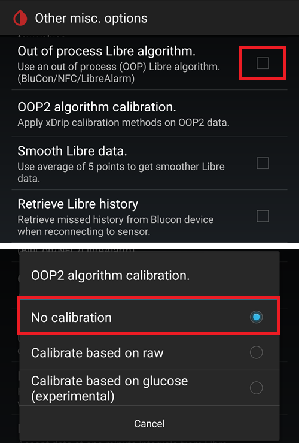
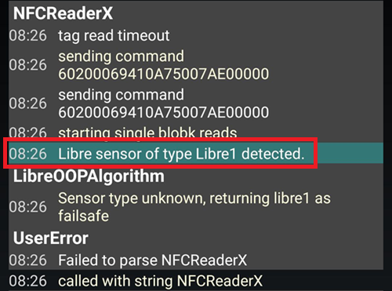

# Πώς να ρυθμίσετε το FSL 2 και το OOP2 για άμεση σύνδεση Bluetooth στο xDrip

Μεταφέρθηκε από το [MinimalL00per](https://www.minimallooper.com/post/how-to-setup-freestyle-libre-2-and-oop2-to-use-a-native-Bluetooth-connection-in-xdrip) σε markdown και **αναθεωρήθηκε/ενημερώθηκε**: 25 Αυγ. 2025, psonnera

Στο τέλος αυτού του κειμένου υπάρχει μια λίστα με ορισμούς. Αν δεν γνωρίζετε κάποιους όρους ή συντομογραφίες, μπορείτε να *[πάτε παρακάτω](#minimallooper-definitions)* για εξηγήσεις.

 

## Διαμόρφωση

### Υλικό (hardware)

- *FSL2 και 2+* **ΣΗΜΕΙΩΣΗ: Οι εκδόσεις US, CAN, NZ, AUS ΔΕΝ υποστηρίζονται**

**(ΠΡΟΑΙΡΕΤΙΚΟ) Reader (συσκευή ανάγνωσης)** (δεν είναι συμβατό με το FSL2+)

- Reader 1 (με ενημερωμένο firmware)

- Reader 2

*ΣΗΜΕΙΩΣΗ: Αν σκοπεύετε να χρησιμοποιήσετε το Reader σε αυτή τη λύση, ΠΡΕΠΕΙ ΝΑ ΞΕΚΙΝΗΣΕΤΕ τον αισθητήρα ΠΡΩΤΑ με το READER. Αν δεν το κάνετε, δεν θα μπορείτε να χρησιμοποιήσετε το Reader για να παίρνετε μετρήσεις από τον ενεργοποιημένο αισθητήρα. Αφού ολοκληρωθεί η προθέρμανση του αισθητήρα, μπορείτε να παίρνετε μετρήσεις από την εφαρμογή LL ή το xDrip.*

### Λογισμικό

**OOP** - Out of Process Algorithm (εξωτερικός αλγόριθμος), μια εξωτερική εφαρμογή Android (APK) που βοηθά να διαβαστούν τα ακατέργαστα δεδομένα του αισθητήρα, για να υπολογιστούν οι τιμές γλυκόζης αίματος. Το xDrip στέλνει τα ακατέργαστα δεδομένα BT του FSL2 στο OOP και οι τιμές γλυκόζης αίματος επιστρέφουν στο xDrip.

- **OOP2**

  - **Λειτουργεί μόνο με ευρωπαϊκούς αισθητήρες FSL2/2+**

  - Κλειστός κώδικας (δεν είναι διαθέσιμος στο GitHub)

  - Σκοπός του είναι να αποκρυπτογραφήσει τις κρυπτογραφημένες ακατέργαστες τιμές του αισθητήρα και να τις επιστρέψει στο xDrip. Μετά το xDrip μπορεί να χρησιμοποιηθεί είτε με ακατέργαστα δεδομένα, που χρειάζονται βαθμονόμηση, είτε με τιμές γλυκόζης παρόμοιες με του Reader 1.

[***xDrip***](https://jamorham.github.io/)

- [*Nightly*](https://github.com/NightscoutFoundation/xDrip/releases): ο πιο πρόσφατος πηγαίος κώδικας, που γίνεται build κάθε νύχτα. Δεν έχει δοκιμαστεί πλήρως

- [*Stable*](https://xdrip-plus-updates.appspot.com/stable/xdrip-plus-latest.apk): η πιο πρόσφατη σταθερή και δοκιμασμένη έκδοση.

- **ΣΗΜΕΙΩΣΗ: οι νέοι αισθητήρες χρειάζονται ενημερωμένη εφαρμογή OOP2. Γι' αυτό συνιστάται να χρησιμοποιείτε τουλάχιστον την πιο πρόσφατη έκδοση του xDrip (Stable), που ταιριάζει με το πιο πρόσφατο OOP2.**

 

## Διαδικασία

- *Πρώτα κατεβάστε και εγκαταστήστε τις παρακάτω εφαρμογές*
- *Απεγκατάσταση εφαρμογών που μπορεί να συγκρούονται*
- *Πώς να ξεκινήσετε αισθητήρα FSL2 σε άμεση λειτουργία Bluetooth με LL και xDrip
  - [*Βήμα 1: Εγκατάσταση και ρύθμιση εφαρμογών*](#minimallooper-step1)
  - [*Βήμα 2: Ρύθμιση του xDrip*](#minimallooper-step2)
  - [*Βήμα 3: Τοποθετήστε τον αισθητήρα στο σώμα*](#minimallooper-step3)
  - [*Βήμα 4: Ανοίξτε την εφαρμογή LL και ξεκινήστε τον αισθητήρα με την πρώτη σάρωση NFC*](#minimallooper-step4)
  - [*Βήμα 5: Ανοίξτε το xDrip και ΣΑΡΩΣΤΕ με NFC τον αισθητήρα FSL2*](#minimallooper-step5)
  - [*Βήμα 6: Ξεκινήστε τον νέο αισθητήρα στο xDrip*](#minimallooper-step6)
  - [*Βήμα 7: Περιμένετε 60 δευτερόλεπτα και σαρώστε ξανά τον αισθητήρα με NFC*](#minimallooper-step7)
  - [*Βήμα 8: Συλλογή δεδομένων για 3 έως 15 λεπτά*](#minimallooper-step8)
  - [*Βήμα 9: Ελέγξτε ότι ο αισθητήρας είναι συνδεδεμένος και στέλνει δεδομένα*](#minimallooper-step9)

- *[Σημειώσεις](#minimallooper-notes)*
- *[Πλεονεκτήματα](#minimallooper-advantages)*
- *[Μειονεκτήματα](#minimallooper-disadvantages)*
- <u>*\[Αντιμετώπιση προβλημάτων\](#minimallooper-troubleshooting)*</u>

## Πριν ξεκινήσετε

Σας συνιστούμε έντονα να ακολουθήσετε αυτή τη διαδικασία με **νέο αισθητήρα**. Κάποιοι αναφέρουν ότι μπορεί να γίνει σύνδεση και με αισθητήρα που ήδη λειτουργεί (***δείτε [παρακάτω](#minimallooper-started-sensor)***), αλλά είναι πολύ πιθανό η εφαρμογή LL ή το Reader να δημιουργήσει νέο ιδιωτικό κοινό κλειδί επικοινωνίας κατά τη σύνδεση. Αυτό σημαίνει ότι μετά τη σύνδεση (bonding) το xDrip δεν γνωρίζει το νέο κλειδί και δεν θα μπορεί να επικοινωνήσει με τον αισθητήρα. Δοκιμάστε σύνδεση με αισθητήρα που ήδη λειτουργεί με δική σας ευθύνη, καλύτερα κοντά στο τέλος της ζωής του αισθητήρα.

### Πρώτα κατεβάστε και εγκαταστήστε τις παρακάτω εφαρμογές

(Libre2_OOP2)=

- **OOP2** - Εκδόσεις του oop2 θα βρείτε εδώ:

  (*Σημείωση: πρέπει να είστε συνδεδεμένοι στο Google για να ανοίξετε τον σύνδεσμο.*)

*[oop2.apk](https://drive.google.com/file/d/1106h2s12b3Ev9gKCTU2G75q8h9ChHjcz/view?usp=sharing)* - OOP2_21_09_25 (05d1989) **2025.09.21** (πιο πρόσφατη έκδοση)

- **xDrip** - η **<u>πιο πρόσφατη έκδοση</u>** (ελάχιστη έκδοση 2025.09.26) βρίσκεται εδώ:

[*xDrip.apk*](https://github.com/NightscoutFoundation/xDrip/releases)

(minimallooper-started-sensor)=

### Τι γίνεται αν ο αισθητήρας μου έχει ήδη ξεκινήσει; Can I still get readings in xDrip? ΝΑΙ!

Πολλοί ρώτησαν αν αυτή η μέθοδος μπορεί να χρησιμοποιηθεί με αισθητήρα που είναι ήδη ενεργός, και η απάντηση είναι ένα καθαρό **ΝΑΙ**: μπορείτε να ξεκινήσετε αισθητήρα που ήδη λειτουργεί.

1.  **ΠΡΩΤΑ**, βεβαιωθείτε ότι έχετε κάνει τις αλλαγές στη διαμόρφωση και στις ρυθμίσεις του xDrip και ότι έχετε εγκαταστήσει και ρυθμίσει το OOP2, όπως φαίνεται παρακάτω.

2.  **ΜΕΤΑ**, πηγαίνετε στο *Βήμα 5* και **ΒΕΒΑΙΩΘΕΙΤΕ** ότι έχετε κλείσει αναγκαστικά (force close) την LL πριν ξεκινήσετε. Μετά ακολουθήστε τη διαδικασία μέχρι το τέλος.

*ΣΗΜΕΙΩΣΗ: Δεν θα μπορείτε να χρησιμοποιήσετε τον ενεργοποιημένο αισθητήρα FSL2 με το FSLReader ΑΝ δεν ξεκίνησε πρώτα με το FSLReader. Αν ΞΕΚΙΝΗΣΕ πρώτα με το FSLReader, τότε θα μπορείτε να **σαρώνετε** τον αισθητήρα και να παίρνετε μετρήσεις ΚΑΙ με το Reader ΚΑΙ με εφαρμογές όπως η LL και το xDrip.*

## Πώς να ξεκινήσετε αισθητήρα FSL2 σε άμεση λειτουργία Bluetooth με LL και xDrip

*ΣΗΜΕΙΩΣΗ: Αν στα στιγμιότυπα οθόνης υπάρχουν ρυθμίσεις που δεν είναι σημειωμένες με ΠΛΑΙΣΙΟ και είναι ΑΠΟΕΠΙΛΕΓΜΕΝΕΣ (δηλ. απενεργοποιημένες), ΑΦΗΣΤΕ ΤΙΣ ΑΠΕΝΕΡΓΟΠΟΙΗΜΕΝΕΣ. Τα στιγμιότυπα οθόνης δείχνουν μια ρύθμιση που λειτουργεί, για ΟΛΕΣ τις ρυθμίσεις που φαίνονται. If you want to experiment turning other features on/off after you have a working sensor, you are free to do so at your own risk.*

(minimallooper-step1)=

### Βήμα 1: Εγκατάσταση και ρύθμιση εφαρμογών

**Εγκαταστήστε και ρυθμίστε το OOP2** και ελέγξτε ότι λειτουργεί, απλώς ανοίγοντας την εφαρμογή.


**Ρυθμίσεις**

- *Use service* **on**

- *Use foreground service* **on**

- *Timer Duration* **5 minutes**

  - Αλλάξτε το σε **1 sec** αν δεν παίρνετε αποτελέσματα αρκετά γρήγορα (το παρακάτω στιγμιότυπο οθόνης δείχνει αυτή τη ρύθμιση).

**Έκδοση 2: 93e5cac-2020.12.08 (πιο πρόσφατη έκδοση)**


**Εγκαταστήστε το xDrip**, ελάχιστη έκδοση: η πιο πρόσφατη έκδοση. Περισσότερη τεκμηρίωση για την εγκατάσταση και ρύθμιση του xDrip θα βρείτε [*εδώ*](../CompatibleCgms/xDrip.md).

(minimallooper-step2)=

### Βήμα 2: Ρύθμιση του xDrip

**Hardware Data Source**: Libre Bluetooth


**NFC Scan features**: *ρυθμίσεις που δεν αναφέρονται θεωρούνται απενεργοποιημένες.*

- *Use NFC feature*: **on**
- *Sensor Age or Expiry*: **on**
- *Scan when not in xDrip*: **on**
- *Use Any-tag optimized reading method*: **off**, αλλά δοκιμάστε **on** αν έχετε δυσκολίες στη σάρωση


- *Starting Bluetooth connection with FSL2 sensor*: **Always connect to libre2 sensors**


- *Smooth libre 3 data when using xxx method*: αφήστε την προεπιλογή. Αυξήστε την τιμή για αισθητήρες με θόρυβο, μειώστε την όταν είναι σταθεροί.


**Less Common Settings -\> Bluetooth Settings** (*αυτές είναι σημαντικές και μπορεί να διαφέρουν ανάλογα με το τηλέφωνο/τη ρύθμισή σας*)

- *Turn Bluetooth on*: **on**
- *Trust Auto-Connect*: **on**
- *Use Background Scans*: **on**
- *Always discover services*: **on**

Μπορείτε να ρυθμίσετε το xDrip με τον παρακάτω κωδικό QR. Πρέπει να τον σαρώσετε (ή να φορτώσετε την εικόνα) στο xDrip -> Auto Configure.

```{admonition} QR Code
:class: dropdown


```


Αφού σαρώσετε τον παραπάνω κωδικό QR, αν έχετε τηλέφωνο Samsung (αυτό βοηθά και σε πολλές κινεζικές μάρκες), σαρώστε και τον άλλο κωδικό QR παρακάτω, για να αλλάξετε τις ρυθμίσεις για πιο αξιόπιστη σύνδεση:

- *Trust Auto-Connect*: **off**
- *Use Background Scans*: **off**

```{admonition} QR Code
:class: dropdown


```


**Advanced settings for FSL2** (*προαιρετικό αλλά χρήσιμο*)

- *show Raw values in Graph*: **on**

- *show Sensor info in Status*: **on**


**Extra Logging Settings** (*χρειάζεται για αναζήτηση σφαλμάτων, αν κάτι δεν λειτουργεί σωστά*)

- *Extra tags for logging*: εισάγετε αυτή την τιμή

`BgReading:d,jamorham librereceiver:v,LibreOOPAlgorithm:v,jamorham nsemulator:v,DexCollectionService:v`


(minimallooper-OOPsettings)=

**Less Common Settings -\> Other misc options**

> **Ρυθμίσεις για τη διαμόρφωση του OOP2**

- *Out of process Libre algorithm*: **OFF**

(*ΒΕΒΑΙΩΘΕΙΤΕ ΟΤΙ ΑΥΤΟ ΕΙΝΑΙ **OFF** ΓΙΑ ΤΟ OOP2, ΑΛΛΙΩΣ ΔΕΝ ΘΑ ΠΑΙΡΝΕΤΕ ΜΕΤΡΗΣΕΙΣ!*)



(minimallooper-step3)=

### Βήμα 3: Τοποθετήστε τον αισθητήρα στο σώμα

(minimallooper-step4)=

### Βήμα 4: Ανοίξτε την εφαρμογή LL και ξεκινήστε τον αισθητήρα με την πρώτη σάρωση NFC

Ανοίξτε την εφαρμογή LL, μετά σαρώστε τον αισθητήρα που μόλις τοποθετήσατε, μετά κλείστε και απενεργοποιήστε ή απεγκαταστήστε την εφαρμογή LL. **Πρέπει ακόμα να περιμένετε ολόκληρα τα 60 λεπτά προθέρμανσης του αισθητήρα πριν συνεχίσετε και ξεκινήσετε τον αισθητήρα στο xDrip**. Μην βασίζεστε στις μετρήσεις πριν από αυτό, γιατί ο αισθητήρας ακόμα κάνει εσωτερική βαθμονόμηση και οι τιμές αλλάζουν πολύ.

#### Βήμα 4a (ΠΡΟΑΙΡΕΤΙΚΟ, χρήση FSLReader):

**Ξεκινήστε τον αισθητήρα FSL2 (όχι 2+) σαρώνοντάς τον με το FSLReader, με την πρώτη σάρωση NFC**

Αν θέλετε να μπορείτε να χρησιμοποιείτε το **FSLReader** καθώς και την εφαρμογή LL ή το xDrip για να διαβάζετε τιμές από τον αισθητήρα FSL2, τότε **πρέπει να σαρώσετε τον αισθητήρα FSL2 που μόλις τοποθετήσατε ΠΡΩΤΑ με το FSL Reader.** Αφού ολοκληρωθεί η προθέρμανση του αισθητήρα, μπορείτε να χρησιμοποιήσετε την εφαρμογή LL ή το xDrip για να σαρώνετε μετρήσεις.

*ΣΗΜΕΙΩΣΗ: Η εφαρμογή LL χρειάζεται μόνο για την ΠΡΩΤΗ σάρωση NFC μετά την τοποθέτηση του αισθητήρα. Χρησιμεύει για να στείλει το σήμα έναρξης της προθέρμανσης. Μετά από αυτό η εφαρμογή ΠΡΕΠΕΙ να απενεργοποιηθεί (ρυθμίσεις εφαρμογής-\>αναγκαστική διακοπή) ή να απεγκατασταθεί. Μπορείτε να χρησιμοποιήσετε την τροποποιημένη (patched) εφαρμογή 2.3 ή τις επίσημες εκδόσεις, δεν έχει σημασία. Το κύριο είναι να μην τρέχει η εφαρμογή LL όταν το xDrip προσπαθεί να ξεκινήσει τη σύνδεση BT (bonding) με τον αισθητήρα, γιατί η εφαρμογή LL διαταράσσει την επικοινωνία και εμποδίζει την επανασύνδεση Bluetooth.*

*Κάποιοι αναφέρουν ότι αρκεί να απενεργοποιήσετε την **άδεια τοποθεσίας** της εφαρμογής LL στις ρυθμίσεις συστήματος Android, ώστε να μην επηρεάζει τη σύνδεση. Μερικοί χρήστες αναφέρουν ότι αυτό λειτουργεί. Και πάλι, **συνιστώ να απενεργοποιήσετε ή να απεγκαταστήσετε την εφαρμογή**, αλλά μπορείτε να το δοκιμάσετε αν θέλετε να πειραματιστείτε.*

(minimallooper-step5)=

### Βήμα 5: Ανοίξτε το xDrip και ΣΑΡΩΣΤΕ με NFC τον αισθητήρα FSL2

(*Υπενθύμιση! Βεβαιωθείτε ότι η LL είναι απενεργοποιημένη (η τοποθεσία κλειστή) ή απεγκατεστημένη ΚΑΙ ότι έχετε περιμένει ολόκληρα τα 60 λεπτά για την προθέρμανση και την εσωτερική βαθμονόμηση του αισθητήρα.*)

**ΣΑΡΩΣΤΕ ΜΕ NFC** τον αισθητήρα FSL2 με το xDrip. Αυτό στέλνει σήμα στον αισθητήρα να ενεργοποιήσει τη σύζευξη Bluetooth, ώστε να ξεκινήσει η διαδικασία σύνδεσης (bonding). Μια μικρή ειδοποίηση θα εμφανιστεί για λίγο στο κάτω μέρος της κύριας οθόνης (Overview) του xDrip με το κείμενο **Scanning** και μετά την ειδοποίηση **Scanned OK!**, όταν η σάρωση NFC του αισθητήρα FSL 2 πετύχει.


(minimallooper-step6)=

### Βήμα 6: Ξεκινήστε τον νέο αισθητήρα στο xDrip

Στην **κύρια οθόνη (Overview) του xDrip** πατήστε το **hamburger menu** (☰) πάνω αριστερά. Μετά επιλέξτε **Start Sensor**.

Στην οθόνη **Start New Sensor** πατήστε **Start Sensor**. Θα εμφανιστεί η ερώτηση **Did you insert it today?** Απαντήστε πατώντας **NOT TODAY**.


*ΣΗΜΕΙΩΣΗ: Αν πατήσατε κατά λάθος "YES, TODAY", τότε πρέπει να κάνετε "stop sensor" από το κύριο μενού του xDrip και μετά "start sensor", ξεκινώντας ξανά από το Βήμα 5.*

(minimallooper-step7)=

### Βήμα 7: Περιμένετε 60 δευτερόλεπτα και σαρώστε ξανά τον αισθητήρα με NFC

A second NFC scan is needed in order to **ADD** the sensor as the Bluetooth device that xDrip will use to retrieve the readings. Όταν τελειώσει, θα δείτε μια ειδοποίηση **NEW SENSOR STARTED**.


Υπάρχει υποχρεωτική αναμονή 60 δευτερολέπτων, γιατί σε αυτή τη διαδικασία ο αισθητήρας δεν μπορεί να σαρωθεί περισσότερο από μία φορά το λεπτό. Αν σαρώσετε τον αισθητήρα πολύ νωρίς, εμφανίζεται η προειδοποίηση **Not so quickly, wait 60 seconds** στην κύρια οθόνη (Overview) του xDrip.


Ανοίξτε τα αρχεία καταγραφής συμβάντων (event logs) του xDrip και ελέγξτε ότι ο αισθητήρας έκανε σωστά σύζευξη με το xDrip.


(minimallooper-step8)=

### Βήμα 8: Συλλογή δεδομένων για 3 έως 15 λεπτά

Σε 3 έως 15 λεπτά συλλέγονται αρκετά δεδομένα για να εμφανιστούν οι πρώτες τιμές. *Αν μετά από αυτό τον χρόνο ακόμα δεν λαμβάνετε μετρήσεις, μερικές φορές βοηθά μια επανεκκίνηση του τηλεφώνου.*

Αν χρησιμοποιείτε Samsung (ή πολλά τηλέφωνα κινεζικών μαρκών) και έχετε προβλήματα λήψης δεδομένων, σαρώστε τον παρακάτω κωδικό QR στο xDrip -> Auto Configure.

```{admonition} QR Code
:class: dropdown


```

Θα αλλάξει τις ρυθμίσεις Bluetooth του xDrip σε:

- *Trust Auto-Connect*: **off**
- *Use Background Scans*: **off**

(minimallooper-step9)=

### Βήμα 9: Ελέγξτε ότι ο αισθητήρας είναι συνδεδεμένος και στέλνει δεδομένα

Πατήστε το Hamburger menu πάνω αριστερά στην κύρια οθόνη (Overview) του xDrip και επιλέξτε **System Status**. Στην οθόνη System Status, το πεδίο **Bluetooth Device:** δείχνει το όνομα Bluetooth του FSL2 στη μορφή **ABB___XXXXXXXXXXX**, όπου τα XXX είναι ο σειριακός αριθμός του αισθητήρα. The **Connection Status** field displays **Connected** and the **Sensor Start:** field displays the time the sensor was started.


Στην οθόνη **BT Device** (σύρετε αριστερά) μπορείτε να ελέγξετε περισσότερες λεπτομέρειες σύνδεσης του αισθητήρα και να χρησιμοποιήσετε αυτή την οθόνη για την αντιμετώπιση προβλημάτων σύνδεσης. Παρακάτω υπάρχει μια λίστα με τα πεδία και τι δείχνουν, για να σας βοηθήσει στην αντιμετώπιση προβλημάτων σύνδεσης.

*ΣΗΜΕΙΩΣΗ: **<u>ΜΗΝ ΑΓΓΙΞΕΤΕ</u> ΚΑΙ ΜΗΝ ΑΛΛΑΞΕΤΕ το Bluetooth Pairing από <u>Disabled</u>** σε αυτό το παράθυρο. Αν το κάνετε, θα γίνει προσπάθεια άμεσης σύζευξης, που θα αποτύχει (Not bonded), και θα πρέπει να ξεκινήσετε τη διαδικασία ξανά από το Βήμα 5.*


- **Phone Service State:** Η τελευταία φορά που το τηλέφωνο έκανε σύνδεση BT με τον αισθητήρα (πρέπει να είναι λιγότερο από 5 λεπτά πριν)
- **Bluetooth Device:** Δείχνει την τρέχουσα κατάσταση της σύνδεσης (**Connected** ή **Disconnected**)
- **Device Mac Address**: Το αναγνωριστικό υλικού (hardware ID) του αισθητήρα
- **Bluetooth Pairing**: This should be **<u>Disabled, tap to enable</u>**. Προσέξτε να ΜΗΝ το πατήσετε. Αν το πατήσετε κατά λάθος, πατήστε το ξανά μέχρι να γυρίσει σε disabled.
- **Slowest wake up**: Μπορείτε να το αγνοήσετε. xDrip doesn't spend its time waiting for readings: it will start expecting them after a certain time (traditionally 5 minutes). Αν δεν έρθουν δεδομένα εκείνη τη στιγμή, θα δείτε "Woke up early", που σημαίνει ότι το xDrip περίμενε έτοιμα δεδομένα αλλά δεν υπήρχαν. Το Slowest wake up είναι η μεγαλύτερη καθυστέρηση που υπήρξε πριν από την κανονική λήψη δεδομένων.
- **Next Wake up**: Πρέπει να δείχνει 5 λεπτά


(minimallooper-notes)=

### Σημειώσεις

- **Χρήση σαρώσεων NFC της LL ΑΦΟΥ ολοκληρωθεί η σύνδεση/σύζευξη στο xDrip**: Μπορείτε να κάνετε σαρώσεις NFC, αλλά η σύνδεση/σύζευξη με το xDrip πρέπει να έχει ολοκληρωθεί πρώτα. Κοιτάζετε πάντα το xDrip για να δείτε αν πλησιάζει η μέτρηση των 5 λεπτών (π.χ. πριν από 4 λεπτά). Αν είναι κοντά στα 5 λεπτά, περιμένετε να έρθει η νέα μέτρηση BT και μετά κάντε τη σάρωση NFC. Αν σαρώσετε σε λάθος στιγμή, θα διαταράξετε τη διαδικασία BT στο xDrip και δεν θα λαμβάνει μετρήσεις BT. Η νέα σύνδεση και η αποστολή δεδομένων μπορεί να αργήσει, και μερικές φορές η σύνδεση BT του αισθητήρα μπορεί να «κλαπεί» από την LL. Όμως, ανάμεσα σε αυτές τις μετρήσεις BT, δεν είχα κανένα πρόβλημα να κάνω σάρωση NFC και αμέσως μετά να απενεργοποιήσω την εφαρμογή. Δεν είμαι σίγουρος αν η LL πρέπει να απενεργοποιείται κάθε φορά, αλλά την απενεργοποιώ για σιγουριά.

- **What is going on?** When a Bluetooth connection is made a private shared key is created that is needed to allow communication between the sensor and the calling application/device. Είναι πολύ πιθανό η εφαρμογή LL ή το Reader να δημιουργήσει νέο ιδιωτικό κοινό κλειδί επικοινωνίας κατά τη σύνδεση. Αυτό σημαίνει ότι μετά τη σύνδεση (bonding) το xDrip δεν γνωρίζει το νέο κλειδί και δεν θα μπορεί να επικοινωνήσει με τον αισθητήρα.

  - Αρκετοί χρήστες αναφέρουν ότι η εφαρμογή LL μπορεί να ξεκινήσει ξανά αφού ο αισθητήρας ξεκινήσει με επιτυχία και λαμβάνει μετρήσεις στο xDrip. Στις άδειες Android της εφαρμογής LL απλώς απενεργοποιήστε τη ρύθμιση **Allow Location** (Να επιτρέπεται η τοποθεσία). Όταν γίνει αυτό, θα μπορείτε να χρησιμοποιείτε την εφαρμογή LL και το xDrip ταυτόχρονα. Συνιστώ να μην ορίσετε προεπιλεγμένη εφαρμογή για σάρωση NFC και να διαλέγετε κάθε φορά με ποια εφαρμογή θα διαβάσετε τον αισθητήρα. Επίσης, ΜΗΝ ΞΕΧΑΣΕΤΕ, στην επόμενη αλλαγή αισθητήρα, να κλείσετε αναγκαστικά την εφαρμογή LL μετά την πρώτη σάρωση NFC προθέρμανσης του νέου αισθητήρα. Αφού ο αισθητήρας ρυθμιστεί και λαμβάνει μετρήσεις στο xDrip, μπορείτε να ξεκινήσετε ξανά την εφαρμογή LL.

&nbsp;

- **Επανεκκίνηση του τηλεφώνου**: Μετά την επανεκκίνηση, και αφού απενεργοποιήσετε ή κλείσετε αναγκαστικά την εφαρμογή, ΘΥΜΗΘΕΙΤΕ να ελέγξετε ότι η εφαρμογή LL ΔΕΝ τρέχει. Προτείνω να δοκιμάσετε μια επανεκκίνηση, για να δείτε αν η LL ξεκινά πάλι αυτόματα. Μπορείτε να το δείτε στις ρυθμίσεις της εφαρμογής LL, στις ρυθμίσεις εφαρμογών Android του τηλεφώνου σας. Αν είναι ακόμα ενεργή, απενεργοποιήστε ξανά την εφαρμογή LL. Η απεγκατάσταση της εφαρμογής LL μπορεί να είναι ο μόνος τρόπος να το αποφύγετε. Αυτό γίνεται για να μην «κλέψει» κατά λάθος η LL τη σύνδεση BT (bond). Επίσης, μετά την επανεκκίνηση θα χρειαστούν πάλι 3-15 λεπτά για να λάβετε μετρήσεις BT από τον αισθητήρα. Γι' αυτό κάντε υπομονή και λάβετε το υπόψη σας, αν κάνετε επανεκκίνηση κοντά σε ώρες που χρειάζεστε τιμή BG για bolus, γεύματα κ.λπ.

&nbsp;

- **Ρυθμίσεις βελτιστοποίησης μπαταρίας**: Βεβαιωθείτε ότι ΕΞΑΙΡΕΙΤΕ αυτές τις εφαρμογές από τις ρυθμίσεις βελτιστοποίησης μπαταρίας του τηλεφώνου σας

  - xDrip

  - OOP 2

  - LL

  - AAPS

&nbsp;

- **Χρήση λειτουργίας πτήσης:** Σε μερικές περιπτώσεις χρειάζεται να ενεργοποιήσετε τη λειτουργία πτήσης (όταν πετάτε ;-), ή τη νύχτα, όταν δεν θέλετε σήματα Wi-Fi ή κινητού δικτύου από το τηλέφωνο κοντά στο κεφάλι σας). Αυτό μπορεί να προκαλέσει προβλήματα στην επικοινωνία Bluetooth όταν ενεργοποιείται η λειτουργία πτήσης. Αν ενεργοποιήσετε τη λειτουργία πτήσης στο τηλέφωνο και μετά ενεργοποιήσετε το Bluetooth, οι μετρήσεις γλυκόζης αίματος θα χαθούν. Η μόνη λύση είναι να κάνετε επανεκκίνηση του collector στο xdrip+ -\> System Status -\> Classic Status Page. Μετά την επανεκκίνηση του collector, οι μετρήσεις γλυκόζης αίματος εμφανίστηκαν ξανά.

 

(minimallooper-advantages)=

### Πλεονεκτήματα

- **Δεν χρειάζεται πια η τροποποιημένη εφαρμογή LL** Δεν χρειάζεστε πια τροποποιημένη (patched) έκδοση της εφαρμογής LL για να παίρνετε τιμές από τον αισθητήρα FSL2. Μπορείτε να χρησιμοποιήσετε την τροποποιημένη εφαρμογή LL, αλλά και οι επίσημες εκδόσεις της LL μπορούν να κάνουν την πρώτη σάρωση NFC έναρξης με τον ίδιο τρόπο. Δεν υπάρχει καμία διαφορά όσον αφορά τη σάρωση NFC έναρξης για να ξεκινήσει ο αισθητήρας.

&nbsp;

- **Δεν χρειάζεται πια συσκευή σάρωσης NFC τρίτου κατασκευαστή** Συσκευές σάρωσης NFC τρίτων (όπως Miaomiao, Bubble ή Blucon) δεν χρειάζονται πια *(αλλά μπορούν ακόμα να χρησιμοποιηθούν)* για τη λήψη μετρήσεων, γιατί ο αισθητήρας μπορεί τώρα να τις στέλνει μόνος του μέσω Bluetooth. Λιγότερο υλικό σημαίνει λιγότερα πράγματα που μπορούν να χαλάσουν, λιγότερες συσκευές για φόρτιση και μια πιο απλή ρύθμιση.

&nbsp;

- **Θα μπορείτε ακόμα να σαρώνετε μετρήσεις με NFC με το FSL2 Reader (έκδοση 1 με ενημερωμένο FW ή έκδοση 2) ΟΤΑΝ ο αισθητήρας FSL2 έχει ξεκινήσει ΠΡΩΤΑ με το FSL Reader.** Το αυτόνομο FSL2 Reader μπορεί ακόμα να σαρώνει μετρήσεις από τον ενεργό αισθητήρα, αφού αυτός έχει συνδεθεί (bonding) μέσω Bluetooth με το xDrip.

  - **ΠΡΕΠΕΙ** να ξεκινήσετε τον αισθητήρα με την πρώτη σάρωση NFC, που ξεκινά την προθέρμανση, **ΠΡΩΤΑ με το FSL Reader**. Από εδώ και πέρα και άλλες εφαρμογές θα μπορούν να παίρνουν μετρήσεις NFC από τον ενεργοποιημένο πια αισθητήρα.
- Από όσο καταλαβαίνω, ο αισθητήρας FSL2 (όσο δεν έχει κάνει σύνδεση και δεν προσπαθεί να κάνει σύνδεση) πάντα ανακοινώνει την παρουσία του (και ότι είναι διαθέσιμος) μέσω BLE ακριβώς κάθε 2 λεπτά (αυτό φαίνεται σε κάθε συσκευή Bluetooth που μπορεί να κάνει σάρωση για συσκευές Bluetooth). Η συσκευή που απαντά πρώτη σε αυτή την ανακοίνωση κερδίζει και είναι η *μόνη* συσκευή που επιτρέπεται να συνδεθεί και να διαβάσει τον αισθητήρα, γιατί κατά τη σύνδεση με σάρωση NFC δημιουργείται ένα ιδιωτικό κοινό κλειδί, που χρησιμοποιείται για την αποκρυπτογράφηση της επικοινωνίας του FSL 2. Μετά ο αισθητήρας δεν είναι διαθέσιμος για άλλες συσκευές που δεν έχουν αυτό το ιδιωτικό κοινό κλειδί και ίσως προσπαθούν επίσης να συνδεθούν. Φαίνεται ότι το FSL 2 Reader πάντα κερδίζει, όποιος κι αν είναι ο «αντίπαλος».

&nbsp;

- **Ρύθμιση με ελάχιστες συσκευές** Ο στόχος μου ήταν πάντα να έχω όσο το δυνατόν λιγότερες ιατρικές συσκευές πάνω στο σώμα μου. Το FSL2 μαζί με το σύστημα Omnipod πέτυχε αυτό τον στόχο. Αυτό είναι ακόμα πιο σημαντικό όταν ταξιδεύω (κοντινές και μακρινές αποστάσεις), γιατί τα αντικείμενα και οι αλλαγές τους είναι λιγότερα, άρα έχω περισσότερο χώρο για άλλα πράγματα στις αποσκευές μου. Ελπίζω στο μέλλον να υπάρξει μια αντλία patch που να έχει μόνο ανταλλακτική δεξαμενή, ενώ το τσιπ και ο μηχανισμός (μοτέρ) να είναι ένα κομμάτι που κρατάτε και ξαναχρησιμοποιείτε. Αυτό θα μείωνε τα απόβλητα και τις συσκευασίες στις αλλαγές σημείου έγχυσης, άρα ακόμα περισσότερος χώρος στη βαλίτσα μου για άλλα πράγματα.

&nbsp;

- **Τέλος τα κενά μίας ώρας στην αλλαγή αισθητήρα** Επειδή μπορείτε να ξεκινήσετε άλλον αισθητήρα με την εφαρμογή LL με μια πρώτη σάρωση NFC, ο τρέχων αισθητήρας μπορεί να συνεχίσει να λειτουργεί και να στέλνει μετρήσεις μέσω Bluetooth την ίδια ώρα. Μετά από 20 λεπτά μπορείτε να πάρετε μετρήσεις από τον νέο αισθητήρα, αλλά καλύτερα να περιμένετε 1 ώρα, ώστε ο αισθητήρας να κάνει σωστά την εσωτερική βαθμονόμηση. Έτσι μπορείτε να σταματήσετε τον τρέχοντα αισθητήρα και να ξεκινήσετε τον νέο (αφού τοποθετήθηκε και προθερμάνθηκε με τη σάρωση NFC της LL μία ώρα πριν), και μέσα σε 3 έως 15 λεπτά θα έχετε τις πρώτες βαθμονομήσεις και τις πρώτες μετρήσεις.

&nbsp;

(minimallooper-disadvantages)=

### Μειονεκτήματα

- **Επανεκκίνηση τηλεφώνου:** Επειδή η διαδικασία Bluetooth πρέπει να ξεκινήσει ξανά όταν κάνετε επανεκκίνηση του τηλεφώνου, πρέπει πρώτα να απενεργοποιήσετε χειροκίνητα την εφαρμογή LL (αν δεν την απεγκαταστήσατε) και να περιμένετε υπομονετικά τις πρώτες μετρήσεις (3 έως 15 λεπτά). Αυτό σημαίνει ότι πρέπει να διαλέγετε πότε θα κάνετε επανεκκίνηση του τηλεφώνου, ώστε να μη γίνεται σε κρίσιμες ώρες, όπως bolus διόρθωσης ή ώρες γευμάτων και σνακ.

&nbsp;

- **Δεν μπορείτε να τρέχετε LL και xDrip παράλληλα για μετρήσεις Bluetooth**. Η LL θα προσπαθεί πάντα να «κλέψει» τη σύνδεση Bluetooth με τον αισθητήρα (bond). Αν συμβεί αυτό, μένετε με την LL για όλη την υπόλοιπη ζωή του αισθητήρα. Γι' αυτό η ταυτόχρονη χρήση των εφαρμογών δεν λειτουργεί πάντα. Όπως αναφέρω παρακάτω, μπορείτε να ενεργοποιήσετε την εφαρμογή LL και να κάνετε σάρωση NFC για να πάρετε τη μέτρηση της LL (αν θέλετε να συγκρίνετε ή να πάρετε το ιστορικό για εσάς ή για αναφορές του ενδοκρινολόγου). Όμως πρέπει να την απενεργοποιήσετε μόλις πάρετε τη μέτρηση και να μην το κάνετε μέσα στο τελευταίο λεπτό πριν το xDrip πάρει τη μέτρηση Bluetooth. Δεν είμαι σίγουρος πώς λειτουργεί το FSL2 Reader σε αυτή την περίπτωση, αλλά θα το δοκιμάσω αργότερα.
- Αρκετοί χρήστες αναφέρουν ότι η εφαρμογή LL μπορεί να ξεκινήσει ξανά αφού ο αισθητήρας ξεκινήσει με επιτυχία και λαμβάνει μετρήσεις στο xDrip. Στις άδειες Android της εφαρμογής LL απλώς απενεργοποιήστε τη ρύθμιση **Allow Location** (Να επιτρέπεται η τοποθεσία). Όταν γίνει αυτό, θα μπορείτε να χρησιμοποιείτε την εφαρμογή LL και το xDrip ταυτόχρονα. Συνιστώ να μην ορίσετε προεπιλεγμένη εφαρμογή για σάρωση NFC και να διαλέγετε κάθε φορά με ποια εφαρμογή θα διαβάσετε τον αισθητήρα. Επίσης, ΜΗΝ ΞΕΧΑΣΕΤΕ, στην επόμενη αλλαγή αισθητήρα, να κλείσετε αναγκαστικά την εφαρμογή LL μετά την πρώτη σάρωση NFC προθέρμανσης του νέου αισθητήρα. Αφού ο αισθητήρας ρυθμιστεί και λαμβάνει μετρήσεις στο xDrip, μπορείτε να ξεκινήσετε ξανά την εφαρμογή LL.

&nbsp;

- **Συσκευές σάρωσης NFC τρίτων μπορούν ακόμα να χρησιμοποιηθούν**. Ναι, το ανέφερα ως μειονέκτημα, αλλά ήθελα επίσης να πω ότι αν κάτι πάει στραβά με τον αισθητήρα και η LL πάρει τον έλεγχό του, μπορείτε πάντα να βάλετε μια συσκευή σάρωσης NFC πάνω στον αισθητήρα για να παίρνετε μετρήσεις στο xDrip. Μπορείτε επίσης να χρησιμοποιήσετε μια τέτοια συσκευή αντί για άμεση σύνδεση Bluetooth, αν προτιμάτε μια ρύθμιση με συσκευή σάρωσης NFC τρίτου κατασκευαστή (Miaomiao, Bubble, Blucon). Μερικές φορές κάποια τηλέφωνα δεν λειτουργούν καλά με την άμεση σύνδεση Bluetooth (bonding) με τον αισθητήρα και τη λήψη δεδομένων. Μπορείτε να χρησιμοποιείτε αυτές τις συσκευές ως εφεδρεία ή κανονικά. Σε κάθε περίπτωση, έχετε ακόμα αυτή την επιλογή.
- Αν σκοπεύετε να χρησιμοποιήσετε το **FSL Reader** ως συσκευή σάρωσης NFC για μετρήσεις, ΠΡΕΠΕΙ να ξεκινήσετε τον αισθητήρα FSL2 με την **ΠΡΩΤΗ σάρωση NFC** για την προθέρμανση **ΠΡΩΤΑ με το READER**.

&nbsp;

- **Τα δεδομένα δεν ανεβαίνουν αυτόματα στο LV** Επειδή η εφαρμογή LL δεν έχει συνεχή σύνδεση Bluetooth (γιατί η LL δεν πρέπει να τρέχει ταυτόχρονα με το xDrip όταν ο αισθητήρας στέλνει ενεργά μετρήσεις Bluetooth), δεν λαμβάνει αυτόματα μετρήσεις από τον αισθητήρα. Αυτό σημαίνει ότι τα δεδομένα γλυκόζης αίματος δεν ανεβαίνουν αυτόματα στο LV και άρα ούτε σε άλλα τηλέφωνα με LL. Το θεωρώ μειονέκτημα, γιατί ξέρω ότι πολλοί γονείς βασίζονται σε αυτή τη λειτουργία, όπως και όσοι πρέπει να χρησιμοποιούν τις αναφορές του LV για τον γιατρό τους. Μπορείτε ακόμα να ανοίγετε την εφαρμογή LL και να σαρώνετε κάθε 8 ώρες, για να περάσουν τα δεδομένα του αισθητήρα στην LL εκ των υστέρων (3 φορές την ημέρα, τουλάχιστον κάθε 8 ώρες, αλλά μάλλον θα χρειαστούν περισσότερες σαρώσεις για να καλυφθούν όλες οι 24 ώρες), αλλά και πάλι αυτό γίνεται χειροκίνητα.

&nbsp;

(minimallooper-definitions)=

### Ορισμοί

- **BT** - Bluetooth

- **BLE** - Bluetooth Low Energy

- **FSL** - FreeStyle Libre
  - **Libre 1 (FSL1)** - Μόνο NFC. Πρώτη έκδοση του αισθητήρα

  - **Libre 2 (FSL2)** - Bluetooth and NFC. Δεύτερη έκδοση του αισθητήρα.

  - **Libre 3 (FSL3)** - Bluetooth και NFC. Τρίτη, μικρότερη έκδοση του αισθητήρα. Δεν υποστηρίζεται από το OOP2 (δείτε Juggluco).

- **LL** - LibreLink, **εφαρμογή** που χρησιμοποιείται για να ξεκινήσει ο αισθητήρας με την πρώτη σάρωση NFC

- **LV** - LibreView, υπηρεσία cloud για κοινή χρήση δεδομένων με την ομάδα του ενδοκρινολόγου σας (σκεφτείτε να χρησιμοποιήσετε Tidepool ή Nightscout)

- **MM** - MiaoMiao, όνομα και κατασκευαστής μιας συσκευής σάρωσης NFC τρίτου κατασκευαστή, που στέλνει μετρήσεις μέσω Bluetooth στο xDrip.

- **NFC** - Near Field Communication (επικοινωνία κοντινού πεδίου): φέρνετε τον αισθητήρα NFC του τηλεφώνου σας κοντά στον αισθητήρα γλυκόζης για να ξεκινήσει μια μέτρηση. Αυτό συχνά λέγεται «σάρωση του αισθητήρα», «σάρωση αισθητήρα» ή «σάρωση NFC». Αυτή η διαδικασία δεν χρησιμοποιεί καθόλου Bluetooth.

- **OOP1** - Out of Process Algorithm έκδοση 1, η εφαρμογή τρίτου κατασκευαστή που λαμβάνει τις ακατέργαστες τιμές (που φτάνουν στο xDrip από τον αισθητήρα μέσω Bluetooth ή σάρωσης NFC) και μετά χρησιμοποιεί έναν αλγόριθμο (πολύ παρόμοιο με τον αλγόριθμο στο τσιπ του αισθητήρα) για να τις επεξεργαστεί. Επιστρέφει στο xDrip μια βαθμονομημένη τιμή σακχάρου (βαθμονομημένη από τον αλγόριθμο OOP1, όχι από τις βαθμονομήσεις του ίδιου του xDrip), για να εμφανιστεί ή, αν χρειάζεται, να επεξεργαστεί περαιτέρω με τη βαθμονόμηση του xDrip (με μέτρηση αίματος από το δάχτυλο).

- **OOP2** - Out of Process Algorithm version 2, the 3rd party app that receives encrypted data delivered from the FSL 2 sensor (by Bluetooth or NFC scan) and then decrypts the encrypted data. Αφού αποκρυπτογραφηθούν, τα δεδομένα στέλνονται στο xDrip.

 

(minimallooper-troubleshooting)=

### Αντιμετώπιση προβλημάτων

#### Αποτυχία σάρωσης του αισθητήρα με NFC

- Βεβαιωθείτε ότι ο αναγνώστης NFC του τηλεφώνου σας είναι ενεργοποιημένος στις ρυθμίσεις Android.
- Ο αναγνώστης NFC πρέπει να είναι συμβατός με ετικέτες (tags) **ISO 15693**. Μερικά τηλέφωνα Cubot είναι πολύ δύσκολα στη χρήση.
- Δείτε στις οδηγίες του τηλεφώνου σας πού βρίσκεται η κεραία NFC. Φέρτε το τηλέφωνο στον αισθητήρα και κρατήστε το εκεί για 10 δευτερόλεπτα: η ανάγνωση NFC του xDrip διαρκεί περισσότερο από την εφαρμογή του κατασκευαστή ή το Reader.
- Δοκιμάστε να κλείσετε το xDrip πριν σαρώσετε τον αισθητήρα.
- Βεβαιωθείτε ότι καμία άλλη εφαρμογή δεν θέλει να διαβάσει τον αισθητήρα (κατά τη σάρωση μπορεί να δείτε μια επιλογή με διάφορες εφαρμογές: επιλέξτε xDrip αλλά μην κουνήσετε το τηλέφωνο).
- Δοκιμάστε όλους τους συνδυασμούς των ρυθμίσεων NFC του xDrip *Use faster multi-block reading method* και *Use Any-tag optimized reading method*. Συνήθως οι σαρώσεις NFC είναι πιο αξιόπιστες με αυτές τις δύο επιλογές **off**.

#### Κόλλησε στη συλλογή των πρώτων μετρήσεων

*Σημείωση: Το FSL 2 δεν αναγνωρίζεται ως αξιόπιστη πηγή δεδομένων όταν βαθμονομείται χειροκίνητα.*

Ορίστε τη στρατηγική [βαθμονόμησης OOP2](#minimallooper-OOPsettings) σε "No calibration" μέχρι να λειτουργούν όλα.

Μετά μπορείτε να αποφασίσετε αν θα κάνετε βαθμονόμηση ή όχι.


#### Ο αισθητήρας εμφανίζεται ως FSL1



Βεβαιωθείτε ότι χρησιμοποιείτε τις πιο πρόσφατες εκδόσεις του xDrip και του OOP2.

#### Η σύνδεση με τον αισθητήρα αποτυγχάνει

- Ελέγξτε ότι το OOP1 είναι απενεργοποιημένο (δείτε [εδώ](#minimallooper-OOPsettings))


- Ελέγξτε ότι το OOP2 δεν τίθεται σε αδράνεια από εφαρμογές και ρυθμίσεις εξοικονόμησης μπαταρίας του τηλεφώνου
- Ελέγξτε ότι το Google Play Protect είναι απενεργοποιημένο, γιατί σταματά το OOP2
- Αλλάξατε το Bluetooth Pairing στο System Status; Πατήστε το ξανά για να γυρίσει πίσω σε **<u>Disabled</u>**


#### Χαμένες μετρήσεις

Βεβαιωθείτε ότι το OOP2 δείχνει τιμές που δεν είναι 0 ή -1. Αυτό μπορεί να σημαίνει ότι ο αισθητήρας σας χαλάει (παράδειγμα παρακάτω σε mmol/l).


Αν η ηλικία του αισθητήρα (Sensor age) δεν προχωρά, αυτό μπορεί επίσης να σημαίνει ότι ο αισθητήρας σας έχει πρόβλημα. Αυτό σημαίνει ότι το xDrip έλαβε μια τιμή, αλλά την απέρριψε επειδή δεν ήταν αποδεκτή (σφάλμα αισθητήρα).


#### Νέα σύζευξη του αισθητήρα από την αρχή

1. Μενού xDrip -> Stop sensor (δεν σταματά το FSL2, απλώς αλλάζει την κατάσταση του xDrip σε «δεν έχει ξεκινήσει»)
2. Μενού xDrip -> System status -> Forget device
3. Σαρώστε τον αισθητήρα με το NFC του xDrip. Περιμένετε τουλάχιστον ένα λεπτό
4. Μενού xDrip -> Start sensor. Περιμένετε τουλάχιστον ένα λεπτό
5. Scan the sensor with xDrip NFC, a few times, always waiting at least one minute between two scans.
