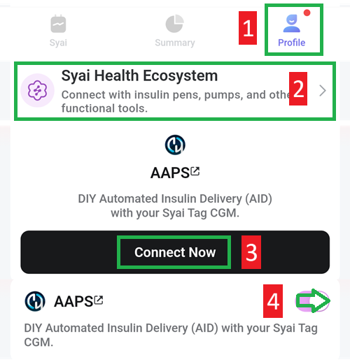

# Syai X1

## Χρήση του X1 με την εφαρμογή Syai Tag

-   Εγκαταστήστε το apk από το <https://play.google.com/store/apps/details?id=com.syai.tag>.

-   Έναρξη του αισθητήρα X1

- Select **Syai/Ottai** in [**Configuration → BG Source**](#Config-Builder-bg-source).

Ενεργοποιήστε την αποστολή δεδομένων (broadcast) στην εφαρμογή Syai:

1. Επιλέξτε Profile
2. Syai Health Ecosystem
3. Πατήστε «Connect Now with AAPS» και αποδεχτείτε τη συμφωνία μεταφοράς δεδομένων σε τρίτους
4. Ενεργοποιήστε το «Enable share data with AAPS» (κοινή χρήση δεδομένων με το AAPS)

