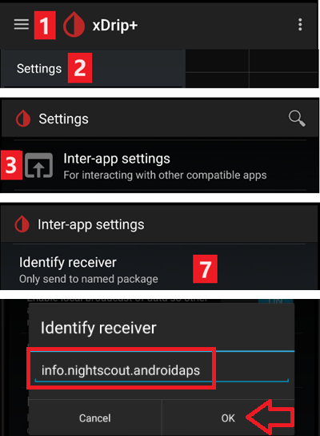
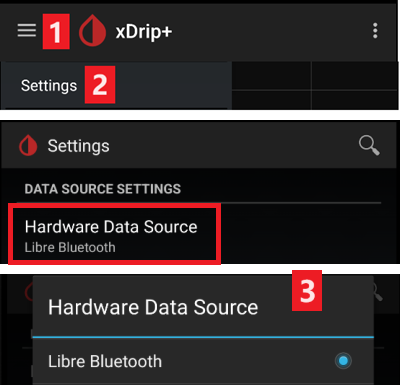

# Ρυθμίσεις xDrip

Αν δεν το έχετε ήδη ρυθμίσει, κατεβάστε και εγκαταστήστε την πιο πρόσφατη έκδοση του xDrip από τη [σελίδα εκδόσεων του xDrip](https://github.com/NightscoutFoundation/xDrip/releases).

Απενεργοποιήστε τη βελτιστοποίηση μπαταρίας και επιτρέψτε τη δραστηριότητα στο παρασκήνιο για την εφαρμογή xDrip.

## Βασικές ρυθμίσεις για όλα τα συστήματα CGM & FGM

### Απενεργοποιήστε το ανέβασμα στο Nightscout

Μην αφήνετε καμία άλλη εφαρμογή να στέλνει δεδομένα (γλυκόζη αίματος και θεραπείες) στο Nightscout.

→ Μενού hamburger (1) → Settings (2) → Cloud Upload (3) -> Nightscout Sync (REST-API)(4) → Γυρίστε σε **OFF** το `Enabled` (5)

#### Απενεργοποιήστε την αυτόματη βαθμονόμηση και τις θεραπείες

Βεβαιωθείτε ότι το `Automatic Calibration` (7) είναι απενεργοποιημένο. Αν το κουτάκι για το `Automatic Calibration` είναι επιλεγμένο, ενεργοποιήστε μία φορά το `Download treatments` (6), μετά αφαιρέστε την επιλογή από το `Automatic Calibration` και απενεργοποιήστε ξανά το `Download treatments`.

Πατήστε `Extra Options`(8)

    {admonition} Προειδοποίηση ασφαλείας
    :class: warning
    Πρέπει να απενεργοποιήσετε το "Upload treatments" στο xDrip. Αλλιώς οι θεραπείες μπορεί να μετρηθούν διπλά στο AAPS και να δώσουν λάθος COB και IOB.

Απενεργοποιήστε το `Upload treatments`(9) και βεβαιωθείτε ότι **ΔΕΝ** θα χρησιμοποιήσετε το `Back-fill data` (11).

Η επιλογή `Alert on failures` πρέπει επίσης να είναι απενεργοποιημένη (10). Αλλιώς θα παίρνετε συναγερμό κάθε 5 λεπτά όταν υπάρχουν προβλήματα με το Wi-Fi/δίκτυο κινητής ή όταν ο διακομιστής δεν είναι διαθέσιμος.

### **Inter-app Settings** (Broadcast)

Αν θα χρησιμοποιήσετε το AAPS και τα δεδομένα πρέπει να προωθούνται π.χ. στο AAPS, πρέπει να ενεργοποιήσετε την εκπομπή (broadcast) στο xDrip, στο Inter-App settings.

→ Μενού hamburger (1) → Settings (2) → Inter-app settings (3) → Broadcast locally **ON** (4)

Για να είναι οι τιμές ίδιες στο AAPS και στο xDrip, πρέπει να ενεργοποιήσετε το `Send the displayed glucose value` (5).

Ενεργοποιήστε το Compatible Broadcast (6).

Αν έχετε ενεργοποιήσει επίσης το `Accept treatments` στο xDrip και το `Ενεργοποίηση εκπομπών στο xDrip+.` στο πρόσθετο xDrip του AAPS, τότε το xDrip θα λαμβάνει από το AAPS πληροφορίες για ινσουλίνη, υδατάνθρακες και βασικό ρυθμό.

Αν ενεργοποιήσετε το `Accept Calibrations`, το xDrip θα χρησιμοποιεί τις βαθμονομήσεις από το AAPS. Προσέξτε όταν χρησιμοποιείτε αυτή τη λειτουργία με αισθητήρες Dexcom: διαβάστε πρώτα [αυτό](https://navid200.github.io/xDrip/docs/Calibrate-G6.html).

Θυμηθείτε να απενεργοποιήσετε το Import Sounds, ώστε το xDrip να μη βγάζει ήχο κάθε φορά που το AAPS στέλνει αλλαγή βασικού ρυθμού/προφίλ.

(xdrip-identify-receiver)=

#### Προσδιορίστε δέκτη

- Αν βρείτε προβλήματα με την τοπική εκπομπή (το AAPS δεν λαμβάνει τιμές BG από το xDrip), πηγαίνετε → Μενού hamburger (1) Settings (2) → Inter-app settings (3) → Identify receiver (7) και γράψτε `info.nightscout.androidaps` για το build του AAPS (αν χρησιμοποιείτε το build PumpControl, γράψτε αντί για αυτό `info.nightscout.aapspumpcontrol`!!).
- Προσοχή: Η αυτόματη διόρθωση μερικές φορές τείνει να αλλάζει το i σε κεφαλαίο γράμμα. **Πρέπει να χρησιμοποιείτε μόνο πεζά γράμματα** όταν γράφετε `info.nightscout.androidaps` (ή `info.nightscout.aapspumpcontrol` για το PumpControl). Ένα κεφαλαίο I θα εμπόδιζε την εφαρμογή να λαμβάνει τιμές BG από το xDrip.
    
    

## Χρήση του AAPS για βαθμονόμηση στο xDrip

- Αν θέλετε να μπορείτε να βαθμονομήσετε από το AAPS, στο xDrip πηγαίνετε Settings → Interapp Compatibility → Accept Calibrations και επιλέξτε ON. 
- Μπορεί επίσης να θέλετε να ελέγξετε τις επιλογές στο Settings → Less Common Settings → Advanced Calibration Settings.

## Αισθητήρες Dexcom

Όλα όσα αφορούν τον ίδιο τον αισθητήρα και τον πομπό της Dexcom (έναρξη, διακοπή, αντικατάσταση, βαθμονόμηση, αντιμετώπιση προβλημάτων) περιγράφονται και ενημερώνονται στην [τεκμηρίωση Dexcom του xDrip](https://navid200.github.io/xDrip/docs/Dexcom_page.html). Ακολουθήστε αυτές τις οδηγίες για τον αισθητήρα. Οι ρυθμίσεις που συνδέουν το xDrip με το **AAPS** (που περιγράφονται παραπάνω σε αυτή τη σελίδα) είναι το μόνο μέρος που αφορά ειδικά το AAPS.

### Dexcom G6 και ONE

- Ρυθμίστε το xDrip σύμφωνα με τις [προτεινόμενες ρυθμίσεις](https://navid200.github.io/xDrip/docs/G6-Recommended-Settings.html).
- Οι πομποί Dexcom G6 και ONE μπορούν να συνδεθούν ταυτόχρονα με τον δέκτη Dexcom (ή εναλλακτικά με την αντλία t:slim) και με μία εφαρμογή στο τηλέφωνό σας.
- Όταν χρησιμοποιείτε το xDrip ως δέκτη, απεγκαταστήστε πρώτα την εφαρμογή Dexcom. **Δεν μπορείτε να συνδέσετε το xDrip και την εφαρμογή Dexcom με τον πομπό ταυτόχρονα!**
- Αν χρειάζεστε το Clarity και θέλετε να έχετε τις λειτουργίες του xDrip, χρησιμοποιήστε το [Build Your Own Dexcom App](#DexcomG6-if-using-g6-with-build-your-own-dexcom-app) με τοπική εκπομπή στο xDrip, ή χρησιμοποιήστε το xDrip ως εφαρμογή Companion που λαμβάνει ειδοποιήσεις από την επίσημη εφαρμογή Dexcom (με πιθανές καθυστερήσεις στις τιμές BG).

#### Επανεκκινήσεις αισθητήρα

- Το xDrip χρησιμοποιεί πάντα τον [εγγενή αλγόριθμο](https://navid200.github.io/xDrip/docs/Native-Algorithm.html) του πομπού με τους τρέχοντες πομπούς. Δεν υπάρχει λόγος να τον απενεργοποιήσετε.
- Οι [προληπτικές επανεκκινήσεις](https://navid200.github.io/xDrip/docs/Preemptive-Restart.html) λειτουργούν μόνο σε παλιούς πομπούς (firmware 1.6.5.25 ή παλαιότερο), όπου χρειάζονται για να μη σταματήσει ο αισθητήρας μετά από 10 ημέρες. Οι νεότεροι πομποί (Firefly) τις αγνοούν.
- Για επανεκκίνηση αισθητήρα σε πομπό Firefly πρέπει να [αφαιρέσετε τον πομπό](https://navid200.github.io/xDrip/docs/Remove-transmitter.html). Μετά την επανεκκίνηση οι τιμές μπορεί να έχουν μεγάλο σφάλμα, κάτι που είναι επικίνδυνο όταν το κύκλωμα είναι ενεργό: διαβάστε ολόκληρο το [Επανεκκίνηση αισθητήρα](https://navid200.github.io/xDrip/docs/Restart-G6-sensor.html) και [βαθμονομήστε προσεκτικά](https://navid200.github.io/xDrip/docs/Calibrate-after-G6Restart.html).

(xdrip-connect-g6-transmitter-for-the-first-time)=

#### Έναρξη, διακοπή και αντικατάσταση αισθητήρων

Ακολουθήστε τις οδηγίες:

- [Έναρξη πομπού G6 ή ONE](https://navid200.github.io/xDrip/docs/Starting-G6.html)
- [Διακοπή και έναρξη αισθητήρα G6 ή ONE](https://navid200.github.io/xDrip/docs/Dexcom/StartG6Sensor.html)
- [Αφαίρεση του πομπού από αισθητήρα](https://navid200.github.io/xDrip/docs/Remove-transmitter.html)
- Η [διάρκεια ζωής του πομπού](https://navid200.github.io/xDrip/docs/Transmitter-lifetime.html) μπορεί να επεκταθεί ([hard reset](https://navid200.github.io/xDrip/docs/Hard-Reset.html)) μόνο σε πομπούς με νέα μπαταρία ή τροποποιημένους πομπούς, όχι στον Firefly.

(xdrip-replace-transmitter)=

#### Αντικατάσταση πομπού

- Κλείστε τον αρχικό δέκτη Dexcom (αν τον χρησιμοποιείτε) και μην τον ανοίξετε ξανά πριν το xDrip δείξει τιμές.
- Διαγράψτε τη συσκευή στο xDrip (System Status → Forget Device) ΚΑΙ στις ρυθμίσεις Bluetooth του smartphone (εμφανίζεται ως DexcomXX, όπου XX είναι τα δύο τελευταία ψηφία του σειριακού αριθμού του πομπού).
- Κρατήστε τον παλιό πομπό εκτός εμβέλειας Bluetooth, για να μη συνδεθεί ξανά.
- Μετά ακολουθήστε το [Έναρξη πομπού G6 ή ONE](https://navid200.github.io/xDrip/docs/Starting-G6.html).

### Dexcom G7, ONE+ και Stelo

- Ακολουθήστε τις [οδηγίες για G7, ONE+ και Stelo](https://navid200.github.io/xDrip/docs/Dexcom/G7.html) (χρειάζεται μια πρόσφατη έκδοση του xDrip — δείτε τη σελίδα του συνδέσμου).
- Δείτε επίσης τη [σελίδα Dexcom G7, ONE+ και Stelo](../CompatibleCgms/DexcomG7.md) για τις διαθέσιμες ρυθμίσεις με το **AAPS**.

(xdrip-troubleshooting-dexcom-g5-g6-and-xdrip)=

### Αντιμετώπιση προβλημάτων Dexcom και xDrip

- [Αντιμετώπιση προβλημάτων σύνδεσης G6/ONE](https://navid200.github.io/xDrip/docs/Connectivity-troubleshoot.html)
- [Αντιμετώπιση προβλημάτων G7/ONE+/Stelo](https://navid200.github.io/xDrip/docs/Dexcom/G7_Troubleshooting.html)
- [Πρόβλημα κατά την έναρξη νέου αισθητήρα](https://navid200.github.io/xDrip/docs/Dexcom/SensorFailedStart.html)
- Πλήρης λίστα: δείτε το **Troubleshooting** στη [σελίδα Dexcom του xDrip](https://navid200.github.io/xDrip/docs/Dexcom_page.html).

## Libre 1

- Ρυθμίστε τη γέφυρα NFC σε Bluetooth στο xDrip
    
    → Μενού hamburger (1) → Settings (2) → Less common settings (3) → Bluetooth Settings (4)

- Στο Bluetooth Settings επιλέξτε τα κουτάκια ακριβώς όπως στις εικόνες παρακάτω (5)
    
    - Απενεργοποιήστε τα watchdogs, γιατί κάνουν επαναφορά του Bluetooth του τηλεφώνου και διακόπτουν τη σύνδεση με την αντλία σας.
    
    

- Μπορείτε να δοκιμάσετε να ενεργοποιήσετε τις παρακάτω ρυθμίσεις (7)
    
    - Χρησιμοποιήστε τη σάρωση
    - Trust Auto-Connect
    - Use Background Scans

- Αν χάνετε εύκολα τη σύνδεση με τη γέφυρα ή η σύνδεση επανέρχεται δύσκολα, **ΑΠΕΝΕΡΓΟΠΟΙΗΣΤΕ ΤΙΣ** (8).
    
    

- Αφήστε όλες τις άλλες επιλογές απενεργοποιημένες, εκτός αν ξέρετε γιατί θέλετε να τις ενεργοποιήσετε.
    
    

### Επίπεδο μπαταρίας του Libre smart reader

- Το επίπεδο μπαταρίας γεφυρών όπως το MiaoMiao και το Bubble μπορεί να εμφανίζεται στο AAPS (όχι για το Blucon).
- Λεπτομέρειες θα βρείτε στη [σελίδα με τις οθόνες](#screens-sensor-level-battery).

### Συνδέστε τον πομπό Libre & ξεκινήστε τον αισθητήρα

- Αν ο αισθητήρας σας το χρειάζεται (Libre 2 EU και Libre 1 US), εγκαταστήστε τον πιο πρόσφατο αλγόριθμο out of process.

- Ο αισθητήρας σας πρέπει να έχει ήδη ξεκινήσει με την εφαρμογή του κατασκευαστή ή με το reader (το xDrip δεν μπορεί να ξεκινήσει ή να σταματήσει αισθητήρες Libre).

- Ορίστε ως πηγή δεδομένων το Libre Bluetooth.
    
    → Μενού hamburger (1) → Settings (2) → Επιλέξτε Libre Bluetooth στο Hardware Data source (3)
    
    

- Κάντε σάρωση Bluetooth και συνδέστε τη γέφυρα.
    
    → Μενού hamburger (1) → Scan Bluetooth (2) → Scan (3)
    
    - Αν το xDrip δεν βρίσκει τη γέφυρα, βεβαιωθείτε ότι δεν είναι συνδεδεμένη με την εφαρμογή του κατασκευαστή. Βάλτε την να φορτίζει και κάντε της επαναφορά.
    
    

- Ξεκινήστε τον αισθητήρα στο xDrip.
    
        {admonition} Προειδοποίηση ασφαλείας
        :class: warning
        Μη χρησιμοποιείτε δεδομένα του αισθητήρα πριν τελειώσει η μία ώρα προθέρμανσης: οι τιμές μπορεί να είναι πολύ υψηλές και να προκαλέσουν λάθος αποφάσεις στο AAPS.
    
    → Μενού hamburger (1) → Start sensor (2) → Start sensor (3) → Ορίστε την ακριβή ώρα που τον ξεκινήσατε με το reader ή με την εφαρμογή του κατασκευαστή. Αν δεν τον ξεκινήσατε σήμερα, απαντήστε "Not Today" (4).

(xdrip-libre2-patched-app)=

## Τροποποιημένη εφαρμογή Libre 2

- Ορίστε ως πηγή δεδομένων την τροποποιημένη εφαρμογή Libre.
    
    → Μενού hamburger (1) → Settings (2) → Επιλέξτε Libre (patched App) στο Hardware Data source (3)
    
    

- Μπορείτε να προσθέσετε `BgReading:d,xdrip libre_receiver:v` στο Less Common Settings->Extra Logging Settings->Extra tags for logging. Έτσι θα καταγράφονται επιπλέον μηνύματα σφάλματος για την αντιμετώπιση προβλημάτων.

