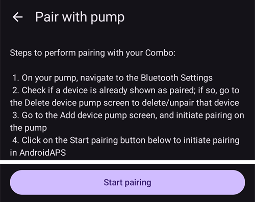

# Accu-Chek Combo

**Αυτό το λογισμικό αποτελεί μέρος μιας DIY (Φτιάξε το Μόνος Σου) λύσης και δεν είναι ένα προϊόν, αλλά απαιτεί από ΕΣΑΣ να διαβάσετε, να μάθετε και να κατανοήσετε το σύστημα συμπεριλαμβανομένου του τρόπου χρήσης του. Δεν είναι κάτι που αναλαμβάνει τη διαχείριση του διαβήτη σας για σας, αλλά σας επιτρέπει να βελτιώσετε το διαβήτη σας και την ποιότητα της ζωής σας αν είστε διατεθειμένοι να αφιερώσετε το χρόνο που χρειάζεται. Μη βιαστείτε, αλλά αντίθετα δώστε στον εαυτό σας χρόνο για να μάθετε. Εσείς και μόνο είστε υπεύθυνοι για οτιδήποτε κάνετε με αυτό.**

```{admonition} Accu-Chek Combo is being phased out
:class: note

Η Roche αποσύρεται από την αγορά αντλιών ινσουλίνης, για να επικεντρωθεί στο CGM Accu-Chek SmartGuide. Έχει ανακοινώσει το τέλος των πωλήσεων των αντλιών Accu-Chek Combo και Accu-Chek Insight. Η μικροαντλία Accu-Chek Solo, που της απομένει, επίσης αποσύρεται σταδιακά (τελευταίες παραδόσεις στη Γερμανία στο τέλος του 2025). Η αλλαγή γίνεται ανά περιοχή, ξεκινώντας από τη Γερμανία, και αναμένεται να ακολουθήσουν άλλες ευρωπαϊκές αγορές. Αν βασίζεστε σε αυτή την αντλία, σχεδιάστε από νωρίς τη μετάβαση σε μια υποστηριζόμενη αντλία.
```

```{contents} Table of contents
:depth: 1
:local: true
```

## Δυνατότητες της αντλίας με το AAPS

* Επικοινωνεί με το **AAPS** μέσω του Bluetooth του τηλεφώνου σας, χωρίς επιπλέον συσκευή επικοινωνίας.
* Αυτόματος χειρισμός θερινής ώρας (DST) και ζώνης ώρας.

## Απαιτήσεις υλικού και λογισμικού

* Μια αντλία Roche Accu-Chek Combo (οποιοδήποτε firmware, λειτουργούν όλα).
* Μια συσκευή Smartpix ή Realtyme μαζί με το λογισμικό 360 Configuration Software για τη ρύθμιση της αντλίας. (Η Roche αποστέλλει τις συσκευές Smartpix και το λογισμικό για τη ρύθμιση δωρεάν στους πελάτες της κατόπιν αιτήματος.)
* Ένα συμβατό τηλέφωνο με Android 12 ή νεότερο. Δείτε τις [σημειώσεις έκδοσης](#maintenance-android-version-aaps-version) για λεπτομέρειες.
* Η εφαρμογή **AAPS** εγκατεστημένη στο τηλέφωνό σας.

Μερικά τηλέφωνα μπορεί να λειτουργούν καλύτερα από άλλα. Αυτό εξαρτάται από την ποιότητα της υποστήριξης Bluetooth και από το αν έχουν επιπλέον, πολύ επιθετική λογική εξοικονόμησης ενέργειας. Μια λίστα τηλεφώνων υπάρχει στη σελίδα [Τηλέφωνα](#Phones-list-of-tested-phones). Παρακαλώ προσέξτε ότι η λίστα δεν είναι ολοκληρωμένη και έχει φτιαχτεί από την προσωπική εμπειρία άλλων χρηστών. Σας ενθαρρύνουμε επίσης να εισαγάγετε και εσείς την εμπειρία σας και, συνεπώς, να βοηθήσετε άλλους (αυτά τα προγράμματα προχωρούν με τη συνδρομή όλων).

(combov2-before-you-begin)=
## Πριν ξεκινήσετε

**ΠΡΩΤΑ Η ΑΣΦΑΛΕΙΑ** - μην κάνετε αυτή τη διαδικασία σε περιβάλλον όπου δεν μπορείτε να διορθώσετε ένα σφάλμα. Έχετε κοντά σας τη συσκευή Smartpix / Realtyme και το 360 Configuration Software. Υπολογίστε περίπου μία ώρα για να ρυθμίσετε τα πάντα και να ελέγξετε ότι όλα λειτουργούν σωστά.

Έχετε υπόψη τους παρακάτω περιορισμούς:

* Το εκτεταμένο bolus και το bolus πολλαπλών κυμάτων δεν υποστηρίζονται προς το παρόν (μπορείτε να χρησιμοποιήσετε αντί γι' αυτά [Εκτεταμένους υδατάνθρακες](../DailyLifeWithAaps/ExtendedCarbs.md)).
* Υποστηρίζεται μόνο ένα προφίλ βασικού ρυθμού (το πρώτο).
* Ο χαμηλότερος βασικός ρυθμός στο **Προφίλ** σας είναι 0,05 U/h. Το **AAPS** δεν δέχεται **Προφίλ** με χαμηλότερο ρυθμό. Το Combo στρογγυλεύει τους βασικούς ρυθμούς στα δικά του βήματα (0,01 U/h κάτω από 1 U/h, 0,05 U/h έως 10 U/h, 0,1 U/h πάνω από αυτό). Το **AAPS** χρησιμοποιεί τους ρυθμούς που πραγματικά δίνει η αντλία.
* Οι προσωρινοί βασικοί ρυθμοί έχουν όριο το 500% του τρέχοντος βασικού ρυθμού. Το **AAPS** λαμβάνει υπόψη αυτό το όριο.
* Το κύκλωμα απενεργοποιείται αν το τρέχον ενεργό προφίλ στην αντλία δεν είναι το προφίλ αρ. 1. Αυτό συνεχίζεται μέχρι να γίνει ενεργό το προφίλ αρ. 1. Μετά από αυτό, την επόμενη φορά που το AAPS θα συνδεθεί (είτε μόνο του μετά από λίγο είτε επειδή πατάτε **Ανανέωση** στην οθόνη της αντλίας Accu-Chek Combo), θα δει ότι το τρέχον προφίλ είναι το προφίλ αρ. 1 και θα ενεργοποιήσει ξανά το κύκλωμα.
* Αν το κύκλωμα ζητήσει να ακυρωθεί ένας TBR που τρέχει, το Combo θα ορίσει αντί γι' αυτό έναν TBR 90% ή 110% για 15 λεπτά. Αυτό γίνεται επειδή η πραγματική ακύρωση ενός TBR προκαλεί ειδοποίηση στην αντλία με πολλές δονήσεις, και αυτές οι δονήσεις δεν μπορούν να απενεργοποιηθούν.
* Η σταθερότητα της σύνδεσης Bluetooth διαφέρει από τηλέφωνο σε τηλέφωνο και προκαλεί ειδοποιήσεις «Η αντλία δεν είναι διαθέσιμη», όταν δεν υπάρχει πλέον σύνδεση με την αντλία. Αν συμβεί αυτό το σφάλμα, βεβαιωθείτε ότι το Bluetooth είναι ενεργό, πατήστε **Ανανέωση** στην οθόνη της αντλίας (**Διαχείριση** > **Αντλία**) για να δείτε αν ήταν ένα περιστασιακό πρόβλημα, και αν ακόμα δεν γίνεται σύνδεση, επανεκκινήστε το τηλέφωνο, κάτι που συνήθως το διορθώνει.
* Υπάρχει και ένα άλλο πρόβλημα, όπου η επανεκκίνηση δεν βοηθά, αλλά πρέπει να πατηθεί ένα κουμπί στην αντλία (που επανεκκινεί τη στοίβα Bluetooth της αντλίας), πριν η αντλία δεχτεί ξανά συνδέσεις από το τηλέφωνο.
* Η ρύθμιση ενός TBR στην αντλία πρέπει να αποφεύγεται, αφού το κύκλωμα αναλαμβάνει τον έλεγχο των TBRs. Η ανίχνευση ενός νέου TBR στην αντλία μπορεί να διαρκέσει έως και 20 λεπτά και η επίδραση του TBR θα ληφθεί υπόψη μόνο από τη στιγμή που ανιχνεύεται, οπότε στη χειρότερη περίπτωση μπορεί να υπάρχουν 20 λεπτά του TBR που δεν φαίνονται στην IOB.

Ο οδηγός υποστηρίζει προς το παρόν τις παρακάτω γλώσσες στο Combo. (Αυτό δεν σχετίζεται με τη γλώσσα του AAPS - είναι η γλώσσα που φαίνεται στην οθόνη LCD του ίδιου του Combo.)

* Αγγλικά
* Ισπανικά
* Γαλλικά
* Ιταλικά
* Ρώσικα
* Τουρκικά
* Πολωνικά
* Τσέχικα
* Ουγγρικά
* Σλοβακικά
* Ρουμανικά
* Κροατικά
* Ολλανδικά
* Ελληνικά
* Φινλανδικά
* Νορβηγικά
* Πορτογαλικά
* Σουηδικά
* Δανικά
* Γερμανικά
* Σλοβενικά
* Λιθουανικά

**Σημαντικό**: Αν η αντλία σας είναι ρυθμισμένη σε γλώσσα που δεν υπάρχει σε αυτή τη λίστα, επικοινωνήστε με τους προγραμματιστές και ρυθμίστε τη γλώσσα της αντλίας σε μία από αυτή τη λίστα. Αλλιώς ο οδηγός δεν θα λειτουργεί σωστά.

## Ρύθμιση τηλεφώνου

Είναι πολύ σημαντικό να βεβαιωθείτε ότι οι βελτιστοποιήσεις μπαταρίας είναι απενεργοποιημένες. Το AAPS ήδη ανιχνεύει μόνο του πότε υπόκειται σε αυτές τις βελτιστοποιήσεις και ζητά στην οθόνη του να απενεργοποιηθούν. Όμως, στα σύγχρονα τηλέφωνα Android, το ίδιο το Bluetooth _είναι_ εφαρμογή (εφαρμογή συστήματος). Και συνήθως αυτή η «εφαρμογή Bluetooth» εκτελείται _με ενεργές βελτιστοποιήσεις μπαταρίας από προεπιλογή_. Γι' αυτό το Bluetooth μπορεί να σταματήσει να απαντά όταν το τηλέφωνο θέλει να εξοικονομήσει ενέργεια, επειδή τερματίζει την εφαρμογή Bluetooth. Αυτό σημαίνει ότι και στις ρυθμίσεις αυτής της εφαρμογής συστήματος Bluetooth πρέπει να απενεργοποιηθούν οι βελτιστοποιήσεις μπαταρίας. Δυστυχώς, ο τρόπος για να βρείτε αυτή την εφαρμογή συστήματος Bluetooth διαφέρει από τηλέφωνο σε τηλέφωνο. Στο απλό (stock) Android, πηγαίνετε στις Ρυθμίσεις -> Εφαρμογές -> Εμφάνιση όλων των N εφαρμογών (N = ο αριθμός των εφαρμογών στο τηλέφωνό σας). Μετά ανοίξτε το μενού πάνω δεξιά και πατήστε «Εμφάνιση συστήματος» ή «Εμφάνιση εφαρμογών συστήματος» ή «Όλες οι εφαρμογές». Τώρα, στη μεγαλύτερη λίστα εφαρμογών, βρείτε μια εφαρμογή «Bluetooth». Επιλέξτε την και στην οθόνη «Πληροφορίες εφαρμογής» πατήστε «Μπαταρία». Εκεί απενεργοποιήστε τις βελτιστοποιήσεις μπαταρίας (μερικές φορές λέγονται «χρήση μπαταρίας»).

## Ρύθμιση του Combo

* Ρυθμίστε την αντλία με το Accu-Chek 360 Configuration Software. Αν δεν έχετε το λογισμικό, επικοινωνήστε με τη γραμμή υποστήριξης της Accu-Chek. Συνήθως στέλνουν στους εγγεγραμμένους χρήστες ένα CD με το "Λογισμικό Διαμόρφωσης Αντλίας 360" και μια συσκευή σύνδεσης SmartPix USB με υπέρυθρη σύνδεση (η συσκευή Realtyme λειτουργεί επίσης εάν το έχετε).

  - **Απαιτούμενες ρυθμίσεις** (σημειωμένες με πράσινο σε στιγμιότυπα οθόνης):

     * Ορίστε/αφήστε τη διαμόρφωση του μενού ως "Standard", το οποίο θα αφήσει να εμφανίζονται μόνο τα υποστηριζόμενα μενού/ενέργειες στην αντλία και να αποκρύπτονται εκείνα τα οποία δεν υποστηρίζονται (εκτεταμένο/συνδυαστικό bolus, πολλαπλοί βασικοί ρυθμοί) που προκαλούν περιορισμό της λειτουργικότητας του κυκλώματος όταν χρησιμοποιούνται επειδή δεν είναι δυνατό να τρέξετε το κύκλωμα με ασφαλή τρόπο όταν χρησιμοποιούνται.
     * Βεβαιωθείτε ότι το _Quick Info Text_ είναι ρυθμισμένο σε "QUICK INFO" (χωρίς τα εισαγωγικά, βρίσκεται στο _Insulin Pump Options_).
     * Ορίστε το _Maximum Adjustment_ του TBR σε 500%
     * Απενεργοποιήστε το _Signal End of Temporary Basal Rate_
     * Ορίστε το _Duration increment_ του TBR σε 15 λεπ.
     * Ενεργοποιήστε το Bluetooth

  - **Συνιστώμενες ρυθμίσεις** (σημειώνονται με μπλε σε στιγμιότυπα οθόνης)

     * Ορίστε τον συναγερμό χαμηλής δεξαμενής ινσουλίνης όπως σας βολεύει
     * Ρυθμίστε το μέγιστο bolus που είναι κατάλληλο για τη θεραπεία σας για να προστατεύεστε από σφάλματα του λογισμικού
     * Ομοίως, ρυθμίστε τη μέγιστη διάρκεια του προσωρινού βασικού ρυθμού (TBR) για ασφάλεια. Επιτρέψτε τουλάχιστον 3 ώρες, αφού η επιλογή αποσύνδεσης της αντλίας για 3 ώρες ρυθμίζει ένα Προσωρινό Βασικό 0% για 3 ώρες.
     * Ενεργοποιήστε το κλείδωμα πλήκτρων στην αντλία, για να μην γίνεται bolus από την αντλία, ειδικά αν χρησιμοποιούσατε την αντλία πριν και είχατε συνήθεια να κάνετε γρήγορο bolus.
     * Ορίστε χρονικό όριο οθόνης και χρονικό όριο μενού στο ελάχιστο των 5,5 και 5 αντίστοιχα. Αυτό επιτρέπει στο AAPS να επανέλθει πιο γρήγορα από καταστάσεις σφάλματος και να μειώσει τις δονήσεις που μπορεί να προκύψουν κατά τη διάρκεια τέτοιων σφαλμάτων

  

  

  

  

## Ενεργοποίηση του οδηγού και σύζευξη με το Combo

* Ανοίξτε το **μενού** (☰) πάνω αριστερά, πηγαίνετε στο [**Διαμόρφωση** > **Αντλία**](../SettingUpAaps/ConfigBuilder.md) και επιλέξτε **Accu-Chek Combo**.

  

  Μόλις επιλεγεί, η κάρτα **Accu-Chek Combo** δείχνει δύο κουμπιά, **Ρυθμίσεις** και **Άνοιγμα πρόσθετου**:

  

  Το **Ρυθμίσεις** ανοίγει τις ρυθμίσεις του οδηγού Accu-Chek Combo (δείτε [Ρυθμίσεις](#combov2-preferences) παρακάτω):

  

  Το **Άνοιγμα πρόσθετου** (ή **Διαχείριση** > **Αντλία**) ανοίγει την οθόνη της αντλίας Accu-Chek Combo. Πριν γίνει σύζευξη με αντλία, δείχνει **Δεν υπάρχει σύζευξη με μία αντλία**:

  

* Στην οθόνη της αντλίας, πατήστε **Σύζευξη**. Ανοίγει η οθόνη **Σύζευξη με αντλία**. Ακολουθήστε τα βήματα στην οθόνη και μετά πατήστε **Έναρξη σύζευξης**. Όταν το Android ζητήσει άδεια να κάνει το τηλέφωνο ορατό σε άλλες συσκευές Bluetooth, πατήστε **Να επιτρέπεται**. Στο τέλος, το Combo δείχνει στην οθόνη του ένα 10-ψήφιο PIN σύζευξης και το **AAPS** το ζητά. Πληκτρολογήστε αυτό το PIN στο πεδίο **10-ψήφιο PIN**.

  

  

  

  Οι επόμενες εικόνες είναι από παλαιότερη έκδοση του **AAPS**. Τα βήματα και τα κείμενα είναι ίδια, αλλά οι οθόνες φαίνονται λίγο διαφορετικές.

  

  

  

* Αν το PIN πληκτρολογηθεί λάθος, το **AAPS** δείχνει **Το PIN δεν λειτούργησε. Ελέγξτε αν υπάρχει τυπογραφικό λάθος. Εάν αυτό συνεχίζει να συμβαίνει, ακυρώστε και προσπαθήστε να κάνετε νέα σύζευξη.**

  

* Όταν εμφανιστεί **Επιτυχής σύζευξη με Combo**, πατήστε **OK**. Επιστρέφετε στην οθόνη της αντλίας, που τώρα δείχνει την κατάσταση της αντλίας (δείτε [Περιεχόμενο της οθόνης της αντλίας Accu-Chek Combo](#combov2-tab-contents) παρακάτω). Το κουμπί **Σύζευξη** αντικαθίσταται από το **Κατάργηση σύζευξης**.

* Για να ελέγξετε τη ρύθμισή σας (με την αντλία **αποσυνδεδεμένη** από κάθε καθετήρα, για ασφάλεια!), ορίστε με το AAPS έναν TBR 500% για 15 λεπ. και κάντε ένα bolus. Η αντλία θα πρέπει τώρα να έχει σε λειτουργία το TBR και το bolus στο ιστορικό. Το AAPS θα πρέπει επίσης να δείχνει το ενεργό TBR και το bolus που χορηγήθηκε.

* Στο Combo συνιστάται να ενεργοποιήσετε το κλείδωμα πλήκτρων, για να μην γίνεται bolus από την αντλία, ειδικά αν χρησιμοποιούσατε την αντλία πριν και είχατε συνήθεια να χρησιμοποιείτε τη λειτουργία «quick bolus».

## Σημειώσεις για τη σύζευξη

Το Accu-Chek Combo αναπτύχθηκε πριν κυκλοφορήσει το Bluetooth 4.0 και μόλις έναν χρόνο μετά την κυκλοφορία της πρώτης έκδοσης του Android. Γι' αυτό ο τρόπος σύζευξης με άλλες συσκευές δεν είναι 100% συμβατός με τον τρόπο που γίνεται σήμερα στο Android. Για να λυθεί αυτό πλήρως, το AAPS θα χρειαζόταν δικαιώματα επιπέδου συστήματος, που υπάρχουν μόνο για εφαρμογές συστήματος. Αυτές τις εγκαθιστούν στο τηλέφωνο οι κατασκευαστές του - οι χρήστες δεν μπορούν να εγκαταστήσουν εφαρμογές συστήματος.

Γι' αυτό η σύζευξη δεν θα είναι ποτέ 100% χωρίς προβλήματα. Συγκεκριμένα, κατά τη σύζευξη, το παράθυρο PIN Bluetooth του Android μπορεί να εμφανιστεί για λίγο και να κλείσει μόνο του. Μερικές φορές όμως μένει στην οθόνη και ζητά ένα 4-ψήφιο PIN. (Αυτό δεν είναι το ίδιο με το 10-ψήφιο PIN σύζευξης του Combo.) Μην πληκτρολογήσετε τίποτα, απλά πατήστε ακύρωση. Αν η σύζευξη δεν συνεχίσει, ακολουθήστε τις οδηγίες στην οθόνη για να δοκιμάσετε ξανά τη σύζευξη.

(combov2-tab-contents)=
## Περιεχόμενο της οθόνης της αντλίας Accu-Chek Combo

Για να ανοίξετε την οθόνη της αντλίας, πηγαίνετε στο **Διαχείριση** > **Αντλία**. Μετά τη σύζευξη με αντλία, δείχνει τις παρακάτω πληροφορίες (από πάνω προς τα κάτω):


1. **Κατάσταση οδηγού**: Ο οδηγός μπορεί να είναι σε μία από τις παρακάτω καταστάσεις:
   - **Αποσυνδέθηκε**: Δεν υπάρχει σύνδεση Bluetooth· ο οδηγός είναι σε αυτή την κατάσταση τον περισσότερο χρόνο και συνδέεται με την αντλία μόνο όταν χρειάζεται - έτσι εξοικονομείται ενέργεια
   - **Συνδέεται**
   - **Έλεγχος αντλίας**: η αντλία είναι συνδεδεμένη, αλλά ο οδηγός κάνει αυτή τη στιγμή ελέγχους ασφαλείας, για να βεβαιωθεί ότι όλα είναι σωστά και ενημερωμένα
   - **Έτοιμο**: ο οδηγός είναι έτοιμος να δεχτεί εντολές από το AAPS
   - **Σε αναστολή**: η αντλία είναι σε αναστολή (στο Combo φαίνεται ως "stopped")
   - Περιγραφή της εντολής που εκτελείται, για παράδειγμα **Ρύθμιση βασικού προφίλ** ή **Ενημέρωση κατάστασης αντλίας**
   - **Σφάλμα**: συνέβη σφάλμα· η σύνδεση τερματίστηκε και κάθε εντολή σε εξέλιξη διακόπηκε
2. **Τελευταία σύνδεση**: Πριν από πόσα λεπτά ο οδηγός συνδέθηκε επιτυχώς με το Combo· αν περάσουν περισσότερα από 30 λεπτά, το στοιχείο εμφανίζεται με κόκκινο χρώμα
3. **Μπαταρία**: Στάθμη μπαταρίας· το Combo δείχνει μόνο **Γεμάτη**, **Χαμηλή** ή **Άδεια** και δεν δίνει κάτι πιο ακριβές (όπως ποσοστό), γι' αυτό εδώ φαίνονται μόνο αυτά τα τρία επίπεδα
4. **Δεξαμενή**: Πόσες IU υπάρχουν τώρα στη δεξαμενή του Combo
5. **Τελευταίο Bolus:** Πριν από πόσα λεπτά χορηγήθηκε το τελευταίο bolus· αν δεν έχει χορηγηθεί ακόμα κανένα από την έναρξη του AAPS, δεν εμφανίζεται
6. **Προσωρινός Ρυθμός**: Στοιχεία για τον προσωρινό βασικό ρυθμό που είναι ενεργός τώρα· αν δεν υπάρχει ενεργός, δεν εμφανίζεται
7. **Βάση Βασικού Ρυθμού**: Ο τρέχων ενεργός βασικός ρυθμός βάσης («βάση» σημαίνει ο βασικός ρυθμός χωρίς την επίδραση κάποιου ενεργού TBR στον συντελεστή του βασικού ρυθμού)
8. **Σειριακός αριθμός**: Ο σειριακός αριθμός του Combo όπως τον δίνει η αντλία (είναι ο σειριακός αριθμός που φαίνεται στο πίσω μέρος του Combo)
9. **Διεύθυνση Bluetooth**: Η διεύθυνση Bluetooth 6 byte του Combo, στη μορφή `XX:XX:XX:XX:XX:XX`

Όταν ο οδηγός κάνει κάτι (για παράδειγμα, ρυθμίζει ένα βασικό προφίλ), ένα πλαίσιο κάτω από τη λίστα περιγράφει την τρέχουσα ενέργεια, με μια λεπτή μπάρα που δείχνει την πρόοδο.

Το Combo μπορεί να λειτουργεί μέσω Bluetooth στη λειτουργία _remote-terminal_ (απομακρυσμένου τερματικού) ή στη λειτουργία _command_ (εντολών). Η λειτουργία remote-terminal αντιστοιχεί στη «λειτουργία τηλεχειρισμού» του μετρητή του Combo, που μιμείται την οθόνη LCD και τα τέσσερα κουμπιά της αντλίας. Ορισμένες εντολές πρέπει να εκτελούνται από τον οδηγό σε αυτή τη λειτουργία, επειδή δεν υπάρχουν στη λειτουργία command. Η δεύτερη λειτουργία είναι πολύ πιο γρήγορη, αλλά, όπως είπαμε, κάνει λιγότερα πράγματα. Όταν είναι ενεργή η λειτουργία remote-terminal, η τρέχουσα οθόνη remote-terminal φαίνεται στο πεδίο ακριβώς πάνω από την εικόνα του Combo. Όταν όμως ο οδηγός περνά στη λειτουργία command, αυτό το πεδίο μένει κενό.

(Δεν το επηρεάζετε εσείς· ο οδηγός αποφασίζει μόνος του ποια λειτουργία θα χρησιμοποιήσει. Αυτή είναι απλώς μια σημείωση, για να ξέρετε γιατί μερικές φορές βλέπετε εικόνες του Combo σε αυτό το πεδίο.)

Στο κάτω μέρος υπάρχουν αυτά τα κουμπιά:

- **Ανανέωση**: Ξεκινά αμέσως ενημέρωση της κατάστασης της αντλίας. Χρησιμοποιείται επίσης για να μάθει το AAPS ότι ένα σφάλμα που βρέθηκε πριν έχει πλέον διορθωθεί και ότι το AAPS μπορεί να ελέγξει ξανά ότι όλα είναι σωστά (περισσότερα παρακάτω στην [ενότητα για τις ειδοποιήσεις](#combov2-alerts)). Μπορείτε να το πατήσετε μόνο όταν ο οδηγός είναι αποσυνδεδεμένος, σε αναστολή ή σε κατάσταση σφάλματος.
- **Κατάργηση σύζευξης**: Καταργεί τη σύζευξη του Combo με το **AAPS** και το Android, αφού επιβεβαιώσετε το **Θέλετε πραγματικά να καταργήσετε τη σύζευξη της αντλίας;**. Όταν δεν υπάρχει σύζευξη με αντλία, αυτό το κουμπί αντικαθίσταται από το **Σύζευξη**.

(combov2-preferences)=
## Ρυθμίσεις

Αυτές οι ρυθμίσεις υπάρχουν για τον οδηγό του Combo (**Διαμόρφωση** > **Αντλία** > **Accu-Chek Combo** > **Ρυθμίσεις**, ή το εικονίδιο ρυθμίσεων (γρανάζι) στην οθόνη της αντλίας). Τα στοιχεία είναι από πάνω προς τα κάτω:

1. **Διάρκεια εξεύρεσης (σε δευτερόλεπτα)**: Κατά τη σύζευξη, ο οδηγός κάνει το τηλέφωνο ορατό στην αντλία. Αυτό ορίζει πόσο διαρκεί αυτή η ορατότητα. Από προεπιλογή είναι επιλεγμένο το μέγιστο (300 δευτερόλεπτα = 5 λεπτά). Το Android δεν επιτρέπει να διαρκεί η ορατότητα χωρίς τέλος, γι' αυτό πρέπει να επιλεγεί μια διάρκεια.
2. **Αυτόματη ανίχνευση και αυτόματη εισαγωγή αλλαγής δεξαμενής ινσουλίνης**: Αν είναι ενεργό, ο οδηγός καταχωρεί την «αλλαγή δεξαμενής» που κανονικά θα καταχωρούσατε εσείς με **Διαχείριση** > **Πλήρωση/Γέμισμα**. Αυτό εξηγείται [πιο αναλυτικά παρακάτω](#combov2-autodetections).
3. **Αυτόματη ανίχνευση και αυτόματη εισαγωγή αλλαγής μπαταρίας**: Αν είναι ενεργό, ο οδηγός καταχωρεί την «αλλαγή μπαταρίας» που κανονικά θα καταχωρούσατε εσείς με **Διαχείριση** > **Αλλαγή Μπαταρίας Αντλίας**. Αυτό εξηγείται [πιο αναλυτικά παρακάτω](#combov2-autodetections).
4. **Ενεργοποίηση λεπτομερούς καταγραφής Combo**: Αυτό αυξάνει πολύ τον όγκο της καταγραφής του οδηγού. **ΠΡΟΣΟΧΗ**: Μην το ενεργοποιήσετε, εκτός αν σας το ζητήσει ένας προγραμματιστής. Αλλιώς αυτό μπορεί να προσθέσει πολύ «θόρυβο» στα αρχεία καταγραφής του **AAPS** και να τα κάνει λιγότερο χρήσιμα.

Η σύζευξη και η κατάργηση σύζευξης γίνονται στην οθόνη της αντλίας, όχι στις ρυθμίσεις (δείτε παραπάνω).

(combov2-autodetections)=
## Αυτόματη ανίχνευση και αυτόματη καταχώριση αλλαγής μπαταρίας και δεξαμενής

Ο οδηγός μπορεί να ανιχνεύει αλλαγές μπαταρίας και δεξαμενής, παρακολουθώντας τη στάθμη της μπαταρίας και της δεξαμενής. Αν την τελευταία φορά που ενημερώθηκε η κατάσταση της αντλίας το Combo ανέφερε χαμηλή μπαταρία, και τώρα, στη νέα ενημέρωση, η στάθμη της μπαταρίας είναι κανονική, τότε ο οδηγός συμπεραίνει ότι ο χρήστης άλλαξε την μπαταρία. Η ίδια λογική ισχύει για τη στάθμη της δεξαμενής: Αν τώρα είναι υψηλότερη από πριν, αυτό θεωρείται αλλαγή δεξαμενής.

Αυτό λειτουργεί μόνο αν η μπαταρία και η δεξαμενή αλλάζονται όταν η στάθμη τους αναφέρεται ως χαμηλή _και_ η νέα μπαταρία και η δεξαμενή είναι αρκετά γεμάτες.

Αυτές οι αυτόματες ανιχνεύσεις μπορούν να απενεργοποιηθούν στις [ρυθμίσεις](#combov2-preferences) του οδηγού.

(combov2-alerts)=
## Ειδοποιήσεις (προειδοποιήσεις και σφάλματα) και πώς αντιμετωπίζονται

Το Combo εμφανίζει τις ειδοποιήσεις ως οθόνες remote-terminal. Οι προειδοποιήσεις εμφανίζονται με κωδικό "Wx" (x είναι ένα ψηφίο), μαζί με μια σύντομη περιγραφή. Ένα παράδειγμα είναι "W7", "TBR OVER". Τα σφάλματα είναι παρόμοια, αλλά εμφανίζονται με κωδικό "Ex".

Ορισμένες προειδοποιήσεις τις κλείνει αυτόματα ο οδηγός. Αυτές είναι:

- W1 "reservoir low" : ο οδηγός τη μετατρέπει σε προειδοποίηση «χαμηλή δεξαμενή», που φαίνεται στην κύρια οθόνη του AAPS
- W2 "battery low" : ο οδηγός τη μετατρέπει σε προειδοποίηση «χαμηλή μπαταρία», που φαίνεται στην κύρια οθόνη του AAPS
- W3, W6, W7, W8 : όλες αυτές είναι μόνο πληροφορίες για τον χρήστη, οπότε ο οδηγός μπορεί να τις κλείνει αυτόματα με ασφάλεια

Οι άλλες προειδοποιήσεις _δεν_ κλείνουν αυτόματα. Επίσης, τα σφάλματα _ποτέ_ δεν κλείνουν αυτόματα. Και τα δύο αντιμετωπίζονται με τον ίδιο τρόπο: Ο οδηγός εμφανίζει ένα παράθυρο ειδοποίησης πάνω από την οθόνη του AAPS και διακόπτει κάθε εντολή που εκτελείται εκείνη τη στιγμή. Μετά ο οδηγός περνά στην κατάσταση «σφάλμα» (δείτε [το περιεχόμενο της οθόνης της αντλίας Accu-Chek Combo παραπάνω](#combov2-tab-contents)). Σε αυτή την κατάσταση δεν μπορεί να εκτελεστεί καμία εντολή. Ο χρήστης πρέπει να αντιμετωπίσει το σφάλμα στην αντλία· για παράδειγμα, ένα σφάλμα απόφραξης μπορεί να χρειάζεται αλλαγή του καθετήρα. Όταν ο χρήστης αντιμετωπίσει το σφάλμα, η κανονική λειτουργία συνεχίζεται αν πατήσει **Ανανέωση** στην οθόνη της αντλίας Accu-Chek Combo. Τότε ο οδηγός συνδέεται με το Combo και ενημερώνει την κατάστασή του, ελέγχοντας αν εμφανίζεται ακόμα σφάλμα στην οθόνη κ.λπ. Επίσης, ο οδηγός ανανεώνει μόνος του την κατάσταση της αντλίας μετά από λίγο, οπότε δεν είναι υποχρεωτικό να πατήσετε αυτό το κουμπί.

Το bolus είναι ειδική περίπτωση. Γίνεται στη λειτουργία command του Combo, η οποία δεν αναφέρει κατά τη διάρκεια του bolus ότι εμφανίστηκε ειδοποίηση. Γι' αυτό ο οδηγός δεν μπορεί να κλείσει αυτόματα προειδοποιήσεις _κατά τη διάρκεια_ ενός bolus. Αυτό σημαίνει ότι, δυστυχώς, η αντλία θα κάνει ήχο μέχρι να τελειώσει το bolus. Η πιο συχνή ειδοποίηση κατά τη διάρκεια bolus είναι συνήθως η W1 "reservoir low" (χαμηλή δεξαμενή). **Μην** κλείνετε χειροκίνητα τις προειδοποιήσεις του Combo στην ίδια την αντλία κατά τη διάρκεια ενός bolus. Υπάρχει κίνδυνος να διακόψετε το bolus. Ο οδηγός θα χειριστεί την προειδοποίηση μόλις τελειώσει το bolus.

Ειδοποιήσεις που εμφανίζονται όταν ο οδηγός δεν είναι συνδεδεμένος με το Combo δεν θα γίνουν αντιληπτές από τον οδηγό. Το Combo δεν μπορεί να στείλει μόνο του την ειδοποίηση στο τηλέφωνο· πάντα το τηλέφωνο πρέπει να ξεκινήσει τη σύνδεση. Γι' αυτό η ειδοποίηση θα παραμείνει μέχρι ο οδηγός να συνδεθεί με την αντλία. Μπορείτε να πατήσετε **Ανανέωση** στην οθόνη της αντλίας, για να ξεκινήσει σύνδεση και ο οδηγός να χειριστεί την ειδοποίηση αμέσως (αντί να περιμένετε μέχρι το ίδιο το AAPS να αποφασίσει να ξεκινήσει σύνδεση).

**ΣΗΜΑΝΤΙΚΟ**: Αν συμβεί σφάλμα ή εμφανιστεί προειδοποίηση που δεν είναι από αυτές που κλείνουν αυτόματα, ο οδηγός περνά σε κατάσταση σφάλματος. Σε αυτή την κατάσταση το κύκλωμα **ΘΑ ΕΙΝΑΙ ΜΠΛΟΚΑΡΙΣΜΕΝΟ** μέχρι να ανανεωθεί η κατάσταση της αντλίας! Ξεμπλοκάρει μετά την ενημέρωση της κατάστασης της αντλίας (είτε πατώντας **Ανανέωση** είτε με την αυτόματη ενημέρωση του οδηγού κάποια στιγμή) και όταν δεν εμφανίζεται πια σφάλμα.

## Τι πρέπει να προσέχετε όταν χρησιμοποιείτε το Combo

* Να θυμάστε ότι αυτό δεν είναι προϊόν. Ειδικά στην αρχή, ο χρήστης πρέπει να παρακολουθεί και να καταλαβαίνει το σύστημα, τους περιορισμούς του και πώς μπορεί να αποτύχει. Συνιστάται έντονα να ΜΗΝ χρησιμοποιείται αυτό το σύστημα όταν το άτομο που το χρησιμοποιεί δεν μπορεί να το καταλάβει πλήρως.
* Λόγω του τρόπου που λειτουργεί ο τηλεχειρισμός του Combo, αρκετές ενέργειες (ειδικά η ρύθμιση προφίλ βασικού ρυθμού) είναι αργές σε σύγκριση με άλλες αντλίες. Αυτός είναι ένας δυστυχώς αναπόφευκτος περιορισμός του Combo.
* Μην ρυθμίσετε ή ακυρώσετε ένα TBR στην αντλία. Το κύκλωμα αναλαμβάνει τον έλεγχο των TBR και δεν μπορεί να λειτουργήσει αξιόπιστα αλλιώς, επειδή δεν είναι δυνατό να βρεθεί η ώρα έναρξης ενός TBR που όρισε ο χρήστης στην αντλία.
* Μην πατάτε κουμπιά στην αντλία όσο το AAPS επικοινωνεί με την αντλία (το λογότυπο Bluetooth φαίνεται στην αντλία όσο είναι συνδεδεμένη με το AAPS). Αυτό θα διακόψει τη σύνδεση Bluetooth. Κάντε το μόνο αν υπάρχουν προβλήματα με τη σύνδεση (δείτε [την ενότητα «Πριν ξεκινήσετε» παραπάνω](#combov2-before-you-begin)).
* Μην πατάτε κουμπιά όσο η αντλία χορηγεί bolus. Ειδικά, μην προσπαθείτε να κλείσετε ειδοποιήσεις πατώντας κουμπιά. Δείτε [την ενότητα για τις ειδοποιήσεις](#combov2-alerts) για πιο αναλυτική εξήγηση του γιατί.

## Λίστα ελέγχου όταν δεν γίνεται σύνδεση με το Combo

Ο οδηγός κάνει ό,τι μπορεί για να συνδεθεί με το Combo και χρησιμοποιεί μερικά κόλπα για μέγιστη αξιοπιστία. Παρ' όλα αυτά, μερικές φορές οι συνδέσεις δεν γίνονται. Εδώ είναι μερικά βήματα για να προσπαθήσετε να λύσετε το πρόβλημα.

1. Πατήστε ένα κουμπί στο Combo. Μερικές φορές η στοίβα Bluetooth του Combo σταματά να απαντά και δεν δέχεται πια συνδέσεις. Αν πατήσετε ένα κουμπί στο Combo και η οθόνη LCD δείξει κάτι, η στοίβα Bluetooth επανεκκινείται. Τις περισσότερες φορές, μόνο αυτό το βήμα χρειάζεται για να λυθούν τα προβλήματα σύνδεσης.
2. Επανεκκινήστε το τηλέφωνο. Αυτό μπορεί να χρειαστεί αν υπάρχει πρόβλημα στην ίδια τη στοίβα Bluetooth του τηλεφώνου.
3. Αν το καπάκι μπαταρίας του Combo είναι παλιό, σκεφτείτε να το αλλάξετε. Τα παλιά καπάκια μπαταρίας μπορεί να προκαλούν προβλήματα στην τροφοδοσία του Combo, που επηρεάζουν το Bluetooth.
4. Αν οι προσπάθειες σύνδεσης συνεχίζουν να αποτυγχάνουν, σκεφτείτε να καταργήσετε τη σύζευξη και μετά να κάνετε ξανά σύζευξη με την αντλία.

(combov2-tips-for-basic-usage)=
## Συμβουλές για βασική χρήση

### Πώς να εξασφαλίσετε ομαλή λειτουργία

* Να **έχετε πάντα μαζί σας το smartphone** και τη νύχτα να το αφήνετε δίπλα στο κρεβάτι σας. Επειδή η αντλία σας μπορεί να βρίσκεται πίσω ή κάτω από το σώμα σας όταν κοιμάστε, μια ψηλότερη θέση (σε ράφι ή έπιπλο) είναι η καλύτερη.
* Να φροντίζετε πάντα η μπαταρία της αντλίας να είναι όσο το δυνατόν πιο γεμάτη. Δείτε την ενότητα για την μπαταρία για συμβουλές σχετικά με την μπαταρία.
* Όποτε είναι δυνατό, χειρίζεστε την αντλία μόνο μέσω της εφαρμογής AAPS. Για να το κάνετε πιο εύκολο, ενεργοποιήστε το κλείδωμα πλήκτρων στην αντλία στο **PUMP SETTINGS / KEY LOCK / ON**. Μόνο όταν αλλάζετε την μπαταρία ή τη δεξαμενή χρειάζεται να χρησιμοποιήσετε τα πλήκτρα της αντλίας.


### Η αντλία δεν είναι διαθέσιμη. Τι να κάνετε;

#### Ενεργοποιήστε τον συναγερμό όταν η αντλία δεν είναι προσβάσιμη
* Στο **AAPS**, πατήστε το εικονίδιο **Ρυθμίσεις** (γρανάζι) πάνω δεξιά στην κύρια οθόνη, πηγαίνετε στο **Τοπικές ειδοποιήσεις**, ενεργοποιήστε το **Ειδοποίηση αν η αντλία δεν είναι προσβάσιμη** και ορίστε το **Όριο μη προσβάσιμης αντλίας** σε **31** λεπτά.
* Έτσι ο συναγερμός δεν θα ενεργοποιείται όταν φεύγετε από το δωμάτιο και το τηλέφωνο μένει στο γραφείο, αλλά θα σας ειδοποιεί αν η αντλία δεν είναι προσβάσιμη για χρόνο μεγαλύτερο από τη διάρκεια ενός προσωρινού βασικού ρυθμού.

#### Αποκαταστήστε τη σύνδεση με την αντλία

* Όταν το AAPS δείχνει συναγερμό **Η αντλία δεν είναι διαθέσιμη**, πρώτα ξεκλειδώστε τα πλήκτρα και **πατήστε οποιοδήποτε πλήκτρο στην αντλία** (π.χ. το κουμπί «κάτω»). Μόλις σβήσει η οθόνη της αντλίας, πατήστε **Ανανέωση** στην οθόνη της αντλίας Accu-Chek Combo (**Διαχείριση** > **Αντλία**). Τότε συνήθως η επικοινωνία επανέρχεται.
* Εάν αυτό δεν σας βοηθήσει, επανεκκινήστε το smartphone σας. Μετά την επανεκκίνηση, το AAPS θα ενεργοποιηθεί ξανά και θα γίνει νέα σύνδεση με την αντλία.

* Οι δοκιμές με διάφορα smartphones έδειξαν ότι ορισμένα smartphones προκαλούν το σφάλμα «Η αντλία δεν είναι διαθέσιμη» πιο συχνά από άλλα. Δείτε τη σελίδα [Τηλέφωνα](#Phones-list-of-tested-phones) για smartphones που δοκιμάστηκαν με επιτυχία.

#### Αιτίες και συνέπειες των συχνών σφαλμάτων επικοινωνίας
* Σε τηλέφωνα με **λίγη μνήμη** (ή ρυθμίσεις **επιθετικής εξοικονόμησης ενέργειας**), το AAPS συχνά τερματίζεται. Το καταλαβαίνετε από το ότι τα κουμπιά θεραπειών (γραμμή QuickLaunch) στην κύρια οθόνη δεν φαίνονται όταν ανοίγετε το AAPS, επειδή το σύστημα κάνει αρχικοποίηση. Αυτό μπορεί να προκαλέσει συναγερμούς «Η αντλία δεν είναι διαθέσιμη» κατά την εκκίνηση. Στο πεδίο **Τελευταία σύνδεση** της οθόνης της αντλίας (**Διαχείριση** > **Αντλία**), μπορείτε να δείτε πότε το AAPS επικοινώνησε τελευταία φορά με την αντλία.


* Αυτό το σφάλμα μπορεί να αδειάζει την μπαταρία της αντλίας πιο γρήγορα, επειδή το βασικό προφίλ διαβάζεται από την αντλία όταν η εφαρμογή ξεκινά ξανά.
* Αυξάνει επίσης την πιθανότητα να συμβεί το σφάλμα όπου η αντλία απορρίπτει όλες τις εισερχόμενες συνδέσεις, μέχρι να πατηθεί ένα κουμπί στην αντλία.

### Η ακύρωση του προσωρινού βασικού ρυθμού αποτυγχάνει
* Μερικές φορές το AAPS δεν μπορεί να ακυρώσει αυτόματα μια ειδοποίηση **TBR CANCELED**. Τότε πρέπει είτε να πατήσετε **Ανανέωση** στην οθόνη της αντλίας Accu-Chek Combo είτε να επιβεβαιώσετε τον συναγερμό στην αντλία.

### Θέματα για την μπαταρία της αντλίας

#### Αλλαγή μπαταρίας
* Μετά από συναγερμό **χαμηλής μπαταρίας**, αλλάξτε την μπαταρία το συντομότερο δυνατό, ώστε να υπάρχει πάντα αρκετή ενέργεια για αξιόπιστη επικοινωνία Bluetooth με το smartphone, ακόμα και αν το τηλέφωνο είναι πιο μακριά από την αντλία.
* Ακόμα και μετά από συναγερμό **χαμηλής μπαταρίας**, η μπαταρία μπορεί να χρησιμοποιηθεί για αρκετό χρόνο. Ωστόσο, συνιστάται να έχετε πάντα μαζί σας μια νέα μπαταρία μετά από ένα συναγερμό χαμηλής μπαταρίας.
* Πριν αλλάξετε την μπαταρία, πατήστε το σύμβολο **Κύκλωμα** στην κύρια οθόνη και επιλέξτε **Αναστολή κυκλώματος** για 1 ώρα.
* Περιμένετε να επικοινωνήσει το τηλέφωνο με την αντλία και να σβήσει το λογότυπο Bluetooth στην αντλία.


* Ξεκλειδώστε τα πλήκτρα της αντλίας, βάλτε την αντλία σε λειτουργία stop, επιβεβαιώστε έναν προσωρινό βασικό ρυθμό που ίσως ακυρώθηκε και αλλάξτε γρήγορα την μπαταρία.
* Δεν χρειάζεται να ρυθμίσετε ξανά το ρολόι της αντλίας μετά την αλλαγή μπαταρίας: το AAPS ενημερώνει αυτόματα την ημερομηνία και την ώρα της αντλίας.
* Μετά βάλτε ξανά την αντλία σε λειτουργία run και επιλέξτε **Συνέχιση**, πατώντας το εικονίδιο **Κύκλωμα σε αναστολή** στην κύρια οθόνη.
* Το AAPS θα ορίσει ξανά έναν απαραίτητο προσωρινό βασικό ρυθμό με την επόμενη τιμή γλυκόζης αίματος.

(Accu-Chek-Combo-Tips-for-Basic-usage-battery-type-and-causes-of-short-battery-life)=
#### Τύπος μπαταρίας και αιτίες βραχείας διάρκειας ζωής της μπαταρίας
* Επειδή η έντονη επικοινωνία Bluetooth καταναλώνει πολλή ενέργεια, χρησιμοποιείτε μόνο **μπαταρίες υψηλής ποιότητας**, όπως Energizer Ultimate Lithium, τις «power one» από το «μεγάλο» service pack της Accu-Chek ή, αν θέλετε επαναφορτιζόμενη μπαταρία, μπαταρίες Eneloop.

 

Η τυπική διάρκεια ζωής των διαφόρων τύπων μπαταρίας είναι:
* **Energizer Ultimate Lithium**: 4 έως 7 εβδομάδες
* **Power One Alkaline** (Varta) από το service pack: 2 έως 4 εβδομάδες
* Επαναφορτιζόμενες μπαταρίες **Eneloop rechargeable** (BK-3MCCE): 1 έως 3 εβδομάδες

Αν η διάρκεια ζωής της μπαταρίας σας είναι πολύ μικρότερη από τα παραπάνω, ελέγξτε τις παρακάτω πιθανές αιτίες:
* Υπάρχουν ορισμένες παραλλαγές του βιδωτού καπακιού μπαταρίας της αντλίας Combo, που βραχυκυκλώνουν εν μέρει τις μπαταρίες και τις αδειάζουν γρήγορα. Τα καπάκια χωρίς αυτό το πρόβλημα μπορούν να αναγνωριστούν από τις χρυσές μεταλλικές επαφές.
* Αν το ρολόι της αντλίας δεν «επιβιώνει» μια σύντομη αλλαγή μπαταρίας, πιθανότατα έχει χαλάσει ο πυκνωτής που κρατά το ρολόι σε λειτουργία κατά τη διάρκεια μιας σύντομης διακοπής ρεύματος. Σε αυτή την περίπτωση, μπορεί να βοηθήσει η αντικατάσταση της αντλίας από τη Roche, που δεν είναι πρόβλημα κατά την περίοδο της εγγύησης.
* Το υλικό και το λογισμικό του smartphone (λειτουργικό σύστημα Android και στοίβα Bluetooth) επηρεάζουν επίσης τη διάρκεια ζωής της μπαταρίας της αντλίας, αν και οι ακριβείς παράγοντες δεν είναι ακόμα πλήρως γνωστοί. Εάν έχετε την ευκαιρία, δοκιμάστε ένα άλλο smartphone και συγκρίνετε τη διάρκεια ζωής της μπαταρίας.

### Εκτεταμένο bolus, bolus πολλαπλών κυμάτων
Ο αλγόριθμος OpenAPS δεν υποστηρίζει παράλληλο εκτεταμένο bolus ή bolus πολλαπλών κυμάτων. Όμως μπορείτε να πετύχετε παρόμοια θεραπεία με τις παρακάτω εναλλακτικές:
* Χρησιμοποιήστε **e-Carbs** όταν καταχωρείτε υδατάνθρακες ή όταν χρησιμοποιείτε τον Οδηγό Bolus: καταχωρήστε τους υδατάνθρακες όλου του γεύματος και τη διάρκεια στην οποία περιμένετε να φτάσουν οι υδατάνθρακες ως γλυκόζη στο αίμα σας. Το σύστημα θα υπολογίσει μικρές ποσότητες υδατανθράκων, μοιρασμένες ίσα σε όλη τη διάρκεια. Έτσι ο αλγόριθμος θα δίνει αντίστοιχη ινσουλίνη, ενώ ελέγχει συνεχώς τη συνολική άνοδο/πτώση της γλυκόζης αίματος. Για προσέγγιση σαν bolus πολλαπλών κυμάτων, μπορείτε επίσης να συνδυάσετε ένα μικρότερο άμεσο bolus με e-carbs.
* Πριν φάτε, ορίστε έναν προσωρινό στόχο **Γεύμα Σύντομα** με γλυκόζη 80 για αρκετές ώρες (πατήστε τον στόχο στην κύρια οθόνη ή **Διαχείριση** > **Προσωρινός στόχος**). Η διάρκεια πρέπει να βασίζεται στο διάστημα που θα επιλέγατε για ένα εκτεταμένο bolus. Έτσι ο στόχος σας θα μείνει χαμηλότερος από το συνηθισμένο και θα αυξηθεί η ποσότητα ινσουλίνης που χορηγείται.
* Μετά χρησιμοποιήστε τον **Οδηγό Bolus** για να καταχωρήσετε όλους τους υδατάνθρακες του γεύματος, αλλά μην εφαρμόσετε αμέσως τις τιμές που προτείνει. Αν θέλετε bolus σαν πολλαπλών κυμάτων, μειώστε τη δόση ινσουλίνης. Ανάλογα με το γεύμα, ο αλγόριθμος πρέπει τώρα να χορηγήσει επιπλέον SMB ή υψηλότερους προσωρινούς βασικούς ρυθμούς, για να αντιμετωπίσει την άνοδο της γλυκόζης αίματος. Εδώ πρέπει να δοκιμάσετε πολύ προσεκτικά το όριο ασφαλείας του βασικού ρυθμού (Max U/h, μέγιστο βασικό IOB) και, αν χρειάζεται, να το αλλάξετε προσωρινά.

* Μη χρησιμοποιείτε το εκτεταμένο bolus ή το bolus πολλαπλών κυμάτων απευθείας στην αντλία. Ο οδηγός δεν τα υποστηρίζει (δείτε [Πριν ξεκινήσετε](#combov2-before-you-begin))· αν παρ' όλα αυτά δοθεί bolus πολλαπλών κυμάτων από την αντλία, το **AAPS** το καταγράφει από το ιστορικό της αντλίας ως κανονικό bolus συν ένα εκτεταμένο bolus, ώστε να μετρά στο IOB. Ένα εκτεταμένο bolus δεν λειτουργεί σε κλειστό κύκλωμα (δείτε [αυτή τη σελίδα](#extended-bolus-and-why-they-wont-work-in-closed-loop-environment) για λεπτομέρειες).

### Συναγερμοί κατά την χορήγηση bolus
* Μετά από κάθε bolus, ο οδηγός διαβάζει το ιστορικό bolus της αντλίας. Αυτός είναι ένας μηχανισμός ασφαλείας, για να υπολογίζεται σωστά η ενεργή ινσουλίνη (IOB), ακόμα και όταν δίνεται bolus απευθείας από την αντλία.
* Πριν από ένα bolus, αν στο ιστορικό της αντλίας υπάρχει bolus που το **AAPS** δεν γνώριζε (για παράδειγμα, bolus που δόθηκε απευθείας στην αντλία), το bolus που ζητήθηκε **δεν χορηγείται**, επειδή υπολογίστηκε χωρίς αυτή την ινσουλίνη. Το **AAPS** δείχνει **Στο ιστορικό της αντλίας υπάρχει ένα bolus που το AAPS δεν γνώριζε. Το bolus που ζητήθηκε δεν χορηγήθηκε...** Ελέγξτε το ιστορικό bolus στην αντλία και το IOB σας. Αν χρειάζεται ακόμα bolus, υπολογίστε το ξανά. Αυτό ισχύει επίσης όταν το άγνωστο bolus βρεθεί σε μια νέα σύνδεση.
* Αν το bolus χορηγήθηκε, αλλά στο ιστορικό της αντλίας υπήρχαν και άλλα bolus που το **AAPS** δεν γνώριζε, αυτά καταγράφονται τώρα και το **AAPS** σας ζητά να ελέγξετε το IOB πριν από το επόμενο bolus.
* Αν η σύνδεση με την αντλία χαθεί **κατά τη διάρκεια** ενός bolus, το **AAPS** δεν καταγράφει 0 U: δείχνει πόσο είχε χορηγήσει η αντλία μέχρι τότε και προειδοποιεί ότι η αντλία μπορεί να χορηγεί ακόμα το υπόλοιπο. **Μην κάνετε ξανά bolus.** Το **AAPS** διαβάζει την πραγματική ποσότητα από το ιστορικό της αντλίας στην επόμενη σύνδεση.
* Αν η σύνδεση χαθεί την ώρα που το **AAPS** στέλνει το bolus, δεν είναι γνωστό αν η αντλία το έλαβε. Ελέγξτε το ιστορικό bolus στην αντλία πριν από το επόμενο bolus.
* Αν το **AAPS** δεν μπορεί να επιβεβαιώσει ότι χορηγήθηκε ένα bolus, δείχνει **Η χορήγηση bolus απέτυχε. Φαίνεται ότι δεν χορηγήθηκε bolus. Για να είστε σίγουροι, ελέγξτε την αντλία, ώστε να αποφύγετε διπλό bolus, και μετά κάντε ξανά bolus.** Τα bolus δεν επαναλαμβάνονται ποτέ αυτόματα.

## Πού θα βρείτε βοήθεια

Η ανάπτυξη του οδηγού Combo γίνεται από την κοινότητα σε **εθελοντική** βάση. Πριν ζητήσετε βοήθεια:

1. **Διαβάστε** τη σχετική ενότητα αυτής της τεκμηρίωσης για να επιβεβαιώσετε πώς πρέπει να λειτουργεί η λειτουργία.
2. **Ρωτήστε** στο κανάλι *#AAPS* στο [Discord](https://discord.gg/4fQUWHZ4Mw) ή σε ένα από τα άλλα [κανάλια της κοινότητας](../GettingHelp/WhereCanIGetHelp.md).
3. **Αναφέρετε ένα σφάλμα**: ψάξτε πρώτα στα [υπάρχοντα issues](https://github.com/nightscout/AndroidAPS/issues)· αν το δικό σας δεν υπάρχει, ανοίξτε ένα [νέο issue](https://github.com/nightscout/AndroidAPS/issues) και επισυνάψτε τα [αρχεία καταγραφής](../GettingHelp/AccessingLogFiles.md) σας.

Όταν ζητάτε βοήθεια, γράψτε τη μάρκα και το μοντέλο του τηλεφώνου σας, την έκδοση Android, την έκδοση του **AAPS** και μια απλή περιγραφή του προβλήματος (τι άλλαξε, πότε λειτουργούσε τελευταία φορά).
