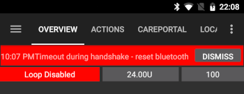

# Accu-Chek Insight

**Αυτό το λογισμικό είναι μέρος μιας λύσης DIY τεχνητού παγκρέατος και δεν είναι προϊόν, αλλά απαιτεί από εσάς να διαβάσετε, να μάθετε και να κατανοήσετε το σύστημα, συμπεριλαμβανομένου του τρόπου χρήσης του. Δεν είναι κάτι που κάνει όλη τη διαχείριση του διαβήτη για σας, αλλά σας επιτρέπει να βελτιώσετε τα επίπεδα σακχάρων σας και την ποιότητα ζωής σας, εάν είστε πρόθυμοι να αφιερώσετε τον απαιτούμενο χρόνο. Μη βιάζεστε, αλλά δώστε στον εαυτό σας χρόνο να μάθει. Μόνο εσείς είστε υπεύθυνοι για ό,τι κάνετε με αυτό.**

```{admonition} Το Accu-Chek Insight αποσύρεται :class: note

Η Roche αποχωρεί από την αγορά αντλιών ινσουλίνης, για να επικεντρώσει τα προϊόντα της για τον διαβήτη στο CGM Accu-Chek SmartGuide. Έχει ανακοινώσει το τέλος των πωλήσεων των αντλιών Accu-Chek Combo και Accu-Chek Insight. Η μικροαντλία Accu-Chek Solo, που της απομένει, επίσης αποσύρεται σταδιακά (τελευταίες παραδόσεις στη Γερμανία στο τέλος του 2025). Η αλλαγή γίνεται ανά περιοχή, ξεκινώντας από τη Γερμανία, και αναμένεται να ακολουθήσουν άλλες ευρωπαϊκές αγορές. Η υποστήριξη για το Insight αναφέρεται ήδη ως λήξασα (δείτε [Αντλίες που δεν πωλούνται πια](./Future-possible-Pump-Drivers.md)). Αν βασίζεστε σε αυτή την αντλία, σχεδιάστε από νωρίς τη μετάβαση σε μια υποστηριζόμενη αντλία.

    <br />```{note}
    Πριν το **AAPS** αποκτήσει δικό του οδηγό για το Insight, το Insight ελεγχόταν μέσω της ξεχωριστής εφαρμογής [SightRemote](https://github.com/TebbeUbben/SightRemote). Το SightRemote δεν χρειάζεται πια και δεν συντηρείται: αν το έχετε ακόμα εγκατεστημένο από τότε, απεγκαταστήστε το και χρησιμοποιήστε μια τρέχουσα έκδοση του **AAPS**.
    

```{contents} Περιεχόμενα :depth: 1 :local: true

    <br />## Δυνατότητες της αντλίας με το AAPS
    
    * Επικοινωνεί με το **AAPS** μέσω του Bluetooth του τηλεφώνου σας, χωρίς επιπλέον συσκευή επικοινωνίας.
    * Αυτόματος χειρισμός θερινής ώρας και ζώνης ώρας.
    
    ## Απαιτήσεις υλικού και λογισμικού
    
    * Μια αντλία Roche Accu-Chek Insight (οποιοδήποτε firmware, όλα λειτουργούν)
    
    Σημείωση: Το AAPS γράφει πάντα τα δεδομένα στο **πρώτο προφίλ βασικού ρυθμού της αντλίας**.
    
    * Ένα τηλέφωνο Android με Android 12 ή νεότερο (δείτε [Τηλέφωνα](../Getting-Started/Phones.md))
    * Η εφαρμογή AAPS εγκατεστημένη στο τηλέφωνό σας
    
    ## Ρύθμιση
    
    * Η αντλία Insight πρέπει να είναι συνδεδεμένη μόνο με μία συσκευή κάθε φορά. Αν έχετε χρησιμοποιήσει στο παρελθόν το τηλεχειριστήριο του Insight (μετρητή), πρέπει να αφαιρέσετε τον μετρητή από τη λίστα συζευγμένων συσκευών της αντλίας: **Menu** > **Settings** > **Communication** > **Remove device**.
    
       
    
    * Στο [Διαμόρφωση > Αντλία](#Config-Builder-pump), επιλέξτε την κάρτα **Accu-Chek Insight**. Μόνο μία αντλία μπορεί να είναι ενεργή κάθε φορά.
    
       
    
       Μόλις επιλεγεί, η κάρτα **Accu-Chek Insight** δείχνει δύο κουμπιά, **Ρυθμίσεις** και **Άνοιγμα πρόσθετου**:
    
       
    
       Το **Ρυθμίσεις** ανοίγει τις ρυθμίσεις του οδηγού Accu-Chek Insight (δείτε [Ρυθμίσεις στο AAPS](#Accu-Chek-Insight-Pump-settings-in-aaps)).
    
       Το **Άνοιγμα πρόσθετου** (ή **Διαχείριση → Αντλία**) ανοίγει την οθόνη της αντλίας Accu-Chek Insight. Πριν από τη σύζευξη μιας αντλίας, η οθόνη μοιάζει έτσι:
    
       
    
    (accu-chek-insight-pairing)=
    ### Σύζευξη
    
    * Στην οθόνη της αντλίας, πατήστε **Σύζευξη Insight**. Ανοίγει ο οδηγός σύζευξης και αναζητά κοντινές συσκευές Bluetooth (πάνω μέρος της παρακάτω εικόνας).
    * Στην αντλία Insight, μεταβείτε στο **Menu** > **Settings** > **Communication** > **Add Device**. Η αντλία δείχνει την παρακάτω οθόνη (κάτω μέρος της παρακάτω εικόνας) με τον σειριακό αριθμό της αντλίας.
    
       
    
    * Πίσω στο τηλέφωνό σας, πατήστε τον σειριακό αριθμό της αντλίας στη λίστα των συσκευών Bluetooth. Αν το Android σας ζητήσει να επιβεβαιώσετε τη σύζευξη, πατήστε **Σύζευξη**.
    
       
    
    * Η αντλία και το τηλέφωνο δείχνουν και τα δύο έναν κωδικό. Ελέγξτε ότι οι κωδικοί είναι ίδιοι και στις δύο συσκευές. Επιβεβαιώστε στην αντλία και πατήστε **Ναι** στο τηλέφωνο. (Πατήστε **Όχι** αν οι κωδικοί δεν ταιριάζουν.)
    
       
    
    * Το τηλέφωνο δείχνει **Σύζευξη ολοκληρώθηκε**. Πατήστε **Έξοδος** για να επιστρέψετε στην οθόνη της αντλίας.
    
       
    
    * Για να ελέγξετε ότι όλα είναι εντάξει, δείτε την οθόνη της αντλίας (**Διαχείριση → Αντλία**). Μετά τη σύζευξη, η οθόνη δείχνει πληροφορίες για την αντλία, όπως **Σειριακός αριθμός**, **Ημερομηνία κατασκευής**, **Έκδοση λογισμικού** και **Διεύθυνση Bluetooth**.
    
       
    
       ```{admonition} Παλαιότερο στιγμιότυπο οθόνης
       :class: note
       Εκτός από το πάνω μέρος της πρώτης εικόνας, τα παραπάνω στιγμιότυπα σύζευξης είναι από παλαιότερη έκδοση του **AAPS** και μπορεί να φαίνονται διαφορετικά στο **AAPS** 4.
       ```
    
    * Για να καταργήσετε τη σύζευξη, πατήστε **Κατάργηση σύζευξης** στην οθόνη της αντλίας και επιβεβαιώστε το **Επαναφορά στοιχείων σύζευξης;**. Μετά εμφανίζεται ξανά το κουμπί **Σύζευξη Insight**.
    
    Σημείωση: Δεν υπάρχει μόνιμη σύνδεση μεταξύ αντλίας και τηλεφώνου. Το **AAPS** συνδέεται μόνο όταν χρειάζεται (για παράδειγμα για να ορίσει προσωρινό βασικό ρυθμό, να δώσει bolus ή να διαβάσει το ιστορικό της αντλίας). Αλλιώς οι μπαταρίες του τηλεφώνου και της αντλίας θα άδειαζαν πολύ γρήγορα.
    
    (Accu-Chek-Insight-Pump-settings-in-aaps)=
    ## Ρυθμίσεις στο AAPS
    
    Ανοίξτε τις ρυθμίσεις με το **Ρυθμίσεις** στην κάρτα **Accu-Chek Insight** στο **Διαμόρφωση** > **Αντλία** ή με το εικονίδιο γραναζιού πάνω δεξιά στην οθόνη της αντλίας.
    
    
    
    Στις ρυθμίσεις του Insight στο **AAPS** μπορείτε να ενεργοποιήσετε τις παρακάτω επιλογές:
    
    * **Καταγραφή αλλαγών δεξαμενής**: καταγράφει αυτόματα αλλαγή φύσιγγας ινσουλίνης όταν εκτελείτε στην αντλία το πρόγραμμα "fill cannula".
    
    * **Καταγραφή αλλαγών σωληνακιού**: προσθέτει μια σημείωση στη βάση δεδομένων του **AAPS** όταν εκτελείτε στην αντλία το πρόγραμμα "tube filling".
    
    * **Καταγραφή αλλαγών σημείου έγχυσης**: προσθέτει μια σημείωση στη βάση δεδομένων του **AAPS** όταν εκτελείτε στην αντλία το πρόγραμμα "cannula filling". **Σημείωση: Μια αλλαγή σημείου έγχυσης μηδενίζει επίσης το Autosens.**
    
    * **Καταγραφή αλλαγών μπαταρίας**: καταγράφει αλλαγή μπαταρίας όταν βάζετε νέα μπαταρία στην αντλία.
    
    * **Καταγραφή αλλαγών κατάστασης λειτουργίας**: προσθέτει μια σημείωση στη βάση δεδομένων του **AAPS** κάθε φορά που ξεκινάτε, σταματάτε ή θέτετε σε παύση την αντλία.
    
    * **Καταγραφή ειδοποιήσεων**: προσθέτει μια σημείωση στη βάση δεδομένων του **AAPS** κάθε φορά που η αντλία δίνει μια ειδοποίηση (εκτός από υπενθυμίσεις, ακύρωση bolus και ακύρωση TBR, που δεν καταγράφονται).
    
    * **Ενεργοποίηση εξομοίωσης TBR**: η αντλία Insight μπορεί να ορίσει προσωρινούς βασικούς ρυθμούς (TBR) μόνο έως 250%. Για να ξεπεραστεί αυτό το όριο, η εξομοίωση TBR λέει στην αντλία να χορηγήσει εκτεταμένο bolus για την επιπλέον ινσουλίνη, αν ζητηθεί TBR πάνω από 250%.
    
      **Σημείωση: Χρησιμοποιείτε μόνο ένα εκτεταμένο bolus κάθε φορά. Πολλά εκτεταμένα bolus ταυτόχρονα μπορεί να προκαλέσουν σφάλματα.**
    
    * **Απενεργοποίηση δονήσεων κατά τη χειροκίνητη δόση bolus**: η αντλία Insight δεν δονείται όταν χορηγεί χειροκίνητο bolus (ή εκτεταμένο bolus). Διαθέσιμο μόνο με firmware Insight 3.x.
    
    * **Απενεργοποίηση δονήσεων κατά την αυτόματη δόση bolus**: η αντλία Insight δεν δονείται όταν χορηγεί αυτόματο bolus (SMB ή προσωρινό βασικό ρυθμό με εξομοίωση TBR). Διαθέσιμο μόνο με firmware Insight 3.x.
    
    * **Ελάχ. διάρκεια αποκατάστασης [s]** και **Μέγ. διάρκεια αποκατάστασης [s]**: πόσο περιμένει το **AAPS** πριν δοκιμάσει ξανά μετά από μια αποτυχημένη προσπάθεια σύνδεσης. Μπορείτε να επιλέξετε από 0 έως 20 δευτερόλεπτα. Αν έχετε προβλήματα σύνδεσης, επιλέξτε μεγαλύτερο χρόνο αναμονής.
        <br><br>Παράδειγμα για ελάχ. διάρκεια αποκατάστασης = 5 και μέγ. διάρκεια αποκατάστασης = 20
        <br><br>καμία σύνδεση -> αναμονή <b>5</b> δευτ.
          <br>  νέα προσπάθεια -> καμία σύνδεση -> αναμονή <b>6</b> δευτ.
          <br>  νέα προσπάθεια -> καμία σύνδεση -> αναμονή <b>7</b> δευτ.
          <br>  νέα προσπάθεια -> καμία σύνδεση -> αναμονή <b>8</b> δευτ.
          <br>...
          <br>νέα προσπάθεια -> καμία σύνδεση -> αναμονή <b>20</b> δευτ.
          <br>νέα προσπάθεια -> καμία σύνδεση -> αναμονή <b>20</b> δευτ.
          <br>...
    
    * **Καθυστέρηση αποσύνδεσης [s]**: πόσο (σε δευτερόλεπτα) περιμένει το **AAPS** πριν αποσυνδεθεί από την αντλία, αφού τελειώσει μια ενέργεια. Μπορείτε να επιλέξετε από 0 έως 15 δευτερόλεπτα. Η προεπιλεγμένη τιμή είναι 5 δευτερόλεπτα.
    
    Για τα διαστήματα που η αντλία ήταν σταματημένη, το **AAPS** καταγράφει προσωρινό βασικό ρυθμό 0%.
    
    ### Η οθόνη της αντλίας
    
    Η οθόνη της αντλίας Accu-Chek Insight (**Διαχείριση → Αντλία**) δείχνει την τρέχουσα κατάσταση της αντλίας, για παράδειγμα **Κατάσταση**, **Τελευταία σύνδεση**, **Κατάσταση λειτουργίας**, **Μπαταρία**, **Επίπεδο δεξαμενής**, τις σημερινές συνολικές ημερήσιες δόσεις (**TDD Bolus**, **TDD βασικός**), τους βασικούς ρυθμούς και το τελευταίο bolus. Μετά τη σύζευξη της αντλίας, υπάρχουν αυτά τα κουμπιά:
    
    * **Ανανέωση**: ανανεώνει την κατάσταση της αντλίας.
    * **Ενεργοποίηση ειδοποίησης τέλους TBR (ρύθμιση αντλίας)** / **Απενεργοποίηση ειδοποίησης τέλους TBR (ρύθμιση αντλίας)**: μια κανονική αντλία Insight δίνει συναγερμό όταν τελειώνει ένας TBR. Αυτό το κουμπί ενεργοποιεί ή απενεργοποιεί αυτόν τον συναγερμό, χωρίς να χρειάζεται λογισμικό διαμόρφωσης.
    * **Κατάργηση σύζευξης**: καταργεί τη σύζευξη με την αντλία (δείτε [Σύζευξη](#accu-chek-insight-pairing)).
    
    
    
    ```{admonition} Παλαιότερο στιγμιότυπο οθόνης
    :class: note
    Το παραπάνω στιγμιότυπο οθόνης είναι από παλαιότερη έκδοση του **AAPS**. Στο **AAPS** 4 η οθόνη της αντλίας φαίνεται διαφορετική και έχει επίσης κουμπί **Κατάργηση σύζευξης**.
    

## Ρυθμίσεις στην αντλία

Ρυθμίστε τους συναγερμούς στην αντλία ως εξής:

* Menu > Settings > Device settings > Mode settings > Quiet > Signal > Sound
* Menu > Settings > Device settings > Mode settings > Quiet > Volume > 0 (αφαιρέστε όλες τις μπάρες)
* Menu > Modes > Signal mode > Quiet

Έτσι σιγούν όλοι οι συναγερμοί της αντλίας και το AAPS αποφασίζει αν ένας συναγερμός σας αφορά. Αν το AAPS δεν επιβεβαιώσει έναν συναγερμό, η έντασή του αυξάνεται (πρώτα μπιπ, μετά δόνηση).

(Accu-Chek-Insight-Pump-vibration)=

### Δόνηση

Ανάλογα με την έκδοση firmware της αντλίας σας, το Insight δονείται για λίγο κάθε φορά που χορηγείται ένα bolus (για παράδειγμα, όταν το AAPS δίνει SMB ή όταν η εξομοίωση TBR χορηγεί εκτεταμένο bolus).

* Firmware 1.x: Χωρίς δόνηση από κατασκευής.
* Firmware 2.x: Η δόνηση δεν μπορεί να απενεργοποιηθεί.
* Firmware 3.x: Το AAPS χορηγεί το bolus αθόρυβα.

Την έκδοση firmware μπορείτε να τη βρείτε στο μενού.

## Αντικατάσταση μπαταρίας

Η μπαταρία του Insight, όταν χρησιμοποιείτε το κύκλωμα, διαρκεί από 10 έως 14 ημέρες, το πολύ 20 ημέρες. Ο χρήστης που το ανέφερε χρησιμοποιεί μπαταρίες λιθίου Energizer.

Η αντλία Insight έχει μια μικρή εσωτερική μπαταρία, που κρατά σε λειτουργία βασικές λειτουργίες, όπως το ρολόι, όσο αλλάζετε την αφαιρούμενη μπαταρία. Αν η αλλαγή της μπαταρίας διαρκέσει πολύ, αυτή η εσωτερική μπαταρία μπορεί να εξαντληθεί, το ρολόι θα επαναρυθμιστεί και θα σας ζητηθεί να εισάγετε νέα ώρα και ημερομηνία μετά την εισαγωγή μιας νέας μπαταρίας. Αν συμβεί αυτό, όλες οι εγγραφές στο AAPS πριν από την αλλαγή της μπαταρίας δεν θα περιλαμβάνονται πια στους υπολογισμούς, γιατί η σωστή ώρα δεν μπορεί να βρεθεί με ακρίβεια.

(Accu-Chek-Insight-Pump-insight-specific-errors)=

## Ειδικά σφάλματα σχετικά με το Insight

### Εκτεταμένο bolus

Χρησιμοποιείτε μόνο ένα εκτεταμένο bolus κάθε φορά, γιατί πολλά εκτεταμένα bolus ταυτόχρονα μπορεί να προκαλέσουν σφάλματα.

### Τέλος χρόνου

Μερικές φορές η αντλία Insight δεν απαντά, ενώ το **AAPS** δημιουργεί τη σύνδεση. Τότε το **AAPS** δείχνει την ειδοποίηση "Τέλος χρόνου κατά τη διάρκεια handshake - επαναφορά bluetooth".



Αν συμβεί αυτό, απενεργοποιήστε το Bluetooth στην αντλία ΚΑΙ στο τηλέφωνο για περίπου 10 δευτερόλεπτα και μετά ενεργοποιήστε το ξανά.

## Διέλευση χρονικών ζωνών με αντλία Insight

Για πληροφορίες σχετικά με τα ταξίδια σε άλλες ζώνες ώρας, δείτε την ενότητα [Ταξίδια σε άλλες ζώνες ώρας με αντλίες](#timezone-traveling-insight).

## Πού θα βρείτε βοήθεια

Η ανάπτυξη του οδηγού Insight γίνεται από την κοινότητα σε **εθελοντική** βάση. Πριν ζητήσετε βοήθεια:

1. **Διαβάστε** τη σχετική ενότητα αυτής της τεκμηρίωσης, για να βεβαιωθείτε πώς πρέπει να λειτουργεί η λειτουργία.
2. **Ρωτήστε** στο κανάλι *#AAPS* στο [Discord](https://discord.gg/4fQUWHZ4Mw) ή σε ένα από τα άλλα [κανάλια της κοινότητας](../GettingHelp/WhereCanIGetHelp.md).
3. **Αναφέρετε ένα σφάλμα**: ψάξτε πρώτα στα [υπάρχοντα issues](https://github.com/nightscout/AndroidAPS/issues). Αν το δικό σας δεν υπάρχει, ανοίξτε ένα [νέο issue](https://github.com/nightscout/AndroidAPS/issues) και επισυνάψτε τα [αρχεία καταγραφής](../GettingHelp/AccessingLogFiles.md) σας.

Όταν ζητάτε βοήθεια, αναφέρετε τη μάρκα και το μοντέλο του τηλεφώνου σας, την έκδοση Android, την έκδοση του **AAPS** και μια περιγραφή του προβλήματος σε απλά αγγλικά (τι άλλαξε, πότε λειτούργησε τελευταία φορά).