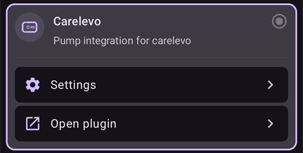

# CareLevo

Η CareLevo είναι μια αντλία patch χωρίς σωληνάκι, από την εταιρεία CareMedi. Κάθε Patch χωρά έως 300 U ινσουλίνης και φοριέται έως 7 ημέρες (168 ώρες). Επικοινωνεί με το **AAPS** μέσω του Bluetooth του τηλεφώνου σας, χωρίς επιπλέον συσκευή.

```{admonition} New driver
:class: warning
Ο οδηγός CareLevo είναι νέος στο **AAPS**. Διαβάστε όλη αυτή τη σελίδα πριν ενεργοποιήσετε το πρώτο σας Patch και έχετε κοντά σας τις οδηγίες χρήσης της αντλίας.
```

Η μικρότερη δόση που μπορεί να χορηγήσει το Patch είναι 0,05 U. Ορίστε τους βασικούς ρυθμούς στο **Προφίλ** σε τουλάχιστον 0,05 U/h, σε βήματα των 0,05 U/h. Αλλιώς η ινσουλίνη που περιμένει το **Προφίλ** και η ινσουλίνη που χορηγεί το Patch διαφέρουν λίγο. Το **AAPS** χρησιμοποιεί τους βασικούς ρυθμούς που δέχτηκε το Patch.

```{contents} Table of contents
:depth: 1
:local: true
```

## Δυνατότητες της αντλίας με το AAPS

* Επικοινωνεί με το **AAPS** μέσω του Bluetooth του τηλεφώνου σας, χωρίς επιπλέον συσκευή επικοινωνίας.
* Bolus σε βήματα των 0,05 U.
* Βασικοί ρυθμοί από 0,05 U/h έως 15 U/h, σε βήματα των 0,05 U/h, με τμήματα βασικού ρυθμού των 30 λεπτών.
* Προσωρινοί βασικοί ρυθμοί ως απόλυτη τιμή, έως 12 ώρες.
* Εκτεταμένο bolus έως 8 ώρες.
* Τις αλλαγές θερινής ώρας και ζώνης ώρας πρέπει να τις κάνετε χειροκίνητα. Το Patch σας ειδοποιεί όταν αλλάζει η ζώνη ώρας.

## Ρύθμιση αντλίας

1. Ανοίξτε το **μενού** (☰) στην πάνω αριστερή γωνία της κύριας οθόνης του **AAPS** και επιλέξτε **Διαμόρφωση**.
1. Επιλέξτε **Carelevo** στην ενότητα Αντλία.
1. Πατήστε το πλήκτρο Πίσω για να επιστρέψετε στην κύρια οθόνη.



## Ρυθμίσεις

Ανοίξτε την οθόνη της αντλίας με **Διαχείριση → Αντλία** (ή **Διαμόρφωση → Αντλία → Άνοιγμα πρόσθετου**).

Ανοίξτε τις ρυθμίσεις της CareLevo πατώντας το εικονίδιο **Ρυθμίσεις** (γρανάζι) πάνω δεξιά. Υπάρχουν τρεις ρυθμίσεις:


### Ρύθμιση ειδοποίησης χαμηλής ινσουλίνης

Το Patch σας ειδοποιεί όταν η ινσουλίνη που μένει στη δεξαμενή φτάσει την ποσότητα που επιλέξατε. Μπορεί να οριστεί από 20 U έως 50 U, σε βήματα των 5 U. Η προεπιλογή είναι 30 U. Ανεξάρτητα από αυτή τη ρύθμιση, το Patch δίνει κρίσιμο συναγερμό και σταματά τη χορήγηση ινσουλίνης όταν μένουν λιγότερες από 10 U.

### Ρύθμιση ειδοποίησης χρήσης Patch

Το Patch σας ειδοποιεί όταν το έχετε φορέσει για τον αριθμό ωρών που επιλέξατε, ώστε να προγραμματίσετε την αλλαγή. Μπορεί να οριστεί από 24 έως 167 ώρες. Η προεπιλογή είναι 116 ώρες.

### Συναγερμός πληροφοριών Patch

Όταν είναι ενεργό, το patch κάνει μπιπ όταν ξεκινά και όταν τελειώνει ένα bolus, ένα εκτεταμένο bolus ή ένας προσωρινός βασικός ρυθμός. Η προεπιλογή είναι ανενεργό.

## Η οθόνη της αντλίας


Η οθόνη της αντλίας δείχνει την **Κατάσταση Bluetooth** (Χωρίς ενεργό Patch, Αποσυνδεδεμένο ή Συνδεδεμένο), τον **Σειριακός αριθμός** του Patch, την **Ώρα ενεργοποίησης** και τη **Λήξη** του, τον τρέχοντα **Βασικός ρυθμός** και τον **Προσωρινός βασικός ρυθμός**, το **Υπόλοιπο ινσουλίνης** (υπόλοιπο / γέμισμα), τον **Υπόλοιπος χρόνος Patch** και τη **Συνολική ινσουλίνη που χορηγήθηκε**.

Τα κουμπιά εξαρτώνται από την κατάσταση του Patch:

* **Ενεργοποίηση Patch**: ξεκινά την ενεργοποίηση ενός νέου Patch, δείτε παρακάτω.
* **Οδηγός ινσουλίνης**: δείχνει τα δώδεκα βήματα για το γέμισμα ενός Patch με ινσουλίνη.
* **Αναστολή έγχυσης** / **Συνέχιση έγχυσης**: σταματά προσωρινά και ξεκινά ξανά τη χορήγηση ινσουλίνης, δείτε παρακάτω.
* **Απόρριψη Patch**: σταματά το τρέχον Patch, ώστε να μπορεί να ενεργοποιηθεί ένα νέο.

## Ενεργοποίηση ενός Patch

Πριν ξεκινήσετε, βεβαιωθείτε ότι ένα **Προφίλ** είναι ενεργό στο **AAPS** και ότι το Bluetooth είναι ενεργοποιημένο. Το Patch πρέπει να ενεργοποιηθεί μέσα σε περιορισμένο χρόνο αφού ανοίξει. Αν ο χρόνος τελειώσει, το Patch δίνει τον συναγερμό **Λήξη χρόνου εφαρμογής Patch** και δεν μπορεί να χρησιμοποιηθεί.

Πατήστε **Ενεργοποίηση Patch** στην οθόνη της αντλίας και ακολουθήστε τα βήματα. Μπορείτε να ακυρώσετε οποιαδήποτε στιγμή πριν από την εισαγωγή της βελόνας. Ό,τι έχετε εισαγάγει απορρίπτεται.

### Επιλογή της ινσουλίνης

Επιβεβαιώστε την ινσουλίνη που χρησιμοποιείτε. Το Patch χρειάζεται ινσουλίνη ταχείας δράσης U-100.

### Γέμισμα του Patch με ινσουλίνη

Γεμίστε το Patch με 50 έως 300 U, ανάλογα με το πόσο καιρό θα το φορέσετε. Πατήστε **Οδηγός ινσουλίνης** αν χρειάζεστε τις οδηγίες γεμίσματος. Μετά πατήστε την ποσότητα πλήρωσης και επιλέξτε την ποσότητα που γεμίσατε. Το **AAPS** τη χρησιμοποιεί για να δείχνει την ινσουλίνη που απομένει.

### Σύνδεση του Patch

1. Βγάλτε το Patch από τη συσκευασία (blister) και αφαιρέστε το καπάκι της βελόνας.
1. Πατήστε το κουμπί λειτουργίας του Patch για περισσότερο από ένα δευτερόλεπτο. Μετά το μπιπ, πατήστε **Αναζήτηση Patch**.
1. Αν το Patch που βρέθηκε είναι το σωστό, πατήστε **Επιβεβαίωση**. Αν δεν είναι, πατήστε **Νέα σάρωση**.

### Έλεγχος ασφαλείας

Μόλις συνδεθεί το Patch, πατήστε **Έλεγχος ασφαλείας**. Το Patch κάνει αυτοέλεγχο και γέμισμα (prime). Ελέγξτε ότι έχει σχηματιστεί μια σταγόνα ινσουλίνης στην άκρη της βελόνας. Αν δεν φαίνεται σταγόνα, πατήστε **Επανάληψη**. Όταν ολοκληρωθεί ο έλεγχος, πατήστε **Επόμενο**.

### Σημείο και τοποθέτηση του Patch

1. Επιλέξτε το σημείο όπου θα φορέσετε το Patch.
1. Καθαρίστε καλά το σημείο με ένα μαντηλάκι οινοπνεύματος.
1. Αφαιρέστε την προστατευτική ταινία και κολλήστε το Patch στο δέρμα σας με τη σημειωμένη κουκκίδα προς τα πάνω.
1. Πατήστε **Επόμενο** μόλις κολλήσει το Patch.

### Εισαγωγή της βελόνας

1. Γυρίστε το καπάκι ασφαλείας προς την κατεύθυνση του βέλους και αφαιρέστε το.
1. Πατήστε το κουμπί του εφαρμογέα τελείως προς τα κάτω και κρατήστε το για 10 δευτερόλεπτα. Όταν μπει η βελόνα, ακούγεται ένα μπιπ.
1. Αφαιρέστε τον εφαρμογέα και πατήστε **Επιβεβαίωση εισαγωγής**.

Αν η εισαγωγή αποτύχει, το **AAPS** σας λέει πόσες προσπάθειες απομένουν. Όταν δεν απομένει καμία προσπάθεια, το Patch δίνει τον συναγερμό **Σφάλμα εισαγωγής βελόνας** και πρέπει να αντικατασταθεί.

Η χορήγηση ινσουλίνης ξεκινά μόλις επιβεβαιωθεί η εισαγωγή.

## Μηνύματα bolus

Αν το Patch αρνηθεί ένα bolus, το **AAPS** σας λέει γιατί. Για παράδειγμα, το μήνυμα *Το bolus δεν μπορεί να χορηγηθεί. Διαθέσιμο bolus: 2,8 U* σημαίνει ότι το Patch μπορεί να χορηγήσει τώρα μόνο αυτή την ποσότητα.

Αν σταματήσετε ένα bolus και το Patch δεν επιβεβαιώσει τη διακοπή, το **AAPS** περιμένει να τελειώσει το bolus και καταγράφει την ποσότητα που αναφέρει το Patch. Αν ένα bolus δεν καταγράφηκε (για παράδειγμα επειδή σταμάτησε ενώ χορηγούνταν), το **AAPS** το προσθέτει από το σύνολο του Patch και σας ζητά να ελέγξετε το IOB πριν δοκιμάσετε ξανά.

## Αναστολή και συνέχιση της χορήγησης ινσουλίνης

Πατήστε **Αναστολή έγχυσης** στην οθόνη της αντλίας και επιλέξτε πόσο θα διαρκέσει η παύση της χορήγησης: από 30 λεπτά έως 4 ώρες, σε βήματα των 30 λεπτών. Η χορήγηση δεν συνεχίζεται μόνη της: όταν τελειώσει η παύση, το Patch δίνει την ειδοποίηση **Έναρξη ινσουλίνης**. Πατήστε **Συνέχιση έγχυσης** στην οθόνη της αντλίας ή **Έναρξη ινσουλίνης** στην ειδοποίηση και επιβεβαιώστε.

## Απόρριψη ενός Patch

Πατήστε **Απόρριψη Patch** στην οθόνη της αντλίας και επιβεβαιώστε. Η χορήγηση ινσουλίνης σταματά και το Patch δεν μπορεί πλέον να χρησιμοποιηθεί. Αφαιρέστε το Patch από το σώμα σας και ενεργοποιήστε ένα νέο.

Όταν ένας κρίσιμος συναγερμός έχει σταματήσει το Patch, ο συναγερμός προσφέρει αντί γι' αυτό το κουμπί **Απενεργοποίηση Patch**. Αν το πατήσετε, το Patch απορρίπτεται με τον ίδιο τρόπο.

(carelevo-alarms-and-notifications)=

## Συναγερμοί και ειδοποιήσεις

Το Patch αναφέρει τρία επίπεδα συμβάντων. Όλα εμφανίζονται ως ειδοποιήσεις του **AAPS**.

### Κρίσιμοι συναγερμοί

Η χορήγηση ινσουλίνης έχει σταματήσει. Ενεργήστε αμέσως:

* **Χαμηλή ινσουλίνη**: μένουν λιγότερες από 10 U. Απενεργοποιήστε το Patch και αλλάξτε το.
* **Το Patch έληξε**: το Patch έφτασε στο τέλος της ζωής του. Απενεργοποιήστε το Patch και αλλάξτε το.
* **Χαμηλή μπαταρία**: απορρίψτε το Patch και αλλάξτε το.
* **Υψηλή/Χαμηλή θερμοκρασία**: μετακινηθείτε σε κατάλληλη θερμοκρασία, μεταξύ 40 ℉ και 99 ℉ (5 ℃ και 37 ℃).
* **Αυτόματη απενεργοποίηση**: το Patch σταμάτησε επειδή αγνοήθηκε η ειδοποίηση Αυτόματη απενεργοποίηση. Πατήστε **Έναρξη ινσουλίνης** για να ξεκινήσει ξανά η χορήγηση βασικού ρυθμού.
* **Λήξη χρόνου εφαρμογής Patch**, **Ο αυτοέλεγχος απέτυχε**, **Σφάλμα Patch**, **Απόφραξη** και **Σφάλμα εισαγωγής βελόνας**: απενεργοποιήστε το Patch και αλλάξτε το.

### Ειδοποιήσεις

Η χορήγηση ινσουλίνης συνεχίζεται, αλλά κάτι χρειάζεται την προσοχή σας:

* **Χαμηλή ινσουλίνη**: η δεξαμενή έφτασε την ποσότητα που ορίστηκε στη **Ρύθμιση ειδοποίησης χαμηλής ινσουλίνης**. Ετοιμαστείτε να αλλάξετε το Patch.
* **Το Patch λήγει σύντομα** και **Η διάρκεια λειτουργίας του Patch έληξε**: αλλάξτε το Patch.
* **Χαμηλή μπαταρία**: ετοιμαστείτε να αλλάξετε το Patch.
* **Υψηλή/Χαμηλή θερμοκρασία**: η χορήγηση σταματά προσωρινά μέχρι το Patch να επιστρέψει μεταξύ 40 ℉ και 99 ℉.
* **Αυτόματη απενεργοποίηση**: πατήστε **OK**. Αν την αγνοήσετε, η ειδοποίηση γίνεται κρίσιμος συναγερμός και η χορήγηση σταματά.
* **Η ενεργοποίηση του Patch δεν ολοκληρώθηκε**: πατήστε **OK** για να ολοκληρώσετε την ενεργοποίηση.
* **Έναρξη ινσουλίνης**: η παύση που ορίσατε τελείωσε. Πατήστε **Έναρξη ινσουλίνης** για να συνεχιστεί η χορήγηση.
* **Ενεργοποιήστε το Bluetooth** και **Το BLE δεν είναι συνδεδεμένο**: το τηλέφωνο δεν μπορεί να επικοινωνήσει με το Patch. Ενεργοποιήστε το Bluetooth ή ελέγξτε τη σύνδεση του Patch.

### Ενημερώσεις

Μόνο για ενημέρωση: **Χαμηλή ινσουλίνη**, **Ειδοποίηση χρόνου χρήσης Patch** (πέρασε ο χρόνος που ορίστηκε στη **Ρύθμιση ειδοποίησης χρήσης Patch**), **Ειδοποίηση ελέγχου Patch**, **Αλλαγή ζώνης ώρας** και **Ελέγξτε τη γλυκόζη αίματος** (ορισμένο χρόνο μετά από ένα bolus).

Το Patch αναφέρει επίσης πότε ξεκινά ή τελειώνει η δική του λειτουργία αναστολής σε χαμηλή γλυκόζη (**LGS**). Το **AAPS** δεν χρησιμοποιεί αυτή τη λειτουργία· το κύκλωμα χειρίζεται μόνο του τη χαμηλή γλυκόζη.

## Πού θα βρείτε βοήθεια

Αναφέρετε προβλήματα με τον οδηγό CareLevo στη [σελίδα GitHub issues του AAPS](https://github.com/nightscout/AndroidAPS/issues) ή στα κανάλια της κοινότητας του AAPS, δείτε [Πού μπορώ να βρω βοήθεια;](../GettingHelp/WhereCanIGetHelp.md).
