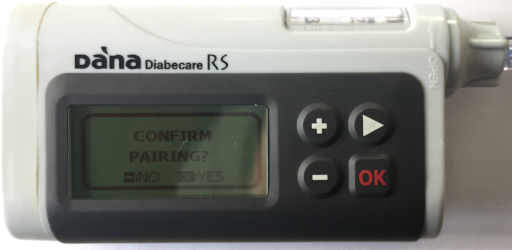
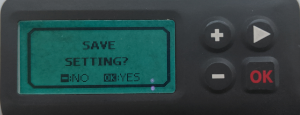

# DanaRS, Dana-i και Dana-i2

*Αυτές οι οδηγίες αφορούν τη διαμόρφωση της εφαρμογής και της αντλίας σας, αν έχετε μια DanaRS από το 2017 και μετά, μια Dana-i ή μια Dana-i2. Αν έχετε την αρχική DanaR, δείτε τη σελίδα [Αντλία ινσουλίνης DanaR](./DanaR-Insulin-Pump.md).*

**Η Dana-i2 μπορεί να χρησιμοποιηθεί από την έκδοση 4.0 του AAPS και μετά.** Χρησιμοποιεί τον ίδιο οδηγό **Dana-i/RS** με την Dana-i.

* Στην αντλία DanaRS/i/i2 η εφαρμογή χρησιμοποιεί το "BASAL A". Τα υπάρχοντα δεδομένα αντικαθίστανται.

    {contents} Περιεχόμενα
    :depth: 1
    :local: true

## Δυνατότητες της αντλίας με το AAPS

* Επικοινωνεί με το **AAPS** μέσω του Bluetooth του τηλεφώνου σας, χωρίς επιπλέον συσκευή επικοινωνίας.
* Οι αλλαγές θερινής ώρας και ζώνης ώρας πρέπει να γίνονται χειροκίνητα (δείτε [Ταξίδια σε άλλες ζώνες ώρας](#timezone-traveling-danarv2-danars)).

(DanaRS-Insulin-Pump-pairing-pump)=

## Σύζευξη αντλίας

* Ανοίξτε το **μενού** (☰) πάνω αριστερά στην κύρια οθόνη του **AAPS** και επιλέξτε **Διαμόρφωση**.
* Πατήστε **Αντλία** και επιλέξτε **Dana-i/RS**.
    
    
    
    Μόλις επιλεγεί, η κάρτα **Dana-i/RS** δείχνει δύο κουμπιά, **Ρυθμίσεις** και **Άνοιγμα πρόσθετου**:
    
    
    
    Το **Ρυθμίσεις** ανοίγει τις ρυθμίσεις του οδηγού Dana-i/RS:
    
    
    
    Το **Άνοιγμα πρόσθετου** (ή **Διαχείριση** > **Αντλία**) ανοίγει την οθόνη της αντλίας Dana-i/RS. Πριν από τη σύζευξη μιας αντλίας, η οθόνη μοιάζει έτσι:
    
    

* Στην οθόνη της αντλίας, πατήστε **Σύζευξη**. Το **AAPS** αναζητά κοντινές αντλίες.

* Πατήστε την αντλία σας στη λίστα.
    
    

* **Πρέπει να επιβεβαιώσετε τη σύζευξη στην αντλία!** Αυτό γίνεται όπως και σε άλλες συζεύξεις Bluetooth που ίσως γνωρίζετε (για παράδειγμα, smartphone και ηχοσύστημα αυτοκινήτου).
    
    

* Ακολουθήστε τη διαδικασία σύζευξης ανάλογα με τον τύπο και το firmware της αντλίας σας:
    
    * Για την DanaRS v1, το **AAPS** ζητά τον **Κωδικός πρόσβασης αντλίας (μόνο v1)**. Εισαγάγετε τον κωδικό της αντλίας σας (δείτε [Προεπιλεγμένος κωδικός](#DanaRS-Insulin-Pump-default-password)).
    * Για την DanaRS v3, το **AAPS** σας ζητά να πατήσετε OK στην αντλία και να πληκτρολογήσετε τις 2 σειρές αριθμών και γραμμάτων που δείχνει η αντλία. Κρατήστε την οθόνη της αντλίας αναμμένη πατώντας το κουμπί μείον, μέχρι να τελειώσετε. Μετά πατήστε **Τέλος**.
    * Για την Dana-i και την Dana-i2 εμφανίζεται το κανονικό παράθυρο σύζευξης του Android. Εισαγάγετε τον 6ψήφιο αριθμό που δείχνει η αντλία.

* Όταν εμφανιστεί το **Η σύζευξη πέτυχε!**, πατήστε **Τέλος**.
    
    
    
    Επιστρέφετε στην οθόνη της αντλίας, που τώρα δείχνει την κατάσταση της αντλίας σας.
    
    

* Στις **Ρυθμίσεις**, επιλέξτε **Ταχύτητα bolus** για να αλλάξετε την προεπιλεγμένη ταχύτητα bolus (12 s/U, 30 s/U ή 60 s/U).

* Ορίστε το βήμα του βασικού ρυθμού στην αντλία σε 0,01 U/h από το Doctors menu (δείτε τις οδηγίες χρήσης της αντλίας).
* Ορίστε το βήμα bolus στην αντλία σε 0,05 U από το Doctors menu (δείτε τις οδηγίες χρήσης της αντλίας). Το **AAPS** διαβάζει τα βήματα βασικού ρυθμού και bolus από την αντλία και τα χρησιμοποιεί για κάθε bolus, ώστε ένα bolus να ταιριάζει πάντα με το βήμα που έχει οριστεί στην αντλία. Η οθόνη της αντλίας τα δείχνει στη γραμμή **Βήμα βασικού/bolus**.
* Ενεργοποιήστε το εκτεταμένο bolus στην αντλία

### Επιλογές που εμφανίζονται μόνο σε κάποια μοντέλα

* **Αυτόματο κλείδωμα**: σε μια Dana-i2, η οθόνη **Ρυθμίσεις χρήστη** (στην οθόνη της αντλίας, **Διαχείριση** > **Αντλία**) έχει διακόπτη **Αυτόματο κλείδωμα** για τη ρύθμιση αυτόματου κλειδώματος της αντλίας. Πατήστε **Αποθήκευση ρυθμίσεων στην αντλία** αφού την αλλάξετε.
* **Easy mode**: σε μοντέλα αντλίας που έχουν απλό μενού (easy mode), η οθόνη της αντλίας δείχνει μια γραμμή **Easy mode** με **Ενεργό** ή **Ανενεργό**.
* Αν μια Dana-i2 αρνηθεί ένα bolus, το **AAPS** δείχνει τον λόγο, για παράδειγμα *Δεν έχει γίνει πλήρωση της αντλίας*, *Δεν υπάρχει αρκετή ινσουλίνη στη δεξαμενή* ή *Η λειτουργία Easy sleep είναι ενεργή στην αντλία*.

(DanaRS-Insulin-Pump-default-password)=

### Προεπιλεγμένος κωδικός πρόσβασης

* Για την DanaRS με firmware v1 και v2 ο προεπιλεγμένος κωδικός είναι 1234.
* Για την DanaRS με firmware v3 ή την Dana-i, ο προεπιλεγμένος κωδικός προκύπτει από την ημερομηνία κατασκευής και υπολογίζεται ως MMDD, όπου MM είναι ο μήνας και DD η ημέρα που κατασκευάστηκε η αντλία (π.χ. '0124' σημαίνει μήνας 01 και ημέρα 24).
    
    * Από το MAIN MENU επιλέξτε REVIEW και μετά ανοίξτε το SHIPPING INFORMATION από το υπομενού
    * Ο αριθμός 3 είναι η ημερομηνία κατασκευής. 
    * Στις v3/i αυτός ο κωδικός χρησιμοποιείται μόνο για το κλείδωμα του μενού στην αντλία. Δεν χρησιμοποιείται για την επικοινωνία και δεν χρειάζεται να τον εισαγάγετε στο AAPS.

(DanaRS-Insulin-Pump-change-password-on-pump)=

## Αλλαγή κωδικού πρόσβασης στην αντλία

* Πατήστε το κουμπί OK στην αντλία
* Στο main menu επιλέξτε "OPTION" (μετακινηθείτε δεξιά πατώντας μερικές φορές το κουμπί βέλους)
    
    

* Στο μενού options επιλέξτε "USER OPTION"
    
    

* Χρησιμοποιήστε το κουμπί βέλους για να μετακινηθείτε προς τα κάτω στο "11. password"
    
    

* Πατήστε OK για να εισάγετε τον παλιό κωδικό πρόσβασης.

* Εισαγάγετε τον **παλιό κωδικό** (για τον προεπιλεγμένο κωδικό δείτε [παραπάνω](#DanaRS-Insulin-Pump-default-password)) και πατήστε OK
    
    

* Εάν εισάγετε λάθος κωδικό πρόσβασης εδώ δεν θα υπάρχει κάποιο μήνυμα που να υποδεικνύει αποτυχία!

* Ορίστε **νέο κωδικό** (αλλάξτε τους αριθμούς με τα κουμπιά + & - / μετακινηθείτε δεξιά με το κουμπί βέλους).
    
    

* Επιβεβαιώστε με το κουμπί OK.

* Πατήστε OK για αποθήκευση των ρυθμίσεων.
    
    

* Πηγαίνετε κάτω στο "14. EXIT" και πατήστε OK για έξοδο.
    
    

(DanaRS-Insulin-Pump-dana-rs-specific-errors)=

## Ειδικά σφάλματα της Dana RS

### Σφάλμα κατά τη χορήγηση ινσουλίνης

Αν χαθεί η σύνδεση μεταξύ AAPS και Dana RS κατά τη χορήγηση ενός bolus (π.χ. απομακρυνθείτε από το τηλέφωνο ενώ η Dana RS χορηγεί ινσουλίνη), θα δείτε το παρακάτω μήνυμα και θα ακούσετε έναν ήχο συναγερμού.

* Στις περισσότερες περιπτώσεις πρόκειται για θέμα επικοινωνίας και παρέχεται η σωστή ποσότητα ινσουλίνης.
* Ελέγξτε στο ιστορικό της αντλίας ότι δόθηκε το σωστό bolus. Μπορείτε να το κάνετε στην ίδια την αντλία ή στο **AAPS** στην οθόνη της αντλίας (**Διαχείριση** > **Αντλία**) > **Ιστορικό αντλίας** > **Bolus**.
* Αν θέλετε, διαγράψτε την εγγραφή του σφάλματος στις [θεραπείες](#screens-bolus-carbs).
* Η πραγματική ποσότητα διαβάζεται και καταγράφεται στην επόμενη σύνδεση. Για να γίνει αυτό αμέσως, πατήστε **Ανανέωση** στην οθόνη της αντλίας ή απλώς περιμένετε την επόμενη σύνδεση.

## Ειδική σημείωση για την αλλαγή τηλεφώνου

Κατά τη μετάβαση σε νέο τηλέφωνο απαιτούνται τα ακόλουθα βήματα:

* [Εξαγωγή ρυθμίσεων](../Maintenance/ExportImportSettings.md) στο παλιό σας τηλέφωνο
* Μεταφορά ρυθμίσεων από το παλιό στο νέο τηλέφωνο

### DanaRS v1

* **Χειροκίνητη σύζευξη** της Dana RS με το νέο τηλέφωνο
* Αν επιλέξετε **Αντικατάσταση και των ρυθμίσεων αντλίας** κατά την εισαγωγή, εισάγονται και οι ρυθμίσεις σύνδεσης της αντλίας, και το AAPS στο νέο σας τηλέφωνο θα "γνωρίζει" ήδη την αντλία και έτσι δεν θα ξεκινήσει σάρωση Bluetooth. Γι' αυτό η σύζευξη του νέου τηλεφώνου με την αντλία πρέπει να γίνει χειροκίνητα.
* Εγκατάσταση του AAPS στο νέο τηλέφωνο.
* [Εισαγωγή ρυθμίσεων](../Maintenance/ExportImportSettings.md) στο νέο σας τηλέφωνο

### DanaRS v3, Dana-i, Dana-i2

* Ξεκινήστε τη διαδικασία σύζευξης όπως περιγράφεται [παραπάνω](#DanaRS-Insulin-Pump-pairing-pump).
* Μερικές φορές μπορεί να χρειαστεί πρώτα να διαγράψετε τα στοιχεία σύζευξης στο **AAPS**. Στην οθόνη της αντλίας (**Διαχείριση** > **Αντλία**), πατήστε **Κατάργηση σύζευξης** και επιβεβαιώστε το **Επαναφορά στοιχείων σύζευξης;**. Μετά πατήστε ξανά **Σύζευξη**.

## Ταξίδια σε άλλες ζώνες ώρας με αντλίες DanaRS, Dana-i και Dana-i2

Για πληροφορίες σχετικά με τα ταξίδια σε άλλες ζώνες ώρας, δείτε την ενότητα [Ταξίδια σε άλλες ζώνες ώρας με αντλίες](#timezone-traveling-danarv2-danars).

## Πού θα βρείτε βοήθεια

Η ανάπτυξη του οδηγού DanaRS/Dana-i/Dana-i2 γίνεται από την κοινότητα σε **εθελοντική** βάση. Πριν ζητήσετε βοήθεια:

1. **Διαβάστε** τη σχετική ενότητα αυτής της τεκμηρίωσης, για να βεβαιωθείτε πώς πρέπει να λειτουργεί η λειτουργία.
2. **Ρωτήστε** στο κανάλι *#AAPS* στο [Discord](https://discord.gg/4fQUWHZ4Mw) ή σε ένα από τα άλλα [κανάλια της κοινότητας](../GettingHelp/WhereCanIGetHelp.md).
3. **Αναφέρετε ένα σφάλμα**: ψάξτε πρώτα στα [υπάρχοντα issues](https://github.com/nightscout/AndroidAPS/issues). Αν το δικό σας δεν υπάρχει, ανοίξτε ένα [νέο issue](https://github.com/nightscout/AndroidAPS/issues) και επισυνάψτε τα [αρχεία καταγραφής](../GettingHelp/AccessingLogFiles.md) σας.

Όταν ζητάτε βοήθεια, αναφέρετε τη μάρκα και το μοντέλο του τηλεφώνου σας, την έκδοση Android, την έκδοση του **AAPS** και μια περιγραφή του προβλήματος σε απλά αγγλικά (τι άλλαξε, πότε λειτούργησε τελευταία φορά).