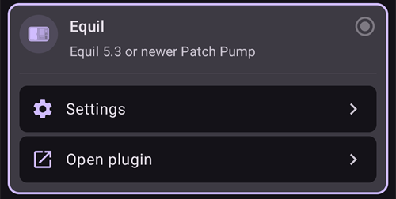
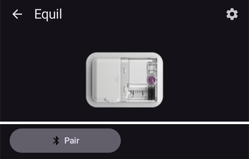

# Equil

Αυτές οι οδηγίες είναι για τη ρύθμιση της αντλίας ινσουλίνης Equil.

```{contents} Table of contents
:depth: 1
:local: true
```

## Δυνατότητες της αντλίας με το AAPS

* Αντλία patch χωρίς σωληνάκι που επικοινωνεί με το **AAPS** μέσω του Bluetooth του τηλεφώνου σας, χωρίς επιπλέον συσκευή επικοινωνίας.
* Το **AAPS** χειρίζεται την Equil ως αντλία patch με δεξαμενή 200 U: η κύρια οθόνη δείχνει τις ενδείξεις κατάστασης για αντλία patch, και τα **Πλήρωση/Γέμισμα** και **Αλλαγή Μπαταρίας Αντλίας** δεν προσφέρονται. Το γέμισμα, η πλήρωση και η αλλαγή μπαταρίας γίνονται στους οδηγούς (wizards) της αντλίας.
* Όσο η αντλία είναι σε αναστολή ή σταματημένη, το **AAPS** καταγράφει προσωρινό βασικό ρυθμό 0 U/h, ώστε να μη μετράει βασική ινσουλίνη στο IOB.
* Τις αλλαγές θερινής ώρας και ζώνης ώρας πρέπει να τις κάνετε χειροκίνητα.

## Απαιτήσεις υλικού και λογισμικού
* **Συμβατό υλικό Equil**

  Προς το παρόν υποστηρίζονται οι Equil 5.3 και 5.4.

* Το **AAPS** έχει δημιουργηθεί και εγκατασταθεί σύμφωνα με τις οδηγίες [Δημιουργία του AAPS](../SettingUpAaps/BuildingAaps.md)

## Ρύθμιση

### Επιλογή της αντλίας Equil

Ανοίξτε το **μενού** (☰) στην πάνω αριστερή γωνία, επιλέξτε **[Διαμόρφωση](#Config-Builder-pump)** και στην ενότητα **Αντλία** επιλέξτε **Equil**.

Μόλις την επιλέξετε, η κάρτα **Equil** δείχνει δύο κουμπιά, **Ρυθμίσεις** και **Άνοιγμα πρόσθετου**:



Το **Άνοιγμα πρόσθετου** (ή **Διαχείριση** → **Αντλία**) ανοίγει την οθόνη της αντλίας Equil. Πριν από τη σύζευξη μιας αντλίας, η οθόνη μοιάζει έτσι:



### Ρυθμίσεις

Ανοίξτε τις ρυθμίσεις της Equil με το **Ρυθμίσεις** στην κάρτα **Equil** ή με το εικονίδιο γραναζιού στην πάνω δεξιά γωνία της οθόνης της αντλίας.


* **Συναγερμός χαμηλής μπαταρίας**: σας προειδοποιεί όταν η μπαταρία της αντλίας είναι χαμηλή.
* **Συναγερμός χαμηλής ινσουλίνης**: σας προειδοποιεί όταν η ινσουλίνη στη δεξαμενή είναι λίγη.
* **Ήχος ειδοποίησης**: πώς σας ειδοποιεί η αντλία: **Σίγαση**, **Μόνο δόνηση**, **Μόνο ήχος** ή **Δόνηση και ήχος**.
* **Ταχύτητα Bolus**: πόσο γρήγορα χορηγείται ένα bolus: **1,5 U/min (κανονική)**, **3 U/min**, **6 U/min** ή **12 U/min**. Ένα πιο γρήγορο bolus μπορεί να δώσει περισσότερους συναγερμούς απόφραξης.


```{admonition} Max basal and max bolus on the patch
:class: note
Το ίδιο το patch απορρίπτει κάθε βασικό ρυθμό πάνω από ένα μέγιστο που το **AAPS** προγραμματίζει σε αυτό. Το **AAPS** παίρνει τη μεγαλύτερη τιμή ανάμεσα στη [ρύθμιση](../SettingUpAaps/Preferences.md) **μέγιστος βασικός ρυθμός** και στον υψηλότερο ωριαίο βασικό ρυθμό του **Προφίλ** σας, ώστε το patch να δέχεται πάντα το προφίλ σας και τους προσωρινούς βασικούς ρυθμούς που ζητά το κύκλωμα. Το **AAPS** στέλνει επίσης στο patch το μέγιστο επιτρεπόμενο bolus σας.

Όταν αλλάζετε τον **μέγιστο βασικό ρυθμό** ή το **μέγιστο bolus**, το **AAPS** στέλνει αυτόματα τις νέες τιμές στο patch. Στέλνονται επίσης με κάθε αλλαγή προφίλ. Δεν χρειάζεται να ρυθμίσετε τίποτα στο ίδιο το patch.
```

### Σύζευξη της αντλίας

Στην οθόνη της αντλίας πατήστε **Σύζευξη**. Ένας οδηγός σας καθοδηγεί σε κάθε βήμα. Η σειρά από τελείες στο πάνω μέρος δείχνει σε ποιο σημείο βρίσκεστε.

Αν το Android ρωτήσει αν το **AAPS** μπορεί να βρίσκει και να συνδέεται σε κοντινές συσκευές, πατήστε **Να επιτρέπεται** (Allow). Το **AAPS** το χρειάζεται για να βρει την αντλία.


Ο οδηγός έχει αυτά τα βήματα. Πατήστε **Επόμενο** για να συνεχίσετε ή **Ακύρωση** για να βγείτε από τον οδηγό.

1. **Απαιτείται προφίλ**: εμφανίζεται μόνο αν δεν έχετε ενεργοποιήσει ποτέ ένα **Προφίλ** στο **AAPS**. Επιλέξτε το προφίλ που θα χρησιμοποιήσετε και πατήστε **Ενεργοποίηση προφίλ**.
1. **Συναρμολόγηση αντλίας**: συναρμολογήστε την αντλία, τη γεμάτη δεξαμενή και τη φορτισμένη μπαταρία.

   

1. **Εύρεση αντλίας**: το **AAPS** αναζητά αντλίες Equil κοντά σας. Επιλέξτε την αντλία σας από τη λίστα.

   
1. **Σύζευξη συσκευής**: μπορείτε να εισαγάγετε έναν κωδικό σύζευξης στο **Ορισμός κωδικού σύζευξης**. Πρέπει να έχει 4 χαρακτήρες, από τους `ABCDEF0123456789`. Πατήστε **Σύζευξη**.

   

1. **Επιλογή ινσουλίνης**: εμφανίζεται μόνο αν έχετε ρυθμίσει περισσότερες από μία ινσουλίνες. Επιλέξτε την ινσουλίνη που έχει η δεξαμενή.
1. **Πλήρωση / Γέμισμα**: η αντλία **δεν** πρέπει να είναι στη βάση της. Πατήστε **Πλήρωση/Γέμισμα** και κάντε πλήρωση της δεξαμενής μέχρι να εμφανιστεί μια σταγόνα ινσουλίνης στην άκρη της βελόνας. Πατήστε **Επόμενο**.

   
1. **Εναλλαγή σημείων**: εμφανίζεται μόνο αν το **Διαχείριση εναλλαγής σημείων αντλίας** είναι ενεργό στις ρυθμίσεις εναλλαγής σημείων. Πατήστε το σημείο όπου θα τοποθετήσετε την αντλία ή πατήστε **Παράλειψη**.
1. **Τοποθέτηση αντλίας**: τοποθετήστε την αντλία στη βάση της.

   
1. **Πλήρωση καθετήρα**: όταν η αντλία είναι στη βάση, πατήστε **Εξαέρωση** για να βγει ο αέρας από τον καθετήρα. Πατήστε **Επόμενο**.

   

1. **Επιβεβαίωση**: βάλτε την αντλία στο σώμα σας και πατήστε **Τέλος**.

   

```{warning}
Αν ορίσετε δικό σας κωδικό σύζευξης (συνιστάται για την ασφάλειά σας), φυλάξτε τον σε ασφαλές μέρος. Ο κωδικός αποθηκεύεται στην αντλία. Η αντλία τον ζητά σε κάθε νέα σύζευξη μέχρι να καταργήσετε σωστά τη σύζευξη στο **AAPS**. Μέχρι τότε, η αντλία δεν μπορεί να χρησιμοποιηθεί ούτε με το αρχικό χειριστήριο (PDA).
```

### Η οθόνη της αντλίας μετά τη σύζευξη

Μόλις γίνει η σύζευξη της αντλίας, η οθόνη της αντλίας δείχνει αυτά τα κουμπιά:

* **Ανανέωση**: διαβάζει τώρα την κατάσταση και το ιστορικό της αντλίας.
* **Αναστολή** / **Συνέχιση χορήγησης**: σταματά ή ξεκινά ξανά τη χορήγηση ινσουλίνης.
* **Αλλαγή δεξαμενής**: σας καθοδηγεί να αφαιρέσετε την αντλία, να βάλετε νέα δεξαμενή (και, αν χρειάζεται, νέα μπαταρία), να κάνετε πλήρωση και να την τοποθετήσετε ξανά. Το πρώτο βήμα ρωτά *Θα βάλετε και νέο σετ έγχυσης (βάση και καθετήρα);*
  * **Ναι, νέο σετ έγχυσης**: επιλέγετε το σημείο, γίνεται πλήρωση του καθετήρα και το **AAPS** καταγράφει αλλαγή ινσουλίνης και αλλαγή καθετήρα.
  * **Όχι, μόνο δεξαμενή ή μπαταρία**: δεν γίνεται πλήρωση του καθετήρα και το **AAPS** καταγράφει μόνο αλλαγή ινσουλίνης.

  Μετά από αλλαγή δεξαμενής, το επίπεδο μπαταρίας δείχνει **-** μέχρι το **AAPS** να το διαβάσει ξανά από την αντλία.

  

* **Ιστορικό**: δείχνει τα συμβάντα που κατέγραψε η αντλία.
* **Κατάργηση σύζευξης συσκευής**: σας καθοδηγεί να αφαιρέσετε την αντλία και να καταργήσετε τη σύζευξή της με το **AAPS**. Αυτό σταματά τη χορήγηση ινσουλίνης, επαναφέρει το έμβολο της αντλίας στο κάτω μέρος και διαγράφει τη σύζευξη.

### Συναγερμοί

* Ο συναγερμός χαμηλής ινσουλίνης ηχεί μία φορά σε κάθε επίπεδο (10 U, 5 U και 2 U) και όταν η δεξαμενή αδειάσει. Ο συναγερμός χαμηλής μπαταρίας ηχεί μία φορά στο 10% και μία φορά στο 5%. Κάθε επίπεδο δίνει συναγερμό μόνο μία φορά μέχρι την επόμενη αλλαγή δεξαμενής.
* Οι συναγερμοί και οι διακοπές της αντλίας καταγράφονται επίσης ως ανακοινώσεις στις θεραπείες, με την ώρα που τις κατέγραψε η αντλία, ώστε να βλέπετε αργότερα πότε και γιατί σταμάτησε η αντλία.
* Αν η δεξαμενή αδειάσει κατά τη διάρκεια ενός bolus, το **AAPS** καταγράφει μόνο την ινσουλίνη που δόθηκε μέχρι τότε και σας λέει και τις δύο ποσότητες.

## Πού θα βρείτε βοήθεια

Την ανάπτυξη του οδηγού Equil την κάνει η κοινότητα **εθελοντικά**. Πριν ζητήσετε βοήθεια:

1. **Διαβάστε** τη σχετική ενότητα αυτής της τεκμηρίωσης για να επιβεβαιώσετε πώς πρέπει να λειτουργεί η λειτουργία.
2. **Ρωτήστε** στο κανάλι *#AAPS* στο [Discord](https://discord.gg/4fQUWHZ4Mw) ή σε ένα από τα άλλα [κανάλια της κοινότητας](../GettingHelp/WhereCanIGetHelp.md).
3. **Αναφέρετε ένα σφάλμα**: ψάξτε πρώτα στα [υπάρχοντα issues](https://github.com/nightscout/AndroidAPS/issues)· αν το δικό σας δεν υπάρχει, ανοίξτε ένα [νέο issue](https://github.com/nightscout/AndroidAPS/issues) και επισυνάψτε τα [αρχεία καταγραφής](../GettingHelp/AccessingLogFiles.md) σας.

Όταν ζητάτε βοήθεια, γράψτε τη μάρκα και το μοντέλο του τηλεφώνου σας, την έκδοση Android, την έκδοση του **AAPS** και μια απλή περιγραφή του προβλήματος (τι άλλαξε, πότε λειτουργούσε τελευταία φορά).
