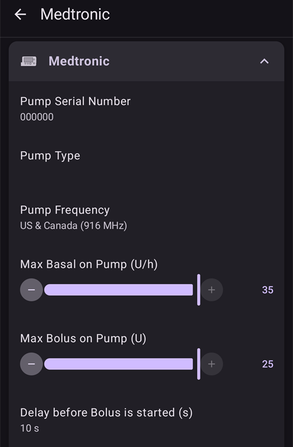

# Αντλίες Medtronic

Το πρόγραμμα οδήγησης δεν λειτουργεί με κανένα νεότερο μοντέλο, ούτε με όλα τα μοντέλα που τελειώνουν σε G (530G, σειρά 600 [630G, 640G, 670G], σειρά 700 [770G, 780G] κ.λπ.).

Οι παρακάτω συνδυασμοί μοντέλου και firmware είναι συμβατοί:

- 512/712 (οποιαδήποτε έκδοση firmware)
- 515/715 (οποιαδήποτε έκδοση firmware)
- 522/722 (οποιαδήποτε έκδοση firmware)
- 523/723 (firmware 2.4A ή χαμηλότερη)
- 554/754 έκδοση ΕΕ (firmware 2.6A ή χαμηλότερη)
- 554/754 έκδοση Καναδά (firmware 2.7A ή χαμηλότερη)

Μπορείτε να δείτε πώς ελέγχετε το firmware στις αντλίες στα [OpenAPS docs](https://openaps.readthedocs.io/en/latest/docs/Gear%20Up/pump.html#how-to-check-pump-firmware-check-for-absence-of-pc-connect) ή στα [LoopDocs](https://loopkit.github.io/loopdocs/build/step3/#medtronic-pump-firmware).

    {contents} Περιεχόμενα
    :depth: 1
    :local: true

## Δυνατότητες της αντλίας με το AAPS

* Χρειάζεται μια συσκευή συμβατή με RileyLink για να επικοινωνεί με το **AAPS**.
* Αυτόματος χειρισμός θερινής ώρας (DST) και ζώνης ώρας.

## Απαιτήσεις υλικού και λογισμικού

- **Τηλέφωνο:** Το πρόγραμμα οδήγησης Medtronic θα πρέπει να λειτουργεί με κάθε τηλέφωνο Android που υποστηρίζει συνδέσεις Bluetooth. **ΣΗΜΑΝΤΙΚΟ: Οι κατασκευαστές τηλεφώνων υλοποιούν το Bluetooth με διαφορετικούς τρόπους, άρα κάθε μοντέλο τηλεφώνου μπορεί να συμπεριφέρεται διαφορετικά. Για παράδειγμα, κάποια τηλέφωνα χειρίζονται διαφορετικά την ενεργοποίηση/απενεργοποίηση του Bluetooth. Αυτό μπορεί να επηρεάσει την εμπειρία σας όταν το AAPS χρειάζεται να συνδεθεί ξανά με τη συσκευή τύπου Rileylink.**
- **Συσκευή συμβατή με RileyLink:** Τα τηλέφωνα Android δεν μπορούν να επικοινωνήσουν με αντλίες Medtronic χωρίς μια ξεχωριστή συσκευή για την επικοινωνία. Αυτή η συσκευή συνδέεται με το τηλέφωνό σας μέσω Bluetooth και με την αντλία σας μέσω συμβατής ραδιοσύνδεσης. Η πρώτη τέτοια συσκευή λεγόταν Rileylink, αλλά σήμερα υπάρχουν και άλλες επιλογές που μπορεί να προσφέρουν επιπλέον λειτουργίες.
    
    - Rileylink: διαθέσιμο στο [getrileylink.org](https://getrileylink.org/product/rileylink916)
    - Orangelink: διαθέσιμο στο [getrileylink.org](https://getrileylink.org/product/orangelink)
    - Emalink (διάφορα μοντέλα): διαθέσιμο στο [github.com](https://github.com/sks01/EmaLink)
    - Gnarl (χρειάζεται λίγη επιπλέον DIY δουλειά): λεπτομέρειες στο [github.com](https://github.com/ecc1/gnarl)

Πίνακα σύγκρισης για τις διάφορες συσκευές που είναι συμβατές με Rileylink θα βρείτε στο [getrileylink.org](https://getrileylink.org/rileylink-compatible-hardware-comparison-chart)

(MedtronicPump-configuration-of-the-pump)=

## Διαμόρφωση της αντλίας

Οι παρακάτω ρυθμίσεις πρέπει να γίνουν στην αντλία, ώστε το AAPS να μπορεί να στέλνει εντολές από απόσταση. Τα βήματα για κάθε αλλαγή σε μια Medtronic 715 φαίνονται σε παρένθεση για κάθε ρύθμιση. Τα ακριβή βήματα μπορεί να διαφέρουν ανάλογα με τον τύπο της αντλίας και/ή την έκδοση firmware.

- **Ενεργοποιήστε την απομακρυσμένη λειτουργία στην αντλία** (στην αντλία πατήστε Act και πηγαίνετε στο Utilities -> Remote Options, επιλέξτε On και στην επόμενη οθόνη κάντε Add ID και προσθέστε ένα τυχαίο ID, όπως 111111). Πρέπει να υπάρχει τουλάχιστον ένα ID στη λίστα Remote ID, ώστε η αντλία να περιμένει απομακρυσμένη επικοινωνία.
- **Ορίστε το Max Basal** (στην αντλία πατήστε Act και πηγαίνετε στο Basal και μετά επιλέξτε Max Basal Rate). Για παράδειγμα, αν ορίσετε αυτή την τιμή στο τετραπλάσιο του μέγιστου κανονικού βασικού ρυθμού σας, θα επιτρέπεται προσωρινός βασικός ρυθμός 400%. Η μέγιστη τιμή που επιτρέπει η αντλία είναι 34,9 μονάδες ανά ώρα.
- **Ορίστε το Max Bolus** (στην αντλία πατήστε Act και πηγαίνετε στο Bolus και μετά επιλέξτε Max Bolus). Αυτό είναι το μεγαλύτερο bolus που θα δεχτεί η αντλία. Η μέγιστη τιμή που επιτρέπει η αντλία είναι 25.
- **Ορίστε το προφίλ σε Standard**. (Στην αντλία πατήστε Act και πηγαίνετε στο Basal και μετά στο Select Patterns) Η αντλία χρειάζεται μόνο ένα προφίλ, επειδή το AAPS διαχειρίζεται τα διάφορα προφίλ στο τηλέφωνό σας. Δεν χρειάζονται άλλα patterns.
- **Ορίστε τον τύπο προσωρινού βασικού ρυθμού** (στην αντλία πατήστε Act και πηγαίνετε στο Basal και μετά στο Temp Basal Type). Επιλέξτε Absolute (όχι Percent).

## Διαμόρφωση Medtronic στο τηλέφωνο/AAPS

- **Μην κάνετε σύζευξη της συσκευής που είναι συμβατή με RileyLink από το μενού Bluetooth του τηλεφώνου σας.** Η σύζευξη από το μενού Bluetooth του τηλεφώνου εμποδίζει το AAPS να βλέπει τη συσκευή σας που είναι συμβατή με Rileylink, όταν ακολουθείτε τις παρακάτω οδηγίες.
- Απενεργοποιήστε την αυτόματη περιστροφή οθόνης στο τηλέφωνό σας. Σε κάποιες συσκευές η αυτόματη περιστροφή οθόνης κάνει επανεκκίνηση των συνδέσεων Bluetooth, κάτι που προκαλεί προβλήματα στην αντλία Medtronic. 
- Υπάρχουν δύο τρόποι για να διαμορφώσετε την αντλία Medtronic στο AAPS:

1. Με τον οδηγό ρύθμισης, σε μια νέα εγκατάσταση
2. Στο **Διαμόρφωση** > **Αντλία**, επιλέγοντας **Medtronic**
    
    
    
    Μόλις το επιλέξετε, η κάρτα **Medtronic** δείχνει δύο κουμπιά, **Ρυθμίσεις** και **Άνοιγμα πρόσθετου**:
    
    
    
    Το **Ρυθμίσεις** ανοίγει τις ρυθμίσεις του προγράμματος οδήγησης Medtronic:
    
    
    
    Το **Άνοιγμα πρόσθετου** (ή **Διαχείριση** > **Αντλία**) ανοίγει την οθόνη της αντλίας Medtronic. Πριν από τη σύζευξη μιας αντλίας, η οθόνη μοιάζει έτσι:
    
    

Όταν διαμορφώνετε την αντλία Medtronic με τον οδηγό ρύθμισης, μπορεί να μη μπορείτε να ολοκληρώσετε τη ρύθμιση λόγω προβλημάτων Bluetooth (π.χ. δεν μπορείτε να συνδεθείτε με την αντλία). Αν συμβεί αυτό, επιλέξτε την εικονική αντλία για να ολοκληρώσετε τη διαμόρφωση και συνεχίστε την αντιμετώπιση του προβλήματος με την επιλογή 2.

Όταν ρυθμίζετε το AAPS για να δουλεύει με την αντλία Medtronic, πρέπει να ορίσετε τα παρακάτω στις **Ρυθμίσεις** (δείτε την εικόνα των ρυθμίσεων παραπάνω):

- **Σειριακός Αριθμός Αντλίας**: Φαίνεται στο πίσω μέρος της αντλίας σας και ξεκινά με SN. Γράψτε μόνο τους 6 αριθμούς που φαίνονται, χωρίς γράμματα (π.χ. 123456).
- **Τύπος Αντλίας**: Το μοντέλο της αντλίας που χρησιμοποιείτε (π.χ. 522). 
- **Συχνότητα Αντλίας**: Υπάρχουν δύο επιλογές, ανάλογα με το πού διανεμήθηκε αρχικά η αντλία σας. Please check the [FAQ](#MedtronicPump-faq) if you are unsure which option to select: 
    - για ΗΠΑ & Καναδά, η συχνότητα είναι 916 MHz
    - για τον υπόλοιπο κόσμο (Worldwide), η συχνότητα είναι 868 MHz
- **Μέγιστος Βασικός στην αντλία (U/h)**: Πρέπει να είναι ίδιος με τη ρύθμιση στην αντλία σας (δείτε παραπάνω τη Διαμόρφωση της αντλίας). Και αυτή η ρύθμιση πρέπει να επιλεγεί προσεκτικά, επειδή καθορίζει πόση ινσουλίνη μπορεί να χορηγήσει το AAPS μέσω του βασικού ρυθμού. Αυτό ορίζει στην πράξη τον μέγιστο προσωρινό βασικό ρυθμό. Για παράδειγμα, αν ορίσετε αυτή την τιμή στο τετραπλάσιο του μέγιστου κανονικού βασικού ρυθμού σας, θα επιτρέπεται προσωρινός βασικός ρυθμός 400%. Η μέγιστη τιμή που επιτρέπει η αντλία είναι 34,9 μονάδες ανά ώρα.
- **Μέγιστο Bolus στην αντλία (U)** (σε μία ώρα): Πρέπει να είναι ίδιο με τη ρύθμιση στην αντλία σας (δείτε παραπάνω τη Διαμόρφωση της αντλίας). Σκεφτείτε προσεκτικά αυτή τη ρύθμιση, επειδή καθορίζει πόσο μεγάλο bolus μπορεί να ορίσει ποτέ το AAPS.
- **Η καθυστέρηση πριν το bolus ξεκίνησε (s)**: Πόσα δευτερόλεπτα μετά την εντολή για bolus στέλνεται πραγματικά η εντολή στην αντλία. Αυτός ο χρόνος επιτρέπει στον χρήστη να ακυρώσει το bolus, αν η εντολή για bolus στάλθηκε κατά λάθος. Δεν είναι δυνατό να ακυρώσετε ένα bolus που ξεκίνησε μέσω του AAPS. Ο μόνος τρόπος να ακυρώσετε ένα bolus που έχει ήδη ξεκινήσει είναι να αναστείλετε την αντλία χειροκίνητα και μετά να τη συνεχίσετε.
- **Medtronic Encoding**: Determines where the Medtronic encoding is carried out (hardware or software). Προτιμάται η κωδικοποίηση με υλικό (δηλαδή από τη συσκευή που είναι συμβατή με Rileylink), επειδή έτσι στέλνονται λιγότερα δεδομένα. Η κωδικοποίηση με λογισμικό (δηλαδή από το AAPS) μπορεί να βοηθήσει όταν βλέπετε συχνές αποσυνδέσεις. Αυτή η ρύθμιση αγνοείται αν έχετε έκδοση firmware 0.x σε συσκευές Rileylink.
- **Τύπος Μπαταρίας (Power View)**: Για να υπολογίζεται σωστά η στάθμη της μπαταρίας που απομένει, πρέπει να επιλέξετε τον τύπο της μπαταρίας AAA που χρησιμοποιείτε. Όταν επιλέξετε κάτι άλλο από την απλή προβολή, το AAPS δείχνει το υπολογισμένο ποσοστό μπαταρίας που απομένει και τα volt. Υπάρχουν οι παρακάτω επιλογές:
    
    - Μη επιλεγμένη (Simple View)
    - Αλκαλική (Extended view)
    - Λιθίου (Extended view)
    - NiZn (Εκτενής προβολή)
    - NiMH (Εκτενής προβολή)
- **Χρήση Σάρωσης**: Ενεργοποιεί τη σάρωση Bluetooth πριν από τη σύνδεση με τις συσκευές σας που είναι συμβατές με Rileylink. Αυτό θα πρέπει να κάνει πιο αξιόπιστη τη σύνδεση με τη συσκευή.

- **Εμφάνιση στάθμης μπαταρίας που αναφέρθηκε από OrangeLink/EmaLink/DiaLink**: Αυτή η λειτουργία υποστηρίζεται μόνο σε νεότερες συσκευές link, όπως το EmaLink ή το OrangeLink. Η τιμή φαίνεται ως **Μπαταρία RileyLink** στην οθόνη της αντλίας Medtronic.
- **Ορισμός ουδέτερου προσωρινού ρυθμού**: Από προεπιλογή οι αντλίες Medtronic κάνουν μπιπ κάθε ώρα όταν είναι ενεργός ένας προσωρινός βασικός ρυθμός. Αν ενεργοποιήσετε αυτή την επιλογή, θα ακούτε λιγότερα μπιπ: ο προσωρινός βασικός ρυθμός διακόπτεται στην αλλαγή της ώρας, ώστε να μη χτυπήσει το μπιπ.

(pairing-your-rileylink-compatible-device)=

### Σύζευξη της συσκευής σας που είναι συμβατή με RileyLink

Η σύζευξη της συσκευής σας που είναι συμβατή με RileyLink γίνεται από την οθόνη της αντλίας Medtronic, όχι από το μενού Bluetooth του τηλεφώνου σας:

- Ανοίξτε την οθόνη της αντλίας (**Διαχείριση** > **Αντλία** ή **Άνοιγμα πρόσθετου** στην κάρτα Medtronic στο **Διαμόρφωση** > **Αντλία**).
- Πατήστε **Σύζευξη RileyLink**. Το **AAPS** ψάχνει για κοντινές συσκευές που είναι συμβατές με RileyLink.
- Πατήστε τη συσκευή σας στη λίστα. Όταν εμφανιστεί το **Επιτυχής σύζευξη με RileyLink**, πατήστε **OK**.

## Οθόνη της αντλίας Medtronic

Για να ανοίξετε την οθόνη της αντλίας Medtronic, πηγαίνετε στο **Διαχείριση** > **Αντλία**. Η οθόνη της αντλίας δείχνει τις τρέχουσες πληροφορίες κατάστασης της αντλίας, μαζί με κάποιες ενέργειες ειδικά για τη Medtronic (δείτε την εικόνα της οθόνης της αντλίας παραπάνω).

- **Κατάσταση RileyLink**: Η τρέχουσα κατάσταση της σύνδεσης ανάμεσα στο τηλέφωνό σας και στη συσκευή που είναι συμβατή με Rileylink. Θα πρέπει να δείχνει πάντα Συνδέθηκε. Κάθε άλλη κατάσταση μπορεί να χρειάζεται παρέμβαση από τον χρήστη. 
- **Μπαταρία RileyLink**: Η τρέχουσα στάθμη μπαταρίας της συσκευής σας EmaLink ή OrangeLink. Εμφανίζεται μόνο αν είναι ενεργοποιημένο το **Εμφάνιση στάθμης μπαταρίας που αναφέρθηκε από OrangeLink/EmaLink/DiaLink** στις ρυθμίσεις Medtronic.
- **Κατάσταση Αντλίας**: Η τρέχουσα κατάσταση της σύνδεσης με την αντλία. Επειδή η αντλία δεν είναι συνδεδεμένη συνέχεια, εδώ θα βλέπετε κυρίως το εικονίδιο ύπνου. Υπάρχουν και άλλες πιθανές καταστάσεις, όπως «Ξύπνημα» όταν το AAPS προσπαθεί να στείλει μια εντολή, ή άλλες πιθανές εντολές της αντλίας, όπως «Get Time», «Set TBR» κ.λπ.
- **Μπαταρία**: Δείχνει την κατάσταση της μπαταρίας, ανάλογα με την τιμή που επιλέξατε στο **Τύπος Μπαταρίας (Power View)** στις ρυθμίσεις Medtronic.
- **Τελευταία σύνδεση**: Πριν από πόσο χρόνο έγινε η τελευταία επιτυχής σύνδεση με την αντλία.
- **Τελευταίο Bolus**: Πριν από πόσο χρόνο χορηγήθηκε το τελευταίο επιτυχές bolus.
- **Βάση Βασικού Ρυθμού**: Ο βασικός ρυθμός που τρέχει στην αντλία αυτή την ώρα, σύμφωνα με το ενεργό προφίλ σας.
- **Προσωρινός Ρυθμός**: Ο προσωρινός βασικός ρυθμός που χορηγείται τώρα. Μπορεί να είναι και 0 μονάδες ανά ώρα.
- **Δεξαμενή**: Πόση ινσουλίνη υπάρχει στη δεξαμενή (ενημερώνεται τουλάχιστον κάθε ώρα).
- **Σφάλματα**: Μήνυμα σφάλματος, αν υπάρχει πρόβλημα (εμφανίζεται κυρίως όταν υπάρχει σφάλμα στη διαμόρφωση).

Στο κάτω μέρος της οθόνης υπάρχουν αυτά τα κουμπιά:

- Η **Ανανέωση** ανανεώνει την τρέχουσα κατάσταση της αντλίας. Χρησιμοποιήστε την μόνο αν η σύνδεση χάθηκε για αρκετή ώρα, επειδή κάνει πλήρη ανανέωση δεδομένων (λήψη ιστορικού, λήψη/ορισμός ώρας, λήψη προφίλ, λήψη κατάστασης μπαταρίας κ.λπ.).
- **Σύζευξη RileyLink**: Βρίσκει τη συσκευή σας που είναι συμβατή με RileyLink και κάνει σύζευξη (δείτε [παραπάνω](#pairing-your-rileylink-compatible-device)).
- **Ιστορικό αντλίας**: Δείχνει το ιστορικό της αντλίας (δείτε [παρακάτω](#MedtronicPump-pump-history)).
- **Στατιστικά RL**: Δείχνει τα στατιστικά RL (δείτε [παρακάτω](#MedtronicPump-rl-status-rileylink-status)).
- **Αφύπνιση και συντονισμός** και **Επαναφορά RileyLink**: Δείτε τις [Ενέργειες](#medtronic-actions) παρακάτω.
- **Καθαρισμός Bolus Block**: Εμφανίζεται μόνο για λίγο μετά από ένα bolus, όσο το **AAPS** περιμένει να τελειώσει η αντλία τη χορήγησή του. Αν το πατήσετε, η αναμονή τελειώνει.

(MedtronicPump-pump-history)=

## Ιστορικό αντλίας

Το ιστορικό της αντλίας λαμβάνεται κάθε 5 λεπτά και αποθηκεύεται τοπικά. Αποθηκεύεται μόνο το ιστορικό των τελευταίων 24 ωρών. Έτσι μπορείτε εύκολα να δείτε τι έκανε η αντλία, αν χρειαστεί. Αποθηκεύονται μόνο οι εγγραφές που αφορούν το AAPS. Δεν περιλαμβάνονται λειτουργίες διαμόρφωσης που δεν έχουν σημασία.

Πατήστε **Ιστορικό αντλίας** στην οθόνη της αντλίας για να το ανοίξετε. Από προεπιλογή είναι επιλεγμένο το **Όλα**. Πατήστε ένα από τα κουμπιά φίλτρου στο πάνω μέρος (για παράδειγμα **Bolus**, **Βασικοί** ή **Συναγερμοί**) για να δείτε μόνο ένα είδος εγγραφών.

(MedtronicPump-rl-status-rileylink-status)=

## Κατάσταση RL (κατάσταση RileyLink)

 

Ο διάλογος Κατάσταση RL έχει δύο καρτέλες:

- **Ρυθμίσεις**: Δείχνει ρυθμίσεις της συσκευής που είναι συμβατή με RileyLink: διεύθυνση που ορίστηκε, συνδεδεμένη συσκευή, κατάσταση σύνδεσης, σφάλμα σύνδεσης και εκδόσεις firmware του RileyLink. Ο τύπος συσκευής είναι πάντα Medtronic Pump, το μοντέλο είναι το μοντέλο της αντλίας σας, ο σειριακός αριθμός είναι αυτός που ορίσατε, η συχνότητα αντλίας δείχνει ποια συχνότητα χρησιμοποιείτε και η τελευταία συχνότητα είναι η συχνότητα που χρησιμοποιήθηκε τελευταία.
- **Ιστορικό**: Δείχνει το ιστορικό επικοινωνίας. Οι εγγραφές RileyLink δείχνουν αλλαγές κατάστασης του RileyLink και οι εγγραφές Medtronic δείχνουν ποιες εντολές στάλθηκαν στην αντλία.

(medtronic-actions)=

## Ενέργειες

Όταν χρησιμοποιείται το πρόγραμμα οδήγησης Medtronic, στην οθόνη της αντλίας (**Διαχείριση** > **Αντλία**) υπάρχουν δύο επιπλέον ενέργειες:

- **Αφύπνιση και συντονισμός** - Αν το AAPS δεν έχει συνδεθεί με την αντλία σας για αρκετή ώρα (θα πρέπει να συνδέεται κάθε 5 λεπτά), μπορείτε να κάνετε συντονισμό (Tune Up) με το χέρι. Θα προσπαθήσει να επικοινωνήσει με την αντλία σας, ψάχνοντας σε όλες τις πιθανές ραδιοσυχνότητες που χρησιμοποιεί η αντλία σας. Αν η σύνδεση πετύχει, η συχνότητα που λειτούργησε ορίζεται ως προεπιλογή. Όσο γίνεται ο συντονισμός, η κατάσταση RileyLink στην οθόνη της αντλίας το δείχνει. Αν ο συντονισμός αποτύχει (για παράδειγμα επειδή η αντλία ήταν εκτός εμβέλειας), το **AAPS** προσπαθεί ξανά μόνο του περίπου κάθε 10 λεπτά.
- **Επαναφορά RileyLink** - Αν κάνετε επαναφορά της συσκευής σας που είναι συμβατή με RileyLink, ίσως χρειαστεί να χρησιμοποιήσετε αυτή την ενέργεια, ώστε να διαμορφωθεί ξανά η συσκευή (ορισμός συχνότητας, ορισμός τύπου συχνότητας, διαμόρφωση κωδικοποίησης).

## Σημαντικές σημειώσεις

### Χρειάζεται ιδιαίτερη προσοχή στη διαμόρφωση του NS

Το AAPS χρησιμοποιεί τον σειριακό αριθμό για τον συγχρονισμό, και ο σειριακός αριθμός φαίνεται στο NS. Επειδή όποιος ξέρει τον σειριακό αριθμό μιας παλιάς αντλίας Medtronic μπορεί να ελέγξει την αντλία από απόσταση, προστατέψτε καλά τη σελίδα NS σας, ώστε να μη διαρρεύσει ο σειριακός αριθμός (SN) της αντλίας σας. Δείτε https://nightscout.github.io/nightscout/security/

### Χρήστες OpenAPS

Οι χρήστες OpenAPS πρέπει να ξέρουν ότι το AAPS με Medtronic λειτουργεί με εντελώς διαφορετικό τρόπο από το OpenAPS. Με το AAPS ο κύριος τρόπος χειρισμού της αντλίας είναι μέσω του τηλεφώνου σας. Στην κανονική χρήση, πιθανότατα θα χρειάζεστε το μενού της αντλίας μόνο όταν αλλάζετε δεξαμενή. Αυτό διαφέρει πολύ από το OpenAPS, όπου συνήθως τουλάχιστον ένα μέρος του bolus χορηγείται με τα κουμπιά γρήγορου bolus. Αν χρησιμοποιήσετε την αντλία για να χορηγήσετε bolus με το χέρι, μπορεί να υπάρξουν προβλήματα αν το AAPS προσπαθήσει να χορηγήσει bolus την ίδια στιγμή. Υπάρχουν έλεγχοι που προσπαθούν να αποτρέψουν προβλήματα σε τέτοιες περιπτώσεις, αλλά καλό είναι να το αποφεύγετε όσο γίνεται.

### Καταγραφή

Αν χρειάζεται να ψάξετε ένα πρόβλημα στη λειτουργία της αντλίας Medtronic, επιλέξτε το εικονίδιο μενού πάνω αριστερά στην οθόνη και επιλέξτε Συντήρηση και Ρυθμίσεις καταγραφής. Για την αντιμετώπιση προβλημάτων με τη Medtronic πρέπει να ελέγξετε τα Pump, PumpComm, PumpBTComm.

### Medtronic CGM

Το Medtronic CGM ΔΕΝ υποστηρίζεται προς το παρόν.

### Χειροκίνητη χρήση της αντλίας

Αποφύγετε να κάνετε bolus ή να ορίζετε προσωρινούς βασικούς ρυθμούς (TBR) με το χέρι στην αντλία σας. Όλες αυτές οι εντολές πρέπει να στέλνονται μέσω του AAPS. Αν χρησιμοποιήσετε εντολές με το χέρι, πρέπει να περνούν τουλάχιστον 3 λεπτά ανάμεσά τους, για να μειωθεί ο κίνδυνος προβλημάτων.

### Αλλαγές ζώνης ώρας και θερινή ώρα (DST) ή ταξίδια με αντλία Medtronic και AAPS

Το AAPS εντοπίζει αυτόματα τις αλλαγές ζώνης ώρας και ενημερώνει την ώρα της αντλίας όταν το τηλέφωνό σας αλλάξει στη νέα ώρα.

Αν ταξιδεύετε ανατολικά, προσθέτετε ώρες στην τρέχουσα ώρα (π.χ. από GMT+0 σε GMT+2). Αυτό δεν προκαλεί προβλήματα, επειδή δεν υπάρχει επικάλυψη (δηλαδή δεν μπορεί να υπάρξει η ίδια ώρα δύο φορές). Αν όμως ταξιδεύετε δυτικά, μπορεί να υπάρξουν προβλήματα, επειδή στην πράξη γυρίζετε πίσω στον χρόνο. Αυτό μπορεί να δώσει λάθος δεδομένα IOB.

Οι προγραμματιστές γνωρίζουν τα προβλήματα στα ταξίδια προς τα δυτικά και δουλεύουν σε μια πιθανή λύση. Δείτε https://github.com/andyrozman/RileyLinkAAPS/issues/145 για περισσότερες λεπτομέρειες. Προς το παρόν, να ξέρετε ότι αυτό το πρόβλημα μπορεί να συμβεί και να παρακολουθείτε προσεκτικά όταν αλλάζετε ζώνη ώρας.

### Είναι το GNARL μια πλήρως συμβατή συσκευή τύπου Rileylink;

Ο κώδικας GNARL υποστηρίζει πλήρως όλες τις λειτουργίες που χρησιμοποιεί το πρόγραμμα οδήγησης Medtronic στο AAPS, άρα είναι πλήρως συμβατός. Σημειώστε ότι αυτό χρειάζεται επιπλέον δουλειά, επειδή πρέπει να βρείτε συμβατό υλικό και μετά να φορτώσετε τον κώδικα GNARL στη συσκευή.

**Σημείωση από τον δημιουργό:** Το λογισμικό GNARL είναι ακόμα πειραματικό και έχει δοκιμαστεί λίγο. Δεν πρέπει να θεωρείται τόσο ασφαλές όσο ένα RileyLink.

(MedtronicPump-faq)=

## Συχνές ερωτήσεις

(MedtronicPump-what-to-do-if-i-loose-connection-to-rileylink-and-or-pump)=

### Τι να κάνω αν χάσω τη σύνδεση με το RileyLink και/ή την αντλία;

Υπάρχουν διάφορες επιλογές που μπορείτε να δοκιμάσετε για να λύσετε προβλήματα σύνδεσης.

- Πατήστε **Αφύπνιση και συντονισμός** στην οθόνη της αντλίας (**Διαχείριση** > **Αντλία**), όπως περιγράφεται παραπάνω.
- Απενεργοποιήστε το Bluetooth στο τηλέφωνό σας, περιμένετε 10 δευτερόλεπτα και μετά ενεργοποιήστε το ξανά. Έτσι η συσκευή Rileylink αναγκάζεται να συνδεθεί ξανά με το τηλέφωνο.
- Κάντε επαναφορά της συσκευής Rileylink. Μετά πρέπει να πατήσετε **Επαναφορά RileyLink** στην οθόνη της αντλίας (**Διαχείριση** > **Αντλία**).
- Άλλοι χρήστες βρήκαν ότι τα παρακάτω βήματα επαναφέρουν τη σύνδεση, όταν οι άλλες μέθοδοι δεν βοήθησαν: 
    1. Κάντε επανεκκίνηση του τηλεφώνου
    2. *Ενώ* γίνεται επανεκκίνηση του τηλεφώνου, κάντε επανεκκίνηση της συσκευής Rileylink
    3. Ανοίξτε το AAPS και αφήστε τη σύνδεση να επανέλθει

### Πώς να καθορίσετε ποια συχνότητα χρησιμοποιεί η αντλία σας

Στο πίσω μέρος της αντλίας θα βρείτε μια γραμμή με τον αριθμό μοντέλου σας και έναν ειδικό κωδικό 3 γραμμάτων. Τα δύο πρώτα γράμματα δείχνουν τον τύπο συχνότητας και το τελευταίο δείχνει το χρώμα. Οι πιθανές τιμές για τη συχνότητα είναι:

- NA - Βόρεια Αμερική (στην επιλογή συχνότητας πρέπει να επιλέξετε «ΗΠΑ & Καναδάς (916 MHz)»)
- CA - Καναδάς (στην επιλογή συχνότητας πρέπει να επιλέξετε «ΗΠΑ & Καναδάς (916 MHz)»)
- WW - Παγκόσμια (στην επιλογή συχνότητας πρέπει να επιλέξετε «Παγκόσμια (868 MHz)»)

(MedtronicPump-pump-unreachable)=

### Πώς να διορθώσετε το σφάλμα «pump unreachable»

Κάποιες αντλίες Medtronic αναφέρουν σφάλμα «pump unreachable» μετά από ενημέρωση του **AAPS**. Για να το διορθώσετε, αλλάξτε τον τύπο κωδικοποίησης:

1. Πηγαίνετε στο **Διαμόρφωση** > **Αντλία** και πατήστε **Ρυθμίσεις** στην κάρτα **Medtronic**.
2. Ορίστε το **Κωδικοποίηση Medtronic** σε **Κωδικοποίηση 4b6b με υλικό**.

## Πού θα βρείτε βοήθεια

Το πρόγραμμα οδήγησης Medtronic αναπτύσσεται από την κοινότητα σε **εθελοντική** βάση. Πριν ζητήσετε βοήθεια:

1. **Διαβάστε** τη σχετική ενότητα αυτής της τεκμηρίωσης, για να βεβαιωθείτε πώς πρέπει να λειτουργεί η λειτουργία.
2. **Ρωτήστε** στο κανάλι *#AAPS* στο [Discord](https://discord.gg/4fQUWHZ4Mw) ή σε ένα από τα άλλα [κανάλια της κοινότητας](../GettingHelp/WhereCanIGetHelp.md).
3. **Αναφέρετε ένα σφάλμα**: ψάξτε πρώτα στα [υπάρχοντα issues](https://github.com/nightscout/AndroidAPS/issues). Αν το δικό σας δεν υπάρχει, ανοίξτε ένα [νέο issue](https://github.com/nightscout/AndroidAPS/issues) και επισυνάψτε τα [αρχεία καταγραφής](../GettingHelp/AccessingLogFiles.md) σας.

Όταν ζητάτε βοήθεια, αναφέρετε τη μάρκα και το μοντέλο του τηλεφώνου σας, την έκδοση Android, την έκδοση του **AAPS** και μια περιγραφή του προβλήματος σε απλά αγγλικά (τι άλλαξε, πότε λειτούργησε τελευταία φορά).