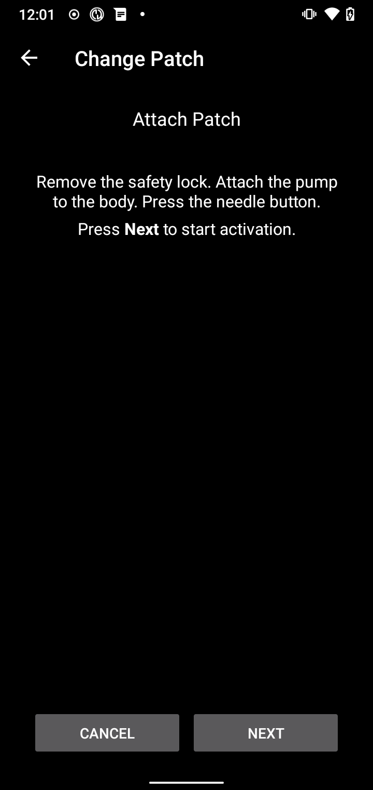

(medtrum-nano-300u)=
# Medtrum Nano 200U / 300U

Αυτές οι οδηγίες αφορούν τη διαμόρφωση της αντλίας ινσουλίνης Medtrum.

```{contents} Table of contents
:depth: 1
:local: true
```

## Δυνατότητες της αντλίας με το AAPS
* Υποστηρίζονται όλες οι λειτουργίες του κυκλώματος (SMB, TBR κ.λπ.)
* Αυτόματος χειρισμός θερινής ώρας (DST) και ζώνης ώρας
* Το εκτεταμένο bolus δεν υποστηρίζεται από το πρόγραμμα οδήγησης του AAPS

## Απαιτήσεις υλικού και λογισμικού
* **Συμβατές βάσεις αντλίας (pumpbase) και patch δεξαμενής Medtrum**
    - Υποστηρίζονται προς το παρόν:
        - Medtrum TouchCare Nano 200U με κωδικούς βάσης αντλίας: **MD0201** και **MD8201**.
        - Medtrum TouchCare 300U με κωδικό βάσης αντλίας: **MD8301**.
        - Αν έχετε ένα μοντέλο που δεν υποστηρίζεται και θέλετε να δωρίσετε υλικό ή να βοηθήσετε με δοκιμές, επικοινωνήστε μαζί μας στο discord [εδώ](https://discordapp.com/channels/629952586895851530/1076120802476441641).
* **Το AAPS δημιουργημένο και εγκατεστημένο** με τις οδηγίες [Δημιουργία του APK](../SettingUpAaps/BuildingAaps.md).
* **Συμβατό τηλέφωνο Android** με σύνδεση BLE Bluetooth
    - Δείτε τις [Σημειώσεις έκδοσης](../Maintenance/ReleaseNotes.md) του AAPS

## Πριν ξεκινήσετε

**ΠΡΩΤΑ Η ΑΣΦΑΛΕΙΑ** Μην κάνετε αυτή τη διαδικασία σε περιβάλλον όπου δεν μπορείτε να διορθώσετε ένα λάθος (πρέπει να έχετε μαζί σας επιπλέον patch, ινσουλίνη και συσκευές ελέγχου της αντλίας).

**Το PDM και η εφαρμογή Medtrum δεν λειτουργούν με patch που ενεργοποιήθηκε από το AAPS.** Μέχρι τώρα μπορεί να χρησιμοποιούσατε το PDM ή την εφαρμογή Medtrum για να στέλνετε εντολές στην αντλία σας. Για λόγους ασφαλείας, μπορείτε να χρησιμοποιείτε το ενεργοποιημένο patch μόνο με τη συσκευή ή την εφαρμογή που το ενεργοποίησε.

*Αυτό ΔΕΝ σημαίνει ότι πρέπει να πετάξετε το PDM σας. Σας συνιστούμε να το φυλάτε σε ασφαλές μέρος ως εφεδρικό για έκτακτες ανάγκες, για παράδειγμα αν χάσετε το τηλέφωνό σας ή αν το AAPS δεν λειτουργεί σωστά.*

**Η αντλία σας δεν σταματά να χορηγεί ινσουλίνη όταν δεν είναι συνδεδεμένη με το AAPS** Οι προεπιλεγμένοι βασικοί ρυθμοί προγραμματίζονται στην αντλία όπως ορίζονται στο τρέχον ενεργό προφίλ. Όσο το AAPS λειτουργεί, στέλνει εντολές προσωρινού βασικού ρυθμού που διαρκούν το πολύ 120 λεπτά. Αν για κάποιο λόγο η αντλία δεν λάβει νέες εντολές (για παράδειγμα επειδή χάθηκε η επικοινωνία λόγω της απόστασης αντλίας - τηλεφώνου), η αντλία επιστρέφει στον προεπιλεγμένο βασικό ρυθμό που είναι προγραμματισμένος σε αυτήν, μόλις τελειώσει ο προσωρινός βασικός ρυθμός.

**Το προφίλ του AAPS δεν υποστηρίζει βασικούς ρυθμούς σε διαστήματα 30 λεπτών** Αν είστε νέοι στο AAPS και ρυθμίζετε το προφίλ βασικού ρυθμού για πρώτη φορά, να ξέρετε ότι βασικοί ρυθμοί που ξεκινούν στη μισή ώρα δεν υποστηρίζονται. Πρέπει να προσαρμόσετε το προφίλ βασικού ρυθμού ώστε να ξεκινά σε ακέραιη ώρα. Για παράδειγμα, αν έχετε βασικό ρυθμό 1,1 μονάδων που ξεκινά στις 09:30 και διαρκεί 2 ώρες, μέχρι τις 11:30, αυτό δεν θα λειτουργήσει. Θα πρέπει να αλλάξετε αυτόν τον βασικό ρυθμό των 1,1 μονάδων σε χρονικό διάστημα 9:00-11:00 ή 10:00-12:00. Παρόλο που το υλικό της αντλίας Medtrum υποστηρίζει βήματα 30 λεπτών στο προφίλ βασικού ρυθμού, το AAPS προς το παρόν δεν μπορεί να τα λάβει υπόψη στους αλγορίθμους του.

**Βασικοί ρυθμοί προφίλ 0U/h ΔΕΝ υποστηρίζονται στο AAPS** Αν και η αντλία Medtrum υποστηρίζει μηδενικό βασικό ρυθμό, το AAPS χρησιμοποιεί πολλαπλάσια του βασικού ρυθμού του προφίλ για να αποφασίσει την αυτόματη θεραπεία, γι' αυτό δεν μπορεί να λειτουργήσει με μηδενικό βασικό ρυθμό. Ο ελάχιστος βασικός ρυθμός προφίλ είναι 0,05 U/h.

Προσωρινό μηδενικό βασικό ρυθμό μπορείτε να έχετε με τη λειτουργία «Αποσύνδεση αντλίας» ή με συνδυασμό Απενεργοποίησης κυκλώματος/Προσωρινού βασικού ρυθμού ή Αναστολής κυκλώματος/Προσωρινού βασικού ρυθμού.

## Ρύθμιση

```{caution}
Όταν ενεργοποιείτε ένα patch με το **AAPS**, **ΠΡΕΠΕΙ** να κλείσετε κάθε άλλη συσκευή που μπορεί να επικοινωνεί με τη βάση της αντλίας Medtrum, για παράδειγμα ένα ενεργό PDM ή την εφαρμογή Medtrum.
```

### Βήμα 1: Επιλέξτε την αντλία Medtrum

#### Επιλογή 1: Νέες εγκαταστάσεις

Αν εγκαθιστάτε το **AAPS** για πρώτη φορά, ο **Οδηγός εγκατάστασης** σας καθοδηγεί στη ρύθμιση. Επιλέξτε **Medtrum** όταν φτάσετε στο βήμα **Αντλία**.

Αν δεν είστε σίγουροι, μπορείτε επίσης να επιλέξετε **Εικονική Αντλία** και να επιλέξετε **Medtrum** αργότερα, αφού ρυθμίσετε το **AAPS** (δείτε την επιλογή 2).


#### Επιλογή 2: Η οθόνη Διαμόρφωση

Σε μια υπάρχουσα εγκατάσταση μπορείτε να επιλέξετε την αντλία **Medtrum** στο [Διαμόρφωση > Αντλία](#Config-Builder-pump):

Ανοίξτε το **μενού** (☰) πάνω αριστερά, πατήστε **Διαμόρφωση** > **Αντλία** και επιλέξτε την κάρτα **Medtrum**. Μόνο μία αντλία μπορεί να είναι ενεργή κάθε φορά.


Μόλις το επιλέξετε, η κάρτα **Medtrum** δείχνει δύο κουμπιά, **Ρυθμίσεις** και **Άνοιγμα πρόσθετου**:


Το **Άνοιγμα πρόσθετου** (ή **Διαχείριση → Αντλία**) ανοίγει την οθόνη της αντλίας Medtrum. Τη χρησιμοποιείτε για να αλλάζετε patch και να βλέπετε την κατάσταση της αντλίας. Πριν ενεργοποιηθεί ένα patch, φαίνεται έτσι:


(medtrum-step-2)=
### Βήμα 2: Αλλάξτε τις ρυθμίσεις Medtrum

Πατήστε **Ρυθμίσεις** στην κάρτα **Medtrum** στο **Διαμόρφωση** > **Αντλία**. Μπορείτε επίσης να πατήσετε το εικονίδιο με το γρανάζι πάνω δεξιά στην οθόνη της αντλίας Medtrum. Ανοίγουν οι **Ρυθμίσεις αντλίας Medtrum**:


```{note}
Δεν υπάρχει πια ρύθμιση **Σειριακός αριθμός**. Το **AAPS** βρίσκει τη βάση της αντλίας σας με σάρωση Bluetooth την πρώτη φορά που ενεργοποιείτε ένα patch (δείτε το [Βήμα 3](#medtrum-activate-patch)) και θυμάται τον σειριακό της αριθμό. Για να χρησιμοποιήσετε άλλη βάση αντλίας, δείτε την [Κατάργηση σύζευξης](#medtrum-unpair).
```

#### Ρυθμίσεις συναγερμού

***Προεπιλογή: Μπιπ.***

Αυτή η ρύθμιση αλλάζει τον τρόπο που η αντλία σας ειδοποιεί όταν υπάρχει προειδοποίηση ή σφάλμα.

- **Μπιπ**: το patch κάνει μπιπ σε συναγερμούς και προειδοποιήσεις.
- **Σίγαση**: το patch δεν σας ειδοποιεί σε συναγερμούς και προειδοποιήσεις.

Σημείωση: Σε αθόρυβη λειτουργία το **AAPS** παίζει ακόμα τον ήχο του συναγερμού, ανάλογα με τις ρυθμίσεις έντασης του τηλεφώνου σας. Αν δεν απαντήσετε στον συναγερμό, στο τέλος το patch θα κάνει μπιπ.

#### Ειδοποίηση για προειδοποίηση αντλίας

***Προεπιλογή: Ενεργό.***

Αυτή η ρύθμιση αλλάζει τον τρόπο που το **AAPS** δείχνει ειδοποιήσεις για μη κρίσιμες προειδοποιήσεις της αντλίας. Όταν είναι ενεργή, εμφανίζεται ειδοποίηση στο τηλέφωνο όταν υπάρχει προειδοποίηση της αντλίας, όπως:
- Χαμηλή μπαταρία
- Χαμηλή δεξαμενή (20 μονάδες)
- Το patch λήγει σύντομα

Σας συνιστούμε να την αφήσετε ενεργή όταν οι συναγερμοί της αντλίας είναι ρυθμισμένοι σε **Σίγαση**. Και στις δύο περιπτώσεις αυτές οι προειδοποιήσεις φαίνονται επίσης στην οθόνη της αντλίας Medtrum, στο [Ενεργοί συναγερμοί](#medtrum-active-alarms).

(medtrum-patch-expiration)=
#### Λήξη Patch

***Προεπιλογή: Ενεργό.***

Αυτή η ρύθμιση αλλάζει τη συμπεριφορά του patch. Όταν είναι ενεργή, το patch λήγει μετά από 3 ημέρες και δίνει ηχητική προειδοποίηση, αν έχετε ενεργοποιημένο τον ήχο. Μετά από 3 ημέρες και 8 ώρες το patch σταματά να λειτουργεί.

Αν αυτή η ρύθμιση είναι ανενεργή, το patch δεν σας προειδοποιεί πριν σταματήσει. Με πρόσφατο firmware της βάσης αντλίας, ένα patch λειτουργεί το πολύ 5 ημέρες.

#### Προειδοποίηση λήξης αντλίας [ώρες]

***Προεπιλογή: 72 ώρες.***

Αυτή η ρύθμιση αλλάζει την ώρα της προειδοποίησης λήξης. Όταν η [Λήξη Patch](#medtrum-patch-expiration) είναι ενεργή, το **AAPS** δείχνει μια ειδοποίηση τόσες ώρες μετά την ενεργοποίηση.

#### Ωριαία μέγιστη ινσουλίνη [μονάδες]

***Προεπιλογή: 25U.***

Αυτή η ρύθμιση αλλάζει τη μέγιστη ποσότητα ινσουλίνης που μπορεί να χορηγηθεί σε μία ώρα. Αν ξεπεραστεί αυτό το όριο, το patch μπαίνει σε αναστολή και δίνει συναγερμό. Μπορείτε να κάνετε επαναφορά του συναγερμού με το κουμπί **Επαναφορά συναγερμών** στην οθόνη της αντλίας, δείτε την [Επαναφορά συναγερμών](#nano-reset-alarms).

Ορίστε μια λογική τιμή για τις ανάγκες σας σε ινσουλίνη.

#### Ημερήσια μέγιστη ινσουλίνη [μονάδες]

***Προεπιλογή: 80U.***

Αυτή η ρύθμιση αλλάζει τη μέγιστη ποσότητα ινσουλίνης που μπορεί να χορηγηθεί σε μία ημέρα. Αν ξεπεραστεί αυτό το όριο, το patch μπαίνει σε αναστολή και δίνει συναγερμό. Μπορείτε να κάνετε επαναφορά του συναγερμού με το κουμπί **Επαναφορά συναγερμών** στην οθόνη της αντλίας, δείτε την [Επαναφορά συναγερμών](#nano-reset-alarms).

Ορίστε μια λογική τιμή για τις ανάγκες σας σε ινσουλίνη.

#### Σάρωση σε περίπτωση σφάλματος σύνδεσης

***Προεπιλογή: Ανενεργό.***

Βρίσκεται στις **Ρυθμίσεις για Προχωρημένους**.

Ενεργοποιήστε το μόνο αν έχετε προβλήματα σύνδεσης. Όταν είναι ενεργό, το πρόγραμμα οδήγησης ψάχνει ξανά την αντλία πριν προσπαθήσει να συνδεθεί ξανά με αυτήν. Βεβαιωθείτε ότι η άδεια Τοποθεσίας για το **AAPS** είναι ρυθμισμένη σε «Να επιτρέπεται πάντα».

### Βήμα 2β: Ρυθμίσεις ειδοποιήσεων του AAPS

Αυτές οι ρυθμίσεις δεν ανήκουν στο πρόγραμμα οδήγησης Medtrum. Ανοίξτε τις από το εικονίδιο **Ρυθμίσεις** (γρανάζι) πάνω δεξιά στην κύρια οθόνη. Δείτε τις [Ρυθμίσεις](../SettingUpAaps/Preferences.md) για περισσότερα.

#### BT Watchdog

Ανοίξτε **Ρυθμίσεις** > **Αντλία**:


Το **BT Watchdog** κλείνει το Bluetooth του τηλεφώνου για ένα δευτερόλεπτο, αν το **AAPS** δεν μπορεί να συνδεθεί με την αντλία. Αυτό μπορεί να βοηθήσει σε κάποια τηλέφωνα όπου το Bluetooth «κολλάει».

Ενεργοποιήστε αυτή τη ρύθμιση αν έχετε συχνά προβλήματα σύνδεσης με την αντλία σας.

#### Τοπικές ειδοποιήσεις

Ανοίξτε **Ρυθμίσεις** > **Τοπικές ειδοποιήσεις**:


##### Ειδοποίηση αν η αντλία δεν είναι προσβάσιμη

***Προεπιλογή: Ενεργό.***

Αυτή η ρύθμιση είναι πάντα ενεργή όταν είναι ενεργό το πρόγραμμα οδήγησης Medtrum. Σας ειδοποιεί όταν η αντλία δεν είναι προσβάσιμη. Αυτό μπορεί να συμβεί όταν η αντλία είναι εκτός εμβέλειας ή όταν δεν απαντά λόγω χαλασμένου patch ή βάσης αντλίας, για παράδειγμα όταν μπει νερό ανάμεσα στη βάση της αντλίας και στο patch.

Για λόγους ασφαλείας αυτή η ρύθμιση δεν μπορεί να απενεργοποιηθεί.

##### Όριο μη προσβάσιμης αντλίας

***Προεπιλογή: 30 λεπτά.***

Αυτή η ρύθμιση αλλάζει πόσο χρόνο περιμένει το **AAPS** πριν σας ειδοποιήσει ότι η αντλία δεν είναι προσβάσιμη.

Μπορείτε να αλλάξετε αυτή τη ρύθμιση όταν χρησιμοποιείτε την αντλία Medtrum, αλλά για λόγους ασφαλείας σας συνιστούμε να την αφήσετε στα 30 λεπτά.

(medtrum-activate-patch)=
### Βήμα 3: Ενεργοποίηση του patch

**Πριν συνεχίσετε:**
- Έχετε έτοιμα τη βάση της αντλίας Medtrum και ένα νέο patch δεξαμενής.
- Κλείστε τις άλλες συσκευές που μπορούν να επικοινωνούν με την αντλία Medtrum (PDM και εφαρμογή Medtrum).
- Ιδανικά, βεβαιωθείτε ότι το **AAPS** είναι ρυθμισμένο και ότι έχει [ενεργοποιηθεί ένα προφίλ](../DailyLifeWithAaps/ProfileSwitch-ProfilePercentage.md). Αν δεν υπάρχει ενεργό προφίλ, η ενεργοποίηση ξεκινά με το βήμα **Απαιτείται προφίλ**, όπου επιλέγετε το προφίλ που θα ενεργοποιηθεί.

#### Ξεκινήστε την ενεργοποίηση

Ανοίξτε την [οθόνη της αντλίας Medtrum](#nano-overview) (**Διαχείριση → Αντλία**) και πατήστε **Αλλαγή Patch**. Αν έχετε ρυθμίσει [προστασία ρυθμίσεων](#Preferences-protection), πρέπει πρώτα να γράψετε τον κωδικό πρόσβασης ή το PIN σας.

Αν υπάρχει ήδη ενεργό patch, θα σας ζητηθεί να το απενεργοποιήσετε πρώτα, δείτε την [Απενεργοποίηση του patch](#nano-deactivate-patch).

Η ενεργοποίηση είναι ένας οδηγός βήμα προς βήμα. Ακολουθήστε τις οδηγίες για να γεμίσετε και να ενεργοποιήσετε ένα νέο patch. Πατήστε **Ακύρωση** σε οποιοδήποτε βήμα για να σταματήσετε.

```{important}
Βάλτε το patch στο σώμα σας και εισάγετε τον καθετήρα μόνο όταν σας το πει ο οδηγός (αφού ολοκληρωθεί η πλήρωση).
```

Τα πρώτα βήματα που βλέπετε εξαρτώνται από τη ρύθμισή σας:

1. **Απαιτείται προφίλ**: μόνο αν δεν υπάρχει ενεργό προφίλ. Επιλέξτε το προφίλ που θα εφαρμοστεί και μετά συνεχίστε.
2. **Εύρεση αντλίας**: μόνο την πρώτη φορά ή αφού χρησιμοποιήσετε την [Κατάργηση σύζευξης](#medtrum-unpair). Συνδέστε τη βάση της αντλίας σε ένα καινούργιο patch για να ενεργοποιηθεί. Το **AAPS** ψάχνει για κοντινές βάσεις αντλίας Medtrum (τα ονόματά τους ξεκινούν με `MT`). Πατήστε τη δική σας στη λίστα. Το **AAPS** αποθηκεύει τον σειριακό της αριθμό και μετά πηγαίνει κατευθείαν στο γέμισμα του patch.

   

3. **Ενεργοποίηση Patch**: μόνο όταν το **AAPS** ξέρει ήδη τη βάση της αντλίας σας. Η οθόνη λέει «Δεν υπάρχει ενεργό patch. Πατήστε **Επόμενο** για να ξεκινήσετε τη διαδικασία ενεργοποίησης.» Βεβαιωθείτε ότι η βάση της αντλίας **δεν** είναι ακόμα συνδεδεμένη με το patch και μετά πατήστε **Επόμενο**.


#### Σύνδεση και γέμισμα του patch


Συνδέστε τη βάση της αντλίας με το patch, αφαιρέστε τον αέρα που έχει μείνει και γεμίστε το patch με ινσουλίνη. Για την ενεργοποίηση χρειάζονται τουλάχιστον 70 μονάδες. Η οθόνη δείχνει τη στάθμη της δεξαμενής. Μην βάλετε ακόμα το patch στο σώμα σας.

Όταν το patch ανιχνευθεί και γεμίσει, εμφανίζεται το κουμπί **Επόμενο**. Πατήστε το.

#### Επιλογή ινσουλίνης

Αυτό το βήμα εμφανίζεται μόνο αν έχετε ρυθμίσει περισσότερες από μία ινσουλίνες στο **AAPS**. Επιλέξτε την ινσουλίνη με την οποία γεμίζετε το patch. Το **AAPS** κάνει αλλαγή προφίλ με αυτή την ινσουλίνη μετά την ενεργοποίηση.

#### Πλήρωση του patch


**Μην** αφαιρέσετε το κλείδωμα ασφάλειας. Μισοπατήστε το κουμπί της βελόνας στο patch και μετά πατήστε **Επόμενο** για να αρχίσει η πλήρωση.


Περιμένετε να ολοκληρωθεί η πλήρωση.


Όταν ολοκληρωθεί η πλήρωση, πατήστε **Επόμενο** για να συνεχίσετε.

#### Εναλλαγή σημείων

Αυτό το βήμα εμφανίζεται μόνο αν διαχειρίζεστε τα σημεία της αντλίας με την [Εναλλαγή σημείων](#Aapsscreens-site-rotation) (ρύθμιση **Διαχείριση εναλλαγής σημείων αντλίας**). Επιλέξτε σε ποιο σημείο του σώματός σας βάζετε το patch ή παραλείψτε αυτό το βήμα.

#### Τοποθέτηση του patch



Καθαρίστε το δέρμα και αφαιρέστε τα αυτοκόλλητα. Αφαιρέστε το κλείδωμα ασφάλειας, βάλτε το patch στο σώμα σας και πατήστε το κουμπί της βελόνας για να εισαχθεί ο καθετήρας.

Πατήστε **Επόμενο** για να ενεργοποιηθεί το patch.

#### Ενεργοποίηση του patch


Το **AAPS** ενεργοποιεί την αντλία και ορίζει τον αρχικό βασικό ρυθμό. Παρακαλώ περιμένετε. Όταν ολοκληρωθεί η ενεργοποίηση, εμφανίζεται η παρακάτω οθόνη:


```{admonition} Older screenshot
:class: note
Εκτός από την **Εύρεση αντλίας**, οι εικόνες της ενεργοποίησης παραπάνω είναι από παλαιότερη έκδοση του **AAPS** και μπορεί να φαίνονται διαφορετικά στο **AAPS** 4.
```

Δείχνει πόσες μονάδες έχουν μείνει στο patch. Πατήστε **OK** για να γυρίσετε στην οθόνη της αντλίας.

```{tip}
Μετά από μια νέα ενεργοποίηση, [κάντε εξαγωγή των ρυθμίσεών σας](../Maintenance/ExportImportSettings.md). Έτσι μπορείτε αργότερα να ανακτήσετε αυτή τη συνεδρία του patch, για παράδειγμα σε ένα νέο τηλέφωνο.
```

(nano-deactivate-patch)=

### Απενεργοποίηση του patch

Για να απενεργοποιήσετε το ενεργό patch, ανοίξτε την [οθόνη της αντλίας Medtrum](#nano-overview) (**Διαχείριση → Αντλία**) και πατήστε **Αλλαγή Patch**.


Θα σας ζητηθεί να επιβεβαιώσετε ότι θέλετε να απενεργοποιήσετε το τρέχον patch. **Αυτό δεν μπορεί να αναιρεθεί.** Πατήστε **Επόμενο** για απενεργοποίηση ή **Ακύρωση** για να γυρίσετε στην οθόνη της αντλίας.


Αν το **AAPS** δεν μπορεί να απενεργοποιήσει το patch (για παράδειγμα επειδή η βάση της αντλίας έχει ήδη αφαιρεθεί από το patch), πατήστε **Απόρριψη** για να ξεχάσει το AAPS την τρέχουσα συνεδρία του patch. Μετά μπορείτε να ενεργοποιήσετε ένα νέο patch.


Όταν ολοκληρωθεί η απενεργοποίηση, τραβήξτε πίσω τη βελόνα και αφαιρέστε το patch από το σώμα σας. Αφαιρέστε τη βάση της αντλίας και πετάξτε το χρησιμοποιημένο patch. Πατήστε **OK** για να γυρίσετε στην οθόνη της αντλίας ή **Επόμενο** για να ξεκινήσετε την ενεργοποίηση ενός νέου patch.

(nano-resume-interrupted-activation)=

### Συνέχιση μιας ενεργοποίησης που διακόπηκε

Αν μια ενεργοποίηση patch διακοπεί, για παράδειγμα επειδή τελείωσε η μπαταρία του τηλεφώνου, μπορείτε να τη συνεχίσετε. Ανοίξτε την [οθόνη της αντλίας Medtrum](#nano-overview) (**Διαχείριση → Αντλία**) και πατήστε **Αλλαγή Patch**.


Πατήστε **Επόμενο** για να συνεχίσετε την ενεργοποίηση. Πατήστε **Απόρριψη** για να γίνει επαναφορά της κατάστασης ενεργοποίησης, ώστε να μπορείτε να ενεργοποιήσετε ένα νέο patch.


```{admonition} Older screenshot
:class: note
Οι εικόνες στις ενότητες **Απενεργοποίηση του patch** και **Συνέχιση μιας ενεργοποίησης που διακόπηκε** είναι από παλαιότερη έκδοση του **AAPS** και μπορεί να φαίνονται διαφορετικά στο **AAPS** 4.
```

Το πρόγραμμα οδήγησης διαβάζει την κατάσταση ενεργοποίησης από την αντλία. Αν αυτό πετύχει, ο οδηγός συνεχίζει από το βήμα όπου σταμάτησε.

(nano-overview)=

## Οθόνη της αντλίας

Η οθόνη της αντλίας Medtrum (**Διαχείριση → Αντλία**) δείχνει την τρέχουσα κατάσταση του patch Medtrum. Έχει επίσης κουμπιά για αλλαγή του patch, επαναφορά συναγερμών και ανανέωση της κατάστασης. Μια λωρίδα στο πάνω μέρος δείχνει σημαντικές καταστάσεις, για παράδειγμα **Μη ενεργοποιημένο Patch** ή **Η αντλία είναι σε αναστολή**.


Η οθόνη μπορεί να δείχνει αυτές τις γραμμές. Κάποιες γραμμές εμφανίζονται μόνο όταν έχουν τιμή.

- **Τελευταία σύνδεση**: πριν από πόσο χρόνο το **AAPS** συνδέθηκε τελευταία φορά με την αντλία.
- **Τελευταίο Bolus**: το τελευταίο bolus που χορηγήθηκε.
- **Μπαταρία**: η τρέχουσα τάση της μπαταρίας του patch.
- **Δεξαμενή**: η τρέχουσα στάθμη της δεξαμενής.
- **Σειριακός αριθμός**: ο σειριακός αριθμός της βάσης της αντλίας σας.
- **Κατάσταση Αντλίας**: η τρέχουσα κατάσταση της αντλίας. Για παράδειγμα **Ενεργό** (το patch είναι ενεργοποιημένο και λειτουργεί κανονικά) ή **Σταματημένο** (το patch δεν είναι ενεργοποιημένο).
- **Βάση Βασικού Ρυθμού**: ο βασικός ρυθμός του προφίλ σας που τρέχει τώρα.
- **Προσωρινός Ρυθμός**: ο προσωρινός βασικός ρυθμός, αν τρέχει κάποιος.
- **Ενεργό bolus**: το bolus που χορηγείται αυτή τη στιγμή.
- **Ενεργοί συναγερμοί**: δείτε [παρακάτω](#medtrum-active-alarms).
- **Τύπος Αντλίας**: το μοντέλο της βάσης της αντλίας σας.
- **Έκδοση FW**: η έκδοση firmware της βάσης της αντλίας.
- **Patch no**: ο αύξων αριθμός του ενεργοποιημένου patch. Αυξάνεται κατά ένα κάθε φορά που ενεργοποιείτε ένα νέο patch.
- **Ενεργοποίηση**: η ημερομηνία και η ώρα που ενεργοποιήθηκε το patch και πόσος χρόνος πέρασε από τότε.
- **Το Patch λήγει**: η ημερομηνία και η ώρα που λήγει το patch. Δείχνει **Μη ενεργοποιημένο** αν η [Λήξη Patch](#medtrum-patch-expiration) είναι ανενεργή.

(medtrum-active-alarms)=
### Ενεργοί συναγερμοί

Αυτή η γραμμή δείχνει τους συναγερμούς που είναι ενεργοί τώρα, για παράδειγμα χαμηλή δεξαμενή ή patch που λήγει.

### Ανανέωση

Αυτό το κουμπί ανανεώνει την κατάσταση του patch. Είναι διαθέσιμο μόνο όταν υπάρχει ενεργό patch και το **AAPS** δεν είναι συνδεδεμένο με την αντλία εκείνη τη στιγμή.

### Αλλαγή Patch

Αυτό το κουμπί ξεκινά τον οδηγό για την αλλαγή του patch. Δείτε την [Ενεργοποίηση του patch](#medtrum-activate-patch) για περισσότερες πληροφορίες.

(medtrum-unpair)=
### Κατάργηση σύζευξης

Αυτό το κουμπί εμφανίζεται μόνο όταν το **AAPS** ξέρει μια βάση αντλίας. Διαγράφει τον αποθηκευμένο σειριακό αριθμό της βάσης αντλίας και αποσυνδέεται. Την επόμενη φορά που θα ενεργοποιήσετε ένα patch, το **AAPS** ψάχνει ξανά για βάση αντλίας (το βήμα **Εύρεση αντλίας**). Χρησιμοποιήστε το αν αλλάξετε σε άλλη βάση αντλίας. Κάντε το μόνο όταν δεν υπάρχει ενεργό patch.

(nano-reset-alarms)=

### Επαναφορά συναγερμών

Το κουμπί **Επαναφορά συναγερμών** εμφανίζεται στην οθόνη της αντλίας μόνο όταν το patch έχει μπει μόνο του σε αναστολή, για παράδειγμα μετά από συναγερμό μέγιστης ημερήσιας ινσουλίνης. Πατήστε το για να γίνει επαναφορά των συναγερμών και να συνεχιστεί η χορήγηση ινσουλίνης.


```{admonition} Older screenshot
:class: note
Η παραπάνω εικόνα είναι από παλαιότερη έκδοση του **AAPS**. Στο **AAPS** 4 η οθόνη της αντλίας φαίνεται διαφορετική, αλλά το κουμπί **Επαναφορά συναγερμών** λειτουργεί με τον ίδιο τρόπο.
```

## Αλλαγή τηλεφώνου, εξαγωγή/εισαγωγή ρυθμίσεων

Όταν αλλάζετε σε νέο τηλέφωνο, κάντε τα εξής:
* Κάντε [Εξαγωγή ρυθμίσεων](../Maintenance/ExportImportSettings.md) στο παλιό σας τηλέφωνο.
* Μεταφέρετε το αρχείο ρυθμίσεων από το παλιό τηλέφωνο στο νέο και κάντε εισαγωγή του στο **AAPS**. Επιλέξτε **Αντικατάσταση και των ρυθμίσεων αντλίας** στην οθόνη εισαγωγής, αλλιώς η συνεδρία του patch δεν μεταφέρεται στο νέο τηλέφωνο.

Το αρχείο ρυθμίσεων που εισάγετε πρέπει να είναι από τη συνεδρία του patch που χρησιμοποιείτε τώρα, αλλιώς το patch δεν θα συνδεθεί (δείτε τις [Αντλίες χωρίς σωληνάκι](#ExportImportSettings-tubeless-pumps)).

Μετά από εισαγωγή ρυθμίσεων, το πρόγραμμα οδήγησης συγχρονίζει το ιστορικό με την αντλία. Αυτό μπορεί να πάρει λίγο χρόνο, ανάλογα με το πόσο παλιό είναι το αρχείο ρυθμίσεων. Η πρόοδος («Συγχρονισμός εγγραφών, απομένουν ...») φαίνεται στην κύρια οθόνη:


(medtrum-nano-troubleshooting)=

## Αντιμετώπιση προβλημάτων

### Προβλήματα σύνδεσης

Αν έχετε λήξεις χρόνου σύνδεσης ή άλλα προβλήματα σύνδεσης:
- Στις ρυθμίσεις εφαρμογών του Android για το **AAPS**, ορίστε την άδεια Τοποθεσίας σε «Να επιτρέπεται πάντα».
- Δοκιμάστε να ενεργοποιήσετε το **Σάρωση σε περίπτωση σφάλματος σύνδεσης** (ρυθμίσεις Medtrum > **Ρυθμίσεις για Προχωρημένους**) και το **BT Watchdog** (**Ρυθμίσεις** > **Αντλία**), δείτε το [Βήμα 2](#medtrum-step-2).

### Προβλήματα Bluetooth
Για γνωστά προβλήματα με συνδέσεις Bluetooth, διακοπές σύνδεσης με αντλίες/Pod ή προβλήματα ενεργοποίησης και σύνδεσης, δείτε τη σελίδα [Προβλήματα σχετικά με το Bluetooth](../GettingHelp/BluetoothTroubleshooting.md)

### Η ενεργοποίηση διακόπηκε

Αν η ενεργοποίηση διακοπεί, για παράδειγμα επειδή άδειασε η μπαταρία του τηλεφώνου ή επειδή κόλλησε το τηλέφωνο, μπορείτε να τη συνεχίσετε. Πατήστε **Αλλαγή Patch** στην οθόνη της αντλίας και ακολουθήστε τα βήματα στη [Συνέχιση μιας ενεργοποίησης που διακόπηκε](#nano-resume-interrupted-activation).

### Πρόληψη σφαλμάτων του patch

Το patch μπορεί να δώσει διάφορα σφάλματα. Για να αποφύγετε συχνά σφάλματα:
- Βεβαιωθείτε ότι η βάση της αντλίας κάθεται σωστά στο patch και ότι δεν φαίνονται κενά.
- Όταν γεμίζετε το patch, μην πιέζετε υπερβολικά το έμβολο. Μην προσπαθήσετε να γεμίσετε το patch πάνω από το μέγιστο που ισχύει για το μοντέλο σας.

## Πού θα βρείτε βοήθεια

Όλη η ανάπτυξη του προγράμματος οδήγησης Medtrum γίνεται από την κοινότητα σε **εθελοντική** βάση. Σας ζητάμε να το θυμάστε αυτό και να ακολουθείτε τις παρακάτω οδηγίες πριν ζητήσετε βοήθεια:

-  **Επίπεδο 0:** Διαβάστε το σχετικό τμήμα αυτής της τεκμηρίωσης, για να καταλάβετε πώς πρέπει να λειτουργεί η λειτουργία με την οποία έχετε πρόβλημα.
-  **Επίπεδο 1:** Αν έχετε ακόμα προβλήματα που δεν μπορείτε να λύσετε με αυτό το κείμενο, πηγαίνετε στο κανάλι *#Medtrum* στο **Discord** με [αυτόν τον σύνδεσμο πρόσκλησης](https://discord.gg/4fQUWHZ4Mw).
-  **Level 2:** Search existing issues to see if your issue has already been reported at [Issues](https://github.com/nightscout/AAPS/issues). If it exists, please confirm/comment/add information on your problem. Αν όχι, δημιουργήστε ένα [νέο θέμα (issue)](https://github.com/nightscout/AndroidAPS/issues) και επισυνάψτε [τα αρχεία καταγραφής σας](../GettingHelp/AccessingLogFiles.md).
-  **Κάντε υπομονή - τα περισσότερα μέλη της κοινότητάς μας είναι καλοπροαίρετοι εθελοντές, και η λύση των προβλημάτων συχνά χρειάζεται χρόνο και υπομονή τόσο από τους χρήστες όσο και από τους προγραμματιστές.**