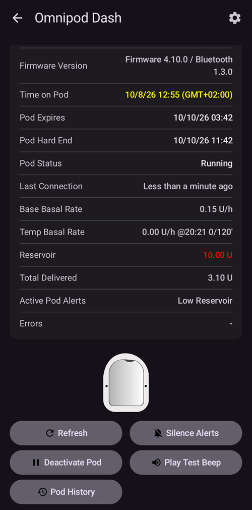

# Omnipod DASH

Αυτές οι οδηγίες είναι για τη ρύθμιση της αντλίας γενιάς **Omnipod DASH** **(ΟΧΙ Omnipod Eros)**. Ο οδηγός DASH είναι ένας δοκιμασμένος τρόπος για κλειστό κύκλωμα με το Omnipod.

```{contents} Table of contents
:depth: 1
:local: true
```

## Προδιαγραφές Omnipod DASH

Βασικά χαρακτηριστικά του **Omnipod DASH** («DASH»):

- Τα Pod DASH αναγνωρίζονται από το **μπλε καπάκι της βελόνας** (το παλαιότερο Pod EROS έχει διάφανο καπάκι βελόνας). Κατά τα άλλα, τα Pod έχουν ακριβώς τις ίδιες φυσικές διαστάσεις.
- Το DASH δεν χρειάζεται συσκευή γέφυρας BLE (ΔΕΝ χρειάζεται RileyLink, OrangeLink ή EmaLink).
- Η σύνδεση Bluetooth του DASH χρησιμοποιείται μόνο όταν στέλνεται μια εντολή (π.χ. ένα bolus) και αποσυνδέεται αμέσως μετά την εντολή.
- Το **AAPS** θα περιμένει μέχρι το Pod να είναι προσβάσιμο για να στείλει εντολές.
- Κατά την ενεργοποίηση του Pod, το **AAPS** θα βρει ένα νέο Pod DASH και θα συνδεθεί με αυτό.
- Αναμενόμενη εμβέλεια από το τηλέφωνο: 5-10 μέτρα (μπορεί να διαφέρει).

(omnipod-dash-constraints)=

## Γνωστοί περιορισμοί/προβλήματα του Omnipod DASH στο AAPS
- Η γενική συμβουλή είναι να χρησιμοποιείτε το **AAPS** σε Android 14 ή 16. Στο Android 15 η κοινότητα έχει αναφέρει πολλά [προβλήματα](https://github.com/nightscout/AndroidAPS/issues/3471). Αν όμως χρησιμοποιείτε Android 15, πιθανότατα θα χρειαστεί να ενεργοποιήσετε το **Bluetooth bonding** (στο τμήμα **Ρυθμίσεις για Προχωρημένους** των [ρυθμίσεων Dash](#omnipod-dash-advanced-settings)) για να ενεργοποιείτε και να χρησιμοποιείτε σωστά τα Pod. Δείτε το [Αντιμετώπιση προβλημάτων](../GettingHelp/GeneralTroubleshooting.md) για περισσότερες πληροφορίες για τις ρυθμίσεις bonding.
- Οι αλλαγές θερινής ώρας και ζώνης ώρας δεν εφαρμόζονται αυτόματα. Μετά από αλλαγή ώρας πρέπει να ενημερώσετε το Pod χειροκίνητα: πατήστε **Ανανέωση** στην οθόνη αντλίας DASH και μετά πατήστε **Ρύθμιση ώρας** (εμφανίζεται όταν οι ζώνες ώρας του Pod και του τηλεφώνου διαφέρουν) ή κάντε μια **Αλλαγή Προφίλ** (δείτε [Αλλαγή ζώνης ώρας για το Omnipod Dash](#timezone-traveling-with-pumps)).
- Το Dash υποστηρίζει βασικό ρυθμό μόνο σε βήματα των 0,05 U/h. Αν προσπαθήσετε να ορίσετε βασικό ρυθμό με βήματα 0,01 στο **προφίλ του AAPS**, το AAPS δεν θα σας προειδοποιήσει, παρόλο που το Pod θα στρογγυλέψει τον ρυθμό προς τα πάνω σε βήματα των 0,05. Αν ανοίξετε το **Ιστορικό Pod** στην οθόνη αντλίας DASH, θα δείτε ότι ορίστηκε βασικός ρυθμός 0,05. Αυτό σημαίνει επίσης ότι ο χαμηλότερος βασικός ρυθμός που επιτρέπει το DASH στο **AAPS** είναι 0,05 U/h.
- Το αρχείο ρυθμίσεων περιέχει την ενεργή περίοδο χρήσης Pod. Κάντε εξαγωγή των ρυθμίσεών σας μετά από κάθε ενεργοποίηση Pod και διαβάστε το [Εξαγωγή και εισαγωγή ρυθμίσεων](#omnipod-dash-export-import) πριν εισαγάγετε ρυθμίσεις.
- Όταν ορίζεται ένα νέο βασικό προφίλ, το DASH κάνει αναστολή της χορήγησης πριν ορίσει το νέο βασικό **Προφίλ**. Αν υπάρξει διακοπή ή σφάλμα στην επικοινωνία, το βασικό προφίλ δεν θα ξεκινήσει ξανά αυτόματα. Δείτε το τμήμα [Συνέχιση της χορήγησης ινσουλίνης](#omnipod-dash-resuming-insulin-delivery) για λεπτομέρειες.
- Αν έχουν ρυθμιστεί ειδοποιήσεις και το Pod πλησιάζει στη λήξη, το Pod θα συνεχίσει να βγάζει μπιπ μέχρι να γίνει σίγαση των ειδοποιήσεων. Δείτε το [Σίγαση ειδοποιήσεων του Pod](#omnipod-dash-silencing-pod-alerts) για λεπτομέρειες.
- Υπάρχουν αρκετά γνωστά προβλήματα με το Bluetooth που μπορεί να προκαλέσουν προβλήματα στην ενεργοποίηση του Pod. Δείτε τη σελίδα [Προβλήματα σχετικά με το Bluetooth](../GettingHelp/BluetoothTroubleshooting.md) για το γνωστό πρόβλημα και τις λύσεις.

(hardware-software-requirements)=

(omnipod-dash-hardware-software-requirements)=
## Απαιτήσεις υλικού και λογισμικού

- Το Omnipod DASH αναγνωρίζεται από το μπλε καπάκι της βελόνας.


- **A Compatible Android phone** with Bluetooth Low Energy (BLE) (see [Phones](../Getting-Started/Phones.md) for more info). In addition, the following information will help guide you on other key considerations around successfully activating and using the DASH on a compatible phone:
    -  Ο οδηγός Omnipod Dash του **AAPS** συνδέεται με το Pod DASH μέσω Bluetooth.  
      Το **AAPS** δημιουργεί αυτόματα μια νέα σύνδεση Bluetooth με το Pod κάθε φορά που χρειάζεται να στείλει μια εντολή (π.χ. ένα bolus). Μετά την αποστολή της εντολής, η σύνδεση Bluetooth κλείνει αμέσως.
       - **ΣΗΜΕΙΩΣΗ:**
         - Η σύνδεση Bluetooth μπορεί να διακοπεί ή να διαταραχθεί από άλλες συσκευές Bluetooth που είναι συνδεδεμένες με το τηλέφωνο όπου τρέχει το **AAPS**, όπως ακουστικά κ.λπ. Τέτοιες συσκευές μπορεί να προκαλέσουν σφάλματα σύνδεσης ή προβλήματα ενεργοποίησης του Pod σε ορισμένα μοντέλα τηλεφώνων. Καλό είναι να δείτε τη λίστα [δοκιμασμένων συνδυασμών υλικού](https://docs.google.com/spreadsheets/u/1/d/e/2PACX-1vScCNaIguEZVTVFAgpv1kXHdsHl3fs6xT6RB2Z1CeVJ561AvvqGwxMhlmSHk4J056gMCAQE02sAWJvT/pubhtml?gid=683363241&single=true) με γνωστές λειτουργικές διαμορφώσεις, όταν διαλέγετε τηλέφωνο για το Omnipod DASH.
         - There are a number of known issues with Bluetooth which can cause pod activation problems (See [Troubleshooting](#omnipod-dash-troubleshooting) for advice on other Bluetooth issues) specifically the [Bluetooth related issues](#omnipod-dash-bluetooth-related-issues) section.
    - Το τηλέφωνο πρέπει να έχει **Android 12 ή νεότερο**, με το **AAPS** δημιουργημένο και εγκατεστημένο σύμφωνα με τις οδηγίες [**Δημιουργία του AAPS**](../SettingUpAaps/BuildingAaps.md). Χρησιμοποιείτε πάντα την τελευταία κυκλοφορημένη έκδοση.
- Ένα υποστηριζόμενο [**σύστημα συνεχούς καταγραφής γλυκόζης (CGM)**](../Getting-Started/CompatiblesCgms.md)

Οι παρακάτω οδηγίες εξηγούν πώς να ξεκινήσετε μια νέα περίοδο χρήσης Pod με το **AAPS**. You should wait for your current Pod to be close to expiry, as you will need to activate a new Pod with **AAPS**. Όταν ένα Pod απενεργοποιηθεί, δεν μπορεί να χρησιμοποιηθεί ή να ενεργοποιηθεί ξανά. Η απενεργοποίηση είναι οριστική.

## Πριν ξεκινήσετε

Βεβαιωθείτε ότι έχετε διαβάσει και καταλάβει όλο αυτόν τον οδηγό, το τμήμα **Πριν ξεκινήσετε**, καθώς και το **[Περιορισμοί και προβλήματα του Omnipod και του AAPS](#omnipod-dash-constraints)**, για να μην πέσετε σε κάποιο γνωστό πρόβλημα.

### **ΑΣΦΑΛΕΙΑ ΠΡΩΤΑ ΑΠ' ΟΛΑ** - **ΔΕΝ ΠΡΕΠΕΙ** να συνδέσετε το **AAPS** με ένα Pod για πρώτη φορά, αν δεν έχετε πρόσβαση σε όλα τα παρακάτω:
1. Επιπλέον Pod (3 ή περισσότερα εφεδρικά)
2. Εφεδρική ινσουλίνη και εξοπλισμός για πολλαπλές ενέσεις (MDI)
3. Ένα PDM Omnipod που λειτουργεί (σε περίπτωση που το **AAPS** αποτύχει)
4. Τα υποστηριζόμενα τηλέφωνα είναι απαραίτητα! (Δείτε [Απαιτήσεις υλικού/λογισμικού](#hardware-software-requirements))
5. Η σωστή έκδοση του AAPS, δημιουργημένη και εγκατεστημένη

### Το PDM του Omnipod Dash δεν θα χρειάζεται πια, αφού ο οδηγός Dash του AAPS ενεργοποιήσει το Pod σας.
- Πριν χρησιμοποιήσετε το **AAPS**, εσείς ή ο φροντιστής σας διαχειριζόσασταν το Pod με το PDM του Omnipod (ή σε ορισμένες χώρες με μια εφαρμογή τηλεφώνου) για να στέλνετε εντολές στο DASH (π.χ. ένα bolus).
- Το DASH μπορεί να συνδεθεί μόνο με μία συσκευή Bluetooth (π.χ. PDM ή τηλέφωνο) για διαχείριση και αποστολή εντολών.
- Η συσκευή που ενεργοποιεί με επιτυχία το Pod είναι από εκεί και πέρα η μόνη συσκευή που επιτρέπεται να επικοινωνεί με αυτό το Pod. Αυτό σημαίνει ότι όταν ενεργοποιήσετε ένα DASH με το τηλέφωνο Android σας μέσω του **AAPS**, **δεν θα μπορείτε πια να χρησιμοποιήσετε το PDM σας με αυτό το Pod!** Όσο αυτό το Pod είναι ενεργό, ο οδηγός Dash του **AAPS** στο τηλέφωνό σας Android είναι πλέον το νέο PDM του Pod σας.
- **ΜΗΝ πετάξετε το PDM σας!** Συνιστάται να το κρατάτε ως εφεδρικό και για έκτακτες ανάγκες, για παράδειγμα αν χάσετε το τηλέφωνό σας ή αν το **AAPS** δεν λειτουργεί σωστά.

### Το Pod σας **ΔΕΝ** θα σταματήσει τη χορήγηση ινσουλίνης όταν δεν είναι συνδεδεμένο με το AAPS.
Οι προεπιλεγμένοι βασικοί ρυθμοί προγραμματίζονται στο Pod κατά την ενεργοποίηση, όπως ορίζονται στο τρέχον ενεργό [**Προφίλ**](../SettingUpAaps/YourAapsProfile.md).  
Όσο το **AAPS** λειτουργεί, θα στέλνει εντολές προσαρμογής του βασικού ρυθμού που διαρκούν το πολύ 120 λεπτά.  
Όταν για κάποιο λόγο το Pod δεν λαμβάνει νέες εντολές (για παράδειγμα επειδή χάθηκε η επικοινωνία λόγω απόστασης Pod ➜ τηλεφώνου), το Pod επιστρέφει αυτόματα στους προεπιλεγμένους βασικούς ρυθμούς, όπως ορίζονται στο [**Προφίλ**](../SettingUpAaps/YourAapsProfile.md) σας.

### Τα προφίλ του AAPS δεν υποστηρίζουν χρονικά διαστήματα βασικού ρυθμού των 30 λεπτών
Αν είστε νέοι στο **AAPS** και ρυθμίζετε το [**Προφίλ**](../SettingUpAaps/YourAapsProfile.md) βασικού ρυθμού για πρώτη φορά, να ξέρετε ότι βασικοί ρυθμοί που ξεκινούν στη μισή ώρα δεν υποστηρίζονται. Για παράδειγμα, αν στο PDM του Omnipod έχετε βασικό ρυθμό 1,1 μονάδες που ξεκινά στις 09:30 και διαρκεί 2 ώρες, μέχρι τις 11:30, δεν μπορείτε να φτιάξετε ακριβώς το ίδιο βασικό **Προφίλ** στο **AAPS**.  
Θα πρέπει να αλλάξετε αυτόν τον βασικό ρυθμό των 1,1 μονάδων στο χρονικό διάστημα 9:00-11:00 ή 10:00-12:00. Παρόλο που το ίδιο το υλικό του DASH υποστηρίζει βήματα 30 λεπτών στο βασικό **Προφίλ**, το **AAPS** ΔΕΝ υποστηρίζει αυτή τη λειτουργία.

### Βασικοί ρυθμοί 0 U/h στο προφίλ ΔΕΝ υποστηρίζονται στο AAPS
Αν και το DASH υποστηρίζει μηδενικό βασικό ρυθμό, το **AAPS** χρησιμοποιεί πολλαπλάσια του βασικού ρυθμού του **Προφίλ** του χρήστη για να αποφασίσει την αυτόματη θεραπεία. Γι' αυτό δεν μπορεί να λειτουργήσει με μηδενικό βασικό ρυθμό.  
Αντί γι' αυτό, ένας προσωρινός μηδενικός βασικός ρυθμός μπορεί να γίνει με τη λειτουργία «Αποσύνδεση αντλίας» ή με συνδυασμό απενεργοποίησης κυκλώματος/προσωρινού βασικού ρυθμού ή αναστολής κυκλώματος/προσωρινού βασικού ρυθμού.  
**ΣΗΜΕΙΩΣΗ:** Ο χαμηλότερος βασικός ρυθμός που επιτρέπει το DASH στο **AAPS** είναι 0,05 U/h.

## Επιλογή του Dash στο AAPS

Υπάρχουν **δύο** τρόποι να επιλέξετε τον οδηγό Omnipod DASH στο **AAPS**:

### Επιλογή 1: Νέες εγκαταστάσεις

Όταν εγκαθιστάτε το **AAPS** για πρώτη φορά, ο **Οδηγός εγκατάστασης** σας καθοδηγεί στις βασικές λειτουργίες και στις απαιτήσεις εγκατάστασης του **AAPS**. Όταν φτάσετε στο βήμα **Αντλία**, επιλέξτε **Omnipod Dash**.


Αν δεν είστε ακόμα σίγουροι, μπορείτε να επιλέξετε προς το παρόν **Εικονική Αντλία** και να επιλέξετε **Omnipod Dash** αργότερα, αφού ρυθμίσετε το **AAPS** (δείτε την Επιλογή 2).

(omnipod-dash-option-2-config-builder)=
### Επιλογή 2: Η οθόνη Διαμόρφωση

Σε μια υπάρχουσα εγκατάσταση μπορείτε να επιλέξετε την αντλία **Omnipod Dash** από την οθόνη **Διαμόρφωση**:

1. Ανοίξτε το **μενού** (☰) πάνω αριστερά στην κύρια οθόνη και επιλέξτε **Διαμόρφωση**.
2. Πατήστε **Αντλία** και επιλέξτε το κουμπί επιλογής του **Omnipod Dash** (*«Ενσωμάτωση αντλίας Omnipod Dash (το νέο μοντέλο με μπλε καπάκι βελόνας - Bluetooth ενεργοποιημένο)»*).

3. Όταν επιλεγεί, η κάρτα **Omnipod Dash** δείχνει δύο κουμπιά:
   - Το **Ρυθμίσεις** ανοίγει τις [ρυθμίσεις Dash](#omnipod-dash-settings).
   - Το **Άνοιγμα πρόσθετου** ανοίγει την [οθόνη αντλίας DASH](#omnipod-dash-tab).

   

### Έλεγχος της επιλογής του οδηγού Omnipod

Για να ελέγξετε ότι έχει επιλεγεί το **Omnipod Dash**, ανοίξτε τη **Διαχείριση** (κάτω γραμμή πλοήγησης της κύριας οθόνης) και πατήστε **Αντλία**. Ανοίγει η οθόνη αντλίας DASH, όπως φαίνεται στο επόμενο τμήμα.

(omnipod-dash-tab)=

## Η οθόνη της αντλίας DASH

Η οθόνη αντλίας DASH είναι το σημείο όπου διαχειρίζεστε τα Pod σας: τα ενεργοποιείτε και απενεργοποιείτε, ανανεώνετε την κατάσταση του Pod, κάνετε σίγαση ειδοποιήσεων και βλέπετε το ιστορικό του Pod. Ανοίξτε την με **Διαχείριση** > **Αντλία** ή με το **Άνοιγμα πρόσθετου** στην κάρτα **Omnipod Dash** στη **Διαμόρφωση** > **Αντλία**.

Αυτή είναι η οθόνη χωρίς ενεργό Pod:


Και αυτή είναι η οθόνη με ενεργό Pod:


Το εικονίδιο **Ρυθμίσεις** (γρανάζι) πάνω δεξιά ανοίγει τις [ρυθμίσεις Dash](#omnipod-dash-settings).

***ΣΗΜΕΙΩΣΗ:** Αν ένα πεδίο στην οθόνη της αντλίας δείχνει (αβέβαιο), πατήστε **Ανανέωση** για να ενημερωθεί η κατάσταση του Pod.*

### Πεδία

- **Διεύθυνση Bluetooth:** Η διεύθυνση Bluetooth του Pod.

- **Ποιότητα σύνδεσης:** Πόσο αξιόπιστα συνδέεται το **AAPS** με το Pod, ως *επιτυχημένες συνδέσεις / όλες οι προσπάθειες σύνδεσης :: ποσοστό επιτυχίας*, για παράδειγμα `412/420 :: 98.10 %`. Μετά από περισσότερες από 50 επιτυχημένες συνδέσεις, η τιμή γίνεται κίτρινη κάτω από 90% και κόκκινη κάτω από 70%. Μια χαμηλή τιμή δείχνει πρόβλημα με το Bluetooth (δείτε [Προβλήματα σχετικά με το Bluetooth](#omnipod-dash-bluetooth-related-issues)).

- **Κατάσταση Παράδοσης:** Η ακατέργαστη κατάσταση χορήγησης που αναφέρει το Pod. Αυτό το πεδίο εμφανίζεται μόνο σε builds με λειτουργία engineering mode.

- **Μοναδικό ID:** Το μοναδικό ID που έδωσε το **AAPS** στο Pod κατά την ενεργοποίηση.

- **Αριθμός Παρτίδας:** Ο αριθμός παρτίδας παραγωγής του Pod.

- **Αριθμός Ακολουθίας:** Ο αριθμός ακολουθίας του Pod.

- **Έκδοση Υλικολογισμικού:** Οι εκδόσεις υλικολογισμικού και Bluetooth του Pod.

- **Ώρα στο Pod:** Η τρέχουσα ώρα στο Pod, με τη ζώνη ώρας του. Το κείμενο γίνεται κόκκινο όταν η ζώνη ώρας του Pod είναι διαφορετική από τη ζώνη ώρας του τηλεφώνου, και κίτρινο όταν η ώρα του Pod διαφέρει περισσότερο από 10 λεπτά.

- **Το Pod Λήγει:** Η ημερομηνία και η ώρα που λήγει το Pod (72 ώρες μετά την ενεργοποίηση). Το κείμενο γίνεται κίτρινο τις τελευταίες 4 ώρες πριν από αυτή την ώρα. Δεν γίνεται ποτέ κόκκινο, γιατί το Pod συνεχίζει να χορηγεί ινσουλίνη και μετά από αυτή.

- **Οριστικό τέλος Pod:** Το τέλος της περιόδου χάριτος του Pod (8 ώρες μετά το **Το Pod Λήγει**, για μέγιστη διάρκεια ζωής του Pod 80 ώρες). Το κείμενο γίνεται κίτρινο όταν ξεκινά η περίοδος χάριτος (στο **Το Pod Λήγει**) και κόκκινο τις τελευταίες 4 ώρες πριν από το οριστικό τέλος. Κατά την περίοδο χάριτος δείχνει επίσης τον χρόνο που απομένει, για παράδειγμα *(Απομένουν 17 λεπ.)*. Το Pod σταματά να χορηγεί ινσουλίνη στο οριστικό τέλος και πρέπει να αλλαχθεί.

- **Κατάσταση Pod:** Η κατάσταση του Pod: **Χωρίς Ενεργό Pod**, **Ρύθμιση σε εξέλιξη**, **Σε λειτουργία**, **Σε αναστολή** ή, μετά από σφάλμα του Pod, **ALARM**.

- **Τελευταία Σύνδεση:** Πόσο πριν επικοινώνησε τελευταία φορά το **AAPS** με το Pod.

  - *Στιγμές πριν* - λιγότερο από 10 δευτερόλεπτα πριν.

  - *Λιγότερο από 1 λεπτό πριν* - από 10 έως 60 δευτερόλεπτα πριν.

  - *XX λεπτά πριν* - περισσότερο από 1 λεπτό πριν (και *X ώρες και XX λεπτά πριν* μετά από μία ώρα).

- **Τελευταίο Bolus:** Η ποσότητα του τελευταίου bolus που στάλθηκε στο Pod και πόσο πριν δόθηκε. Ένα bolus που δεν επιβεβαιώθηκε σημειώνεται ως (αβέβαιο).

- **Βάση Βασικού Ρυθμού:** Ο βασικός ρυθμός που είναι προγραμματισμένος για την τρέχουσα ώρα στο βασικό **Προφίλ** σας.

- **Προσωρινός Βασικός Ρυθμός:** Ο προσωρινός βασικός ρυθμός (TBR) που τρέχει τώρα, με την ώρα έναρξης και τη διάρκειά του. Αυτό το πεδίο εμφανίζεται μόνο όσο τρέχει ένας TBR.

- **Δεξαμενή:** Δείχνει *Πάνω από 50 U* όταν στη δεξαμενή έχουν μείνει περισσότερες από 50 μονάδες. Κάτω από 50 μονάδες, εμφανίζεται η ακριβής ποσότητα. Η τιμή γίνεται κόκκινη κάτω από 20 μονάδες.

- **Σύνολο Χορηγήσεων:** Η συνολική ποσότητα ινσουλίνης που χορηγήθηκε από τη δεξαμενή. Περιλαμβάνει και την ινσουλίνη που χρησιμοποιήθηκε για την πλήρωση.

- **Ειδοποιήσεις Ενεργού Pod:** Ειδοποιήσεις που είναι ενεργές τώρα στο Pod, για παράδειγμα *Το Pod θα λήξει σύντομα* ή *Χαμηλή Δεξαμενή*.

- **Σφάλματα:** Το σφάλμα του Pod, αν το Pod έχει αποτύχει, με κόκκινο ως *Σφάλμα Pod:* και μετά τον κωδικό και το όνομα του σφάλματος, για παράδειγμα *Σφάλμα Pod: 020 ALARM_OCCLUDED*. Δείτε το [Ιστορικό Pod](#omnipod-dash-view-pod-history) και τα αρχεία καταγραφής για παλαιότερα σφάλματα και πιο λεπτομερείς πληροφορίες. Δείτε [Αποτυχίες Pod](#omnipod-dash-pod-failures).

- **Ειδοποίηση PDM:** Εμφανίζεται μόνο μετά από σφάλμα του Pod. Δείχνει το σφάλμα όπως θα το έδειχνε το PDM του Omnipod: έναν τίτλο (για παράδειγμα *Εντοπίστηκε έμφραξη*, *Άδεια δεξαμενή* ή *Το Pod έληξε*), τι συνέβη (για παράδειγμα *Η χορήγηση ινσουλίνης σταμάτησε. Αλλάξτε τώρα το Pod.*) και έναν κωδικό *Ref:*.

### Κουμπιά

Τα κουμπιά στο κάτω μέρος της οθόνης της αντλίας αλλάζουν ανάλογα με την κατάσταση του Pod. Εμφανίζονται μόνο τα κουμπιά που έχουν νόημα εκείνη τη στιγμή.

- **Ανανέωση:** Ζητά από το Pod την τρέχουσα κατάστασή του.
  - *Χρησιμοποιήστε το για να ενημερώσετε την κατάσταση του Pod και να καθαρίσετε πεδία που δείχνουν (αβέβαιο).*
  - *Δείτε το τμήμα [Αντιμετώπιση προβλημάτων](#omnipod-dash-troubleshooting) παρακάτω για περισσότερες πληροφορίες.*

- **Σίγαση Ειδοποιήσεων:** Σταματά τα μπιπ των ειδοποιήσεων του Pod (για παράδειγμα λήξη του Pod ή χαμηλή δεξαμενή). Εμφανίζεται μόνο όσο το Pod έχει ενεργή ειδοποίηση. Δείτε [Σίγαση ειδοποιήσεων του Pod](#omnipod-dash-silencing-pod-alerts).

- **Συνέχιση Έγχυσης:** Συνεχίζει τη χορήγηση ινσουλίνης σε ένα Pod που είναι σε αναστολή. Εμφανίζεται μόνο όταν η χορήγηση είναι σε αναστολή. Δείτε [Συνέχιση της χορήγησης ινσουλίνης](#omnipod-dash-resuming-insulin-delivery).

- **Ρύθμιση ώρας:** Ενημερώνει το Pod στη ζώνη ώρας του τηλεφώνου σας, στέλνοντας ξανά το βασικό **Προφίλ** σας. Εμφανίζεται μόνο όταν η ζώνη ώρας του Pod διαφέρει από τη ζώνη ώρας του τηλεφώνου σας.

- [**Ενεργοποίηση Pod**](#omnipod-dash-activate-pod): Κάνει πλήρωση και ενεργοποίηση ενός νέου Pod. Εμφανίζεται όταν δεν υπάρχει ενεργό Pod.

- [**Απενεργοποίηση Pod**](#omnipod-dash-deactivate-pod): Απενεργοποιεί το ενεργό Pod. Εμφανίζεται μόλις ένα Pod γίνει σύζευξη με το **AAPS**, και επίσης όταν μια ενεργοποίηση σταμάτησε στη μέση (για παράδειγμα επειδή το Pod απέτυχε κατά την ενεργοποίηση). Το **AAPS** σας ζητά επιβεβαίωση πριν απενεργοποιήσει το Pod.

- **Δοκιμαστικός ήχος:** Το Pod παίζει ένα δοκιμαστικό μπιπ.

- [**Ιστορικό Pod**](#omnipod-dash-view-pod-history): Δείχνει το ιστορικό δραστηριότητας του ενεργού Pod.

- **Απόρριψη Pod:** Αφαιρεί ένα Pod με μισοτελειωμένη ενεργοποίηση από το **AAPS**. Εμφανίζεται μόνο όταν μια ενεργοποίηση Pod σταμάτησε στη μέση. Το **AAPS** σας ζητά επιβεβαίωση. Μετά την απόρριψη, το **AAPS** δεν μπορεί πια να επικοινωνήσει με αυτό το Pod: αφαιρέστε το από το σώμα σας.


```{admonition} Older screenshot
:class: note
Η παραπάνω εικόνα είναι από παλαιότερη έκδοση του **AAPS**, που είχε ξεχωριστό μενού **Διαχείριση Pod**. Στο **AAPS** 4 όλες αυτές οι ενέργειες, μαζί με τα **Ενεργοποίηση Pod**, **Απενεργοποίηση Pod**, **Δοκιμαστικός ήχος** και **Ιστορικό Pod**, είναι κουμπιά με κείμενο απευθείας στην οθόνη της αντλίας.
```

(omnipod-dash-activate-pod)=

## Ενεργοποίηση Pod

1. Ανοίξτε την οθόνη αντλίας DASH (**Διαχείριση** > **Αντλία**) και πατήστε **Ενεργοποίηση Pod**. Ανοίγει ο οδηγός ενεργοποίησης.

   

   ```{admonition} Older screenshot
   :class: note
   Η παραπάνω εικόνα είναι από παλαιότερη έκδοση του **AAPS**. Στο **AAPS** 4 το **Ενεργοποίηση Pod** είναι κουμπί απευθείας στην οθόνη αντλίας DASH και όχι στο μενού **Διαχείριση Pod**.
   ```

   Αν δεν έχετε ενεργοποιήσει ποτέ πριν ένα **Προφίλ** στο **AAPS**, ο οδηγός δείχνει πρώτα το βήμα **Απαιτείται προφίλ**: επιλέξτε το προφίλ που θα εφαρμοστεί κατά την ενεργοποίηση και συνεχίστε.

2. Εμφανίζεται το βήμα **Γέμισμα Pod**. Γεμίστε ένα νέο Pod με αρκετή ινσουλίνη για 3 ημέρες, **τουλάχιστον 80 μονάδες**. Ακούστε για δύο μπιπ από το Pod: σημαίνουν ότι έχει γεμίσει η ελάχιστη ποσότητα των 80 μονάδων. Αδειάστε τελείως τη σύριγγα γεμίσματος, ακόμα και αφού ακούσετε τα δύο μπιπ. Μην αφαιρέσετε ακόμα το καπάκι της βελόνας του Pod.

   ***ΣΗΜΕΙΩΣΗ:** Όταν υπολογίζετε την ποσότητα ινσουλίνης που χρειάζεστε για 3 ημέρες, να θυμάστε ότι η πλήρωση του Pod χρησιμοποιεί περίπου 3-10 μονάδες.*

   

   

   Βεβαιωθείτε ότι το νέο Pod και το τηλέφωνο με το **AAPS** είναι κοντά το ένα στο άλλο και πατήστε **Επόμενο**.

3. Αν χρησιμοποιείτε περισσότερες από μία ινσουλίνες στο **AAPS**, εμφανίζεται το βήμα **Επιλογή ινσουλίνης**. Δείχνει την ινσουλίνη **Ενεργή τώρα**. Αν γεμίσατε το Pod με διαφορετική ινσουλίνη, πατήστε **Αλλαγή** και επιλέξτε την. Το **AAPS** κάνει μια **Αλλαγή Προφίλ** με αυτή την ινσουλίνη όταν τελειώσει η ενεργοποίηση. Πατήστε **Επόμενο**.

   

4. Στο βήμα **Αρχικοποίηση Pod**, το **AAPS** κάνει σύζευξη με το νέο Pod και πλήρωση του Pod. Ακούτε ένα κλικ και μετά μια σειρά από ήχους «τικ» καθώς το Pod κάνει πλήρωση. Όταν αυτό τελειώσει με επιτυχία, εμφανίζεται το κουμπί **Επόμενο**. Πατήστε **Επόμενο**.

       

   ***ΣΗΜΕΙΩΣΗ**: Αν εμφανιστεί ένα μήνυμα σφάλματος όπως _Η αναζήτηση απέτυχε_ ή _'Could not find an available pod for activation'_ (αυτό μπορεί να συμβεί), μην πανικοβληθείτε. Πατήστε **Επανάληψη**. Στις περισσότερες περιπτώσεις η ενεργοποίηση μετά συνεχίζεται με επιτυχία.*

   

   Αν το Pod έχει αποτύχει (για παράδειγμα επειδή πέρασε ο χρόνος ενεργοποίησής του), εμφανίζεται το **Απενεργοποίηση Pod** αντί για το **Επανάληψη**. Χρησιμοποιήστε το και ξεκινήστε ξανά με νέο Pod.

   Αν πατήσετε **Ακύρωση** πριν τελειώσει η ενεργοποίηση, το **AAPS** σας ζητά να επιβεβαιώσετε ότι θέλετε να βγείτε. Πατήστε **ΟΚ** για να βγείτε από τον οδηγό ή **Ακύρωση** για να μείνετε.

   

5. Αν διαχειρίζεστε την εναλλαγή σημείων της αντλίας στο **AAPS** (**Διαχείριση εναλλαγής σημείων αντλίας** στις ρυθμίσεις [Εναλλαγή σημείων](#Aapsscreens-site-rotation)), εμφανίζεται το βήμα **Σημείο τοποθέτησης**. Επιλέξτε στο διάγραμμα του σώματος πού θα τοποθετήσετε το Pod και πατήστε **Επόμενο** ή πατήστε **Παράλειψη**.

   

6. Μετά, προετοιμάστε το σημείο έγχυσης για το νέο Pod. Πλύνετε τα χέρια σας για να αποφύγετε κάθε κίνδυνο μόλυνσης. Καθαρίστε το σημείο έγχυσης με σαπούνι και νερό ή με μαντηλάκι οινοπνεύματος, και αφήστε το δέρμα να στεγνώσει τελείως στον αέρα πριν συνεχίσετε. Αν η κόλλα ερεθίζει το δέρμα σας, σκεφτείτε να χρησιμοποιήσετε προστατευτικό μαντηλάκι ή σπρέι (barrier).

   Στο βήμα **Τοποθέτηση Pod**, αφαιρέστε το μπλε πλαστικό καπάκι της βελόνας του Pod. Αν ο καθετήρας ή κάτι άλλο εξέχει από το Pod, ή αν το Pod φαίνεται ασυνήθιστο, **ΣΤΑΜΑΤΗΣΤΕ**: πατήστε **Ακύρωση** και ξεκινήστε ξανά με νέο Pod. Αν όλα φαίνονται **εντάξει**, αφαιρέστε το λευκό χαρτί από την κόλλα και κολλήστε το Pod στο σημείο του σώματος που διαλέξατε.

   Όταν τελειώσετε, πατήστε **Επόμενο**.

   

7. Εμφανίζεται ένα παράθυρο επιβεβαίωσης: *Όταν πιέσετε OK, θα γίνει εισαγωγή του καθετήρα.* **Πατήστε OK ΜΟΝΟ αν είστε έτοιμοι για την εισαγωγή του καθετήρα!**

   

8. Στο βήμα **Εισαγωγή Καθετήρα**, το **AAPS** ορίζει το πρόγραμμα του βασικού ρυθμού σας και το Pod εισάγει τον καθετήρα. Αυτό μπορεί να πάρει λίγο χρόνο (το πολύ 1-2 λεπτά). **Κάντε υπομονή!**

   ***ΣΗΜΕΙΩΣΗ:** Καλό είναι να τσιμπήσετε το δέρμα κοντά στο σημείο εισαγωγής πριν μπει ο καθετήρας. Αυτό βοηθά τη βελόνα να μπει ομαλά και μειώνει την πιθανότητα έμφραξης (απόφραξης).*

       

9. Όταν ο καθετήρας εισαχθεί με επιτυχία, εμφανίζεται το κουμπί **Επόμενο**. Πατήστε **Επόμενο**.

   

10. Εμφανίζεται το βήμα **Pod Ενεργοποιημένο**. Ελέγξτε ότι ο καθετήρας έχει εισαχθεί σωστά, και αλλάξτε το Pod αν πιστεύετε ότι δεν έχει εισαχθεί σωστά.

    Πατήστε **Τέλος**.

    Συγχαρητήρια! Έχετε τώρα ξεκινήσει μια νέα περίοδο χρήσης Pod.

    

11. Επιστρέφετε στην οθόνη αντλίας DASH. Τώρα δείχνει τις πληροφορίες του ενεργού Pod σας, μαζί με τον τρέχοντα βασικό ρυθμό, το επίπεδο της δεξαμενής, την ινσουλίνη που χορηγήθηκε, τα σφάλματα και τις ειδοποιήσεις του Pod. Το **Ενεργοποίηση Pod** αντικαθίσταται από το **Απενεργοποίηση Pod**: δεν μπορείτε να ενεργοποιήσετε άλλο Pod χωρίς να απενεργοποιήσετε πρώτα το ενεργό Pod.

    ***ΣΗΜΕΙΩΣΗ:** Για περισσότερες λεπτομέρειες για τις πληροφορίες που εμφανίζονται, δείτε [Η οθόνη αντλίας DASH](#omnipod-dash-tab).*

    

    ***ΣΗΜΕΙΩΣΗ:** Καλό είναι να κάνετε εξαγωγή των ρυθμίσεών σας ΜΕΤΑ την ενεργοποίηση του Pod. Κάντε εξαγωγή των ρυθμίσεών σας μετά από κάθε αλλαγή Pod και μία φορά τον μήνα. Αντιγράψτε το αρχείο εξαγωγής ρυθμίσεων σε μια υπηρεσία cloud (για παράδειγμα Google Drive) ή κάπου εκτός του τηλεφώνου σας, σε περίπτωση που χάσετε το τηλέφωνό σας (δείτε [**Εξαγωγή ρυθμίσεων**](../Maintenance/ExportImportSettings.md)).*

Αν μια προηγούμενη ενεργοποίηση σταμάτησε αφού έγινε η πλήρωση του Pod, πατώντας **Ενεργοποίηση Pod** συνεχίζετε από το βήμα **Τοποθέτηση Pod**.

(omnipod-dash-deactivate-pod)=

## Απενεργοποίηση Pod

Σε κανονικές συνθήκες, ένα Pod διαρκεί τρεις ημέρες (72 ώρες), συν μια περίοδο χάριτος 8 ωρών μετά την προειδοποίηση λήξης του Pod: συνολικά 80 ώρες.

Για να απενεργοποιήσετε ένα Pod (είτε επειδή έληξε είτε επειδή απέτυχε):

1. Ανοίξτε την οθόνη αντλίας DASH (**Διαχείριση** > **Αντλία**) και πατήστε **Απενεργοποίηση Pod**.

   

2. Στο βήμα **Απενεργοποίηση Pod**, πατήστε **Επόμενο**. Ένα παράθυρο ρωτά *Ένα απενεργοποιημένο Pod δεν μπορεί να χρησιμοποιηθεί ξανά. Απενεργοποίηση αυτού του Pod τώρα;* Πατήστε **ΟΚ** για να ξεκινήσει η απενεργοποίηση του Pod ή **Ακύρωση** για να το κρατήσετε. Η απενεργοποίηση σταματά κάθε χορήγηση ινσουλίνης και δεν μπορεί να αναιρεθεί.

   

3. Το βήμα **Απενεργοποίηση Pod** εμφανίζεται όσο το **AAPS** απενεργοποιεί το Pod. Το Pod βγάζει μπιπ για να επιβεβαιώσει ότι η απενεργοποίηση έγινε με επιτυχία.

   

   ```{admonition} Older screenshot
   :class: note
   Η παραπάνω εικόνα είναι από παλαιότερη έκδοση του **AAPS**. Στο **AAPS** 4 ο οδηγός δείχνει την πρόοδό του με μια σειρά από τελείες στο πάνω μέρος αντί για μπάρα προόδου.
   ```

   Όταν η απενεργοποίηση τελειώσει με επιτυχία, εμφανίζεται το κουμπί **Επόμενο**. Πατήστε **Επόμενο**.

   

   Αν η απενεργοποίηση αποτύχει, εμφανίζεται ένα μήνυμα σφάλματος και ένα κουμπί **Απόρριψη Pod**. Διαβάστε το [Απόρριψη ενός Pod](#omnipod-dash-discard-pod) παρακάτω πριν το χρησιμοποιήσετε. Μπορείτε επίσης να πατήσετε **Ακύρωση** και να δοκιμάσετε ξανά το **Απενεργοποίηση Pod** αργότερα.

4. Εμφανίζεται το βήμα **Pod Απενεργοποιημένο**. Αφαιρέστε το Pod από το σώμα σας και πατήστε **Τέλος**.

   

5. Επιστρέφετε στην οθόνη αντλίας DASH. Ελέγξτε ότι το πεδίο **Κατάσταση Pod** δείχνει **Χωρίς Ενεργό Pod** και ότι εμφανίζεται ξανά το κουμπί **Ενεργοποίηση Pod**.

   

(omnipod-dash-discard-pod)=

### Απόρριψη ενός Pod

Απορρίψτε ένα Pod μόνο όταν κάθε επικοινωνία με αυτό αποτυγχάνει συνεχώς. Αν το **AAPS** μπορεί ακόμα να επικοινωνήσει με το Pod, χρησιμοποιήστε το **Απενεργοποίηση Pod**.

- Το **AAPS** σας ζητά επιβεβαίωση πριν απορρίψει το Pod.
- Μετά από αυτό, το **AAPS** δεν μπορεί πια να επικοινωνήσει με αυτό το Pod.
- **Η χορήγηση ινσουλίνης ΔΕΝ έχει σταματήσει**, γιατί το Pod δεν απενεργοποιήθηκε σωστά. **Αφαιρέστε το Pod από το σώμα σας!**
- Το βήμα **Το Pod Απορρίφθηκε** επιβεβαιώνει ότι η κατάσταση του Pod έχει απορριφθεί. Πατήστε **Τέλος**. Τώρα μπορείτε να ενεργοποιήσετε ένα νέο Pod.

(omnipod-dash-resuming-insulin-delivery)=

## Συνέχιση της χορήγησης ινσουλίνης

**ΣΗΜΕΙΩΣΗ**: Κατά τις **Αλλαγές Προφίλ**, όπως και με το PDM, το **AAPS** πρέπει να κάνει αναστολή της χορήγησης στο Pod πριν ορίσει το νέο βασικό **Προφίλ**. Αν η επικοινωνία αποτύχει ανάμεσα στις εντολές αναστολής και συνέχισης, η χορήγηση μπορεί να μείνει σε αναστολή. Διαβάστε το [**Η χορήγηση είναι σε αναστολή**](#omnipod-dash-delivery-suspended) στο τμήμα αντιμετώπισης προβλημάτων για περισσότερες λεπτομέρειες.

Όταν η χορήγηση ινσουλίνης είναι σε αναστολή, πρέπει να πείτε στο Pod να συνεχίσει τη χορήγηση ινσουλίνης. Όταν η εντολή εκτελεστεί με επιτυχία, το Pod χορηγεί ξανά ινσουλίνη με τον βασικό ρυθμό της τρέχουσας ώρας από το ενεργό βασικό **Προφίλ** σας. Το Pod δέχεται ξανά εντολές για bolus, **TBR** και **SMB**.

1. Ανοίξτε την οθόνη αντλίας DASH και ελέγξτε ότι το πεδίο **Κατάσταση Pod** δείχνει **Σε αναστολή**. Πατήστε **Συνέχιση Έγχυσης** για να πείτε στο Pod να συνεχίσει την κανονική χορήγηση ινσουλίνης.

   

2. Όταν η εντολή πετύχει, το πεδίο **Κατάσταση Pod** δείχνει **Σε λειτουργία** και το κουμπί **Συνέχιση Έγχυσης** εξαφανίζεται.

   

   

   ```{admonition} Older screenshot
   :class: note
   Οι παραπάνω εικόνες είναι από παλαιότερη έκδοση του **AAPS**, που έδειχνε παράθυρο επιβεβαίωσης. Στο **AAPS** 4 επιβεβαιώνετε το αποτέλεσμα στην οθόνη αντλίας DASH: το πεδίο **Κατάσταση Pod** δείχνει **Σε λειτουργία** και το κουμπί **Συνέχιση Έγχυσης** έχει εξαφανιστεί.
   ```

   Αν η εντολή αποτύχει, το **AAPS** δείχνει ένα παράθυρο προειδοποίησης που ξεκινά με *Απέτυχε η συνέχιση έγχυσης*. Πατήστε **Ανανέωση** και δοκιμάστε ξανά.

   

(omnipod-dash-silencing-pod-alerts)=

## Σίγαση ειδοποιήσεων του Pod

Αυτό το τμήμα εξηγεί πώς να σταματήσετε τα μπιπ του Pod όταν το Pod πλησιάζει στο τέλος της ζωής του. Το πότε ξεκινούν αυτά τα μπιπ εξαρτάται από τις ρυθμίσεις **Συναγερμοί Pod** (δείτε [Ρυθμίσεις Dash](#omnipod-dash-settings)):

- **Υπενθύμιση σε ώρες πριν από τη λήξη (72 ώρες):** πόσες ώρες πριν από τη λήξη των 72 ωρών το Pod αρχίζει να βγάζει μπιπ.
- **Ειδοποίηση σε ώρες πριν από τη διακοπή λειτουργίας (80 Ώρες):** πόσες ώρες πριν από τη διακοπή λειτουργίας στις 80 ώρες το Pod βγάζει ξανά μπιπ.

Η μέγιστη διάρκεια ζωής ενός Pod είναι 80 ώρες (3 ημέρες και 8 ώρες). Όμως ο κατασκευαστής του Pod συνιστά να μην ξεπερνάτε τις 72 ώρες (3 ημέρες).

***ΣΗΜΕΙΩΣΗ**: Το κουμπί **Σίγαση Ειδοποιήσεων** εμφανίζεται στην οθόνη αντλίας DASH μόνο όσο το Pod έχει ενεργή ειδοποίηση, για παράδειγμα λήξη του Pod ή χαμηλή δεξαμενή. Αν το κουμπί **Σίγαση Ειδοποιήσεων** δεν εμφανίζεται αλλά ακούτε το Pod να βγάζει μπιπ, πατήστε **Ανανέωση**.*

1. Όταν έρθει η ώρα της υπενθύμισης, το Pod βγάζει μπιπ για να σας πει ότι θα λήξει σύντομα και ότι πρέπει να το αλλάξετε. Στην οθόνη αντλίας DASH, το πεδίο **Το Pod Λήγει (1)** δείχνει την ακριβή ώρα που θα λήξει το Pod (72 ώρες μετά την ενεργοποίηση). Το κείμενο γίνεται κίτρινο 4 ώρες πριν από αυτή την ώρα. Μετά από αυτή, το **Οριστικό τέλος Pod** γίνεται κίτρινο και δείχνει τον χρόνο που απομένει μέχρι το Pod να σταματήσει να χορηγεί ινσουλίνη. Το πεδίο **Ειδοποιήσεις Ενεργού Pod (2)** δείχνει **Το Pod θα λήξει σύντομα** και εμφανίζεται το κουμπί **Σίγαση Ειδοποιήσεων (3)**.

   

2. Πατήστε **Σίγαση Ειδοποιήσεων**. Το **AAPS** στέλνει την εντολή στο Pod να σταματήσει τα μπιπ λήξης.

   

   ```{admonition} Older screenshot
   :class: note
   Η παραπάνω εικόνα είναι από παλαιότερη έκδοση του **AAPS**, όπου αυτή η οθόνη ήταν η καρτέλα **DASH**. Στο **AAPS** 4 το κουμπί **Σίγαση Ειδοποιήσεων** είναι στην οθόνη αντλίας DASH (**Διαχείριση** > **Αντλία**).
   ```

3. Όταν γίνει η σίγαση των ειδοποιήσεων, η ειδοποίηση δεν εμφανίζεται πια στο πεδίο **Ειδοποιήσεις Ενεργού Pod**, το κουμπί **Σίγαση Ειδοποιήσεων** εξαφανίζεται και το Pod σταματά τα μπιπ λήξης.

   

   ```{admonition} Older screenshot
   :class: note
   Η παραπάνω εικόνα είναι από παλαιότερη έκδοση του **AAPS**, που έδειχνε παράθυρο επιβεβαίωσης. Στο **AAPS** 4 επιβεβαιώνετε το αποτέλεσμα στην οθόνη αντλίας DASH: η ειδοποίηση δεν υπάρχει πια στο πεδίο **Ειδοποιήσεις Ενεργού Pod**.
   ```

   Αν η εντολή αποτύχει, το **AAPS** δείχνει ένα παράθυρο προειδοποίησης που ξεκινά με *Απέτυχε η σίγαση ειδοποιήσεων*. Πατήστε **Ανανέωση** και δοκιμάστε ξανά.

Η ειδοποίηση χαμηλής δεξαμενής λειτουργεί με τον ίδιο τρόπο. Όταν η ινσουλίνη που έχει μείνει στο Pod πέσει στον **Αριθμός μονάδων** που έχει οριστεί στις ρυθμίσεις **Συναγερμοί Pod**, το Pod βγάζει μπιπ. Το πεδίο **Δεξαμενή** δείχνει την ποσότητα που έχει μείνει, το πεδίο **Ειδοποιήσεις Ενεργού Pod** δείχνει **Χαμηλή Δεξαμενή** και εμφανίζεται το κουμπί **Σίγαση Ειδοποιήσεων**. Πατήστε **Σίγαση Ειδοποιήσεων** για να σταματήσουν τα μπιπ, και σχεδιάστε την επόμενη αλλαγή Pod.



(omnipod-dash-view-pod-history)=

## Προβολή ιστορικού του Pod

Αυτό το τμήμα εξηγεί πώς να δείτε το ιστορικό του ενεργού Pod σας και να το φιλτράρετε ανά τύπο ενέργειας. Το ιστορικό του Pod δείχνει τις εντολές που στάλθηκαν στο ενεργό Pod σας και τα αποτελέσματά τους κατά τη διάρκεια ζωής του των τριών ημερών (72 - 80 ώρες).

Είναι χρήσιμο για να ελέγξετε τα bolus, τους TBR και τις εντολές βασικού ρυθμού που στάλθηκαν στο Pod. Οι άλλες κατηγορίες βοηθούν στην αντιμετώπιση προβλημάτων και δείχνουν τη σειρά των γεγονότων που οδήγησαν σε μια αποτυχία.

**ΣΗΜΕΙΩΣΗ:** **Μόνο η τελευταία εντολή μπορεί να είναι αβέβαιη**. Νέες εντολές *δεν στέλνονται* μέχρι η **τελευταία «αβέβαιη» εντολή να γίνει «επιβεβαιωμένη» ή «απορριφθείσα»**. Για να «διορθώσετε» μια αβέβαιη εντολή, πατήστε **Ανανέωση** στην οθόνη αντλίας DASH.

1. Ανοίξτε την οθόνη αντλίας DASH και πατήστε **Ιστορικό Pod**.

   

   ```{admonition} Older screenshot
   :class: note
   Η παραπάνω εικόνα είναι από παλαιότερη έκδοση του **AAPS**. Στο **AAPS** 4 το **Ιστορικό Pod** είναι κουμπί απευθείας στην οθόνη αντλίας DASH και όχι στο μενού **Διαχείριση Pod**.
   ```

2. Η οθόνη **Ιστορικό Pod** ανοίγει με επιλεγμένο το φίλτρο **Όλα**. Δείχνει κάθε εντολή με την ώρα και το αποτέλεσμά της, τις νεότερες πρώτες, ομαδοποιημένες ανά ημέρα. Χρησιμοποιήστε τα κουμπιά φίλτρου στο πάνω μέρος (για παράδειγμα **Bolus** ή **Βασικοί**) για να δείτε μόνο έναν τύπο εντολής. Πατήστε το βέλος επιστροφής για να γυρίσετε στην οθόνη αντλίας DASH.

    

   ```{admonition} Older screenshot
   :class: note
   Η δεύτερη παραπάνω εικόνα είναι από παλαιότερη έκδοση του **AAPS**, όπου διαλέγατε τον τύπο εντολής από μια λίστα **Τύπος**. Στο **AAPS** 4 χρησιμοποιείτε τα κουμπιά φίλτρου που φαίνονται στην πρώτη εικόνα.
   ```

   Στα bolus, μετά την ποσότητα εμφανίζεται ο τύπος του bolus, όταν δεν είναι κανονικό bolus, για παράδειγμα *0,05 U (SMB)* ή *0,05 U (Διόρθωση βασικού)*. Η διόρθωση βασικού είναι ένα πολύ μικρό bolus (ένας παλμός του Pod, 0,05 U) που στέλνει ο οδηγός μόνος του. Δεν το ζητήσατε εσείς.

   ```{admonition} Why basal corrections happen
   :class: note
   Το Pod χορηγεί τη βασική ινσουλίνη σε παλμούς των 0,05 U, με χρονισμό από ένα εσωτερικό ρολόι. Κάθε φορά που αλλάζει ο βασικός ρυθμός (για παράδειγμα όταν το κύκλωμα ορίζει νέο **TBR**), το Pod ξεκινά ξανά αυτό το ρολόι, και ο παλμός που μετρούσε χάνεται. Επειδή το κύκλωμα αλλάζει συχνά τον βασικό ρυθμό, ειδικά τη νύχτα, το Pod μπορεί τελικά να χορηγήσει λιγότερη βασική ινσουλίνη από την αναμενόμενη.

   Το **AAPS** συγκρίνει τη βασική ινσουλίνη που το Pod αναφέρει ότι χορήγησε με αυτή που έπρεπε να είχε χορηγήσει. Όταν η διαφορά φτάσει μισό παλμό ή περισσότερο, ο οδηγός χορηγεί έναν επιπλέον παλμό ως διόρθωση βασικού, ώστε να παίρνετε τη βασική ινσουλίνη που ζήτησαν το προφίλ σας και το κύκλωμα. Δεν στέλνεται διόρθωση όσο το Pod είναι σε αναστολή ή όσο τρέχει μηδενικός **TBR**.
   ```

(omnipod-dash-settings)=

## Ρυθμίσεις Dash

Υπάρχουν δύο τρόποι να ανοίξετε τις ρυθμίσεις του οδηγού Dash:

- Πατήστε το εικονίδιο **Ρυθμίσεις** (γρανάζι) πάνω δεξιά στην [οθόνη αντλίας DASH](#omnipod-dash-tab).
- Ανοίξτε το **μενού** (☰) πάνω αριστερά στην κύρια οθόνη και επιλέξτε **Διαμόρφωση** > **Αντλία**. Στην κάρτα **Omnipod Dash**, πατήστε **Ρυθμίσεις**.

Οι ρυθμίσεις είναι χωρισμένες σε τέσσερα τμήματα που ανοίγουν: **Ήχοι Επιβεβαίωσης**, **Συναγερμοί Pod**, **Ειδοποιήσεις** και **Ρυθμίσεις για Προχωρημένους**. Πατήστε ένα τμήμα για να το ανοίξετε:


Οι περισσότερες ρυθμίσεις είναι διακόπτες ενεργό/ανενεργό.

### Ήχοι Επιβεβαίωσης


Ήχοι επιβεβαίωσης από το Pod για χορήγηση και αλλαγές bolus, βασικού ρυθμού, SMB και TBR.

**Ηχητικά σήματα Bolus ενεργοποιημένα:**    Το Pod βγάζει μπιπ όταν χορηγείται ένα bolus. Ενεργό από προεπιλογή.

**Ηχητικά σήματα βασικού ενεργοποιημένα:**    Το Pod βγάζει μπιπ όταν ορίζεται νέος βασικός ρυθμός ή όταν ο ενεργός βασικός ρυθμός ακυρώνεται ή αλλάζει. Ανενεργό από προεπιλογή.

**Ηχητικά σήματα SMB ενεργοποιημένα:**  Το Pod βγάζει μπιπ όταν χορηγείται ένα SMB. Ενεργό από προεπιλογή.

**Ηχητικά σήματα TBR ενεργοποιημένα:**  Το Pod βγάζει μπιπ όταν ορίζεται ή ακυρώνεται ένας TBR. Ανενεργό από προεπιλογή.

### Ειδοποιήσεις


```{admonition} Older screenshot
:class: note
Η παραπάνω εικόνα είναι από παλαιότερη έκδοση του **AAPS**. Στο **AAPS** 4 αυτές οι ρυθμίσεις είναι στο τμήμα **Συναγερμοί Pod** που ανοίγει.
```

Ειδοποιήσεις του Pod για λήξη του Pod, διακοπή λειτουργίας και χαμηλή δεξαμενή. Όταν αλλάζετε αυτές τις ρυθμίσεις ενώ ένα Pod είναι ενεργό, το **AAPS** στέλνει τις νέες ρυθμίσεις ειδοποιήσεων στο Pod.

***ΣΗΜΕΙΩΣΗ:** Μια ειδοποίηση του **AAPS** εμφανίζεται ΠΑΝΤΑ για κάθε ειδοποίηση, μόλις το **AAPS** επικοινωνήσει με το Pod μετά την ενεργοποίηση της ειδοποίησης. Το κλείσιμο της ειδοποίησης ΔΕΝ σταματά την ειδοποίηση του Pod. Για να σταματήσετε την ειδοποίηση, ανοίξτε την οθόνη αντλίας DASH και πατήστε **Σίγαση Ειδοποιήσεων**.*

**Ενεργοποιημένη υπενθύμιση λήξης:**    Όταν είναι ενεργό, το Pod βγάζει μπιπ όταν έρθει η ώρα της υπενθύμισης. Ενεργό από προεπιλογή.

**Υπενθύμιση σε ώρες πριν από τη λήξη (72 ώρες):** Πόσες ώρες πριν από τη λήξη του Pod στις 72 ώρες ξεκινά η υπενθύμιση (1 έως 24 ώρες, προεπιλογή 4).

**Ειδοποίηση λήξης ενεργοποιήθηκε:**   Όταν είναι ενεργό, το Pod βγάζει μπιπ όταν έρθει η ώρα της ειδοποίησης, και ξανά 1 ώρα πριν από τη διακοπή λειτουργίας. Ενεργό από προεπιλογή.

**Ειδοποίηση σε ώρες πριν από τη διακοπή λειτουργίας (80 Ώρες):**  Πόσες ώρες πριν από τη διακοπή λειτουργίας του Pod στις 80 ώρες ξεκινά η ειδοποίηση (1 έως 8 ώρες, προεπιλογή 8).

**Ειδοποίηση χαμηλής δεξαμενής ενεργοποιημένη:**    Το Pod σας ειδοποιεί όταν η ινσουλίνη που έχει μείνει στη δεξαμενή πέσει στην τιμή του **Αριθμός μονάδων**. Ενεργό από προεπιλογή.

**Αριθμός μονάδων:**    Ο αριθμός μονάδων στον οποίο ενεργοποιείται η ειδοποίηση χαμηλής δεξαμενής (5 έως 50 μονάδες, προεπιλογή 20).

### Ειδοποιήσεις


Επιλέξτε αν το **AAPS** θα παίζει ήχο με τις ειδοποιήσεις του όταν δεν είναι βέβαιο αν χορηγήθηκε ένας TBR, ένα SMB ή ένα bolus, και όταν η χορήγηση είναι σε αναστολή.

***ΣΗΜΕΙΩΣΗ:** Αυτές είναι μόνο ειδοποιήσεις του τηλεφώνου. Το ίδιο το Pod δεν βγάζει μπιπ.*

**Ήχος για αβέβαιες ειδοποιήσεις TBR ενεργοποιημένος:**  Παίζει ήχο με την ειδοποίηση όταν το **AAPS** δεν είναι βέβαιο αν ορίστηκε ένας TBR.

**Ήχος για αβέβαιες ειδοποιήσεις SMB ενεργοποιημένος:**  Παίζει ήχο με την ειδοποίηση όταν το **AAPS** δεν είναι βέβαιο αν χορηγήθηκε ένα SMB.

**Ήχος για αβέβαιες ειδοποιήσεις bolus ενεργοποιημένος:**    Παίζει ήχο με την ειδοποίηση όταν το **AAPS** δεν είναι βέβαιο αν χορηγήθηκε ένα bolus.

**Ήχος για ειδοποίηση αναστολής χορήγησης ενεργοποιημένος:**     Παίζει ήχο με την ειδοποίηση όταν η χορήγηση ινσουλίνης είναι σε αναστολή.

(omnipod-dash-advanced-settings)=

### Ρυθμίσεις για Προχωρημένους


**Bluetooth bonding:**  Κάνει bonding (μόνιμη σύζευξη) του Pod με το τηλέφωνο μέσω Bluetooth. Δοκιμάστε το μόνο αν το Pod δεν μπορεί να κρατήσει σταθερή σύνδεση, για παράδειγμα σε Android 15 (δείτε [Γνωστοί περιορισμοί/προβλήματα του Omnipod DASH στο AAPS](#omnipod-dash-constraints)). Όταν είναι ενεργό, το τηλέφωνο εμφανίζει αιτήματα σύζευξης που πρέπει να αποδεχτείτε. Αφήστε το απενεργοποιημένο αν το Pod συνδέεται κανονικά. Δεν έχει καμία επίδραση σε εκδόσεις κάτω από Android 15. Ανενεργό από προεπιλογή.

## Ηλικία ινσουλίνης και καθετήρα

Η [γραμμή κατάστασης](#screens-sensor-level-battery) στην κύρια οθόνη δείχνει την ηλικία της ινσουλίνης και του καθετήρα σας. Με το Omnipod, αυτές λειτουργούν λίγο διαφορετικά από ό,τι με αντλίες με σωληνάκι.

Το **AAPS** καταγράφει αυτόματα αλλαγή καθετήρα και αλλαγή ινσουλίνης κάθε φορά που ενεργοποιείτε ένα Pod. Έτσι οι ηλικίες **Ινσουλίνη** και **Καθετήρας** μηδενίζονται μετά από κάθε αλλαγή Pod. Δεν χρειάζεται να τις καταγράψετε μόνοι σας με το **Πλήρωση/Γέμισμα**. Αυτό συμβαίνει γιατί το Pod εισάγει τον καθετήρα απευθείας στο δέρμα εκεί όπου είναι κολλημένο: το Omnipod δεν χρησιμοποιεί σωληνάκι.

Η ηλικία της **Μπαταρία αντλίας** δεν αναφέρεται: η μπαταρία και η δεξαμενή ινσουλίνης είναι ενσωματωμένες σε κάθε Pod, και η μπαταρία διαρκεί πάντα περισσότερο από το ίδιο το Pod (το πολύ 80 ώρες).


```{admonition} Older screenshot
:class: note
Η παραπάνω εικόνα είναι από παλαιότερη έκδοση του **AAPS**, όπου αυτές οι ηλικίες εμφανίζονταν στο τμήμα **Careportal** της καρτέλας **Ενέργειες**. Στο **AAPS** 4 εμφανίζονται στη γραμμή κατάστασης στην κύρια οθόνη.
```

### Επίπεδο

**Επίπεδο ινσουλίνης**

Το επίπεδο ινσουλίνης που εμφανίζεται είναι η ποσότητα που αναφέρει το Pod. Όμως το Pod αναφέρει το πραγματικό επίπεδο της δεξαμενής μόνο όταν είναι κάτω από 50 μονάδες. Μέχρι τότε εμφανίζεται *Πάνω από 50 U*. Η ποσότητα που αναφέρεται δεν είναι ακριβής: όταν το Pod αναφέρει «άδειο», στις περισσότερες περιπτώσεις η δεξαμενή έχει ακόμα λίγες μονάδες ινσουλίνης.

Η οθόνη αντλίας DASH δείχνει το επίπεδο ως εξής:

  * **Πάνω από 50 U** - Το Pod αναφέρει περισσότερες από 50 μονάδες στη δεξαμενή.
  * **Κάτω από 50 μονάδες** - Η ακριβής ποσότητα ινσουλίνης που έχει μείνει στη δεξαμενή, όπως την αναφέρει το Pod.

Επιπλέον σημείωση:
  * **SMS** - Επιστρέφει την τιμή, ή 50+U όταν είναι πάνω από 50 μονάδες, στις απαντήσεις SMS.
  * **Nightscout** - Ανεβάζει στο Nightscout τιμή 50 όταν είναι πάνω από 50 μονάδες (έκδοση 14.07 και παλαιότερες). Οι νεότερες εκδόσεις αναφέρουν τιμή 50+ όταν είναι πάνω από 50 μονάδες.

(omnipod-dash-troubleshooting)=

## Αντιμετώπιση προβλημάτων

Αυτό το τμήμα καλύπτει συνηθισμένα γνωστά προβλήματα και λύσεις για τη χρήση του Omnipod DASH με το AAPS. Υπάρχει επίσης το τμήμα [Αντιμετώπιση προβλημάτων](../GettingHelp/GeneralTroubleshooting.md) στην τεκμηρίωση, που καλό είναι να το διαβάσετε, γιατί καλύπτει θέματα που αφορούν και ορισμένα προβλήματα με το Pod.

---

(omnipod-dash-bluetooth-related-issues)=

## Προβλήματα σχετικά με το Bluetooth

Για γνωστά προβλήματα με συνδέσεις Bluetooth, διακοπές σύνδεσης με αντλίες/Pod ή προβλήματα ενεργοποίησης και σύνδεσης, δείτε τη σελίδα [Προβλήματα σχετικά με το Bluetooth](../GettingHelp/BluetoothTroubleshooting.md)

---

(omnipod-dash-delivery-suspended)=

### Η χορήγηση είναι σε αναστολή

  - Δεν υπάρχει πια κουμπί αναστολής. Αν θέλετε να κάνετε «αναστολή» του Pod, μπορείτε να ορίσετε μηδενικό **TBR** για x λεπτά.
  - Κατά τις **Αλλαγές Προφίλ**, το DASH πρέπει να κάνει αναστολή της χορήγησης πριν ορίσει το νέο βασικό **Προφίλ**. Αν η επικοινωνία αποτύχει ανάμεσα στις δύο εντολές, η χορήγηση μπορεί να μείνει σε αναστολή. Όταν συμβεί αυτό:
     - Δεν θα γίνεται καμία χορήγηση ινσουλίνης, ούτε βασικός ρυθμός, ούτε SMB, ούτε χειροκίνητο bolus κ.λπ.
     - Μπορεί να εμφανιστεί ειδοποίηση ότι μία από τις εντολές δεν επιβεβαιώθηκε: αυτό εξαρτάται από τη στιγμή που έγινε η αποτυχία.
     - Το **AAPS** θα προσπαθεί να ορίσει το νέο βασικό προφίλ κάθε 15 λεπτά.
     - Το **AAPS** θα εμφανίζει κάθε 15 λεπτά μια ειδοποίηση ότι η χορήγηση είναι σε αναστολή, αν η χορήγηση είναι ακόμα σε αναστολή (η συνέχιση της χορήγησης απέτυχε).
     - Το κουμπί [**Συνέχιση Έγχυσης**](#omnipod-dash-resuming-insulin-delivery) εμφανίζεται στην οθόνη αντλίας DASH αν θέλετε να συνεχίσετε τη χορήγηση χειροκίνητα.
     - Αν το **AAPS** δεν καταφέρει να συνεχίσει τη χορήγηση μόνο του (αυτό συμβαίνει αν το Pod δεν είναι προσβάσιμο, ο ήχος είναι σε σίγαση κ.λπ.), το Pod θα αρχίσει να βγάζει 4 μπιπ κάθε λεπτό για 3 λεπτά, και αυτό θα επαναλαμβάνεται κάθε 15 λεπτά, αν η χορήγηση είναι ακόμα σε αναστολή για περισσότερο από 20 λεπτά.
  - Για εντολές που δεν επιβεβαιώθηκαν, πατήστε **Ανανέωση** στην οθόνη αντλίας DASH για να επιβεβαιωθούν ή να απορριφθούν.

*****ΣΗΜΕΙΩΣΗ:** Όταν ακούτε μπιπ από το Pod, μην υποθέτετε ότι η χορήγηση θα συνεχιστεί χωρίς να ελέγξετε το τηλέφωνο. Η χορήγηση μπορεί να μείνει σε αναστολή, ***γι' αυτό πρέπει να ελέγξετε!******

---
(omnipod-dash-pod-failures)=

### Αποτυχίες Pod

- Τα Pod αποτυγχάνουν κάποιες φορές για διάφορους λόγους, μαζί και λόγω προβλημάτων υλικού στο ίδιο το Pod.
- Είναι καλύτερο να μην ανοίγετε αιτήματα υποστήριξης ή αντικατάστασης στην Insulet, γιατί το AAPS δεν είναι εγκεκριμένος τρόπος χρήσης των Pod.
- Μια λίστα με κωδικούς σφαλμάτων [**υπάρχει εδώ**](https://github.com/openaps/openomni/wiki/Fault-event-codes) και βοηθά να βρείτε την αιτία.

Όταν ένα Pod αποτυγχάνει, σταματά να χορηγεί ινσουλίνη και βγάζει συνεχώς μπιπ. Το **AAPS** δείχνει μια ειδοποίηση στην κύρια οθόνη με τον κωδικό και το όνομα του σφάλματος και τον κωδικό *Ref:*, για παράδειγμα *Σφάλμα Pod: 020 ALARM_OCCLUDED*. Πατήστε **Παράβλεψη** για να κλείσει η ειδοποίηση. Αυτό δεν σταματά τα μπιπ του Pod.


Στην οθόνη αντλίας DASH, το πεδίο **Κατάσταση Pod** δείχνει **ALARM**, το πεδίο **Σφάλματα** δείχνει το σφάλμα του Pod, και το πεδίο **Ειδοποίηση PDM** το εξηγεί, για παράδειγμα *Εντοπίστηκε έμφραξη. Η χορήγηση ινσουλίνης σταμάτησε. Αλλάξτε τώρα το Pod. Ελέγξτε τη γλυκόζη αίματος*.


Ένα Pod που απέτυχε δεν μπορεί να χρησιμοποιηθεί ξανά. Ελέγξτε τη γλυκόζη αίματός σας, μετά [απενεργοποιήστε το Pod](#omnipod-dash-deactivate-pod) και ενεργοποιήστε ένα νέο.

---
### Πρόληψη αποτυχιών Pod με σφάλμα 49

Αυτή η αποτυχία σχετίζεται με λάθος κατάσταση του Pod για μια εντολή ή με σφάλμα κατά τη διάρκεια μιας εντολής χορήγησης ινσουλίνης. Αυτό συμβαίνει όταν ο οδηγός και το Pod διαφωνούν για την πραγματική κατάσταση. Το Pod (ως ενσωματωμένο μέτρο ασφάλειας) αντιδρά τότε με έναν μη αναστρέψιμο κωδικό σφάλματος 49 (0x31) και καταλήγει σε αυτό που λέγεται «screamer»: ένα μακρύ, ενοχλητικό μπιπ που σταματά μόνο αν ανοίξετε μια τρύπα στο σωστό σημείο στο πίσω μέρος του Pod. Η ακριβής αιτία μιας «αποτυχίας Pod 49» συχνά είναι δύσκολο να βρεθεί. It can happen, for example, after application crashes, when running a development version or after a re-installation.

---

### Ειδοποιήσεις «Η αντλία δεν είναι διαθέσιμη»

Όταν δεν μπορεί να γίνει επικοινωνία με το Pod για έναν προκαθορισμένο χρόνο, εμφανίζεται η ειδοποίηση «Η αντλία δεν είναι διαθέσιμη». Οι ειδοποιήσεις «Η αντλία δεν είναι διαθέσιμη» ρυθμίζονται αν πατήσετε το εικονίδιο **Ρυθμίσεις** (γρανάζι) πάνω δεξιά στην κύρια οθόνη και μετά επιλέξετε **Τοπικές ειδοποιήσεις** ➜ **Όριο μη προσβάσιμης αντλίας**. Η προτεινόμενη τιμή είναι ειδοποίηση μετά από **120** λεπτά.

---
(omnipod-dash-export-import)=
### Εξαγωγή και εισαγωγή ρυθμίσεων

Η εξαγωγή των ρυθμίσεων του **AAPS** σας επιτρέπει να επαναφέρετε όλες τις ρυθμίσεις σας και τα Βήματα, για παράδειγμα μετά από επανεγκατάσταση του **AAPS** ή σε νέο τηλέφωνο. **Κάντε εξαγωγή των ρυθμίσεών σας αμέσως μετά από κάθε ενεργοποίηση Pod** και αντιγράψτε το αρχείο σε ασφαλές μέρος εκτός του τηλεφώνου σας (για παράδειγμα Google Drive), ώστε να μπορεί να επαναφερθεί και το ενεργό Pod. Δείτε [Δημιουργία και επαναφορά αντιγράφων ασφαλείας](#ExportImportSettings-Settings-Export).

```{admonition} Importing settings can end your active Pod
:class: warning
Στο τηλέφωνο που ήδη λειτουργεί με το Pod, αφήστε το **Αντικατάσταση και των ρυθμίσεων αντλίας** χωρίς τσεκ: η περίοδος χρήσης του Pod διατηρείται και εισάγονται μόνο οι άλλες ρυθμίσεις. Τσεκάρετέ το μόνο σε νέο τηλέφωνο, με αρχείο που εξαγάγατε κατά τη διάρκεια του Pod που φοράτε τώρα. Δείτε [Αντλίες χωρίς σωληνάκι](#ExportImportSettings-tubeless-pumps).
```

Αν οι ρυθμίσεις που εισαγάγατε περιέχουν ένα Pod που δεν είναι πια ενεργό, δείτε το επόμενο τμήμα.

---
### Εισαγωγή ρυθμίσεων που περιέχουν την κατάσταση ενός ανενεργού Pod

Όταν εισάγετε ρυθμίσεις που περιέχουν δεδομένα για ένα Pod που δεν είναι πια ενεργό, το AAPS θα προσπαθήσει να συνδεθεί με αυτό, και φυσικά αυτό θα αποτύχει. Σε αυτή την περίπτωση δεν μπορείτε να ενεργοποιήσετε νέο Pod.

Για να αφαιρέσετε την παλιά περίοδο χρήσης Pod:
1. Στην οθόνη αντλίας DASH, πατήστε **Απενεργοποίηση Pod**. Η απενεργοποίηση πιθανότατα θα αποτύχει.
2. Όταν αποτύχει, πατήστε **Απόρριψη Pod** και επιβεβαιώστε (δείτε [Απόρριψη ενός Pod](#omnipod-dash-discard-pod)).
3. Όταν αφαιρεθεί το παλιό Pod, μπορείτε να ενεργοποιήσετε ένα νέο Pod.

### Γενικό σφάλμα: java.lang.IllegalStateException: Trying to set a Bluetooth Address to ***, but it is already set to ***.

Αν δείτε αυτό το σφάλμα όταν προσπαθείτε να κάνετε αρχικοποίηση ενός νέου Pod, το **AAPS** αποτυγχάνει γιατί έχει ακόμα αποθηκευμένες στη διαμόρφωση ρυθμίσεις για ένα παλιό Pod.


Αυτό μπορεί να συμβεί αν κάνετε επαναφορά από αντίγραφο ασφαλείας ή αν αποτύχει η απενεργοποίηση ενός Pod.

Για να το λύσετε, πατήστε **Ακύρωση** για να βγείτε από την ενεργοποίηση. Στην οθόνη αντλίας DASH, πατήστε **Απόρριψη Pod**, αν εμφανίζεται. Αλλιώς πατήστε **Απενεργοποίηση Pod**, και όταν η απενεργοποίηση αποτύχει, πατήστε **Απόρριψη Pod** (δείτε [Απόρριψη ενός Pod](#omnipod-dash-discard-pod)).

Τώρα θα μπορείτε να ενεργοποιήσετε ένα νέο Pod.

---
### Επανεγκατάσταση του AAPS

Όταν απεγκαθιστάτε το **AAPS**, θα χάσετε όλες τις ρυθμίσεις σας, τα Βήματα και την τρέχουσα περίοδο χρήσης Pod. **Για να τα επαναφέρετε, βεβαιωθείτε ότι έχετε ένα πρόσφατο αρχείο εξαγωγής ρυθμίσεων!**

Όταν έχετε ενεργό Pod, χρησιμοποιήστε μια εξαγωγή που έγινε κατά την τρέχουσα περίοδο χρήσης του Pod (δείτε [Εξαγωγή και εισαγωγή ρυθμίσεων](#omnipod-dash-export-import)).

1. Κάντε εξαγωγή των ρυθμίσεών σας και κρατήστε ένα αντίγραφο σε ασφαλές μέρος (π.χ. Google Drive).
2. Απεγκαταστήστε το **AAPS** και επανεκκινήστε το τηλέφωνό σας.
3. Εγκαταστήστε τη νέα έκδοση του **AAPS**.
4. Εισαγάγετε τις ρυθμίσεις σας.
5. Ελέγξτε όλες τις ρυθμίσεις (αν θέλετε, εισαγάγετε ξανά τις ρυθμίσεις).
6. Ενεργοποιήστε ένα νέο Pod.
7. Όταν τελειώσετε: κάντε εξαγωγή των τρεχουσών ρυθμίσεων.

---
### Ενημέρωση του AAPS σε νεότερη έκδοση

Στις περισσότερες περιπτώσεις δεν χρειάζεται απεγκατάσταση. Μπορείτε να κάνετε εγκατάσταση «από πάνω», ξεκινώντας απλώς την εγκατάσταση της νέας έκδοσης. Αυτό είναι δυνατό και όταν έχετε ενεργό Pod.

1. Εξαγάγετε τις ρυθμίσεις σας.
2. Εγκαταστήστε τη νέα έκδοση του **AAPS**.
3. Ελέγξτε ότι η εγκατάσταση έγινε σωστά
4. Κάντε ΕΠΑΝΑΦΟΡΑ στο Pod ή ενεργοποιήστε ένα νέο Pod.
5. Όταν τελειώσετε: κάντε εξαγωγή των τρεχουσών ρυθμίσεων.

---
### Ειδοποιήσεις του οδηγού Omnipod

Ο οδηγός Omnipod Dash εμφανίζει διάφορες ειδικές ειδοποιήσεις στην **κύρια οθόνη**. Οι περισσότερες είναι πληροφοριακές και μπορούν να κλείσουν, ενώ κάποιες ζητούν από τον χρήστη μια ενέργεια για να λυθεί η αιτία της ειδοποίησης.

Παρακάτω υπάρχει μια σύνοψη των κύριων ειδοποιήσεων που μπορεί να δείτε:

- *Σφάλμα Pod: XXX NAME*, και μετά *Ref: ...*: το Pod απέτυχε και σταμάτησε να χορηγεί ινσουλίνη. Αλλάξτε το Pod. Δείτε [Αποτυχίες Pod](#omnipod-dash-pod-failures).
- *Χωρίς Ενεργό Pod*: δεν βρέθηκε περίοδος χρήσης Pod. Αυτή η ειδοποίηση εμφανίζεται ξανά και ξανά μέχρι να ενεργοποιήσετε ένα νέο Pod. Όταν ενεργοποιηθεί ένα Pod, εξαφανίζεται αυτόματα.
- *Αναστολή χορήγησης ινσουλίνης*: το Pod έχει κάνει αναστολή της χορήγησης ινσουλίνης. Δείτε [Συνέχιση της χορήγησης ινσουλίνης](#omnipod-dash-resuming-insulin-delivery).
- *Η ρύθμιση του βασικού προφίλ μπορεί να έχει αποτύχει. Η χορήγηση μπορεί να έχει ανασταλεί! Please manually refresh the Pod status on the pump screen and resume delivery if needed.* Setting the basal **Profile** on the pod may have failed. Press **Refresh** on the DASH pump screen, and press **Resume Delivery** if it is shown.
- *Δεν είναι δυνατό να επιβεβαιωθεί αν το SMB (X U) πέτυχε. Ανανεώστε την κατάσταση του Pod για να επιβεβαιωθεί ή να απορριφθεί αυτή η εντολή.* Το **AAPS** δεν μπόρεσε να επιβεβαιώσει ότι χορηγήθηκε το **SMB**. Πατήστε **Ανανέωση** στην οθόνη αντλίας DASH και ελέγξτε το πεδίο **Τελευταίο Bolus**.
- *Αβέβαιη κατάσταση παράδοσης Bolus. Ανανεώστε την κατάσταση του pod για να επιβεβαιώσετε ή αρνηθείτε.* Το ίδιο ισχύει για ένα κανονικό bolus: πατήστε **Ανανέωση** στην οθόνη αντλίας DASH.
- *Η ζώνη ώρας στο pod είναι διαφορετική από τη ζώνη ώρας στο τηλέφωνο. Ο βασικός ρυθμός είναι εσφαλμένος. Αλλάξτε το προφίλ για διόρθωση* Δείτε τη σημείωση για τη θερινή ώρα και τη ζώνη ώρας στο [Γνωστοί περιορισμοί/προβλήματα του Omnipod DASH στο AAPS](#omnipod-dash-constraints).

(omnipod-dash-where-to-get-help-for-dash)=

## Πού θα βρείτε βοήθεια

Όλη η εργασία ανάπτυξης για το DASH γίνεται από την κοινότητα σε **εθελοντική** βάση. Να το θυμάστε αυτό και να ακολουθείτε τις παρακάτω οδηγίες πριν ζητήσετε βοήθεια:

-  **Επίπεδο 0:** Διαβάστε το σχετικό τμήμα αυτής της τεκμηρίωσης, για να καταλάβετε πώς πρέπει να λειτουργεί η λειτουργία με την οποία έχετε πρόβλημα.
-  **Επίπεδο 1:** Αν έχετε ακόμα προβλήματα που δεν μπορείτε να λύσετε με αυτό το έγγραφο, πηγαίνετε στο κανάλι *#AAPS* στο **Discord** με [αυτόν τον σύνδεσμο πρόσκλησης](https://discord.gg/4fQUWHZ4Mw). Υπάρχουν επίσης πολλές ομάδες στο Facebook και αλλού όπου μπορείτε να ρωτήσετε (δείτε [**Πού μπορώ να βρω βοήθεια;**](../GettingHelp/WhereCanIGetHelp.md))
-  **Level 2:** Search existing issues to see if your issue has already been reported at [Issues](https://github.com/nightscout/AndroidAPS/issues). If it exists, please confirm/comment/add information on your problem. Αν όχι, δημιουργήστε ένα [νέο θέμα (issue)](https://github.com/nightscout/AndroidAPS/issues) και επισυνάψτε [τα αρχεία καταγραφής σας](../GettingHelp/AccessingLogFiles.md).
-  **Κάντε υπομονή - τα περισσότερα μέλη της κοινότητάς μας είναι καλοπροαίρετοι εθελοντές, και η λύση των προβλημάτων συχνά χρειάζεται χρόνο και υπομονή τόσο από τους χρήστες όσο και από τους προγραμματιστές.**

Όταν ζητάτε βοήθεια, ετοιμάστε τις παρακάτω πληροφορίες, για να βοηθήσετε την κοινότητα με τις δικές σας ερωτήσεις και προβλήματα:
- Μάρκα και μοντέλο του τηλεφώνου Android
- Έκδοση Android (π.χ. 15 ή 16)
  - Αναβαθμίσατε πρόσφατα την έκδοση Android;
- Η έκδοση του **AAPS** που χρησιμοποιείτε
- Απλή περιγραφή του προβλήματος που έχετε, λαμβάνοντας υπόψη μερικά από τα παρακάτω
   - Λειτουργούσε πριν;
   - Πότε λειτουργούσε και πότε όχι;
   - Κάνατε αλλαγές στη διαμόρφωση ή στις ρυθμίσεις του προφίλ;
   - Κάνατε σύζευξη με μια νέα συσκευή Bluetooth;
   - Αναβαθμίσατε ή εγκαταστήσατε κάποια νέα εφαρμογή;
   - Πόσο καιρό λειτουργούσε πριν σταματήσει;
