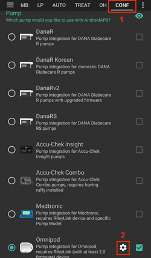
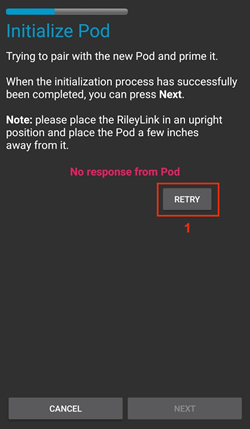
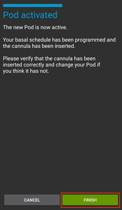
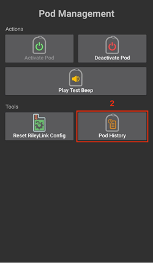
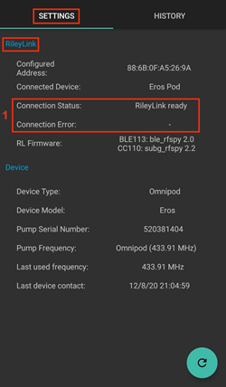
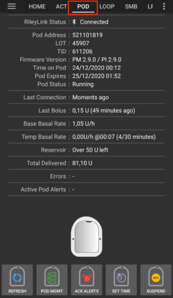
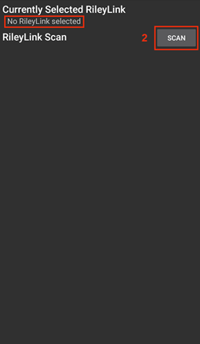
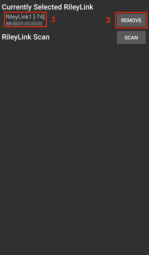

# Omnipod Eros

Αυτές οι οδηγίες αφορούν τη ρύθμιση της αντλίας Omnipod γενιάς Eros (**ΟΧΙ Omnipod Dash**).

```{admonition} Omnipod Eros is being phased out
:class: note

Το [Omnipod System](https://www.omnipod.com/current-podders/resources/omnipod-system) (το αρχικό Omnipod, που αποτελείται από το Personal Diabetes Manager (PDM) και το Pod) σταματά να διατίθεται. Η ημερομηνία λήξης διαφέρει ανά χώρα. Για παράδειγμα, στον Καναδά δεν θα διατίθεται πλέον μετά τις 30 Ιουνίου 2026. Αν βασίζεστε στην αντλία Eros, σχεδιάστε από νωρίς τη μετάβαση σε μια υποστηριζόμενη αντλία.
```

**Αυτό το λογισμικό είναι μέρος μιας λύσης DIY (Do It Yourself) για τεχνητό πάγκρεας. Δεν είναι ένα έτοιμο προϊόν. Απαιτεί από ΕΣΑΣ να διαβάσετε, να μάθετε και να κατανοήσετε το σύστημα, καθώς και τον τρόπο χρήσης του. Εσείς και μόνο είστε υπεύθυνοι για οτιδήποτε κάνετε με αυτό.**

```{contents} Table of contents
:depth: 1
:local: true
```

## Απαιτήσεις υλικού και λογισμικού

- **Συσκευή επικοινωνίας Pod**

> Εξάρτημα που μεταφέρει την επικοινωνία από το τηλέφωνό σας με το AAPS προς τα Pod της γενιάς Eros.
> 
> > -   [Ιστότοπος OrangeLink](https://getrileylink.org/product/orangelink)
> > -  [RileyLink 433MHz](https://getrileylink.org/product/rileylink433)
> > -   [Ιστότοπος Emalink](https://github.com/sks01/EmaLink) - [Στοιχεία επικοινωνίας](mailto:getemalink@gmail.com)
> > -   DiaLink - [Στοιχεία επικοινωνίας](mailto:Boshetyn@ukr.net)
> > -   [Ιστότοπος LoopLink](https://www.getlooplink.org/) - [Στοιχεία επικοινωνίας](https://jameswedding.substack.com/) - Δεν έχει δοκιμαστεί

-   **Κινητό τηλέφωνο**

> Εξάρτημα που εκτελεί το AAPS και στέλνει εντολές ελέγχου στη συσκευή επικοινωνίας Pod.
> 
> > - Υποστηριζόμενο [τηλέφωνο Android](#Phones-list-of-tested-phones) με ρυθμισμένο το **AAPS** και τα σχετικά εξαρτήματα.

-   **Συσκευή χορήγησης ινσουλίνης**

> Εξάρτημα που εκτελεί τις εντολές που λαμβάνει από τη συσκευή επικοινωνίας Pod. Οι εντολές ξεκινούν από το τηλέφωνό σας με το AAPS.
> 
> > - Ένα νέο Pod Omnipod (γενιά Eros - **ΟΧΙ DASH**)

Αυτές οι οδηγίες υποθέτουν ότι ξεκινάτε μια νέα περίοδο χρήσης Pod. Αν δεν ισχύει αυτό, κάντε υπομονή και ξεκινήστε τη διαδικασία στην επόμενη αλλαγή Pod.

Σε αυτή τη σελίδα, **RileyLink** σημαίνει οποιαδήποτε από τις συσκευές επικοινωνίας Pod που αναφέρονται παραπάνω.

## Πριν ξεκινήσετε

**ΑΣΦΑΛΕΙΑ ΠΡΩΤΑ ΑΠ' ΟΛΑ** - μην κάνετε αυτή τη διαδικασία σε περιβάλλον όπου δεν μπορείτε να διορθώσετε ένα σφάλμα (επιπλέον Pod, ινσουλίνη, φορτισμένο RileyLink και τηλέφωνο είναι απαραίτητα).

**Το PDM του Omnipod δεν θα λειτουργεί πλέον μετά την ενεργοποίηση του Pod από τον οδηγό Omnipod του AAPS**. Πριν, χρησιμοποιούσατε το PDM του Omnipod για να στέλνετε εντολές στο Pod Omnipod Eros. Ένα Pod Omnipod Eros επιτρέπει σε μία μόνο συσκευή να επικοινωνεί μαζί του. Η συσκευή που ενεργοποιεί με επιτυχία το Pod είναι η μόνη συσκευή που μπορεί να επικοινωνεί μαζί του από εκείνη τη στιγμή και μετά. Αυτό σημαίνει ότι, μόλις ενεργοποιήσετε ένα Pod Omnipod Eros με το RileyLink μέσω του οδηγού Omnipod του AAPS, **δεν θα μπορείτε πλέον να χρησιμοποιήσετε το PDM με αυτό το Pod**. Ο οδηγός Omnipod του AAPS μαζί με το RileyLink είναι τώρα το PDM σας. *Αυτό ΔΕΝ σημαίνει ότι πρέπει να πετάξετε το PDM σας. Συνιστάται να το κρατήσετε ως εφεδρικό και για έκτακτες ανάγκες, όταν το AAPS δεν λειτουργεί σωστά.*

**Μόνο ένα RileyLink κάθε φορά μπορεί να επικοινωνεί με ένα Pod.** Το **AAPS** θυμάται ένα συζευγμένο RileyLink. Αν κάνετε σύζευξη με άλλο, αυτό αντικαθιστά το προηγούμενο.

**Το Pod δεν θα σταματήσει να λειτουργεί όταν το RileyLink είναι εκτός εμβέλειας.** Όταν το RileyLink είναι εκτός εμβέλειας ή το σήμα εμποδίζεται και δεν επικοινωνεί με το ενεργό Pod, το Pod θα συνεχίσει να χορηγεί βασική ινσουλίνη. Κατά την ενεργοποίηση ενός Pod, το προφίλ βασικού ρυθμού που έχει οριστεί στο AAPS προγραμματίζεται στο νέο Pod. Αν χαθεί η επικοινωνία με το Pod, το Pod θα επιστρέψει σε αυτό το προφίλ βασικού ρυθμού. Δεν θα μπορείτε να στείλετε νέες εντολές μέχρι το RileyLink να επιστρέψει σε εμβέλεια και να συνδεθεί ξανά.

**Προφίλ βασικού ρυθμού ανά 30 λεπτά ΔΕΝ υποστηρίζονται στο AAPS.** Αν είστε νέοι στο AAPS και ρυθμίζετε το προφίλ βασικού ρυθμού για πρώτη φορά, προσέξτε: βασικοί ρυθμοί που ξεκινούν στη μισή ώρα δεν υποστηρίζονται και θα πρέπει να αλλάξετε το προφίλ ώστε κάθε ρυθμός να ξεκινά στην ακέραια ώρα. Για παράδειγμα, αν έχετε βασικό ρυθμό 1,1 μονάδων που ξεκινά στις 09:30 και διαρκεί 2 ώρες, μέχρι τις 11:30, αυτό δεν θα λειτουργήσει.  Θα πρέπει να αλλάξετε αυτόν τον βασικό ρυθμό 1,1 μονάδων στο διάστημα 9:00-11:00 ή 10:00-12:00.  Παρόλο που το ίδιο το υλικό του Omnipod υποστηρίζει βήματα 30 λεπτών στο προφίλ βασικού ρυθμού, οι αλγόριθμοι του AAPS δεν μπορούν προς το παρόν να τα λάβουν υπόψη.

## Ενεργοποίηση του οδηγού Omnipod στο AAPS

Μπορείτε να ενεργοποιήσετε τον οδηγό Omnipod στο AAPS με **δύο τρόπους**:

### Επιλογή 1: Ο Οδηγός εγκατάστασης

Μετά την εγκατάσταση μιας νέας έκδοσης του AAPS, ο **Οδηγός εγκατάστασης** ξεκινά αυτόματα. Αν έχετε ήδη κάνει εξαγωγή των ρυθμίσεών σας από προηγούμενη εγκατάσταση, μπορείτε να τις εισαγάγετε στον οδηγό. Για νέες εγκαταστάσεις, συνεχίστε παρακάτω.

Προχωρήστε στον [Οδηγό εγκατάστασης του AAPS](../SettingUpAaps/SetupWizard.md) μέχρι το βήμα **Αντλία** και επιλέξτε **Omnipod Eros** (η περιγραφή γράφει «Ενσωμάτωση αντλίας για Omnipod Eros»).


Ο Οδηγός εγκατάστασης δεν κάνει σύζευξη του RileyLink. Αφού τελειώσετε τον οδηγό, ανοίξτε την οθόνη αντλίας Omnipod και κάντε σύζευξη όπως περιγράφεται στην [ενότητα Ρύθμιση RileyLink](#OmnipodEros-rileylink-setup).

**Ή**

### Επιλογή 2: Η οθόνη Διαμόρφωση

Ανοίξτε το **μενού** (☰) πάνω αριστερά > **Διαμόρφωση** > **Αντλία** και επιλέξτε το **κουμπί επιλογής** του **Omnipod Eros**.

Μόλις επιλεγεί, η κάρτα **Omnipod Eros** δείχνει δύο κουμπιά, **Ρυθμίσεις** και **Άνοιγμα πρόσθετου**:


Το **Ρυθμίσεις** ανοίγει τις ρυθμίσεις του οδηγού Omnipod (δείτε [Ρυθμίσεις Omnipod](#OmnipodEros-omnipod-settings)):


Το **Άνοιγμα πρόσθετου** ανοίγει την οθόνη αντλίας Omnipod. Μπορείτε επίσης να την ανοίξετε οποιαδήποτε στιγμή από την κύρια οθόνη με **Διαχείριση** > **Αντλία**. Σε αυτή τη σελίδα την ονομάζουμε **οθόνη αντλίας Omnipod**. Πριν από τη σύζευξη ενός RileyLink και την ενεργοποίηση ενός Pod, μοιάζει έτσι:


### Έλεγχος της επιλογής του οδηγού Omnipod

Για να ελέγξετε ότι έχετε ενεργοποιήσει τον οδηγό Omnipod, ανοίξτε **Διαχείριση** > **Αντλία** από την κύρια οθόνη. Θα πρέπει να δείτε την οθόνη αντλίας **Omnipod Eros** που φαίνεται παραπάνω. Αν δεν έχετε κάνει ακόμα σύζευξη με RileyLink, η **Κατάσταση RileyLink** δείχνει **Δεν ξεκίνησε** και η **Κατάσταση Pod** δείχνει **Χωρίς Ενεργό Pod**.

## Διαμόρφωση Omnipod

Όλες οι λειτουργίες του Pod και του RileyLink είναι κουμπιά στην [οθόνη αντλίας Omnipod](#OmnipodEros-omnipod-pod-tab) (**Διαχείριση** > **Αντλία**). Μερικά κουμπιά εμφανίζονται μόνο σε ορισμένες περιπτώσεις, για παράδειγμα όταν υπάρχει ενεργό Pod.

>  Ανανέωση σύνδεσης και κατάστασης του Pod
> 
>  Διαχείριση Pod (Ενεργοποίηση, Απενεργοποίηση, Δοκιμαστικός ήχος, Στατιστικά RileyLink και Ιστορικό Pod)

```{admonition} Older screenshot
:class: note
Τα παραπάνω στιγμιότυπα οθόνης είναι από παλαιότερη έκδοση του **AAPS**. Στο **AAPS** 4 δεν υπάρχει κουμπί **POD MGMT** ούτε μενού Διαχείριση Pod: η **Ανανέωση** και όλες οι ενέργειες διαχείρισης του Pod είναι κουμπιά στην οθόνη αντλίας Omnipod.
```

(OmnipodEros-rileylink-setup)=

### Ρύθμιση RileyLink

Αν έχετε ήδη κάνει σύζευξη του RileyLink, συνεχίστε στην [ενότητα Ενεργοποίηση ενός Pod](#OmnipodEros-activating-a-pod) παρακάτω.

*Σημείωση: Ένα καλό οπτικό σημάδι ότι το RileyLink δεν είναι συνδεδεμένο είναι ότι λείπουν τα κουμπιά θεραπειών (γραμμή εργαλείων QuickLaunch) από την κύρια οθόνη. Αυτό συμβαίνει επίσης για περίπου τα πρώτα 30 δευτερόλεπτα μετά την εκκίνηση του AAPS, όσο το AAPS συνδέεται με το RileyLink.*

1. Βεβαιωθείτε ότι το RileyLink είναι πλήρως φορτισμένο και ενεργοποιημένο.

2. Τοποθετήστε το RileyLink [κοντά στο τηλέφωνό σας](#OmnipodEros-optimal-omnipod-and-rileylink-positioning) (~30 cm ή λιγότερο).

3. Ανοίξτε την οθόνη αντλίας Omnipod (**Διαχείριση** > **Αντλία**) και πατήστε **Σύζευξη RileyLink**.

4. Η οθόνη **Σύζευξη RileyLink** αρχίζει αμέσως αναζήτηση για συσκευές Bluetooth. Πατήστε το RileyLink σας στη λίστα με τις συσκευές που βρέθηκαν.

   

5. Όταν εμφανιστεί το **Επιτυχής σύζευξη με RileyLink** με το όνομα και τη διεύθυνση της συσκευής σας, πατήστε **OK**.

6. Πίσω στην οθόνη αντλίας Omnipod, ελέγξτε ότι η **Κατάσταση RileyLink** αλλάζει σε **Συνδέθηκε**. Η **Κατάσταση Pod** θα πρέπει να δείχνει **Χωρίς Ενεργό Pod**. Αν το RileyLink δεν συνδεθεί, πατήστε **Επαναφορά RileyLink** ή επανεκκινήστε το **AAPS**.

 

 


```{admonition} Older screenshot
:class: note
Τα έξι παραπάνω στιγμιότυπα οθόνης (μετά το βήμα 6) είναι από παλαιότερη έκδοση του **AAPS**. Στο **AAPS** 4 κάνετε σύζευξη του RileyLink με το κουμπί **Σύζευξη RileyLink** στην οθόνη αντλίας Omnipod αντί για το **RileyLink Configuration** στις ρυθμίσεις Omnipod, και η αναζήτηση ξεκινά αυτόματα.
```

```{note}
Για να αλλάξετε σε άλλο RileyLink (για παράδειγμα μια εφεδρική συσκευή), πατήστε ξανά **Σύζευξη RileyLink** και επιλέξτε τη νέα συσκευή. Αντικαθιστά αυτό που είχε συζευχθεί πριν. Δεν χρειάζεται να αφαιρέσετε πρώτα την παλιά συσκευή.
```

(OmnipodEros-activating-a-pod)=

### Ενεργοποίηση ενός Pod

Πριν ενεργοποιήσετε ένα Pod, βεβαιωθείτε ότι το RileyLink είναι συζευγμένο και η **Κατάσταση RileyLink** δείχνει **Συνδέθηκε**. Το κουμπί **Ενεργοποίηση Pod** μένει απενεργοποιημένο μέχρι το RileyLink να είναι έτοιμο.

*ΥΠΕΝΘΥΜΙΣΗ: Για λόγους ασφαλείας, κατά τη σύζευξη για την ενεργοποίηση η επικοινωνία με το Pod γίνεται μόνο σε μικρή απόσταση. Πριν από τη σύζευξη, το ραδιοσήμα του Pod είναι πιο αδύναμο. Μετά τη σύζευξη, λειτουργεί με πλήρη ισχύ σήματος. Κατά τη διάρκεια αυτών των διαδικασιών, βεβαιωθείτε ότι το Pod είναι* [πολύ κοντά](#OmnipodEros-optimal-omnipod-and-rileylink-positioning) *(~30 cm ή λιγότερο), αλλά όχι πάνω ή ακριβώς δίπλα στο RileyLink.*

01. Ανοίξτε την οθόνη αντλίας Omnipod (**Διαχείριση** > **Αντλία**) και πατήστε **Ενεργοποίηση Pod**.

    Αν δεν έχετε ενεργοποιήσει ποτέ προφίλ, εμφανίζεται πρώτα ένα βήμα **Απαιτείται προφίλ**. Επιλέξτε το προφίλ που θα εφαρμοστεί κατά την ενεργοποίηση.

    >   
    > 
    > ```{admonition} Older screenshot
    >     :class: note
    >     Τα παραπάνω στιγμιότυπα οθόνης είναι από παλαιότερη έκδοση του **AAPS**. Στο **AAPS** 4 η **Ενεργοποίηση Pod** είναι κουμπί στην οθόνη αντλίας Omnipod και όχι στο μενού **POD MGMT**.
    > ```

02. Εμφανίζεται η οθόνη **Γέμισμα Pod**. Γεμίστε ένα νέο Pod με αρκετή ινσουλίνη για 3 ημέρες και περιμένετε να ακούσετε δύο μπιπ. Σημαίνουν ότι έχει γεμίσει η ελάχιστη ποσότητα των 80 μονάδων. Αδειάστε τελείως τη σύριγγα γεμίσματος, ακόμα και αφού ακούσετε τα δύο μπιπ. Όταν υπολογίζετε τη συνολική ποσότητα ινσουλίνης που χρειάζεστε για 3 ημέρες, λάβετε υπόψη ότι η πλήρωση του Pod χρησιμοποιεί 12 έως 15 μονάδες. Μην αφαιρέσετε ακόμα το καπάκι της βελόνας του Pod.

    > 
    > 
    > Βεβαιωθείτε ότι το νέο Pod και το RileyLink είναι πολύ κοντά το ένα στο άλλο (~30cm ή λιγότερο) και πατήστε **Επόμενο**.

03. **Επιλογή ινσουλίνης** (εμφανίζεται μόνο αν έχετε ρυθμίσει περισσότερες από μία ινσουλίνες): επιλέξτε την ινσουλίνη με την οποία γεμίζετε το Pod και πατήστε **Επόμενο**. Μετά την ενεργοποίηση εφαρμόζεται μια αλλαγή προφίλ με αυτή την ινσουλίνη.

04. Στην οθόνη **Αρχικοποίηση Pod**, το Pod θα ξεκινήσει την πλήρωση (θα ακούσετε ένα κλικ και μετά μια σειρά από ήχους «τικ» όσο το Pod κάνει πλήρωση). Αν το RileyLink είναι εκτός εμβέλειας του Pod που ενεργοποιείται, θα λάβετε το μήνυμα σφάλματος **Καμία απάντηση από το Pod**. Αν συμβεί αυτό, [μετακινήστε το RileyLink πιο κοντά](#OmnipodEros-optimal-omnipod-and-rileylink-positioning) (~30 cm ή λιγότερο) στο Pod, αλλά όχι πάνω ή ακριβώς δίπλα σε αυτό, και πατήστε **Επανάληψη**.

    >  

05. Όταν η πλήρωση πετύχει, εμφανίζεται ένα πράσινο σημάδι ελέγχου και το κουμπί **Επόμενο** ενεργοποιείται. Πατήστε **Επόμενο**.

    > 

06. **Σημείο τοποθέτησης** (εμφανίζεται μόνο αν η **Διαχείριση εναλλαγής σημείων αντλίας** είναι ενεργοποιημένη στην [Εναλλαγή σημείων](#Aapsscreens-site-rotation)): επιλέξτε σε ποιο σημείο του σώματος τοποθετείτε το Pod και πατήστε **Επόμενο**.

07. Εμφανίζεται η οθόνη **Τοποθέτηση Pod**. Προετοιμάστε το σημείο έγχυσης για το νέο Pod. Αφαιρέστε το πλαστικό καπάκι της βελόνας του Pod και το λευκό χαρτί από το αυτοκόλλητο και κολλήστε το Pod στο σημείο του σώματος που επιλέξατε. Αν ο καθετήρας εξέχει, πατήστε **Ακύρωση** και πετάξτε το Pod. Όταν τελειώσετε, πατήστε **Επόμενο**.

    > 

08. Εμφανίζεται ένα παράθυρο επιβεβαίωσης: «Όταν πιέσετε OK, θα γίνει εισαγωγή του καθετήρα». **Πατήστε OK ΜΟΝΟ αν είστε έτοιμοι για την εισαγωγή του καθετήρα**.

    > 

09. Στην οθόνη **Εισαγωγή Καθετήρα**, μπορεί να περάσει λίγος χρόνος μέχρι το Omnipod να απαντήσει και να εισαγάγει τον καθετήρα (1-2 λεπτά το πολύ), οπότε κάντε υπομονή.

    > Αν το RileyLink είναι εκτός εμβέλειας του Pod που ενεργοποιείται, θα λάβετε το μήνυμα σφάλματος **Καμία απάντηση από το Pod**. Αν συμβεί αυτό, μετακινήστε το RileyLink πιο κοντά (~30 cm ή λιγότερο) στο Pod, αλλά όχι πάνω ή ακριβώς δίπλα σε αυτό, και πατήστε **Επανάληψη**.
    > 
    > Αν το RileyLink είναι εκτός εμβέλειας Bluetooth ή δεν έχει ενεργή σύνδεση με το τηλέφωνο, θα λάβετε το μήνυμα σφάλματος **Καμία απάντηση από το RileyLink**. Αν συμβεί αυτό, μετακινήστε το RileyLink πιο κοντά στο τηλέφωνο και πατήστε **Επανάληψη**.
    > 
    > *ΣΗΜΕΙΩΣΗ: Πριν από την εισαγωγή του καθετήρα, είναι καλή ιδέα να ανασηκώσετε τσιμπώντας το δέρμα κοντά στο σημείο εισαγωγής του καθετήρα. Αυτό βοηθά να μπει η βελόνα ομαλά και μειώνει την πιθανότητα να εμφανιστούν αποφράξεις.*
    > 
    > 
    > 
    >  

10. Εμφανίζεται ένα πράσινο σημάδι ελέγχου (checkmark) και το κουμπί **Επόμενο** ενεργοποιείται μετά την επιτυχή εισαγωγή του καθετήρα. Πατήστε **Επόμενο**.

    > 

11. Εμφανίζεται η οθόνη **Pod Ενεργοποιημένο**. Ελέγξτε ότι ο καθετήρας έχει εισαχθεί σωστά και αλλάξτε το Pod αν πιστεύετε ότι δεν έχει εισαχθεί σωστά. Πατήστε **Τέλος**. Συγχαρητήρια! Τώρα έχετε ξεκινήσει μια νέα ενεργή περίοδο χρήσης Pod.

    >  
    > 
    > ```{admonition} Older screenshot
    >     :class: note
    >     Τα στιγμιότυπα οθόνης στα βήματα 2 έως 11 είναι από παλαιότερη έκδοση του **AAPS** και μπορεί να φαίνονται διαφορετικά στο **AAPS** 4. Τα βήματα **Επιλογή ινσουλίνης** και **Σημείο τοποθέτησης** δεν φαίνονται στις εικόνες.
    > ```

12. Επιστρέφετε στην οθόνη αντλίας Omnipod. Το κουμπί **Ενεργοποίηση Pod** αντικαθίσταται από το **Απενεργοποίηση Pod**, γιατί δεν μπορείτε να ενεργοποιήσετε άλλο Pod χωρίς να απενεργοποιήσετε πρώτα το ενεργό.

    Η οθόνη αντλίας δείχνει τώρα πληροφορίες για το ενεργό Pod σας, όπως τον τρέχοντα βασικό ρυθμό, το επίπεδο της δεξαμενής, την ινσουλίνη που χορηγήθηκε, τα σφάλματα και τις ειδοποιήσεις του Pod. Για περισσότερες λεπτομέρειες, δείτε την ενότητα [Οθόνη αντλίας Omnipod](#OmnipodEros-omnipod-pod-tab).

     

    ```{admonition} Older screenshot
    :class: note
    Τα παραπάνω στιγμιότυπα οθόνης είναι από παλαιότερη έκδοση του **AAPS**. Στο **AAPS** 4 δεν υπάρχει μενού Διαχείριση Pod: επιστρέφετε απευθείας στην οθόνη αντλίας Omnipod, όπου η **Απενεργοποίηση Pod** αντικαθιστά την **Ενεργοποίηση Pod**.
    ```

```{note}
Αν η ενεργοποίηση διακόπηκε μετά την πλήρωση (για παράδειγμα έκλεισε η εφαρμογή), πατήστε ξανά **Ενεργοποίηση Pod**. Ο οδηγός συνεχίζει από τα βήματα εισαγωγής του καθετήρα.
```

### Απενεργοποίηση ενός Pod

Κανονικά, ένα Pod λειτουργεί τρεις ημέρες (72 ώρες) και επιπλέον 8 ώρες μετά την προειδοποίηση λήξης του Pod, δηλαδή συνολικά 80 ώρες χρήσης.

Για να απενεργοποιήσετε ένα Pod (είτε λόγω λήξης είτε λόγω βλάβης του Pod):

1. Ανοίξτε την οθόνη αντλίας Omnipod (**Διαχείριση** > **Αντλία**) και πατήστε **Απενεργοποίηση Pod**.

   >   
   > 
   > ```{admonition} Older screenshot
   >    :class: note
   >    Τα παραπάνω στιγμιότυπα οθόνης είναι από παλαιότερη έκδοση του **AAPS**. Στο **AAPS** 4 η **Απενεργοποίηση Pod** είναι κουμπί στην οθόνη αντλίας Omnipod και όχι στο μενού **POD MGMT**.
   > ```

2. Στην οθόνη **Απενεργοποίηση Pod**, βεβαιωθείτε πρώτα ότι το RileyLink είναι πολύ κοντά στο Pod, αλλά όχι πάνω ή ακριβώς δίπλα σε αυτό. Μετά πατήστε **Επόμενο**. Ένα παράθυρο ρωτά *Ένα απενεργοποιημένο Pod δεν μπορεί να χρησιμοποιηθεί ξανά. Απενεργοποίηση αυτού του Pod τώρα;* Πατήστε **ΟΚ** για να ξεκινήσει η απενεργοποίηση του Pod ή **Ακύρωση** για να το κρατήσετε. Η απενεργοποίηση σταματά κάθε χορήγηση ινσουλίνης και δεν μπορεί να αναιρεθεί.

   > 

3. Εμφανίζεται η οθόνη **Απενεργοποίηση Pod** και θα ακούσετε ένα μπιπ επιβεβαίωσης από το Pod ότι η απενεργοποίηση πέτυχε.

   > 
   > 
   > **ΑΝ η απενεργοποίηση αποτύχει** και δεν ακούσετε μπιπ επιβεβαίωσης, μπορεί να δείτε το μήνυμα **Καμία απάντηση από το RileyLink** ή **Καμία απάντηση από το Pod**. Πατήστε **Επανάληψη** για να δοκιμάσετε ξανά την απενεργοποίηση. Αν η απενεργοποίηση συνεχίζει να αποτυγχάνει, πατήστε **Απόρριψη Pod** και επιβεβαιώστε. Τότε το **AAPS** «ξεχνά» το Pod. Η χορήγηση ινσουλίνης **δεν** έχει ανασταλεί, γι' αυτό αφαιρέστε το Pod από το σώμα σας. Αν το Pod ηχεί συνεχώς (συναγερμός), μπορεί να χρειαστεί να το σταματήσετε χειροκίνητα (με μια καρφίτσα ή έναν συνδετήρα), γιατί η **Απόρριψη Pod** δεν το σταματά.
   > 
   > >   

4. Ένα πράσινο σημάδι ελέγχου εμφανίζεται όταν η απενεργοποίηση πετύχει. Πατήστε **Επόμενο** για να εμφανιστεί η οθόνη **Pod Απενεργοποιημένο**. Τώρα μπορείτε να αφαιρέσετε το Pod, γιατί η ενεργή περίοδος χρήσης έχει απενεργοποιηθεί.

   > 

5. Πατήστε **Τέλος** για να επιστρέψετε στην οθόνη αντλίας Omnipod.

   >  
   > 
   > ```{admonition} Older screenshot
   >    :class: note
   >    Τα στιγμιότυπα οθόνης στα βήματα 2 έως 5 είναι από παλαιότερη έκδοση του **AAPS** και μπορεί να φαίνονται διαφορετικά στο **AAPS** 4.
   > ```

6. Στην οθόνη αντλίας Omnipod, ελέγξτε ότι η **Κατάσταση RileyLink** δείχνει **Συνδέθηκε** και η **Κατάσταση Pod** δείχνει **Χωρίς Ενεργό Pod**.

   >    
   > 
   > ```{admonition} Older screenshot
   >    :class: note
   >    Τα παραπάνω στιγμιότυπα οθόνης είναι από παλαιότερη έκδοση του **AAPS**. Στο **AAPS** 4 το **Τέλος** σας επιστρέφει απευθείας στην οθόνη αντλίας Omnipod. Δεν υπάρχει μενού Διαχείριση Pod ούτε καρτέλα **Omnipod (POD)**.
   > ```

### Αναστολή και συνέχιση της χορήγησης ινσουλίνης

Η παρακάτω διαδικασία δείχνει πώς να κάνετε αναστολή και συνέχιση της χορήγησης ινσουλίνης.

*ΣΗΜΕΙΩΣΗ - αν δεν βλέπετε κουμπί **Αναστολή***, είναι κρυφό από προεπιλογή. Ενεργοποιήστε το **Εμφάνιση κουμπιού Αναστολής Έγχυσης στην καρτέλα Omnipod** στις [ρυθμίσεις Omnipod](#OmnipodEros-omnipod-settings), στην ομάδα **Άλλο**.

#### Αναστολή της χορήγησης ινσουλίνης

Χρησιμοποιήστε αυτή την εντολή για να θέσετε το ενεργό Pod σε αναστολή. Σε αναστολή, το Pod δεν χορηγεί καθόλου ινσουλίνη. Αυτή η εντολή μιμείται τη λειτουργία αναστολής που στέλνει το αρχικό PDM του Omnipod σε ένα ενεργό Pod.

1. Ανοίξτε την οθόνη αντλίας Omnipod (**Διαχείριση** > **Αντλία**) και πατήστε **Αναστολή**. Η εντολή αναστολής στέλνεται μέσω του RileyLink στο ενεργό Pod.

2. Όταν το Pod σταματήσει κάθε χορήγηση ινσουλίνης, η **Κατάσταση Pod** δείχνει **Σε αναστολή** και το κουμπί **Αναστολή** αντικαθίσταται από το **Συνέχιση Έγχυσης**.

   >  
   > 
   > 
   > 
   >  
   > 
   > ```{admonition} Older screenshot
   >    :class: note
   >    Τα παραπάνω στιγμιότυπα οθόνης είναι από παλαιότερη έκδοση του **AAPS**. Στο **AAPS** 4 αυτά τα βήματα γίνονται στην οθόνη αντλίας Omnipod αντί για την καρτέλα **Omnipod (POD)**, και το αποτέλεσμα φαίνεται στην **Κατάσταση Pod**.
   > ```

Αν η εντολή αποτύχει, ένα παράθυρο **Προειδοποίηση** δείχνει «Απέτυχε η αναστολή της χορήγησης» με την αιτία. Ελέγξτε τη σύνδεση του RileyLink και δοκιμάστε ξανά.

#### Συνέχιση της χορήγησης ινσουλίνης

Χρησιμοποιήστε αυτή την εντολή για να πείτε στο ενεργό Pod, που είναι τώρα σε αναστολή, να συνεχίσει τη χορήγηση ινσουλίνης. Όταν η εντολή εκτελεστεί με επιτυχία, η ινσουλίνη χορηγείται ξανά κανονικά, με τον βασικό ρυθμό που ισχύει την τρέχουσα ώρα στο ενεργό προφίλ βασικού ρυθμού. Το Pod θα δέχεται ξανά εντολές για bolus, TBR και SMB.

1. Ανοίξτε την οθόνη αντλίας Omnipod και ελέγξτε ότι η **Κατάσταση Pod** δείχνει **Σε αναστολή**. Πατήστε **Συνέχιση Έγχυσης**.

2. Όταν η εντολή πετύχει, η **Κατάσταση Pod** δείχνει ξανά **Σε λειτουργία** και το κουμπί **Συνέχιση Έγχυσης** εξαφανίζεται (το κουμπί **Αναστολή** εμφανίζεται ξανά, αν το έχετε ενεργοποιήσει).

   >  
   > 
   > 
   > 
   >  
   > 
   > ```{admonition} Older screenshot
   >    :class: note
   >    Τα παραπάνω στιγμιότυπα οθόνης είναι από παλαιότερη έκδοση του **AAPS**. Στο **AAPS** 4 αυτά τα βήματα γίνονται στην οθόνη αντλίας Omnipod αντί για την καρτέλα **Omnipod (POD)**, και το αποτέλεσμα φαίνεται στην **Κατάσταση Pod**.
   > ```

Αν η εντολή αποτύχει, ένα παράθυρο **Προειδοποίηση** δείχνει «Απέτυχε η συνέχιση έγχυσης» με την αιτία. Ελέγξτε τη σύνδεση του RileyLink και δοκιμάστε ξανά.

### Σίγαση ειδοποιήσεων του Pod

*ΣΗΜΕΙΩΣΗ - Το κουμπί **Σίγαση Ειδοποιήσεων** εμφανίζεται στην οθόνη αντλίας Omnipod μόνο όταν το Pod έχει ενεργή ειδοποίηση (για παράδειγμα λήξη του Pod ή χαμηλή δεξαμενή) και μόνο αν η **Αυτόματη σίγαση ειδοποιήσεων Pod** είναι απενεργοποιημένη.*

Η παρακάτω διαδικασία δείχνει πώς να κάνετε σίγαση στα μπιπ του Pod που ξεκινούν όταν το Pod φτάσει τον χρόνο προειδοποίησης πριν λήξει. Αυτός ο χρόνος προειδοποίησης ορίζεται με το **Ειδοποίηση σε ώρες πριν από τη διακοπή λειτουργίας (80 Ώρες)** στις ρυθμίσεις **Συναγερμοί Pod** του Omnipod. Η μέγιστη διάρκεια ζωής ενός Pod είναι 80 ώρες (3 ημέρες και 8 ώρες), όμως η Insulet συνιστά να μην ξεπερνάτε το όριο των 72 ωρών (3 ημέρες).

*ΣΗΜΕΙΩΣΗ - Αν έχετε ενεργοποιήσει την **Αυτόματη σίγαση ειδοποιήσεων Pod** στις ρυθμίσεις **Συναγερμοί Pod** του Omnipod, το **AAPS** κάνει αυτόματα σίγαση της ειδοποίησης στην επόμενη επικοινωνία με το Pod και ΔΕΝ χρειάζεται να το κάνετε χειροκίνητα.*

1. Όταν έρθει ο χρόνος προειδοποίησης, το Pod βγάζει μπιπ για να σας πει ότι θα λήξει σύντομα και πρέπει να αλλαχτεί. Στην οθόνη αντλίας Omnipod, το πεδίο **Το Pod Λήγει** δείχνει την ακριβή ώρα λήξης του Pod (72 ώρες μετά την ενεργοποίηση). Γίνεται **κίτρινο** 4 ώρες πριν. Το **Οριστικό τέλος Pod** δείχνει πότε το Pod σταματά να χορηγεί ινσουλίνη. Οι **Ειδοποιήσεις Ενεργού Pod** δείχνουν **Το Pod θα λήξει σύντομα** και εμφανίζεται το κουμπί **Σίγαση Ειδοποιήσεων**. Το **AAPS** δείχνει επίσης μια ειδοποίηση για την επερχόμενη λήξη του Pod.

   >   
   > 
   > ```{admonition} Older screenshot
   >    :class: note
   >    Τα παραπάνω στιγμιότυπα οθόνης είναι από παλαιότερη έκδοση του **AAPS**. Στο **AAPS** 4 το κουμπί **ACK ALERTS** λέγεται **Σίγαση Ειδοποιήσεων** και βρίσκεται στην οθόνη αντλίας Omnipod.
   > ```

2. Πατήστε **Σίγαση Ειδοποιήσεων**. Το RileyLink στέλνει στο Pod την εντολή να σταματήσει τα μπιπ προειδοποίησης λήξης.

   >  
   > 
   > ```{admonition} Older screenshot
   >    :class: note
   >    Η παραπάνω εικόνα είναι από παλαιότερη έκδοση του **AAPS**. Στο **AAPS** 4 το κουμπί λέγεται **Σίγαση Ειδοποιήσεων**.
   > ```

3. Όταν γίνει σίγαση των ειδοποιήσεων, το Pod βγάζει δύο μπιπ. Οι **Ειδοποιήσεις Ενεργού Pod** δεν δείχνουν πια την προειδοποίηση, το κουμπί **Σίγαση Ειδοποιήσεων** εξαφανίζεται και το Pod σταματά τα μπιπ προειδοποίησης λήξης.

   >  
   > 
   > ```{admonition} Older screenshot
   >    :class: note
   >    Η παραπάνω εικόνα είναι από παλαιότερη έκδοση του **AAPS**. Στο **AAPS** 4 το αποτέλεσμα φαίνεται στην οθόνη αντλίας Omnipod: η προειδοποίηση εξαφανίζεται από τις **Ειδοποιήσεις Ενεργού Pod**.
   > ```

Αν η εντολή αποτύχει (για παράδειγμα το RileyLink είναι εκτός εμβέλειας του Pod), ένα παράθυρο **Προειδοποίηση** δείχνει «Απέτυχε η σίγαση ειδοποιήσεων» με την αιτία. Μετακινήστε το RileyLink πιο κοντά στο Pod και δοκιμάστε ξανά.


```{admonition} Older screenshot
:class: note
Η παραπάνω εικόνα είναι από παλαιότερη έκδοση του **AAPS**. Στο **AAPS** 4 το παράθυρο **Προειδοποίηση** δείχνει «Απέτυχε η σίγαση ειδοποιήσεων» με την αιτία.
```

(OmnipodEros-view-pod-history)=

### Προβολή ιστορικού του Pod

Αυτή η ενότητα δείχνει πώς να δείτε το ιστορικό του ενεργού Pod και πώς να το φιλτράρετε ανά κατηγορία ενεργειών. Το εργαλείο ιστορικού Pod σάς δείχνει τις ενέργειες και τα αποτελέσματα που στάλθηκαν στο τρέχον ενεργό Pod κατά τη διάρκεια ζωής του των τριών ημερών (72 - 80 ώρες).

Αυτή η λειτουργία είναι χρήσιμη για να ελέγξετε bolus, TBR και αλλαγές βασικού ρυθμού που δόθηκαν, όταν δεν είστε σίγουροι αν ολοκληρώθηκαν. Οι υπόλοιπες κατηγορίες είναι γενικά χρήσιμες για την αντιμετώπιση προβλημάτων και για να βρείτε τη σειρά των γεγονότων που οδήγησαν σε μια αποτυχία.

*ΣΗΜΕΙΩΣΗ:* Οι **αβέβαιες** εντολές εμφανίζονται στο ιστορικό του Pod, αλλά λόγω της φύσης τους δεν μπορείτε να είστε σίγουροι για την ακρίβειά τους.

1. Ανοίξτε την οθόνη αντλίας Omnipod (**Διαχείριση** > **Αντλία**) και πατήστε **Ιστορικό Pod**.

   >   
   > 
   > ```{admonition} Older screenshot
   >    :class: note
   >    Τα παραπάνω στιγμιότυπα οθόνης είναι από παλαιότερη έκδοση του **AAPS**. Στο **AAPS** 4 το **Ιστορικό Pod** είναι κουμπί στην οθόνη αντλίας Omnipod και όχι στο μενού **POD MGMT**.
   > ```

2. Η οθόνη **Ιστορικό Pod** δείχνει όλες τις ενέργειες του Pod και τα αποτελέσματά τους, τις νεότερες πρώτες, ομαδοποιημένες ανά ημέρα. Από προεπιλογή είναι επιλεγμένο το **Όλα**. Πατήστε ένα από τα κουμπιά φίλτρου στο πάνω μέρος για να δείτε μόνο μία κατηγορία. Χρησιμοποιήστε το βέλος επιστροφής πάνω αριστερά για να επιστρέψετε στην οθόνη αντλίας Omnipod.

   > 

   >  
   > 
   > ```{admonition} Older screenshot
   >    :class: note
   >    Το δεύτερο στιγμιότυπο οθόνης είναι από παλαιότερη έκδοση του **AAPS** και μπορεί να φαίνεται διαφορετικά στο **AAPS** 4.
   > ```

### Προβολή ρυθμίσεων και ιστορικού RileyLink

Η οθόνη **Στατιστικά RileyLink** δείχνει τις ρυθμίσεις του RileyLink και του ενεργού Pod, καθώς και το ιστορικό επικοινωνίας και των δύο. Έχει δύο καρτέλες: **Ρυθμίσεις** και **Ιστορικό**.

Το κουμπί **Στατιστικά RileyLink** είναι κρυφό από προεπιλογή. Για να εμφανιστεί στην οθόνη αντλίας Omnipod, ενεργοποιήστε το **Εμφάνιση του κουμπιού Στατιστικά RileyLink στο μενού Διαχείριση Pod** στις [ρυθμίσεις Omnipod](#OmnipodEros-omnipod-settings), στην ομάδα **Άλλο**.

#### Χειροκίνητη επανασύνδεση Bluetooth της συσκευής επικοινωνίας Pod

Αν η συσκευή επικοινωνίας Pod ήταν για λίγο εκτός εμβέλειας Bluetooth του τηλεφώνου σας, η **Κατάσταση RileyLink** μπορεί να δείχνει **Το RileyLink μη προσπελάσιμο** στην οθόνη αντλίας Omnipod. Το **AAPS** κανονικά συνδέεται ξανά μόνο του όταν η συσκευή επιστρέψει σε εμβέλεια. Αν δεν συνδεθεί:

1. Βεβαιωθείτε ότι το RileyLink είναι ενεργοποιημένο, φορτισμένο και κοντά στο τηλέφωνό σας.

2. Στην οθόνη αντλίας Omnipod, πατήστε **Επαναφορά RileyLink**. Ένα μήνυμα επιβεβαιώνει **Επαναφορά ρυθμίσεων RileyLink**. Δείτε τις [σημειώσεις για την Επαναφορά RileyLink](#OmnipodEros-reset-rileylink-config-notes) παρακάτω.

3. Αν η **σύνδεση Bluetooth** δεν αποκατασταθεί, δοκιμάστε να **απενεργοποιήσετε** και μετά να **ενεργοποιήσετε** ξανά το Bluetooth στο τηλέφωνό σας.

4. Αν πάλι δεν συνδεθεί, πατήστε **Σύζευξη RileyLink** και επιλέξτε ξανά το RileyLink σας.

5. Μετά από επιτυχή επανασύνδεση, η **Κατάσταση RileyLink** δείχνει **Συνδέθηκε**. Μπορείτε επίσης να ελέγξετε την **Κατάσταση Σύνδεσης** στην καρτέλα **Ρυθμίσεις** της οθόνης **Στατιστικά RileyLink**. Συγχαρητήρια, συνδέσατε ξανά τη ρυθμισμένη συσκευή επικοινωνίας Pod με το AAPS!

 




```{admonition} Older screenshot
:class: note
Τα παραπάνω στιγμιότυπα οθόνης είναι από παλαιότερη έκδοση του **AAPS**. Στο **AAPS** 4 κάνετε επανασύνδεση με **Επαναφορά RileyLink** ή **Σύζευξη RileyLink** στην οθόνη αντλίας Omnipod αντί για το κουμπί ανανέωσης στην οθόνη ρυθμίσεων RileyLink.
```

#### Ρυθμίσεις της συσκευής επικοινωνίας Pod και του ενεργού Pod

Αυτή η οθόνη δείχνει πληροφορίες και κατάσταση τόσο για τη συζευγμένη συσκευή επικοινωνίας Pod όσο και για το ενεργό Pod Omnipod Eros. Οι πληροφορίες ανανεώνονται αυτόματα.

1. Ανοίξτε την οθόνη αντλίας Omnipod (**Διαχείριση** > **Αντλία**) και πατήστε **Στατιστικά RileyLink**. Η καρτέλα **Ρυθμίσεις** δείχνει το συζευγμένο **RileyLink** και το ενεργό Pod (**Συσκευή**).

   >   
   > 
   > ```{admonition} Older screenshot
   >    :class: note
   >    Τα παραπάνω στιγμιότυπα οθόνης είναι από παλαιότερη έκδοση του **AAPS**. Στο **AAPS** 4 τα **Στατιστικά RileyLink** είναι κουμπί στην οθόνη αντλίας Omnipod και όχι στο μενού **POD MGMT**.
   > ```

   > 

##### Πεδία RileyLink

> - **Διεύθυνση:** Η διεύθυνση MAC της συζευγμένης συσκευής επικοινωνίας Pod.
> - **Όνομα:** Το όνομα Bluetooth της συζευγμένης συσκευής επικοινωνίας Pod.
> - **Επίπεδο Μπαταρίας:** Το τρέχον επίπεδο μπαταρίας της συνδεδεμένης συσκευής επικοινωνίας Pod. Εμφανίζεται μόνο όταν το **Εμφάνιση στάθμης μπαταρίας που αναφέρθηκε από OrangeLink/EmaLink/DiaLink** είναι ενεργοποιημένο.
> - **Κατάσταση Σύνδεσης**: Η τρέχουσα κατάσταση της σύνδεσης Bluetooth ανάμεσα στη συσκευή επικοινωνίας Pod και στο τηλέφωνο με το AAPS.
> - **Σφάλμα σύνδεσης:** Αν υπάρχει σφάλμα στη σύνδεση Bluetooth της συσκευής επικοινωνίας Pod, οι λεπτομέρειες εμφανίζονται εδώ.
> - **Έκδοση Υλικολογισμικού:** Η τρέχουσα έκδοση υλικολογισμικού (firmware) της συνδεδεμένης συσκευής επικοινωνίας Pod.

##### Πεδία συσκευής - Με ενεργό Pod

> - **Τύπος Συσκευής:** Ο τύπος της συσκευής που επικοινωνεί με τη συσκευή επικοινωνίας Pod (Omnipod (Eros)).
> - **Μοντέλο Ρυθμισμένης Συσκευής:** Το μοντέλο της συσκευής που έχει ρυθμιστεί να επικοινωνεί με τη συσκευή επικοινωνίας Pod.
> - **Μοντέλο Συνδεδεμένης Συσκευής:** Το μοντέλο της συσκευής που επικοινωνεί τώρα με τη συσκευή επικοινωνίας Pod.
> - **Σειριακός Αριθμός Αντλίας:** Ο σειριακός αριθμός του ενεργού Pod.
> - **Συχνότητα Αντλίας:** Η ραδιοσυχνότητα που χρησιμοποιείται για την επικοινωνία με το Pod.
> - **Τελευταία Χρησιμοποιημένη Συχνότητα:** Η τελευταία γνωστή ραδιοσυχνότητα που χρησιμοποίησε το Pod για να επικοινωνήσει με τη συσκευή επικοινωνίας Pod.
> - **Τελευταία Επαφή Συσκευής:** Η ημερομηνία και η ώρα της τελευταίας επαφής του Pod με τη συσκευή επικοινωνίας Pod.

(omnipod-eros-rileylink-and-active-pod-history)=
#### Ιστορικό RileyLink και ενεργού Pod

Αυτή η καρτέλα δείχνει, με τα νεότερα πρώτα, κάθε κατάσταση ή ενέργεια του RileyLink ή του συνδεδεμένου Pod. Το ιστορικό είναι διαθέσιμο μόνο για το τρέχον ενεργό Pod. Μετά από αλλαγή Pod, αυτό το ιστορικό διαγράφεται και καταγράφονται και εμφανίζονται μόνο τα γεγονότα του νέου Pod.

1. Ανοίξτε την οθόνη αντλίας Omnipod (**Διαχείριση** > **Αντλία**), πατήστε **Στατιστικά RileyLink** και μετά την καρτέλα **Ιστορικό**.

   >   
   > 
   > ```{admonition} Older screenshot
   >    :class: note
   >    Τα παραπάνω στιγμιότυπα οθόνης είναι από παλαιότερη έκδοση του **AAPS**. Στο **AAPS** 4 τα **Στατιστικά RileyLink** είναι κουμπί στην οθόνη αντλίας Omnipod και όχι στο μενού **POD MGMT**.
   > ```

   > 

##### Πεδία

Κάθε εγγραφή δείχνει:

> - **Συσκευή:** Η συσκευή στην οποία αναφέρεται η ενέργεια ή η κατάσταση.
> - **Χρόνος:** Η ώρα του γεγονότος.
> - **Κατάσταση ή ενέργεια:** Η κατάσταση της συσκευής ή η ενέργεια που έκανε.

(OmnipodEros-omnipod-pod-tab)=

## Οθόνη αντλίας Omnipod

Παρακάτω εξηγούνται τα πεδία κατάστασης και τα κουμπιά της **οθόνης αντλίας Omnipod** (**Διαχείριση** > **Αντλία**, ή **Διαμόρφωση** > **Αντλία** > **Άνοιγμα πρόσθετου**).

Το εικονίδιο με το γρανάζι πάνω δεξιά ανοίγει τις [ρυθμίσεις Omnipod](#OmnipodEros-omnipod-settings).

*ΣΗΜΕΙΩΣΗ: Αν κάποιο πεδίο κατάστασης δείχνει (αβέβαιο), πατήστε **Ανανέωση** για να ανανεώσετε την κατάσταση του Pod και να το καθαρίσετε.*




```{admonition} Older screenshot
:class: note
Το παραπάνω στιγμιότυπο οθόνης είναι από παλαιότερη έκδοση του **AAPS**, όπου αυτή η οθόνη ήταν η καρτέλα **Omnipod (POD)**. Στο **AAPS** 4 είναι η οθόνη αντλίας Omnipod και ορισμένα ονόματα πεδίων και κουμπιών είναι διαφορετικά.
```

### Πεδία

- **Κατάσταση RileyLink:** Δείχνει την τρέχουσα κατάσταση σύνδεσης του RileyLink. Τα σφάλματα εμφανίζονται με κόκκινο.

- *Δεν ξεκίνησε* - δεν έχει γίνει ακόμα σύζευξη με RileyLink ή η σύνδεση δεν έχει ξεκινήσει.
- *Το RileyLink μη προσπελάσιμο* - η συσκευή επικοινωνίας Pod είτε δεν είναι σε εμβέλεια Bluetooth του τηλεφώνου, είτε είναι κλειστή, είτε έχει βλάβη που εμποδίζει την επικοινωνία Bluetooth.
- *RileyLink έτοιμο* - η συσκευή επικοινωνίας Pod είναι ενεργοποιημένη και ξεκινά τη σύνδεση Bluetooth.
- *Συνδέθηκε* - η συσκευή επικοινωνίας Pod είναι ενεργοποιημένη, συνδεδεμένη και μπορεί να επικοινωνεί μέσω Bluetooth.

- **Μοναδικό ID:** Δείχνει τη διεύθυνση του ενεργού Pod.

- **Αριθμός Παρτίδας:** Δείχνει τον αριθμό παρτίδας (LOT) του ενεργού Pod.

- **Αριθμός Ακολουθίας:** Δείχνει τον σειριακό αριθμό (TID) του Pod.

- **Έκδοση Υλικολογισμικού:** Δείχνει την έκδοση υλικολογισμικού του ενεργού Pod.

- **Ώρα στο Pod:** Δείχνει την τρέχουσα ώρα στο ενεργό Pod. Επισημαίνεται όταν διαφέρει από την ώρα του τηλεφώνου περισσότερο από 5 λεπτά.

- **Το Pod Λήγει:** Δείχνει την ημερομηνία και την ώρα που θα λήξει το ενεργό Pod. Το κείμενο γίνεται κίτρινο τις τελευταίες 4 ώρες πριν από αυτή την ώρα. Δεν γίνεται ποτέ κόκκινο, γιατί το Pod συνεχίζει να χορηγεί ινσουλίνη και μετά από αυτή.

- **Οριστικό τέλος Pod:** Δείχνει το τέλος της περιόδου χάριτος του Pod (8 ώρες μετά την ώρα στο πεδίο **Το Pod Λήγει**, για μέγιστη διάρκεια ζωής του Pod 80 ώρες). Το κείμενο γίνεται κίτρινο όταν ξεκινά η περίοδος χάριτος (στο **Το Pod Λήγει**) και κόκκινο τις τελευταίες 4 ώρες πριν από το οριστικό τέλος. Κατά την περίοδο χάριτος δείχνει επίσης τον χρόνο που απομένει, για παράδειγμα *(Απομένουν 17 λεπ.)*. Το Pod σταματά να χορηγεί ινσουλίνη στο οριστικό τέλος και πρέπει να αλλαχθεί.

- **Κατάσταση Pod:** Δείχνει την κατάσταση του ενεργού Pod (για παράδειγμα **Χωρίς Ενεργό Pod**, **Σε λειτουργία** ή **Σε αναστολή**).

- **Τελευταία Σύνδεση:** Δείχνει την τελευταία φορά που έγινε επικοινωνία με το ενεργό Pod. Το κείμενο γίνεται κόκκινο όταν ξεπεραστεί το [όριο μη προσβάσιμης αντλίας](#OmnipodEros-troubleshooting).

- *Στιγμές πριν* - λιγότερο από 20 δευτερόλεπτα πριν.
- *Λιγότερο από 1 λεπτό πριν* - περισσότερο από 20 αλλά λιγότερο από 60 δευτερόλεπτα πριν.
- *1 λεπτό πριν* - περισσότερο από 60 αλλά λιγότερο από 120 δευτερόλεπτα (2 λεπ.)
- *XX λεπτά πριν* - περισσότερο από 2 λεπτά πριν, όπου XX είναι ο αριθμός των λεπτών

- **Τελευταίο Bolus:** Δείχνει τη δόση του τελευταίου bolus που στάλθηκε στο ενεργό Pod και, σε παρένθεση, πόση ώρα πριν δόθηκε.

- **Βάση Βασικού Ρυθμού:** Δείχνει τον βασικό ρυθμό που είναι προγραμματισμένος για την τρέχουσα ώρα στο προφίλ βασικού ρυθμού.

- **Προσωρινός Βασικός Ρυθμός:** Εμφανίζεται μόνο όσο τρέχει ένας προσωρινός βασικός ρυθμός. Τον δείχνει με την παρακάτω μορφή:

- Μονάδες / ώρα @ ώρα που δόθηκε το TBR (λεπτά που έχουν περάσει / συνολικά λεπτά του TBR)
- *Παράδειγμα:* 0,00U/h @18:25 ( 90/120 λεπτά)

- **Δεξαμενή:** Δείχνει **Απομένουν πάνω από 50 U** όταν απομένουν περισσότερες από 50 μονάδες στη δεξαμενή. Κάτω από αυτή την τιμή εμφανίζεται ο κατά προσέγγιση αριθμός μονάδων. Το κείμενο γίνεται κόκκινο κάτω από το όριο χαμηλής δεξαμενής που έχει οριστεί στις [ρυθμίσεις Ειδοποιήσεων](#OmnipodEros-omnipod-settings).

- **Σύνολο Χορηγήσεων:** Δείχνει τον συνολικό αριθμό μονάδων ινσουλίνης που χορηγήθηκαν από τη δεξαμενή. *Σημειώστε ότι αυτή είναι μια προσέγγιση, γιατί η πλήρωση και το γέμισμα του Pod δεν είναι ακριβείς διαδικασίες.*

- **Ειδοποιήσεις Ενεργού Pod:** Για τις ειδοποιήσεις που είναι ενεργές τώρα στο ενεργό Pod. Χρησιμοποιείται συνήθως όταν το Pod έχει περάσει τις 72 ώρες και ακούγονται οι ηχητικές ειδοποιήσεις του Pod.

- **Σφάλματα:** Δείχνει το τελευταίο σφάλμα που έγινε (με κόκκινο). Δείτε το [ιστορικό Pod](#OmnipodEros-view-pod-history), το [ιστορικό RileyLink](#omnipod-eros-rileylink-and-active-pod-history) και τα αρχεία καταγραφής για παλαιότερα σφάλματα και πιο λεπτομερείς πληροφορίες.

### Κουμπιά

Τα κουμπιά στο κάτω μέρος της οθόνης αντλίας αλλάζουν ανάλογα με την κατάσταση. Τα κουμπιά που δεν μπορούν να χρησιμοποιηθούν αυτή τη στιγμή είναι γκρι, για παράδειγμα όσο το RileyLink δεν είναι συνδεδεμένο.

**Κουμπιά κατάστασης Pod** (εμφανίζονται όταν υπάρχει ενεργό Pod):

- **Ανανέωση:** Στέλνει εντολή ανανέωσης στο ενεργό Pod για να ενημερωθεί η κατάστασή του. Χρησιμοποιήστε το για να ανανεώσετε την κατάσταση του Pod και να καθαρίσετε πεδία κατάστασης που περιέχουν το κείμενο (αβέβαιο). Δείτε την [ενότητα αντιμετώπισης προβλημάτων](#OmnipodEros-troubleshooting) παρακάτω για περισσότερες πληροφορίες.

  

  ```{admonition} Older screenshot
  :class: note
  Το παραπάνω στιγμιότυπο οθόνης είναι από παλαιότερη έκδοση του **AAPS**. Στο **AAPS** 4 αυτό είναι ένα κουμπί κειμένου με το όνομα **Ανανέωση** στην οθόνη αντλίας Omnipod.
  ```

- **Σίγαση Ειδοποιήσεων:** Κάνει σίγαση στα μπιπ και στις ειδοποιήσεις για λήξη του Pod και χαμηλή δεξαμενή. Εμφανίζεται μόνο όταν το Pod έχει ενεργή ειδοποίηση και η **Αυτόματη σίγαση ειδοποιήσεων Pod** είναι απενεργοποιημένη. Μετά τη σίγαση των ειδοποιήσεων, το κουμπί εξαφανίζεται.

  

  ```{admonition} Older screenshot
  :class: note
  Το παραπάνω στιγμιότυπο οθόνης είναι από παλαιότερη έκδοση του **AAPS**. Στο **AAPS** 4 αυτό το κουμπί λέγεται **Σίγαση Ειδοποιήσεων**.
  ```

- **Ρύθμιση ώρας:** Ενημερώνει την ώρα στο Pod με την τρέχουσα ώρα του τηλεφώνου σας. Εμφανίζεται μόνο όταν η ώρα στο Pod διαφέρει από την ώρα του τηλεφώνου περισσότερο από 5 λεπτά.

  

  ```{admonition} Older screenshot
  :class: note
  Το παραπάνω στιγμιότυπο οθόνης είναι από παλαιότερη έκδοση του **AAPS**. Στο **AAPS** 4 αυτό είναι ένα κουμπί κειμένου με το όνομα **Ρύθμιση ώρας** στην οθόνη αντλίας Omnipod.
  ```

- **Αναστολή:** Κάνει αναστολή της χορήγησης ινσουλίνης στο ενεργό Pod. Εμφανίζεται μόνο αν είναι ενεργοποιημένο στις ρυθμίσεις (**Εμφάνιση κουμπιού Αναστολής Έγχυσης στην καρτέλα Omnipod**).

  

  ```{admonition} Older screenshot
  :class: note
  Το παραπάνω στιγμιότυπο οθόνης είναι από παλαιότερη έκδοση του **AAPS**. Στο **AAPS** 4 αυτό είναι ένα κουμπί κειμένου με το όνομα **Αναστολή** στην οθόνη αντλίας Omnipod.
  ```

- **Συνέχιση Έγχυσης:** Συνεχίζει τη χορήγηση ινσουλίνης στο ενεργό Pod που είναι τώρα σε αναστολή. Εμφανίζεται μόνο όσο το Pod είναι σε αναστολή.

  

  ```{admonition} Older screenshot
  :class: note
  Το παραπάνω στιγμιότυπο οθόνης είναι από παλαιότερη έκδοση του **AAPS**. Στο **AAPS** 4 αυτό είναι ένα κουμπί κειμένου με το όνομα **Συνέχιση Έγχυσης** στην οθόνη αντλίας Omnipod.
  ```

**Κουμπιά διαχείρισης Pod και RileyLink:**


```{admonition} Older screenshot
:class: note
Η παραπάνω εικόνα είναι από παλαιότερη έκδοση του **AAPS**. Στο **AAPS** 4 δεν υπάρχει μενού Διαχείριση Pod: αυτές οι ενέργειες είναι κουμπιά απευθείας στην οθόνη αντλίας Omnipod.
```

- **Ενεργοποίηση Pod:** Κάνει πλήρωση και ενεργοποίηση ενός νέου Pod. Εμφανίζεται όταν δεν υπάρχει ενεργό Pod. Είναι ενεργό μόνο όταν το RileyLink είναι συνδεδεμένο.

  

  ```{admonition} Older screenshot
  :class: note
  Το παραπάνω στιγμιότυπο οθόνης είναι από παλαιότερη έκδοση του **AAPS**. Στο **AAPS** 4 η **Ενεργοποίηση Pod** είναι κουμπί στην οθόνη αντλίας Omnipod και όχι στο μενού Διαχείριση Pod.
  ```

- **Απενεργοποίηση Pod:** Απενεργοποιεί το τρέχον ενεργό Pod. Εμφανίζεται μόλις γίνει σύζευξη με ένα Pod, και επίσης όταν μια ενεργοποίηση σταμάτησε στη μέση (για παράδειγμα επειδή το Pod παρουσίασε βλάβη κατά την ενεργοποίηση). Είναι ενεργό μόνο όταν το RileyLink είναι συνδεδεμένο. Το **AAPS** σας ζητά επιβεβαίωση πριν απενεργοποιήσει το Pod.

- Χρησιμοποιήστε αυτή την εντολή για να απενεργοποιήσετε ένα Pod που ηχεί συνεχώς (σφάλμα 49).
- Αν η απενεργοποίηση αποτύχει, ο οδηγός απενεργοποίησης προσφέρει την επιλογή **Απόρριψη Pod**.

  

  ```{admonition} Older screenshot
  :class: note
  Το παραπάνω στιγμιότυπο οθόνης είναι από παλαιότερη έκδοση του **AAPS**. Στο **AAPS** 4 η **Απενεργοποίηση Pod** είναι κουμπί στην οθόνη αντλίας Omnipod και όχι στο μενού Διαχείριση Pod.
  ```

- **Δοκιμαστικός ήχος:** Παίζει ένα δοκιμαστικό μπιπ στο Pod όταν το πατήσετε. Εμφανίζεται όταν έχει γίνει σύζευξη με ένα Pod.

  

  ```{admonition} Older screenshot
  :class: note
  Το παραπάνω στιγμιότυπο οθόνης είναι από παλαιότερη έκδοση του **AAPS**. Στο **AAPS** 4 ο **Δοκιμαστικός ήχος** είναι κουμπί στην οθόνη αντλίας Omnipod και όχι στο μενού Διαχείριση Pod.
  ```

- **Ιστορικό Pod:** Δείχνει το ιστορικό δραστηριότητας του ενεργού Pod. Δείτε [Προβολή ιστορικού Pod](#OmnipodEros-view-pod-history).

  

  ```{admonition} Older screenshot
  :class: note
  Το παραπάνω στιγμιότυπο οθόνης είναι από παλαιότερη έκδοση του **AAPS**. Στο **AAPS** 4 το **Ιστορικό Pod** είναι κουμπί στην οθόνη αντλίας Omnipod και όχι στο μενού Διαχείριση Pod.
  ```

- **Σύζευξη RileyLink:** Αναζητά τη συσκευή επικοινωνίας Pod και κάνει σύζευξη. Δείτε [Ρύθμιση RileyLink](#OmnipodEros-rileylink-setup).

- **Στατιστικά RileyLink:** Ανοίγει την οθόνη «Στατιστικά RileyLink» με δύο καρτέλες. Εμφανίζεται μόνο αν είναι ενεργοποιημένο στις ρυθμίσεις (**Εμφάνιση του κουμπιού Στατιστικά RileyLink στο μενού Διαχείριση Pod**).

- **Ρυθμίσεις** - δείχνει πληροφορίες για τις ρυθμίσεις του RileyLink και του ενεργού Pod
- **Ιστορικό** - δείχνει το ιστορικό επικοινωνίας του RileyLink και του Pod

  

  ```{admonition} Older screenshot
  :class: note
  Το παραπάνω στιγμιότυπο οθόνης είναι από παλαιότερη έκδοση του **AAPS**. Στο **AAPS** 4 τα **Στατιστικά RileyLink** είναι κουμπί στην οθόνη αντλίας Omnipod και όχι στο μενού Διαχείριση Pod.
  ```

- **Επαναφορά RileyLink:** Επαναφέρει τις ρυθμίσεις της συνδεδεμένης συσκευής επικοινωνίας Pod. Όταν ξεκινά η επικοινωνία, συγκεκριμένα δεδομένα στέλνονται και ορίζονται στο RileyLink:

- Ορίζονται οι καταχωρητές μνήμης
- Ορίζονται τα πρωτόκολλα επικοινωνίας
- Ορίζεται η συντονισμένη ραδιοσυχνότητα
  > 
  > Δείτε τις [επιπλέον σημειώσεις](#OmnipodEros-reset-rileylink-config-notes) παρακάτω.

  

  ```{admonition} Older screenshot
  :class: note
  Το παραπάνω στιγμιότυπο οθόνης είναι από παλαιότερη έκδοση του **AAPS**. Στο **AAPS** 4 αυτό το κουμπί λέγεται **Επαναφορά RileyLink** και βρίσκεται στην οθόνη αντλίας Omnipod.
  ```

- **Απόρριψη Pod:** Απορρίπτει την κατάσταση ενός Pod που δεν απαντά, μετά από επιβεβαίωση. Εμφανίζεται μόνο όταν ένα Pod έχει ξεκινήσει αλλά δεν έχει ολοκληρώσει τη σύζευξη, γιατί τότε η σωστή απενεργοποίηση δεν είναι πλέον δυνατή:

- Ένα **Pod δεν έχει ολοκληρώσει τη σύζευξη** και γι' αυτό αγνοεί τις εντολές απενεργοποίησης.
- Ένα **Pod έχει «κολλήσει»** ανάμεσα σε βήματα της σύζευξης.
- Ένα **Pod δεν κάνει καθόλου σύζευξη.**
  > 
  > Αφού απορρίψετε ένα Pod, το **AAPS** δεν μπορεί πλέον να επικοινωνήσει μαζί του. Αφαιρέστε το Pod από το σώμα σας.

  

  ```{admonition} Older screenshot
  :class: note
  Το παραπάνω στιγμιότυπο οθόνης είναι από παλαιότερη έκδοση του **AAPS**. Στο **AAPS** 4 η **Απόρριψη Pod** είναι κουμπί στην οθόνη αντλίας Omnipod και όχι στο μενού Διαχείριση Pod.
  ```

(OmnipodEros-reset-rileylink-config-notes)=

#### *Σημειώσεις για την Επαναφορά RileyLink*

- Αυτή η λειτουργία χρησιμοποιείται κυρίως όταν η ενεργή συσκευή επικοινωνίας Pod δεν απαντά και η επικοινωνία έχει «κολλήσει».
- Αν η συσκευή επικοινωνίας Pod απενεργοποιηθεί και ενεργοποιηθεί ξανά, πατήστε **Επαναφορά RileyLink** ώστε αυτές οι παράμετροι επικοινωνίας να οριστούν ξανά στη συσκευή επικοινωνίας Pod.
- Αν ΔΕΝ το κάνετε, θα πρέπει να επανεκκινήσετε το AAPS μετά το σβήσιμο και άναμμα της συσκευής επικοινωνίας Pod.
- Αυτό το κουμπί **ΔΕΝ** χρειάζεται να πατηθεί όταν αλλάζετε από μια συσκευή επικοινωνίας Pod σε άλλη.

(OmnipodEros-omnipod-settings)=

## Ρυθμίσεις Omnipod

Για να ανοίξετε τις ρυθμίσεις του οδηγού Omnipod, είτε:

- πατήστε το εικονίδιο με το γρανάζι πάνω δεξιά στην οθόνη αντλίας Omnipod (**Διαχείριση** > **Αντλία**), είτε
- ανοίξτε το **μενού** (☰) πάνω αριστερά > **Διαμόρφωση** > **Αντλία** και πατήστε **Ρυθμίσεις** στην κάρτα **Omnipod Eros**.


```{admonition} Older screenshot
:class: note
Η παραπάνω εικόνα είναι από παλαιότερη έκδοση του **AAPS**. Στο **AAPS** 4 ανοίγετε τις ρυθμίσεις με το **Ρυθμίσεις** στην κάρτα **Omnipod Eros** ή με το εικονίδιο γραναζιού στην οθόνη αντλίας Omnipod, αντί για το γρανάζι ρυθμίσεων στη **Διαμόρφωση** ή το μενού με τις 3 τελείες.
```

Οι ρυθμίσεις είναι ομαδοποιημένες όπως φαίνεται παρακάτω. Πατήστε μια ομάδα για να την ανοίξετε. Οι περισσότερες επιλογές είναι διακόπτες που μπορείτε να ενεργοποιήσετε ή να απενεργοποιήσετε:


*ΣΗΜΕΙΩΣΗ: Ο αστερίσκος (\*) σημαίνει ότι η ρύθμιση είναι ενεργοποιημένη από προεπιλογή.*

### RileyLink

Ρυθμίσεις για τη συσκευή επικοινωνίας Pod. Τη σύζευξη της ίδιας της συσκευής την κάνετε με το κουμπί **Σύζευξη RileyLink** στην οθόνη αντλίας (δείτε [Ρύθμιση RileyLink](#OmnipodEros-rileylink-setup)).

- **Χρήση Σάρωσης:** Κάνει σάρωση πριν από τη σύνδεση με το OrangeLink. Αυτό μπορεί να βελτιώσει τις συνδέσεις. Μπορεί επίσης να χρησιμοποιηθεί με άλλους κλώνους RileyLink, αν χρειάζεται.

- **Εμφάνιση στάθμης μπαταρίας που αναφέρθηκε από OrangeLink/EmaLink/DiaLink:** Αναφέρει το πραγματικό επίπεδο μπαταρίας του OrangeLink/EmaLink/DiaLink. **Συνιστάται έντονα** σε όλους τους χρήστες OrangeLink/EmaLink/DiaLink να ενεργοποιήσουν αυτή τη ρύθμιση.

- ΔΕΝ λειτουργεί με το αρχικό RileyLink.
- Μπορεί να μη λειτουργεί με εναλλακτικές συσκευές RileyLink.
- Ενεργοποιημένο - Αναφέρει το τρέχον επίπεδο μπαταρίας για τις συσκευές επικοινωνίας Pod που το υποστηρίζουν.
- Απενεργοποιημένο - Αναφέρει την τιμή n/a.

- **Ενεργοποίηση καταγραφής αλλαγής μπαταρίας στις Ενέργειες:** Διαθέσιμο μόνο όταν η παραπάνω ρύθμιση αναφοράς μπαταρίας είναι ενεργοποιημένη. Μερικές συσκευές επικοινωνίας Pod χρησιμοποιούν κανονικές μπαταρίες που μπορείτε να αλλάξετε. Με αυτή τη ρύθμιση ενεργοποιημένη, μπορείτε να καταγράψετε μια εγγραφή [careportal](#aaps-screens-careportal) **Αλλαγή Μπαταρίας Αντλίας** για να σημειώσετε την αλλαγή και να μηδενίσετε την ηλικία της μπαταρίας.

### Ήχοι Επιβεβαίωσης

Το Pod δίνει ήχους επιβεβαίωσης για χορήγηση και αλλαγές bolus, βασικού ρυθμού, SMB και TBR.

- **\*Ηχητικά σήματα Bolus ενεργοποιημένα:** Ενεργοποιεί ή απενεργοποιεί τους ήχους επιβεβαίωσης όταν χορηγείται ένα bolus.
- **Ηχητικά σήματα βασικού ενεργοποιημένα:** Ενεργοποιεί ή απενεργοποιεί τους ήχους επιβεβαίωσης όταν ορίζεται νέος βασικός ρυθμός, ακυρώνεται ο ενεργός βασικός ρυθμός ή αλλάζει ο τρέχων βασικός ρυθμός.
- **\*Ηχητικά σήματα SMB ενεργοποιημένα:** Ενεργοποιεί ή απενεργοποιεί τους ήχους επιβεβαίωσης όταν χορηγείται ένα SMB.
- **Ηχητικά σήματα TBR ενεργοποιημένα:** Ενεργοποιεί ή απενεργοποιεί τους ήχους επιβεβαίωσης όταν ορίζεται ή ακυρώνεται ένα TBR.

### Ειδοποιήσεις

Δίνει ειδοποιήσεις στο AAPS και ανακοινώσεις στο Nightscout για τη λήξη του Pod, τον τερματισμό λειτουργίας του και τη χαμηλή δεξαμενή, με βάση το όριο μονάδων που έχετε ορίσει.

*Σημειώστε ότι το AAPS θα δίνει ΠΑΝΤΑ μια ειδοποίηση για κάθε ειδοποίηση του Pod, μετά την πρώτη επικοινωνία με το Pod από τη στιγμή που ξεκίνησε η ειδοποίηση. Το κλείσιμο της ειδοποίησης ΔΕΝ κάνει σίγαση στην ειδοποίηση του Pod, ΕΚΤΟΣ αν είναι ενεργοποιημένη η **Αυτόματη σίγαση ειδοποιήσεων Pod**. Για ΧΕΙΡΟΚΙΝΗΤΗ σίγαση της ειδοποίησης, ανοίξτε την οθόνη αντλίας Omnipod και πατήστε **Σίγαση Ειδοποιήσεων**.*

- **\*Ενεργοποιημένη υπενθύμιση λήξης:** Όταν είναι ενεργοποιημένη, το Pod βγάζει μπιπ όταν φτάσει ο χρόνος που ορίζεται παρακάτω.
- **Ειδοποίηση σε ώρες πριν από τη διακοπή λειτουργίας (80 Ώρες):** Πόσες ώρες πριν από τη διακοπή λειτουργίας του Pod (80 ώρες μετά την ενεργοποίηση) θα ενεργοποιηθεί η υπενθύμιση λήξης (1 έως 8 ώρες, προεπιλογή 8).
- **\*Ειδοποίηση χαμηλής δεξαμενής ενεργοποιημένη:** Ενεργοποιεί ή απενεργοποιεί μια ειδοποίηση όταν οι μονάδες που απομένουν στο Pod φτάσουν το όριο χαμηλής δεξαμενής, όπως ορίζεται στο πεδίο «Αριθμός μονάδων».
- **Αριθμός μονάδων:** Ο αριθμός μονάδων στον οποίο ενεργοποιείται η ειδοποίηση χαμηλής δεξαμενής του Pod (5 έως 50, προεπιλογή 20).
- **Αυτόματη σίγαση ειδοποιήσεων Pod:** Όταν είναι ενεργοποιημένη, εμφανίζεται ακόμα ειδοποίηση, αλλά η ειδοποίηση του Pod σιγεί αυτόματα στην επόμενη επικοινωνία με το Pod μετά την έναρξή της.

### Ειδοποιήσεις

Δίνει ειδοποιήσεις στο AAPS και ηχητικές ειδοποιήσεις στο τηλέφωνο όταν δεν είναι βέβαιο αν ένα TBR, SMB ή bolus έγινε με επιτυχία.

*ΣΗΜΕΙΩΣΗ: Αυτές είναι μόνο ειδοποιήσεις, το Pod δεν βγάζει ήχους.*

- **\*Ήχος για αβέβαιες ειδοποιήσεις TBR ενεργοποιημένος:** Ενεργοποιήστε ή απενεργοποιήστε αυτή τη ρύθμιση για ηχητική ειδοποίηση και ειδοποίηση στην οθόνη όταν το AAPS δεν είναι βέβαιο αν ένα TBR ορίστηκε με επιτυχία.
- **\*Ήχος για αβέβαιες ειδοποιήσεις SMB ενεργοποιημένος:** Ενεργοποιήστε ή απενεργοποιήστε αυτή τη ρύθμιση για ηχητική ειδοποίηση και ειδοποίηση στην οθόνη όταν το AAPS δεν είναι βέβαιο αν ένα SMB χορηγήθηκε με επιτυχία.
- **\*Ήχος για αβέβαιες ειδοποιήσεις bolus ενεργοποιημένος:** Ενεργοποιήστε ή απενεργοποιήστε αυτή τη ρύθμιση για ηχητική ειδοποίηση και ειδοποίηση στην οθόνη όταν το AAPS δεν είναι βέβαιο αν ένα bolus χορηγήθηκε με επιτυχία.

### Άλλο

Προχωρημένες ρυθμίσεις που βοηθούν στον εντοπισμό σφαλμάτων.

- **Εμφάνιση κουμπιού Αναστολής Έγχυσης στην καρτέλα Omnipod:** Κρύβει ή εμφανίζει το κουμπί **Αναστολή** στην οθόνη αντλίας Omnipod.
- **Εμφάνιση κουμπιού καταγραφής Pulse στο μενού Διαχείριση Pod:** Αυτή η ρύθμιση υπάρχει ακόμα στη λίστα, αλλά η τρέχουσα έκδοση της οθόνης αντλίας δεν έχει κουμπί **Αρχείο Καταγραφής Pulse**.

- **Εμφάνιση του κουμπιού Στατιστικά RileyLink στο μενού Διαχείριση Pod:** Κρύβει ή εμφανίζει το κουμπί **Στατιστικά RileyLink** στην οθόνη αντλίας Omnipod.
- **\*DST/Ανίχνευση ζώνης ώρας ενεργοποιημένη:** Επιτρέπει την αυτόματη ανίχνευση αλλαγών ζώνης ώρας, αν το τηλέφωνο χρησιμοποιείται σε περιοχή με θερινή ώρα (DST).

### Αλλαγή ή αφαίρεση μιας ενεργής συσκευής επικοινωνίας Pod (RileyLink)

Υπάρχουν πολλά εναλλακτικά μοντέλα του αρχικού RileyLink (όπως το OrangeLink ή το EmaLink) και μπορεί να χρειάζεστε πολλές ή εφεδρικές συσκευές επικοινωνίας Pod του ίδιου τύπου. Γι' αυτό μπορεί να χρειαστεί να αλλάξετε σε άλλη συσκευή.

Για να αλλάξετε, ανοίξτε την οθόνη αντλίας Omnipod (**Διαχείριση** > **Αντλία**), πατήστε **Σύζευξη RileyLink** και επιλέξτε τη νέα συσκευή, όπως περιγράφεται στη [Ρύθμιση RileyLink](#OmnipodEros-rileylink-setup). Η νέα συσκευή αντικαθιστά αυτήν που είχε συζευχθεί πριν.

 




 

```{admonition} Older screenshot
:class: note
Τα παραπάνω στιγμιότυπα οθόνης είναι από παλαιότερη έκδοση του **AAPS**. Στο **AAPS** 4 προσθέτετε μια συσκευή με το **Σύζευξη RileyLink** στην οθόνη αντλίας Omnipod αντί για το **RileyLink Configuration** στις ρυθμίσεις Omnipod, και η αναζήτηση ξεκινά αυτόματα.
```

Δεν υπάρχει ξεχωριστό κουμπί για την αφαίρεση μιας συζευγμένης συσκευής. Αν σταματήσετε να χρησιμοποιείτε ένα RileyLink, απλώς κάντε σύζευξη με το νέο όταν το χρειαστείτε.





```{admonition} Older screenshot
:class: note
Τα παραπάνω στιγμιότυπα οθόνης είναι από παλαιότερη έκδοση του **AAPS**. Στο **AAPS** 4 δεν υπάρχει κουμπί **Αφαίρεση**: η σύζευξη ενός νέου RileyLink αντικαθιστά το προηγούμενο.
```

## Γραμμή κατάστασης και careportal

Υπάρχουν μερικά σημεία που είναι ειδικά για το Omnipod, γιατί το Pod διαφέρει από τις αντλίες με σωληνάκι, ειδικά μετά την τοποθέτηση ενός νέου Pod.

Οι ηλικίες **ινσουλίνης** και **καθετήρα** στη [γραμμή κατάστασης](#screens-sensor-level-battery) της κύριας οθόνης **μηδενίζονται** σε 0 ημέρες και 0 ώρες **μετά από κάθε αλλαγή Pod**. Αυτό γίνεται λόγω του τρόπου με τον οποίο είναι κατασκευασμένη και λειτουργεί η αντλία Omnipod. Η **μπαταρία της αντλίας** και η **δεξαμενή ινσουλίνης** βρίσκονται μέσα σε κάθε Pod. Επειδή το Pod εισάγει τον καθετήρα απευθείας στο δέρμα, στο σημείο όπου κολλάτε το Pod, οι αντλίες Omnipod δεν χρησιμοποιούν το συνηθισμένο σωληνάκι. *Γι' αυτό, μετά από κάθε αλλαγή Pod, η ηλικία αυτών των τιμών μηδενίζεται αυτόματα.* Η **ηλικία μπαταρίας αντλίας** δεν εμφανίζεται, γιατί η μπαταρία του Pod διαρκεί πάντα περισσότερο από τη ζωή του Pod (μέγιστο 80 ώρες).


```{admonition} Older screenshot
:class: note
Το παραπάνω στιγμιότυπο οθόνης είναι από παλαιότερη έκδοση του **AAPS**, όπου αυτές οι ηλικίες εμφανίζονταν στην ενότητα **Careportal** της καρτέλας **Ενέργειες (ACT)**. Στο **AAPS** 4 εμφανίζονται στη γραμμή κατάστασης της κύριας οθόνης.
```

### Επίπεδα

**Επίπεδο ινσουλίνης**

Η ποσότητα ινσουλίνης στο Pod Omnipod Eros δεν αναφέρεται με ακρίβεια. Αυτό συμβαίνει γιατί δεν είναι γνωστό ακριβώς πόση ινσουλίνη μπήκε στο Pod. Γνωρίζουμε μόνο ότι, όταν ακουστούν τα 2 μπιπ κατά το γέμισμα του Pod, έχουν μπει τουλάχιστον 80 μονάδες. Ένα Pod χωράει έως 200 μονάδες. Και η πλήρωση μπορεί να προσθέσει απόκλιση, γιατί δεν είναι ακριβής διαδικασία. Λόγω αυτών των δύο παραγόντων, ο οδηγός Omnipod έχει γραφτεί ώστε να δίνει την καλύτερη δυνατή εκτίμηση της ινσουλίνης που απομένει στη δεξαμενή.

> - **Πάνω από 50 μονάδες** - Αναφέρει την τιμή 50+U όταν υπάρχουν περισσότερες από 50 μονάδες στη δεξαμενή.
> - **Κάτω από 50 μονάδες** - Αναφέρει μια κατά προσέγγιση υπολογισμένη τιμή της ινσουλίνης που απομένει στη δεξαμενή.
> - **SMS** - Επιστρέφει την τιμή ή 50+U στις απαντήσεις SMS
> - **Nightscout** - Ανεβάζει στο Nightscout την τιμή 50 όταν υπάρχουν πάνω από 50 μονάδες (έκδοση 14.07 και παλαιότερες).  Οι νεότερες εκδόσεις αναφέρουν την τιμή 50+ όταν υπάρχουν πάνω από 50 μονάδες.

**Επίπεδο Μπαταρίας**

Η αναφορά επιπέδου μπαταρίας είναι μια ρύθμιση που μπορείτε να ενεργοποιήσετε, ώστε να εμφανίζεται το τρέχον επίπεδο μπαταρίας των συσκευών επικοινωνίας Pod, όπως το OrangeLink, το EmaLink ή το DiaLink.  Το υλικό του RileyLink δεν μπορεί να αναφέρει το επίπεδο της μπαταρίας του.  Το επίπεδο μπαταρίας αναφέρεται μετά από κάθε επικοινωνία με το Pod. Γι' αυτό, κατά τη φόρτιση μπορεί να μη δείτε σταθερή αύξηση.  Μια χειροκίνητη ανανέωση ενημερώνει το τρέχον επίπεδο μπαταρίας.  Όταν μια υποστηριζόμενη συσκευή επικοινωνίας Pod αποσυνδεθεί, αναφέρεται η τιμή 0%.

> - **Το υλικό του RileyLink ΔΕΝ μπορεί να αναφέρει επίπεδο μπαταρίας**
> - **Η ρύθμιση «Εμφάνιση στάθμης μπαταρίας που αναφέρθηκε από OrangeLink/EmaLink/DiaLink» ΠΡΕΠΕΙ να είναι ενεργοποιημένη στις ρυθμίσεις Omnipod για να αναφέρονται τιμές επιπέδου μπαταρίας**
> - **Η αναφορά επιπέδου μπαταρίας λειτουργεί ΜΟΝΟ για τις συσκευές OrangeLink, EmaLink και DiaLink**
> - **Η αναφορά επιπέδου μπαταρίας ΜΠΟΡΕΙ να λειτουργεί για άλλες συσκευές (όχι για το RileyLink)**
> - **SMS** - Επιστρέφει το τρέχον επίπεδο μπαταρίας ως απάντηση όταν υπάρχει πραγματική τιμή. Η τιμή n/a δεν επιστρέφεται
> - **Nightscout** - Το επίπεδο μπαταρίας αναφέρεται όταν υπάρχει πραγματική τιμή. Η τιμή n/a δεν αναφέρεται

(OmnipodEros-troubleshooting)=

## Αντιμετώπιση προβλημάτων

### Αποτυχίες Pod

Τα Pod αποτυγχάνουν κάποιες φορές για διάφορους λόγους, μαζί και λόγω προβλημάτων υλικού στο ίδιο το Pod. Είναι καλύτερα να μην αναφέρετε αυτά τα σφάλματα στην Insulet, γιατί το AAPS δεν είναι εγκεκριμένος τρόπος χρήσης. Μια λίστα με κωδικούς σφαλμάτων υπάρχει [εδώ](https://github.com/openaps/openomni/wiki/Fault-event-codes) και βοηθά να βρείτε την αιτία.

### Πρόληψη αποτυχιών Pod με σφάλμα 49

Αυτή η αποτυχία σχετίζεται με λάθος κατάσταση του Pod για μια εντολή ή με σφάλμα κατά τη διάρκεια μιας εντολής χορήγησης ινσουλίνης. Συνιστούμε να ρυθμίσετε τον συγχρονισμό Nightscout σε *μόνο αποστολή*: κρατήστε απενεργοποιημένες όλες τις επιλογές «Λήψη ... από NS» στις ρυθμίσεις συγχρονισμού του πελάτη Nightscout (δείτε [Nightscout](../SettingUpAaps/Nightscout.md)) για να αποφύγετε πιθανές αποτυχίες.

### Ειδοποιήσεις «Η αντλία δεν είναι διαθέσιμη»

Συνιστούμε να ορίσετε τις ειδοποιήσεις μη προσβάσιμης αντλίας στα **120 λεπτά**. Πατήστε το εικονίδιο **Ρυθμίσεις** (γρανάζι) πάνω δεξιά στην κύρια οθόνη, επιλέξτε **Τοπικές ειδοποιήσεις** > **Όριο μη προσβάσιμης αντλίας** και ορίστε το σε **120**.

(OmnipodEros-import-settings-from-previous-aaps)=
### Εισαγωγή ρυθμίσεων από προηγούμενο AAPS

```{admonition} Importing settings can end your active Pod
:class: warning
Στο τηλέφωνο που ήδη λειτουργεί με το Pod, αφήστε το **Αντικατάσταση και των ρυθμίσεων αντλίας** χωρίς τσεκ: η περίοδος χρήσης του Pod διατηρείται και εισάγονται μόνο οι άλλες ρυθμίσεις. Επιλέξτε το μόνο με αρχείο που εξαγάγατε κατά τη διάρκεια του Pod που φοράτε τώρα. Δείτε [Αντλίες χωρίς σωληνάκι](#ExportImportSettings-tubeless-pumps).
```

Ο πιο ασφαλής τρόπος για να εγκαταστήσετε ξανά το **AAPS** είναι ανάμεσα σε δύο Pod:

1. Απενεργοποιήστε την περίοδο χρήσης του Pod. Βεβαιωθείτε ότι δεν έχετε ενεργή περίοδο χρήσης Pod.
2. Κάντε εξαγωγή των ρυθμίσεών σας και φυλάξτε ένα αντίγραφο σε ασφαλές μέρος.
3. Απεγκαταστήστε την προηγούμενη έκδοση του AAPS και επανεκκινήστε το τηλέφωνό σας.
4. Εγκαταστήστε τη νέα έκδοση του AAPS και βεβαιωθείτε ότι δεν έχετε ενεργή περίοδο χρήσης Pod.
5. Κάντε εισαγωγή των ρυθμίσεών σας και ενεργοποιήστε το νέο Pod.

### Ειδοποιήσεις του οδηγού Omnipod

Σημειώστε ότι ο οδηγός Omnipod δείχνει διάφορες ειδικές ειδοποιήσεις στην **κύρια οθόνη**. Οι περισσότερες είναι ενημερωτικές και μπορείτε να τις κλείσετε, ενώ κάποιες σας λένε τι πρέπει να κάνετε για να λύσετε την αιτία της ειδοποίησης. Παρακάτω υπάρχει μια σύνοψη των κύριων ειδοποιήσεων που μπορεί να δείτε:

#### Δεν υπάρχει ενεργό Pod

Δεν εντοπίστηκε ενεργή περίοδος χρήσης Pod. Μπορείτε να κλείσετε προσωρινά αυτή την ειδοποίηση πατώντας **SNOOZE** (Αναβολή), αλλά θα εμφανίζεται ξανά όσο δεν έχει ενεργοποιηθεί νέο Pod. Μόλις ενεργοποιηθεί ένα Pod, αυτή η ειδοποίηση σιγεί αυτόματα.

#### Αναστολή Pod

Ενημερωτική ειδοποίηση ότι το Pod έχει τεθεί σε αναστολή.

#### Αποτυχία ρύθμισης βασικού προφίλ. Η χορήγηση μπορεί να έχει ανασταλεί! Παρακαλώ ανανεώστε την κατάσταση του Pod χειροκίνητα από την καρτέλα Omnipod και συνεχίστε την χορήγηση αν χρειαστεί.

Ενημερωτική ειδοποίηση ότι ο ορισμός του προφίλ βασικού ρυθμού στο Pod απέτυχε. Ανοίξτε την οθόνη αντλίας Omnipod και πατήστε **Ανανέωση** και μετά, αν χρειάζεται, **Συνέχιση Έγχυσης**.

#### Αδυναμία επαλήθευσης αν το bolus SMB πέτυχε. Αν είστε σίγουροι ότι το Bolus απέτυχε, θα πρέπει να διαγράψετε χειροκίνητα την καταχώρηση SMB από τις Θεραπείες.

Ειδοποίηση ότι δεν ήταν δυνατό να επαληθευτεί αν το bolus SMB πέτυχε. Ελέγξτε το πεδίο **Τελευταίο Bolus** στην οθόνη αντλίας Omnipod για να δείτε αν το SMB πέτυχε. Αν δεν πέτυχε, διαγράψτε την εγγραφή από τις θεραπείες.

#### Δεν είναι βέβαιο αν ολοκληρώθηκε το «task bolus/TBR/SMB». Ελέγξτε χειροκίνητα αν έγινε με επιτυχία.

Λόγω του τρόπου που επικοινωνούν το RileyLink και το Omnipod, μπορεί να υπάρξουν περιπτώσεις όπου είναι *αβέβαιο* αν μια εντολή εκτελέστηκε με επιτυχία. Ήταν απαραίτητο να ενημερώνεται ο χρήστης για αυτή την αβεβαιότητα.

Παρακάτω υπάρχουν μερικά παραδείγματα για το πότε μπορεί να εμφανιστεί μια ειδοποίηση αβεβαιότητας.

- **Bolus** - Τα αβέβαια bolus δεν μπορούν να επαληθευτούν αυτόματα. Η ειδοποίηση παραμένει μέχρι το επόμενο bolus, αλλά μια χειροκίνητη ανανέωση του Pod θα καθαρίσει το μήνυμα. *Από προεπιλογή, οι ήχοι ειδοποίησης είναι ενεργοποιημένοι για αυτόν τον τύπο ειδοποίησης, γιατί ο χρήστης πρέπει να τις επαληθεύσει χειροκίνητα.*
- **TBR, καταστάσεις Pod, αλλαγές προφίλ, αλλαγές ώρας** - μια χειροκίνητη ανανέωση του Pod θα καθαρίσει το μήνυμα.
- **Απόκλιση ώρας Pod -** Όταν η ώρα στο Pod και η ώρα στο τηλέφωνό σας διαφέρουν πολύ, το κύκλωμα του AAPS δυσκολεύεται να λειτουργήσει και να κάνει ακριβείς προβλέψεις και προτάσεις δόσεων. Αν η διαφορά ώρας ανάμεσα στο Pod και στο τηλέφωνο είναι πάνω από 5 λεπτά, εμφανίζεται ένα κουμπί **Ρύθμιση ώρας** στην οθόνη αντλίας Omnipod. Πατήστε **Ρύθμιση ώρας** για να συγχρονίσετε την ώρα στο Pod με την ώρα του τηλεφώνου. Αν μετά η **Κατάσταση Pod** δείχνει **Σε αναστολή**, πατήστε **Συνέχιση Έγχυσης** για να συνεχίσει κανονικά η λειτουργία του Pod.

## Καλές πρακτικές

(OmnipodEros-optimal-omnipod-and-rileylink-positioning)=

### Βέλτιστη τοποθέτηση Omnipod και RileyLink

Η κεραία που χρησιμοποιεί το RileyLink για να επικοινωνεί με ένα Pod Omnipod είναι ελικοειδής (σπιράλ) κεραία 433 MHz. Λόγω της κατασκευής της, εκπέμπει σήμα προς όλες τις κατευθύνσεις, σαν ένα τρισδιάστατο «ντόνατ», όπου ο άξονας z είναι η κάθετη όρθια κεραία. Αυτό σημαίνει ότι υπάρχουν βέλτιστες θέσεις για το RileyLink, ειδικά κατά την ενεργοποίηση και την απενεργοποίηση του Pod.


> *(Εικ. 1. Γραφική απεικόνιση ελικοειδούς κεραίας με εκπομπή προς όλες τις κατευθύνσεις*)

Για λόγους ασφάλειας, η *ενεργοποίηση* του Pod πρέπει να γίνεται σε *μικρότερη απόσταση (~30 cm ή λιγότερο)* από άλλες λειτουργίες, όπως ένα bolus, ένα TBR ή απλή ανανέωση της κατάστασης του Pod. Λόγω του τρόπου που εκπέμπει σήμα η κεραία του RileyLink, ΔΕΝ συνιστάται να τοποθετείτε το Pod ακριβώς πάνω ή ακριβώς δίπλα στο RileyLink.

Η παρακάτω εικόνα δείχνει τη βέλτιστη θέση του RileyLink κατά την ενεργοποίηση και την απενεργοποίηση του Pod. Το Pod μπορεί να ενεργοποιηθεί και σε άλλες θέσεις, αλλά η θέση της παρακάτω εικόνας έχει τις περισσότερες πιθανότητες επιτυχίας.

*Σημείωση: Αν η επικοινωνία αποτύχει ακόμα και με τη βέλτιστη θέση του Pod και του RileyLink, η αιτία μπορεί να είναι χαμηλή μπαταρία, που μειώνει την εμβέλεια της κεραίας του RileyLink. Για να το αποφύγετε, βεβαιωθείτε ότι το RileyLink είναι σωστά φορτισμένο ή συνδεδεμένο σε καλώδιο φόρτισης κατά τη διαδικασία.*


## Πού θα βρείτε βοήθεια

Όλη η εργασία ανάπτυξης για τον οδηγό Omnipod γίνεται εθελοντικά από την κοινότητα. Σας παρακαλούμε να είστε ευγενικοί και να ακολουθείτε τις παρακάτω οδηγίες όταν ζητάτε βοήθεια:

- **Επίπεδο 0:** Διαβάστε το σχετικό τμήμα αυτής της τεκμηρίωσης, για να καταλάβετε πώς πρέπει να λειτουργεί η λειτουργία με την οποία έχετε πρόβλημα.
- **Επίπεδο 1:** Αν έχετε ακόμα προβλήματα που δεν μπορείτε να λύσετε με αυτό το έγγραφο, πηγαίνετε στο κανάλι *#androidaps* στο **Discord** μέσω [αυτού του συνδέσμου πρόσκλησης](https://discord.gg/4fQUWHZ4Mw).
- **Επίπεδο 2:** Ψάξτε στα υπάρχοντα issues για να δείτε αν το πρόβλημά σας έχει ήδη αναφερθεί. Αν όχι, δημιουργήστε ένα νέο [issue](https://github.com/nightscout/AndroidAPS/issues) και επισυνάψτε τα [αρχεία καταγραφής](../GettingHelp/AccessingLogFiles.md).
- **Κάντε υπομονή - τα περισσότερα μέλη της κοινότητάς μας είναι καλοπροαίρετοι εθελοντές, και η λύση των προβλημάτων συχνά χρειάζεται χρόνο και υπομονή τόσο από τους χρήστες όσο και από τους προγραμματιστές.**
