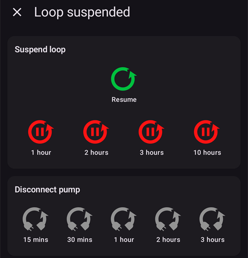
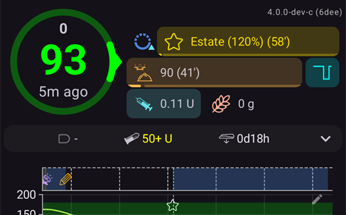
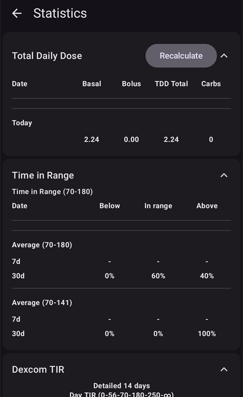

# Οθόνες του AAPS

```{contents}
:backlinks: entry
:depth: 2
```

(the-homescreen)= (AapsScreens-the-homescreen)=

## Η κύρια οθόνη


Αυτή είναι η πρώτη οθόνη που βλέπετε όταν ανοίγετε το **AAPS** και περιέχει τις περισσότερες πληροφορίες που χρειάζεστε καθημερινά.

### Ενότητα A - Πάνω γραμμή

* Το **μενού** (☰) αριστερά ανοίγει το πλευρικό μενού με **Ιστορικό θεραπειών**, **Εξερεύνηση ιστορικού**, **Στατιστικά**, **Βοηθός ρύθμισης προφίλ**, **Συντήρηση**, **Οδηγός εγκατάστασης**, **Διαμόρφωση** και άλλα.
* Η **γραμμή αναζήτησης** βρίσκει ρυθμίσεις, διαλόγους και τεκμηρίωση — απλώς αρχίστε να πληκτρολογείτε (δείτε [Καθολική αναζήτηση](../DailyLifeWithAaps/GlobalSearch.md)).
* Το εικονίδιο **Ρυθμίσεις** (γρανάζι) δεξιά ανοίγει όλες τις [ρυθμίσεις](../SettingUpAaps/Preferences.md).

(aaps-screens-profile--target)=

### Ενότητα B - Περιοχή κατάστασης

#### Τρέχουσα γλυκόζη αίματος

Η τελευταία τιμή γλυκόζης αίματος από το CGM σας εμφανίζεται στον μεγάλο κύκλο αριστερά, μαζί με τη διαφορά από την προηγούμενη τιμή (delta) και την ηλικία της τιμής.

Το χρώμα της τιμής BG δείχνει την κατάσταση σε σχέση με το ορισμένο [εύρος](#Preferences-range-for-visualization).

* πράσινο = εντός εύρους
* κόκκινο = κάτω από το εύρος
* κίτρινο = πάνω από το εύρος

  

(loop-status)= (AapsScreens-loop-status)=

#### Κατάσταση κυκλώματος


Δίπλα στον κύκλο BG, ένα εικονίδιο δείχνει τον τρόπο λειτουργίας του κυκλώματος (από πάνω προς τα κάτω στην εικόνα):

1. Πράσινος κύκλος = [κλειστό κύκλωμα](#KeyAapsFeatures-ClosedLoop), το κύκλωμα λειτουργεί
2. Μωβ κύκλος με διακεκομμένη γραμμή = [αναστολή λόγω χαμηλής γλυκόζης (LGS)](#KeyAapsFeatures-LGS)
3. Μπλε κύκλος με διακεκομμένη γραμμή = [ανοιχτό κύκλωμα](#KeyAapsFeatures-OpenLoop)
4. Κόκκινος κύκλος με σταυρό = το κύκλωμα είναι απενεργοποιημένο (δεν λειτουργεί μόνιμα)
5. Κόκκινο εικονίδιο παύσης = το κύκλωμα είναι σε αναστολή (προσωρινή παύση, αλλά ο βασικός ρυθμός χορηγείται) - ο υπόλοιπος χρόνος εμφανίζεται δίπλα στο εικονίδιο
6. Γκρι κύκλος με βύσμα = η αντλία είναι αποσυνδεδεμένη (προσωρινά καμία χορήγηση ινσουλίνης) - ο υπόλοιπος χρόνος εμφανίζεται δίπλα στο εικονίδιο

Πατήστε το εικονίδιο για να ανοίξει ο διάλογος του κυκλώματος. Το περιεχόμενο του διαλόγου εξαρτάται από την τρέχουσα κατάσταση:

* Όταν το κύκλωμα **λειτουργεί** (κλειστό, ανοιχτό ή LGS), μπορείτε να αλλάξετε τον τρόπο λειτουργίας (Κλειστό Κύκλωμα, Αναστολή Χαμηλής Γλυκόζης, Ανοιχτό Κύκλωμα ή Απενεργοποιήστε κύκλωμα), να κάνετε **αναστολή** του κυκλώματος ή να κάνετε **αποσύνδεση** της αντλίας για μια διάρκεια που επιλέγετε.
* Όταν το κύκλωμα είναι **απενεργοποιημένο**, μπορείτε να το ενεργοποιήσετε ξανά επιλέγοντας έναν τρόπο λειτουργίας ή να αποσυνδέσετε την αντλία.
* Όταν το κύκλωμα είναι **σε αναστολή**, μπορείτε να το **συνεχίσετε**, να αποσυνδέσετε την αντλία ή να επιλέξετε νέα διάρκεια στο **Αναστολή κυκλώματος** για να παρατείνετε την αναστολή.
* Όταν η αντλία είναι **αποσυνδεδεμένη**, μπορείτε να κάνετε **επανασύνδεση** της αντλίας ή να επιλέξετε νέα διάρκεια στο **Αποσύνδεση αντλίας** για να παρατείνετε την αποσύνδεση.

Όταν παρατείνετε μια αναστολή ή μια αποσύνδεση, η νέα διάρκεια **ξεκινά από τώρα**: αντικαθιστά τον υπόλοιπο χρόνο, δεν προστίθεται σε αυτόν. Δεν χρειάζεται να κάνετε πρώτα συνέχιση ή επανασύνδεση.

Ο διάλογος όταν το κύκλωμα λειτουργεί ως κλειστό κύκλωμα:


Ο διάλογος όταν το κύκλωμα είναι σε αναστολή, με **Συνέχιση** και τις διάρκειες για παράταση της αναστολής:



Ο διάλογος όταν η αντλία είναι αποσυνδεδεμένη, με **Επανασύνδεση αντλίας** και τις διάρκειες για παράταση της αποσύνδεσης:


Ο διάλογος σε Αναστολή Χαμηλής Γλυκόζης, σε ανοιχτό κύκλωμα και όταν το κύκλωμα είναι απενεργοποιημένο διαφέρει μόνο στους τρόπους λειτουργίας που προσφέρει:


Έτσι φαίνεται η κύρια οθόνη σε κάθε τρόπο λειτουργίας. Η χρωματιστή λωρίδα στο πάνω μέρος του γραφήματος αλλάζει τη στιγμή της αλλαγής.

Αναστολή Χαμηλής Γλυκόζης:


Ανοιχτό κύκλωμα:



Κύκλωμα απενεργοποιημένο:


Κύκλωμα σε αναστολή — ο υπόλοιπος χρόνος εμφανίζεται δίπλα στο εικονίδιο:


Αντλία αποσυνδεδεμένη — ο υπόλοιπος χρόνος εμφανίζεται δίπλα στο εικονίδιο. Τα κουμπιά θεραπειών μένουν στη γραμμή εργαλείων QuickLaunch, ώστε να μπορείτε ακόμη να καταγράψετε ινσουλίνη που δώσατε με πένα ή υδατάνθρακες:


Μετά από κάθε επιλογή χρειάζεται επιβεβαίωση.

```{admonition} Συναγερμός: η αντλία δεν δέχτηκε τον μηδενικό προσωρινό βασικό ρυθμό :class: warning Όσο η αντλία είναι αποσυνδεδεμένη, το **AAPS** διατηρεί έναν μηδενικό προσωρινό βασικό ρυθμό στην αντλία και τον ορίζει ξανά αν λείπει. Αν αυτό αποτυγχάνει ακόμη μετά από 10 λεπτά, το **AAPS** δίνει επείγοντα συναγερμό: *"Η αντλία δεν δέχτηκε τον μηδενικό προσωρινό βασικό ρυθμό. Μπορεί να χορηγεί ακόμα βασική ινσουλίνη. Ελέγξτε την αντλία."* Ο συναγερμός επαναλαμβάνεται κάθε 15 λεπτά μέχρι να οριστεί ο μηδενικός προσωρινός βασικός ρυθμός ή να τελειώσει η αποσύνδεση. Αν τον δείτε, ελέγξτε την αντλία σας: μπορεί να χορηγεί βασική ινσουλίνη, παρόλο που το **AAPS** τη δείχνει ως αποσυνδεδεμένη.

    <br />Σημείωση: οι τρόποι λειτουργίας που προσφέρονται εξαρτώνται από την πρόοδό σας στα [Βήματα](../SettingUpAaps/CompletingTheObjectives.md) — το Κλειστό Κύκλωμα και το LGS γίνονται διαθέσιμα μόνο καθώς ολοκληρώνετε τα βήματα.
    
    (aaps-screens-bg-warning-sign)=
    #### Σήμα προειδοποίησης BG
    
    Αν το **AAPS** ανιχνεύσει πρόβλημα με τις τιμές BG που λαμβάνει, μια συντόμευση προς την πηγή BG σας (με το όνομά της, για παράδειγμα **xDrip+ BG**) εμφανίζεται στην κάτω γραμμή της κύριας οθόνης, με ένα κόκκινο σήμα προειδοποίησης. Πατήστε τη για να ανοίξει η [οθόνη της πηγής BG](#aaps-screens-bg-source).
    
    ##### Διπλά δεδομένα BG
    
    Το κόκκινο σήμα προειδοποίησης σάς λέει να ενεργήσετε αμέσως: λαμβάνετε **διπλά δεδομένα BG**, και αυτό εμποδίζει το κύκλωμα να κάνει σωστά τη δουλειά του. Το **AAPS** δεν μπορεί να υπολογίσει αξιόπιστα την τάση της BG από διπλές τιμές, γι' αυτό σταματά τις διορθώσεις.
    
    Αν το κύκλωμά σας ήταν κλειστό, το **AAPS** το αλλάζει σε [Αναστολή Χαμηλής Γλυκόζης (LGS)](#KeyAapsFeatures-LGS): το εικονίδιο του κυκλώματος γίνεται μωβ.
    
      
    
    Πατήστε το εικονίδιο του κυκλώματος: η κάρτα **Περιορισμοί** στο πάνω μέρος σάς λέει τον λόγο: "BgQualityCheck: Λειτουργία LGS λόγω διπλών τιμών στην πηγή γλυκόζης".
    
      
    
    ```{admonition} Το κύκλωμά σας λειτουργεί σε Αναστολή Χαμηλής Γλυκόζης
    :class: note
    Το κύκλωμά σας συνεχίζει να λειτουργεί, αλλά μόνο για να σας προστατεύει από υπογλυκαιμίες: το **AAPS** μπορεί ακόμη να μειώσει ή να αναστείλει τον βασικό ρυθμό σας, αλλά δεν θα δώσει καμία ινσουλίνη διόρθωσης μέχρι να λύσετε αυτό το πρόβλημα!
    

Θα πρέπει να βρείτε γιατί παίρνετε διπλά δεδομένα γλυκόζης αίματος:

* Είναι ενεργοποιημένο το Dexcom bridge στον ιστότοπο Nightscout σας; Απενεργοποιήστε το bridge από τον πίνακα διαχείρισης (administration panel) του Nightscout σας: επεξεργαστείτε τη μεταβλητή "enable" και αφαιρέστε από εκεί το "bridge". (Για το heroku [λεπτομέρειες θα βρείτε εδώ](https://nightscout.github.io/troubleshoot/troubleshoot/#heroku).)
* Στέλνουν πολλές πηγές τις τιμές BG σας στο Nightscout; Αν χρησιμοποιείτε την εφαρμογή BYODA, ενεργοποιήστε την αποστολή στο **AAPS**, αλλά μην την ενεργοποιήσετε στο xDrip, αν το χρησιμοποιείτε.
* Έχετε ακόλουθους (followers) που λαμβάνουν τις τιμές BG σας αλλά τις στέλνουν και ξανά στον ιστότοπο Nightscout σας;
* Τελευταία λύση: Στις [ρυθμίσεις του NSClient](#Preferences-nsclient), επιλέξτε τις ρυθμίσεις Συγχρονισμού και απενεργοποιήστε την επιλογή "Λήψη δεδομένων CGM από το NS".

Για να φύγει αμέσως η προειδοποίηση και να ξαναρχίσει το κύκλωμα τις διορθώσεις, διαγράψτε τις διπλές εγγραφές από την οθόνη της πηγής BG: πατήστε τη συντόμευση στην κάτω γραμμή. Η διπλή τιμή εμφανίζεται με κόκκινο χρώμα. Πατήστε παρατεταμένα μια τιμή για να ξεκινήσει η επιλογή, σημειώστε τις διπλές τιμές και πατήστε το εικονίδιο του κάδου πάνω δεξιά.


Ωστόσο, όταν υπάρχουν πολλές διπλές καταχωρήσεις, μπορεί να είναι ευκολότερο να

* [να κάνετε αντίγραφο ασφαλείας των ρυθμίσεών σας](../Maintenance/ExportImportSettings.md),
* να επαναφέρετε τη βάση δεδομένων στο μενού συντήρησης και
* [να εισαγάγετε τις ρυθμίσεις σας](../Maintenance/ExportImportSettings.md) ξανά

    {admonition} Επιστρέψτε μόνοι σας σε Κλειστό Κύκλωμα
    :class: important
    Το **AAPS** δεν επιστρέφει μόνο του σε **Κλειστό Κύκλωμα** όταν φύγουν οι διπλές τιμές. Πατήστε το εικονίδιο του κυκλώματος στην κύρια οθόνη και επιλέξτε ξανά **Κλειστό Κύκλωμα**.

##### Σταθερά δεδομένα BG

Με ορισμένες πηγές BG (Libre 1, AiDEX, Glutec, Medtronic και πηγές που δεν αναφέρουν τον τύπο του αισθητήρα τους), το **AAPS** ελέγχει επίσης για τιμές που δεν αλλάζουν: αν η BG σας άλλαξε λιγότερο από 2 mg/dl (0,1 mmol/l) σε 45 λεπτά, τα δεδομένα θεωρούνται λάθος. Τότε η συντόμευση της πηγής BG δείχνει ένα κόκκινο σήμα σταθερής τάσης, και το κύκλωμα σταματά κάθε υψηλό προσωρινό βασικό ρυθμό και δεν δίνει ινσουλίνη διόρθωσης μέχρι να αλλάξουν ξανά οι τιμές. Ελέγξτε τον αισθητήρα σας και την εφαρμογή που στέλνει τις τιμές.

##### Ακανόνιστα δεδομένα BG

Όταν οι τιμές έρχονται σε ακανόνιστα διαστήματα ή κάποιες λείπουν, το **AAPS** υπολογίζει ξανά τιμές ανά 5 λεπτά από τις τιμές που έχει. Αυτό συμβαίνει για παράδειγμα μετά από αλλαγή αισθητήρα ή με αισθητήρες Libre, των οποίων ο χρονισμός μετακινείται ένα ή δύο λεπτά κάθε λίγες ώρες. Το κύκλωμα συνεχίζει να λειτουργεί και δεν χρειάζεται να κάνετε τίποτα. Το **AAPS** 4 δεν εμφανίζει πλέον κίτρινο σήμα προειδοποίησης για αυτό.

#### Τρέχον Προφίλ

Το τρέχον προφίλ εμφανίζεται δίπλα στο εικονίδιο με το αστέρι.

Πατήστε το όνομα του προφίλ για να ανοίξει η [οθόνη Προφίλ](#aaps-screens-profile), όπου μπορείτε να δείτε τις λεπτομέρειες του προφίλ και να [αλλάξετε μεταξύ διαφορετικών προφίλ](../DailyLifeWithAaps/ProfileSwitch-ProfilePercentage.md).

Για να **αλλάξετε το ποσοστό του προφίλ** (και τη διάρκειά του), πατήστε το όνομα του προφίλ και μετά πατήστε το στρογγυλό κουμπί **▶** (Ενεργοποίηση) κάτω δεξιά στην οθόνη Προφίλ. Στο **AAPS** 3.x αυτή η οθόνη άνοιγε με παρατεταμένο πάτημα στο όνομα του προφίλ· στο **AAPS** 4 το παρατεταμένο πάτημα δεν κάνει τίποτα. Βήμα προς βήμα: [Αλλαγή του ποσοστού προφίλ](#ProfileSwitch-change-percentage).


1. Κανονική εμφάνιση με ενεργοποίηση ενός τυπικού προφίλ.
2. Αλλαγή προφίλ με ποσοστό 90% και υπόλοιπη διάρκεια 9 λεπτά — το όνομα του προφίλ γίνεται κίτρινο όσο τρέχει μια προσωρινή αλλαγή προφίλ.
3. Αλλαγή προφίλ με χρονική μετατόπιση 1 ώρας και υπόλοιπη διάρκεια 9 λεπτά.

#### Στόχος


Ο τρέχων στόχος γλυκόζης αίματος εμφανίζεται κάτω από το όνομα του προφίλ.

Πατήστε σύντομα τον στόχο για να ανοίξει η οθόνη **[Προσωρινός στόχος](../DailyLifeWithAaps/TempTargets.md)**.

1. Κανονική εμφάνιση: το εύρος στόχου που ορίζεται στο προφίλ σας.
2. Αν έχει οριστεί προσωρινός στόχος, ο στόχος γίνεται κίτρινος/πορτοκαλί με το εικονίδιο της προεπιλογής που χρησιμοποιήθηκε, και ο υπόλοιπος χρόνος σε λεπτά εμφανίζεται σε παρένθεση.

(AapsScreens-visualization-of-dynamic-target-adjustment)=

#### Εμφάνιση της δυναμικής προσαρμογής στόχου

Όταν χρησιμοποιείτε τον [αλγόριθμο SMB](#Config-Builder-aps) και τη λειτουργία [Autosens](#Open-APS-features-autosens), το **AAPS** μπορεί να προσαρμόζει δυναμικά τον στόχο σας με βάση την ευαισθησία.

Ενεργοποιήστε μία ή και τις δύο από τις παρακάτω επιλογές στις [ρυθμίσεις OpenAPS SMB](#Preferences-openaps-smb-settings):

* "Η ευαισθησία ανεβάζει τον στόχο" και/ή
* "Η αντίσταση χαμηλώνει τον στόχο"

Αν το **AAPS** ανιχνεύσει αντίσταση ή ευαισθησία, ο στόχος θα αλλάξει από αυτόν που ορίζει το προφίλ, και ο στόχος που εμφανίζεται αλλάζει χρώμα για να δείξει την προσαρμογή.

(aaps-screens-iob-cob-basal-sens)=

#### IOB, COB, βασικός ρυθμός και ευαισθησία


1. **Σύριγγα**: ινσουλίνη στον οργανισμό (IOB) - ποσότητα ενεργής ινσουλίνης στο σώμα σας  
    Η τιμή της ινσουλίνης στον οργανισμό θα ήταν μηδέν αν έτρεχε μόνο ο κανονικός βασικός ρυθμός σας και δεν υπήρχε υπόλοιπο ινσουλίνης από προηγούμενα bolus. 
    * Το IOB μπορεί να είναι αρνητικό αν πρόσφατα υπήρξαν περίοδοι μειωμένου βασικού ρυθμού.
    * Πατήστε το chip για να δείτε τον διαχωρισμό σε ινσουλίνη bolus και βασικού ρυθμού (πρώτος διάλογος στην εικόνα — εδώ με αρνητικό IOB μετά από περίοδο μειωμένου βασικού ρυθμού)
2. **Κόκκος**: [υδατάνθρακες στον οργανισμό (COB)](../DailyLifeWithAaps/CobCalculation.md) - υδατάνθρακες που φάγατε πριν και δεν έχουν απορροφηθεί ακόμη
3. Το γαλαζοπράσινο κουμπί δεξιά δείχνει την **τρέχουσα χορήγηση βασικού ρυθμού**: επίπεδη γραμμή όταν τρέχει ο βασικός ρυθμός του προφίλ, αλλαγμένο εικονίδιο όσο είναι ενεργός ένας προσωρινός βασικός ρυθμός
4. Η **γραμμή ποσοστού** δείχνει την τρέχουσα ευαισθησία ([Autosens](#Open-APS-features-autosens) / [Δυναμική ISF](../DailyLifeWithAaps/DynamicISF.md)). Όταν το κύκλωμα αλλάζει το ISF σας, η γραμμή δείχνει επίσης το ISF του προφίλ, ένα βέλος και το ISF που χρησιμοποιεί τώρα το κύκλωμα, για παράδειγμα «80% 2,0 ↗ 2,5». Πατήστε την για να δείτε την τιμή Autosens και το πραγματικό ISF (δεύτερος διάλογος στην εικόνα). Αν το κύκλωμα δουλεύει με διαφορετική τιμή από το τελευταίο αποτέλεσμα του Autosens (για παράδειγμα επειδή ένας προσωρινός στόχος αλλάζει την ευαισθησία σας), ο διάλογος δείχνει επίσης αυτή την τιμή ως **Autosens σε αλγόριθμο**. Όταν το Autosens είναι απενεργοποιημένο, το κύκλωμα κρατά το ISF του προφίλ σας και δεν εμφανίζεται πραγματικό ISF.

Ο διάλογος IOB, που ανοίγει όταν πατήσετε το chip IOB:


Πατήστε το γαλαζοπράσινο κουμπί για να δείτε τον προσωρινό βασικό ρυθμό που τρέχει, πότε ξεκίνησε και πόση ώρα τρέχει:


(aaps-screens-carbs-required)=

#### Απαιτούνται υδατάνθρακες


Οι προτάσεις υδατανθράκων δίνονται όταν το πλάνο αναφοράς ανιχνεύει ότι απαιτούνται υδατάνθρακες.

Αυτό συμβαίνει όταν ο αλγόριθμος oref κρίνει ότι δεν μπορεί να σας προστατέψει με μηδενικό βασικό (zero temp) και θα χρειαστείτε υδατάνθρακες για να το διορθώσετε.

Οι ειδοποιήσεις υδατανθράκων είναι πολύ πιο εξελιγμένες από αυτές του υπολογιστή bolus. Μπορεί να δείτε πρόταση υδατανθράκων ενώ ο υπολογιστής bolus δεν δείχνει υδατάνθρακες που λείπουν.

Οι ειδοποιήσεις για ανάγκη υδατανθράκων μπορούν να προωθηθούν στο Nightscout αν το επιθυμείτε, οπότε και θα εμφανιστεί και θα μεταδοθεί μια ανακοίνωση.

### Ενότητα C - Γραμμή κατάστασης


Η γραμμή κατάστασης δίνει οπτική προειδοποίηση για

* Ηλικία καθετήρα
* Ηλικία ινσουλίνης (ημέρες χρήσης της δεξαμενής) και επίπεδο δεξαμενής (μονάδες)
* Ηλικία αισθητήρα
* Ηλικία και επίπεδο μπαταρίας αντλίας (%)

Εάν υπάρχει υπέρβαση του ορίου προειδοποίησης, οι τιμές θα εμφανίζονται με κίτρινο χρώμα.

Αν ξεπεραστεί το κρίσιμο όριο, οι τιμές εμφανίζονται με κόκκινο χρώμα.

The age is always shown in its short form, whatever the screen size: *4h* on the first day, *3d4h* later.

Τα όρια αλλάζουν από το μικρό εικονίδιο **Ρυθμίσεις** που εμφανίζεται όταν η γραμμή κατάστασης είναι **ανοιγμένη** (βέλος δεξιά) — δείτε [Ενδείξεις κατάστασης](#Preferences-status-lights).

Η ανοιγμένη περιοχή κατάστασης έχει επίσης ένα κουμπί στο τέλος ορισμένων γραμμών για να καταγράψετε μια αλλαγή, που μηδενίζει την αντίστοιχη ηλικία: το **Προσθήκη** στη γραμμή **Αισθητήρας** καταγράφει την τοποθέτηση αισθητήρα. Αν η αντλία σας το υποστηρίζει, το **Πλήρωση/Γέμισμα** εμφανίζεται στις γραμμές **Καθετήρας** (ή **Αυτοκόλλητη αντλία**) και **Ινσουλίνη**, και το **Προσθήκη** στη γραμμή **Μπαταρία αντλίας**.


Ανάλογα με την αντλία που χρησιμοποιείτε, μπορεί να μην έχετε όλα αυτά τα εικονίδια.

(screens-sensor-level-battery)=

#### Επίπεδο αισθητήρα (μπαταρία)

Λειτουργεί για CGM με πρόσθετο πομπό, όπως το MiaoMiao 2. (Τεχνικά, ο αισθητήρας πρέπει να στέλνει πληροφορίες για το επίπεδο μπαταρίας στο xDrip.)

Τα όρια ορίζονται στις [Ενδείξεις κατάστασης](#Preferences-status-lights).

(aaps-screens-main-graph)=

### Ενότητα D - Κύριο γράφημα


Το γράφημα δείχνει τη γλυκόζη αίματος (BG) όπως τη μετράει ο μετρητής γλυκόζης σας (CGM).

Χρησιμοποιήστε κύλιση και τσίμπημα (pinch-zoom) στο γράφημα για να αλλάξετε το χρονικό διάστημα που φαίνεται.

Η πράσινη περιοχή δείχνει το εύρος στόχου σας.

Αυτές οι πληροφορίες εμφανίζονται επίσης σε αυτό το γράφημα:

* Χειροκίνητα bolus: μπλε τρίγωνο ακριβώς πάνω από την καμπύλη BG, που δείχνει προς τα κάτω στην τιμή εκείνης της στιγμής, με την ποσότητα ινσουλίνης
* Καταχωρήσεις υδατανθράκων: πορτοκαλί τρίγωνο ακριβώς κάτω από την καμπύλη BG, που δείχνει προς τα πάνω στην τιμή, με την ποσότητα υδατανθράκων. Ένα γεύμα που καταχωρήθηκε μαζί με το bolus του φαίνεται σαν ένα σημάδι, που χωρίζεται από την τιμή.
* Τα τρίγωνα έχουν τρία μεγέθη (μικρό, μεσαίο, μεγάλο), ανάλογα με την ποσότητα σε σύγκριση με τη μεγαλύτερη της ημέρας. Αν δεν υπάρχει τιμή BG εκείνη τη στιγμή (κενό αισθητήρα), το τρίγωνο σχεδιάζεται στο κάτω μέρος του γραφήματος.
* Έλεγχοι BG και βαθμονομήσεις: σχεδιάζονται στη δική τους μετρημένη τιμή, ώστε να τις συγκρίνετε με την καμπύλη του αισθητήρα
* Στόχος όπως ορίζεται στο προφίλ ή όπως άλλαξε από προσωρινό στόχο: πράσινη γραμμή
* Αλλαγές προφίλ: εικονίδια αστεριού στο πάνω μέρος του γραφήματος
* Κατάσταση κυκλώματος: χρωματιστή λωρίδα στο πάνω μέρος του γραφήματος όταν ο [τρόπος λειτουργίας](#AapsScreens-loop-status) είναι οτιδήποτε άλλο εκτός από κλειστό κύκλωμα: μπλε = ανοιχτό κύκλωμα, μωβ = LGS, κόκκινο = απενεργοποιημένο κύκλωμα, κίτρινο = κύκλωμα σε αναστολή, γκρι = αντλία αποσυνδεδεμένη, πορτοκαλί = superbolus (στο στιγμιότυπο: μωβ και μετά κίτρινο). Το ιστορικό αυτών των αλλαγών εμφανίζεται στο [Τρόπος λειτουργίας](#AapsScreens-running-mode)
* Τα [SMB](#Open-APS-features-super-micro-bolus-smb) δεν σχεδιάζονται στο γράφημα BG (θα υπήρχε ένα κάθε λίγα λεπτά): εμφανίζονται στο [γράφημα IOB](#aaps-screens-iob).

Πατήστε έναν **Έλεγχο BG** στο γράφημα για να δείτε την τιμή του και τη σημείωσή του, αν γράψατε μία.

(aaps-screens-graph-press-and-hold)=

#### Δείτε τις τιμές σε μια συγκεκριμένη στιγμή

**Πατήστε παρατεταμένα** το γράφημα BG για λίγο για να δείτε τις τιμές σε μια μέτρηση. Μια τελεία δείχνει την πιο κοντινή μέτρηση, μια διακεκομμένη γραμμή σχεδιάζεται σε εκείνη τη στιγμή σε όλα τα γραφήματα και ένα αναδυόμενο παράθυρο στο πάνω μέρος του γραφήματος δείχνει:

* την ώρα και την τιμή BG
* IOB, COB (μόνο όταν είναι πάνω από 0 g) και τον βασικό ρυθμό εκείνη τη στιγμή — το εικονίδιο βασικού ρυθμού δείχνει αν έτρεχε προσωρινός βασικός ρυθμός, όπως στην κύρια οθόνη
* κάθε bolus, SMB ή υδατάνθρακες εκείνη τη στιγμή, με τα ίδια τρίγωνα όπως στα γραφήματα

Κρατήστε το δάχτυλό σας στην οθόνη και μετακινήστε το αριστερά ή δεξιά για να πάτε από μια μέτρηση στην επόμενη. Νιώθετε μια ελαφριά δόνηση σε κάθε μέτρηση, και το γράφημα δεν κάνει κύλιση όσο το κάνετε αυτό. Το αναδυόμενο παράθυρο μένει 2 δευτερόλεπτα αφού σηκώσετε το δάχτυλό σας.

Αυτό λειτουργεί με τον ίδιο τρόπο και στα [πρόσθετα γραφήματα](#aaps-screens-additional-graphs) κάτω από το γράφημα BG (IOB, COB...): πατήστε παρατεταμένα οποιοδήποτε από αυτά.


(aaps-screens-graph-clock-change)=

#### Clock changes

When the clock of the phone jumped, at a daylight saving change or in a new time zone, a dashed vertical line marks that moment in the BG graph, with a small clock icon at its foot. The same dashed line runs through the [additional graphs](#aaps-screens-additional-graphs) below.


(AapsScreens-activate-optional-information)=

#### Ενεργοποίηση προαιρετικών πληροφοριών

Πατήστε το εικονίδιο με το **μολύβι** πάνω δεξιά στο γράφημα για να ανοίξουν οι ρυθμίσεις του γραφήματος:


* Το **Ύψος γραφήματος** ρυθμίζει πόσο ψηλό σχεδιάζεται το γράφημα.
* Το **ACT** προσθέτει την καμπύλη δράσης της ινσουλίνης: μια συνεχής κιτρινοπράσινη γραμμή <span style="background:#141218;color:#D3F166;padding:0 0.3em;border:1px solid #141218;border-radius:4px">━━━━</span> (μην τη μπερδέψετε με την κίτρινη διακεκομμένη πρόβλεψη UAM)
* Το **PRED** προσθέτει τις [γραμμές πρόβλεψης](#aaps-screens-prediction-lines) (δείτε παρακάτω)

(aaps-screens-prediction-lines)=

#### Γραμμές προβλέψεων

Όταν το **PRED** είναι ενεργό, το AAPS σχεδιάζει τις προβλέψεις του ως **διακεκομμένες γραμμές** δεξιά από τη γραμμή «τώρα». Κάθε πρόβλεψη έχει το δικό της χρώμα. Το σκούρο θέμα χρησιμοποιεί πιο ανοιχτές αποχρώσεις των ίδιων χρωμάτων, και μια γραμμή μέσα στο πράσινο εύρος στόχου μπορεί να φαίνεται λίγο πιο πράσινη.

| Γραμμή                     | Φωτεινό θέμα                                                                                                                      | Σκούρο θέμα                                                                                                                        | Τι προβλέπει                                       |
| -------------------------- | --------------------------------------------------------------------------------------------------------------------------------- | ---------------------------------------------------------------------------------------------------------------------------------- | -------------------------------------------------- |
| **IOB** (μπλε)             | <span style="background:#FFFFFF;color:#1E88E5;padding:0 0.3em;border:1px solid #CCCCCC;border-radius:4px">●●●●</span>             | <span style="background:#141218;color:#64B5F6;padding:0 0.3em;border:1px solid #141218;border-radius:4px">●●●●</span>              | μόνο ινσουλίνη                                     |
| **COB** (πορτοκαλί)        | <span style="background:#FFFFFF;color:#FB8C00;padding:0 0.3em;border:1px solid #CCCCCC;border-radius:4px">●●●●</span>             | <span style="background:#141218;color:#FFB74D;padding:0 0.3em;border:1px solid #141218;border-radius:4px">●●●●</span>              | υδατάνθρακες στον οργανισμό                        |
| **UAM** (κίτρινο)          | <span style="background:#FFFFFF;color:#C9BD60;padding:0 0.3em;border:1px solid #CCCCCC;border-radius:4px">●●●●</span>             | <span style="background:#141218;color:#E6D39A;padding:0 0.3em;border:1px solid #141218;border-radius:4px">●●●●</span>              | μη δηλωμένο γεύμα                                  |
| **ZT** (κυανό)             | <span style="background:#FFFFFF;color:#00D2D2;padding:0 0.3em;border:1px solid #CCCCCC;border-radius:4px">●●●●</span>             | <span style="background:#141218;color:#4DD4D4;padding:0 0.3em;border:1px solid #141218;border-radius:4px">●●●●</span>              | μηδενικός βασικός (zero temp, η ινσουλίνη σταματά) |
| **aCOB** (απαλό πορτοκαλί) | <span style="background:#FFFFFF;color:rgba(251,140,0,0.5);padding:0 0.3em;border:1px solid #CCCCCC;border-radius:4px">●●●●</span> | <span style="background:#141218;color:rgba(255,183,77,0.5);padding:0 0.3em;border:1px solid #141218;border-radius:4px">●●●●</span> | μόνο ο παλαιότερος αλγόριθμος AMA                  |

Όταν δύο προβλέψεις δίνουν τις ίδιες τιμές, οι τελείες τους επικαλύπτονται και βλέπετε μόνο ένα από τα χρώματα (για παράδειγμα, UAM πάνω από IOB όταν η BG είναι σταθερή).

* Γραμμή **COB** (πορτοκαλί): [υδατάνθρακες στον οργανισμό](CobCalculation) (το πορτοκαλί χρησιμοποιείται σε όλο το AAPS για COB και υδατάνθρακες)
    
    Αυτή η γραμμή πρόβλεψης δείχνει πού θα πάει η BG σας (όχι το ίδιο το COB!) με βάση τις τρέχουσες ρυθμίσεις του **Προφίλ**, αν οι αποκλίσεις λόγω απορρόφησης υδατανθράκων μείνουν σταθερές. Αυτή η γραμμή εμφανίζεται μόνο εάν υπάρχουν γνωστοί Ενεργοί Υδατάνθρακες.

* Γραμμή **IOB** (μπλε): ινσουλίνη στον οργανισμό (το μπλε χρησιμοποιείται σε όλο το AAPS για IOB και ινσουλίνη)
    
    Αυτή η γραμμή πρόβλεψης δείχνει τι θα συνέβαινε μόνο με την επίδραση της ινσουλίνης. Για παράδειγμα, αν δώσατε ινσουλίνη και μετά δεν φάγατε υδατάνθρακες.

* Γραμμή **ZT** (κυανή): μηδενικός βασικός (zero temp) (προβλεπόμενη BG αν οριζόταν προσωρινός βασικός ρυθμός 0%)
    
    Αυτή η γραμμή πρόβλεψης δείχνει πώς θα άλλαζε η πορεία της BG αν η αντλία σταματούσε κάθε χορήγηση ινσουλίνης (TBR 0%). Η γραμμή σταματά μόλις ανέβει πάνω από τον στόχο σας.
    
    *Αυτή η γραμμή εμφανίζεται μόνο όταν χρησιμοποιείται ο αλγόριθμος [SMB](#Config-Builder-aps).*

* Γραμμή **UAM** (κίτρινη): [μη δηλωμένα γεύματα](#SensitivityDetectionAndCob-sensitivity-oref1)
    
    Μη δηλωμένα γεύματα σημαίνει ότι ανιχνεύτηκε σημαντική άνοδος της γλυκόζης λόγω γευμάτων, αδρεναλίνης ή άλλων παραγόντων. Η γραμμή πρόβλεψης μοιάζει με την **πορτοκαλί γραμμή COB**, αλλά υποθέτει ότι οι αποκλίσεις θα μειώνονται με σταθερό ρυθμό (συνεχίζοντας τον τρέχοντα ρυθμό μείωσης).
    
    *Αυτή η γραμμή εμφανίζεται μόνο όταν χρησιμοποιείται ο αλγόριθμος [SMB](#Config-Builder-aps), η επιλογή **Ενεργοποίηση UAM** είναι ενεργή στις ρυθμίσεις OpenAPS SMB και η BG ανεβαίνει περισσότερο από όσο εξηγεί μόνο η ινσουλίνη.*

* Γραμμή **aCOB** (απαλή, διάφανη πορτοκαλί): επιταχυμένη απορρόφηση υδατανθράκων
    
    Παρόμοια με το COB, αλλά υποθέτει σταθερό ρυθμό απορρόφησης υδατανθράκων 10 mg/dl/5m (-0,555 mmol/l/5m). Έχει καταργηθεί και έχει περιορισμένη χρησιμότητα.
    
    *Αυτή η γραμμή εμφανίζεται μόνο όταν χρησιμοποιείται ο παλαιότερος αλγόριθμος [AMA](#Config-Builder-aps).*

Συνήθως η πραγματική καμπύλη γλυκόζης καταλήγει στη μέση αυτών των γραμμών ή κοντά σε εκείνη της οποίας οι υποθέσεις μοιάζουν περισσότερο με την κατάστασή σας.

(aaps-screens-how-predictions-become-a-dosing-decision)=

#### Πώς το AAPS μετατρέπει τις προβλέψεις σε απόφαση δοσολογίας

Το AAPS δεν δίνει ινσουλίνη μόνο με βάση την τρέχουσα BG σας — σε κάθε κύκλο του κυκλώματος (περίπου κάθε 5 λεπτά) εξετάζει όλες τις παραπάνω γραμμές πρόβλεψης μαζί και βρίσκει την πιο ασφαλή ενέργεια.

Ο βασικός κανόνας είναι **πρώτα η ασφάλεια**: αν *οποιαδήποτε* γραμμή πρόβλεψης, σε οποιοδήποτε χρονικό διάστημα, πέσει κάτω από το κατώτερο όριο ασφαλείας σας, το AAPS ορίζει μηδενικό βασικό (zero temp, προσωρινός βασικός ρυθμός 0%) και δεν δίνει άλλη ινσουλίνη, ακόμη κι αν η τρέχουσα BG σας είναι υψηλή. Μόνο όταν όλες οι γραμμές πρόβλεψης μένουν πάνω από αυτό το όριο, το AAPS θα εξετάσει να δώσει περισσότερη ινσουλίνη.

Όταν είναι ασφαλές να δοθεί περισσότερη ινσουλίνη, το AAPS κοιτάζει πού προβλέπεται να καταλήξει τελικά η BG (η **τελική BG**) στις συνδυασμένες προβλέψεις, και υπολογίζει πόση διόρθωση χρειάζεται για να φέρει αυτή την τελική BG πίσω στον στόχο — είτε ως αυξημένο προσωρινό βασικό ρυθμό, είτε (αν είναι ενεργός ο αλγόριθμος oref1/[SMB](#Open-APS-features-super-micro-bolus-smb)) ως μικρό άμεσο bolus. Αν η BG είναι υψηλή τώρα αλλά ήδη πέφτει αρκετά από μόνη της, το AAPS θα περιμένει ή μπορεί ακόμη και να μειώσει τον βασικό ρυθμό, αντί να προσθέσει ινσουλίνη που θα έκανε μια μελλοντική υπογλυκαιμία ακόμη χειρότερη.

Για παραδείγματα αυτής της λογικής απόφασης με πραγματικά στιγμιότυπα, δείτε τα [σενάρια δοσολογίας στον Οδηγό για γιατρούς](#clinicianguide-dosing-scenarios) — γράφτηκαν για γιατρούς, αλλά ισχύουν για κάθε χρήστη του AAPS.

*Για την πλήρη τεχνική περιγραφή του τρόπου υπολογισμού αυτών των προβλέψεων και της απόφασης δοσολογίας, δείτε την [τεκμηρίωση determine-basal του OpenAPS](https://openaps.readthedocs.io/en/latest/docs/While%20You%20Wait%20For%20Gear/Understand-determine-basal.html).*

#### Βασικοί

Μια **συνεχής μπλε** γραμμή δείχνει τη χορήγηση βασικού ρυθμού από την αντλία σας και αντιστοιχεί στην πραγματική χορήγηση στον χρόνο.

Η **διακεκομμένη μπλε** γραμμή δείχνει ποιος θα ήταν ο βασικός ρυθμός αν δεν υπήρχαν προσωρινές αλλαγές βασικού ρυθμού (TBR).

Όταν χορηγείται ο κανονικός βασικός ρυθμός, η περιοχή κάτω από την καμπύλη εμφανίζεται σκούρα μπλε. Όταν ο βασικός ρυθμός αλλάζει προσωρινά (αυξάνεται ή μειώνεται), η περιοχή κάτω από την καμπύλη εμφανίζεται ανοιχτή μπλε.

#### Δράση ινσουλίνης

Η **λεπτή κίτρινη** γραμμή δείχνει τη δράση της ινσουλίνης.

Βασίζεται στην αναμενόμενη πτώση της BG από την ινσουλίνη στον οργανισμό σας, αν δεν υπήρχαν άλλοι παράγοντες (όπως υδατάνθρακες).

(AapsScreens-section-g-additional-graphs)= (aaps-screens-additional-graphs)=

### Ενότητα E - Πρόσθετα γραφήματα

Μπορείτε να ενεργοποιήσετε πρόσθετα γραφήματα κάτω από το κύριο γράφημα. Σε [Απλή λειτουργία](#preferences-simple-mode), τα πρόσθετα γραφήματα είναι προκαθορισμένα και δεν αλλάζουν. Απενεργοποιήστε την **Απλή λειτουργία** αν θέλετε να ορίσετε δική σας διαμόρφωση για τα πρόσθετα γραφήματα.

Τα πρόσθετα γραφήματα ακολουθούν το κύριο γράφημα: όταν κάνετε κύλιση ή ζουμ στο γράφημα BG, μετακινούνται μαζί του. Ένα σύρσιμο προς τα πλάγια σε ένα πρόσθετο γράφημα κάνει επίσης κύλιση σε όλα τα γραφήματα. Δεν έχουν δικές τους ενδείξεις ώρας — διαβάστε την ώρα στο γράφημα BG.

Για να ρυθμίσετε ένα πρόσθετο γράφημα, πατήστε το εικονίδιο με το **μολύβι** πάνω δεξιά σε αυτό:


Επιλέξτε τα chips για τα δεδομένα που θέλετε να βλέπετε σε αυτό το γράφημα· το κουμπί **Αφαίρεση** διαγράφει το γράφημα.

Για να δημιουργήσετε ένα ακόμη γράφημα, πατήστε **Προσθήκη γραφήματος** κάτω από το τελευταίο γράφημα και επιλέξτε τα chips του με τον ίδιο τρόπο:


Το νέο γράφημα προστίθεται κάτω από τα άλλα — εδώ ένα δεύτερο πρόσθετο γράφημα με **SENS%** και **DEV**:


Οι περισσότεροι χρήστες βρίσκουν αρκετή την παρακάτω διαμόρφωση πρόσθετων γραφημάτων:

* Γράφημα 1 με IOB, COB, Αλλαγή ευαισθησίας
* Γράφημα 2 με Αποκλίσεις και BGI.

#### Απόλυτη ινσουλίνη (ABS)

Ενεργή ινσουλίνη μαζί με τα bolus **και τον βασικό ρυθμό**.

(aaps-screens-iob)=

#### Ενεργή ινσουλίνη (IOB)

Δείχνει την ινσουλίνη στον οργανισμό σας (= ενεργή ινσουλίνη στο σώμα σας). Περιλαμβάνει ινσουλίνη από bolus και από προσωρινό βασικό ρυθμό (**αλλά όχι τους βασικούς ρυθμούς του προφίλ σας**).

Αν δεν υπήρχαν [SMB](#Open-APS-features-super-micro-bolus-smb), bolus και TBR κατά τη διάρκεια της DIA, αυτό θα ήταν μηδέν.

Τα SMB εμφανίζονται σε αυτό το γράφημα ως μπλε τρίγωνα, σε τρία μεγέθη ανάλογα με την ποσότητα σε σύγκριση με το μεγαλύτερο SMB της ημέρας.

Το IOB μπορεί να είναι αρνητικό αν δεν έχετε υπόλοιπο bolus και είχατε μηδενικό/χαμηλό προσωρινό ρυθμό για μεγάλο διάστημα.

Η μείωση εξαρτάται από τις [ρυθμίσεις DIA και τύπου ινσουλίνης](#Config-Builder-insulin-dia).

#### Ενεργοί υδατάνθρακες (COB)

Δείχνει τους υδατάνθρακες στον οργανισμό σας (= ενεργοί υδατάνθρακες στο σώμα σας, που δεν έχουν απορροφηθεί ακόμη).

Η απορρόφηση εξαρτάται από τις [αποκλίσεις που ανιχνεύει ο αλγόριθμος](../DailyLifeWithAaps/CobCalculation.md).

Αν ανιχνεύσει μεγαλύτερη απορρόφηση υδατανθράκων από την αναμενόμενη, θα χορηγηθεί ινσουλίνη και αυτό θα αυξήσει το IOB (περισσότερο ή λιγότερο, ανάλογα με τις ρυθμίσεις ασφαλείας σας).

#### Αλλαγή ευαισθησίας (SENS%)

Δείχνει την ευαισθησία που ανίχνευσε το [Autosens](#Open-APS-features-autosens).

Η ευαισθησία είναι ένας υπολογισμός της ευαισθησίας στην ινσουλίνη λόγω άσκησης, ορμονών κ.λπ.

Σημείωση: πρέπει να βρίσκεστε στο [Βήμα 8](#objectives-objective8), ώστε η Ανίχνευση ευαισθησίας/το [Autosens](#Open-APS-features-autosens) να προσαρμόζει αυτόματα την ποσότητα ινσουλίνης που χορηγείται. Πριν φτάσετε σε αυτό το βήμα, η γραμμή στο γράφημα εμφανίζεται μόνο για ενημέρωση.

### Μεταβλητή ευαισθησία (VSENS)

Δείχνει την ευαισθησία όπως την υπολογίζει η [Δυναμική ISF](../DailyLifeWithAaps/DynamicISF.md). Έχει τιμές μόνο αν χρησιμοποιείτε αυτή τη λειτουργία.

(screen-heart-rate-steps)=

#### Καρδιακός ρυθμός (HR) & Βήματα

Αυτά τα δεδομένα μπορεί να είναι διαθέσιμα όταν χρησιμοποιείτε ένα [έξυπνο ρολόι Wear OS](../WearOS/WearOsSmartwatch.md). Ενεργοποιήστε τα στην εφαρμογή Wear του **AAPS** και δώστε άδεια για τα δεδομένα υγείας.

Steps are drawn as columns, and the heart rate as a curved line that breaks where the watch sent no data.

#### Αποκλίσεις (DEV)

* Οι **γκρι** μπάρες δείχνουν απόκλιση λόγω υδατανθράκων.
* Οι **πράσινες** μπάρες δείχνουν ότι η BG είναι υψηλότερη από ό,τι περίμενε ο αλγόριθμος. Οι πράσινες μπάρες χρησιμοποιούνται για να αυξήσουν την αντίσταση στο [Autosens](#Open-APS-features-autosens).
* Οι **κόκκινες** μπάρες δείχνουν ότι η BG είναι χαμηλότερη από ό,τι περίμενε ο αλγόριθμος. Οι κόκκινες μπάρες χρησιμοποιούνται για να αυξήσουν την ευαισθησία στο [Autosens](#Open-APS-features-autosens).
* Οι **κίτρινες** μπάρες δείχνουν απόκλιση λόγω UAM.
* Οι **μαύρες** μπάρες δείχνουν μικρές αποκλίσεις που δεν λαμβάνονται υπόψη για την ευαισθησία

#### Επίδραση στη γλυκόζη αίματος (-BGI)

Αυτή η γραμμή δείχνει πόσο «θα έπρεπε» να ανέβει ή να πέσει η BG μόνο λόγω της δράσης της ινσουλίνης.


Είναι καλός συνδυασμός να εμφανίζετε αυτή τη γραμμή μαζί με τις μπάρες αποκλίσεων. Έχουν την ίδια κλίμακα, αλλά διαφορετική από τα άλλα προαιρετικά δεδομένα, γι' αυτό είναι καλή ιδέα να τα εμφανίζετε σε ξεχωριστό γράφημα, όπως φαίνεται παραπάνω. Η σύγκριση της γραμμής BGI με τις μπάρες αποκλίσεων είναι ένας ακόμη τρόπος να καταλάβετε πώς αλλάζει η **BG**. Εδώ, τη στιγμή που σημειώνεται με **1**, οι μπάρες αποκλίσεων είναι πολύ πάνω από τη γραμμή BGI: η BG ανεβαίνει περισσότερο από όσο εξηγεί μόνο η δράση της ινσουλίνης (για παράδειγμα μετά από υδατάνθρακες). Τη στιγμή που σημειώνεται με **2**, οι μπάρες αποκλίσεων είναι κάτω από το μηδέν (κόκκινες): η BG είναι χαμηλότερη από ό,τι περίμενε ο αλγόριθμος.

### Ενότητα F - Γραμμή εργαλείων QuickLaunch


Η αιωρούμενη γραμμή εργαλείων στο κάτω μέρος της οθόνης περιέχει τις ενέργειες **[QuickLaunch](../DailyLifeWithAaps/QuickLaunch.md)**. Το μικρό **γρανάζι** ανοίγει τη ρύθμιση του QuickLaunch, όπου επιλέγετε ποια κουμπιά εμφανίζονται (θεραπείες, καταχωρήσεις Careportal, ενέργειες CGM, οι οθόνες του φύλλου **Διαχείριση**, κουμπιά [Γρήγορου Οδηγού](../DailyLifeWithAaps/QuickWizards.md), [Σενάρια](../DailyLifeWithAaps/Scenes.md) και άλλα).

Μια συνηθισμένη διαμόρφωση φαίνεται παραπάνω: **Ινσουλίνη**, **Υδατάνθρακες** και ο **Οδηγός Bolus**.

Όσο η αντλία είναι **αποσυνδεδεμένη**, τα κουμπιά θεραπειών μένουν στη γραμμή εργαλείων, για παράδειγμα για να καταγράψετε ινσουλίνη που δώσατε με πένα (δείτε [Ινσουλίνη](#aaps-screens-buttons-insulin) παρακάτω). Οι ίδιες ενέργειες υπάρχουν και στο [φύλλο Θεραπείες](#aaps-screens-treatments-sheet) της κάτω πλοήγησης.

(aaps-screens-buttons-insulin)=

#### Ινσουλίνη


Για να δώσετε μια ποσότητα ινσουλίνης χωρίς να χρησιμοποιήσετε τον [υπολογιστή bolus](#aaps-screens-bolus-wizard).

Αν ενεργοποιήσετε το **Εκκίνηση Τρώω σύντομα ΤΤ**, μπορείτε να ξεκινήσετε αυτόματα τον [προσωρινό στόχο «Γεύμα Σύντομα»](#TempTargets-eating-soon-temp-target).

Αν δεν θέλετε να κάνετε bolus μέσω της αντλίας αλλά μόνο να καταγράψετε μια ποσότητα ινσουλίνης (π.χ. ινσουλίνη από πένα), ενεργοποιήστε το "**Το Bolus μόνο θα καταγραφεί**". Μια πρόσθετη γραμμή **Χρόνος**, ρυθμισμένη στο **Τώρα**, σας επιτρέπει να καταγράψετε μια ένεση ινσουλίνης που έγινε στο παρελθόν: χρησιμοποιήστε **-** / **+** για να την αλλάξετε, ή πατήστε το βέλος για να γράψετε τα λεπτά ή να επιλέξετε ημερομηνία και ώρα.

 

Μπορείτε να χρησιμοποιήσετε τα κουμπιά **+0.5 / +1.0 / +2.0** για να αυξήσετε γρήγορα την ποσότητα ινσουλίνης. Οι τιμές των βημάτων αλλάζουν στις [ρυθμίσεις του Οδηγού Bolus](#Preferences-deliver-this-part-of-bolus-wizard-result).

Ο διάλογος ινσουλίνης μπορεί να χρησιμοποιηθεί και όταν η αντλία είναι σε αναστολή ή αποσυνδεδεμένη, π.χ. για να καταγράψετε ινσουλίνη που κάνατε με πένα. Σε αυτή την περίπτωση, το "**Το Bolus μόνο θα καταγραφεί**" είναι υποχρεωτικά ενεργό (εμφανίζεται με κόκκινο) και εμφανίζονται πρόσθετα πεδία για να επιλέξετε τον τύπο ινσουλίνης και μια μετατόπιση **Χρόνος** για ένεση που έγινε στο παρελθόν:


#### Υδατάνθρακες


Για να καταγράψετε υδατάνθρακες χωρίς bolus.

Ορισμένοι [προκαθορισμένοι προσωρινοί στόχοι](#TempTargets-hypo-temp-target) (Υπογλυκαιμία, Γεύμα Σύντομα, Άσκηση) μπορούν να ξεκινήσουν απευθείας με τους διακόπτες στο πάνω μέρος.

**Χρόνος υδατανθράκων**: Πότε θα φάτε / πότε φάγατε τους υδατάνθρακες.

**Διάρκεια**: Χρησιμοποιείται για [«εκτεταμένους υδατάνθρακες»](ExtendedCarbs). Αυτή η γραμμή είναι κλειστή, ώστε να μη γράψετε κατά λάθος τα γραμμάρια σε αυτήν: χρησιμοποιήστε **-** / **+** για να την αλλάξετε, ή πατήστε το βέλος για να την ανοίξετε και να γράψετε μια τιμή.

Μπορείτε να χρησιμοποιήσετε τα κουμπιά **+5 / +10 / +20** για να αυξήσετε γρήγορα την ποσότητα υδατανθράκων.

#### Γρήγορος Οδηγός

Καταχωρήστε εύκολα την ποσότητα υδατανθράκων και ορίστε τις βάσεις του υπολογισμού με ένα μόνο προρυθμισμένο κουμπί.

Οι λεπτομέρειες ορίζονται στον [Γρήγορο Οδηγό](../DailyLifeWithAaps/QuickWizards.md).

(aaps-screens-treatments-sheet)=

### Ενότητα G - Κάτω πλοήγηση

Η κάτω γραμμή πλοήγησης δίνει πρόσβαση σε:

* **Θεραπείες** — ένα φύλλο γρήγορων ενεργειών με τις ενέργειες θεραπείας σας:
    
    

* **Σενάρια** — εμφανίζεται μόνο όταν έχετε τουλάχιστον ένα [σενάριο](../DailyLifeWithAaps/Scenes.md) ή έναν κανόνα **Αυτοματισμός** σημειωμένο ως **Ενέργεια χρήστη**. Ανοίγει ένα φύλλο από το οποίο μπορείτε να τα ξεκινήσετε· ένας αριθμός δείχνει πόσα μπορείτε να ξεκινήσετε αυτή τη στιγμή. Το **μολύβι** στο πάνω μέρος του φύλλου ανοίγει το **Διαχείριση → Σενάρια**.

* **Διαχείριση** — το κέντρο για όλα όσα διαχειρίζεστε στο **AAPS**: Προφίλ, Ρυθμίσεις ινσουλίνης, Προσωρινός στόχος, Γρήγορος Οδηγός, Σενάρια, Αυτοματισμός, Τρόφιμα, Εναλλαγή σημείων, Αντλία και Εξουσιοδοτημένοι πελάτες. Από κάτω υπάρχουν ενέργειες για συσκευές και βασικό ρυθμό, όπως Τοποθέτηση αισθητήρα και Προσωρινός βασικός ρυθμός. Ορισμένα στοιχεία εμφανίζονται μόνο όταν ισχύουν για τη δική σας διάταξη — για παράδειγμα το Πλήρωση/Γέμισμα και η αλλαγή μπαταρίας εξαρτώνται από την αντλία σας, και ο Προσωρινός βασικός ρυθμός, το Εκτεταμένο bolus και οι καταχωρήσεις Careportal είναι κρυφά σε [Απλή λειτουργία](#preferences-simple-mode):
    
    

* **Βήματα** — η πρόοδός σας στα [Βήματα](../SettingUpAaps/CompletingTheObjectives.md)· ένας αριθμός δείχνει πόσα έχουν ολοκληρωθεί. Αυτό το στοιχείο εξαφανίζεται μόλις ολοκληρωθούν όλα τα βήματα και δεν υπάρχει στο **AAPSClient**.

(aaps-screens-notifications)=

#### Ειδοποιήσεις

Μια **φούσκα ειδοποιήσεων** μπορεί να εμφανιστεί πάνω από την κάτω γραμμή, δεξιά. Συγκεντρώνει τις ενεργές ειδοποιήσεις του **AAPS**· ο μικρός αριθμός δείχνει πόσες είναι. Το χρώμα της ακολουθεί την πιο σημαντική: κόκκινο για επείγον μήνυμα, πράσινο για απλή πληροφορία.


Πατήστε τη φούσκα για να ανοίξει ο πίνακας **Ειδοποίηση**. Κάθε μήνυμα δείχνει την ώρα που εμφανίστηκε. Πατήστε **Παράβλεψη** κάτω από ένα μήνυμα για να το αφαιρέσετε· ορισμένα μηνύματα έχουν αντί γι' αυτό άλλο κουμπί, που σας πηγαίνει στη ρύθμιση που χρειάζεται την προσοχή σας.


(bolus-wizard)= (aaps-screens-bolus-wizard)=

## Οδηγός Bolus


Όταν θέλετε να κάνετε bolus γεύματος, συνήθως θα το κάνετε από εδώ.

### Ενότητα I

Η επικεφαλίδα **Υπολογισμός** δείχνει το υπολογισμένο bolus. Αν η ινσουλίνη στον οργανισμό ήδη ξεπερνά το υπολογισμένο bolus, θα εμφανιστεί μόνο η ποσότητα υδατανθράκων που χρειάζεστε ακόμη.

Ο υπολογιστής bolus μπορεί να χρησιμοποιηθεί όποια κι αν είναι η τρέχουσα **BG** σας, ακόμη και όταν είναι πολύ υψηλή ή πολύ χαμηλή. Αν η **BG** είναι πάνω από τον στόχο, προστίθεται διόρθωση στο bolus γεύματος. Αν η **BG** είναι κάτω από τον στόχο, το bolus μειώνεται και, αν η ινσουλίνη που υπάρχει ήδη στον οργανισμό είναι περισσότερη από όση χρειάζεται, ο υπολογιστής σάς λέει πόσους υδατάνθρακες χρειάζεστε ακόμη, αντί να προτείνει ινσουλίνη.

Η σειρά εικονιδίων κάτω από την επικεφαλίδα δείχνει ποια δεδομένα μπαίνουν στον υπολογισμό (BG, τάση, IOB, προσωρινός στόχος, COB). Πατώντας ένα εικονίδιο ενεργοποιείτε / απενεργοποιείτε αυτό το δεδομένο στον υπολογισμό· το εικονίδιο **(i)** δείχνει τους αναλυτικούς αριθμούς του υπολογισμού.

#### Συνδυασμοί COB και IOB και τι σημαίνουν

* Για λόγους ασφαλείας, το IOB δεν μπορεί να απενεργοποιηθεί όταν το COB είναι ενεργό, γιατί υπάρχει κίνδυνος για υπερβολική ινσουλίνη, αφού το **AAPS** δεν θα λάβει υπόψη όσα έχουν ήδη δοθεί.
* Αν ενεργοποιήσετε COB και IOB, λαμβάνονται υπόψη οι υδατάνθρακες που δεν έχουν απορροφηθεί και δεν καλύπτονται ήδη από ινσουλίνη + όλη η ινσουλίνη που έχει χορηγηθεί ως TBR ή SMB.
* Αν ενεργοποιήσετε IOB χωρίς COB, το **AAPS** λαμβάνει υπόψη την ινσουλίνη που έχει ήδη χορηγηθεί, αλλά δεν τη συμψηφίζει με υδατάνθρακες που δεν έχουν απορροφηθεί ακόμη. Αυτό οδηγεί σε μια ειδοποίηση σχετικά με την «εξαφάνιση των υδατανθράκων».
* Αν κάνετε bolus για **επιπλέον φαγητό** λίγο μετά από bolus γεύματος (π.χ. επιπλέον επιδόρπιο), μπορεί να βοηθήσει να **απενεργοποιήσετε όλα τα δεδομένα**. Με αυτόν τον τρόπο προστίθενται μόνο οι νέοι υδατάνθρακες καθώς το κύριο γεύμα δεν θα απορροφηθεί απαραιτήτως, έτσι ώστε το IOB να μην ταιριάζει με το COB με ακρίβεια λίγο μετά το bolus γεύματος.
* Για λόγους ασφαλείας, ένας **προσωρινός στόχος** μπαίνει στον υπολογισμό μόνο αν ενεργοποιήσετε χειροκίνητα αυτό το δεδομένο.

(AapsScreens-section-j)=

### Ενότητα J - Πεδία καταχώρησης

Στο πεδίο **Υδατάνθρακες**, γράφετε την εκτίμησή σας για την ποσότητα υδατανθράκων, **σε γραμμάρια**, για την οποία θέλετε να κάνετε bolus· τα κουμπιά **+** από κάτω προσθέτουν γρήγορα υδατάνθρακες. Το **AAPS** δουλεύει μόνο με γραμμάρια: αν μετράτε σε ψωμομονάδες ή ισοδύναμα (*π.χ.* ισοδύναμα "CHO" του DAFNE), μετατρέψτε τα σε γραμμάρια πριν τα καταχωρήσετε. Δείτε τη [σημείωση για τις ψωμομονάδες](#your-aaps-profile-insulin-to-carbs-ratio) στη σελίδα του προφίλ.

#### Τύπος υδατανθράκων: ψωμί, γλυκό ή πίτσα

Κάτω από το πεδίο **Υδατάνθρακες**, τα κουμπιά **Ψωμί**, **Γλυκό** και **Πίτσα** λένε στο **AAPS** πόσο γρήγορα απορροφάται το γεύμα. Με **Γλυκό** και **Πίτσα**, το bolus καλύπτει τώρα μόνο ένα μέρος των υδατανθράκων και το υπόλοιπο προστίθεται αργότερα ως eCarbs. Δείτε [Τύπος υδατανθράκων: ψωμί, γλυκό ή πίτσα](#AapsScreens-carbs-type) στη σελίδα Εκτεταμένοι υδατάνθρακες για τα ποσοστά και τον χρονισμό.

Η γραμμή **Διόρθωση** είναι για όταν θέλετε να αλλάξετε την τελική δόση για κάποιο λόγο.

Μόνο το πεδίο **Υδατάνθρακες** είναι πάντα ανοιχτό. Οι άλλες γραμμές (**Διόρθωση**, **Χρόνος υδατανθράκων**, **BG** και **Χρήση ποσοστού**) είναι κλειστές: δείχνουν την τιμή τους με κουμπιά **-** / **+**, ώστε να την αλλάζετε σε μικρά βήματα. Πατήστε το βέλος για να ανοίξετε μια γραμμή και να γράψετε μια τιμή, και πατήστε το ξανά για να κλείσει η γραμμή. Έτσι αποφεύγετε να γράψετε κατά λάθος γραμμάρια στο πεδίο **Διόρθωση**.


Πατήστε οπουδήποτε στη γραμμή **Προφίλ** για να ανοίξει η λίστα των προφίλ σας και μετά πατήστε ένα όνομα για να χρησιμοποιήσετε εκείνο το προφίλ σε αυτόν τον υπολογισμό.


Το πεδίο **Χρόνος υδατανθράκων** είναι για pre-bolus: έτσι λέτε στο σύστημα ότι οι υδατάνθρακες αναμένονται με καθυστέρηση. Μπορείτε να βάλετε αρνητικό αριθμό σε αυτό το πεδίο αν κάνετε bolus για υδατάνθρακες που φάγατε νωρίτερα.

**Ορισμός ειδοποίησης** (υπενθύμιση φαγητού): όταν καταχωρηθεί χρόνος υδατανθράκων στο μέλλον, εμφανίζεται ένας διακόπτης "**Ορισμός ειδοποίησης**", ώστε να σας θυμίσει τη συγκεκριμένη ώρα πότε να φάτε τους υδατάνθρακες που καταχωρήσατε στο **AAPS**:


The reminder starts when the bolus has been delivered. While it runs, a **Time to eat** bar on the main screen counts down, with **Stop** and **+5 min**. **+5 min** moves the end of the wait five minutes later, and the bar shows the total wait. When the time has come, the reminder rings with its own sound, a soft kitchen timer. Besides **Silence alarm** (the screen stays open) and **Silence and close**, the alarm screen offers **+5 min**, which starts a new five-minute wait. Once it has rung, the bar reads *The time is up* with **+5 min** and **Dismiss**; **Silence and close** removes the bar too. The bar and the alarm are also shown on **AAPSClient**, and on the [watch](#WearOsSmartwatch-wizard-carb-time). The reminder does not create a timer in your phone's clock app. If Android does not let **AAPS** set alarms, the wizard asks you to allow *Alarms and reminders* for **AAPS** in the Android settings. The bell is not offered for a carb time in the past.


Το πεδίο **BG** είναι συνήθως ήδη συμπληρωμένο με την τελευταία μέτρηση από το CGM σας. Εάν δεν έχετε λειτουργικό CGM τότε θα είναι κενό. Όταν η μέτρηση είναι πρόσφατη, η γραμμή **BG** μένει κλειστή. The field follows new readings while the wizard is open, until you change it yourself.

Το κουμπί αποτελέσματος στο κάτω μέρος δείχνει το προτεινόμενο bolus· όταν το πατήσετε, ζητά επιβεβαίωση πριν χορηγηθεί οποιαδήποτε ινσουλίνη. While the confirmation is waiting, the loop gives no SMB, so the bolus you confirm is still right. If an SMB is being delivered at that moment, **OK** waits until it has finished.

Καλό είναι να ξέρετε:

* Αν το υπολογισμένο bolus είναι πάνω από το **[Μέγιστο bolus](#Preferences-maximum-bolus)**, μειώνεται στο μέγιστο bolus, και η επιβεβαίωση δείχνει την προειδοποίηση "Ορίστηκε περιορισμός Bolus". Ένας [Γρήγορος Οδηγός](../DailyLifeWithAaps/QuickWizards.md) αντίθετα απορρίπτεται.
* Όταν το bolus μόνο καταγράφεται (για παράδειγμα όσο η αντλία είναι αποσυνδεδεμένη), η προειδοποίηση "**Το Bolus μόνο θα καταγραφεί**" μένει στο πάνω μέρος του διαλόγου, και όταν κάνετε κύλιση.
* Ένα bolus που δίνετε χειροκίνητα έχει προτεραιότητα έναντι ενός [SMB](#Open-APS-features-super-micro-bolus-smb) που περιμένει να χορηγηθεί: το SMB ακυρώνεται και το κύκλωμα υπολογίζει ξανά. Αν ένα SMB χορηγείται αυτή τη στιγμή, το bolus σας απορρίπτεται με το μήνυμα "Χορηγείται τώρα ένα SMB. Δοκιμάστε ξανά όταν τελειώσει." Δεν χορηγείται ινσουλίνη, και οι υδατάνθρακες που καταχωρήσατε με αυτό το bolus δεν αποθηκεύονται: περιμένετε λίγο και καταχωρήστε τους ξανά.

(AapsScreens-wrong-cob-detection)=

#### Λανθασμένη ανίχνευση COB


Αν δείτε την παραπάνω προειδοποίηση μετά τη χρήση του οδηγού bolus, το **AAPS** ανίχνευσε ότι η υπολογισμένη τιμή COB μπορεί να είναι λάθος. Γι' αυτό, αν θέλετε να κάνετε ξανά bolus μετά από προηγούμενο γεύμα με COB, προσέξτε τον κίνδυνο υπερδοσολογίας!

Για λεπτομέρειες, δείτε τις συμβουλές στη [σελίδα υπολογισμού COB](#CobCalculation-detection-of-wrong-cob-values).

Ψάχνετε την καρτέλα **Ενέργειες** του **AAPS** 3.x; Οι λειτουργίες της μετακινήθηκαν στην κύρια οθόνη, στο φύλλο **Διαχείριση** και στη γραμμή εργαλείων QuickLaunch: δείτε [Πού πήγε η καρτέλα Ενέργειες;](#screens-action-tab).

(aaps-screens-careportal)=

## Καταχωρήσεις Careportal

Οι ηλικίες και τα επίπεδα που εμφανίζονται στη [γραμμή κατάστασης](#screens-sensor-level-battery) (αισθητήρας, ινσουλίνη, καθετήρας, μπαταρία αντλίας) βασίζονται σε καταχωρήσεις Careportal: **Πλήρωση/Γέμισμα** (καταγράφει αλλαγές σημείου έγχυσης και φυσιγγίου ινσουλίνης), **Τοποθέτηση αισθητήρα** και **Αλλαγή Μπαταρίας Αντλίας**.

Μπορείτε να τις καταγράψετε από την ανοιγμένη περιοχή κατάστασης στην κύρια οθόνη, από το φύλλο **Διαχείριση** ή με κουμπιά [QuickLaunch](../DailyLifeWithAaps/QuickLaunch.md).

Το **Πλήρωση/Γέμισμα** καταγράφει αλλαγή σημείου έγχυσης και/ή αλλαγή φυσιγγίου ινσουλίνης, και μπορεί να χορηγήσει μια ποσότητα πλήρωσης:


Το **Τοποθέτηση αισθητήρα** και το **Αλλαγή Μπαταρίας Αντλίας** ζητούν μόνο την ώρα του συμβάντος:


 Οι καταχωρήσεις άσκησης, ανακοίνωσης, ερώτησης και σημείωσης αντιστοιχούν στο Careportal του Nightscout και είναι ειδικές μορφές σημειώσεων.

Στο φύλλο **Διαχείριση**, κάντε κύλιση προς τα κάτω και πατήστε **Careportal** για να εμφανιστούν αυτές οι καταχωρήσεις: **Έλεγχος BG**, **Σημείωση**, **Άσκηση**, **Ερώτηση** και **Ανακοίνωση**.


Το **Έλεγχος BG**, η **Ερώτηση** και η **Ανακοίνωση** σας επιτρέπουν να καταχωρήσετε μια τιμή γλυκόζης (από μετρητή, από τον αισθητήρα ή από άλλη πηγή), μια σημείωση και την ώρα του συμβάντος. Στην **Ερώτηση** και στην **Ανακοίνωση**, η γραμμή γλυκόζης είναι κλειστή και δείχνει τον τύπο μέτρησης δίπλα στην τιμή: αν αλλάξετε την τιμή, ο τύπος αλλάζει από **Αισθητήρας** σε **Μετρητής**.


Η **Σημείωση** και η **Άσκηση** σας επιτρέπουν να καταχωρήσετε διάρκεια (κλειστή γραμμή: χρησιμοποιήστε **-** / **+**, ή πατήστε το βέλος για να τη γράψετε), μια σημείωση και την ώρα του συμβάντος:


Σε όλους αυτούς τους διαλόγους (**Πλήρωση/Γέμισμα**, **Τοποθέτηση αισθητήρα**, **Αλλαγή Μπαταρίας Αντλίας** και οι καταχωρήσεις Careportal), η ώρα του συμβάντος χρησιμοποιεί την ίδια γραμμή **Χρόνος** όπως ο [διάλογος ινσουλίνης](#aaps-screens-buttons-insulin) και ο Οδηγός Bolus: χρησιμοποιήστε **-** / **+** για να μετακινήσετε την ώρα σε βήματα των 5 λεπτών (έως μία εβδομάδα πίσω και 12 ώρες μπροστά), ή πατήστε το βέλος για να επιλέξετε οποιαδήποτε ημερομηνία και ώρα.

## Εναλλαγή σημείων

Το **Διαχείριση → Εναλλαγή σημείων** καταγράφει πού τοποθετήθηκε κάθε καθετήρας και αισθητήρας πάνω σε έναν χάρτη του σώματος, ώστε να αλλάζετε σημεία: δείτε [Εναλλαγή σημείων](#Aapsscreens-site-rotation) στη σελίδα Αντλίες και καθετήρες.

Το **TDD** (συνολική ημερήσια δόση) και ο πρακτικός κανόνας για τον λόγο βασικού/bolus εξηγούνται στην [καρτέλα Ινσουλίνη των Στατιστικών](#reviewing-tdd).

(AapsScreens-insulin-profile)=

## Ινσουλίνη


Το **Διαχείριση → Ρυθμίσεις ινσουλίνης** δείχνει και διαχειρίζεται τις διαμορφώσεις ινσουλίνης σας. Κάθε διαμόρφωση εμφανίζεται σε μια κάρτα με τον **χρόνο κορυφής** και τη **[DIA](#Config-Builder-insulin-dia)**· αυτή που χρησιμοποιείται σημειώνεται ως **ΕΝΕΡΓΟ**. Κάτω από την κάρτα βλέπετε την καμπύλη δράσης. Μπορείτε να επεξεργαστείτε το ψευδώνυμο, την κορυφή και τη DIA κάθε διαμόρφωσης εκτός από την ενεργή: για να αλλάξετε την ινσουλίνη που χρησιμοποιείτε, [προσθέστε μια νέα διαμόρφωση και ενεργοποιήστε την](#Config-Builder-insulin-change-active).

Δείτε [Διάρκεια δράσης της ινσουλίνης](#Config-Builder-insulin-dia) για να μάθετε τι είναι και πώς τη ρυθμίζετε.

## Κατάσταση Αντλίας


Το **Διαχείριση → Αντλία** (ή **Διαμόρφωση → Αντλία → Άνοιγμα πρόσθετου**) δείχνει την κατάσταση της αντλίας σας: τελευταία σύνδεση, βασικός ρυθμός, μπαταρία, δεξαμενή...

* Οι πληροφορίες που εμφανίζονται εξαρτώνται από το μοντέλο της αντλίας σας.
* Δείτε τη [σελίδα των αντλιών](../Getting-Started/CompatiblePumps.md) για λεπτομέρειες.

## Κύκλωμα, AMA / SMB

Το **Διαμόρφωση → Κύκλωμα → Άνοιγμα πρόσθετου** (και το **Διαμόρφωση → APS → Άνοιγμα πρόσθετου**) δείχνουν λεπτομέρειες για τους υπολογισμούς του αλγορίθμου και γιατί το **AAPS** ενεργεί όπως ενεργεί: τελευταία εκτέλεση, το αίτημα που προέκυψε και τους περιορισμούς. Η οθόνη **Κύκλωμα** δείχνει μόνο τους περιορισμούς που πραγματικά περιόρισαν τον προσωρινό βασικό ρυθμό ή το SMB που χορηγήθηκε (και γιατί δεν επιτρέπεται το κλειστό κύκλωμα, αν ισχύει αυτό)· η οθόνη **APS** δείχνει κάθε περιορισμό που μπήκε στον υπολογισμό.

Οι υπολογισμοί γίνονται κάθε φορά που το σύστημα παίρνει νέα μέτρηση από το CGM.

Για περισσότερες λεπτομέρειες δείτε την [ενότητα APS της σελίδας Διαμόρφωση](#Config-Builder-aps).

(aaps-screens-profile)=

## Προφίλ


Το **Διαχείριση → Προφίλ** (ή ένα πάτημα στο όνομα του προφίλ στην κύρια οθόνη) ανοίγει την οθόνη Προφίλ: τα προφίλ σας ως κάρτες που αλλάζετε με σύρσιμο, με κουμπιά για προσθήκη, επεξεργασία, αντιγραφή, διαγραφή και **ενεργοποίηση** ενός προφίλ.

Το προφίλ περιέχει πληροφορίες για τις προσωπικές σας ρυθμίσεις διαβήτη. Για περισσότερες πληροφορίες δείτε τη σελίδα **[Προφίλ](../SettingUpAaps/YourAapsProfile.md)**.

## Αυτοματισμός


Το **Διαχείριση → Αυτοματισμός** δείχνει τους κανόνες αυτοματισμού σας. Δείτε την ειδική σελίδα [εδώ](../DailyLifeWithAaps/Automations.md).

## NSClient


Το **Διαμόρφωση → Επικοινωνία → NSClientV3 → Άνοιγμα πρόσθετου** δείχνει την κατάσταση της σύνδεσης με τον ιστότοπο Nightscout σας: URL, κατάσταση websocket, ουρά και αρχείο καταγραφής της δραστηριότητας συγχρονισμού.

Οι ρυθμίσεις αλλάζουν στις [ρυθμίσεις του NSClient](#Preferences-nsclient).

Για την αντιμετώπιση προβλημάτων δείτε αυτή τη [σελίδα](../GettingHelp/TroubleshootingNsClient.md).

(aaps-screens-bg-source)=

## Πηγή BG - xDrip, BYODA...


Το **Διαμόρφωση → Πηγή BG → Άνοιγμα πρόσθετου** δείχνει το ιστορικό των τιμών CGM και δίνει τη δυνατότητα να αφαιρέσετε τιμές σε περίπτωση σφάλματος (π.χ. compression low, ψευδώς χαμηλή τιμή από πίεση) ή διπλών τιμών.

## Ιστορικό θεραπειών

Ανοίξτε το **μενού** (☰) και επιλέξτε **Ιστορικό θεραπειών** για να δείτε, να ελέγξετε και να διορθώσετε όλα όσα έχει καταγράψει το **AAPS**: υδατάνθρακες και bolus, προσωρινούς βασικούς ρυθμούς, προσωρινούς στόχους, αλλαγές προφίλ, καταχωρήσεις Careportal, αλλαγές τρόπου λειτουργίας κυκλώματος και εγγραφές χρήστη. Δείτε [Ιστορικό θεραπειών](#aaps-screens-treatments) στη σελίδα Έλεγχος των δεδομένων σας.

## Εξερεύνηση ιστορικού


Ανοίξτε το **μενού** (☰) και επιλέξτε **Εξερεύνηση ιστορικού**.

Σας επιτρέπει να γυρίσετε πίσω στο ιστορικό του **AAPS**. Δείτε την ειδική σελίδα [Έλεγχος των δεδομένων σας > Εξερεύνηση ιστορικού](../Maintenance/Reviewing.md).

(aaps-screens-statistics)=

## Στατιστικά



Ανοίξτε το **μενού** (☰) και επιλέξτε **Στατιστικά**.

Σας δίνει στατιστικά για τη συνολική ημερήσια δόση, τον χρόνο εντός στόχου, το προφίλ γλυκόζης σας μέσα στην ημέρα (AGP) και το μοτίβο του κύκλου ινσουλίνης σας, σε τέσσερις καρτέλες. Δείτε την ειδική σελίδα [Έλεγχος των δεδομένων σας > Στατιστικά](#reviewing-statistics).

(aaps-screens-profile-helper)=

## Βοηθός ρύθμισης προφίλ

Ανοίξτε το **μενού** (☰) και επιλέξτε **Βοηθός ρύθμισης προφίλ**.


Ο Βοηθός ρύθμισης προφίλ σας επιτρέπει να συγκρίνετε προφίλ και να δημιουργήσετε αρχικά προφίλ για παιδιά. Δείτε [Το προφίλ σας στο AAPS](../SettingUpAaps/YourAapsProfile.md) — ενότητες [Δημιουργία προφίλ από την αρχή για παιδί](#your-aaps-profile-profile-from-scratch-for-a-kid) και [Σύγκριση δύο προφίλ](#your-aaps-profile-compare-profiles).

(aaps-screens-widgets)=

## Widgets αρχικής οθόνης

Το **AAPS** έχει πέντε widgets που μπορείτε να προσθέσετε στην αρχική οθόνη του τηλεφώνου σας, για να βλέπετε τα δεδομένα σας χωρίς να ανοίξετε την εφαρμογή. Δείτε την ειδική σελίδα [Widgets αρχικής οθόνης](../DailyLifeWithAaps/Widgets.md).

