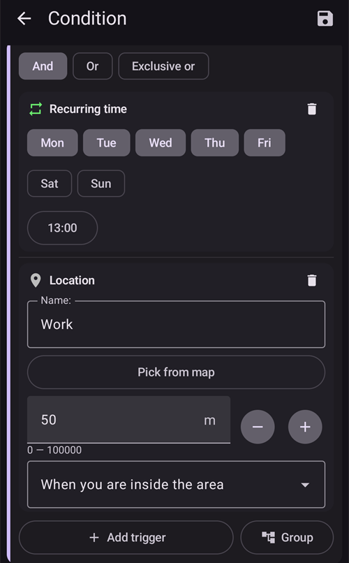

# Αυτοματισμός

```{contents} In this page
:backlinks: entry
:depth: 2
```

## Τι είναι ένας Αυτοματισμός;

Ο «**Αυτοματισμός**» είναι μια λειτουργία που κάνει εργασίες στο AAPS αυτόματα.

Ο Αυτοματισμός εκτελεί συγκεκριμένες ενέργειες με βάση μία ή περισσότερες συνθήκες. Οι συνθήκες μπορεί να είναι ακανόνιστα συμβάντα, όπως χαμηλά ή υψηλά επίπεδα γλυκόζης αίματος (BG) ή μια ορισμένη ποσότητα αρνητικής ινσουλίνης στον οργανισμό (IOB). Οι Αυτοματισμοί μπορούν επίσης να χειριστούν επαναλαμβανόμενα συμβάντα, όπως γεύματα ή άσκηση σε ορισμένες ώρες της ημέρας, ή όταν ο χρήστης βρίσκεται σε ορισμένη απόσταση από μια τοποθεσία GPS ή στην περιοχή ενός δικτύου Wi-Fi (SSID). Ο Αυτοματισμός μπορεί να κάνει αντίγραφα ασφαλείας των ρυθμίσεων του AAPS με βάση ένα πρόγραμμα ή σε κάθε αλλαγή Pod.

Οι κανόνες Αυτοματισμού δημιουργούνται και αλλάζουν στην οθόνη **Αυτοματισμός** (**Διαχείριση → Αυτοματισμός**). Κάθε κανόνας ορίζεται από δύο στοιχεία:

- Μία ή περισσότερες συνθήκες (triggers) που ξεκινούν μια ενέργεια.

    Για παράδειγμα ένα χρονικό πρόγραμμα, ένα συμβάν ή μια τιμή στο AAPS

- Μία ή περισσότερες ενέργειες που θα εκτελεστούν.

    Για παράδειγμα ένας συναγερμός, η ρύθμιση ενός ποσοστού προφίλ ή η εξαγωγή των ρυθμίσεων του AAPS σε αλλαγή Pod.


Υπάρχουν πολλές επιλογές Αυτοματισμού. Σας προτείνουμε να τις μελετήσετε μέσα στην εφαρμογή AAPS, στην ενότητα Αυτοματισμός. Μπορείτε επίσης να ψάξετε στις ομάδες χρηστών του AAPS στο [**Facebook**](https://www.facebook.com/groups/AndroidAPSUsers) και στο [**Discord**](https://discord.gg/4fQUWHZ4Mw) για παραδείγματα Αυτοματισμών από άλλους χρήστες.

## Πώς μπορεί να βοηθήσει ο Αυτοματισμός

1. **Αυτόματη εκτέλεση επαναλαμβανόμενων εργασιών:** Οι προγραμματισμένες ενέργειες εκτελούνται αυτόματα, χωρίς να κάνει κάτι ο χρήστης.

1. **Λιγότερη κούραση από τις αποφάσεις:** Το κύριο όφελος των **Αυτοματισμών** είναι ότι ο χρήστης δεν χρειάζεται να κάνει τόσες χειροκίνητες παρεμβάσεις στο **AAPS**. Μια [έρευνα](https://www.ncbi.nlm.nih.gov/pmc/articles/PMC6286423/#ref4) εκτιμά ότι τα άτομα με διαβήτη τύπου 1 πρέπει να παίρνουν κατά μέσο όρο 180 επιπλέον αποφάσεις κάθε μέρα. Οι **Αυτοματισμοί** μπορούν να μειώσουν το νοητικό φορτίο και να αφήσουν στον χρήστη περισσότερη ενέργεια για άλλα πράγματα στη ζωή του.

1. **Πιθανώς καλύτερος γλυκαιμικός έλεγχος:** για παράδειγμα, οι **Αυτοματισμοί** βοηθούν ώστε οι **Προσωρινοί στόχοι** να ορίζονται πάντα όταν χρειάζεται, ακόμα και σε μέρες με πολλή δουλειά ή όταν ξεχνάτε. Για παράδειγμα, αν ένα παιδί με διαβήτη έχει γυμναστική στο σχολείο την Τρίτη στις 10:00 και την Πέμπτη στις 14:00 και χρειάζεται υψηλό Προσωρινό στόχο («TT») 30 λεπτά πριν από τη γυμναστική, ο **Προσωρινός στόχος** μπορεί να ενεργοποιείται με έναν **Αυτοματισμό**.

1. **Το AAPS προσαρμόζεται πολύ**, ώστε να είναι πιο επιθετικό ή λιγότερο επιθετικό σε ορισμένες καταστάσεις, όπως προτιμά ο χρήστης. Για παράδειγμα, μπορεί να ενεργοποιεί για ορισμένο χρόνο ένα προσωρινά μειωμένο % **Προφίλ**, αν εμφανιστεί αρνητικό **IOB** μέσα στη νύχτα, που δείχνει ότι το τρέχον **Προφίλ** μπορεί να είναι πολύ ισχυρό.

Το παρακάτω παράδειγμα δείχνει πώς ένας **Αυτοματισμός** μπορεί να σας γλιτώσει από κάποια βήματα.

Ο χρήστης γυμνάζεται κάθε πρωί στις 6:00: πρέπει να θυμηθεί να ορίσει χειροκίνητα στις 5:00 στο AAPS έναν «Προσωρινό στόχο - Άσκηση», πριν από τη γυμναστική.


Ο χρήστης έχει ορίσει έναν **Αυτοματισμό** που ενεργοποιεί στις 5:00 έναν «Προσωρινό στόχο - Άσκηση», ώστε η **BG** και το **IOB** του να είναι στο καλύτερο επίπεδο για τη γυμναστική των 6:00:


## Τι πρέπει να σκεφτείτε πριν ξεκινήσετε με τους Αυτοματισμούς

1. Πριν ρυθμίσετε ορισμένους Αυτοματισμούς, πρέπει να έχετε αρκετά καλό έλεγχο της **BG** με το **AAPS**. Οι Αυτοματισμοί δεν πρέπει να χρησιμοποιούνται για να καλύψουν ρυθμίσεις βασικού ρυθμού, **ISF** ή **CR** που δεν είναι σωστές (δείτε παρακάτω). Μην ορίζετε αυτόματη **Αλλαγή Προφίλ** για να αντισταθμίσετε ανόδους της **BG** που οφείλονται _π.χ._ σε φαγητό. Αυτές αντιμετωπίζονται καλύτερα με άλλους τρόπους (SMB κ.λπ.).

1. Όπως κάθε τεχνολογία, τα **CGM**, οι **αντλίες** και τα τηλέφωνα μπορεί να παρουσιάσουν βλάβη: Τεχνικά προβλήματα ή σφάλματα αισθητήρα μπορεί να διακόψουν τις ενέργειες του **Αυτοματισμού** και μπορεί να χρειαστεί χειροκίνητη παρέμβαση.

1. **Οι ανάγκες για Αυτοματισμούς είναι πιθανό να αλλάξουν όταν αλλάζει η καθημερινότητα**. Όταν αλλάζετε ανάμεσα σε περιόδους δουλειάς/σχολείου/διακοπών, βάλτε μια υπενθύμιση στο ημερολόγιό σας για να ελέγξετε ποιοι **Αυτοματισμοί** είναι ενεργοί (ενεργοποιούνται και απενεργοποιούνται εύκολα). Για παράδειγμα, αν πάτε διακοπές και δεν χρειάζεστε πια έναν Αυτοματισμό για τη γυμναστική στο σχολείο ή για την καθημερινή άσκηση, ή αν πρέπει να αλλάξετε τις ώρες.

1. Οι **Αυτοματισμοί** μπορεί να συγκρούονται μεταξύ τους. Καλό είναι να ελέγχετε προσεκτικά κάθε νέα ρύθμιση **Αυτοματισμού** σε ασφαλές περιβάλλον και να καταλαβαίνετε γιατί ένας **Αυτοματισμός** ενεργοποιήθηκε ή δεν ενεργοποιήθηκε όπως περιμένατε.

1. Αν χρησιμοποιείτε το Autosens, προσπαθήστε να χρησιμοποιείτε **Προσωρινούς στόχους** αντί για **Αλλαγές Προφίλ**. Οι **Προσωρινοί στόχοι** δεν μηδενίζουν το Autosens. Οι **Αλλαγές Προφίλ** μηδενίζουν το Autosens.

1. Οι περισσότεροι **Αυτοματισμοί** πρέπει να ορίζονται μόνο για **περιορισμένη διάρκεια**. Μετά το **AAPS** μπορεί να ελέγξει ξανά και να επαναλάβει τον **Αυτοματισμό**, αν χρειάζεται και αν η συνθήκη ισχύει ακόμα. Για παράδειγμα, «έναρξη προσωρινού στόχου 7,0 mmol/l για 30 λεπτά» ή «έναρξη **Προφίλ** 110% για 10 λεπτά» _και_ «έναρξη προσωρινού στόχου 5,0 mmol/l για 10 λεπτά». Αν χρησιμοποιείτε **Αυτοματισμούς** για μόνιμες αλλαγές (π.χ. σε ισχυρότερο % προφίλ), υπάρχει κίνδυνος υπογλυκαιμίας.

## Πότε μπορώ να αρχίσω να χρησιμοποιώ τον Αυτοματισμό;

Μπορείτε να ξεκινήσετε με τους **Αυτοματισμούς** στο **Βήμα 10**.

## Πού βρίσκονται οι Αυτοματισμοί στο AAPS;

Ανοίξτε τη **Διαχείριση** στην κάτω πλοήγηση της κύριας οθόνης και επιλέξτε **Αυτοματισμός**.

## Πώς μπορώ να ρυθμίσω έναν Αυτοματισμό;

Για να ρυθμίσετε έναν **Αυτοματισμό**, πατήστε το κουμπί **+** στην οθόνη Αυτοματισμός για να δημιουργήσετε έναν «κανόνα»:


* δώστε έναν τίτλο στον «κανόνα» σας (Όνομα εργασίας)·
* πατήστε «**Επεξεργασία**» κάτω από τη **Συνθήκη**. Στην οθόνη **Συνθήκη**, επιλέξτε πώς συνδέονται οι συνθήκες (**Και**, **Ή**, **Αποκλειστικό ή**) και πατήστε «**Προσθήκη συνθήκης**»:


* προσθέστε τουλάχιστον μία συνθήκη:


* πατήστε «**Προσθήκη**» κάτω από την **Ενέργεια** και επιλέξτε μία ενέργεια:


* αποθηκεύστε τον κανόνα με το κουμπί **Αποθήκευση** και βεβαιωθείτε ότι το κουτί αριστερά από το όνομα του κανόνα είναι «επιλεγμένο», για να ενεργοποιηθεί ο **Αυτοματισμός**:


Για να απενεργοποιήσετε έναν κανόνα **Αυτοματισμού**, βγάλτε το σημάδι από το κουτί αριστερά από το όνομα του **Αυτοματισμού**. Το παρακάτω παράδειγμα δείχνει έναν **Αυτοματισμό** ενεργοποιημένο («επιλεγμένο») ή απενεργοποιημένο («μη επιλεγμένο»):


Όταν ρυθμίζετε έναν **Αυτοματισμό**, μπορείτε πρώτα να τον δοκιμάσετε επιλέγοντας την «ειδοποίηση» στις «Ενέργειες». Έτσι το **AAPS** πρώτα εμφανίζει μια ειδοποίηση, αντί να κάνει πραγματικά την ενέργεια αυτόματα. Όταν είστε σίγουροι ότι η ειδοποίηση εμφανίζεται τη σωστή ώρα και με τις σωστές συνθήκες, μπορείτε να αλλάξετε τον κανόνα **Αυτοματισμού** και να βάλετε μια «Ενέργεια» στη θέση της «Ειδοποίησης».


```{admonition} Important note
:class: note

Οι **Αυτοματισμοί** παραμένουν ενεργοί και όταν το Κύκλωμα είναι απενεργοποιημένο!
```


## Πότε ελέγχονται οι κανόνες

Το **AAPS** ελέγχει όλους τους κανόνες **Αυτοματισμού** κάθε φορά που επεξεργάζεται μια νέα μέτρηση γλυκόζης. Έτσι οι κανόνες ελέγχονται με τον ρυθμό του CGM σας, ακόμα και όταν η οθόνη του τηλεφώνου είναι σβηστή. Οι κανόνες ελέγχονται επίσης όταν το τηλέφωνο αρχίζει να φορτίζει, όταν αλλάζει το δίκτυο ή η τοποθεσία και όταν συνδέεται μια συσκευή Bluetooth. Γίνεται μόνο ένας έλεγχος κάθε φορά, οπότε ένας κανόνας με ενέργειες που παίρνουν χρόνο (για παράδειγμα μια εντολή στην αντλία) δεν μπορεί να εκτελεστεί δύο φορές.

## Όρια ασφαλείας

Οι **Αυτοματισμοί** έχουν όρια ασφαλείας:

* Ένας **Προσωρινός στόχος** που ορίζεται από **Αυτοματισμό** πρέπει να είναι μεταξύ 72 και 180 mg/dl (ή 4 και 10 mmol/l).
* Το **Ποσοστό προφίλ** πρέπει να είναι μεταξύ 50% και 130%.
* Υπάρχει χρονικό όριο 5 λεπτών ανάμεσα στις εκτελέσεις ενός **Αυτοματισμού** (και πριν από την πρώτη εκτέλεση).

## Σωστή χρήση αρνητικών τιμών

```{admonition} Warning
:class: warning

Προσέξτε όταν επιλέγετε αρνητική τιμή στον **Αυτοματισμό**
```

Χρειάζεται προσοχή όταν επιλέγετε μια «αρνητική τιμή» σε μια «Συνθήκη», όπως «λιγότερο από», στους **Αυτοματισμούς**. Για παράδειγμα:


**Παράδειγμα 1:** Αν δημιουργήσετε μια Συνθήκη **«είναι λιγότερο από»** «-0,1 mmol/l» (ή «-2 mg/dl»), αυτή:

Ενεργοποιεί έναν **Αυτοματισμό** για κάθε αριθμό που είναι **αυστηρά μικρότερος από** -0,1 (-2). Αυτό περιλαμβάνει αριθμούς όπως -0,2, -0,3, -0,4 (-4, -6, -8) κ.λπ. Θυμηθείτε ότι το ίδιο το -0,1 (-2) **δεν** περιλαμβάνεται σε αυτή τη συνθήκη. (Η συνθήκη «είναι ίσο ή μικρότερο από -0,1 mmol/l (-2 mg/dl)» _θα_ περιλάμβανε το -0,1 mmol/l ή το -2 mg/dl).

**Παράδειγμα 2:** Αν δημιουργήσετε μια Συνθήκη «είναι μεγαλύτερο από» -0,1 mmol/l (-2 mg/dl), αυτή:

Ενεργοποιεί έναν **Αυτοματισμό** για κάθε αριθμό που είναι **μεγαλύτερος από** -0,1 mmol/l (-2 mg/dl). Αυτό περιλαμβάνει αριθμούς όπως 0, 0,2, 0,4 mmol/l (0, 4, 8 mg/dl) και κάθε άλλον θετικό αριθμό.

Είναι σημαντικό να σκεφτείτε προσεκτικά τι ακριβώς θέλετε να κάνει ο **Αυτοματισμός** σας, όταν επιλέγετε αυτές τις συνθήκες και τιμές.

(automations-automation-triggers)=
## Συνθήκες Αυτοματισμού


Κάντε κύλιση προς τα κάτω για να δείτε την υπόλοιπη λίστα:


Ο χρήστης μπορεί να επιλέξει διάφορες «Συνθήκες». Οι συνθήκες είναι αυτά που πρέπει να ισχύουν για να εκτελεστεί ο αυτοματισμός. Η παρακάτω λίστα δεν είναι πλήρης:

**Συνθήκη:** σύνδεση συνθηκών

**Επιλογές:**

Πολλές συνθήκες μπορούν να συνδεθούν με
* «Και»
* «Ή»
* «Αποκλειστικό ή» (σημαίνει ότι αν ισχύει μία - και μόνο μία - από τις συνθήκες, θα γίνει η ενέργεια ή οι ενέργειες)

**Συνθήκη:** χρόνος ή επαναλαμβανόμενος χρόνος

**Επιλογές:**

* χρόνος = συμβάν μίας φοράς
* επαναλαμβανόμενος χρόνος = κάτι που συμβαίνει τακτικά (π.χ. μία φορά την εβδομάδα, κάθε εργάσιμη ημέρα κ.λπ.)

**Συνθήκη:** τοποθεσία

**Επιλογές:**

* στις [Ρυθμίσεις > Αυτοματισμός](#preferences-maintenance-settings) ο χρήστης μπορεί να επιλέξει την υπηρεσία τοποθεσίας που χρειάζεται.

**Συνθήκη:** υπηρεσία τοποθεσίας

**Επιλογές:**

* Χρήση παθητικής τοποθεσίας: το **AAPS** παίρνει την τοποθεσία μόνο όταν τη ζητούν άλλες εφαρμογές.
* Χρήση τοποθεσίας δικτύου: η τοποθεσία του Wi-Fi σας.
* Χρήση τοποθεσίας GPS (Προσοχή! Αυτό μπορεί να αδειάσει γρήγορα την μπαταρία!)

**Συνθήκες**: δεδομένα αντλίας και αισθητήρα

* Συνθήκη ηλικίας καθετήρα: Διαθέσιμη για όλες τις αντλίες
* Συνθήκη ηλικίας ινσουλίνης: Διαθέσιμη για τις αντλίες που την υποστηρίζουν
* Συνθήκη ηλικίας μπαταρίας: Διαθέσιμη για τις αντλίες που την υποστηρίζουν
* Συνθήκη ηλικίας αισθητήρα: πάντα διαθέσιμη
* Συνθήκη ενεργοποίησης Pod: Διαθέσιμη για αντλίες patch

Σημειώστε ότι σε όλες τις συνθήκες ηλικίας η σύγκριση «ίσο» σχεδόν ποτέ δεν ενεργοποιείται, οπότε σε αυτή την περίπτωση χρειάζονται δύο συνθήκες για να φτιάξετε ένα εύρος

* Συνθήκη επιπέδου δεξαμενής: Διαθέσιμη για όλες τις αντλίες. Η σύγκριση "NOT\_AVAILABLE" δεν λειτουργεί σε αυτή τη συνθήκη, γιατί η τιμή υπάρχει πάντα στο **AAPS**
* Συνθήκη επιπέδου μπαταρίας αντλίας: Διαθέσιμη για τις αντλίες που την υποστηρίζουν. Η σύγκριση "NOT\_AVAILABLE" δεν λειτουργεί σε αυτή τη συνθήκη, γιατί η τιμή υπάρχει πάντα στο **AAPS**

(automations-automation-action)=
## Ενέργεια


Κάντε κύλιση προς τα κάτω για να δείτε την υπόλοιπη λίστα:


**Ενέργειες:** έναρξη **Προσωρινού στόχου**

**Επιλογές:**

* Η **BG** πρέπει να είναι μεταξύ 72 mg/dl και 180 mg/dl (4 mmol/l και 10 mmol/l)
* Ο **TT** λειτουργεί μόνο αν δεν υπάρχει ήδη Προσωρινός στόχος — το **AAPS** το προσθέτει αυτόματα στον κανόνα ως γραμμή «**Προϋποθέσεις: Προσ. στόχος δεν υπάρχει**»

**Ενέργειες:** λήξη **Προσωρινού στόχου**

**Επιλογές:**

καμία

**Ενέργειες:** **Ποσοστό προφίλ**

**Επιλογές:**

* Το **Προφίλ** πρέπει να είναι μεταξύ 50% και 130%
* λειτουργεί μόνο αν το προηγούμενο Ποσοστό είναι 100%

**Ενέργειες:** **Αλλαγή εξομάλυνσης**

**Επιλογές:**

* επιλέξτε τη [μέθοδο εξομάλυνσης](../CompatibleCgms/SmoothingBloodGlucoseData.md) στην οποία θα γίνει η αλλαγή
* εκτελείται μόνο αν αυτή η μέθοδος εξομάλυνσης δεν είναι ήδη ενεργή — το **AAPS** το προσθέτει αυτόματα στον κανόνα ως γραμμή «**Προϋποθέσεις: Η εξομάλυνση … δεν είναι ενεργή**». Όταν η επιλεγμένη εξομάλυνση είναι ήδη ενεργή, ο κανόνας παραλείπεται χωρίς μήνυμα.
* Παράδειγμα: σε συνδυασμό με τη συνθήκη **Ηλικία αισθητήρα**, αλλάξτε σε **Μέση εξομάλυνση** την πρώτη ημέρα ενός νέου αισθητήρα και μετά πάλι σε **Χωρίς εξομάλυνση**.

**Ενέργειες:** **Σημείωση** (στην ομάδα **Ειδοποιήσεις** της λίστας)

**Επιλογές:**

* επιλέξτε το συμβάν που θα καταγραφεί: **Σημείωση**, **Άσκηση**, **Ερώτηση**, **Ανακοίνωση** ή **Αλλαγή σημείου αντλίας**, και προαιρετικά μια σημείωση. Το όνομα της ενέργειας αλλάζει στο συμβάν που επιλέγετε.
* **Διάρκεια**: χρησιμοποιείται για **Σημείωση**, **Άσκηση** και **Αλλαγή σημείου αντλίας**. Η **Ερώτηση** και η **Ανακοίνωση** δεν έχουν διάρκεια: αντί γι' αυτό καταγράφουν την τρέχουσα BG σας.
* Η **Αλλαγή σημείου αντλίας** μηδενίζει την ηλικία του καθετήρα, σαν να είχατε καταγράψει μόνοι σας μια αλλαγή σημείου. Παράδειγμα: κάποιες αντλίες (όπως η Combo) καταγράφουν μόνες τους την αλλαγή δεξαμενής, αλλά όχι την αλλαγή σημείου. Αν αλλάζετε πάντα και τα δύο μαζί, ένας κανόνας με **Ηλικία ινσουλίνης** μικρότερη από 1 ώρα και **Ηλικία καθετήρα** μεγαλύτερη από 24 ώρες μπορεί να καταγράψει την αλλαγή σημείου για εσάς.

 

**Ενέργειες:** **Στείλτε SMS** (στην ομάδα **Ειδοποιήσεις**)

**Επιλογές:**

* γράψτε το κείμενο του μηνύματος. Στέλνεται σε όλους τους αριθμούς τηλεφώνου που επιτρέπονται στις ρυθμίσεις της [Επικοινωνίας με SMS](../RemoteFeatures/SMSCommands.md). Το πρόσθετο Επικοινωνία με SMS πρέπει να είναι ενεργοποιημένο.

**Ενέργειες:** **Αλλαγή προφίλ σε** (στην ομάδα **Προφίλ**)

**Επιλογές:**

* επιλέξτε το **Προφίλ** που θα ενεργοποιηθεί. Ενεργοποιείται στο 100%, χωρίς χρονική μετατόπιση. Αν αυτό το προφίλ είναι ήδη ενεργό, η ενέργεια δεν κάνει τίποτα.

**Ενέργειες:** **Ενεργοποίηση/απενεργοποίηση SMB** (στην ομάδα **Κύκλωμα & ινσουλίνη**)

**Επιλογές:**

* επιλέξτε **Ενεργό** ή **Ανενεργό**. Αυτό αλλάζει τη ρύθμιση **Ενεργοποίηση SMB** του OpenAPS SMB, ακριβώς σαν να την είχατε αλλάξει στις **Ρυθμίσεις**, και μένει έτσι μέχρι να την αλλάξετε πάλι εσείς ή κάποιος άλλος κανόνας.

**Ενέργειες:** **Προφίλ Autotune** (στην ομάδα **Κύκλωμα & ινσουλίνη**)

**Επιλογές:**

* επιλέξτε το προφίλ που θα ρυθμιστεί και τον αριθμό των ημερών: δείτε [Εκτέλεση του Autotune με κανόνα αυτοματισμού](#autotune-run-autotune-with-an-automation-rule).

**Ενέργειες:** **Διακοπή επεξεργασίας** (στην ομάδα **Κύκλωμα & ινσουλίνη**)

**Επιλογές:**

* καμία. Όταν εκτελείται ένας κανόνας με αυτή την ενέργεια, το **AAPS** δεν ελέγχει τους κανόνες που βρίσκονται κάτω από αυτόν στη λίστα σε αυτή την εκτέλεση. Προσθέστε την σε έναν κανόνα που πρέπει να έχει προτεραιότητα από τους κανόνες κάτω από αυτόν (δείτε [τη σειρά των Αυτοματισμών](#Automations-the-order-of-the-automations-in-the-list-matters)).

**Ενέργειες:** **Εκτέλεση σεναρίου**, **Ενεργοποίηση σεναρίου**, **Απενεργοποίηση σεναρίου** (στην ομάδα **Σενάρια**)

**Επιλογές:**

* επιλέξτε το [σενάριο](Scenes.md) που θα εκτελεστεί, θα ενεργοποιηθεί ή θα απενεργοποιηθεί.

Αφού προσθέσετε την «Ενέργεια», πρέπει να αλλάξετε τις προεπιλεγμένες τιμές στον αριθμό που θέλετε, πατώντας πάνω τους και αλλάζοντάς τες.


(Automations-the-order-of-the-automations-in-the-list-matters)=
## Η σειρά των **Αυτοματισμών** στη λίστα έχει σημασία
 Το **AAPS** εκτελεί τους κανόνες με τη σειρά προτεραιότητας, ξεκινώντας από την κορυφή της λίστας **Αυτοματισμού**. Για παράδειγμα, αν ο **Αυτοματισμός** «Χαμηλή» είναι ο πιο σημαντικός **Αυτοματισμός**, πάνω από όλους τους άλλους κανόνες, τότε αυτός ο **Αυτοματισμός** πρέπει να βρίσκεται στην κορυφή της λίστας **Αυτοματισμού** του χρήστη, όπως φαίνεται παρακάτω:


Για να αλλάξετε την προτεραιότητα των κανόνων **Αυτοματισμού**, πατήστε παρατεταμένα τη λαβή **=** στη δεξιά πλευρά του κανόνα. Αλλάξτε τη σειρά των **Αυτοματισμών** μετακινώντας τους κανόνες πάνω ή κάτω.


## Πώς διαγράφετε κανόνες Αυτοματισμού

Για να διαγράψετε έναν κανόνα **Αυτοματισμού**, πατήστε το εικονίδιο του κάδου.


## Παραδείγματα Αυτοματισμών

Παρακάτω υπάρχουν παραδείγματα **Αυτοματισμών**. Περισσότερη συζήτηση για τους **Αυτοματισμούς** και για το πώς οι χρήστες έχουν προσαρμόσει τον δικό τους **Αυτοματισμό** θα βρείτε σε ομάδες συζήτησης στο Facebook ή στο Discord. Μην αντιγράψετε τα παρακάτω παραδείγματα αν δεν καταλαβαίνετε καλά πώς θα λειτουργήσει ο **Αυτοματισμός**.

(automations-low-glucose-temp-target)=
### Προσωρινός Στόχος Χαμηλής Γλυκόζης

Αυτός ο **Αυτοματισμός** ενεργοποιεί αυτόματα έναν **Προσωρινό στόχο** όταν η **BG** πέσει κάτω από ένα όριο — εδώ, όταν η γλυκόζη είναι λιγότερο από 70 mg/dl, ξεκινά ένας στόχος 110 mg/dl για 30 λεπτά:


### Προσωρινός στόχος για το μεσημεριανό (με «Τοποθεσία»)


Αυτός ο **Αυτοματισμός** δημιουργήθηκε για έναν χρήστη που τρώει μεσημεριανό στη δουλειά περίπου την ίδια ώρα κάθε εργάσιμη ημέρα, αλλά ενεργοποιείται μόνο αν ο χρήστης βρίσκεται σε μια ορισμένη «τοποθεσία».  Έτσι, αν ο χρήστης δεν είναι στη δουλειά μια μέρα, αυτός ο **Αυτοματισμός** δεν θα ενεργοποιηθεί.

Αυτός ο **Αυτοματισμός** θα ορίσει έναν χαμηλό **Προσωρινό στόχο** (Γεύμα Σύντομα) στις 13:00, για να φέρει τη BG στα 90 mg/dl (ή 5 mmol/l) πριν από το μεσημεριανό.

Η «Συνθήκη» τοποθεσίας έχει όνομα, θέση (πατήστε **Επιλογή από χάρτη** ή χρησιμοποιήστε την τρέχουσα τοποθεσία σας) και ακτίνα σε μέτρα, και ενεργοποιείται όταν είστε μέσα (ή έξω) από την περιοχή:



Λόγω της σύνδεσης «Και», ο **Αυτοματισμός** εκτελείται μόνο στον «επιλεγμένο χρόνο» και μόνο αν ο χρήστης βρίσκεται στην επιλεγμένη τοποθεσία.

Ο **Αυτοματισμός** δεν θα ενεργοποιηθεί σε καμία άλλη ώρα σε αυτή την τοποθεσία, ούτε αυτή την ώρα έξω από την ακτίνα των 50 μέτρων γύρω από την επιλεγμένη θέση.

### Αυτοματισμός τοποθεσίας με Wi-Fi SSID

Ένα Wi-Fi SSID είναι καλή επιλογή για να ενεργοποιείται ένας **Αυτοματισμός** όταν είστε μέσα στην εμβέλεια ενός συγκεκριμένου δικτύου Wi-Fi (σε σύγκριση με το GPS): είναι αρκετά ακριβές, καταναλώνει λιγότερη μπαταρία και λειτουργεί σε κλειστούς χώρους όπου το GPS και άλλες υπηρεσίες τοποθεσίας μπορεί να μην είναι διαθέσιμες.

Εδώ είναι ένα άλλο παράδειγμα που ορίζει έναν **Προσωρινό στόχο** μόνο τις εργάσιμες ημέρες, πριν από το πρωινό (1).


Ο **Αυτοματισμός** θα ενεργοποιηθεί στις 05:30 μόνο από Δευτέρα έως Παρασκευή (2)  
και ενώ το τηλέφωνο είναι συνδεδεμένο σε ένα οικιακό δίκτυο Wi-Fi (3).


Μετά θα ορίσει έναν **Προσωρινό στόχο** 75 mg/dl για 30 λεπτά (4). Ένα πλεονέκτημα όταν προσθέτετε την τοποθεσία είναι ότι ο κανόνας δεν θα ενεργοποιηθεί, για παράδειγμα, αν ο χρήστης ταξιδεύει σε διακοπές.


Κάντε κύλιση προς τα κάτω για να δείτε την ενέργεια: έναν **Προσωρινό στόχο** 75 mg/dl για 30 λεπτά (4).


Εδώ είναι η εικόνα με τις συνθήκες του **Αυτοματισμού**:

1) Κάτω από το κύριο «ΚΑΙ» (πρέπει να ισχύουν και οι δύο συνθήκες για να ενεργοποιηθεί) 1) Επαναλαμβανόμενος χρόνος = Δ,Τ,Τ,Π,Π στις 5:30  
1) Wi-Fi SSID = My_Home_WiFi_Name


(automating-preference-settings-export)=

## Αυτόματη εξαγωγή ρυθμίσεων

### Αυτόματες εξαγωγές: προγραμματισμένες (καθημερινά)

Εικόνες με τις συνθήκες του Αυτοματισμού:

1) Συνθήκη: Επαναλαμβανόμενος χρόνος = Δ,Τ,Τ,Π,Π στις 8:00 1) Ενέργεια: Εξαγωγή ρυθμίσεων (στο «Κείμενο σε θεραπείες» γράψτε «Ημερήσια»)


Σημείωση: Η εκτέλεση της εξαγωγής καταγράφεται στο Careportal

### Αυτόματες εξαγωγές: Ενεργοποίηση Pod (μόνο για αντλίες patch)

Εικόνες με τις συνθήκες του Αυτοματισμού:

1) Συνθήκη: Ενεργοποίηση Pod 1) Ενέργεια: Εξαγωγή ρυθμίσεων (στο «Κείμενο σε θεραπείες» γράψτε «Ενεργοποίηση Pod: εξαγωγή ρυθμίσεων»)


Σημείωση: Η εκτέλεση της εξαγωγής καταγράφεται στο Careportal. Σημείωση: Ο Αυτοματισμός **δεν** θα ενεργοποιηθεί καθόλου αν δεν έχετε κάνει πριν μια χειροκίνητη εξαγωγή ρυθμίσεων. Δείτε [Ρυθμίσεις → Συντήρηση](#preferences-maintenance-settings) για τη σωστή ενεργοποίηση της αυτόματης εξαγωγής ρυθμίσεων.


## Ημερολόγιο Αυτοματισμού

Το **AAPS** δείχνει ένα ημερολόγιο με τα πιο πρόσφατα συμβάντα **Αυτοματισμού** στο κάτω μέρος της οθόνης **Αυτοματισμός**, κάτω από τους κανόνες. Χρησιμοποιήστε το για να ελέγξετε ότι οι κανόνες σας ενεργοποιήθηκαν όταν το περιμένατε.

Στο παρακάτω παράδειγμα, ο κανόνας **Προσωρινός Στόχος Χαμηλής Γλυκόζης** (1) (δείτε [Προσωρινός Στόχος Χαμηλής Γλυκόζης](#automations-low-glucose-temp-target) παραπάνω) είναι ενεργοποιημένος. Το ημερολόγιο (2) δείχνει ότι στις 15:09 η γλυκόζη έπεσε κάτω από 70 mg/dl και ο κανόνας ενεργοποιήθηκε:
* η ενέργεια ήταν «Έναρξη προσ. στόχου: 110mg/dL@30 min»: ένας **Προσωρινός στόχος** 110 mg/dl για 30 λεπτά·
* Το **OK** στο τέλος σημαίνει ότι η ενέργεια εκτελέστηκε με επιτυχία.


(automations-troubleshooting)=

## Αντιμετώπιση προβλημάτων

* Πρόβλημα: __Οι αυτοματισμοί μου δεν ενεργοποιούνται από το AAPS;__

Ελέγξτε ότι το κουτί αριστερά από το όνομα του **Αυτοματισμού** είναι «επιλεγμένο», ώστε ο κανόνας να είναι ενεργοποιημένος:


* Πρόβλημα: __Οι αυτοματισμοί μου ενεργοποιούνται με λάθος σειρά.__

Ελέγξτε τη σειρά προτεραιότητας των κανόνων σας, όπως εξηγήθηκε παραπάνω.

* Πρόβλημα: __Μια συνθήκη δείχνει «Άγνωστη συνθήκη … - ποτέ αληθής».__

Ο κανόνας περιέχει μια συνθήκη που αυτή η έκδοση του **AAPS** δεν μπορεί να διαβάσει, για παράδειγμα αφού γυρίσατε σε παλαιότερη έκδοση ή εισαγάγατε ρυθμίσεις από νεότερη. Μια τέτοια συνθήκη δεν είναι ποτέ αληθής, οπότε ο κανόνας δεν εκτελείται. Μένει όπως είναι, ώστε μια νεότερη έκδοση να μπορεί να τη χρησιμοποιήσει. Επεξεργαστείτε τον κανόνα και αντικαταστήστε τη συνθήκη, ή ενημερώστε το **AAPS**.

## Εναλλακτικές λύσεις αντί για Αυτοματισμούς

Για προχωρημένους χρήστες, υπάρχουν κι άλλες δυνατότητες για αυτοματοποίηση χρησιμοποιώντας το IFTTT ή μια εφαρμογή Android από τρίτους που ονομάζεται Automate. 
