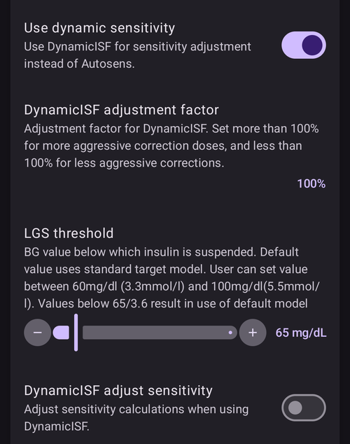

(Open-APS-features-DynamicISF)=
# Δυναμική ISF (DynISF)

Μέχρι τώρα, με το **AMA** και το **SMB**, το **ISF** οριζόταν στο **Προφίλ** και ήταν σταθερό για κάθε χρονικό διάστημα της ημέρας. Στην πραγματικότητα όμως, το **ISF** ενός ατόμου δεν είναι τόσο σταθερό και αλλάζει ανάλογα με το επίπεδο της **BG**: όταν η BG είναι υψηλή, ο χρήστης χρειάζεται περισσότερη ινσουλίνη για να ρίξει τη **BG** του κατά 50 mg/dl / 3 mmol/l, από όση θα χρειαζόταν σε χαμηλότερη **BG**. Το [Autosens](#Open-APS-features-autosens) ήταν ο πρώτος αλγόριθμος που προσπάθησε να λύσει αυτό το πρόβλημα, προσαρμόζοντας το **ISF** εκτός των γευμάτων.

Η **Δυναμική ISF** (λέγεται και **DynISF**) έχει τον ίδιο σκοπό, αλλά είναι πιο προχωρημένη, γιατί μπορεί να χρησιμοποιείται συνέχεια. Προτείνεται μόνο για έμπειρους χρήστες που γνωρίζουν καλά τα χειριστήρια και την παρακολούθηση του **AAPS**. Διαβάστε την ενότητα [Τι πρέπει να προσέξετε όταν ενεργοποιείτε τη Δυναμική ISF](#dyn-isf-things-to-consider-when-activating-dynamicisf) παρακάτω, πριν τη δοκιμάσετε.

```{admonition} CAUTION - Automations or Profile Percentage change
:class: warning

Οι **Αυτοματισμοί** πρέπει να χρησιμοποιούνται πάντα με προσοχή. Αυτό ισχύει ιδιαίτερα με τη **Δυναμική ISF**.

Όταν χρησιμοποιείτε τη **Δυναμική ISF**, απενεργοποιήστε κάθε κανόνα **Αυτοματισμού** που κάνει προσωρινή αλλαγή **Προφίλ**, γιατί θα έκανε τη **Δυναμική ISF** υπερβολικά επιθετική στα bolus διόρθωσης και θα προκαλούσε υπογλυκαιμία. Αυτός είναι ακριβώς ο σκοπός της **Δυναμικής ISF**, οπότε δεν χρειάζεται να λέτε στο **AAPS** μέσω Αυτοματισμού να δίνει επιπλέον ινσουλίνη όταν οι τιμές **BG** είναι υψηλές.

```

Για να χρησιμοποιήσετε τη **Δυναμική ISF**, η βάση δεδομένων του **AAPS** χρειάζεται τουλάχιστον 7 ημέρες δεδομένων **AAPS** του χρήστη.

## What does Dynamic ISF do?

Η **Δυναμική ISF** προσαρμόζει δυναμικά τον συντελεστή ευαισθησίας στην ινσουλίνη (**ISF**) με βάση:

- τη συνολική ημερήσια δόση ινσουλίνης (**TDD**)· και
- τις τρέχουσες και τις προβλεπόμενες τιμές γλυκόζης αίματος.

When using **Dynamic ISF**, the **ISF** values entered in the **Profile** are not used at all anymore, except as a fallback if there is not enough TDD data in **AAPS** database (*i.e.* fresh reinstallation of the app).

**SMB/AMA** - παράδειγμα **Προφίλ** χρήστη με σταθερό **ISF**, όπως το όρισε ο χρήστης, που το χρησιμοποιούν το **SMB** και το **AMA**.


**Δυναμική ISF** - παράδειγμα **ISF** χρήστη που αλλάζει, όπως το υπολογίζει η **Δυναμική ISF**.


Η περιοχή με τον κόκκινο κύκλο δείχνει: `profile ISF` -> `ISF as calculated by DynISF`. <br/> Αν πατήσετε σε αυτή την περιοχή, ανοίγει ένα παράθυρο με περισσότερες πληροφορίες, όπως το **ISF** που χρησιμοποιείται για τον υπολογιστή bolus και την απορρόφηση υδατανθράκων (δείτε [Άλλες χρήσεις του ISF](#dynisf-other-usages-of-isf) παρακάτω).

Η τιμή **DynISF** μπορεί να εμφανιστεί και σε γράφημα: πατήστε **Προσθήκη γραφήματος** κάτω από τα γραφήματα στην κύρια οθόνη και επιλέξτε **VSENS** (μεταβλητή ευαισθησία). Εμφανίζεται ως λευκή γραμμή (στο κάτω μέρος της παραπάνω εικόνας).

## How is Dynamic ISF calculated?

Η **Δυναμική ISF** χρησιμοποιεί το μοντέλο του Chris Wilson για να βρει το **ISF**, αντί για τη σταθερή τιμή **ISF** που έχει ορίσει ο χρήστης στο **Προφίλ**. Μια αναλυτική εξήγηση θα βρείτε εδώ: [Chris Wilson on Insulin Sensitivity (Correction Factor) with Loop and Learn, 2/6/2022](https://www.youtube.com/watch?v=oL49FhOts3c) (στα αγγλικά).

Η εξίσωση της **Δυναμικής ISF** που χρησιμοποιείται είναι: `ISF = 1800 / ((TDD * DynISF Adjust Factor) * Ln (( current BG / insulin divisor) + 1 ))`

Οι μεταβλητές αυτής της εξίσωσης εξηγούνται παρακάτω.<br/> Σημείωση: το `Ln` είναι ο φυσικός λογάριθμος, μια μαθηματική συνάρτηση.

Το AAPS χρησιμοποιεί την παραπάνω εξίσωση για να υπολογίσει το τρέχον **ISF** και στις [προβλέψεις του oref1 για **IOB**, **ZT** (zero temp, μηδενικός βασικός) και **UAM**](#aaps-screens-prediction-lines). Χρησιμοποιείται επίσης για τους **COB** και στον οδηγό bolus (δείτε [Άλλες χρήσεις του ISF](#dynisf-other-usages-of-isf) παρακάτω).

### TDD (συνολική ημερήσια δόση)
Η TDD χρησιμοποιεί έναν συνδυασμό από τις παρακάτω τιμές:
1.  τη μέση **TDD** 7 ημερών·
2.  την **TDD** της προηγούμενης ημέρας· και
3.  έναν σταθμισμένο μέσο όρο της χρήσης ινσουλίνης των τελευταίων οκτώ (8) ωρών, αναγμένο σε 24 ώρες.

Η **TDD** της παραπάνω εξίσωσης παίρνει το ένα τρίτο από κάθε μία από τις παραπάνω τιμές.

### Συντελεστής προσαρμογής Δυναμικής ISF

Ορίζεται στις **Ρυθμίσεις** του χρήστη και κάνει τη **Δυναμική ISF** πιο επιθετική ή λιγότερο επιθετική. Δείτε την ενότητα [Ρυθμίσεις](#dyn-isf-preferences) παρακάτω.

### Διαιρέτης ινσουλίνης
Ο διαιρέτης ινσουλίνης εξαρτάται από την κορυφή της ινσουλίνης που χρησιμοποιείτε και είναι αντιστρόφως ανάλογος με τον χρόνο κορυφής. Για τη Lyumjev η τιμή είναι 75, για τη Fiasp 65 και για την κανονική ταχείας δράσης ινσουλίνη 55.

### ISF με βάση την προβλεπόμενη BG για αποφάσεις δόσης

Η δυναμική ευαισθησία υπολογίζεται με την τιμή της **τρέχουσας BG** και εμφανίζεται ως το τρέχον ISF σας στο **AAPS**. Όμως, όταν υπολογίζει δόσεις, ο αλγόριθμος oref1 υπολογίζει και χρησιμοποιεί το **μελλοντικό ISF**.

Αυτό γίνεται για να μη χορηγηθεί πολλή ινσουλίνη όταν η **BG** είναι χαμηλή ή προβλέπεται να πέσει χαμηλά.

Το **μελλοντικό ISF** χρησιμοποιεί τον ίδιο τύπο που περιγράφεται παραπάνω, μόνο που μπορεί να χρησιμοποιεί την **ελάχιστη προβλεπόμενη BG** αντί για την **τρέχουσα BG**. Η **ελάχιστη προβλεπόμενη BG**, [όπως υπολογίζεται στο oref1](#aaps-screens-how-predictions-become-a-dosing-decision), είναι η χαμηλότερη τιμή στην οποία προβλέπεται να φτάσει η BG σας σε όλη τη διάρκεια των προβλέψεων.

* If the current **BG** is above target<br/> **and** if **BG** levels are flat, within +/- 3 mg/dL:<br/>BG is used in the formula as follows: `average(minimum predicted BG, current BG)`.
* If eventual **BG** is above target and glucose levels are increasing,<br/> **or** eventual **BG** is above current **BG**:<br/>BG is used in the formula as follows: `current BG`.
* Σε κάθε άλλη περίπτωση:<br/>η BG μπαίνει στον τύπο ως εξής: `minimum predicted BG`.

Για μια απλή εξήγηση, δείτε την παρακάτω εικόνα, που δείχνει την παραπάνω κατάσταση. Οι πορτοκαλί κουκκίδες χρησιμοποιούν την **προβλεπόμενη BG**, οι μωβ κουκκίδες χρησιμοποιούν το **average(predicted BG, current BG)** (μέσος όρος προβλεπόμενης και τρέχουσας BG) και οι μπλε κουκκίδες χρησιμοποιούν την **τρέχουσα BG**.


(dynisf-other-usages-of-isf)=
## Άλλες χρήσεις του ISF

### ISF και απορρόφηση COB

Όπως περιγράφεται στη σελίδα [Υπολογισμός COB (ενεργοί υδατάνθρακες)](../DailyLifeWithAaps/CobCalculation.md), η απορρόφηση των COB συνήθως υπολογίζεται με αυτόν τον τύπο:   
`absorbed_carbs = deviation * ic / isf`  
Όταν χρησιμοποιείτε τη **Δυναμική ISF**, το **ISF** που χρησιμοποιείται εδώ είναι ο μέσος όρος των τιμών της Δυναμικής ISF των τελευταίων 24 ωρών.

### ISF στον Οδηγό Bolus

Όταν χρησιμοποιείτε τον [Οδηγό Bolus](#aaps-screens-bolus-wizard), το **ISF** χρησιμοποιείται για να προστεθεί μια διόρθωση, αν η **BG** είναι πάνω από τον στόχο.

Όταν χρησιμοποιείτε τη **Δυναμική ISF**, το **ISF** που χρησιμοποιείται εδώ είναι ο μέσος όρος των τιμών της Δυναμικής ISF των τελευταίων 24 ωρών.

(dyn-isf-preferences)=
## Ρυθμίσεις

Για να την ενεργοποιήσετε, επιλέξτε **Χρήση δυναμικής ευαισθησίας** στις [Ρυθμίσεις > OpenAPS SMB](#Preferences-openaps-smb-settings). Μόλις ενεργοποιήσετε αυτή την επιλογή, εμφανίζονται νέες ρυθμίσεις.



(dyn-isf-adjustment-factor)=
### Συντελεστής προσαρμογής DynamicISF
Η **Δυναμική ISF** λειτουργεί με έναν μόνο κανόνα, που υποτίθεται ότι ισχύει για όλους. Αυτό σημαίνει ότι άτομα με την ίδια **TDD** θα είχαν την ίδια ευαισθησία. Επειδή κάθε χρήστης έχει τη δική του ευαισθησία, ο **Συντελεστής προσαρμογής** επιτρέπει στον χρήστη να ορίσει αν είναι πιο ευαίσθητος ή λιγότερο ευαίσθητος στην ινσουλίνη από το «συνηθισμένο» άτομο.

Ο **Συντελεστής προσαρμογής** είναι μια τιμή μεταξύ 1% και 300%. Λειτουργεί ως πολλαπλασιαστής της τιμής **TDD**.

* Αν αυξήσετε αυτή την τιμή πάνω από 100%, η **DynISF** γίνεται πιο επιθετική: οι τιμές **ISF** γίνονται *μικρότερες* (_δηλαδή_ χρειάζεται περισσότερη ινσουλίνη για να πέσουν λίγο τα επίπεδα **BG**)
* Αν μειώσετε αυτή την τιμή κάτω από 100%, η **DynISF** γίνεται λιγότερο επιθετική: οι τιμές **ISF** γίνονται μεγαλύτερες (_δηλαδή_ χρειάζεται λιγότερη ινσουλίνη για να πέσουν λίγο τα επίπεδα **BG**).

Ο **Συντελεστής προσαρμογής** αλλάζει επίσης όταν ενεργοποιείτε μια [**Αλλαγή Προφίλ** με ποσοστό](../DailyLifeWithAaps/ProfileSwitch-ProfilePercentage.md). Ένα χαμηλότερο **Ποσοστό προφίλ** μειώνει τον **Συντελεστή προσαρμογής**, και ένα υψηλότερο **Ποσοστό προφίλ** τον αυξάνει.

For example, if your **Adjustment Factor** is 80%, and **Profile Switch** to 80% is actioned, the resulting **Adjustment Factor** will be `0.8*0.8=0.64`.

Αυτό σημαίνει ότι, όταν χρησιμοποιείτε τη **DynISF**, μπορείτε να χρησιμοποιήσετε το **Ποσοστό προφίλ** για να ρυθμίσετε προσωρινά και χειροκίνητα την ευαισθησία σας. Αυτό μπορεί να βοηθήσει στη σωματική δραστηριότητα (χαμηλότερο ποσοστό), στην ασθένεια (υψηλότερο ποσοστό) κ.λπ.

### Όριο LGS

Η τιμή **BG** κάτω από την οποία η ινσουλίνη αναστέλλεται (αναστολή λόγω χαμηλής γλυκόζης, low glucose suspend). Η προεπιλεγμένη τιμή χρησιμοποιεί το συνηθισμένο μοντέλο στόχου. Ο χρήστης μπορεί να ορίσει αυτή την τιμή από 60 mg/dl (3,3 mmol/l) έως 100 mg/dl (5,5 mmol/l). Τιμές κάτω από 65/3,6 οδηγούν στη χρήση του προεπιλεγμένου μοντέλου.

### Το DynamicISF προσαρμόζει την ευαισθησία

Αυτή η ρύθμιση (*«Προσαρμογή των υπολογισμών ευαισθησίας όταν χρησιμοποιείται το DynamicISF»*) αντικαθιστά το Autosens και χρησιμοποιεί τον λόγο **TDD** 24 ωρών / **TDD** 7 ημερών ως βάση για να αυξάνει και να μειώνει τον βασικό ρυθμό, όπως κάνει το συνηθισμένο Autosens. Αυτή η υπολογισμένη τιμή χρησιμοποιείται επίσης για να προσαρμόσει τον στόχο, αν είναι ενεργές οι επιλογές για προσαρμογή του στόχου με βάση την ευαισθησία. Αντίθετα από το Autosens, αυτή η επιλογή δεν προσαρμόζει τις τιμές **ISF**.

(dyn-isf-things-to-consider-when-activating-dynamicisf)=
## Τι πρέπει να προσέξετε όταν ενεργοποιείτε τη Δυναμική ISF

* Η **Δυναμική ISF** προτείνεται μόνο για έμπειρους χρήστες που γνωρίζουν καλά τα χειριστήρια και την παρακολούθηση του **AAPS**. Ιδανικά, οι χρήστες πρέπει να έχουν πετύχει καλό έλεγχο με το **SMB** πριν περάσουν στη **Δυναμική ISF**.
* Όπως αναφέρθηκε παραπάνω, απενεργοποιήστε όλους τους [**Αυτοματισμούς**](../DailyLifeWithAaps/Automations.md) που ενεργοποιούν ένα **Ποσοστό προφίλ** ανάλογα με τη **BG**, γιατί θα είναι υπερβολικά επιθετικοί και μπορεί να χορηγήσουν πάρα πολλή ινσουλίνη! Αυτό είναι ήδη μέρος του αλγορίθμου της **Δυναμικής ISF**.
* Το [Ποσοστό προφίλ](../DailyLifeWithAaps/ProfileSwitch-ProfilePercentage.md) λαμβάνεται υπόψη στον υπολογισμό της Δυναμικής ISF (δείτε [Συντελεστής προσαρμογής Δυναμικής ISF](#dyn-isf-adjustment-factor) παραπάνω). Δεν είναι καλή πρακτική να χρησιμοποιείτε **Ποσοστό προφίλ** διαφορετικό από 100% για μεγάλο διάστημα. Αν διαπιστώσετε ότι το **Προφίλ** σας έχει αλλάξει, δημιουργήστε ένα νέο **Προφίλ** με τις νέες τιμές σας, αντί να χρησιμοποιείτε το **Προφίλ** με ένα συγκεκριμένο ποσοστό.
* Η **Δυναμική ISF** μπορεί να μη λειτουργεί για όλους. Συγκεκριμένα, μπορεί να δείτε απρόσμενα αποτελέσματα αν ισχύει για εσάς μία από αυτές τις καταστάσεις:
  * Μεταβλητός τρόπος ζωής (ακανόνιστα γεύματα ή ακανόνιστη σωματική δραστηριότητα)
  * Ασταθής TDD ή ευαισθησία από μέρα σε μέρα.
* Δεν υπάρχει ακριβής οδηγός για την αρχική τιμή του **Συντελεστή προσαρμογής**. Ωστόσο, ως σημείο εκκίνησης: αν οι τιμές του **Προφίλ** σας είναι σωστές, όταν είστε εντός στόχου και τα επίπεδα **BG** είναι σταθερά, η τιμή **DynISF** πρέπει να είναι περίπου ίδια με αυτή που είχατε πριν στο **Προφίλ** σας.<br/>Αν βλέπετε ότι η **Δυναμική ISF** είναι πολύ επιθετική, μειώστε τον **Συντελεστή προσαρμογής**, και αντίστροφα.
* Αν και η **DynISF** δεν χρησιμοποιεί καθόλου το **ISF του Προφίλ**, αν δείτε ότι η ευαισθησία σας είναι πολύ διαφορετική από αυτή που είχατε αποθηκεύσει στο **Προφίλ** σας, καλό είναι να το ενημερώνετε. Αυτό μπορεί να βοηθήσει αν χάσετε τα δεδομένα του **AAPS** (_π.χ._ νέο τηλέφωνο, νέα έκδοση του **AAPS**…), γιατί το **ISF του Προφίλ** σας θα χρησιμοποιηθεί ως εφεδρική λύση για τις επόμενες 7 ημέρες.