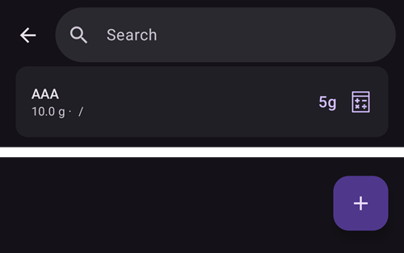

(food)=
# Τρόφιμα (η βάση τροφίμων σας)

Η βάση **Τρόφιμα** είναι η προσωπική σας λίστα με αποθηκευμένα τρόφιμα. Κάθε εγγραφή αποθηκεύει τους **υδατάνθρακες** ενός τροφίμου (και, αν θέλετε, τα λιπαρά, την πρωτεΐνη, την ενέργεια και μια κατηγορία). Έτσι κρατάτε σε ένα σημείο ό,τι τρώτε συχνά και μπορείτε να ξεκινήσετε ένα bolus από ένα αποθηκευμένο τρόφιμο με τους υδατάνθρακες ήδη συμπληρωμένους.

```{contents} Table of contents
:depth: 2
:local: true
```

---

## Άνοιγμα της βάσης τροφίμων

Ανοίξτε την οθόνη **Διαχείριση** (κάτω μπάρα πλοήγησης) και επιλέξτε **Τρόφιμα** (*«Διαχείριση εγγραφών της βάσης τροφίμων»*). Στο **AAPS** v4 τα Τρόφιμα **δεν είναι πλέον πρόσθετο** — δεν χρειάζεται να ενεργοποιήσετε κάτι· είναι μια ξεχωριστή οθόνη που ανοίγει από το [μενού Διαχείριση](#v4changes-manage).

---

## Η λίστα τροφίμων

Τα τρόφιμά σας εμφανίζονται σε μια λίστα με κύλιση. Κάθε γραμμή δείχνει το **όνομα** του τροφίμου, τη **μερίδα / μονάδα / κατηγορία** και τους **υδατάνθρακές** του:



- **🔍 Αναζήτηση** (πάνω) — φιλτράρει τη λίστα με βάση το **όνομα** (χωρίς διάκριση πεζών-κεφαλαίων).
- **Φίλτρο κατηγορίας** — με τα κουμπιά (chips) περιορίζετε τη λίστα σε μια **κατηγορία**· όταν επιλέξετε κατηγορία, εμφανίζονται κουμπιά **υποκατηγορίας** για αυτήν. (Πατήστε ξανά ένα επιλεγμένο κουμπί για να το καταργήσετε.)
- **➕** (κάτω δεξιά) — προσθήκη νέου τροφίμου (δείτε παρακάτω).
- Πατήστε μια γραμμή για να **επεξεργαστείτε** αυτό το τρόφιμο.

Αν η λίστα (ή το τρέχον φίλτρο) δεν έχει εγγραφές, η οθόνη δείχνει **Δεν υπάρχουν δεδομένα**.

---

## Προσθήκη και επεξεργασία τροφίμου

Πατήστε **➕** για προσθήκη ή πατήστε μια υπάρχουσα γραμμή για επεξεργασία. Ανοίγει ένας επεξεργαστής από το κάτω μέρος της οθόνης (**Προσθήκη τροφίμου** / **Επεξεργασία τροφίμου**):


Τα πεδία είναι:

- **Όνομα** — υποχρεωτικό (δεν μπορείτε να αποθηκεύσετε χωρίς αυτό).
- **Κατηγορία** και **Υποκατηγορία** — προαιρετικά, για ομαδοποίηση/φιλτράρισμα τροφίμων.
- **Μερίδα** και **Μονάδα** — το συνηθισμένο μέγεθος μερίδας· η **Μονάδα** είναι από προεπιλογή **g**.
- **Υδατάνθρακες (g)** — η ποσότητα υδατανθράκων του τροφίμου.
- **Λιπαρά (g)**, **Πρωτεΐνη (g)**, **Ενέργεια (kJ)** — προαιρετικές διατροφικές τιμές.

Πατήστε **Αποθήκευση** για να το αποθηκεύσετε ή **Ακύρωση** για να το απορρίψετε. Όταν επεξεργάζεστε ένα υπάρχον τρόφιμο, ο επεξεργαστής έχει επίσης κουμπί **Διαγραφή**.

```{admonition} Deleting is undoable
:class: note
Η διαγραφή ενός τροφίμου δείχνει το μήνυμα **«Το τρόφιμο διαγράφηκε»** με την ενέργεια **Αναίρεση**, οπότε μια διαγραφή κατά λάθος αναιρείται εύκολα.
```

---

## Χρήση τροφίμου για bolus

Κάθε γραμμή τροφίμου έχει ένα κουμπί **υπολογιστή**. Αν το πατήσετε, ανοίγει ο **Οδηγός Bolus** με τους **υδατάνθρακες** του τροφίμου ήδη συμπληρωμένους και το **όνομα** του τροφίμου ως σημείωση της θεραπείας — έτσι επιβεβαιώνετε και χορηγείτε χωρίς να πληκτρολογήσετε ξανά τους υδατάνθρακες.

```{admonition} The carbs value is used as-is
:class: note
Ο αποθηκευμένος αριθμός **υδατανθράκων** του τροφίμου περνά απευθείας στον οδηγό — το **AAPS** δεν τον πολλαπλασιάζει με τη μερίδα ή με το πόσο φάγατε. Αν φάγατε διαφορετική ποσότητα, διορθώστε τους υδατάνθρακες στον οδηγό πριν επιβεβαιώσετε. (Δεν υπάρχει επιλογή τροφίμου *μέσα* στον Οδηγό Bolus ή στο παράθυρο υδατανθράκων· ξεκινάτε από τη γραμμή του τροφίμου εδώ.)
```

---

## Από πού έρχονται τα τρόφιμα (συγχρονισμός με Nightscout)

Η βάση τροφίμων μοιράζεται μέσω του **Nightscout**, αλλά **μόνο προς μία κατεύθυνση**:

- **Λήψη:** Το **AAPS** **διαβάζει** τρόφιμα από τη **βάση τροφίμων** του Nightscout σας και κρατά την τοπική λίστα συγχρονισμένη με αυτήν. Αυτό γίνεται ως μέρος του συγχρονισμού NSClient, οπότε ένας συνδεδεμένος **πελάτης/ακόλουθος** έχει επίσης τα ίδια τρόφιμα.
- **Αποστολή:** Το **AAPS** **δεν** στέλνει τρόφιμα **στο** Nightscout — το NSClient δεν υποστηρίζει αποστολή εγγραφών τροφίμων. Γι' αυτό, τα τρόφιμα που δημιουργείτε ή επεξεργάζεστε **μέσα στο AAPS** μένουν **σε αυτή τη συσκευή** και δεν μεταφέρονται στο Nightscout ή στις άλλες συσκευές σας.

```{admonition} Maintain your shared list in Nightscout
:class: important
Επειδή τα τρόφιμα γίνονται **μόνο λήψη**, ο τρόπος για να έχετε μία λίστα τροφίμων στο τηλέφωνό σας, στον ακόλουθο/[πελάτη](../RemoteFeatures/ClientMasterControl.md) σας και στο υπόλοιπο σύστημά σας είναι να τη διατηρείτε στο **Nightscout** (στον ενσωματωμένο επεξεργαστή τροφίμων του). Το **AAPS** θα κατεβάσει αυτές τις εγγραφές. Ένα τρόφιμο που προστέθηκε μόνο στο **AAPS** είναι τοπικό σε αυτή τη συσκευή — και μένει εκεί: η λήψη ταιριάζει τις εγγραφές του Nightscout με βάση το Nightscout ID τους, οπότε προσθέτει και ενημερώνει αυτές, αλλά ποτέ δεν αντικαθιστά ή αφαιρεί ένα τρόφιμο που δημιουργήσατε τοπικά (ένα τρόφιμο αφαιρείται μόνο όταν το αντίγραφό του διαγραφεί στο Nightscout).

Σημειώστε ότι η βάση τροφίμων **δεν** είναι επίσης μέρος του υπογεγραμμένου καναλιού ελέγχου κύριας συσκευής ↔ πελάτη — μεταφέρεται μόνο ως δεδομένα του Nightscout.
```

---

## Όχι στο ρολόι

Η βάση τροφίμων είναι λειτουργία του **τηλεφώνου** — δεν υπάρχει περιήγηση τροφίμων, πλακίδιο ή μενού σε **ρολόι Wear OS**.

---


<!-- =====================================================================
     Screenshots captured from a real master device:
       - food_list.png    (Manage → Food: list row, search, add button)
       - food_editor.png  ("Add Food" editor: name/category/subcategory/portion/unit/carbs/fat/protein/energy)
     No food was created or deleted (the editor was cancelled).
     Sync facts code-verified: download via LoadFoodsWorker.getFoods(); upload disabled
     (DataSyncSelectorV3 processChangedFoods() commented out — "NSCv3 doesn't support food update").
     Maintainers: relocate page + images and fix cross-links as needed.
     ===================================================================== -->
