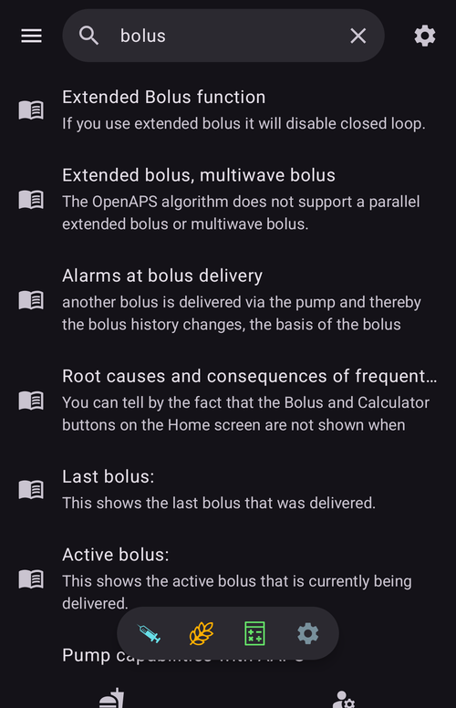

(global-search)=
# Καθολική αναζήτηση

Το **AAPS** v4 έχει ένα πεδίο **καθολικής αναζήτησης** στο πάνω μέρος της κύριας οθόνης. Πληκτρολογήστε μια λέξη και ψάχνει σε όλη την εφαρμογή μαζί — πρόσθετα, παράθυρα διαλόγου, οθόνες ρυθμίσεων, μεμονωμένες επιλογές — και, αν είστε συνδεδεμένοι στο διαδίκτυο, και στην **τεκμηρίωση του AndroidAPS**. Είναι ο πιο γρήγορος τρόπος να πάτε σε μια ρύθμιση ή οθόνη χωρίς να θυμάστε πού βρίσκεται.

```{contents} Table of contents
:depth: 2
:local: true
```

---

## Άνοιγμα της αναζήτησης

Πατήστε το πεδίο **🔍 Αναζήτηση** στο πάνω μέρος της **Επισκόπησης** (δίπλα στο μενού ☰). Αρχίστε να πληκτρολογείτε και τα αποτελέσματα εμφανίζονται όσο γράφετε (μετά από μια μικρή παύση), ομαδοποιημένα ανά κατηγορία:


Καθαρίστε το πεδίο με το **✕** ή κλείστε την αναζήτηση με το κουμπί **Πίσω** της συσκευής.

---

## Αναζήτηση στα αγγλικά *ή* στη δική σας γλώσσα

Αυτό αξίζει να το ξέρετε: η αναζήτηση ελέγχει **και** το κείμενο στην **επιλεγμένη γλώσσα** σας **και** το αρχικό **αγγλικό** κείμενο.

- Αν η εφαρμογή σας είναι, για παράδειγμα, στα γερμανικά ή στα τσεχικά, μπορείτε να πληκτρολογήσετε τη **μεταφρασμένη** λέξη **ή** την **αγγλική** λέξη — και οι δύο βρίσκουν τη ρύθμιση.
- Ένα ταίριασμα στον **μεταφρασμένο** τίτλο έχει την υψηλότερη θέση, μετά ο **αγγλικός** τίτλος, μετά οι μεταφρασμένες και οι αγγλικές **περιγραφές**.
- Το ταίριασμα αγνοεί τους **τόνους/διακριτικά σημεία** (έτσι το *ů* ταιριάζει με το *u*, το *é* με το *e*) και **δεν κάνει διάκριση πεζών-κεφαλαίων**.

Αυτό σημαίνει ότι ένας οδηγός ή μια ανάρτηση σε φόρουμ στα αγγλικά σας οδηγεί και πάλι στη σωστή ρύθμιση, ακόμη κι όταν το τηλέφωνό σας δείχνει τα πάντα μεταφρασμένα.

---

## Τι καλύπτει η αναζήτηση

Τα αποτελέσματα ομαδοποιούνται σε αυτές τις κατηγορίες:

- **Πρόσθετα** — κάθε πρόσθετο που είναι ορατό στο build σας (τα ίδια που υπάρχουν στη [Διαμόρφωση](../SettingUpAaps/ConfigBuilder.md)). Κάθε γραμμή πρόσθετου έχει τον **διακόπτη ενεργοποίησης**, ώστε να ενεργοποιείτε ή να απενεργοποιείτε ένα πρόσθετο απευθείας από τα αποτελέσματα — αν πατήσετε τη γραμμή ενός απενεργοποιημένου πρόσθετου (που μπορεί να ενεργοποιηθεί), αυτό ενεργοποιείται.
- **Παράθυρα διαλόγου** — οι οθόνες θεραπειών/ενεργειών και διαχείρισης (Οδηγός Bolus, Ινσουλίνη, Εκτεταμένο bolus, Βαθμονόμηση, Προσωρινός στόχος, Προφίλ, …). Οθόνες που δεν ισχύουν για το build σας δεν εμφανίζονται (για παράδειγμα η *Σύζευξη με κύρια συσκευή* σε μια κύρια συσκευή, οι *Εξουσιοδοτημένοι πελάτες* σε έναν πελάτη).
- **Κατηγορίες επιλογών** — οι **οθόνες** ρυθμίσεων και οι υπο-οθόνες τους, τόσο οι ενσωματωμένες (Γενικά, Εμφάνιση, Προστασία, Ειδοποιήσεις, Συντήρηση, …) όσο και αυτές των πρόσθετων, καθώς και οι μικρές ομάδες ρυθμίσεων που ανοίγουν από παράθυρα διαλόγου (κουμπιά πλήρωσης, βήματα κουμπιών Ινσουλίνης/Υδατανθράκων, όρια για τις λυχνίες κατάστασης, ρυθμίσεις του οδηγού, …).
- **Επιλογές** — κάθε **μεμονωμένη ρύθμιση** που έχει τίτλο. Αυτές φιλτράρονται για το build/τη λειτουργία σας, οπότε βλέπετε μόνο ρυθμίσεις που πραγματικά ισχύουν (APS / NSClient / έλεγχος αντλίας).
- **Τεκμηρίωση** — σελίδες από την online **τεκμηρίωση του AndroidAPS** (δείτε παρακάτω).

```{admonition} Settings that belong to a disabled plugin
:class: note
Μια επιλογή της οποίας το πρόσθετο είναι τώρα **απενεργοποιημένο** εμφανίζεται κανονικά — **γκρι** και χωρίς να μπορείτε να την πατήσετε — με τη σημείωση *«Το πρόσθετο … είναι απενεργοποιημένο»*, ώστε να ξέρετε ότι η ρύθμιση υπάρχει και ποιο πρόσθετο πρέπει να ενεργοποιήσετε για να φτάσετε σε αυτήν.


```

---

## Αποτελέσματα τεκμηρίωσης (online)

Όσο τρέχει η τοπική αναζήτηση, το **AAPS** ψάχνει παράλληλα και στην επίσημη **τεκμηρίωση του AndroidAPS** (που φιλοξενείται στο ReadTheDocs). Οι σελίδες που ταιριάζουν εμφανίζονται στην ομάδα **Τεκμηρίωση** στο κάτω μέρος, η καθεμία με ένα εικονίδιο 📖, τον τίτλο της ενότητας και ένα μικρό απόσπασμα:



- Αν η τεκμηρίωση είναι μεταφρασμένη στη γλώσσα της εφαρμογής σας, το **AAPS** ψάχνει ταυτόχρονα στις μεταφρασμένες και στις αγγλικές σελίδες. Πρώτα εμφανίζονται οι σελίδες στη γλώσσα σας και μετά οι αγγλικές σελίδες που δεν βρέθηκαν ήδη.
- Αν πατήσετε ένα αποτέλεσμα τεκμηρίωσης, η σελίδα ανοίγει στον **browser** σας.
- Η αναζήτηση στην τεκμηρίωση χρειάζεται **διαδίκτυο** — όταν είστε εκτός σύνδεσης, βλέπετε αντί για αυτήν τη σημείωση *«Η αναζήτηση στην τεκμηρίωση χρειάζεται σύνδεση στο διαδίκτυο»*, και τα τοπικά αποτελέσματα (μέσα στην εφαρμογή) λειτουργούν κανονικά.

---

## Άνοιγμα αποτελέσματος

Πατήστε ένα αποτέλεσμα για να πάτε απευθείας σε αυτό:

- **Πρόσθετο** → ανοίγει αυτό το πρόσθετο.
- **Παράθυρο διαλόγου** → ανοίγει αυτή την οθόνη ή το παράθυρο διαλόγου.
- **Κατηγορία επιλογών** → ανοίγει αυτή την οθόνη ρυθμίσεων.
- **Επιλογή** → ανοίγει τη ρύθμιση **στη θέση της** (πηγαίνει σε αυτήν μέσα στην οθόνη της).
- **Τεκμηρίωση** → ανοίγει τη σελίδα στον browser σας.

Opening settings and protected actions still respects your **[protection](#Preferences-protection)** (PIN/password), exactly as it would if you had navigated there by hand. Αφού κάνετε κάτι με ένα αποτέλεσμα, μπορείτε να πατήσετε **Πίσω** για να επιστρέψετε στα αποτελέσματα της αναζήτησης.

---

## Συντομεύσεις για προχωρημένους χρήστες

Δύο ειδικές αναζητήσεις εμφανίζουν μια ολόκληρη κατηγορία μαζί:

- `%PLUGINS%` — εμφανίζει **όλα** τα πρόσθετα.
- `%DIALOGS%` — εμφανίζει **όλα** τα παράθυρα διαλόγου/οθόνες ενεργειών.

---

```{admonition} The index stays current
:class: note
Το ευρετήριο αναζήτησης δημιουργείται την πρώτη φορά που κάνετε αναζήτηση και μένει έτοιμο μετά από αυτό. Δημιουργείται ξανά αυτόματα όταν **ενεργοποιείτε/απενεργοποιείτε ένα πρόσθετο** ή **αλλάζετε τη γλώσσα της εφαρμογής**, ώστε τα αποτελέσματα να δείχνουν πάντα την τρέχουσα ρύθμισή σας.
```

---


<!-- =====================================================================
     Screenshots captured from a real master device (query "bolus"):
       - search_results.png        (categorized local results: Dialogs / Preference categories / Preferences)
       - search_disabled_plugin.png (greyed-out preference from a disabled plugin)
       - search_documentation.png   (online ReadTheDocs results with 📖 icon + snippets)
     Maintainers: relocate page + images and fix cross-links as needed.
     ===================================================================== -->
