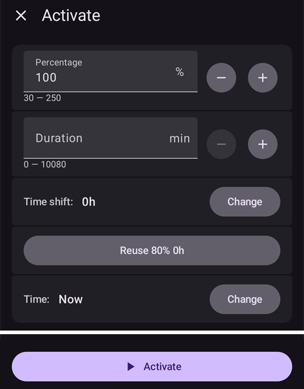
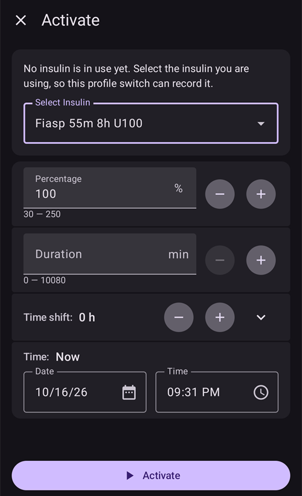

# Αλλαγή προφίλ και ποσοστό προφίλ

Αυτή η ενότητα εξηγεί τι είναι η **Αλλαγή Προφίλ** και το **Ποσοστό προφίλ**. Μπορείτε να μάθετε πώς δημιουργείτε ένα **Προφίλ** στη σελίδα [Το προφίλ σας στο AAPS](#your-aaps-profile-create-and-edit-profiles).

Όταν ξεκινάτε με το **AAPS**, θα χρειαστεί να δημιουργήσετε ένα **Προφίλ**, να μάθετε πώς κάνετε μια **Αλλαγή Προφίλ** και να καταλάβετε την επίδραση ενός **Ποσοστού προφίλ** στο **AAPS**. Οι λειτουργίες της **Αλλαγής Προφίλ** ή του **Ποσοστού προφίλ** μπορεί να είναι ιδιαίτερα χρήσιμες για:

- Έμμηνος κύκλος - μια προσαρμογή με ποσοστό στο **Προφίλ** μπορεί να ρυθμιστεί στους **Αυτοματισμούς**, ώστε το **AAPS** να προσαρμόζεται στις διάφορες φάσεις του ορμονικού κύκλου και στην αναμενόμενη αντίσταση στην ινσουλίνη.

- Άσκηση - μια προσαρμογή με ποσοστό στο **Προφίλ** μπορεί να ρυθμιστεί στους **Αυτοματισμούς** για την άσκηση, ώστε να μειωθεί ο βασικός ρυθμός.

- Νυχτερινή εργασία ή εργασία σε βάρδιες - μια χρονική μετατόπιση στο **Προφίλ** μπορεί να ρυθμιστεί για όσους δουλεύουν σε βάρδιες: ορίζετε στο **Προφίλ** πόσες ώρες αργότερα/νωρίτερα θα πάει ο χρήστης για ύπνο ή θα ξυπνήσει.

Γιατί να χρησιμοποιήσετε **Ποσοστό προφίλ** και όχι μια προσωρινή αλλαγή του βασικού ρυθμού; Για να είναι πιο αποτελεσματικό, το **Ποσοστό προφίλ** μειώνει ή αυξάνει αναλογικά: τον βασικό ρυθμό, το ISF και το I:C. Έτσι το **AAPS** υπολογίζει με ισορροπημένο τρόπο την ινσουλίνη που χορηγεί στον χρήστη. Μια μείωση μόνο του βασικού ρυθμού στο **Προφίλ** του χρήστη στο **AAPS** βοηθά λίγο, αν ο αλγόριθμος συνεχίζει να χρησιμοποιεί τους ίδιους λόγους ISF και I:C.

(ProfileSwitch-change-percentage)=

## Αλλαγή του ποσοστού προφίλ από την κύρια οθόνη

Χρειάζεστε τουλάχιστον ένα αποθηκευμένο **Προφίλ**. Ένα **Ποσοστό προφίλ** εφαρμόζεται πάντα μέσω μιας **Αλλαγής Προφίλ**: ενεργοποιείτε ξανά ένα **Προφίλ**, αυτή τη φορά με ποσοστό.

```{admonition} Έρχεστε από το AAPS 3; :class: note Το παρατεταμένο πάτημα στο όνομα του προφίλ δεν ανοίγει πια τον διάλογο αλλαγής προφίλ. **Πατήστε** το όνομα του προφίλ και μετά πατήστε το στρογγυλό κουμπί **▶** κάτω δεξιά: ανοίγει τις ίδιες ρυθμίσεις (ποσοστό, διάρκεια, προσωρινός στόχος Άσκηση).

    <br />1. Στην κύρια οθόνη, **πατήστε το όνομα του προφίλ** (δίπλα στο εικονίδιο με το αστέρι). Η [οθόνη Προφίλ](#ProfileSwitch-manage-v4) ανοίγει στην κάρτα του **Προφίλ** που τρέχει, με την ένδειξη **ΕΝΕΡΓΟ**.
    
       
    
    2. Για να κρατήσετε το ίδιο **Προφίλ**, αφήστε επιλεγμένη την κάρτα **ΕΝΕΡΓΟ**. Για να αλλάξετε και **Προφίλ** ταυτόχρονα, σύρετε σε άλλη κάρτα.
    3. Πατήστε το στρογγυλό κουμπί **▶** (**Ενεργοποίηση**) κάτω δεξιά. Ανοίγει η οθόνη **Ενεργοποίηση**.
    4. Ορίστε το **Ποσοστό** με **−** / **+** (βήματα του 5%) ή πληκτρολογήστε το (30 έως 250%). Το πεδίο ξεκινά πάντα από **100%**: δεν δείχνει το ποσοστό που τρέχει τώρα. Για παράδειγμα, εισάγετε **80** για 20% λιγότερη ινσουλίνη ή **120** για 20% περισσότερη.
    5. Ορίστε τη **Διάρκεια** σε λεπτά:
       * το **0** κρατά το νέο ποσοστό μέχρι να κάνετε άλλη **Αλλαγή Προφίλ**·
       * κάθε άλλη τιμή τερματίζει την αλλαγή μετά από αυτόν τον χρόνο και το **AAPS** επιστρέφει στο **Προφίλ** που έτρεχε πριν.
    
       
    
    6. Πατήστε **▶ Ενεργοποίηση** στο κάτω μέρος της οθόνης. Ελέγξτε τη σύνοψη στον διάλογο **Αλλαγή Προφίλ** και πατήστε **OK**.
    
       
    
    Πίσω στην κύρια οθόνη, το όνομα του προφίλ δείχνει το ποσοστό και τον χρόνο που απομένει, για παράδειγμα *Normal (80%) (59')*, και γίνεται κίτρινο όσο τρέχει μια αλλαγή με διάρκεια. Ένα αστέρι σημειώνει την αλλαγή στο γράφημα γλυκόζης. Δείτε [την κύρια οθόνη](#aaps-screens-profile--target).
    
    
    
    Για να **επιστρέψετε στο 100%** πριν το τέλος, επαναλάβετε τα βήματα και αφήστε το **Ποσοστό** στο 100 και τη **Διάρκεια** στο 0.
    
    ```{admonition} Ποσοστά με ένα πάτημα
    :class: tip
    Αν χρησιμοποιείτε συχνά το ίδιο ποσοστό (άσκηση, ασθένεια), προσθέστε μια [συντόμευση προφίλ](#profile-shortcuts) στη γραμμή QuickLaunch ή δημιουργήστε ένα [σενάριο](Scenes.md). Και τα δύο εφαρμόζουν ένα προφίλ με προκαθορισμένο ποσοστό και διάρκεια με ένα πάτημα.
    

(ProfileSwitch-manage-v4)=

## Διαχείριση και ενεργοποίηση προφίλ (Διαχείριση → Προφίλ)

Στο **AAPS** v4 τα προφίλ τα διαχειρίζεστε και τα ενεργοποιείτε από την οθόνη **Διαχείριση** (κάτω πλοήγηση) → **Προφίλ** (*«Διαχείριση και ενεργοποίηση προφίλ»*).

Η οθόνη Προφίλ δείχνει τα προφίλ σας ως **καρουζέλ καρτών που σύρετε**. Η κάρτα του προφίλ που τρέχει έχει την ένδειξη **ΕΝΕΡΓΟ** και δείχνει τον συνολικό ημερήσιο βασικό ρυθμό του (π.χ. *∑ 30,15 U*). Κάτω από την επιλεγμένη κάρτα βλέπετε τις λεπτομέρειες του προφίλ — **Μονάδες**, τύπο **Ινσουλίνης** και τα προγράμματα **IC**, **ISF**, **βασικού ρυθμού** και **στόχου** με γραφήματα.


Τα κουμπιά στο κάτω μέρος ενεργούν στο **επιλεγμένο** προφίλ: **➕ Προσθήκη**, **✏️ Επεξεργασία**, **⧉ Κλώνος** και **‘️ Διαγραφή**, και το στρογγυλό κουμπί **▶ Ενεργοποίηση** δεξιά. Για το πώς συμπληρώνετε τα τέσσερα προγράμματα στον επεξεργαστή (IC / ISF / BAS / TARG), δείτε [Δημιουργία και επεξεργασία προφίλ](#your-aaps-profile-create-and-edit-profiles).

Το **⧉ Κλώνος** χρησιμοποιεί το εικονίδιο με τα δύο τετράγωνα, που συχνά σημαίνει *αντιγραφή*, αλλά δεν υπάρχει επικόλληση: δημιουργεί το αντίγραφο με ένα βήμα. Επιβεβαιώστε το *Κλωνοποίηση του προφίλ "Normal";* και ένα νέο προφίλ με όνομα *Normal αντίγραφο* προστίθεται στο τέλος του καρουζέλ και επιλέγεται, έτοιμο για **✏️ Επεξεργασία** (όπου μπορείτε και να το μετονομάσετε). Αυτό δεν είναι το ίδιο με την κλωνοποίηση μιας παλιάς **Αλλαγής Προφίλ** από το Ιστορικό θεραπειών, που δημιουργεί ένα νέο προφίλ *με εφαρμοσμένα το ποσοστό και τη χρονική μετατόπιση*. Δείτε [Κρατήστε μια αλλαγή προφίλ για μελλοντική χρήση](#ProfileSwitch-keep-for-later).

(ProfileSwitch-read-only-mode)= **Μόνο το κουμπί ▶ Ενεργοποίηση;** Οι ρυθμίσεις σας είναι προστατευμένες, γι' αυτό η οθόνη ανοίγει μόνο για ανάγνωση. Πατήστε το **✏️ μολύβι** στην επάνω γραμμή και εισάγετε τον κωδικό των ρυθμίσεών σας. Δείτε [Η προστασία ρυθμίσεων κλειδώνει πλέον και τις οθόνες διαχείρισης](#v4changes-read-only-management).

### Αλλαγή σειράς των προφίλ

Αν έχετε περισσότερα από ένα προφίλ, μπορείτε να επιλέξετε τη σειρά τους στο καρουζέλ: πατήστε το εικονίδιο **Αναδιάταξη** (⇅, δύο βέλη προς τα πάνω και προς τα κάτω) στην επάνω γραμμή. Η ένδειξη σελίδας αντικαθίσταται από **κουμπιά μετακίνησης ◀ / ▶** με ένδειξη *θέση / σύνολο* — μετακινήστε την κεντρική κάρτα πιο μπροστά ή πιο πίσω και επιβεβαιώστε με **✓** (ή ακυρώστε με **✕**). Η νέα σειρά αποθηκεύεται μία φορά, όταν επιβεβαιώσετε.


### Ενεργοποίηση ενός προφίλ

Επιλέξτε ένα προφίλ και πατήστε **▶ Ενεργοποίηση**. Η οθόνη **Ενεργοποίηση** σας επιτρέπει να ορίσετε πώς θα εφαρμοστεί η **Αλλαγή Προφίλ**:


- **Ποσοστό** (30–250%, ξεκινά κάθε φορά από 100%) — αλλάζει την κλίμακα όλου του προφίλ. Το 100% το χρησιμοποιεί όπως είναι· για παράδειγμα, το 70% μειώνει τον βασικό ρυθμό και την υπολογισμένη δόση ινσουλίνης (και τα bolus γευμάτων και τις διορθώσεις) κατά 30%. Δεν αλλάζει τους στόχους γλυκόζης ούτε την απορρόφηση υδατανθράκων. Δείτε [Ποσοστό προφίλ](#profile-percentage) για την πλήρη επίδραση.
- **Διάρκεια** (0–10080 λεπτά, δηλαδή έως 7 ημέρες) — πόσο διαρκεί η αλλαγή. **0 = χωρίς λήξη** (μέχρι να κάνετε νέα αλλαγή)· μια τιμή διάφορη του μηδενός επιστρέφει στο προηγούμενο προφίλ όταν λήξει.
- **Προσωρινός στόχος / Άσκηση** — εμφανίζεται μόνο όταν ορίσετε **Διάρκεια** και **Ποσοστό** κάτω από 100%. Ενεργοποιήστε το για να ξεκινήσει επίσης ένας [προσωρινός στόχος Άσκηση](#TempTargets-activity-temp-target) για την ίδια διάρκεια, όπως θα κάνατε πριν από άσκηση.
- **Χρονική μετατόπιση** — δείχνει *0h*· πατήστε **Αλλαγή** για να μετακινήσετε το πρόγραμμα μπροστά ή πίσω έως 23 ώρες (χρήσιμο για εργασία σε βάρδιες ή ταξίδια). Δείτε [Χρονική μετατόπιση](#ProfileSwitch-ProfilePercentage-time-shift-of-the-circadian-percentage-profile).
- **Επαναχρησιμοποίηση** — εμφανίζεται όταν η αλλαγή που τρέχει έχει ποσοστό διαφορετικό από 100% ή χρονική μετατόπιση, για παράδειγμα **Επαναχρησιμοποίηση 80% 0h**. Πατήστε το για να συμπληρωθούν το ίδιο ποσοστό και η ίδια χρονική μετατόπιση, για παράδειγμα για να παρατείνετε μια αλλαγή που πρόκειται να λήξει.
    
    

- **Χρόνος** — από προεπιλογή *Τώρα*. Μπορείτε να επιλέξετε άλλη ώρα, έως 24 ώρες πριν ή μετά από τώρα. Μια αλλαγή με ώρα στο μέλλον ξεκινά εκείνη την ώρα· ένας προσωρινός στόχος Άσκηση που ορίστηκε μαζί της ξεκινά επίσης εκείνη την ώρα.
    
    

- **Σημειώσεις** — εμφανίζεται μόνο αν είναι ενεργό το [Εμφάνιση σημειώσεων στους διαλόγους](#Preferences-show-notes-field-in-treatments-dialogs).

Αν οι βασικοί ρυθμοί στο επιλεγμένο ποσοστό δεν είναι συμβατοί με την αντλία σας, εμφανίζεται μια προειδοποίηση στην κορυφή και το **▶ Ενεργοποίηση** μένει ανενεργό: επιλέξτε άλλο ποσοστό.

Πατήστε **▶ Ενεργοποίηση** και μετά **OK** στον διάλογο επιβεβαίωσης. Το προφίλ που τρέχει έχει τότε την ένδειξη **ΕΝΕΡΓΟ** στην κάρτα του.

```{admonition} Η αντλία σας μπορεί να στρογγυλοποιεί τους βασικούς ρυθμούς :class: note Κάθε αντλία μπορεί να δίνει βασικούς ρυθμούς μόνο στα δικά της βήματα (για παράδειγμα 0,05 U/h), γι' αυτό στρογγυλοποιεί τους ρυθμούς του **Προφίλ** σας. Το **AAPS** χρησιμοποιεί τότε τον βασικό ρυθμό που δίνει πραγματικά η αντλία, ώστε το IOB και η TDD να μένουν σωστά. Αν η αντλία δίνει λίγο περισσότερη ή λιγότερη ινσουλίνη την ημέρα από το **Προφίλ** σας, η ειδοποίηση *«Το βασικό προφίλ στην αντλία ενημερώθηκε»* σας λέει πόση, για παράδειγμα *«δίνει 10,00 U την ημέρα αντί για 10,12 U»*.

Αν η αντλία αναφέρει βασικό ρυθμό που απέχει πολύ από το **Προφίλ** σας, το **AAPS** κρατά τον βασικό ρυθμό του **Προφίλ** και σας ζητά να ελέγξετε τους βασικούς ρυθμούς στην αντλία.

    <br />```{admonition} Με ποσοστό και χρονική μετατόπιση ένα προφίλ αρκεί για πολλά
    :class: note
    Αντί να φτιάχνετε πολλά παρόμοια προφίλ, κρατήστε ένα βασικό προφίλ και εφαρμόστε το με διαφορετικό **ποσοστό** ή **χρονική μετατόπιση** για καταστάσεις που επαναλαμβάνονται (ασθένεια, άσκηση, ταξίδια). Αυτό ακριβώς αυτοματοποιούν τα [σενάρια](Scenes.md).
    

Μια αλλαγή προφίλ δεν γίνεται μόνο από αυτή την οθόνη. Η ίδια αλλαγή μπορεί να γίνει επίσης από ένα **ρολόι Wear OS**, έναν συζευγμένο **πελάτη** (δείτε [Έλεγχος κύριας συσκευής ↔ πελάτη](../RemoteFeatures/ClientMasterControl.md)), ένα **[σενάριο](Scenes.md)** ή έναν κανόνα **Αυτοματισμού**.

## Ποσοστό προφίλ

Είναι σημαντικό ο χρήστης να καταλαβαίνει τα βασικά χαρακτηριστικά του **Ποσοστού προφίλ**. Όταν εφαρμόζετε μια αύξηση ή μείωση σε ποσοστό σε μια **Αλλαγή Προφίλ**, οι ρυθμίσεις του χρήστη στο **Προφίλ** αυξάνονται ή μειώνονται κατά το ίδιο ποσοστό.

Για παράδειγμα: μια **Αλλαγή Προφίλ** στο 130% (δηλαδή ο χρήστης έχει 30% περισσότερη αντίσταση στην ινσουλίνη) θα κάνει το **AAPS** να

- **αυξήσει** τον βασικό ρυθμό κατά 30%· 
- **μειώσει** το **ISF**: διαιρώντας με 1,3·
- **μειώσει** το **I:C** διαιρώντας με 1,3.

Θυμηθείτε: χαμηλότερο **ISF** ή **I:C** σημαίνει ισχυρότερο λόγο και περισσότερη ινσουλίνη. Οι νέοι χρήστες του **AAPS** το ξεχνούν εύκολα.

Μόλις το επιλέξετε, το **AAPS** προσαρμόζει ξανά τον βασικό ρυθμό και το **AAPS** (ανοιχτό ή κλειστό κύκλωμα) συνεχίζει να δουλεύει με βάση το επιλεγμένο ποσοστό του **Προφίλ**.

Η επίδραση ενός ποσοστού **Προφίλ** φαίνεται στον παρακάτω πίνακα:

| Αλλαγή Προφίλ  
Ποσοστό |   Επίδραση   |     I:C  
g/U     | παράδειγμα  
15g |          ISF  
mmol/l/U  
mg/dl/U          | U για μείωση  
2mmol/l  
40mg/dl |
|:-----------------------:|:------------:|:-----------------:|:----------------:|:------------------------------------------:|:--------------------------------:|
|           90%           | Πιο ασθενές  | 5/0,9  
=**5,55** |      2,7 U       | 2,2/0,9  
=**2,4**  
  
40/0,9  
=**44,4** |              0,8 U               |
|        **100%**         | **Κανονικό** |       **5**       |     **3 U**      |                **2,2  
40**                |            **0,9** U             |
|          130%           |  Πιο ισχυρό  | 5/1,3  
=**3,85** |      3,9 U       | 2,2/1,3  
=**1,7**  
  
40/1,3  
=**30,8** |              1,2 U               |

(ProfileSwitch-ProfilePercentage-time-shift-of-the-circadian-percentage-profile)=

## Χρονική μετατόπιση του κιρκαδικού ποσοστιαίου προφίλ

Μια «χρονική μετατόπιση» στο **Προφίλ** του χρήστη μετακινεί τις ρυθμίσεις του **Προφίλ** μέσα στο 24ωρο («κιρκαδικό») ρολόι κατά τον αριθμό ωρών που εισάγετε. Αυτό μπορεί να βοηθήσει:

- **όσους δουλεύουν νυχτερινές βάρδιες ή σε βάρδιες**: για νυχτερινές βάρδιες ορίζετε στο **Προφίλ** πόσες ώρες αργότερα/νωρίτερα θα πάει ο χρήστης για ύπνο ή θα ξυπνήσει· 
- **όσους αλλάζουν ζώνη ώρας σε ταξίδια**· ή
- **παιδιά με διαβήτη τύπου 1**: που έχουν σταθερό πρόγραμμα ύπνου και η αντίσταση στην ινσουλίνη τους έχει ρυθμιστεί στο **Προφίλ**. Αν για κάποιο λόγο το παιδί αναμένεται να κοιμηθεί αργότερα, ο φροντιστής μπορεί να εφαρμόσει μια «χρονική μετατόπιση» στο **Προφίλ** του παιδιού, ώστε το **AAPS** να αντιδράσει στην αντίσταση στην ινσουλίνη στο χρονικό διάστημα που ορίζει ο χρήστης.

Το ερώτημα είναι πάντα: οι ρυθμίσεις ποιας ώρας του **Προφίλ** θα αντικαταστήσουν τις ρυθμίσεις της τρέχουσας ώρας. Αυτή η ώρα πρέπει να μετατοπιστεί κατά x ώρες. Γι' αυτό προσέξτε την κατεύθυνση, όπως περιγράφεται στο παρακάτω παράδειγμα:

- Τρέχουσα ώρα: 12:00
- **Θετική** χρονική μετατόπιση 
    - 2:00 **+10 h** -> 12:00
    - Θα χρησιμοποιηθούν ρυθμίσεις από τις 2:00 αντί για τις ρυθμίσεις που χρησιμοποιούνται κανονικά στις 12:00 λόγω της θετικής χρονικής μετατόπισης.
- **Αρνητική** χρονική μετατόπιση 
    - 22:00 **-10 h** -> 12:00
    - Θα χρησιμοποιηθούν οι ρυθμίσεις από τις 22:00 (10 μ.μ.) αντί των ρυθμίσεων που χρησιμοποιούνται κανονικά στις 12:00 λόγω της αρνητικής χρονικής μετατόπισης.


Αυτός ο μηχανισμός, που κρατά στιγμιότυπα του **Προφίλ**, επιτρέπει πολύ πιο ακριβή υπολογισμό του παρελθόντος και τη δυνατότητα να παρακολουθείτε τις αλλαγές του **Προφίλ**.

(ProfileSwitch-keep-for-later)=

## Κρατήστε μια αλλαγή προφίλ για μελλοντική χρήση

Αφού κάνετε μια αλλαγή προφίλ με ποσοστό ή/και χρονική μετατόπιση, μπορείτε να αντιγράψετε αυτό το προσωρινό προφίλ σε ένα νέο προφίλ.

Για να το κάνετε, ανοίξτε το μενού (☰) → **Θεραπείες** και πηγαίνετε στην καρτέλα **Αλλαγή Προφίλ**, δείτε [Κλωνοποίηση μιας αλλαγής προφίλ σε νέο προφίλ](#your-aaps-profile-clone-profile-switch).