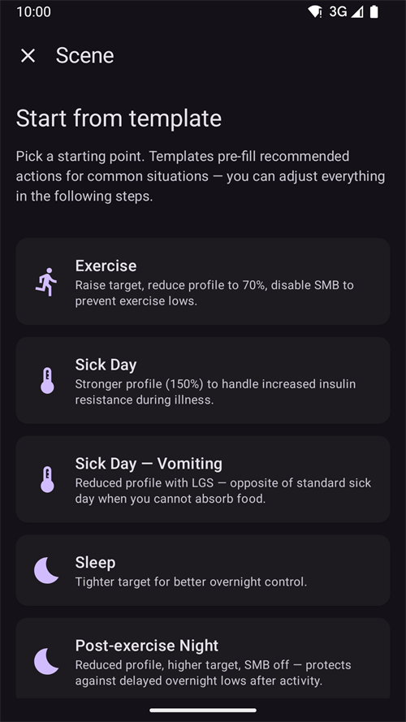
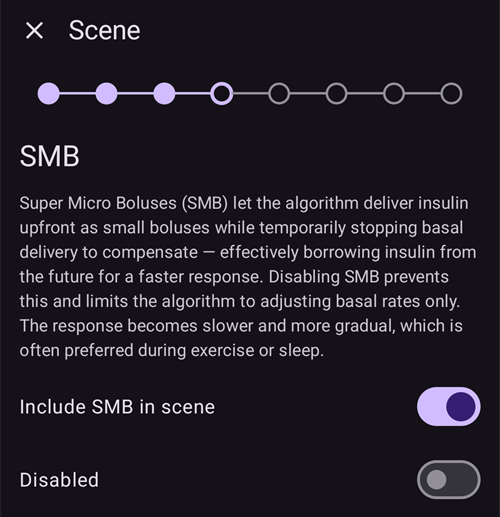
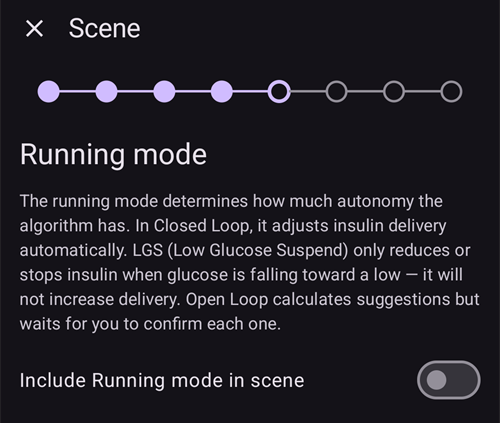
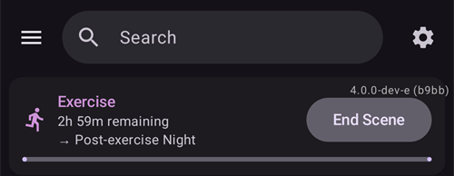
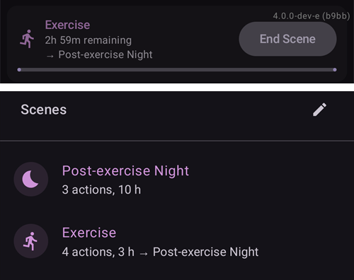

(scenes)=
# Σενάρια (έτοιμες ρυθμίσεις για καταστάσεις)

Ένα **σενάριο** είναι μια αποθηκευμένη ρύθμιση με όνομα που εκτελεί **πολλές ενέργειες μαζί**. Για παράδειγμα, ένα σενάριο *Ύπνος*, *Άσκηση* ή *Ημέρα ασθένειας* αλλάζει το προφίλ σας, ορίζει έναν προσωρινό στόχο, ενεργοποιεί ή απενεργοποιεί το SMB και προσθέτει μια σημείωση careportal με ένα πάτημα, αν θέλετε για ορισμένη διάρκεια.

```{contents} Table of contents
:depth: 2
:local: true
```

---

## Τι είναι ένα σενάριο

Αντί να αλλάζετε πολλά πράγματα με το χέρι κάθε φορά που επαναλαμβάνεται μια κατάσταση, τα ρυθμίζετε μία φορά ως σενάριο και το ενεργοποιείτε με ένα πάτημα. Ένα σενάριο μπορεί να περιέχει οποιαδήποτε από αυτές τις ενέργειες:

- **Αλλαγή Προφίλ** — αλλάζει το προφίλ ή/και το προσαρμόζει με ένα ποσοστό (π.χ. 70%).
- **Προσωρινός στόχος** — ορίζει έναν προσωρινό στόχο (π.χ. *Άσκηση*, *Γεύμα Σύντομα* ή μια δική σας τιμή).
- **SMB ενεργό/ανενεργό** — ενεργοποιεί ή απενεργοποιεί τα super-micro-bolus όσο το σενάριο είναι ενεργό.
- **Τρόπος λειτουργίας κυκλώματος** — αλλάζει τον τρόπο λειτουργίας (π.χ. σε έναν πιο συντηρητικό τρόπο).
- **Σημείωση careportal** — καταγράφει ένα συμβάν (π.χ. *Άσκηση*, *Ασθένεια*), ώστε να φαίνεται στο γράφημα και στο Nightscout.

Ένα σενάριο έχει επίσης **διάρκεια** — σταθερό χρόνο (λεπτά/ώρες/ημέρες) ή *Χωρίς όριο (χειροκίνητος τερματισμός)* — και μια **ενέργεια λήξης** που εκτελείται όταν τελειώνει: είτε μια **ειδοποίηση**, είτε μπορεί να **συνεχίσει** σε ένα άλλο σενάριο (για παράδειγμα *Ημέρα ασθένειας → Άσκηση*).

---

## Διαχείριση σεναρίων

Ανοίξτε **Διαχείριση → Σενάρια** για να δείτε, να δημιουργήσετε, να αλλάξετε, να ενεργοποιήσετε/απενεργοποιήσετε και να αλλάξετε τη σειρά των σεναρίων σας.


Κάθε κάρτα σεναρίου δείχνει:

- ένα **πλαίσιο επιλογής** για να ενεργοποιήσετε/απενεργοποιήσετε το σενάριο,
- ένα **εικονίδιο** και ένα **όνομα**,
- μια σύνοψη — *«N ενέργειες, διάρκεια»* — και το **→ επόμενο σενάριο**, αν συνεχίζει σε άλλο σενάριο,
- και τρία κουμπιά: **▶ ενεργοποίηση**, **✏️ επεξεργασία**, **🗑️ διαγραφή**.

Πατήστε το κουμπί **+** για να δημιουργήσετε ένα νέο σενάριο.

---

## Δημιουργία ή επεξεργασία σεναρίου

### Έναρξη από πρότυπο

Για να **δημιουργήσετε** ένα σενάριο, πατήστε το κουμπί **+** στην οθόνη Σενάρια. Το πρώτο βήμα είναι **Έναρξη από πρότυπο**: διαλέξτε ένα έτοιμο σενάριο για μια συνηθισμένη κατάσταση — *Άσκηση*, *Ημέρα ασθένειας*, *Ημέρα ασθένειας — Έμετος*, *Ύπνος*, *Νύχτα μετά την άσκηση*, *Πριν το γεύμα*, *Αλκοόλ*, *Οδήγηση*, *Μπάνιο*, *Ωχρινική φάση*, *Ζέστη*, *Ιατρική επέμβαση* — ή ξεκινήστε από ένα *Κενό* σενάριο. Κάθε πρότυπο **συμπληρώνει από πριν τις προτεινόμενες ενέργειες** και μπορείτε να αλλάξετε τα πάντα στα επόμενα βήματα.



Αφού διαλέξετε ένα πρότυπο, εξηγείται ο σκοπός του — *πότε* και *γιατί* να το χρησιμοποιήσετε — πριν συνεχίσετε:


### Περάστε από τις ενέργειες βήμα προς βήμα

Το υπόλοιπο του επεξεργαστή είναι ένας σύντομος οδηγός **βήμα προς βήμα**. Κάθε βήμα είναι ένας τύπος ενέργειας με έναν διακόπτη *«Συμπερίληψη … στο σενάριο»*. Ενεργοποιήστε τον μόνο για τις ενέργειες που θέλετε να εκτελεί αυτό το σενάριο και αφήστε τις υπόλοιπες ανενεργές.


Περάστε από τα βήματα με **Επόμενο**/**Πίσω**: *Αλλαγή Προφίλ*, *Προσωρινός στόχος*, *SMB*, *Τρόπος λειτουργίας κυκλώματος*, *Σημείωση careportal*, μετά τη **διάρκεια**, την **ενέργεια λήξης** (ειδοποίηση ή συνέχεια σε άλλο σενάριο) και τέλος το **όνομα και το εικονίδιο** του σεναρίου. Αποθηκεύστε όταν τελειώσετε. (Για να **αλλάξετε** ένα υπάρχον σενάριο, πατήστε το κουμπί **✏️** του — μπαίνετε κατευθείαν σε αυτά τα βήματα.)

Κάθε βήμα ξεκινά με μια σύντομη εξήγηση του τι κάνει η ενέργεια. Τα βήματα μοιάζουν έτσι, εδώ με το πρότυπο *Άσκηση*:

**Προσωρινός στόχος** — διαλέξτε μία από τις έτοιμες ρυθμίσεις προσωρινού στόχου:


**SMB** — ενεργοποιήστε ή απενεργοποιήστε το SMB όσο το σενάριο είναι ενεργό:



**Τρόπος λειτουργίας** — αν θέλετε, αλλάξτε τον τρόπο λειτουργίας του κυκλώματος:



**Careportal** — ο τύπος συμβάντος και η σημείωση για καταγραφή:


**Διάρκεια** — πόσο χρόνο μένει ενεργό το σενάριο· 0 σημαίνει μέχρι να το τερματίσετε εσείς:


**Επόμενο σενάριο** — αν θέλετε, το σενάριο που ξεκινά όταν τελειώσει αυτό:


**Σενάριο** — το όνομα και το εικονίδιο. Πατήστε **Τέλος** για αποθήκευση:


---

## Ενεργοποίηση σεναρίου

Ενεργοποιήστε ένα σενάριο από τη λίστα **Σενάρια** (το κουμπί **▶**) ή από την επιλογή **Σενάρια** στην κάτω γραμμή πλοήγησης. Στο φύλλο **Σενάρια** της κάτω γραμμής πλοήγησης, κάθε σενάριο δείχνει την ίδια σύνοψη όπως στη λίστα Σενάρια. Το **μολύβι** στο πάνω μέρος του φύλλου ανοίγει τη **Διαχείριση → Σενάρια** για να δημιουργήσετε ή να αλλάξετε τα σενάριά σας.


Πριν εφαρμοστεί οτιδήποτε, βλέπετε μια **επιβεβαίωση** που δείχνει ακριβώς τι θα κάνει το σενάριο, για να το ελέγξετε:


Αν το σενάριο συνεχίζει σε άλλο σενάριο, η επιβεβαίωση τελειώνει με **→** και το όνομα του επόμενου σεναρίου, όπως φαίνεται και στη λίστα Σενάρια.

Όταν ξεκινάτε το σενάριο από την επιλογή **Σενάρια** της κάτω γραμμής πλοήγησης, η επιβεβαίωση είναι ένα πιο απλό παράθυρο με την ίδια λίστα ενεργειών. Πατήστε **OK** για ενεργοποίηση:


Αφού επιβεβαιώσετε, οι ενέργειες εφαρμόζονται και το **ενεργό σενάριο** εμφανίζεται στο πάνω μέρος της επισκόπησης με ένα κουμπί **Τερματισμός σεναρίου**. Αν το σενάριο συνεχίζει σε άλλο σενάριο, η γραμμή δείχνει επίσης το όνομα του επόμενου σεναρίου:



Οι ενέργειες του σεναρίου μένουν σε ισχύ μέχρι:

- να τελειώσει η **διάρκειά** του (εκτελείται η **ενέργεια λήξης** — μια ειδοποίηση ή συνέχεια στο επόμενο σενάριο), ή
- να πατήσετε **Τερματισμός σεναρίου** για να το τερματίσετε χειροκίνητα. Αν το σενάριο συνεχίζει σε άλλο σενάριο, έχετε δύο επιλογές: **Μετάβαση σε** επόμενο σενάριο (το ενεργό σενάριο τελειώνει και το επόμενο ξεκινά τώρα) ή **Τερματισμός σεναρίου** (το ενεργό σενάριο τελειώνει και το επόμενο δεν ξεκινά).

Ένα σενάριο χωρίς επόμενο σενάριο σας ζητά μόνο επιβεβαίωση:


Ο τερματισμός ενός σεναρίου **αναιρεί** τις αλλαγές που έκανε (για παράδειγμα την αλλαγή προφίλ και τον προσωρινό στόχο που ξεκίνησε).

Όσο ένα σενάριο είναι ενεργό, το προφίλ και ο στόχος στην κύρια οθόνη έχουν ένα μικρό εικονίδιο σεναρίου, όταν τα όρισε το σενάριο. Το φύλλο **Σενάρια** της κάτω γραμμής πλοήγησης μένει διαθέσιμο για να ξεκινήσετε άλλο σενάριο:



Όταν η διάρκεια τελειώσει μόνη της, οι αλλαγές αναιρούνται αμέσως και η γραμμή αλλάζει σε **Το σενάριο τερματίστηκε** με ένα κουμπί **Παράβλεψη**. Η παράβλεψη απλώς αφαιρεί τη γραμμή από την οθόνη — το ίδιο το σενάριο έχει ήδη τελειώσει, οπότε οι κανόνες αυτοματισμού και ένα επόμενο σενάριο συνεχίζουν χωρίς να την περιμένουν.

---

## Εκκίνηση σεναρίων από τον Αυτοματισμό

Ένα σενάριο δεν χρειάζεται να ξεκινήσει με το χέρι — ο **Αυτοματισμός** μπορεί να το εκτελέσει για εσάς. Όταν προσθέτετε μια ενέργεια σε έναν κανόνα αυτοματισμού (**Διαχείριση → Αυτοματισμός**), η επιλογή ενεργειών έχει μια κατηγορία **Σενάρια**:

- **Εκτέλεση σεναρίου** — ενεργοποιεί ένα σενάριο όταν ενεργοποιηθούν οι συνθήκες του κανόνα (για παράδειγμα σε μια ορισμένη ώρα, όταν φτάνετε κάπου ή όταν η γλυκόζη περάσει ένα όριο).
- **Ενεργοποίηση σεναρίου** / **Απενεργοποίηση σεναρίου** — κάνει ένα σενάριο διαθέσιμο (ή μη διαθέσιμο) χωρίς να το ξεκινήσει.


Ο Αυτοματισμός μπορεί επίσης να **αντιδρά σε** ένα σενάριο: η λίστα συνθηκών περιέχει τη συνθήκη **Σενάριο**, ώστε ένας κανόνας να εκτελείται μόνο όσο ένα συγκεκριμένο σενάριο είναι ενεργό. Μαζί με την **ενέργεια λήξης** ενός σεναρίου (αναίρεση, ειδοποίηση ή συνέχεια σε άλλο σενάριο), έτσι τα σενάρια μπορούν να ξεκινούν, να συνεχίζουν το ένα μετά το άλλο και να τελειώνουν αυτόματα.

---

## Σενάρια με Master/Client και ρολόι

Το **τρέχον ενεργό σενάριο συγχρονίζεται** σε όλες τις συνδεδεμένες συσκευές σας — αν το ενεργοποιήσετε σε ένα τηλέφωνο, το δείχνουν και τα άλλα.

Ένας συζευγμένος **πελάτης** (**AAPSClient**) μπορεί επίσης να ενεργοποιήσει ή να τερματίσει ένα σενάριο: το αίτημα στέλνεται στην **κύρια συσκευή**, που δημιουργεί την επιβεβαίωση και εφαρμόζει το σενάριο στη δική του κατάσταση. Δείτε [Έλεγχος κύριας συσκευής ↔ πελάτη](../RemoteFeatures/ClientMasterControl.md) για το πώς λειτουργεί.

(scenes-from-watch)=
### Από ρολόι Wear OS

Τα σενάρια είναι διαθέσιμα σε **ρολόι Wear OS** ως **πλακίδιο Σενάριο**. Σαρώστε μέχρι το πλακίδιο **Σενάριο** στα πλακίδια του ρολογιού (αν δεν υπάρχει ακόμα, προσθέστε το πρώτα από τη λίστα πλακιδίων) και πατήστε το σενάριο που θέλετε να ξεκινήσετε:


Το πλακίδιο έχει τέσσερις θέσεις. Από προεπιλογή, κάθε θέση συμπληρώνεται **αυτόματα** με το επόμενο από τα ενεργά σενάριά σας, με τη σειρά που έχουν στο τηλέφωνο. Για να διαλέξετε εσείς, **πατήστε παρατεταμένα το πλακίδιο** και ανοίξτε τις ρυθμίσεις του: για καθεμία από τις τέσσερις θέσεις μπορείτε να κρατήσετε το **Αυτόματο**, να καρφιτσώσετε ένα **συγκεκριμένο σενάριο** ή να επιλέξετε **Κανένα** για να μείνει η θέση κενή. Μια θέση καρφιτσωμένη σε σενάριο που στο μεταξύ διαγράφηκε ή απενεργοποιήθηκε δείχνει **Μη διαθέσιμο** — διαλέξτε άλλο σενάριο για αυτήν.

Το ρολόι δείχνει μετά μια επιβεβαίωση — πατήστε **✓** για ενεργοποίηση ή σαρώστε προς τα πίσω για ακύρωση:


Όπως και σε έναν πελάτη, **η κύρια συσκευή δημιουργεί την επιβεβαίωση και εκτελεί το σενάριο**· το ρολόι μόνο προωθεί το αίτημα (μέσω του τηλεφώνου-πελάτη, αν το ρολόι είναι συνδεδεμένο με πελάτη).

Όσο ένα σενάριο εκτελείται — ή η γραμμή **Το σενάριο τερματίστηκε** φαίνεται ακόμα στο τηλέφωνο — το πλακίδιο δείχνει ένα κουμπί **Τέλος** με το όνομα του σεναρίου από κάτω. Πατήστε το για να τερματίσετε το ενεργό σενάριο ή για να αφαιρέσετε τη γραμμή που έμεινε, από τον καρπό σας.

Αν το σενάριο που εκτελείται συνεχίζει σε άλλο σενάριο, το πλακίδιο δείχνει επίσης ένα κουμπί **Παράλειψη** με το όνομα του επόμενου σεναρίου από κάτω. Αυτές είναι οι ίδιες δύο επιλογές όπως στο τηλέφωνο:

- **Τέλος** — το ενεργό σενάριο τελειώνει. Η επιβεβαίωση σας λέει ότι το επόμενο σενάριο δεν θα ξεκινήσει.
- **Παράλειψη** — το ενεργό σενάριο τελειώνει και το επόμενο σενάριο ξεκινά τώρα. Η επιβεβαίωση αναφέρει και τα δύο σενάρια.

Η [οθόνη Κατάσταση κυκλώματος](#WearOsSmartwatch-loop-status) του ρολογιού δείχνει επίσης το ενεργό σενάριο, τον χρόνο που απομένει και το επόμενο σενάριο.

---


<!-- =====================================================================
     Screenshots captured from a real master device:
       - scenes_list.png        (Manage → Scenes management list)
       - templates_picker.png   (create: "Start from template" picker)
       - template_explanation.png (create: chosen template's explanation)
       - scene_editor.png       (scene editor, Profile switch step)
       - scene_confirmation.png (scene activation confirmation — also used on the Client/Master page)
       - scene_active_banner.png (overview active-scene banner with the End Scene button)
       - automation_scene_action.png (Automation action picker — Scenes category)
       - scene_watch_tile.png    (Wear OS Scene tile)
       - scene_watch_confirm.png (Wear OS scene confirmation)
     Maintainers: relocate page + images and fix cross-links as needed.
     ===================================================================== -->
