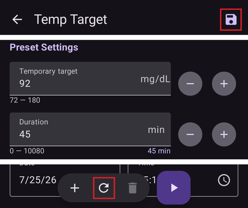

# Προσωρινοί στόχοι

## Τι είναι οι προσωρινοί στόχοι και πού μπορώ να τους ορίσω και να τους ρυθμίσω;

Ο **προσωρινός στόχος** (ή σύντομα **TT**, από το Temp-Target) είναι μια λειτουργία του **AAPS** που επιτρέπει στον χρήστη να αλλάξει το [εύρος στόχου **BG**](#profile-glucose-targets) του για προγραμματισμένες δραστηριότητες. Το **AAPS** το πετυχαίνει αλλάζοντας την ινσουλίνη που χορηγείται στον χρήστη.

Ένας στόχος γλυκόζης, ιδίως αν είναι μόνο για λίγο (διάρκεια μικρότερη από 4 ώρες), δεν χρειάζεται να είναι η *πραγματική τιμή* στην οποία περιμένετε ή θέλετε να φτάσει η γλυκόζη σας. Είναι μάλλον ένας καλός τρόπος να πείτε στο **AAPS** να είναι πιο ή λιγότερο επιθετικό, ενώ η γλυκόζη σας μένει εντός στόχου.

Οι προσωρινοί στόχοι μπορούν να οριστούν μέσα σε αυτά τα όρια:

|          | Προσωρινός στόχος     |
| -------- | --------------------- |
| Ελάχιστο | 4 mmol/l ή 72 mg/dl   |
| Μέγιστο  | 10 mmol/l ή 180 mg/dl |

Το **AAPS** έχει τρεις ενσωματωμένες προεπιλογές **προσωρινού στόχου**: για άσκηση (**Άσκηση**), για γεύματα (**Γεύμα Σύντομα**) και για προβλεπόμενη υπογλυκαιμία (**Υπογλυκαιμία**). Βρίσκονται στην οθόνη **Προσωρινός Στόχος** (**Διαχείριση** → **Προσωρινός Στόχος**), που μπορείτε επίσης να ανοίξετε απλά πατώντας την **ένδειξη στόχου** στην κύρια οθόνη.

Οι χρήστες πρέπει να έχουν ρεαλιστικές προσδοκίες για τα αποτελέσματα που μπορούν να πετύχουν όταν επιλέγουν έναν **προσωρινό στόχο** στο **AAPS**. Το αν θα πετύχετε τον επιθυμητό στόχο **BG** εξαρτάται από πολλούς παράγοντες, όπως: πόσο αξιόπιστες είναι οι ρυθμίσεις του **AAPS** σας, ο γενικός έλεγχος της **BG**, το **IOB**, η ευαισθησία στην ινσουλίνη, η αντίσταση στην ινσουλίνη, η ένταση της άσκησης κ.λπ.

Ένας **προσωρινός στόχος** μπορεί να χρειαστεί περίπου 30 λεπτά ή περισσότερο για να φτάσει η **BG** στον επιθυμητό στόχο. Το **AAPS** δεν μπορεί να φτάσει σε έναν στόχο **BG** αμέσως. Οι χρήστες πρέπει να το έχουν αυτό υπόψη όταν επιλέγουν έναν **προσωρινό στόχο**.

The sections below summarize the features of **Temp-Target Activity**, **Temp-Target Eating soon** and **Temp-Target Hypo**. Οι τιμές που φαίνονται είναι οι εργοστασιακές προεπιλογές — μπορείτε να [προσαρμόσετε κάθε προεπιλογή](#TempTargets-change-preset-defaults) στις δικές σας ανάγκες.

### TT - Άσκηση


**Στόχος BG (προεπιλογή, μπορεί να αλλάξει)**

Το AAPS θα προσπαθήσει να φτάσει τα 140 mg/dl ή 7,8 mmol/l για 1 ώρ. 30 λεπ.

**Άλλα πράγματα που οι χρήστες μπορεί να θέλουν να λάβουν υπόψη όταν επιλέγουν**:

Ανάλογα με το επίπεδο της **BG**, το **AAPS** θα «μειώσει» τη χορήγηση ινσουλίνης για να φτάσει στον στόχο **BG**. Αν ο στόχος **BG** δεν είναι εντός εύρους (δηλαδή είναι πάνω από τον στόχο **BG** που έχει επιλεγεί στο **Προφίλ** του χρήστη), τότε το **AAPS** μπορεί να κρατήσει τον βασικό ρυθμό ενεργό.

Σε λειτουργία κλειστού κυκλώματος, το **SMB**:

- *μπορεί να* απενεργοποιηθεί (περισσότερα παρακάτω)· και/ή
- ο βασικός ρυθμός μπορεί να ενεργοποιηθεί αν το **AAPS** έχει αρνητικό **IOB** ή <0.

Οι χρήστες μπορεί επίσης να θέλουν να σκεφτούν:

- την *επιλογή* αυτού του **TT** 1–2 ώρες πριν την προγραμματισμένη άσκηση, ώστε να είναι μειωμένο το IOB (η σωστή χρονική στιγμή για αυτό το TT διαφέρει από άνθρωπο σε άνθρωπο)· και
- την *επιλογή* ενός προσωρινού Προφίλ (μείωση) για τη διάρκεια της προγραμματισμένης δραστηριότητας, ώστε να είναι μειωμένο το **IOB**·
- την *εξασφάλιση* ότι ο **TT** θα *απενεργοποιηθεί* λίγο πριν την άσκηση, επειδή το **IOB** είναι ήδη μειωμένο και κάποιοι χρήστες έχουν γρήγορη άνοδο της **BG** μετά την άσκηση.

### TT - Γεύμα Σύντομα


**Στόχος BG (προεπιλογή, μπορεί να αλλάξει)**

Το AAPS θα προσπαθήσει να φτάσει τα 90 mg/dl ή 5,0 mmol/l για 45 λεπτά

**Άλλα πράγματα που οι χρήστες μπορεί να θέλουν να λάβουν υπόψη όταν επιλέγουν**:

Σε λειτουργία κλειστού κυκλώματος, το **SMB**:

- θα μείνει ενεργό· και/ή
- ο βασικός ρυθμός μπορεί επίσης να ενεργοποιηθεί, ανάλογα με τις ρυθμίσεις του **Προφίλ** του χρήστη.

Ανάλογα με το επίπεδο της **BG**, το **AAPS** θα «αυξήσει» τη χορήγηση ινσουλίνης μέσα στα όρια των ρυθμίσεων του **AAPS** του χρήστη, για να πετύχει τον επιθυμητό στόχο **BG**.

### TT - Υπογλυκαιμία


**Στόχος BG (προεπιλογή, μπορεί να αλλάξει)**

Το AAPS θα προσπαθήσει να φτάσει τα 160 mg/dl ή 8,9 mmol/l για 1 ώρα

**Άλλα πράγματα που οι χρήστες μπορεί να θέλουν να λάβουν υπόψη όταν επιλέγουν**:

Σε λειτουργία κλειστού κυκλώματος, το **SMB**:

- *μπορεί να* απενεργοποιηθεί (περισσότερα παρακάτω)· και/ή
- ο βασικός ρυθμός μπορεί να ενεργοποιηθεί αν το **AAPS** έχει αρνητικό **IOB** ή <0.

(TempTargets-manage-v4)=

## Ορισμός και διαχείριση προσωρινών στόχων (Διαχείριση → Προσωρινός Στόχος)

Στο **AAPS** v4 διαχειρίζεστε τις **προεπιλογές** TT σας και ξεκινάτε έναν προσωρινό στόχο από την οθόνη **Διαχείριση** (κάτω γραμμή πλοήγησης) → **Προσωρινός Στόχος** (*«Διαχείριση και ορισμός προσωρινών στόχων»*).


Η οθόνη έχει τρία μέρη:

1. **Κάρτες προεπιλογών** (πάνω) — σαρώστε για να δείτε τις προεπιλογές TT σας. Κάθε κάρτα δείχνει το **όνομα**, τον **στόχο** και τη **διάρκεια** της προεπιλογής· ο TT που εκτελείται τώρα είναι επισημασμένος.
2. **Επεξεργαστής** (μέση) — ο **Προσωρινός στόχος** και η **Διάρκεια** που θα εφαρμοστούν πραγματικά, και επίσης ημερομηνία/ώρα **Ενεργοποίησης**.
3. **Γραμμή ενεργειών** (κάτω) — **➕ προσθήκη**, **‘️ διαγραφή** και το κουμπί **▶ ενεργοποίηση**.

Όταν επιλέγετε μια κάρτα προεπιλογής, ο **στόχος** και η **διάρκειά** της φορτώνονται στον επεξεργαστή.

```{admonition} Ενσωματωμένες και δικές σας προεπιλογές :class: note Οι ενσωματωμένες προεπιλογές — **Γεύμα Σύντομα**, **Άσκηση** και **Υπογλυκαιμία** — υπάρχουν πάντα και **δεν μπορούν να διαγραφούν** (μπορείτε όμως να αλλάξετε τις τιμές τους και να τις αποθηκεύσετε). Όλες οι προεπιλογές που δημιουργείτε εσείς είναι **δικές σας** και μπορείτε ελεύθερα να τις αλλάξετε ή να τις διαγράψετε.

    <br />### Ενεργοποίηση προσωρινού στόχου
    
    Σαρώστε μέχρι την προεπιλογή που θέλετε (οι τιμές της φορτώνονται στον επεξεργαστή), αν θέλετε αλλάξτε τον **στόχο**/τη **διάρκεια** στον επεξεργαστή και πατήστε **▶ Ενεργοποίηση**. Μια επιβεβαίωση δείχνει τον ακριβή στόχο, τη διάρκεια και τον λόγο πριν ξεκινήσει οτιδήποτε:
    
    
    
    Αφού επιβεβαιώσετε, ο προσωρινός στόχος ξεκινά αμέσως (ή την ώρα **Ενεργοποίησης** που επιλέξατε) και ισχύει για τη **διάρκεια** που ορίσατε.
    
    ```{admonition} Η αλλαγή των αριθμών ισχύει μόνο μία φορά — δεν αλλάζει την προεπιλογή
    :class: important
    Ο **στόχος** και η **διάρκεια** στον επεξεργαστή είναι οι τιμές που θα χρησιμοποιήσει η **Ενεργοποίηση** *τώρα*. Αν τις αλλάξετε, η αλλαγή είναι **προσωρινή**: ισχύει μόνο για αυτή την ενεργοποίηση και **δεν αλλάζει την αποθηκευμένη προεπιλογή**. Έτσι μπορείτε να «αλλάξετε και να ενεργοποιήσετε» έναν TT μία φορά (για παράδειγμα να ενεργοποιήσετε σήμερα την *Άσκηση* με λίγο διαφορετικό στόχο), χωρίς να αλλάξετε μόνιμα την προεπιλογή.
    

### Αποθήκευση αλλαγών σε προεπιλογή

Αν *θέλετε* να κρατήσετε μια τιμή που αλλάξατε, κάντε **Αποθήκευση**: όταν ο επεξεργαστής διαφέρει από την επιλεγμένη προεπιλογή, εμφανίζεται ένα εικονίδιο **Αποθήκευση** στην πάνω γραμμή εργαλείων. Αν το πατήσετε, ο τρέχων **στόχος** και η **διάρκεια** (και το όνομα, για δικές σας προεπιλογές) αποθηκεύονται στην επιλεγμένη προεπιλογή. Για τις ενσωματωμένες προεπιλογές εμφανίζεται επίσης ένα κουμπί **Επαναφορά προεπιλογών** (↺) στη γραμμή ενεργειών: φέρνει πίσω τις αρχικές τιμές της προεπιλογής.


Ο απλός κανόνας λοιπόν είναι:

- **Ενεργοποίηση** → χρησιμοποιεί τους αριθμούς **μία φορά** (η προεπιλογή δεν αλλάζει).
- **Αποθήκευση** → κάνει τους αριθμούς τις **νέες τιμές** της προεπιλογής.

Για να φέρετε μια ενσωματωμένη προεπιλογή πίσω στις εργοστασιακές τιμές, επιλέξτε την και πατήστε το κουμπί **↺ Επαναφορά**. Εμφανίζεται στη γραμμή ενεργειών μόνο για μια **ενσωματωμένη** προεπιλογή με τιμές που τώρα διαφέρουν από τις εργοστασιακές, και επαναφέρει τον αρχικό **στόχο** και τη **διάρκεια** αυτής της προεπιλογής.

### Προσθήκη και αφαίρεση προεπιλογών

- **➕ Προσθήκη** — δημιουργεί μια **νέα δική σας προεπιλογή** από τις τρέχουσες τιμές του επεξεργαστή. Η νέα κάρτα εμφανίζεται στις κάρτες.
- **‘️ Διαγραφή** — αφαιρεί την επιλεγμένη **δική σας** προεπιλογή. Οι ενσωματωμένες προεπιλογές (*Γεύμα Σύντομα*, *Άσκηση*, *Υπογλυκαιμία*) δεν μπορούν να διαγραφούν.

Όταν έχετε τουλάχιστον δύο **δικές σας** προεπιλογές, μπορείτε επίσης να αλλάξετε τη σειρά τους στις κάρτες: πατήστε το εικονίδιο **Αναδιάταξη** (⇅) στην πάνω γραμμή, μετακινήστε την κεντρική κάρτα με τα **κουμπιά μετακίνησης ◀ / ▶** και επιβεβαιώστε με **✓**. Οι ενσωματωμένες προεπιλογές κρατούν τη θέση τους — μόνο οι δικές σας προεπιλογές μπορούν να μετακινηθούν. (Τα κουμπιά είναι ίδια με την [αλλαγή σειράς των προφίλ](ProfileSwitch-ProfilePercentage.md).)

Οι προεπιλογές σας είναι μέρος της συγχρονισμένης διαμόρφωσης, οπότε είναι κοινές στην κύρια συσκευή και στους συζευγμένους πελάτες σας.

### Άλλοι τρόποι για να ορίσετε έναν προσωρινό στόχο

Μπορείτε επίσης να ορίσετε έναν προσωρινό στόχο χωρίς να ανοίξετε αυτή την οθόνη:

- με τους **διακόπτες TT στο παράθυρο Υδατάνθρακες** — δείτε [παρακάτω](#TempTargets-carbs-dialog),
- με ένα **κουμπί προεπιλογής στη [γραμμή εργαλείων QuickLaunch](QuickLaunch.md)** — η κατηγορία *Προεπιλογές προσωρινού στόχου* στη *Ρύθμιση QuickLaunch* δίνει ένα κουμπί ενός πατήματος για κάθε προεπιλογή σας,
- από ένα **ρολόι Wear OS** (το στοιχείο μενού / πλακίδιο **Προσωρινός Στόχος**),
- από έναν συζευγμένο **πελάτη** — δείτε [Έλεγχος κύριας συσκευής ↔ πελάτη](../RemoteFeatures/ClientMasterControl.md),
- ως μέρος ενός **[σεναρίου](Scenes.md)** (η ενέργεια *Προσωρινός στόχος*) ή
- από έναν κανόνα **Αυτοματισμού** (*Έναρξη προσ. στόχου* / *Λήξη προσ. στόχου*).

* * *

(TempTargets-where-can-i-select-a-temp-target)=

## Πού μπορώ να επιλέξω έναν προσωρινό στόχο;

Ο πιο γρήγορος τρόπος είναι να πατήσετε την **ένδειξη στόχου** στην κύρια οθόνη (δείχνει το τρέχον εύρος στόχου σας):


Αυτό ανοίγει την οθόνη **Προσωρινός Στόχος** που περιγράφεται παραπάνω — σαρώστε μέχρι μια προεπιλογή και πατήστε **▶ Ενεργοποίηση**. Στην ίδια οθόνη φτάνετε επίσης μέσω **Διαχείριση** → **Προσωρινός Στόχος**.

(TempTargets-carbs-dialog)= Όταν καταχωρίζετε υδατάνθρακες, δεν χρειάζεται καθόλου να ανοίξετε την οθόνη **Προσωρινός Στόχος**: το **παράθυρο Υδατάνθρακες** (**Θεραπείες** → **Υδατάνθρακες**) έχει στο πάνω μέρος τους διακόπτες **Εκκίνηση TT Υπογλυκαιμίας**, **Εκκίνηση TT Γεύμα Σύντομα** και **Εκκίνηση TT Άσκησης**. Ενεργοποιήστε έναν και η αντίστοιχη προεπιλογή ενεργοποιείται μαζί με την καταχώριση υδατανθράκων:


    {admonition} Αυτόματος TT Υπογλυκαιμίας
    :class: note
    Αν ανοίξετε το **παράθυρο Υδατάνθρακες** όταν η γλυκόζη σας είναι κάτω από 72 mg/dl (4 mmol/l), το **AAPS** επιλέγει από πριν για εσάς τον διακόπτη **Εκκίνηση TT Υπογλυκαιμίας** (εκτός αν ήδη ισχύει ένας υψηλότερος προσωρινός στόχος με μεγαλύτερη υπόλοιπη διάρκεια).

(TempTargets-change-preset-defaults)=

## Πού μπορώ να αλλάξω τον προεπιλεγμένο προσωρινό στόχο και να τον αντικαταστήσω με τις δικές μου ρυθμίσεις;

Ο **στόχος** και η **διάρκεια** κάθε προεπιλογής αλλάζουν απευθείας στην οθόνη **Προσωρινός Στόχος** — δεν υπάρχει πια ξεχωριστή ρύθμιση για αυτό:

1. Ανοίξτε την οθόνη **Προσωρινός Στόχος** (πατήστε την ένδειξη στόχου ή **Διαχείριση** → **Προσωρινός Στόχος**).
2. Σαρώστε μέχρι την προεπιλογή που θέλετε να αλλάξετε.
3. Αλλάξτε τον **Προσωρινό στόχο** ή/και τη **Διάρκεια** στον επεξεργαστή.
4. Πατήστε το εικονίδιο **Αποθήκευση** που εμφανίζεται στην πάνω γραμμή εργαλείων.



Όσο ο επεξεργαστής διαφέρει από τις εργοστασιακές τιμές μιας ενσωματωμένης προεπιλογής, εμφανίζεται επίσης ένα κουμπί **↺ Επαναφορά** στη γραμμή ενεργειών — πατήστε το για να επαναφέρετε τον αρχικό στόχο και τη διάρκεια της προεπιλογής.

## Πώς ακυρώνω έναν προσωρινό στόχο;

Όσο ισχύει ένας προσωρινός στόχος, η ένδειξη στόχου στην κύρια οθόνη δείχνει τον στόχο και τον χρόνο που απομένει. Πατήστε την — στην οθόνη **Προσωρινός Στόχος** η προεπιλογή που ισχύει είναι επισημασμένη ως **ΕΝΕΡΓΟ** και ένα κόκκινο κουμπί **✗ Ακύρωση** εμφανίζεται στο τέλος της κάτω γραμμής εργαλείων, ακριβώς αριστερά από το κουμπί **▶ Ενεργοποίηση**. Πατήστε το και επιβεβαιώστε:


Ένας προσωρινός στόχος που ισχύει μπορεί επίσης να σταματήσει από ένα **ρολόι Wear OS**, από έναν συζευγμένο **πελάτη** ή από έναν κανόνα **Αυτοματισμού** (*Λήξη προσ. στόχου*).

(TempTargets-hypo-temp-target)=

## Προσωρινός στόχος Υπογλυκαιμία

Ο **προσωρινός στόχος Υπογλυκαιμία** βοηθά το **AAPS** να προστατεύσει τον χρήστη από χαμηλό σάκχαρο, μειώνοντας τη χορήγηση ινσουλίνης. Αν ο χρήστης προβλέπει ότι η **BG** του θα πέσει: συνήθως το **AAPS** θα το χειριστεί, αλλά αυτό εξαρτάται πολύ από το πόσο σταθερές είναι οι ρυθμίσεις του **AAPS** του χρήστη. Ένας **προσωρινός στόχος Υπογλυκαιμία** επιτρέπει στον χρήστη να προλάβει την προβλεπόμενη πτώση και να πει στο **AAPS** να μειώσει την ινσουλίνη.

Μερικές φορές, όταν τρώτε υδατάνθρακες για να διορθώσετε μια υπογλυκαιμία, η **BG** μπορεί να ανέβει γρήγορα και το **AAPS** θα διορθώσει τη γρήγορη άνοδο της **BG** δίνοντας **SMB**.

Μερικοί χρήστες θέλουν να μη δίνονται **SMB** όσο ισχύει ο **προσωρινός στόχος Υπογλυκαιμία**. Αυτό γίνεται αν απενεργοποιήσετε τη ρύθμιση *«Ενεργοποίηση SMB με υψηλό προσωρινό στόχο»* στις **Ρυθμίσεις** → **OpenAPS SMB** (δείτε παρακάτω):

- Advanced, objective 9: the user can enable *“High temp target raises sensitivity”* for **Temp-Targets** of 100 mg/dL (5.6 mmol/L) or higher in OpenAPS SMB, **AAPS** will be more sensitive.

- Advanced, objective 9: the user can deactivate *“Enable SMB with high temp target”*, so that even if **AAPS** has COB > 0, “Enable SMB with low temp target” or “Enable SMB always” enabled and OpenAPS SMB active, **AAPS** will not give SMBs while high temp targets are active.

Σημείωση: αν ανοίξετε το **παράθυρο Υδατάνθρακες** όταν η γλυκόζη αίματος είναι κάτω από 72 mg/dl ή 4 mmol/l, το **AAPS** επιλέγει αυτόματα από πριν τον διακόπτη **Εκκίνηση TT Υπογλυκαιμίας**.

(TempTargets-activity-temp-target)=

## Προσωρινός στόχος Άσκηση

Πριν και κατά την άσκηση, ο χρήστης μπορεί να χρειάζεται υψηλότερο στόχο για να αποφύγει την υπογλυκαιμία κατά τη δραστηριότητα.

Για να απλοποιήσει τον **προσωρινό στόχο Άσκηση**, ο χρήστης μπορεί να ρυθμίσει έναν προεπιλεγμένο **προσωρινό στόχο - Άσκηση** που ανεβάζει τη **BG** μειώνοντας τη χορήγηση ινσουλίνης, ώστε να επιβραδύνει την πτώση της **BG** και να αποφύγει την υπογλυκαιμία.

Οι νέοι χρήστες του **AAPS** μπορεί να χρειαστεί να δοκιμάσουν και να προσαρμόσουν τις προεπιλεγμένες ρυθμίσεις του **προσωρινού στόχου Άσκηση**, ώστε η λειτουργία να δουλεύει όσο καλύτερα γίνεται για αυτούς. Κάθε άνθρωπος είναι διαφορετικός όσον αφορά τον σταθερό έλεγχο της BG κατά την άσκηση. Δείτε επίσης την [ενότητα για τον αθλητισμό στις Συχνές Ερωτήσεις](#FAQ-sports).

Μερικοί χρήστες προτιμούν επίσης να ενεργοποιούν μια **Αλλαγή Προφίλ** (μείωση του Προφίλ < 100%, ώστε το **AAPS** να χορηγεί λιγότερη ινσουλίνη) πριν και όσο ισχύει ο **προσωρινός στόχος Άσκηση**. Μπορείτε να ξεκινήσετε και τα δύο σε ένα βήμα: πατήστε το όνομα του προφίλ στην κύρια οθόνη, πατήστε το στρογγυλό κουμπί **▶**, ορίστε ένα **Ποσοστό** κάτω από 100% και μια **Διάρκεια** και μετά ενεργοποιήστε το **Προσωρινός στόχος / Άσκηση**. Δείτε [Αλλαγή του ποσοστού προφίλ](#ProfileSwitch-change-percentage).

Βήμα 9 για προχωρημένους: οι χρήστες μπορούν να ενεργοποιήσουν τη ρύθμιση *«Υψηλός προσωρινός στόχος αυξάνει την ευαισθησία»* για **προσωρινούς στόχους** 100 mg/dl (5,6 mmol/l) ή υψηλότερους στο OpenAPS **SMB**. Ένας στόχος 99 mg/dl (5,5 mmol/l) είναι κανονικός στόχος, ούτε υψηλός ούτε χαμηλός. Τότε το **AAPS** είναι πιο ευαίσθητο.

Επιπλέον, αν η ρύθμιση *«Ενεργοποίηση SMB με υψηλό προσωρινό στόχο»* είναι απενεργοποιημένη, το **AAPS** δεν θα δίνει **SMB**, ακόμα και με COB > 0, με ενεργές τις ρυθμίσεις *«Ενεργοποίηση SMB με χαμηλό προσωρινό στόχο»* ή *«Ενεργοποίηση SMB πάντα»* και με ενεργό το OpenAPS **SMB**.

(TempTargets-eating-soon-temp-target)=

## Προσωρινός στόχος Γεύμα Σύντομα

**Temp-Target Eating soon** can help accomplish a gentle drive down of **BG** and ensure there is ample **IOB** before eating.

This can be an important tool for those users who do not pre bolus, however the efficacy of **Temp-Target Eating soon** will depend on a number of factors including: the user’s settings, if they eat a low carb diet and whether they are using a fast acting insulin (like Fiasp or Lyumjev) in order to eliminate the need to pre bolus. Ordinarily, until users are experienced in **AAPS** they should expect to pre bolus when using **Temp-Target Eating soon** and this is particularly so, if eating a high carb diet.

Μπορείτε να διαβάσετε περισσότερα για τη λειτουργία “Eating soon” (Γεύμα σύντομα) στο άρθρο ['How to do “eating soon” mode'](https://diyps.org/2015/03/26/how-to-do-eating-soon-mode-diyps-lessons-learned/) ή [εδώ](https://diyps.org/tag/eating-soon-mode/) (στα αγγλικά).

Για προχωρημένους, [Βήμα 9](#objectives-objective9): Αν χρησιμοποιείτε το OpenAPS SMB και έχετε ενεργή τη ρύθμιση *«Χαμηλός προσωρινός στόχος μειώνει την ευαισθησία»*, το **AAPS** δουλεύει λίγο πιο επιθετικά. Για αυτή την επιλογή ο **προσωρινός στόχος** πρέπει να είναι 98 mg/dl (5,4 mmol/l) ή χαμηλότερος.

## Πώς απενεργοποιώ το SMB κατά τους προσωρινούς στόχους;

Για να το κάνετε, ανοίξτε **Ρυθμίσεις** → **OpenAPS SMB** και απενεργοποιήστε τη ρύθμιση *«Ενεργοποίηση SMB με υψηλό προσωρινό στόχο»*.


Έτσι το **AAPS** δεν θα δίνει **SMB**, ακόμα και με COB > 0, με ενεργές τις ρυθμίσεις *«Ενεργοποίηση SMB με χαμηλό προσωρινό στόχο»* ή *«Ενεργοποίηση SMB πάντα»* και με ενεργό το OpenAPS SMB.