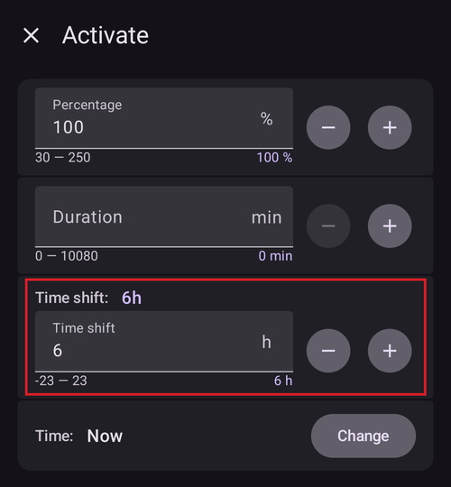
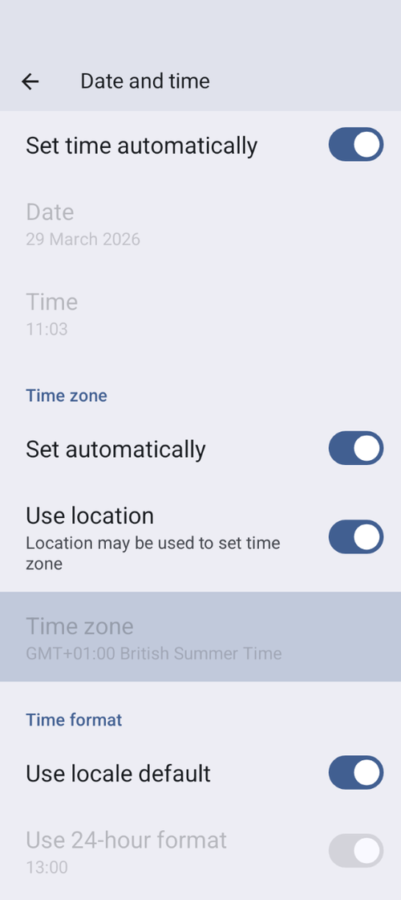

# Αλλαγή ζώνης ώρας και θερινή ώρα

Όταν αλλάζει η ζώνη ώρας του τηλεφώνου σας, το **AAPS** υπολογίζει ξανά από την αρχή το **IOB**, τον βασικό ρυθμό και την ευαισθησία για το παρελθόν, περίπου 10 δευτερόλεπτα μετά την αλλαγή. Όσο γίνεται αυτό, τα γραφήματα και οι τιμές στην κύρια οθόνη μπορεί να αργήσουν λίγο να ενημερωθούν.

(timezone-traveling-with-pumps)=

## Αλλαγή ζώνης ώρας για Omnipod Dash

* Ανανεώστε την κατάσταση της αντλίας στο **Διαχείριση → Αντλία**
* Επιλέξτε προσωρινά ένα άλλο **Προφίλ** και μετά επιστρέψτε στο αρχικό ή στο επιθυμητό **Προφίλ**

## Αλλαγή ζώνης ώρας για DanaR, Korean DanaR

Δεν υπάρχει πρόβλημα με την αλλαγή ζώνης ώρας στο τηλέφωνο, επειδή η αντλία δεν χρησιμοποιεί ιστορικό

(timezone-traveling-danarv2-danars)=

## Αλλαγή ζώνης ώρας για DanaRv2, DanaRS, Dana-i

Αυτές οι αντλίες χρειάζονται ιδιαίτερη προσοχή, επειδή το **AAPS** χρησιμοποιεί το ιστορικό της αντλίας, αλλά οι καταχωρήσεις στην αντλία δεν έχουν σήμανση ζώνης ώρας. **Αυτό σημαίνει ότι αν αλλάξετε τη ζώνη ώρας στο τηλέφωνό σας, οι καταχωρήσεις θα διαβαστούν με διαφορετική ζώνη ώρας και θα εμφανιστούν διπλές.**

Για να αποφευχθεί αυτό, υπάρχουν δύο δυνατότητες:

### Επιλογή 1: Κρατήστε την ώρα του σπιτιού και μετατοπίστε χρονικά το προφίλ

* Απενεργοποιήστε την «Αυτόματη ημερομηνία και ώρα» στις ρυθμίσεις του τηλεφώνου σας (χειροκίνητη αλλαγή ζώνης ώρας).

* Το τηλέφωνό σας πρέπει να κρατά την κανονική ώρα του σπιτιού σας για όλη τη διάρκεια του ταξιδιού.

* Μετατοπίστε χρονικά το **Προφίλ** σας ανάλογα με τη διαφορά ώρας ανάμεσα στο σπίτι και στον προορισμό.
   
   * Πατήστε το όνομα του **Προφίλ** στην κύρια οθόνη για να ανοίξετε την [οθόνη Προφίλ](#ProfileSwitch-manage-v4)
   * Επιλέξτε το **Προφίλ** σας και πατήστε **▶ Ενεργοποίηση**
   * Ορίστε τη '**Χρονική μετατόπιση**' ανάλογα με τον προορισμό σας και πατήστε **Ενεργοποίηση**.
   
   
   
   * π.χ. Βιέννη -> Νέα Υόρκη: **Αλλαγή Προφίλ** +6 ώρες
   * π.χ. Βιέννη -> Σίδνεϊ: **Αλλαγή Προφίλ** -8 ώρες

### Επιλογή 2: Διαγραφή ιστορικού αντλίας

* Απενεργοποιήστε την «Αυτόματη ημερομηνία και ώρα» στις ρυθμίσεις του τηλεφώνου σας (χειροκίνητη αλλαγή ζώνης ώρας)

Όταν κατεβείτε από το αεροπλάνο:

* κλείστε την αντλία
* αλλάξτε τη ζώνη ώρας στο τηλέφωνο
* κλείστε το τηλέφωνο, ανοίξτε την αντλία
* σβήστε το ιστορικό στην αντλία
* αλλάξτε την ώρα στην αντλία
* ενεργοποιήστε το τηλέφωνο
* αφήστε το τηλέφωνο να συνδεθεί στην αντλία και να ρυθμίσει με ακρίβεια την ώρα

(timezone-traveling-insight)=

## Αλλαγή ζώνης ώρας για Insight

Ο οδηγός προσαρμόζει αυτόματα την ώρα της αντλίας στην ώρα του τηλεφώνου.

Το Insight καταγράφει επίσης στο ιστορικό τη στιγμή που άλλαξε η ώρα, καθώς και από ποια (παλιά) ώρα σε ποια (νέα) ώρα έγινε η αλλαγή. Έτσι το **AAPS** μπορεί να βρει τη σωστή ώρα παρά την αλλαγή της ώρας.

Μπορεί να προκαλέσει ανακρίβειες στις **TDD**. Αλλά αυτό δεν θα είναι πρόβλημα.

Έτσι, ο χρήστης Insight δεν χρειάζεται να ανησυχεί για τις αλλαγές ζώνης ώρας και τις αλλαγές ώρας. Υπάρχει μία εξαίρεση σε αυτόν τον κανόνα: Η αντλία Insight έχει μια μικρή εσωτερική μπαταρία που κρατά σε λειτουργία το ρολόι κ.λπ. ενώ αλλάζετε την «πραγματική» μπαταρία. Αν η αλλαγή της μπαταρίας κρατήσει πολύ, αυτή η εσωτερική μπαταρία αδειάζει, το ρολόι μηδενίζεται και μετά την τοποθέτηση νέας μπαταρίας θα σας ζητηθεί να βάλετε ώρα και ημερομηνία. Σε αυτή την περίπτωση, όλες οι καταχωρήσεις πριν από την αλλαγή της μπαταρίας παραλείπονται στους υπολογισμούς του AAPS, επειδή η σωστή ώρα δεν μπορεί να βρεθεί με ακρίβεια.

## Αλλαγή ζώνης ώρας για Accu-Chek Combo

Ο [οδηγός του Combo](../CompatiblePumps/Accu-Chek-Combo-Pump-v2.md) προσαρμόζει αυτόματα την ώρα της αντλίας στην ώρα του τηλεφώνου. Το Combo δεν μπορεί να αποθηκεύσει ζώνες ώρας, μόνο την τοπική ώρα, και αυτή ακριβώς είναι η ώρα που ο οδηγός ορίζει στην αντλία. Επιπλέον, αποθηκεύει τη ζώνη ώρας στις τοπικές ρυθμίσεις του AAPS, ώστε να μπορεί να μετατρέπει την τοπική ώρα της αντλίας σε πλήρη χρονική σήμανση με διαφορά ζώνης ώρας. Ο χρήστης δεν χρειάζεται να κάνει τίποτα. Αν η ώρα στο Combo διαφέρει πολύ από την τρέχουσα ώρα του τηλεφώνου, η ώρα της αντλίας διορθώνεται αυτόματα.

Σημειώστε όμως ότι αυτό παίρνει λίγο χρόνο, επειδή μπορεί να γίνει μόνο στη λειτουργία remote-terminal, που γενικά είναι αργή. Αυτός είναι ένας περιορισμός του Combo που δεν μπορεί να ξεπεραστεί.

## Αλλαγή ζώνης ώρας για Medtrum

Ο οδηγός προσαρμόζει αυτόματα την ώρα της αντλίας στην ώρα του τηλεφώνου.

Οι αλλαγές ζώνης ώρας κρατούν το ιστορικό ανέπαφο. Μόνο η TDD μπορεί να επηρεαστεί. Η χειροκίνητη αλλαγή της ώρας στο τηλέφωνο μπορεί να προκαλέσει προβλήματα στο ιστορικό και στο **IOB**. Αν αλλάξετε την ώρα χειροκίνητα, ελέγξτε προσεκτικά το **IOB**.

Όταν αλλάζει η ζώνη ώρας ή η ώρα, οι **TBR** που τρέχουν σταματούν.

(time-adjustment-daylight-savings-time-dst)=

## ΘΕΡΙΝΗ ΩΡΑ (DST)

Προσαρμογή της ώρας για τη θερινή ώρα.

Ανάλογα με την αντλία και το CGM σας, τα άλματα στην ώρα μπορεί να εμποδίσουν τη σωστή λειτουργία του **AAPS**. Για μερικές αντλίες είναι καλύτερο να αλλάξετε τη ζώνη ώρας όσο είστε ξύπνιοι, πριν από την αλλαγή σε θερινή ώρα (DST), και όχι μέσα στη νύχτα.

### Αυτόματη προσαρμογή για θερινή ώρα (DST) στις περισσότερες αντλίες

* Όμως το **Κύκλωμα** θα απενεργοποιηθεί για 3 ώρες ΜΕΤΑ την αλλαγή σε θερινή ώρα (DST) (συνήθως από τη 1 π.μ. και μετά) και το **AAPS** θα επιστρέψει στον βασικό ρυθμό του **Προφίλ** σας. Αυτό γίνεται για λόγους ασφάλειας - το **IOB** μπορεί να είναι πολύ υψηλό λόγω διπλού bolus πριν από την αλλαγή σε θερινή ώρα (DST).
* Μετά την αλλαγή σε θερινή ώρα (DST), κάντε μια **Αλλαγή Προφίλ** στο επιθυμητό **Προφίλ** για να ενεργοποιήσετε το **Κύκλωμα**: πατήστε το όνομα του προφίλ στην κύρια οθόνη και μετά το στρογγυλό κουμπί **▶** (δείτε [Ενεργοποίηση προφίλ](#ProfileSwitch-manage-v4)).
* Πριν από την αλλαγή σε θερινή ώρα (DST) θα δείτε επίσης μια ειδοποίηση στην κύρια οθόνη του **AAPS** ότι το **Κύκλωμα** απενεργοποιήθηκε προσωρινά. Αυτό το μήνυμα θα εμφανιστεί χωρίς ήχο, δόνηση ή κάτι παρόμοιο.

Αν κάνετε bolus με τον υπολογιστή του **AAPS**, μη χρησιμοποιείτε τα δεδομένα **COB** και **IOB**, εκτός αν είστε σίγουροι ότι αυτά τα δεδομένα είναι απόλυτα σωστά. Προσέξτε και μη χρησιμοποιείτε αυτή τη λειτουργία για μερικές ώρες μετά την αλλαγή σε θερινή ώρα (DST).

### Θερινή ώρα (DST) για Accu-Chek Insight

* Η αλλαγή σε θερινή ώρα (DST) γίνεται αυτόματα. Δεν απαιτείται καμιά ενέργεια.

### Θερινή ώρα (DST) για Accu-Chek Combo

* Η αλλαγή σε θερινή ώρα (DST) γίνεται αυτόματα. Δεν απαιτείται καμιά ενέργεια.

### Θερινή ώρα (DST) για Medtrum

* Η αλλαγή σε θερινή ώρα (DST) γίνεται αυτόματα. Δεν απαιτείται καμιά ενέργεια.

### Θερινή ώρα (DST) για Omnipod Dash

* Είτε αφήστε το **AAPS** να επιστρέψει προσωρινά στον βασικό ρυθμό του προφίλ μετά την αλλαγή σε θερινή ώρα (DST), όπως εξηγήθηκε παραπάνω.
* Αλλιώς, αν δεν θέλετε το **AAPS** να επιστρέψει προσωρινά στον βασικό ρυθμό του προφίλ μέσα στη νύχτα, μπορείτε να αλλάξετε τη ζώνη ώρας την προηγούμενη μέρα από την αλλαγή σε θερινή ώρα (DST), ώστε να μην υπάρξει διακοπή τη νύχτα. ΣΗΜΕΙΩΣΗ: ΑΥΤΗ Η ΕΠΙΛΟΓΗ ΜΠΟΡΕΙ ΝΑ ΚΑΝΕΙ ΤΟ POD ΣΑΣ ΝΑ ΛΗΞΕΙ ΝΩΡΙΤΕΡΑ. ΑΝ ΕΠΙΛΕΞΕΤΕ ΤΗ ΛΕΙΤΟΥΡΓΙΑ ΠΑΡΑΚΑΤΩ, ΕΧΕΤΕ ΜΑΖΙ ΣΑΣ ΑΝΤΑΛΛΑΚΤΙΚΑ.

#### Ενέργειες πριν από την αλλαγή της ώρας

1. Απενεργοποιήστε κάθε ρύθμιση του τηλεφώνου που ορίζει αυτόματα τη ζώνη ώρας, ώστε ο χρήστης να μπορεί να αλλάξει σε μια ζώνη ώρας που δεν χρησιμοποιεί θερινή ώρα (DST). Ο τρόπος ενεργοποίησης εξαρτάται από το τηλέφωνό σας και την έκδοση Android.
   
   * Μερικά τηλέφωνα έχουν δύο ρυθμίσεις: μία για την αυτόματη ρύθμιση της ώρας (που ιδανικά πρέπει να μείνει ενεργή) και μία για την αυτόματη ρύθμιση της ζώνης ώρας (που πρέπει να ΑΠΕΝΕΡΓΟΠΟΙΗΣΕΤΕ: **Set automatically** (Αυτόματη ρύθμιση) κάτω από **Time zone** (Ζώνη ώρας) στο στιγμιότυπο οθόνης παρακάτω).
   * Δυστυχώς, σε μερικές εκδόσεις Android υπάρχει ένας μόνο διακόπτης για την αυτόματη ρύθμιση της ώρας και της ζώνης ώρας μαζί. Θα πρέπει να το απενεργοποιήσετε προς το παρόν.

2. Βρείτε μια ζώνη ώρας που έχει την ίδια ώρα με την τωρινή σας τοποθεσία, αλλά δεν χρησιμοποιεί θερινή ώρα (DST).
   
   * Μια λίστα με αυτές τις χώρες θα βρείτε εδώ: [https://greenwichmeantime.com/countries](https://greenwichmeantime.com/countries/)
   * Για την Ώρα Κεντρικής Ευρώπης (CET) αυτή θα μπορούσε να είναι η «Brazzaville» (Κονγκό). Αλλάξτε τη ζώνη ώρας του τηλεφώνου σας σε Κονγκό.

3. Στο **AAPS** ανανεώστε την αντλία σας και αλλάξτε στο επιθυμητό **Προφίλ**.

4. Ελέγξτε το **IOB** και το **COB** στο **AAPS**. Αν δεν είναι σωστά, απενεργοποιήστε το **Κύκλωμα** για τουλάχιστον μία DIA ή τον μέγιστο χρόνο απορρόφησης υδατανθράκων (Max-Carb-Time), όποιο από τα δύο είναι μεγαλύτερο.

5. Ενέργειες μετά την αλλαγή της ώρας. Μια καλή στιγμή για να επιστρέψετε στην τοπική ζώνη ώρας είναι όταν το **IOB** είναι χαμηλό. Π.χ. μία ώρα πριν από ένα γεύμα, όπως το πρωινό. Ιδανικά, το **COB** και το **IOB** πρέπει να είναι και τα δύο κοντά στο μηδέν.