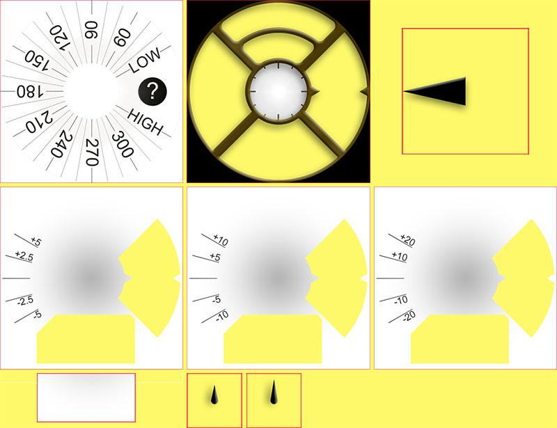

# Έγγραφο αναφοράς για το Custom Watchface

Αυτή η σελίδα είναι για όσους σχεδιάζουν νέα watchface. Περιέχει όλες τις λέξεις-κλειδιά και τις λειτουργίες που υπάρχουν όταν θέλετε να δημιουργήσετε ή να προσθέσετε κίνηση σε ένα νέο watchface.

- Οι νέες λειτουργίες και τα νέα κλειδιά του Custom Watchface V2 (Wear apk 3.3.0 ή νεότερο) περιγράφονται [εδώ](#cwf-reference-new-v2-features)

## Μορφή του Custom Watchface

Το Custom Watchface είναι μια ανοιχτή μορφή που σχεδιάστηκε για το AAPS και συνδέεται με το νέο watchface «AAPS (Custom)» που υπάρχει στο ρολόι.

Το αρχείο του watchface είναι ένα απλό αρχείο zip, αλλά για να αναγνωριστεί ως αρχείο watchface, το zip πρέπει να περιέχει τα παρακάτω αρχεία:

- Ένα αρχείο εικόνας με όνομα CustomWatchface (μπορεί να είναι αρχεία bitmap `CustomWatchface.jpg`, `CustomWatchface.png` ή ένα διανυσματικό `CustomWatchface.svg`). Αυτό το αρχείο είναι το μικρό εικονίδιο για την επιλογή του watchface όταν πατάτε το κουμπί «Φόρτωση Watchface», καθώς και η εικόνα που φαίνεται στο πρόσθετο Wear του AAPS.
- Ένα αρχείο με όνομα `CustomWatchface.json` (δείτε [Δομή JSON](#cwf-reference-json-structure) παρακάτω). Αυτό το δεύτερο αρχείο είναι το βασικό αρχείο που περιέχει όλες τις πληροφορίες που χρειάζονται για τη σχεδίαση του watchface. Αυτό το αρχείο json πρέπει να είναι έγκυρο (αυτό είναι ίσως το πιο δύσκολο σημείο όταν αλλάζετε το αρχείο με το χέρι σε έναν επεξεργαστή κειμένου, γιατί αρκεί ένα κόμμα που λείπει ή περισσεύει για να χαλάσει η μορφή json). Αυτό το αρχείο JSON πρέπει επίσης να περιέχει ένα μπλοκ `"metadata"` με ένα κλειδί `"name"` που δεν είναι κενό. Αυτό θα είναι το όνομα του προσαρμοσμένου watchface σας (δείτε [Ρυθμίσεις Metadata](#cwf-reference-metadata-settings) παρακάτω)
- το μέγεθος αυτού του zip πρέπει να είναι όσο το δυνατόν μικρότερο (λιγότερο από περίπου 500kb). Αν αυτό το αρχείο είναι πολύ μεγάλο, απλώς μπλοκάρεται και δεν στέλνεται στο ρολόι.

Το αρχείο zip μπορεί επίσης να περιέχει κάποια επιπλέον αρχεία πόρων:

- Σταθερά (hardcoded) ονόματα αρχείων για τις εικόνες που χρησιμοποιούνται στις βασικές προβολές του watchface (όπως `Background`, `CoverChart`... δείτε [Λίστα σταθερών αρχείων πόρων](#cwf-reference-list-of-hardcoded-resource-files) παρακάτω). Όλα αυτά τα αρχεία μπορούν να είναι σε μορφή `jpg`, `png` ή `svg`. αλλά για τα περισσότερα θα πρέπει να χρησιμοποιήσετε `png` ή `svg`, που υποστηρίζουν διαφάνεια (τα jpg είναι μικρότερα σε μέγεθος από τα png, αλλά δεν έχουν διαφάνεια). Σημειώστε ότι η καλύτερη ποιότητα με το μικρότερο μέγεθος επιτυγχάνεται συνήθως με αρχεία svg (διανυσματική μορφή).
- Επιπλέον αρχεία πόρων με ελεύθερα ονόματα. Αυτά τα πρόσθετα αρχεία μπορούν να είναι αρχεία εικόνας ή αρχεία γραμματοσειράς (για γραμματοσειρές γίνονται δεκτές οι μορφές `ttf` και `otf`). Σημειώστε ότι για αυτά τα επιπλέον αρχεία, το `filename` (χωρίς κατάληξη) χρησιμοποιείται ως keyValue μέσα στο αρχείο JSON, για να ορίσει πού ή πότε θα χρησιμοποιηθούν αυτά τα αρχεία.
  - τα αρχεία εικόνας χρησιμοποιούνται συχνά ως φόντο για τα πεδία κειμένου ή για δυναμική κίνηση (π.χ. επίπεδο μπαταρίας από 0% έως 100%)
  - τα αρχεία γραμματοσειράς σάς επιτρέπουν να χρησιμοποιήσετε δικές σας γραμματοσειρές στο watchface σας

(cwf-reference-json-structure)=

## Δομή JSON

Τα αρχεία JSON μπορούν να αλλάξουν με τον επεξεργαστή κειμένου Notepad (ή notepad++) (προτιμήστε το notepad++, που αναγνωρίζει το JSON και το δείχνει με χρώματα)

- περιέχει κλειδιά συμβολοσειράς `"string_key":` και τιμές κλειδιών, που μπορεί να είναι συμβολοσειρές όπως `"key value"`, ακέραιοι, λογικές τιμές όπως `true` ή `false` ή ένα μπλοκ δεδομένων.
- κάθε τιμή χωρίζεται με κόμμα `,`
- Ένα μπλοκ δεδομένων αρχίζει με `{` και τελειώνει με `}`
- το αρχείο json είναι ένα ενιαίο μπλοκ, οπότε αρχίζει με `{` και τελειώνει με `}`. Μέσα σε αυτό το αρχείο, όλα τα εσωτερικά μπλοκ συνδέονται με ένα `"key"`, που πρέπει να είναι μοναδικό μέσα στο μπλοκ
- Για να διαβάζεται πιο εύκολα το αρχείο json, συνήθως έχει εσοχές (κάθε νέο κλειδί είναι σε νέα γραμμή και κάθε νέο μπλοκ μετακινείται δεξιά κατά 4 κενά)

(cwf-reference-metadata-settings)=

### Ρυθμίσεις Metadata

Αυτό το μπλοκ είναι το πρώτο μπλοκ στο αρχείο json και είναι υποχρεωτικό. Περιέχει όλες τις πληροφορίες για αυτό το watchface, όπως το όνομα, τον δημιουργό, την ημερομηνία δημιουργίας ή ενημέρωσης, την έκδοση του δημιουργού ή την έκδοση του πρόσθετου.

Δείτε παρακάτω ένα παράδειγμα μπλοκ metadata:

```text
"metadata": {
    "name": "Default Watchface",
    "author": "myName",
    "created_at": "07\/10\/2023",
    "author_version": "1.0",
    "cwf_version": "1.0",
    "comment": "Default watchface, you can click on EXPORT WATCHFACE button to generate a template"
},
```

Σημειώστε ότι η `/` που χρησιμοποιείται στην ημερομηνία είναι ειδικός χαρακτήρας. Για να αναγνωριστεί σωστά στο αρχείο json, πρέπει να βάλετε πριν από αυτήν τον χαρακτήρα «διαφυγής» `\`

Σε κάποια αρχεία json μπορεί να δείτε ένα επιπλέον κλειδί `"filename"`. Αυτό το κλειδί δημιουργείται ή ενημερώνεται αυτόματα όταν το προσαρμοσμένο watchface φορτώνεται στο AAPS (χρησιμοποιείται για να δείχνει στον χρήστη το όνομα του αρχείου zip στον φάκελο exports), οπότε μπορείτε να αφαιρέσετε αυτό το κλειδί από το μπλοκ metadata.

(cwf-reference-general-parameter-settings)=

### Ρυθμίσεις γενικών παραμέτρων

Μετά το πρώτο μπλοκ με τα metadata, ορίζετε κάποιες γενικές παραμέτρους (δείτε [Λίστα γενικών παραμέτρων](#cwf-reference-list-of-general-parameters) παρακάτω). Έτσι μπορείτε να ορίσετε τα χρώματα του γραφήματος (υδατάνθρακες, bolus, τιμές γλυκόζης αίματος...), καθώς και τα προεπιλεγμένα χρώματα για τιμές εντός στόχου, υπεργλυκαιμία ή υπογλυκαιμία (προεπιλεγμένα χρώματα της τιμής γλυκόζης αίματος και των βελών)

Δείτε παρακάτω ένα παράδειγμα γενικών παραμέτρων

```text
"highColor": "#FFFF00",
"midColor": "#00FF00",
"lowColor": "#FF0000",
"lowBatColor": "#E53935",
"carbColor": "#FB8C00",
"basalBackgroundColor": "#0000FF",
"basalCenterColor": "#64B5F6",
"gridColor": "#FFFFFF",
"pointSize": 2,
"enableSecond": true,
```
(cwf-reference-imageview-settings)=

### Ρυθμίσεις ImageView

Μια προσαρμοσμένη εικόνα ρυθμίζεται με το σωστό όνομα αρχείου για κάθε ImageView του Layout του προσαρμοσμένου watchface. Το μπλοκ json χρειάζεται μόνο για να ορίσει τη θέση, το μέγεθος, αν η προβολή είναι ορατή ή όχι και, προαιρετικά, για να ρυθμίσει το χρώμα:

Δείτε παρακάτω ένα παράδειγμα μπλοκ εικόνας για το second_hand (σε αυτή την περίπτωση δεν υπάρχει εικόνα στο αρχείο zip, οπότε χρησιμοποιείται η προεπιλεγμένη εικόνα του δείκτη δευτερολέπτων, αλλά με προσαρμοσμένο χρώμα.

```text
"second_hand": {
    "width": 400,
    "height": 400,
    "topmargin": 0,
    "leftmargin": 0,
    "visibility": "visible",
    "color": "#BC906A"
}
```
Για να έχει ο second_hand το προεπιλεγμένο χρώμα γλυκόζης (lowRange, midRange ή highRange), αρκεί να αλλάξετε την τελευταία γραμμή με την τιμή κλειδιού `bgColor`

```json
    "color": "bgColor"
```

(cwf-reference-textview-settings)=

### Ρυθμίσεις TextView

Το TextView έχει περισσότερες παραμέτρους από το ImageView: μπορείτε να ρυθμίσετε το rotation (ακέραιη τιμή σε μοίρες), το textsize (ακέραιη τιμή σε pixel), το gravity (για να ορίσετε αν το κείμενο θα είναι στο κέντρο (προεπιλογή) ή στοιχισμένο αριστερά ή δεξιά), να ορίσετε τα font, fontStyle και fontColor, καθώς και το χρώμα φόντου του TextView

```text
"basalRate": {
    "width": 91,
    "height": 32,
    "topmargin": 133,
    "leftmargin": 249,
    "rotation": 0,
    "visibility": "visible",
    "textsize": 23,
    "gravity": "center",
    "font": "default",
    "fontStyle": "bold",
    "fontColor": "#BDBDBD"
},
```
Σημειώστε ότι αν δεν θέλετε να χρησιμοποιήσετε μια προβολή στο watchface σας, βάλτε το κλειδί `"visibility"` σε `"gone"`, αλλά ορίστε επίσης μέγεθος και θέση έξω από την ορατή περιοχή, όπως εδώ:

```text
"second": {
    "width": 0,
    "height": 0,
    "topmargin": 0,
    "leftmargin": 0,
    "rotation": 0,
    "visibility": "gone",
    "textsize": 46,
    "gravity": "center",
    "font": "default",
    "fontStyle": "bold",
    "fontColor": "#BDBDBD"
},
```
Αν το μέγεθος και η θέση είναι μέσα στην ορατή περιοχή, μπορεί να δείτε για λίγο την κρυφή τιμή («flash») κατά την ανανέωση του watchface.

Αν θέλετε να προσαρμόσετε την εικόνα φόντου ενός text view, μπορείτε να χρησιμοποιήσετε το κλειδί `"background":` και να βάλετε ως keyValue το όνομα της εικόνας που περιέχεται στο αρχείο zip. Μπορείτε επίσης απλώς να αλλάξετε το χρώμα φόντου με το κλειδί `"color:"`.

```json
"background": "fileName"
```

Έχετε επίσης 4 ειδικά textViews (με όνομα freetext1 έως freetext4) που έχουν μια ειδική παράμετρο `"textvalue":`, η οποία μπορεί να χρησιμοποιηθεί, για παράδειγμα, για να ορίσει μια ετικέτα

(cwf-reference-chartview-settings)=

### Ρυθμίσεις ChartView

Το Chart view είναι μια πολύ ειδική προβολή που μπορεί να έχει κοινές παραμέτρους με το ImageView ή με το TextView...

Οι βασικές ρυθμίσεις για αυτή την προβολή είναι πολύ απλές:

```text
"chart": {
    "width": 400,
    "height": 170,
    "topmargin": 230,
    "leftmargin": 0,
    "visibility": "visible"
},
```
Οι 2 επιπλέον παράμετροι που μπορείτε να βάλετε στο Chart view είναι ένα χρώμα φόντου (η προεπιλογή είναι διάφανο), με το κλειδί `"color"`, ή μια εικόνα φόντου, με το κλειδί `"background"`.

(cwf-reference-how-to-build-watchface)=

## Πώς να δημιουργήσετε/σχεδιάσετε το πρώτο σας watchface

### Εργαλεία που χρειάζονται

- Επεξεργαστής κειμένου: Σας προτείνω το NotePad++ (ή κάτι αντίστοιχο). Είναι ένας απλός επεξεργαστής κειμένου, αλλά δείχνει το κείμενο μορφοποιημένο με χρώματα, οπότε βρίσκετε πιο εύκολα τα λάθη. οποιοσδήποτε απλός επεξεργαστής κειμένου κάνει τη δουλειά. Αφού ο σκοπός είναι να ρυθμίσετε τις πληροφορίες του json.
- Επεξεργαστής εικόνας (bitmap και/ή διανυσματικός)
  - Αν χρησιμοποιείτε bitmap
    - Ο επεξεργαστής εικόνας πρέπει να υποστηρίζει διαφάνεια (απαιτείται για όλες τις εικόνες πάνω από το φόντο) και τη μορφή png (αν χρησιμοποιείτε εικόνες bitmap)
    - Η εικόνα φόντου μπορεί να είναι σε μορφή jpg (μικρότερη από png)
    - Ο επεξεργαστής εικόνας πρέπει να σας επιτρέπει να μετράτε σε pixel γραφικά αντικείμενα (μπορεί να είναι ένα απλό τετράγωνο) (top, left, width, height)
    - Ο επεξεργαστής εικόνας πρέπει να μπορεί να δείχνει τα χρώματα με κωδικό RRGGBB σε δεκαεξαδική μορφή
    - Ο επεξεργαστής εικόνας πρέπει να μπορεί να αλλάζει το μέγεθος της εικόνας σε 400px x 400px (πολύ σημαντικό να δουλεύετε με αυτή την ανάλυση)
  - Αν χρησιμοποιείτε διανυσματικές εικόνες
    - Η διανυσματική εικόνα πρέπει να εξάγεται σε μορφή svg

### Πάρτε ένα πρότυπο για να μην ξεκινήσετε από το μηδέν

Όταν θέλετε να σχεδιάσετε το πρώτο σας watchface, το καλύτερο είναι να ξεκινήσετε από το προεπιλεγμένο watchface (έτσι θα έχετε την πιο πρόσφατη έκδοση με όλες τις διαθέσιμες προβολές σωστά ταξινομημένες)

- Μπορείτε να πάρετε το αρχείο zip πατώντας το κουμπί «Εξαγωγή Προτύπου» στο πρόσθετο Wear. Το αρχείο zip θα βρίσκεται στον φάκελο AAPS/exports
- Σημειώστε ότι πρέπει να έχετε ένα ρολόι συνδεδεμένο με το AAPS για να δείτε τα κουμπιά του Custom Watchface (το ρολόι χρειάζεται επίσης για να ελέγξετε, να δοκιμάσετε και να ρυθμίσετε το προσαρμοσμένο watchface σας)

Το προεπιλεγμένο watchface είναι πολύ απλό και το αρχείο zip περιέχει μόνο τα 2 αρχεία:

- CustomWatchface.png (εικόνα του προεπιλεγμένου watchface για την επιλογή watchface)
- CustomWatchface.json

### Οργανώστε τα αρχεία σας στον υπολογιστή

Ο πιο εύκολος τρόπος εργασίας είναι να έχετε το τηλέφωνο συνδεδεμένο με τον υπολογιστή και να δουλεύετε με δύο συγκεκριμένους φακέλους:

- ένα παράθυρο εξερεύνησης ανοιχτό σε έναν φάκελο που θα έχει όλα τα αρχεία (json, εικόνες bitmap, διανυσματικές εικόνες, γραμματοσειρές) και μέσα του το αρχείο CustomWatchface.zip
- ένα δεύτερο παράθυρο εξερεύνησης (ή δέντρο πλοήγησης) ανοιχτό στον φάκελο Phone/AAPS/exports

Έτσι η εργασία είναι πολύ εύκολη: κάθε φορά που αλλάζετε το αρχείο json με έναν επεξεργαστή κειμένου ή μια εικόνα με έναν επεξεργαστή εικόνας (bitmap ή διανυσματικό), αρκεί να:

1. αποθηκεύσετε τις αλλαγές σας σε κάθε εφαρμογή
2. σύρετε και αφήσετε όλα τα αρχεία μέσα στο αρχείο CustomWatchface.zip
3. σύρετε και αφήσετε το CustomWatchface.zip στον φάκελο AAPS/exports του τηλεφώνου
4. στείλετε το CustomWatchface στο ρολόι για να ελέγξετε το αποτέλεσμα

### Αρχική προετοιμασία της προσαρμογής του watchface

Ως πρώτο βήμα πρέπει να ορίσετε ένα όνομα για το watchface (χρειάζεται για να το επιλέγετε εύκολα στις δοκιμές) και να αρχίσετε να ρυθμίζετε τα κλειδιά metadata στην αρχή του αρχείου json

Στη συνέχεια πρέπει να αποφασίσετε ποιες πληροφορίες θέλετε να δείχνετε, δηλαδή ποιες προβολές θα είναι ορατές ή κρυφές.

- θα δείχνετε δευτερόλεπτα ή όχι;
- θέλετε να σχεδιάσετε αναλογικό ή ψηφιακό ρολόι (ή και τα δύο...);

Τώρα μπορείτε να αρχίσετε να αλλάζετε το αρχείο json, ορίζοντας το κλειδί `"visibility":` κάθε προβολής σε `"visible"` ή `"gone"` (αν θέλετε να κρατήσετε ή όχι την προβολή)

Μπορείτε επίσης να αρχίσετε να ρυθμίζετε περίπου τις τιμές top, left margin, width και height για να αρχίσετε να οργανώνετε το watchface (αυτές οι τιμές θα ρυθμιστούν ακριβώς αργότερα με τον επεξεργαστή εικόνας)

Σημείωση: όλα σχεδιάζονται μέσα σε ένα **ορθογώνιο 400px x 400px**. Έτσι όλα τοποθετούνται με απόλυτες συντεταγμένες μέσα σε αυτό το μέγεθος.

Όταν σχεδιάζετε το πρώτο σας watchface, πρέπει να ξέρετε ότι όλα είναι οργανωμένα σε επίπεδα, από πίσω προς τα εμπρός. Έτσι κάθε προβολή (ImageView ή TextView) μπορεί να κρύψει κάτι που βρίσκεται πίσω της...


Μέσα στο αρχείο json όλες οι προβολές είναι ταξινομημένες από πίσω προς τα εμπρός (αυτό θα σας βοηθήσει να θυμάστε τι βρίσκεται πίσω από τι...)

Αν σχεδιάζετε ή ρυθμίζετε το πρώτο σας προσαρμοσμένο watchface, ξεκινήστε με απλά πράγματα: αλλάξτε την ορατότητα κάποιων προβολών, βάλτε μια δική σας εικόνα φόντου χωρίς να αλλάξετε το αρχείο json...

### Διαχείριση χρωμάτων

Στο αρχείο json θα έχετε διάφορα κλειδιά για τα χρώματα: `"color"`, `"fontColor"` για τις προβολές, αλλά και `"highColor"`, `"midColor"`, `"lowColor"`, ... (δείτε [Λίστα γενικών παραμέτρων](#cwf-reference-list-of-general-parameters))

Τα χρώματα ορίζονται με ένα πεδίο κειμένου που αρχίζει με `#` και ακολουθούν οι τιμές RRGGBB (κόκκινο, πράσινο, μπλε) σε δεκαεξαδική μορφή:

- Το `"#FFFFFF"` είναι λευκό, το `"#000000"` είναι μαύρο, το `"#FF0000"` είναι κόκκινο...

Μπορείτε επίσης να προσθέσετε 2 επιπλέον ψηφία για το κανάλι alpha και να ορίσετε το επίπεδο διαφάνειας (AARRGGBB):

- Το `"#00000000"` είναι εντελώς διάφανο και το `"#FF000000"` είναι εντελώς αδιαφανές (άρα το `"#FF000000"` είναι ίδιο με το `"#000000"`)

Μπορείτε επίσης να χρησιμοποιήσετε την ειδική τιμή κλειδιού `"bgColor"` για να χρησιμοποιούνται αυτόματα τα `"highColor"`, `"midColor"`, `"lowColor"` των γενικών παραμέτρων, ανάλογα με την τιμή γλυκόζης αίματος:

- Το `"fontColor": "bgColor",` ορίζει αυτόματα το χρώμα της γραμματοσειράς της προβολής ανάλογα με την τιμή γλυκόζης αίματος
- Σημειώστε ότι οι προβολές `sgv` (για την τιμή γλυκόζης αίματος) και `direction` (για το βέλος τάσης) χρησιμοποιούν αυτόματα τα χρώματα γλυκόζης των γενικών παραμέτρων (αν θέλετε διαφορετικά χρώματα για αυτές τις 2 προβολές, πρέπει να χρησιμοποιήσετε την προχωρημένη λειτουργία [dynData](#cwf-reference-dyndata-feature) με χρώμα ενός βήματος...)

Για περισσότερες πληροφορίες για τα ImageViews και το κλειδί `"color":`, δείτε το κεφάλαιο [Ρύθμιση χρώματος εικόνας](#cwf-reference-tune-image-color) παρακάτω.

### Προσθήκη σταθερών (hardcoded) εικόνων

ο πιο εύκολος τρόπος για να αρχίσετε να ρυθμίζετε το watchface σας είναι να βάλετε στο αρχείο zip κάποιες εικόνες με συγκεκριμένα ονόματα (δείτε [Λίστα σταθερών αρχείων πόρων](#cwf-reference-list-of-hardcoded-resource-files))

- Η εικόνα πρέπει να είναι σε μορφή `.jpg`, `.png` ή `.svg`. αλλά προσοχή, το jpg δεν υποστηρίζει διαφάνεια, οπότε πρέπει να χρησιμοποιείται μόνο για το επίπεδο του φόντου. Για όλα τα ενδιάμεσα επίπεδα (cover_chart, cover_plate, δείκτες) χρησιμοποιήστε εικόνα `.png` ή `.svg`

- Αν έχετε επεξεργαστή διανυσματικών εικόνων (για παράδειγμα Illustrator), προτιμήστε αυτή τη μορφή, που δίνει μικρά αρχεία κειμένου με κατάληξη `.svg` και την καλύτερη ποιότητα.
- Προσέξτε να χρησιμοποιείτε ακριβώς το σωστό όνομα αρχείου (με κεφαλαία/πεζά)

Αν θέλετε μια δική σας εικόνα φόντου, αρκεί να βάλετε στο αρχείο zip ένα αρχείο με όνομα `Background.jpg` (χωρίς να αλλάξετε τίποτε άλλο). Στείλτε το αρχείο zip στο ρολόι και δείτε το αποτέλεσμα!

Αν θέλετε να προσαρμόσετε τα hour_hand, minute_hand ή second_hand για ένα αναλογικό ρολόι, απλώς βάλτε τα `HourHand.png` (ή `HourHand.svg`), `MinuteHand.png` και `SecondHand.png`.

- αυτές οι εικόνες περιστρέφονται αυτόματα γύρω από το κέντρο τους, οπότε πρέπει να είναι σχεδιασμένες στην ώρα 00:00:00 (και για ένα αναλογικό ρολόι «πλήρους πλαισίου», χρησιμοποιήστε μέγεθος 400 x 400 px στη θέση top 0, left 0)

Στη [Λίστα σταθερών αρχείων πόρων](#cwf-reference-list-of-hardcoded-resource-files) θα δείτε επίσης ότι για κάθε image view έχετε δύο επιπλέον σταθερά ονόματα αρχείων, με `High` και `Low` (για παράδειγμα, μπορείτε να βάλετε στο αρχείο zip και άλλες εικόνες με όνομα `BackgroundHigh.jpg` και `BackgroundLow.jpg`). τότε η εικόνα αλλάζει αυτόματα ανάλογα με το επίπεδο γλυκόζης αίματος (εντός στόχου, υπεργλυκαιμία ή υπογλυκαιμία). Δείτε ως παράδειγμα το watchface AIMICO.

(cwf-reference-tune-image-color)=

### Ρύθμιση χρώματος εικόνας

Το κλειδί `"color"` μπορεί να χρησιμοποιηθεί για να αλλάξει το χρώμα της προεπιλεγμένης εικόνας:

- στην προβολή background, ορίζει το χρώμα του φόντου (προεπιλογή μαύρο)
- στο cover_plate (απλό καντράν) ή στους δείκτες, αλλάζει την προεπιλεγμένη εικόνα (λευκή) στο χρώμα που ορίζεται (και το `"bgColor"`)

Όταν εφαρμόζετε το κλειδί `"color"` σε μια εικόνα bitmap (`.jpg` ή `.png`), το χρώμα δίνει ένα ενδιαφέρον εφέ στον κορεσμό του χρώματος. Έτσι θα αναγνωρίζετε ακόμα την εικόνα bitmap σας.

Τέλος, σε αρχεία εικόνας `.svg` το κλειδί `"color"` δεν έχει καμία επίδραση. Τα χρώματα των διανυσματικών αρχείων είναι σταθερά μέσα στην εικόνα. Αν θέλετε να αλλάξετε χρώματα, πρέπει να βάλετε διάφορα αρχεία `svg` και να χρησιμοποιήσετε την προχωρημένη λειτουργία [dynData](#cwf-reference-dyndata-feature) για την αλλαγή

### Χρήση επιπλέον γραμματοσειρών για τα TextViews

Στο wear apk υπάρχουν ήδη αρκετές προεπιλεγμένες γραμματοσειρές (δείτε τα κλειδιά font στο κεφάλαιο [Τιμές κλειδιών](#cwf-reference-key-values)). Αν όμως θέλετε να χρησιμοποιήσετε επιπλέον γραμματοσειρές που δεν υπάρχουν από προεπιλογή, μπορείτε να τις βάλετε στο αρχείο zip:

- οι 2 μορφές γραμματοσειράς που γίνονται δεκτές είναι τα αρχεία `.ttf` και `.otf`
- αν βάλετε μια δική σας γραμματοσειρά στο αρχείο zip, για παράδειγμα ένα αρχείο με όνομα `myCustomFont.ttf`, τότε για να τη χρησιμοποιήσετε σε ένα TextView πρέπει να γράψετε το όνομα του αρχείου στο αρχείο json:

```
"font": "myCustomFont",
```

Να θυμάστε ότι κάποιες γραμματοσειρές είναι μεγάλα αρχεία (και υπάρχει όριο στο μέγιστο μέγεθος του αρχείου zip). Έτσι, αν χρησιμοποιείτε πολύ λίγους χαρακτήρες (αριθμούς, `.`, `,`), μπορείτε να χρησιμοποιήσετε δωρεάν εργαλεία για να αφαιρέσετε τους χαρακτήρες που δεν χρειάζεστε (για παράδειγμα [εδώ](https://products.aspose.app/font/generator/ttf-to-ttf)) και να μικρύνετε το αρχείο της γραμματοσειράς.

(cwf-reference-advanced-features)=

## Προχωρημένες λειτουργίες

(cwf-reference-preference-feature)=

### Λειτουργία προτιμήσεων

Το CustomWatchface μπορεί να ρυθμίσει αυτόματα κάποιες προτιμήσεις του ρολογιού, ώστε το watchface να εμφανίζεται σωστά (αν ο χρήστης έχει δώσει άδεια στις προτιμήσεις του Wear).

Όμως αυτή η λειτουργία πρέπει να χρησιμοποιείται με προσοχή. Οι προτιμήσεις είναι κοινές για όλα τα άλλα watchface. Γι' αυτό υπάρχουν μερικοί κανόνες για αυτή τη λειτουργία:

- ποτέ μην ορίζετε προτιμήσεις για κρυφές προβολές
- προσπαθήστε να μεγιστοποιήσετε τις ορατές προβολές
- μη διστάσετε να κάνετε κάποιες προβολές πιο φαρδιές από όσο χρειάζεται:
  - Ο TBR μπορεί να εμφανίζεται ως ποσοστό (μικρό πλάτος), αλλά και ως απόλυτη τιμή (πολύ πιο φαρδύ)
  - το delta ή το avg delta με λεπτομερείς πληροφορίες μπορεί να είναι φαρδύ
  - το ίδιο για το iob2: αυτή η προβολή μπορεί να δείχνει το συνολικό iob, αλλά αν επιλεγεί το λεπτομερές iob, το κείμενο μπορεί να γίνει πολύ μακρύ

Αν παρ' όλα αυτά χρειάζεστε κάποιες πολύ ειδικές ρυθμίσεις για σωστή εμφάνιση (στο παρακάτω παράδειγμα, αν δεν υπάρχει αρκετός χώρος για το λεπτομερές iob, μπορείτε να «επιβάλετε» την τιμή `false` σε αυτή την παράμετρο του ρολογιού σας), μπορείτε να βάλετε στο μπλοκ metadata έναν περιορισμό ρύθμισης όπως αυτόν

```text
"metadata": {
    "name": "Default Watchface",
    "author": "myName",
    "created_at": "07\/10\/2023",
    "author_version": "1.0",
    "cwf_version": "1.0",
    "comment": "Default watchface, you can click on EXPORT WATCHFACE button to generate a template",
    "key_show_detailed_iob": false
},
```

Αν ο χρήστης επιτρέψει στο προσαρμοσμένο watchface να αλλάζει παραμέτρους του ρολογιού (ρύθμιση στο πρόσθετο Wear), τότε το «Εμφάνιση λεπτομερούς IOB» θα οριστεί σε «απενεργοποιημένο» και θα κλειδωθεί σε αυτή την τιμή (δεν μπορεί να αλλάξει, μέχρι να απενεργοποιηθεί η άδεια στις παραμέτρους του πρόσθετου Wear ή να επιλεγεί άλλο watchface)

- Σημειώστε ότι όταν ο χρήστης επιλέγει ένα watchface, βλέπει τον αριθμό των «απαιτούμενων παραμέτρων» κατά την επιλογή

Στο παρακάτω παράδειγμα το watchface Gota έχει μία απαιτούμενη παράμετρο. Αν δεν έχει δοθεί άδεια, ο αριθμός εμφανίζεται με λευκό χρώμα. Αν όμως έχει δοθεί άδεια, η παράμετρος ορίζεται και κλειδώνεται στο ρολόι (σε αυτή την περίπτωση ο αριθμός είναι πορτοκαλί)


(cwf-reference-twinview-feature)=

### Λειτουργία TwinView

Οι δίδυμες προβολές (twin views) δίνουν έναν εύκολο τρόπο να προσαρμόζεται η θέση μιας προβολής ανάλογα με τις ορατές προβολές. Δεν έχει τις δυνατότητες ενός layout που είναι φτιαγμένο εξ ολοκλήρου από LinearLayout, αλλά καλύπτει πολλές συνηθισμένες περιπτώσεις.

Στο παρακάτω παράδειγμα βλέπετε το watchface AAPS (Cockpit) με όλες τις προβολές ορατές στις ρυθμίσεις, και το ίδιο watchface με απενεργοποιημένα τα «Εμφάνιση Μπαταρίας» και «Εμφάνιση AvgDelta»


Βλέπετε ότι όταν μία από τις δίδυμες προβολές είναι κρυφή, η άλλη μετακινείται ώστε να είναι στο κέντρο

σε αυτό το παράδειγμα βλέπετε ότι στο μπλοκ `"uploader_battery"` έχει προστεθεί το κλειδί `"twinView":` που ορίζει την προβολή `"rig_battery"`, και στο μπλοκ `"rig_battery"` το κλειδί `"twinView":` ορίζει το `"uploader_battery"` ως δίδυμο. Μετά, το επιπλέον κλειδί `"leftOffsetTwinHidden":` ορίζει πόσα pixel θα μετακινηθεί η προβολή όταν η δίδυμή της είναι κρυφή.

Για να υπολογίσετε αυτόν τον αριθμό: η διαφορά ανάμεσα στο leftMargin των δύο δίδυμων προβολών είναι 50 pixel, οπότε η μετατόπιση για να μείνει στο κέντρο είναι το μισό, προς τη μία ή την άλλη κατεύθυνση.

Αν οι δίδυμες προβολές είναι τοποθετημένες κάθετα, τότε πρέπει να χρησιμοποιήσετε το κλειδί `"topOffsetTwinHidden":`

```text
"uploader_battery": {
    "width": 49,
    "height": 30,
    "topmargin": 354,
    "leftmargin": 150,
    "rotation": 0,
    "visibility": "visible",
    "textsize": 23,
    "gravity": "center",
    "font": "roboto_condensed_bold",
    "fontStyle": "bold",
    "fontColor": "#FFFFFF",
    "twinView": "rig_battery",
    "leftOffsetTwinHidden": 25
},
"rig_battery": {
    "width": 49,
    "height": 30,
    "topmargin": 354,
    "leftmargin": 200,
    "rotation": 0,
    "visibility": "visible",
    "textsize": 23,
    "gravity": "center",
    "font": "roboto_condensed_bold",
    "fontStyle": "bold",
    "fontColor": "#FFFFFF",
    "twinView": "uploader_battery",
    "leftOffsetTwinHidden": -25
},
```
(cwf-reference-dyndata-feature)=

### Λειτουργία DynData

Το DynData είναι η πιο ισχυρή λειτουργία αν θέλετε να βάλετε κίνηση στο watchface σας, ανάλογα με κάποιες εσωτερικές τιμές (όπως τιμή γλυκόζης αίματος, επίπεδο γλυκόζης, delta, % μπαταρίας... δείτε τη λίστα των διαθέσιμων δεδομένων [εδώ](#cwf-reference-dyndata-key-values))

Για να δείξω αυτή τη λειτουργία, θα πάρω ως παράδειγμα το watchface AAPS (SteamPunk):


Σε αυτό το watchface πρέπει να ελέγξουμε την [περιστροφή της τιμής γλυκόζης αίματος](#cwf-reference-background-management) (από 30 μοίρες έως 330 μοίρες) στα δεξιά, το [δυναμικό εύρος του avg_delta](#cwf-reference-avg-delta-management) (κλίμακα έως 5 mgdl, 10 mgdl ή 20 mgdl ανάλογα με την τιμή), την [περιστροφή του δείκτη](#cwf-reference-dynamic-rotation-management), που πρέπει να συμφωνεί με την κλίμακα, καθώς και τα διάφορα επίπεδα των προβολών...

Για να λειτουργήσει αυτό το watchface, δείτε παρακάτω όλες τις εικόνες που περιέχει το αρχείο zip:

Σημείωση: για να φαίνεται η διαφάνεια, όλες αυτές οι εικόνες είναι σε κίτρινο φόντο και μέσα σε ένα κόκκινο τετράγωνο



- Στην πρώτη σειρά, τα Background.jpg και CoverPlate.png αντιστοιχίζονται αυτόματα με τις αντίστοιχες προβολές (προεπιλεγμένα ονόματα αρχείων προβολών), και το steampunk_pointer.png ελέγχεται από το dynData
- Στη δεύτερη σειρά βλέπετε τις 3 κλίμακες δυναμικού εύρους για το avg_delta, που επίσης ελέγχονται από το dynData
- Στην τρίτη σειρά, το chartBackground.jpg συνδέεται χειροκίνητα στο chart view, ενώ τα αρχεία HourHand.png και MinuteHand.png αντιστοιχίζονται αυτόματα με τις αντίστοιχες προβολές

(cwf-reference-background-management)=

#### Διαχείριση φόντου

Πρώτα, για την εικόνα της τιμής γλυκόζης αίματος δεν υπάρχει επιλογή: μπορεί να είναι μόνο στο επίπεδο του φόντου (αλλιώς θα είναι μπροστά από το chart view και το γράφημα δεν θα φαίνεται!). Έτσι πρέπει να συνδέσουμε την τιμή γλυκόζης αίματος με το φόντο και μετά να περιστρέψουμε την εικόνα φόντου ανάλογα με την τιμή γλυκόζης αίματος.

Μέσα στο μπλοκ `"background"` θα βάλουμε 2 ειδικά κλειδιά για αυτή την περιστροφή:

```text
"background": {
    "width": 400,
    "height": 400,
    "topmargin": 0,
    "leftmargin": 0,
    "dynData": "rotateSgv",
    "rotationOffset": true,
    "visibility": "visible"
},
```
Το κλειδί `"dynData":` ορίζει ποιο μπλοκ θα χρησιμοποιηθεί για την κίνηση (τιμή, εύρος, μετατροπή...). Εδώ αυτό το μπλοκ ονομάστηκε «rotateSgv» (διαλέξτε ένα σαφές όνομα όταν χρησιμοποιείτε αυτή τη λειτουργία),

Το `"rotationOffset": true,` ορίζει ότι η κίνηση ανάλογα με την τιμή θα είναι περιστροφή. (άλλα διαθέσιμα κλειδιά είναι τα `"leftOffset"` και `"topOffset"`, αν θέλετε να φτιάξετε ένα ρυθμιστικό που μετακινείται)

Τώρα πάμε στο τέλος του αρχείου, μετά την τελευταία προβολή:

```text
"second_hand": {
    "width": 120,
    "height": 120,
    "topmargin": 140,
    "leftmargin": 140,
    "visibility": "gone"
},
"dynData": {
    "rotateSgv": {
        "valueKey": "sgv",
        "minData": 30,
        "maxData": 330
    },
```
Βλέπετε ότι μετά την τελευταία προβολή (`"second_hand"`), προσθέσαμε ένα νέο μπλοκ `"dynData": { ... }` που θα περιέχει όλες τις κινήσεις:

Το μπλοκ που ορίστηκε στην προβολή `"background"` ονομάστηκε `"rotateSgv"`. Είναι το πρώτο μπλοκ που θα βρείτε μέσα στο `"dynData"`!

Αυτό το μπλοκ είναι απλό: έχετε ένα πρώτο κλειδί με όνομα `"valueKey":` που ορίζει ποια τιμή θα χρησιμοποιηθεί. σε αυτή την περίπτωση το `"sgv"` είναι ένα «keyValue» που ορίζει την τιμή γλυκόζης αίματος (σημειώστε ότι στις περισσότερες περιπτώσεις το keyValue έχει το ίδιο όνομα με την προβολή που δείχνει αυτή την πληροφορία).

Για την τιμή γλυκόζης αίματος, το προεπιλεγμένο min data είναι 39 mgdl και το max data είναι 400 mgdl (δείτε παρακάτω τις [Τιμές κλειδιών DynData](#cwf-reference-dyndata-key-values) για όλες τις διαθέσιμες keyValues και τις αντίστοιχες τιμές min/max data).

Μέσα στο μπλοκ `"rotateSgv"` τα δύο επιπλέον κλειδιά (`"minData":` και `"maxData":`) ορίζουν την ελάχιστη και τη μέγιστη τιμή σε 30 και 330. Με αυτές τις τιμές min και max μπορούμε να χρησιμοποιήσουμε απευθείας την τιμή των δεδομένων (χωρίς μετατροπή) για να περιστρέψουμε το φόντο σε μοίρες. Σε αυτή την περίπτωση όλες οι τιμές γλυκόζης αίματος πάνω από 330 mgdl περιορίζονται στο 330, το ανώτερο όριο της εικόνας.

#### Διαχείριση γραφήματος

Το προεπιλεγμένο φόντο του γραφήματος είναι διάφανο. Για να κρύψουμε την κλίμακα γλυκόζης της εικόνας φόντου, πρέπει να βάλουμε μια ειδική εικόνα φόντου (αυτή η εικόνα θα έχει τις σκιές του watchface Steampunk). Η σύνδεση με το αρχείο chartBackground.jpg γίνεται με το κλειδί `"background":`

Φυσικά, το μέγεθος και η θέση της προβολής πρέπει να είναι ακριβή μέχρι το pixel!

```text
"chart": {
    "width": 216,
    "height": 107,
    "topmargin": 280,
    "leftmargin": 80,
    "visibility": "visible",
    "background": "chartBackground"
},
```
(cwf-reference-avg-delta-management)=

#### Διαχείριση του avg delta

Για να ελέγξουμε το δυναμικό εύρος του avg delta, θα χρησιμοποιήσουμε τις τέσσερις προβολές freetext. Το freetext1 θα χρησιμοποιηθεί για την κλίμακα της εικόνας και τα freetext2 έως freetext4 για την περιστροφή του δείκτη ανάλογα με την κλίμακα.

**freetext1**

Όπως εξηγήσαμε πριν, οι προβολές freetext είναι μπροστά από το γράφημα και μπροστά από το φόντο. Γι' αυτό βάλαμε διάφανη περιοχή για να φαίνονται αυτές οι εικόνες (δεξιά και κάτω μέρος της εικόνας)

Σημειώστε ότι το κάτω μέρος που αφαιρέθηκε από αυτές τις εικόνες χρησιμοποιήθηκε ως φόντο του γραφήματος, ώστε να ταιριάζουν τέλεια.

```text
"freetext1": {
    "width": 400,
    "height": 400,
    "topmargin": 0,
    "leftmargin": 0,
    "rotation": 0,
    "visibility": "visible",
    "dynData": "avgDeltaBackground"
},
```
Για αυτή την προβολή βάζουμε τη σύνδεση σε ένα άλλο μπλοκ `"dynData"` με όνομα `avgDeltaBackground`. Αυτό το μπλοκ ελέγχει την κλίμακα του avgDelta ανάλογα με την τιμή του avgDelta.

```text
"avgDeltaBackground": {
    "valueKey": "avg_delta",
    "minData": -20,
    "maxData": 20,
    "invalidImage": "steampunk_gauge_mgdl_5",
    "image1": "steampunk_gauge_mgdl_20",
    "image2": "steampunk_gauge_mgdl_20",
    "image3": "steampunk_gauge_mgdl_10",
    "image4": "steampunk_gauge_mgdl_5",
    "image5": "steampunk_gauge_mgdl_5",
    "image6": "steampunk_gauge_mgdl_10",
    "image7": "steampunk_gauge_mgdl_20",
    "image8": "steampunk_gauge_mgdl_20"
},
```
- Το `"valueKey":` κάνει τη σύνδεση με την τιμή `"avg_delta"`
- Τα min και max Data περιορίζουν επίσης το εύρος στη μέγιστη τιμή που υπάρχει σε αυτό το watchface (από -20 mgdl έως 20 mgdl). Αν χρησιμοποιείτε mmol, να θυμάστε ότι όλες οι εσωτερικές τιμές στο AAPS είναι πάντα σε mgdl.

Εδώ θα δούμε πώς να αλλάζει η εικόνα φόντου ανάλογα με την τιμή.

Το `"invalidImage":` είναι το κλειδί για την εικόνα που εμφανίζεται όταν τα δεδομένα δεν είναι έγκυρα (ή λείπουν). Εδώ κάνουμε τη σύνδεση με μια επιπλέον εικόνα του αρχείου zip με κλίμακα 5 mgdl

Μετά θα χρησιμοποιήσουμε μια σειρά εικόνων, από `"image1":` έως `"image8":`. Ο αριθμός των εικόνων που δίνετε ορίζει τον αριθμό των βημάτων ανάμεσα στο `minData` και στο `maxData`.

- Το `image1` ορίζει την εικόνα που εμφανίζεται όταν το avg_delta είναι ίσο ή κοντά στο `minData`, και η εικόνα με τον μεγαλύτερο αριθμό (εδώ `image8`) ορίζει την εικόνα που εμφανίζεται όταν το avg_delta είναι ίσο ή κοντά στο `maxData`
- μεταξύ -20 mgdl και 20 mgdl το συνολικό εύρος είναι 40 mgdl. Αν το διαιρέσουμε με 8 (αριθμός εικόνων), έχουμε 8 βήματα των 5 mgdl
- Τώρα μπορούμε να αντιστοιχίσουμε τις εικόνες φόντου με την τιμή avg_delta, ξεκινώντας από τις μικρότερες τιμές: μεταξύ -20 και -15, καθώς και μεταξύ -15 και -10, χρησιμοποιούμε το `steampunk_gauge_mgdl_20` για την κλίμακα, μετά μεταξύ -10 και -5 το `steampunk_gauge_mgdl_10`, και ούτω καθεξής μέχρι το +15 και +20, όπου χρησιμοποιούμε πάλι την εικόνα φόντου `steampunk_gauge_mgdl_20`

(cwf-reference-dynamic-rotation-management)=

**freetext2 έως freetext4**

Για αυτές τις προβολές θα συνδυάσουμε δυναμικές εικόνες και τη λειτουργία περιστροφής που εξηγήσαμε πριν:

```text
"freetext2": {
    "width": 276,
    "height": 276,
    "topmargin": 64,
    "leftmargin": 64,
    "rotation": 0,
    "visibility": "visible",
    "dynData": "avgDelta5",
    "rotationOffset": true
},
"freetext3": {
    "width": 276,
    "height": 276,
    "topmargin": 64,
    "leftmargin": 64,
    "rotation": 0,
    "visibility": "visible",
    "dynData": "avgDelta10",
    "rotationOffset": true
},
"freetext4": {
    "width": 276,
    "height": 276,
    "topmargin": 64,
    "leftmargin": 64,
    "rotation": 0,
    "visibility": "visible",
    "dynData": "avgDelta20",
    "rotationOffset": true
},
```
Εδώ κάθε προβολή αντιστοιχεί σε μια συγκεκριμένη κλίμακα (άρα συνδέεται με ένα δικό της μπλοκ dynData). Βλέπετε επίσης ότι το κλειδί `"rotationOffset":` είναι ενεργοποιημένο για αυτές τις 3 προβολές. Ας δούμε τώρα το πρώτο μπλοκ dynData:

```text
"avgDelta5": {
    "valueKey": "avg_delta",
    "minData": -20,
    "maxData": 20,
    "rotationOffset": {
        "minValue": -120,
        "maxValue": 120
    },
    "invalidImage": "null",
    "image1": "null",
    "image2": "null",
    "image3": "null",
    "image4": "steampunk_pointer",
    "image5": "steampunk_pointer",
    "image6": "null",
    "image7": "null",
    "image8": "null"
},
```
Εδώ, ακόμα κι αν το δυναμικό εύρος θα χρησιμοποιηθεί μόνο για δεδομένα avg_delta μεταξύ -5 και +5, είναι σημαντικό να κρατήσουμε το συνολικό εύρος από -20 έως +20 mgdl, ώστε ο δείκτης να συμφωνεί με το φόντο όταν αλλάζει η κλίμακα. Γι' αυτό κρατάμε το ίδιο συνολικό εύρος με το `avgDeltaBackground` και τον ίδιο αριθμό βημάτων (8 εικόνες).

Βλέπετε ότι είτε το `"invalidImage"` είτε αρκετά `"imagexx"` έχουν την τιμή κλειδιού `"null"` (μπορεί να είναι οποιαδήποτε συμβολοσειρά που δεν υπάρχει ως όνομα αρχείου στο αρχείο zip). Όταν ένα όνομα αρχείου δεν βρίσκεται, η εικόνα φόντου της προβολής είναι διάφανη. Έτσι η ρύθμιση εξασφαλίζει ότι ο δείκτης θα φαίνεται μόνο στο βήμα 4 και στο βήμα 5 (avg delta μεταξύ -5 mgdl και +5 mgdl) και δεν θα φαίνεται έξω από αυτό το εύρος.

Τώρα βλέπουμε ένα νέο μπλοκ `"rotationOffset":` που έχει μέσα δύο κλειδιά, `"minValue":` και `"maxValue":`. Αυτές οι τιμές χρησιμοποιούνται για τη μετατροπή από τα εσωτερικά δεδομένα (σε mgdl) στη γωνία περιστροφής που θέλουμε.

- Το watchface Steampunk είναι σχεδιασμένο ώστε ο δείκτης να περιστρέφεται το πολύ από -30 μοίρες έως 30 μοίρες. Έτσι, σύμφωνα με την κλίμακα (εδώ από -5 mgdl έως 5 mgdl), θέλουμε 30 μοίρες για αυτές τις τιμές. Επειδή τα `minData` και `maxData` είναι 4 φορές μεγαλύτερα, τα αντίστοιχα minValues και maxValues είναι 4 * 30 μοίρες, δηλαδή -120 και +120 μοίρες. Όμως για κάθε περιστροφή πάνω ή κάτω από ±30 μοίρες ο δείκτης θα είναι κρυφός (δεν φαίνεται καμία εικόνα), και ο δείκτης θα φαίνεται μόνο για τιμές μεταξύ -5 και +5 mgdl... Αυτό ακριβώς θέλουμε εδώ.

Τα άλλα μπλοκ dynData ορίζονται με τον ίδιο τρόπο για τα `"avgDelta10"` και `"avgDelta20"`

#### Προβολή loop

στο watchface Steampunk τα πράσινα και κόκκινα βέλη του κυκλώματος (για την κατάσταση) είναι απενεργοποιημένα. Αυτό ελέγχεται επίσης με ένα ειδικό μπλοκ dynData που συνδέεται με την προβολή loop.

```text
    "loopArrows": {
        "invalidImage": "greyArrows",
        "image1": "greenArrows",
        "image2": "redArrows"
    }
```
Επειδή αυτό το μπλοκ καλείται μόνο από την προβολή loop, και τα προεπιλεγμένα δεδομένα αυτής της προβολής είναι οι πληροφορίες του κυκλώματος, το κλειδί `"valueKey":` είναι προαιρετικό.

Τα προεπιλεγμένα `minData` και `maxData` για το loop είναι 0 λεπ. και 28 λεπ. Έτσι, με δύο εικόνες, όλες οι τιμές κάτω από 14 λεπ. εμφανίζονται με φόντο το `image1` και όλες οι τιμές πάνω από 14 λεπ. εμφανίζονται με το `image2`. Τα 14 λεπ. είναι ακριβώς το όριο όπου το πράσινο βέλος γίνεται κόκκινο.

Σε αυτό το παράδειγμα, τα αρχεία `greyArrows`, `greenArrows` και `redArrows` δεν υπάρχουν στο αρχείο zip, οπότε αυτά τα βέλη απλώς αφαιρούνται (δεν φαίνονται). Μπορείτε όμως να χρησιμοποιήσετε αυτό το μπλοκ «ως έχει» αν θέλετε να αλλάξετε τα βέλη κατάστασης με δικές σας εικόνες φόντου.

#### Προβολές rig_battery και uploader_battery

Για να ολοκληρώσουμε την επισκόπηση της λειτουργίας dynData, ας δούμε τη διαχείριση της μπαταρίας. Η ιδέα εδώ είναι να αλλάζει το χρώμα του κειμένου ανάλογα με το επίπεδο της μπαταρίας (από 0 έως 100%)

```text
"uploader_battery": {
    "width": 60,
    "height": 28,
    "topmargin": 100,
    "leftmargin": 170,
    "rotation": 0,
    "visibility": "visible",
    "textsize": 20,
    "gravity": "center",
    "font": "default",
    "fontStyle": "bold",
    "fontColor": "#00000000",
    "dynData": "batteryIcons",
    "twinView": "rig_battery",
    "topOffsetTwinHidden": -13
},
"rig_battery": {
    "width": 60,
    "height": 28,
    "topmargin": 74,
    "leftmargin": 170,
    "rotation": 0,
    "visibility": "visible",
    "textsize": 20,
    "gravity": "center",
    "font": "default",
    "fontStyle": "bold",
    "fontColor": "#00000000",
    "dynData": "batteryIcons",
    "twinView": "uploader_battery",
    "topOffsetTwinHidden": 13
},
```
Βλέπετε εδώ ότι και οι δύο προβολές χρησιμοποιούν το ίδιο μπλοκ `dynData` με όνομα `batteryIcons`. Αυτό γίνεται επειδή από προεπιλογή τα δεδομένα που συνδέονται είναι αυτά της προβολής (έτσι, χωρίς να ορίσετε κλειδί `"valueKey":` στο μπλοκ `batteryIcons`, αυτό εφαρμόζεται στα δεδομένα `uploader_battery` ή `rig_battery`, ανάλογα με την προβολή).

Σημειώστε ότι αυτές οι δύο προβολές χρησιμοποιούν επίσης τη λειτουργία TwinView που εξηγείται [εδώ](#cwf-reference-twinview-feature).

Ας δούμε τώρα το μπλοκ dynData:

```text
"batteryIcons": {
    "invalidFontColor": "#00000000",
    "fontColor1": "#A00000",
    "fontColor2": "#000000",
    "fontColor3": "#000000",
    "fontColor4": "#000000",
    "fontColor5": "#000000"        
},
```
Εδώ χρησιμοποιούμε ακριβώς την ίδια λογική με τη δυναμική εικόνα φόντου, αλλά με ειδικά κλειδιά (`"invalidFontColor"` και `"fontColor1"` έως `"fontColor5"`, για 5 βήματα των 20% το καθένα).

- Το `"fontColor1"` (σκούρο κόκκινο) χρησιμοποιείται για όλες τις τιμές κάτω από 20%, και το λευκό για όλες τις τιμές πάνω από αυτό το όριο.
- Αν θέλετε να χαμηλώσετε το όριο σε «κάτω από 10%», αρκεί να προσθέσετε 5 επιπλέον κλειδιά, από `"fontColor6"` έως `"fontColor10"`. Μπορείτε επίσης να ρυθμίσετε κάθε χρώμα, αν θέλετε σταδιακή αλλαγή από πράσινο σε κίτρινο, πορτοκαλί και κόκκινο...

(cwf-reference-dynpref-feature)=

### Λειτουργία DynPref

Πριν διαβάσετε αυτό το κεφάλαιο, πρέπει να καταλάβετε πώς λειτουργεί το [dynData](#cwf-reference-dyndata-feature), γιατί το DynPref είναι μια προχωρημένη χρήση του DynData: τώρα θα μπορείτε να ρυθμίζετε κάθε μπλοκ DynData ανάλογα με τις προτιμήσεις που έχει ορίσει ο χρήστης:

Για να δείξουμε τη λειτουργία DynPref, θα χρησιμοποιήσουμε δύο παραδείγματα:

- Watchface Steampunk (απλή χρήση: το ίδιο watchface περιέχει την έκδοση mgdl και την έκδοση mmol, και αλλάζει αυτόματα ανάλογα με τη μονάδα που έχει επιλεγεί στο AAPS).
- Το watchface AAPS V2 συνδυάζει διάφορες προτιμήσεις για να ρυθμίζει το χρώμα του κειμένου και το φόντο ανάλογα με τις προτιμήσεις dark και match divider.

#### Απλή χρήση του dynPref στο watchface Steampunk

Στο Steampunk έχουμε δύο σετ εικόνων, ανάλογα με τη μονάδα: την εικόνα `background`, που έχει την κλίμακα γλυκόζης και περιστρέφεται ανάλογα με την τιμή γλυκόζης αίματος. και το `freeText1`, που περιέχει τη δυναμική κλίμακα ανάλογα με την τιμή avgDelta. Για να έχουμε ένα watchface που δείχνει αυτόματα τις σωστές μονάδες, πρέπει να επιλέγουμε την εικόνα ανάλογα με την επιλεγμένη μονάδα.

Για να το κάνουμε αυτό, θα αντικαταστήσουμε το κλειδί `dynData` με ένα κλειδί `dynPref` μέσα στο μπλοκ της προβολής:

```text
 "background": {
    "width": 400,
    "height": 400,
    "topmargin": 0,
    "leftmargin": 0,
    "dynPref": "rotateSgv",
    "rotationOffset": true,
    "visibility": "visible"
},
```
Η χρήση των κλειδιών `dynPref` μοιάζει πολύ με τη χρήση των κλειδιών `dynData` που εξηγήσαμε στο προηγούμενο κεφάλαιο

Ας δούμε τώρα το τέλος του αρχείου json, μετά το μπλοκ `dynData`:

```text
"dynData": {
    ...
},
"dynPref": {
    "rotateSgv": {
        "prefKey": "key_units",
        "true": {
            "valueKey": "sgv",
            "minData": 30,
            "maxData": 330,
            "invalidImage": "Background_mgdl",
            "image1": "Background_mgdl"
        },
        "false": {
            "valueKey": "sgv",
            "minData": 30,
            "maxData": 330,
            "invalidImage": "Background_mmol",
            "image1": "Background_mmol"
        }
    },
    ...
}
```
Βλέπετε ότι το κλειδί dynpref που ορίστηκε στο μπλοκ της προβολής `background` (`"dynPref": "rotateSgv"`) υπάρχει μέσα στο μπλοκ json `dynPref` στο τέλος του αρχείου json:

Αυτό το μπλοκ πρέπει να περιέχει ένα κλειδί `"prefKey"` που ορίζει ποια προτίμηση θα χρησιμοποιηθεί. Σε αυτό το παράδειγμα το κλειδί `"key_units"` συνδέεται με τις μονάδες που έχουν επιλεγεί στο AAPS στο τηλέφωνο. Η τιμή είναι `"true"` αν η επιλεγμένη μονάδα είναι mgdl και `"false"` αν η επιλεγμένη μονάδα είναι mmol.

Μετά θα βρείτε δύο μπλοκ json σε μορφή «dynData», που χρησιμοποιούνται ανάλογα με την επιλεγμένη προτίμηση

Σημειώστε ότι το «σταθερό» (HardCoded) όνομα αρχείου για την εικόνα φόντου αντικαθίσταται τώρα από μια δυναμική εικόνα, που είναι ίδια για κάθε τιμή γλυκόζης (το αρχείο `Background_mgdl.png` αν το key_units είναι «true», το `Background_mmol.png` αν το key_units είναι false). Βάζουμε επίσης ένα κλειδί `"invalidImage"`, ώστε να υπάρχει πάντα εικόνα φόντου, ακόμα κι αν δεν έχουν ληφθεί δεδομένα από το τηλέφωνο.

#### Συνδυασμός διαφορετικών προτιμήσεων στο dynPref με το AAPS V2

Τις περισσότερες φορές, όταν ορίζετε μια προτίμηση, δεν θέλετε «δυναμική συμπεριφορά», αλλά μόνο το αποτέλεσμα ανάλογα με αυτό που επιλέγετε. Όμως στο dynPref αυτό θεωρείται δυναμική λειτουργία...

- ενώ στο `dynData` ορίζετε ένα πλήρες μπλοκ παραμέτρων (με images, fontColor, Color, ...), με το `dynPref` μπορείτε να συνδυάσετε κάθε παράμετρο ανάλογα με μια συγκεκριμένη προτίμηση.
- Εδώ θα δούμε πώς η προτίμηση match divider συνδυάζεται με την προτίμηση dark: όταν είναι ενεργοποιημένη (true), δείχνει λευκό κείμενο σε μαύρο φόντο σε σκούρο watchface (παράμετρος dark true) ή μαύρο κείμενο σε λευκό φόντο σε ανοιχτό watchface (dark false)...

Ας δούμε πρώτα την αρχή του αρχείου json:

```text
"dynPrefColor": "prefColorDark",
"pointSize": 2,
"enableSecond": false,
"background": {
    "width": 400,
    "height": 400,
    "topmargin": 0,
    "leftmargin": 0,
    "visibility": "visible",
    "dynPref": "dark"
},
```
Το `"dynPrefColor": "prefColorDark"` ορίζει το μπλοκ dynPref για όλα τα προεπιλεγμένα χρώματα έξω από τις προβολές. Αυτά τα χρώματα ρυθμίζονται ανάλογα με την παράμετρο dark μέσα στο `"prefColorDark"`:

Και στο τέλος, μέσα στο μπλοκ `dynPref`, θα έχετε ένα ειδικό μπλοκ dynPref για τα προεπιλεγμένα χρώματα:

```text
"prefColorDark": {
    "prefKey": "key_dark",
    "true": {
        "highColor": "#FFFF00",
        "midColor": "#00FF00",
        "lowColor": "#FF0000",
        "lowBatColor": "#E53935",
        "carbColor": "#FB8C00",
        "basalBackgroundColor": "#0000FF",
        "basalCenterColor": "#64B5F6",
        "gridColor": "#FFFFFF"
    },
    "false": {
        "highColor": "#A0A000",
        "midColor": "#00A000",
        "lowColor": "#A00000",
        "lowBatColor": "#E53935",
        "carbColor": "#D07C00",
        "basalBackgroundColor": "#0000A0",
        "basalCenterColor": "#64B5F6",
        "gridColor": "#303030"
    }
}
```
Η διαφορά ανάμεσα σε αυτό το μπλοκ dynPref και στα άλλα συνηθισμένα μπλοκ dynPref των προβολών είναι ότι εδώ δεν έχετε ένα μπλοκ dynData για κάθε τιμή της παραμέτρου `"key_dark"`, αλλά μόνο τη λίστα των κύριων χρωμάτων (`highColor`, `midColor`, ...)

Ας δούμε τώρα τα στοιχεία της «λωρίδας διαχωριστικού» (στο παρακάτω παράδειγμα, η προβολή `"basalRate"` συνδέεται με την προβολή dynPref `"matchDivider"`):

```text
"basalRate": {
    "width": 90,
    "height": 32,
    "topmargin": 127,
    "leftmargin": 242,
    "rotation": 0,
    ...
    "leftOffsetTwinHidden": 33,
    "dynPref": "matchDivider"
},
```
Μετά, μέσα στο μπλοκ dynPref, βλέπετε ότι η παράμετρος Match divider (κλειδί `key_match_divider`) περιέχει τα 2 μπλοκ «true» και «false». Αυτά τα δύο μπλοκ χρησιμοποιούνται μόνο για να ορίσουν ότι η προβολή θα χρησιμοποιεί είτε το dynBlock «dark» (δηλαδή ακριβώς το ίδιο χρώμα φόντου και κειμένου με τις άλλες προβολές έξω από τη λωρίδα), είτε το dynBLock «white», που ορίζει αντίθετα χρώματα για το φόντο και το κείμενο...

```text
"matchDivider": {
    "prefKey": "key_match_divider",
    "true": {
        "dynPref": "dark"
    },
    "false": {
        "dynPref": "white"
    }
},
"dark": {
    "prefKey": "key_dark",
    "true": {
        "color1": "#000000",
        "fontColor1": "#FFFFFF"
    },
    "false": {
        "color1": "#FFFFFF",
        "fontColor1": "#000000"
    }
},
```
Σημειώστε ότι εδώ βρίσκεστε μέσα σε ένα μπλοκ «dynData», οπότε για να ορίσετε ένα color ή ένα fontColor, χρησιμοποιείτε ένα dynData (δεν ορίζεται εδώ) και ένα μόνο βήμα (χρησιμοποιούνται τα `"color1"` και `'fontColor1'`)

- για όλες τις παραμέτρους εκτός από το `image`, η προεπιλεγμένη «μη έγκυρη τιμή» (αν δεν ορίζεται ειδικά με το κλειδί `"invalidColor"` ή τα κλειδιά `"invalidFontColor"`) θα είναι τα `"color1"` και `"fontColor1"`.


Μετά θα δούμε ένα τρίτο παράδειγμα με τις προβολές iob (`iob1` και `iob2`), όπου θα χρησιμοποιήσουμε μικρότερο κείμενο για το λεπτομερές iob και μεγαλύτερο κείμενο για το συνολικό iob:

```text
"iob1": {
    "width": 125,
    "height": 33,
    "topmargin": 168,
    "leftmargin": 275,
    "rotation": 0,
    "visibility": "visible",
    "textsize": 19,
    ...
    "dynPref": "prefIob1"
},
"iob2": {
    "width": 125,
    "height": 33,
    "topmargin": 196,
    "leftmargin": 275,
    "rotation": 0,
    "visibility": "visible",
    "textsize": 24,
    ...
    "leftOffsetTwinHidden": -10,
    "dynPref": "prefIob2"
},
```
Στις προεπιλεγμένες ρυθμίσεις των προβολών θα δείτε το μέγεθος κειμένου (19 στο `iob1` και 24 στο `iob2`) και τα δύο διαφορετικά μπλοκ `dynPref` που ρυθμίζουν το textsize (ανάλογα με την παράμετρο του λεπτομερούς iob) και τα χρώματα (ανάλογα με την παράμετρο dark)

```text
"prefIob1": {
    "prefKey": "key_show_detailed_iob",
    "true": {
        "dynPref": "dark",
        "textsize1": 24
    },
    "false": {
        "dynPref": "dark"
    }
},
"prefIob2": {
    "prefKey": "key_show_detailed_iob",
    "true": {
        "dynPref": "dark",
        "textsize1": 19
    },
    "false": {
        "dynPref": "dark"
    }
},
```
Βλέπετε εδώ ότι, ανάλογα με την παράμετρο του λεπτομερούς iob (κλειδί `"key_show_detailed_iob"`), όταν είναι «true» το textsize ορίζεται σε μια σταθερή τιμή μεγαλύτερη από την προεπιλογή (24 αντί για 19). Αυτό γίνεται με τη λειτουργία «βημάτων» του textsize, με μία μόνο τιμή, δηλαδή ένα βήμα... (σημειώστε ότι για όλες τις παραμέτρους εκτός από τις εικόνες, αν δεν έχει οριστεί το invalidTextSize, τότε για τα μη έγκυρα δεδομένα χρησιμοποιείται το textsize1)

Μετά, το μπλοκ dynPref «dark» χρησιμοποιείται για να ορίσει το color και το fontColor

Σε αυτό το παράδειγμα, το μπλοκ dynData που θα χρησιμοποιηθεί για την προβολή iob1, όταν είναι ενεργοποιημένα το λεπτομερές IOB και το dark, είναι:

```text
{
    "color1": "#000000",
    "fontColor1": "#FFFFFF",
    "textsize1": 24
},
```

Έτσι το κείμενο θα είναι λευκό σε μαύρο φόντο, και το μέγεθος 24 θα αντικαταστήσει το προεπιλεγμένο μέγεθος 19 που έχει οριστεί στην προβολή

Το μπλοκ dynData που θα χρησιμοποιηθεί για την ίδια προβολή iob1, όταν είναι απενεργοποιημένα το λεπτομερές IOB και το dark, είναι:

```text
{
    "color1": "#FFFFFF",
    "fontColor1": "#000000"
},
```

Τώρα το κείμενο θα είναι μαύρο σε λευκό φόντο, με μέγεθος 19

#### Συμβουλές για το dynPref

- Μπορείτε να συνδυάσετε όσες προτιμήσεις θέλετε, αλλά προσοχή: ο αριθμός των μπλοκ που πρέπει να περιγράψετε μεγαλώνει πολύ γρήγορα (εκθετικά). Αν συνδέσετε 3 παραμέτρους και θέλετε να ορίσετε όλες τις περιπτώσεις, θα πρέπει να περιγράψετε 8 μπλοκ, αν κάθε παράμετρος έχει μόνο 2 τιμές...
- Προσέξτε να μη δημιουργήσετε «ατέρμονο βρόχο» (για παράδειγμα, αν το μπλοκ dynpref1 συμπληρώνεται από το μπλοκ dynpref2, που συμπληρώνεται από το μπλοκ dynpref1...). Σε αυτή την περίπτωση τα μπλοκ dynpref θεωρούνται μη έγκυρα...
- Μην ξεχάσετε να βάλετε τον αριθμό (δείκτη) μετά το κλειδί (όταν, για παράδειγμα, χρησιμοποιείτε το κλειδί `"textsize"` σε μια προβολή, πρέπει να χρησιμοποιήσετε το `"textsize1"` μέσα στο μπλοκ τιμών του dynPref, επειδή είναι σε μορφή «dynData», δηλαδή συνδέεται με την τιμή, με ένα μόνο βήμα σε αυτή την περίπτωση)
- Πρέπει να ορίζεται μόνο ένα κλειδί `"valueKey"` για κάθε προβολή. Έτσι, αν το τελικό μπλοκ `dynData` φτιάχνεται από διάφορα μπλοκ `dynPref`, μη βάζετε πολλά `"valueKey"` (και τα αντίστοιχα `"minData"`, `"maxData"`, ...)

(cwf-reference-new-v2-features)=

### Νέες λειτουργίες στο CustomWatchface V2 (AAPS V3.3.0 ή νεότερο)

Σημειώστε ότι τα watchface που χρησιμοποιούν αυτές τις νέες λειτουργίες ή προβολές χρειάζονται το πιο πρόσφατο wear apk, φτιαγμένο από την έκδοση 3.3.0 του AAPS.

Αν χρησιμοποιήσετε ένα zip «v2» σε ένα ρολόι με CustomWachface V1, θα λείπουν πληροφορίες ή το περιεχόμενο του watchface θα είναι λάθος.

Το CustomWatchface V2 περιέχει αυτές τις νέες λειτουργίες:

- [Νέα προβολή Status](#cwf-reference-new-status-feature)
- [Νέα προβολή TempTarget](#cwf-reference-new-temp-target-feature)
- [Νέα προβολή Reservoir Level](#cwf-reference-new-reservoir-level-feature)
- [Νέα λειτουργία μορφοποίησης](#cwf-reference-new-formating-feature)
- [Εμφάνιση εξωτερικών δεδομένων για ακόλουθους](#cwf-reference-show-external-datas) (έως 3 σετ δεδομένων σε ένα μόνο watchface, για AAPS, AAPSCLIENT και AAPSCLIENT2)

(cwf-reference-new-status-feature)=

#### Νέα προβολή Status

Το κλειδί αυτής της προβολής είναι `"status"` και το αντίστοιχο μπλοκ περιέχεται αυτόματα στο πρότυπο που εξάγεται από το wear apk «Custom Watchface V2» (φτιαγμένο από την έκδοση AAPS 3.3.0 ή νεότερη)

Αυτή η προβολή υπήρχε στα προηγούμενα watchface AAPS (NoChart), AAPS (BigChart) και AAPS (Large) και περιέχει μια τιμή κειμένου (που φτιάχνεται μέσα στο wear apk).

Αυτά τα προηγούμενα watchface αφαιρέθηκαν και αντικαταστάθηκαν από 3 νέα προσαρμοσμένα watchface στο AAPS 3.3.0.

- η ελάχιστη πληροφορία είναι η τιμή IOB (φαίνεται πάντα, όποια κι αν είναι η παράμετρος IOB στο ρολόι)
- μετά έχετε τις λεπτομερείς τιμές IOB (BolusIOB|BasalIOB), αν είναι ενεργοποιημένες στις προτιμήσεις
- και την τιμή BGI (πάλι, αν είναι ενεργοποιημένη στις προτιμήσεις)

Αυτή η προβολή `"status"` συνδέεται με το κλειδί `"key_show_loop_status"` (μέσα στο dynPref) για τον έλεγχο της ορατότητας.

Στο V1 αυτή η προβολή μπορούσε να γίνει με τις υπάρχουσες προβολές `"iob1"`, `"iob2"` και `"bgi"`, αλλά χρειάζονταν σύνθετες ρυθμίσεις dynPref για τα κενά ανάμεσα σε κάθε πληροφορία, ανάλογα με τις ρυθμίσεις που έχουν επιλεγεί στο ρολόι.

(cwf-reference-new-temp-target-feature)=

#### Νέα προβολή TempTarget

Το κλειδί αυτής της προβολής είναι `"tempTarget"` και το αντίστοιχο μπλοκ περιέχεται αυτόματα στο πρότυπο που εξάγεται από το wear apk «Custom Watchface V2» (φτιαγμένο από την έκδοση AAPS 3.3.0 ή νεότερη).

Στο watchface δείχνει:

- Τον στόχο του προφίλ (μία τιμή ή τιμές στόχου min-max) (προεπιλεγμένο χρώμα λευκό)
- Τον στόχο που έχει προσαρμόσει το κύκλωμα (προεπιλεγμένο χρώμα πράσινο)
- Τον προσωρινό στόχο που έχει ορίσει ο χρήστης (προεπιλεγμένο χρώμα κίτρινο)

Αυτή η προβολή `"tempTarget"` συνδέεται με το κλειδί `"key_show_temp_target"` (μέσα στο dynPref) για τον έλεγχο της ορατότητας.

Το κλειδί DynData (που συνδέεται με την πληροφορία χρώματος) είναι το `"tempTarget"` (προεπιλεγμένο κλειδί DynData της προβολής TempTarget)

Η τιμή DynData είναι:

- 0 (στόχος προφίλ),
- 1 (στόχος κυκλώματος) ή
- 2 (προσωρινός στόχος χρήστη)

Σημειώστε ότι αυτή η προβολή υπάρχει και για εξωτερικά δεδομένα (δείτε [παρακάτω](#cwf-reference-show-external-datas)) με τα κλειδιά `"tempTarget_Ext1"` και `"tempTarget_Ext2"` (View και DynData)

(cwf-reference-new-reservoir-level-feature)=

#### Νέα προβολή Reservoir Level

Το κλειδί αυτής της προβολής είναι `"reservoir"` και το αντίστοιχο μπλοκ περιέχεται αυτόματα στο πρότυπο που εξάγεται από το wear apk «Custom Watchface V2» (φτιαγμένο από την έκδοση AAPS 3.3.0 ή νεότερη).

Αυτή η προβολή δείχνει το επίπεδο της δεξαμενής (σε `U`) με προεπιλεγμένο χρώμα λευκό, κίτρινο στο επίπεδο προειδοποίησης και κόκκινο στο επείγον επίπεδο

Αυτή η προβολή `"reservoir"` συνδέεται με το κλειδί `"key_show_reservoir_level"` (μέσα στο dynPref) για τον έλεγχο της ορατότητας.

Τα κλειδιά DynData που συνδέονται με το επίπεδο της δεξαμενής είναι:

-  `"reservoir"` (προεπιλεγμένο κλειδί DynData της προβολής Reservoir Level), που συνδέεται με την ποσότητα ινσουλίνης σε `U`
  - Η ελάχιστη τιμή είναι 0,0 U
  - Η μέγιστη τιμή είναι 500,0 U
-  `"reservoirLevel"`
  - 0 (κανονικό επίπεδο, από προεπιλογή λευκό χρώμα)
  - 1 (επίπεδο προειδοποίησης, από προεπιλογή κίτρινο χρώμα)
  - 2 (επείγον επίπεδο, από προεπιλογή κόκκινο χρώμα)

Σημειώστε ότι αυτή η προβολή υπάρχει και για εξωτερικά δεδομένα (δείτε [παρακάτω](#cwf-reference-show-external-datas)) με τα κλειδιά `"reservoir_Ext1"`, `"reservoir_Ext2"`, `"reservoirLevel_Ext1"` και `"reservoirLevel_Ext2"` (View και DynData).

(cwf-reference-new-formating-feature)=

#### Νέα λειτουργία μορφοποίησης για DynData ή DynPref

Μπορείτε τώρα να ορίσετε δική σας μορφοποίηση για τις αρχικές τιμές που λαμβάνει το ρολόι και που αναφέρονται στον [πίνακα τιμών κλειδιών dyndata](#cwf-reference-dyndata-key-values) παρακάτω.

Για να δείξουμε πώς λειτουργεί αυτή η δυνατότητα, ας πάρουμε ως παράδειγμα το watchface AAPS (Large) και ας δούμε το αποτέλεσμα ανάλογα με την τιμή «χρόνος πριν» και με τη νέα προβολή «status» ορατή ή όχι:


- Στο πρώτο στιγμιότυπο, αριστερά, η προβολή status είναι ορατή (με IOB, λεπτομερές IOB και BGI), οπότε μόνο το 1/3 της γραμμής είναι διαθέσιμο για το timestamp (πολύ συμπτυγμένη πληροφορία με `1'`, και για την μπαταρία του uploader `U: 55%`)
- Στο δεύτερο στιγμιότυπο, η προβολή `status` έχει κρυφτεί στις παραμέτρους του ρολογιού, οπότε υπάρχει πολύς χώρος για πλήρη ετικέτα για το timestamp και την μπαταρία του uploader (`1 minute ago` και `Uploader : 55%`)
- Στο τρίτο στιγμιότυπο, δεξιά, έχετε ακριβώς την ίδια ρύθμιση στο ρολόι, αλλά τώρα το timestamp άλλαξε και είναι πάνω από «1». τώρα το προσαρμοσμένο watchface μπορεί να δείχνει την ετικέτα με σωστό πληθυντικό (`2 minutes ago`)

Δεν θα εξηγήσω παρακάτω πώς λειτουργούν όλες οι προβολές του αρχείου zip (θέση κάθε προβολής ανάλογα με τις ρυθμίσεις). Θα εστιάσω μόνο στον τρόπο που χρησιμοποιούμε τη λειτουργία μορφοποίησης και τη δυναμική τιμή στο watchface AAPS (Large).


**Αυτή η λειτουργία χρειάζεται «δυναμικό μπλοκ»** (μπορεί να είναι μπλοκ `dynData` ή μπλοκ `dynPref`)

- Για το watchface AAPS (Large) θέλαμε η μορφή να αλλάζει ανάλογα με τις παραμέτρους (σύντομη ή μεγάλη μορφή ανάλογα με την ορατότητα της προβολής `status`), γι' αυτό χρησιμοποιήσαμε ένα μπλοκ `dynPref`.

Ας ξεκινήσουμε πρώτα από τις προβολές:

```text
"uploader_battery": {
    "width": 200,
    "height": 50,
    "topmargin": 175,
    "leftmargin": 0,
    "rotation": 0,
    "visibility": "visible",
    "textsize": 25,
    "gravity": "center",
    "font": "roboto_condensed_light",
    "fontStyle": "normal",
    "dynPref": "uploader",
    "dynValue": false,
    "fontColor": "#BDBDBD"
},

"timestamp": {
    "width": 200,
    "height": 50,
    "topmargin": 175,
    "leftmargin": 0,
    "rotation": 0,
    "visibility": "visible",
    "textsize": 25,
    "gravity": "center",
    "font": "roboto_condensed_light",
    "fontStyle": "normal",
    "dynPref": "timestamp",
    "dynValue": false,
    "fontColor": "#FFFFFF"
},
```
εδώ το πιο σημαντικό κλειδί είναι το `"dynValue"`: με αυτό το κλειδί ενεργοποιείται η δυναμική διαχείριση της αρχικής (raw) τιμής. η λογική τιμή που ακολουθεί (true ή false) ορίζει αν η τιμή θα «μετατραπεί ή όχι»

- `false`: η αρχική τιμή χρησιμοποιείται όπως είναι, χωρίς κανέναν περιορισμό ή μετατροπή
- `true`: η αρχική τιμή θα μετατραπεί (με τα κλειδιά `minData` και `maxData` του μπλοκ dynData και με τα `minValue` και `maxValue` που ορίζονται στο dynData)

Σε αυτό το watchface οι αρχικές τιμές χρησιμοποιούνται χωρίς μετατροπή, οπότε και στις δύο προβολές το κλειδί `"dynValue"` έχει οριστεί σε `false`.


Ας δούμε τώρα το μπλοκ `"uploader"` που ορίζεται μέσα στο `"dynPref"`:

```text
"uploader": {
    "prefKey": "key_show_loop_status",
    "true": {
        "dynPref": "uploader_true_ago",
        "invalidTextvalue": "U: --",
        "textvalue1": "U: %.0f%%"
    },
    "false": {
        "dynPref": "uploader_false_ago",
        "invalidTextvalue": "Uploader: --",
        "textvalue1": "Uploader: %.0f%%"
    }
},
```
Από προεπιλογή η προβολή `"uploader_battery"` συνδέεται με το `"uploader_battery"`, οπότε δεν χρειάζεται να προσθέσετε ρητά μια γραμμή με

`"valueKey": "uploader_battery"` (ελάχιστη τιμή 0, μέγιστη τιμή 100, και η αρχική τιμή είναι το ποσοστό μπαταρίας του τηλεφώνου)

Η συμβολοσειρά μορφοποίησης βρίσκεται στο κλειδί `"textvalue1"` (τα κλειδιά `"textvalue1"`, `"textvalue2"` κ.λπ. συνδέονται με το κλειδί `"textvalue"`, που μπορεί να υπάρχει στο μπλοκ `view`)

- Το κλειδί `"textvalue"` μπορεί να χρησιμοποιηθεί με πληροφορίες μορφοποίησης μέσα στο μπλοκ της προβολής (σε αυτή την περίπτωση η μορφή είναι σταθερή, όποια κι αν είναι η τιμή ή οι ρυθμίσεις)
- Αν θέλετε να αλλάζει η μορφοποίηση ανάλογα με τις ρυθμίσεις ή τις τιμές, μπορείτε να χρησιμοποιήσετε όλη τη λειτουργία dynData. Τα σχετικά κλειδιά είναι το `"invalidTextValue"` (χωρίς «πληροφορίες μορφοποίησης», επειδή η τιμή δεν είναι έγκυρη) και τα `"textvalue1"`, `"textvalue2"`... (και όσες τιμές θέλετε για τα βήματα μεταξύ minData και maxData)
- τα επιπλέον κλειδιά `"dynPref"` χρησιμοποιούνται για να ορίσουν άλλα μπλοκ για αλλαγή θέσης και χρώματος, ανάλογα με τις ορατές προβολές και τις ρυθμίσεις dark και matchDivider

Για τη συμβολοσειρά μορφοποίησης, η σύνταξη είναι η εξής: `%[flags][width][.precision]f`

- Το `%` είναι η αρχή μιας μορφοποίησης, το `f` είναι το τέλος και πρέπει να χρησιμοποιείται για τη μετατροπή τιμών Double.
  - Σημειώστε ότι αν θέλετε να χρησιμοποιήσετε τον χαρακτήρα `%` στη συμβολοσειρά σας, πρέπει να γράψετε `%%`, για να φαίνεται ότι δεν είναι μορφοποίηση αλλά ο χαρακτήρας του ποσοστού.
- Το `[flag]` είναι προαιρετικό. Συνήθως μπορεί να είναι `+`, αν θέλετε πάντα πρόσημο πριν από τον αριθμό, ή `(`, αν θέλετε τις αρνητικές τιμές σε παρενθέσεις
- Το `[width]` είναι προαιρετικό και ορίζει τον ελάχιστο αριθμό χαρακτήρων που θα γραφτούν
- Το `[.precision]` ορίζει τον αριθμό των ψηφίων μετά την υποδιαστολή.
  - Σημειώστε ότι οι τιμές είναι τύπου Double, οπότε είναι καλό να ορίζετε πάντα precision (για να μην εμφανίζονται πολλά ψηφία μετά την υποδιαστολή λόγω της ακρίβειας της kotlin)

Έτσι στο παραπάνω παράδειγμα το `%.0f` δείχνει την τιμή Double ως ακέραιο


Ας δούμε τώρα το μπλοκ dynPref του timestamp για τη διαχείριση του πληθυντικού:

```text
"timestamp": {
    "prefKey": "key_show_loop_status",
    "true": {
        "dynPref": "timestamp_true_uploader",
        "invalidTextvalue": "U: --",
        "textvalue1": "%.0f'"
    },
    "false": {
        "dynPref": "timestamp_false_uploader",
        "minData": 0,
        "maxData": 3,
        "invalidTextvalue": "-- minute ago",
        "textvalue1": "%.0f minute ago",
        "textvalue2": "%.0f minutes ago"
    }
},
```
- εδώ, αν η προβολή `status` είναι ορατή (δηλαδή το κλειδί `"key_show_loop_status"` είναι `true`), χρησιμοποιείται μία μόνο μορφή (`"textvalue1"`), με το `'` ως «μονάδα»
- αν η προβολή `status` είναι κρυφή, χρησιμοποιούνται 2 διαφορετικές μορφές: μία για το 0 ή το 1 με ενικό, και μία άλλη για τιμές πάνω από 2 με πληθυντικό
  - Τα `"minData"` και `"maxData"` χρησιμοποιούνται για να ορίσουν το εύρος και να εξασφαλίσουν ότι η αλλαγή από ενικό σε πληθυντικό θα γίνει μεταξύ των τιμών 1 και 2
  - Σημειώστε ότι το `"maxData"` (ακέραιος) ορίστηκε σε 3 και όχι σε 2, επειδή τα δεδομένα Double του συστήματος δεν είναι ακέραιοι. Έτσι μια τιμή λίγο πάνω ή λίγο κάτω από το 1 μπορεί να πάρει ενικό ή πληθυντικό, ακόμα κι αν μετά τη στρογγυλοποίηση σε ακέραιο η τιμή είναι 1.

- Για την προβολή `timestamp` είναι σημαντικό να ορίσετε το κλειδί `"dynValue"` σε `false`. Αλλιώς, λόγω της μορφοποίησης (ενικός/πληθυντικός), όλες οι τιμές πάνω από 3 θα περιορίζονται στο `3 minutes ago` από τη μετατροπή με το `maxData`...


**Επιπλέον σχόλιο για τη λειτουργία μορφοποίησης**

- να θυμάστε ότι οι μόνες δυναμικές τιμές που υπάρχουν είναι αυτές που αναφέρονται [εδώ](#cwf-reference-dyndata-key-values)
- Όλες οι τιμές `BG` είναι σε μονάδα mgdl. Αν θέλετε να χρησιμοποιήσετε τη λειτουργία μορφοποίησης για να δείχνετε τιμές σε mmol, πρέπει να κάνετε εσείς τη μετατροπή από mgdl σε mmol. Μέσα σε ένα μπλοκ `dynData` ή `dynPref`, το κλειδί που ονομάζει το μπλοκ με τα `"minValue"` και `"maxValue"` για τη μετατροπή της τιμής πρέπει να λέγεται `"dynValue": { ...  }`. (δείτε [Κλειδιά DynData](#cwf-reference-dyndata-keys))
- Αν σε μια προβολή θέλετε να χρησιμοποιήσετε μια σταθερή συμβολοσειρά μορφοποίησης, με το κλειδί `"textvalue"` για τη μορφή και το κλειδί `"dynValue"` για τη χρήση της δυναμικής τιμής, τότε πρέπει επίσης να χρησιμοποιήσετε ένα μπλοκ `"dynData"` ή ένα μπλοκ `"dynPref"` (ακόμα κι αν είναι κενό), για να λειτουργήσει η μορφοποίηση.
- Τα `"textvalue1"`, `"textvalue2"` έως textvalue*n* μπορούν να χρησιμοποιηθούν και χωρίς μορφοποίηση, για να αντικαταστήσουν τα βήματα της τιμής double με μια δική σας ετικέτα κειμένου (για παράδειγμα, με την τιμή κλειδιού `"day_name"` και επτά βήματα, για να ορίσετε δικά σας ονόματα για τις ημέρες της εβδομάδας, ...)

- Για πλήρη τεκμηρίωση μπορείτε να δείτε την [Class Formatter](https://docs.oracle.com/javase/8/docs/api/java/util/Formatter.html)

(cwf-reference-show-external-datas)=

#### Εμφάνιση εξωτερικών δεδομένων για ακόλουθους

Το Custom Watchface μπορεί πλέον να δείχνει στο ίδιο watchface έως 3 σετ δεδομένων: AAPS, AAPSCLIENT και AAPSCLIENT2

Για να χρησιμοποιήσετε αυτή τη λειτουργία, πρέπει:

- να έχετε εγκατεστημένες στο τηλέφωνο τουλάχιστον 2 από τις 3 παρακάτω εφαρμογές (AAPS, AAPSCLIENT, AAPSCLIENT2)
- να ενεργοποιήσετε το Broadcast data στο AAPSCLIENT και/ή στο AAPSCLIENT2, ώστε να στέλνουν δεδομένα στην κύρια εφαρμογή που συγχρονίζεται με το CustomWatchface (AAPS ή AAPSCLIENT)
- Να χρησιμοποιήσετε ένα CustomWatchface που έχει προβολές με κλειδί που περιέχει `_Ext1` ή `_Ext2` (δείτε [Αναφορά κλειδιών και τιμών κλειδιών](#cwf-reference-key-and-keyvalue-reference) παρακάτω)

Σημειώστε ότι αν η κύρια εφαρμογή στο τηλέφωνο είναι το AAPSCLIENT και η δεύτερη εφαρμογή που στέλνει δεδομένα είναι το AAPSCLIENT2, πρέπει να ενεργοποιήσετε την παράμετρο `Switch external data in watchface` («Εναλλαγή εξωτερικών δεδομένων στο καντράν») στις παραμέτρους του Custom Watchface, αν χρησιμοποιείτε ένα watchface με τις βασικές προβολές και τις επιπλέον προβολές Ext1 (το Ext1 συνδέεται με το AAPSCLIENT και το Ext2 με το AAPSCLIENT2)

Επιπλέον, προστέθηκαν τρεις νέες προβολές (`"patient_name"`, `"patient_name_Ext1"` και `"patient_name_Ext2"` *), ώστε να εμφανίζεται αυτόματα στο watchface το όνομα του ασθενούς (που ορίζεται στις ρυθμίσεις του AAPS) (δείτε το παράδειγμα παρακάτω)


(cwf-reference-key-and-keyvalue-reference)=

## Αναφορά κλειδιών και τιμών κλειδιών

(cwf-reference-list-of-metadata-keys)=

### Λίστα κλειδιών Metadata

(cwf-reference-list-of-standard-metadata-keys)=

#### Λίστα κλειδιών metadata για βασικές πληροφορίες

| Κλειδί             | Σχόλιο                                                                                                                                      |
| ------------------ | ------------------------------------------------------------------------------------------------------------------------------------------- |
| `"name"`           | Όνομα του προσαρμοσμένου watchface                                                                                                          |
| `"author"`         | Όνομα ή ψευδώνυμο του δημιουργού (ή των δημιουργών)                                                                                         |
| `"created_at"`     | Ημερομηνία δημιουργίας (ή ενημέρωσης). Προσοχή: η `/` είναι ειδικός χαρακτήρας, οπότε αν τη χρησιμοποιείτε στην ημερομηνία, βάλτε πριν `\` |
| `"cwf_version"`    | Πρόσθετο watchface που είναι συμβατό με τη σχεδίαση του watchface σας                                                                       |
| `"author_version"` | Εδώ ο δημιουργός μπορεί να γράψει την έκδοση του watchface του                                                                              |
| `"comment"`        | Ελεύθερο κείμενο για πληροφορίες ή περιορισμούς του τρέχοντος watchface                                                                     |

(cwf-reference-preference-keys)=

#### Κλειδιά προτιμήσεων

| Κλειδί                        | Προεπιλεγμένη τιμή και σχόλιο                                                                                                                                                                                                                                                                                                                      |
| ----------------------------- | -------------------------------------------------------------------------------------------------------------------------------------------------------------------------------------------------------------------------------------------------------------------------------------------------------------------------------------------------- |
| `"key_show_detailed_iob"`     | Το true κλειδώνει τα λεπτομερή δεδομένα IOB στην προβολή `iob2`, και τότε το `iob1` (αν είναι ορατό και δεν έχει αντικατασταθεί από εικονίδιο) δείχνει το συνολικό iob.<br />Το false κλειδώνει το συνολικό iob στην προβολή `iob2`. μπορεί να χρησιμοποιηθεί αν το πλάτος του `iob2` είναι πολύ μικρό για να δείξει σωστά το λεπτομερές iob |
| `"key_show_detailed_delta"`   | false (μόνο αν η σχεδίαση δεν χωράει το πλάτος του λεπτομερούς delta στις προβολές `delta` και `avg_delta`)                                                                                                                                                                                                                                        |
| `"key_show_bgi"`              | true αν η σχεδίασή σας χρειάζεται την πληροφορία `bgi`                                                                                                                                                                                                                                                                                             |
| `"key_show_iob"`              | true αν η σχεδίασή σας χρειάζεται τις προβολές `iob1` ή `iob2`                                                                                                                                                                                                                                                                                     |
| `"key_show_cob"`              | true αν η σχεδίασή σας χρειάζεται τις προβολές `cob1` ή `cob2`                                                                                                                                                                                                                                                                                     |
| `"key_show_delta"`            | true αν η σχεδίασή σας χρειάζεται την πληροφορία `delta`                                                                                                                                                                                                                                                                                           |
| `"key_show_avg_delta"`        | true αν η σχεδίασή σας χρειάζεται την πληροφορία `avg_delta`                                                                                                                                                                                                                                                                                       |
| `"key_show_temp_target"`      | true αν η σχεδίασή σας χρειάζεται την πληροφορία `tempTarget`                                                                                                                                                                                                                                                                                      |
| `"key_show_reservoir_level"`  | true αν η σχεδίασή σας χρειάζεται την πληροφορία `reservoir`                                                                                                                                                                                                                                                                                       |
| `"key_show_uploader_battery"` | true αν η σχεδίασή σας χρειάζεται την πληροφορία `uploader_battery` (μπαταρία τηλεφώνου)                                                                                                                                                                                                                                                           |
| `"key_show_rig_battery"`      | true αν η σχεδίασή σας χρειάζεται την πληροφορία `rig_battery`                                                                                                                                                                                                                                                                                     |
| `"key_show_temp_basal"`       | true αν η σχεδίασή σας χρειάζεται την πληροφορία `basalRate`                                                                                                                                                                                                                                                                                       |
| `"key_show_direction"`        | true αν η σχεδίασή σας χρειάζεται την πληροφορία `direction` (βέλη μεταβολής της γλυκόζης αίματος)                                                                                                                                                                                                                                                 |
| `"key_show_ago"`              | true αν η σχεδίασή σας χρειάζεται την πληροφορία `timestamp` (λεπτά από την τελευταία τιμή γλυκόζης αίματος)                                                                                                                                                                                                                                       |
| `"key_show_bg"`               | true αν η σχεδίασή σας χρειάζεται την πληροφορία `sgv` (τιμή γλυκόζης αίματος)                                                                                                                                                                                                                                                                     |
| `"key_show_loop_status"`      | true αν η σχεδίασή σας χρειάζεται την πληροφορία `loop` (κατάσταση κυκλώματος και χρόνος από την τελευταία εκτέλεση)                                                                                                                                                                                                                               |
| `"key_show_week_number"`      | true αν η σχεδίασή σας χρειάζεται την πληροφορία `week_number`                                                                                                                                                                                                                                                                                     |
| `"key_show_date"`             | true αν η σχεδίασή σας χρειάζεται τις πληροφορίες `Date`, `Month` ή `Day of the week`                                                                                                                                                                                                                                                              |

#### Εσωτερικά κλειδιά

| Κλειδί                | Σχόλιο                                                                                                                                                                                                  |
| --------------------- | ------------------------------------------------------------------------------------------------------------------------------------------------------------------------------------------------------- |
| `"filename"`          | Αυτό το κλειδί δημιουργείται (ή ενημερώνεται) αυτόματα όταν φορτώνεται το watchface και περιέχει το όνομα του τοπικού αρχείου zip στον φάκελο exports                                                   |
| `"cwf_authorization"` | αυτό το κλειδί δημιουργείται (όταν φορτώνεται το watchface) και ενημερώνεται κάθε φορά που αλλάζει η προτίμηση άδειας στις ρυθμίσεις του Wear. Χρησιμοποιείται για να συγχρονίζει την άδεια με το ρολόι |

(cwf-reference-list-of-general-parameters)=

### Λίστα γενικών παραμέτρων

| Κλειδί                   | Σχόλιο                                                                                                                                                                                                                                                           |
| ------------------------ | ---------------------------------------------------------------------------------------------------------------------------------------------------------------------------------------------------------------------------------------------------------------- |
| `"highColor"`            | `"#FFFF00"`(προεπιλογή κίτρινο): Χρώμα της τιμής γλυκόζης αίματος, των βελών τάσης και της τιμής γλυκόζης στο γράφημα, όταν η γλυκόζη είναι πάνω από το ανώτερο όριο (υπεργλυκαιμία)                                                                             |
| `"midColor"`             | `"#00FF00"`(προεπιλογή πράσινο): Χρώμα της τιμής γλυκόζης αίματος, των βελών τάσης και της τιμής γλυκόζης στο γράφημα, όταν η γλυκόζη είναι εντός στόχου                                                                                                         |
| `"lowColor"`             | `"#FF0000"`(προεπιλογή κόκκινο): Χρώμα της τιμής γλυκόζης αίματος, των βελών τάσης και της τιμής γλυκόζης στο γράφημα, όταν η γλυκόζη είναι κάτω από το κατώτερο όριο (υπογλυκαιμία)                                                                             |
| `"lowBatColor"`          | `"#E53935"`(προεπιλογή σκούρο κόκκινο): Χρώμα του `uploader_battery` όταν η τιμή είναι χαμηλή (κάτω από 20%, προς επιβεβαίωση)                                                                                                                                   |
| `"carbColor"`            | `"#FB8C00"`(προεπιλογή πορτοκαλί): Χρώμα των σημείων υδατανθράκων στο γράφημα                                                                                                                                                                                    |
| `"basalBackgroundColor"` | `"#0000FF"`(προεπιλογή σκούρο μπλε): Χρώμα της καμπύλης TBR στο γράφημα                                                                                                                                                                                          |
| `"basalCenterColor"`     | `"#64B5F6"`(προεπιλογή γαλάζιο): Χρώμα των σημείων bolus ή SMB στο γράφημα                                                                                                                                                                                       |
| `"gridColor"`            | `"#FFFFFF"`(προεπιλογή λευκό): Χρώμα των γραμμών και της κλίμακας κειμένου στο γράφημα                                                                                                                                                                           |
| `"pointSize"`            | 2 (προεπιλογή): μέγεθος των σημείων στο γράφημα (1 για μικρά σημεία, 2 για μεγάλα σημεία)                                                                                                                                                                        |
| `"enableSecond"`         | false (προεπιλογή): ορίζει αν το watchface θα δείχνει δευτερόλεπτα ή όχι στις προβολές `time`, `second` ή `second_hand`. είναι σημαντικό η ορατότητα των προβολών να ταιριάζει με αυτή τη γενική ρύθμιση, που επιτρέπει την ενημέρωση της ώρας κάθε δευτερόλεπτο |
| `"dayNameFormat"`        | "E" (προεπιλογή): από "E" έως "EEEE" ορίζει τη μορφή του ονόματος της ημέρας (αριθμός, σύντομο όνομα, πλήρες όνομα), προς επιβεβαίωση                                                                                                                            |
| `"monthFormat"`          | "MMM" (προεπιλογή): από "M" έως "MMMM" ορίζει τη μορφή του μήνα (αριθμός, σύντομο όνομα, πλήρες όνομα)                                                                                                                                                           |

(cwf-reference-list-of-hardcoded-resource-files)=

### Λίστα σταθερών αρχείων πόρων (hardcoded)

Για τις περισσότερες εικόνες, οι καταλήξεις High και Low επιτρέπουν να αλλάζει η εικόνα ανάλογα με το επίπεδο γλυκόζης αίματος (εντός στόχου, υπεργλυκαιμία ή υπογλυκαιμία)

| Ονόματα αρχείων                                                 | Σχόλιο                                                                                                                                                                                                                    |
| --------------------------------------------------------------- | ------------------------------------------------------------------------------------------------------------------------------------------------------------------------------------------------------------------------- |
| CustomWatchface                                                 | Εικόνα που εμφανίζεται για την επιλογή watchface και στο πρόσθετο Wear                                                                                                                                                    |
| Background,<br />BackgroundHigh,<br />BackgroundLow | none (προεπιλογή μαύρο): Εικόνα φόντου. το φόντο είναι πάντα ορατό και το προεπιλεγμένο χρώμα είναι μαύρο, αν δεν υπάρχει εικόνα. Το χρώμα μπορεί να αλλάξει για να ταιριάζει με τη σχεδίαση του watchface                |
| CoverChart,<br />CoverChartHigh,<br />CoverChartLow | none (προεπιλογή): Εικόνα μπροστά από το γράφημα (πρέπει να έχει διαφάνεια για να φαίνεται το γράφημα από πίσω). Μπορεί να χρησιμοποιηθεί για να περιορίσει τα όρια του γραφήματος                                        |
| CoverPlate,<br />CoverPlateHigh,<br />CoverPlateLow | απλό καντράν (προεπιλογή): εικόνα μπροστά από όλες τις τιμές κειμένου. η διαφάνεια είναι υποχρεωτική για να φαίνονται όλες οι τιμές που βρίσκονται από πίσω                                                               |
| HourHand,<br />HourHandHigh,<br />HourHandLow       | hour_hand (προεπιλογή): εικόνα του ωροδείκτη. υπάρχει μια προεπιλεγμένη εικόνα, που μπορεί να χρωματιστεί για να ταιριάζει με αναλογική σχεδίαση. Σημείωση: ο άξονας περιστροφής είναι το κέντρο της εικόνας              |
| MinuteHand,<br />MinuteHandHigh,<br />MinuteHandLow | minute_hand (προεπιλογή): εικόνα του λεπτοδείκτη. υπάρχει μια προεπιλεγμένη εικόνα, που μπορεί να χρωματιστεί για να ταιριάζει με αναλογική σχεδίαση. Σημείωση: ο άξονας περιστροφής είναι το κέντρο της εικόνας          |
| SecondHand,<br />SecondHandHigh,<br />SecondHandLow | second_hand (προεπιλογή): εικόνα του δείκτη δευτερολέπτων. υπάρχει μια προεπιλεγμένη εικόνα, που μπορεί να χρωματιστεί για να ταιριάζει με αναλογική σχεδίαση. Σημείωση: ο άξονας περιστροφής είναι το κέντρο της εικόνας |
| ArrowNone                                                       | ?? (προεπιλογή): εικόνα που εμφανίζεται όταν δεν υπάρχει έγκυρο βέλος.                                                                                                                                                    |
| ArrowDoubleUp                                                   | ↑↑ (προεπιλογή): εικόνα διπλού βέλους προς τα πάνω                                                                                                                                                                        |
| ArrowSingleUp                                                   | ↑ (προεπιλογή): εικόνα απλού βέλους προς τα πάνω                                                                                                                                                                          |
| Arrow45Up                                                       | ↗ (προεπιλογή): εικόνα βέλους 45 μοιρών προς τα πάνω                                                                                                                                                                      |
| ArrowFlat                                                       | → (προεπιλογή): εικόνα οριζόντιου βέλους                                                                                                                                                                                  |
| Arrow45Down                                                     | ↘ (προεπιλογή): εικόνα βέλους 45 μοιρών προς τα κάτω                                                                                                                                                                      |
| ArrowSingleDown                                                 | ↓ (προεπιλογή): εικόνα απλού βέλους προς τα κάτω                                                                                                                                                                          |
| ArrowDoubleDown                                                 | ↓↓ (προεπιλογή): εικόνα διπλού βέλους προς τα κάτω                                                                                                                                                                        |

Για κάθε όνομα αρχείου παραπάνω, η κατάληξη μπορεί να είναι `.jpg`, `.png` ή `.svg`. Αλλά προσοχή, το `.jpg` δεν υποστηρίζει διαφάνεια (οπότε τα περισσότερα αρχεία πρέπει να είναι .png ή .svg, για να μην κρύβουν τις προβολές που είναι από πίσω...)

(cwf-reference-list-of-view-keys)=

### Λίστα κλειδιών προβολών

Αυτή η λίστα είναι ταξινομημένη από το φόντο προς το προσκήνιο. Είναι πολύ σημαντικό να ξέρετε αυτή τη σειρά όταν οργανώνετε το watchface σας, γιατί κάποια εικόνα ή κείμενο μπορεί να κρυφτεί πίσω από άλλες εικόνες.

Σημείωση: όλα τα κλειδιά που τελειώνουν σε `_Ext1` ή `_Ext2` είναι νέα και προορίζονται για watchface με πολλούς χρήστες.

| Κλειδί                                                                                 | Τύπος προβολής    | Συνδεδεμένα δεδομένα                                                                                                                                            | Κλειδί DynData                                                                                                                                   |
| -------------------------------------------------------------------------------------- | ----------------- | --------------------------------------------------------------------------------------------------------------------------------------------------------------- | ------------------------------------------------------------------------------------------------------------------------------------------------ |
| `"background"`                                                                         | Image View        |                                                                                                                                                                 |                                                                                                                                                  |
| `"chart"`                                                                              | Ειδικό Chart View | Γραφικές καμπύλες                                                                                                                                               |                                                                                                                                                  |
| `"cover_chart"`                                                                        | Image View        |                                                                                                                                                                 |                                                                                                                                                  |
| `"freetext1"`                                                                          | Text View         |                                                                                                                                                                 |                                                                                                                                                  |
| `"freetext2"`                                                                          | Text View         |                                                                                                                                                                 |                                                                                                                                                  |
| `"freetext3"`                                                                          | Text View         |                                                                                                                                                                 |                                                                                                                                                  |
| `"freetext4"`                                                                          | Text View         |                                                                                                                                                                 |                                                                                                                                                  |
| `"patient_name"` *<br/>`"patient_name_Ext1"` *<br/>`"patient_name_Ext2"` * | Text View         | Όνομα ασθενούς                                                                                                                                                  |                                                                                                                                                  |
| `"iob1"`<br/>`"iob1_Ext1"` *<br/>`"iob1_Ext2"` *                           | Text View         | Ετικέτα IOB ή συνολικό IOB                                                                                                                                      |                                                                                                                                                  |
| `"iob2"`<br/>`"iob2_Ext1"` *<br/>`"iob2_Ext2"` *                           | Text View         | Συνολικό IOB ή λεπτομερές IOB                                                                                                                                   |                                                                                                                                                  |
| `"cob1"`<br/>`"cob1_Ext1"` *<br/>`"cob1_Ext2"` *                           | Text View         | Ετικέτα υδατανθράκων                                                                                                                                            |                                                                                                                                                  |
| `"cob2"`<br/>`"cob2_Ext1"` *<br/>`"cob2_Ext2"` *                           | Text View         | Τιμή COB                                                                                                                                                        |                                                                                                                                                  |
| `"delta"`<br/>`"delta_Ext1"` *<br/>`"delta_Ext2"` *                        | Text View         | Σύντομο delta (5 λεπ.)                                                                                                                                          | delta  
delta_Ext1<br/>delta_Ext2                                                                                                          |
| `"avg_delta"`<br/>`"avg_delta_Ext1"` *<br/>`"avg_delta_Ext2"` *            | Text View         | Μέσο delta (15 λεπ.)                                                                                                                                            | avg_delta<br/>avg_delta_Ext1<br/>avg_delta_Ext2                                                                                  |
| `"tempTarget"`*<br/>`"tempTarget_Ext1"` *<br/>`"tempTarget_Ext2"` *        | Text View         | Στόχος γλυκόζης αίματος (μία τιμή ή τιμές στόχου min - max)                                                                                                     | tempTarget<br/>tempTarget_Ext1<br/>tempTarget_Ext2                                                                                   |
| `"reservoir"`*<br/>`"reservoir_Ext1"` *<br/>`"reservoir_Ext2"` *           | Text View         | Επίπεδο δεξαμενής                                                                                                                                               | reservoir<br/>reservoirLevel<br/>reservoir_Ext1<br/>reservoirLevel_Ext1<br/>reservoir_Ext2<br/>reservoirLevel_Ext2 |
| `"uploader_battery"`                                                                   | Text View         | επίπεδο μπαταρίας τηλεφώνου (%)                                                                                                                                 | uploader_battery                                                                                                                                 |
| `"rig_battery"`<br/>`"rig_battery_Ext1"` *<br/>`"rig_battery_Ext2"` *      | Text View         | επίπεδο μπαταρίας rig (%)                                                                                                                                       | rig_battery<br/>rig_battery_Ext1<br/>rig_battery_Ext2                                                                            |
| `"basalRate"`<br/>`"basalRate_Ext1"` *<br/>`"basalRate_Ext2"` *            | Text View         | % ή απόλυτη τιμή                                                                                                                                                |                                                                                                                                                  |
| `"bgi"`<br/>`"bgi_Ext1"` *<br/>`"bgi_Ext2"` *                              | Text View         | mgdl/(5 λεπ.) ή mmol/(5 λεπ.)                                                                                                                                   |                                                                                                                                                  |
| `"status"` *<br/>`"status_Ext1"` *<br/>`"status_Ext2"` *                   | Text View         | Σύνοψη του IOB (όποια κι αν είναι η ρύθμιση IOB στο ρολόι), του λεπτομερούς IOB (ανάλογα με τη ρύθμιση στο ρολόι) και του BGI (ανάλογα με τη ρύθμιση στο ρολόι) |                                                                                                                                                  |
| `"time"`                                                                               | Text View         | HH:MM ή HH:MM:SS                                                                                                                                                |                                                                                                                                                  |
| `"hour"`                                                                               | Text View         | HH                                                                                                                                                              |                                                                                                                                                  |
| `"minute"`                                                                             | Text View         | MM                                                                                                                                                              |                                                                                                                                                  |
| `"second"`                                                                             | Text View         | SS                                                                                                                                                              |                                                                                                                                                  |
| `"timePeriod"`                                                                         | Text View         | ΠΜ ή ΜΜ                                                                                                                                                         |                                                                                                                                                  |
| `"day_name"`                                                                           | Text View         | όνομα της ημέρας (βλ. dayNameFormat)                                                                                                                            | day_name                                                                                                                                         |
| `"day"`                                                                                | Text View         | DD ημερομηνία                                                                                                                                                   | day                                                                                                                                              |
| `"week_number"`                                                                        | Text View         | (WW) αριθμός εβδομάδας                                                                                                                                          | week_number                                                                                                                                      |
| `"month"`                                                                              | Text View         | όνομα του μήνα (βλ. monthFormat)                                                                                                                                |                                                                                                                                                  |
| `"loop"`<br/>`"loop_Ext1"` *<br/>`"loop_Ext2"` *                           | Text View         | λεπτά από την τελευταία εκτέλεση και κατάσταση (χρωματιστά βέλη στο φόντο). Τα χρωματιστά βέλη μπορούν να ρυθμιστούν με το DynData                              | loop                                                                                                                                             |
| `"direction"`<br/>`"direction_Ext1"` *<br/>`"direction_Ext2"` *            | Image View        | TrendArrows                                                                                                                                                     | direction                                                                                                                                        |
| `"timestamp"`<br/>`"timestamp_Ext1"` *<br/>`"timestamp_Ext2"` *            | Text View         | ακέραιος (λεπτά πριν)                                                                                                                                           | timestamp                                                                                                                                        |
| `"sgv"`<br/>`"sgv_Ext1"` *<br/>`"sgv_Ext2"` *                              | Text View         | τιμή sgv (mgdl ή mmol)                                                                                                                                          | sgv<br />sgvLevel<br/>sgv_Ext1<br />sgvLevel_Ext1<br/>sgv_Ext2<br />sgvLevel_Ext2                                  |
| `"cover_plate"`                                                                        | Image View        |                                                                                                                                                                 |                                                                                                                                                  |
| `"hour_hand"`                                                                          | Image View        |                                                                                                                                                                 |                                                                                                                                                  |
| `"minute_hand"`                                                                        | Image View        |                                                                                                                                                                 |                                                                                                                                                  |
| `"second_hand"`                                                                        | Image View        |                                                                                                                                                                 |                                                                                                                                                  |

**Η προβολή προστέθηκε στο Custom Watchface V2.0 ή νεότερο (διαθέσιμο στο wear apk του AAPS 3.3.0 ή νεότερο)*

(cwf-reference-list-of-json-keys)=

### Λίστα κλειδιών Json

(cwf-reference-common-keys)=

#### Κοινά κλειδιά

 που μπορούν να χρησιμοποιηθούν σε όλους τους τύπους προβολών (Text View, Image View, Graph View)

| Κλειδί                   | τύπος   | σχόλιο / τιμή                                                                                                                                                                                          |
| ------------------------ | ------- | ------------------------------------------------------------------------------------------------------------------------------------------------------------------------------------------------------ |
| `"width"`                | int     | πλάτος της προβολής σε pixel                                                                                                                                                                           |
| `"height"`               | int     | ύψος της προβολής σε pixel                                                                                                                                                                             |
| `"topmargin"`            | int     | πάνω περιθώριο σε pixel                                                                                                                                                                                |
| `"leftmargin"`           | int     | αριστερό περιθώριο σε pixel                                                                                                                                                                            |
| `"rotation"`             | int     | γωνία περιστροφής σε μοίρες                                                                                                                                                                            |
| `"visibility"`           | string  | δείτε τον πίνακα τιμών κλειδιών                                                                                                                                                                        |
| `"dynData"`              | string  | όνομα μπλοκ κλειδιού που ορίζει τα δυναμικά δεδομένα που συνδέονται και την κίνηση που τα συνοδεύει (χρώματα, εικόνα, μετατόπιση, περιστροφή)<br />`"dynData": "customName",` (δείτε παρακάτω)   |
| `"leftOffset"`           | boolean | βάλτε αυτό το κλειδί με τιμή true για να ενεργοποιήσετε την οριζόντια μετατόπιση (θετική ή αρνητική τιμή) ανάλογα με την τιμή του dynData                                                              |
| `"topOffset"`            | boolean | βάλτε αυτό το κλειδί με τιμή true για να ενεργοποιήσετε την κάθετη μετατόπιση (θετική ή αρνητική τιμή) ανάλογα με την τιμή του dynData                                                                 |
| `"rotationOffset"`       | boolean | βάλτε αυτό το κλειδί με τιμή true για να ενεργοποιήσετε την περιστροφή (θετική ή αρνητική τιμή) ανάλογα με την τιμή του dynData                                                                        |
| `"twinView"`             | string  | κλειδί της άλλης προβολής (συνήθως η άλλη προβολή έχει επίσης την παράμετρο twinView με το κλειδί αυτής της προβολής)                                                                                  |
| `"topOffsetTwinHidden"`  | int     | αριθμός pixel για κάθετη μετατόπιση της θέσης της προβολής, αν η δίδυμη προβολή είναι κρυφή (θετική ή αρνητική τιμή)<br />topOffsetTwinHidden = (topOffset twinView - topOffset thisView)/2      |
| `"leftOffsetTwinHidden"` | int     | αριθμός pixel για οριζόντια μετατόπιση της θέσης της προβολής, αν η δίδυμη προβολή είναι κρυφή (θετική ή αρνητική τιμή)<br />leftOffsetTwinHidden= (leftOffset twinView - leftOffset thisView)/2 |
| `"dynPref"`              | string  | όνομα μπλοκ κλειδιού που ορίζει τη δυναμική προτίμηση που συνδέεται και την κίνηση που τη συνοδεύει (χρώματα, εικόνα, μετατόπιση, περιστροφή)<br />`"dynPref": "customName",` (δείτε παρακάτω)   |

(cwf-reference-textview-keys)=

#### Κλειδιά TextView

| Κλειδί         | τύπος   | comment                                                                                                                                                                                                                                                                                                                                                                                                                                                                                                                                                                                                                                                                                                                                                                                                                                                                                                                                                        |
| -------------- | ------- | -------------------------------------------------------------------------------------------------------------------------------------------------------------------------------------------------------------------------------------------------------------------------------------------------------------------------------------------------------------------------------------------------------------------------------------------------------------------------------------------------------------------------------------------------------------------------------------------------------------------------------------------------------------------------------------------------------------------------------------------------------------------------------------------------------------------------------------------------------------------------------------------------------------------------------------------------------------- |
| `"textsize"`   | int     | μέγεθος γραμματοσειράς σε pixel (να θυμάστε ότι η γραμματοσειρά μπορεί να έχει πάνω και κάτω περιθώριο, οπότε το πραγματικό μέγεθος του κειμένου είναι συνήθως μικρότερο από τον αριθμό pixel που ορίσατε). Σημειώστε ότι το μέγεθος πρέπει να είναι μικρότερο από το ύψος της προβολής, για να μην κόβεται                                                                                                                                                                                                                                                                                                                                                                                                                                                                                                                                                                                                                                                    |
| `"gravity"`    | string  | δείτε τον πίνακα τιμών κλειδιών                                                                                                                                                                                                                                                                                                                                                                                                                                                                                                                                                                                                                                                                                                                                                                                                                                                                                                                                |
| `"font"`       | string  | δείτε τον πίνακα τιμών κλειδιών για τις διαθέσιμες γραμματοσειρές.<br />Μπορεί επίσης να είναι το όνομα αρχείου (χωρίς κατάληξη) μιας γραμματοσειράς που περιέχεται στο αρχείο zip                                                                                                                                                                                                                                                                                                                                                                                                                                                                                                                                                                                                                                                                                                                                                                       |
| `"fontStyle"`  | string  | δείτε τον πίνακα τιμών κλειδιών                                                                                                                                                                                                                                                                                                                                                                                                                                                                                                                                                                                                                                                                                                                                                                                                                                                                                                                                |
| `"fontColor"`  | string  | Ορίζει το χρώμα της γραμματοσειράς<br />`"#RRGGBB"`: κωδικός χρώματος σε μορφή RGB, δεκαεξαδικές τιμές. Το #FF0000 είναι κόκκινο<br />`"#AARRGGBB"`: το AA περιέχει την πληροφορία Alpha (διαφάνεια). Το 00 είναι διάφανο, το FF αδιαφανές<br />`"bgColor"`: η τιμή κλειδιού bgColor είναι ένας εύκολος τρόπος να χρησιμοποιηθούν τα highColor, midColor ή lowColor ανάλογα με την τιμή γλυκόζης αίματος                                                                                                                                                                                                                                                                                                                                                                                                                                                                                                                                     |
| `"allCaps"`    | boolean | true αν θέλετε το κείμενο με κεφαλαία (κυρίως για το όνομα της ημέρας ή του μήνα)                                                                                                                                                                                                                                                                                                                                                                                                                                                                                                                                                                                                                                                                                                                                                                                                                                                                              |
| `"background"` | string  | `resource_filename`: μπορείτε να βάλετε μια εικόνα πόρου ως φόντο του text view (το αρχείο αλλάζει μέγεθος για να ταιριάζει στο ύψος και στο πλάτος του text view, αλλά κρατά τις αναλογίες της εικόνας). η τιμή του κειμένου είναι μπροστά από την εικόνα φόντου.<br />- Σημειώστε ότι αυτό το κλειδί μπορεί να χρησιμοποιηθεί και στην προβολή `chart`, για να ορίσει δικό σας φόντο στο γράφημα, μπροστά από την εικόνα φόντου                                                                                                                                                                                                                                                                                                                                                                                                                                                                                                                        |
| `"color"`      | string  | Ορίζει το χρώμα του φόντου της προβολής ή ρυθμίζει το χρώμα της εικόνας (μόνο για bitmap)<br />`"#RRGGBB"`: κωδικός χρώματος σε μορφή RGB, δεκαεξαδικές τιμές. Το #FF0000 είναι κόκκινο<br />`"#AARRGGBB"`: το AA περιέχει την πληροφορία Alpha (διαφάνεια). Το 00 είναι διάφανο, το FF αδιαφανές<br />`"bgColor"`: η τιμή κλειδιού bgColor είναι ένας εύκολος τρόπος να χρησιμοποιηθούν τα highColor, midColor ή lowColor ανάλογα με την τιμή γλυκόζης αίματος<br />- Για τις προεπιλεγμένες ενσωματωμένες εικόνες (δείκτες, καντράν) το χρώμα εφαρμόζεται απευθείας. Για εικόνες bitmap (jpg ή png) εφαρμόζεται ένα φίλτρο κορεσμού στην εικόνα<br />- Για svg αυτή η παράμετρος δεν έχει καμία επίδραση (το χρώμα των αρχείων svg δεν μπορεί να αλλάξει)<br />- Σημειώστε ότι αυτό το κλειδί μπορεί να χρησιμοποιηθεί και στην προβολή `chart`, για να ορίσει δικό σας φόντο στο γράφημα, μπροστά από την εικόνα φόντου |
| `"textvalue"`  | string  | Κλειδί ειδικό για τις 4 προβολές ελεύθερου κειμένου του layout (από freetext1 έως freetext4). Σας επιτρέπει να ορίσετε το κείμενο που θα εμφανίζεται (μπορεί να είναι μια ετικέτα ή απλώς `:`, αν θέλετε ένα διαχωριστικό ανάμεσα στην προβολή της ώρας και την προβολή των λεπτών...)  
Από το πρόσθετο Custom Watchface v2 (AAPS 3.3), το textvalue μπορεί να χρησιμοποιηθεί για μια συμβολοσειρά μορφοποίησης στα άλλα textViews (μαζί με το κλειδί `dynValue` και το `dynData` ή το `dynPref`). για παράδειγμα                                                                                                                                                                                                                                                                                                                                                                                                                                             |
| `"dynValue"`*  | boolean | true αν θέλετε να χρησιμοποιήσετε την αρχική τιμή (double). Χρήσιμο με το κλειδί `textvalue`, αν θέλετε μια δική σας μορφή για την εμφάνιση της τιμής                                                                                                                                                                                                                                                                                                                                                                                                                                                                                                                                                                                                                                                                                                                                                                                                          |

**Το κλειδί προστέθηκε στο Custom Watchface V2.0 ή νεότερο (διαθέσιμο στο wear apk του AAPS 3.3.0 ή νεότερο)*

(cwf-reference-imageview-keys)=

#### Κλειδιά ImageView

| Κλειδί    | τύπος  | comment                                                                                                                                                                                                                                                                                                                                                                                                                                                                                                                                                                                                                                                                                                                                                                                                                                                                                                                                                        |
| --------- | ------ | -------------------------------------------------------------------------------------------------------------------------------------------------------------------------------------------------------------------------------------------------------------------------------------------------------------------------------------------------------------------------------------------------------------------------------------------------------------------------------------------------------------------------------------------------------------------------------------------------------------------------------------------------------------------------------------------------------------------------------------------------------------------------------------------------------------------------------------------------------------------------------------------------------------------------------------------------------------- |
| `"color"` | string | Ορίζει το χρώμα του φόντου της προβολής ή ρυθμίζει το χρώμα της εικόνας (μόνο για bitmap)<br />`"#RRGGBB"`: κωδικός χρώματος σε μορφή RGB, δεκαεξαδικές τιμές. Το #FF0000 είναι κόκκινο<br />`"#AARRGGBB"`: το AA περιέχει την πληροφορία Alpha (διαφάνεια). Το 00 είναι διάφανο, το FF αδιαφανές<br />`"bgColor"`: η τιμή κλειδιού bgColor είναι ένας εύκολος τρόπος να χρησιμοποιηθούν τα highColor, midColor ή lowColor ανάλογα με την τιμή γλυκόζης αίματος<br />- Για τις προεπιλεγμένες ενσωματωμένες εικόνες (δείκτες, καντράν) το χρώμα εφαρμόζεται απευθείας. Για εικόνες bitmap (jpg ή png) εφαρμόζεται ένα φίλτρο κορεσμού στην εικόνα<br />- Για svg αυτή η παράμετρος δεν έχει καμία επίδραση (το χρώμα των αρχείων svg δεν μπορεί να αλλάξει)<br />- Σημειώστε ότι αυτό το κλειδί μπορεί να χρησιμοποιηθεί και στην προβολή `chart`, για να ορίσει δικό σας φόντο στο γράφημα, μπροστά από την εικόνα φόντου |

(cwf-reference-chartview-keys)=

#### Κλειδιά ChartView

| Κλειδί         | τύπος  | comment                                                                                                                                                                                                                                                                                                                                                                                                                                                                                                                                                                                                                                                                                                                                                                                                                                                                                                                                                        |
| -------------- | ------ | -------------------------------------------------------------------------------------------------------------------------------------------------------------------------------------------------------------------------------------------------------------------------------------------------------------------------------------------------------------------------------------------------------------------------------------------------------------------------------------------------------------------------------------------------------------------------------------------------------------------------------------------------------------------------------------------------------------------------------------------------------------------------------------------------------------------------------------------------------------------------------------------------------------------------------------------------------------- |
| `"color"`      | string | Ορίζει το χρώμα του φόντου της προβολής ή ρυθμίζει το χρώμα της εικόνας (μόνο για bitmap)<br />`"#RRGGBB"`: κωδικός χρώματος σε μορφή RGB, δεκαεξαδικές τιμές. Το #FF0000 είναι κόκκινο<br />`"#AARRGGBB"`: το AA περιέχει την πληροφορία Alpha (διαφάνεια). Το 00 είναι διάφανο, το FF αδιαφανές<br />`"bgColor"`: η τιμή κλειδιού bgColor είναι ένας εύκολος τρόπος να χρησιμοποιηθούν τα highColor, midColor ή lowColor ανάλογα με την τιμή γλυκόζης αίματος<br />- Για τις προεπιλεγμένες ενσωματωμένες εικόνες (δείκτες, καντράν) το χρώμα εφαρμόζεται απευθείας. Για εικόνες bitmap (jpg ή png) εφαρμόζεται ένα φίλτρο κορεσμού στην εικόνα<br />- Για svg αυτή η παράμετρος δεν έχει καμία επίδραση (το χρώμα των αρχείων svg δεν μπορεί να αλλάξει)<br />- Σημειώστε ότι αυτό το κλειδί μπορεί να χρησιμοποιηθεί και στην προβολή `chart`, για να ορίσει δικό σας φόντο στο γράφημα, μπροστά από την εικόνα φόντου |
| `"background"` | string | `resource_filename`: μπορείτε να βάλετε μια εικόνα πόρου ως φόντο του text view (το αρχείο αλλάζει μέγεθος για να ταιριάζει στο ύψος και στο πλάτος του text view, αλλά κρατά τις αναλογίες της εικόνας). η τιμή του κειμένου είναι μπροστά από την εικόνα φόντου.<br />- Σημειώστε ότι αυτό το κλειδί μπορεί να χρησιμοποιηθεί και στην προβολή `chart`, για να ορίσει δικό σας φόντο στο γράφημα, μπροστά από την εικόνα φόντου                                                                                                                                                                                                                                                                                                                                                                                                                                                                                                                        |

(cwf-reference-key-values)=

### Τιμές κλειδιών

| Τιμή κλειδιού                | κλειδί     | comment                                                                                                              |
| ---------------------------- | ---------- | -------------------------------------------------------------------------------------------------------------------- |
| `"gone"`                     | visibility | η προβολή είναι κρυφή                                                                                                |
| `"visible"`                  | visibility | η προβολή είναι ορατή στο watchface (αλλά η ορατότητα μπορεί να ενεργοποιηθεί ή να απενεργοποιηθεί στις παραμέτρους) |
| `"center"`                   | gravity    | το κείμενο είναι στο κέντρο της προβολής, κάθετα και οριζόντια                                                       |
| `"left"`                     | gravity    | το κείμενο είναι στο κέντρο κάθετα, αλλά στοιχισμένο αριστερά στην προβολή                                           |
| `"right"`                    | gravity    | το κείμενο είναι στο κέντρο κάθετα, αλλά στοιχισμένο δεξιά στην προβολή                                              |
| `"sans_serif"`               | font       |                                                                                                                      |
| `"default"`                  | font       |                                                                                                                      |
| `"default_bold"`             | font       |                                                                                                                      |
| `"monospace"`                | font       |                                                                                                                      |
| `"serif"`                    | font       |                                                                                                                      |
| `"roboto_condensed_bold"`    | font       |                                                                                                                      |
| `"roboto_condensed_light"`   | font       |                                                                                                                      |
| `"roboto_condensed_regular"` | font       |                                                                                                                      |
| `"roboto_slab_light"`        | font       |                                                                                                                      |
| `"normal"`                   | fontStyle  |                                                                                                                      |
| `"bold"`                     | fontStyle  |                                                                                                                      |
| `"bold_italic"`              | fontStyle  |                                                                                                                      |
| `"italic"`                   | fontStyle  |                                                                                                                      |

(cwf-reference-dyndata-keys)=

### Κλειδιά DynData

| Κλειδί                    | τύπος  | comment                                                                                                                                                                                                                                                                                                                                                                                                                                                                                                                                                                                      |
| ------------------------- | ------ | -------------------------------------------------------------------------------------------------------------------------------------------------------------------------------------------------------------------------------------------------------------------------------------------------------------------------------------------------------------------------------------------------------------------------------------------------------------------------------------------------------------------------------------------------------------------------------------------- |
| `"dynData"`               | block  | ορίζει το μπλοκ με όλα τα μπλοκ δυναμικών δεδομένων που θα χρησιμοποιηθούν από τις προβολές. συνήθως μετά την τελευταία προβολή.<br />Όλα τα κλειδιά που ορίζονται σε αυτό το μπλοκ χρησιμοποιούνται ως τιμή κλειδιού στο μπλοκ της προβολής:<br />`"dynData": { dynData blocks }`<br />και κάθε μπλοκ ορίζεται με ένα δικό σας όνομα και διάφορα κλειδιά μέσα του:<br />`"customName": { one dynData block }`                                                                                                                                                       |
| `"valueKey"`              | string | όνομα των δυναμικών δεδομένων που θα χρησιμοποιηθούν (συνήθως το ίδιο με το κλειδί της συνδεδεμένης προβολής).<br />Αν δεν υπάρχει, χρησιμοποιούνται από προεπιλογή οι τιμές της προβολής που χρησιμοποιεί αυτό το μπλοκ. <br />για παράδειγμα, μπορείτε να ορίσετε ένα μπλοκ για να προσαρμόσετε το ποσοστό μπαταρίας χωρίς να ορίσετε valueKey, και μετά να χρησιμοποιήσετε το ίδιο μπλοκ για τα uploader_battery και rig_battery                                                                                                                                            |
| `"minData"`               | int    | ορίζει την ελάχιστη τιμή των δεδομένων του AAPS που λαμβάνεται υπόψη: για παράδειγμα, αν η τιμή είναι sgv (εσωτερικά σε mgdl) και το minData είναι 50, όλες οι τιμές γλυκόζης κάτω από 50 mgdl γίνονται 50.<br />- Σημειώστε ότι τα minData και maxData χρησιμοποιούνται για τον υπολογισμό των δυναμικών τιμών (σε pixel ή σε μοίρες).                                                                                                                                                                                                                                                |
| `"maxData"`               | int    | ορίζει τη μέγιστη τιμή των δεδομένων του AAPS που λαμβάνεται υπόψη: για παράδειγμα, αν η τιμή είναι sgv (εσωτερικά σε mgdl) και το maxData είναι 330, όλες οι τιμές γλυκόζης πάνω από 330 mgdl γίνονται 330.                                                                                                                                                                                                                                                                                                                                                                                 |
| `"leftOffset"`            | block  | Ορίζει την οριζόντια μετατόπιση της προβολής σε pixel, ανάλογα με τις τιμές min και max.<br />- Περιέχει το κλειδί minValue, το maxValueKey και το κλειδί invalidValue (προαιρετικό)<br />- Αν τα δεδομένα είναι μικρότερα ή ίσα με το minData, η προβολή μετατοπίζεται κατά minValue pixel, και αν είναι μεγαλύτερα ή ίσα με το maxData, μετατοπίζεται κατά maxValue pixel<br />Σημειώστε ότι για να εφαρμοστεί αυτή η μετατόπιση, το `leftOffset` πρέπει να είναι true στην προβολή                                                                                      |
| `"topOffset"`             | block  | Ορίζει την κάθετη μετατόπιση της προβολής σε pixel, ανάλογα με τις τιμές min και max.<br />- Περιέχει το κλειδί minValue, το maxValueKey και το κλειδί invalidValue (προαιρετικό)<br />- Αν τα δεδομένα είναι μικρότερα ή ίσα με το minData, η προβολή μετατοπίζεται κατά minValue pixel, και αν είναι μεγαλύτερα ή ίσα με το maxData, μετατοπίζεται κατά maxValue pixel<br />Σημειώστε ότι για να εφαρμοστεί αυτή η μετατόπιση, το topOffset πρέπει να είναι true στην προβολή                                                                                            |
| `"rotationOffset"`        | block  | Ορίζει τη γωνία περιστροφής της προβολής σε μοίρες, ανάλογα με τις τιμές min και max.<br />- Περιέχει το κλειδί `minValue`, το κλειδί `maxValue` και το κλειδί `invalidValue` (προαιρετικό)<br />- Αν τα δεδομένα είναι μικρότερα ή ίσα με το `minData`, η προβολή περιστρέφεται κατά `minValue` μοίρες, και αν είναι μεγαλύτερα ή ίσα με το `maxData`, περιστρέφεται κατά `maxValue` μοίρες<br />Σημειώστε ότι για να εφαρμοστεί αυτή η περιστροφή, το `rotationOffset` πρέπει να είναι true στην προβολή                                                                 |
| `"dynValue"`*             | block  | Ορίζει τη μετατροπή του dynValue από το εύρος min και max στις τιμές min και max σε pixel.<br />- Περιέχει το κλειδί `minValue`, το κλειδί `maxValue` και το κλειδί `invalidValue` (προαιρετικό)<br />- Αν τα δεδομένα είναι μικρότερα ή ίσα με το `minData`, το dynValue που στέλνεται είναι το minValue (μετατρεπόμενο σε double), και αν είναι μεγαλύτερα ή ίσα με το `maxData`, το dynValue που υπολογίζεται είναι το maxValue (μετατρεπόμενο σε double)<br />Σημειώστε ότι για να εφαρμοστεί αυτή η μετατροπή, το κλειδί `dynValue` πρέπει να είναι true στην προβολή |
| `"minValue"`              | int    | τελική τιμή που εφαρμόζεται στην προβολή (το κλειδί ισχύει μόνο μέσα σε μπλοκ leftOffset, topOffset ή rotationOffset)                                                                                                                                                                                                                                                                                                                                                                                                                                                                        |
| `"maxValue"`              | int    | τελική τιμή που εφαρμόζεται στην προβολή (το κλειδί ισχύει μόνο μέσα σε μπλοκ leftOffset, topOffset ή rotationOffset)                                                                                                                                                                                                                                                                                                                                                                                                                                                                        |
| `"invalidValue"`          | int    | τελική τιμή που εφαρμόζεται στην προβολή αν τα δεδομένα δεν είναι έγκυρα (το κλειδί ισχύει μόνο μέσα σε μπλοκ leftOffset, topOffset ή rotationOffset)                                                                                                                                                                                                                                                                                                                                                                                                                                        |
| `"invalidImage"`          | string | `resource_filename` που χρησιμοποιείται για το ImageView ή για το φόντο του TextView, αν τα δεδομένα δεν είναι έγκυρα                                                                                                                                                                                                                                                                                                                                                                                                                                                                        |
| image*1_to_n*           | string | `resource_filename`: εικόνα για κάθε βήμα, από το minData (ή κοντά στο minData) με το `"image1"` έως το maxData (ή κοντά στο maxData) με το image*n*<br />Αν, για παράδειγμα, βάλετε 5 εικόνες (από image1 έως image5), το εύρος από minData έως maxData χωρίζεται σε 5 βήματα και, ανάλογα με την τιμή των δεδομένων, εμφανίζεται η αντίστοιχη εικόνα                                                                                                                                                                                                                                 |
| `"invalidFontColor"`      | string | Ορίζει το βήμα fontColor όταν τα δεδομένα δεν είναι έγκυρα<br />`"#RRGGBB"` ή `"#AARRGGBB"`: χρώμα που χρησιμοποιείται όταν λαμβάνονται μη έγκυρα δεδομένα (μπορεί να είναι διάφανο αν AA=00)                                                                                                                                                                                                                                                                                                                                                                                          |
| fontColor*1_to_n*       | string | Ορίζει τα βήματα fontColor<br />`"#RRGGBB"` ή `"#AARRGGBB"`: χρώμα για κάθε βήμα, από το minData (ή κοντά στο minData) με το `"fontColor1"` έως το maxData (ή κοντά στο maxData) με το fontColor*n*                                                                                                                                                                                                                                                                                                                                                                                    |
| `"invalidColor"`          | string | Ορίζει το βήμα χρώματος φόντου ή χρώματος εικόνας όταν τα δεδομένα δεν είναι έγκυρα<br />`"#RRGGBB"` ή `"#AARRGGBB"`: χρώμα που χρησιμοποιείται όταν λαμβάνονται μη έγκυρα δεδομένα (μπορεί να είναι διάφανο αν AA=00)                                                                                                                                                                                                                                                                                                                                                                 |
| color*1_to_n*           | string | Ορίζει τα βήματα χρώματος φόντου ή χρώματος εικόνας<br />`"#RRGGBB"` ή `"#AARRGGBB"`: χρώμα για κάθε βήμα, από το minData (ή κοντά στο minData) με το `"color1"` έως το maxData (ή κοντά στο maxData) με το color*n*                                                                                                                                                                                                                                                                                                                                                                   |
| `"invalidTextSize"`       | int    | Ορίζει το βήμα textsize όταν τα δεδομένα δεν είναι έγκυρα                                                                                                                                                                                                                                                                                                                                                                                                                                                                                                                                    |
| textsize*1_to_n*        | int    | Ορίζει το μέγεθος κειμένου για κάθε βήμα, από το minData (ή κοντά στο minData) με το `"textsize1"` έως το maxData (ή κοντά στο maxData) με το textsize*n*                                                                                                                                                                                                                                                                                                                                                                                                                                    |
| `"invalidLeftOffset"`     | int    | Ορίζει το βήμα leftOffset όταν τα δεδομένα δεν είναι έγκυρα                                                                                                                                                                                                                                                                                                                                                                                                                                                                                                                                  |
| leftOffset*1_to_n*      | int    | Ορίζει το leftOffset για κάθε βήμα, από το minData (ή κοντά στο minData) με το `"leftOffset1"` έως το maxData (ή κοντά στο maxData) με το leftOffset*n*<br />Σημείωση: μπορεί να χρησιμοποιηθεί με το dynPref για να μετακινηθεί μια προβολή όταν μια άλλη είναι κρυφή...                                                                                                                                                                                                                                                                                                              |
| `"invalidTopOffset"`      | int    | Ορίζει το βήμα topOffset όταν τα δεδομένα δεν είναι έγκυρα                                                                                                                                                                                                                                                                                                                                                                                                                                                                                                                                   |
| topOffset*1_to_n*       | int    | Ορίζει το topOffset για κάθε βήμα, από το minData (ή κοντά στο minData) με το topOffset1 έως το maxData (ή κοντά στο maxData) με το topOffset*n*<br />Σημείωση: μπορεί να χρησιμοποιηθεί με το dynPref για να μετακινηθεί μια προβολή όταν μια άλλη είναι κρυφή...                                                                                                                                                                                                                                                                                                                     |
| `"invalidRotationOffset"` | int    | Ορίζει το βήμα rotationOffset όταν τα δεδομένα δεν είναι έγκυρα                                                                                                                                                                                                                                                                                                                                                                                                                                                                                                                              |
| rotationOffset*1_to_n*  | int    | Ορίζει το rotationOffset για κάθε βήμα, από το minData (ή κοντά στο minData) με το rotationOffset1 έως το maxData (ή κοντά στο maxData) με το rotationOffset*n*                                                                                                                                                                                                                                                                                                                                                                                                                              |
| `"invalidTextvalue"`*     | string | Ορίζει το textvalue όταν τα δεδομένα δεν είναι έγκυρα                                                                                                                                                                                                                                                                                                                                                                                                                                                                                                                                        |
| textvalue*1_to_n* *     | string | Ορίζει το textvalue για κάθε βήμα, από το minData (ή κοντά στο minData) με το textvalue1 έως το maxData (ή κοντά στο maxData) με το textvalue*n*<br />Σημείωση: μπορεί να περιέχει συμβολοσειρά μορφοποίησης αν το `"dynValue"` είναι true στην προβολή                                                                                                                                                                                                                                                                                                                                |

**Το κλειδί προστέθηκε στο Custom Watchface V2.0 ή νεότερο (διαθέσιμο στο wear apk του AAPS 3.3.0 ή νεότερο)*

(cwf-reference-dyndata-key-values)=

### Τιμές κλειδιών DynData

| Τιμή κλειδιού                                                                               | κλειδί   | comment                                                                                                                                                                                                                                                                                                            |
| ------------------------------------------------------------------------------------------- | -------- | ------------------------------------------------------------------------------------------------------------------------------------------------------------------------------------------------------------------------------------------------------------------------------------------------------------------ |
| `"sgv"`<br/>`"sgv_Ext1"` *<br>`"sgv_Ext2"` *                                    | valueKey | προεπιλογή minData = 39 mgdl<br />προεπιλογή maxData = 400 mgdl<br />- Σημειώστε ότι το πραγματικό maxData εξαρτάται από τον αισθητήρα σας και οι εσωτερικές τιμές είναι πάντα σε mgdl                                                                                                                 |
| `"sgvLevel"`<br/>`"sgvLevel_Ext1"` *<br/>`"sgvLevel_Ext2"` *                    | valueKey | προεπιλογή minData = -1 (υπογλυκαιμία)<br />προεπιλογή maxData = 1 (υπεργλυκαιμία)<br />αν η γλυκόζη είναι εντός στόχου = 0                                                                                                                                                                            |
| `"direction"`<br/>`"direction_Ext1"` *<br/>`"direction_Ext2"` *                 | valueKey | προεπιλογή minData = 1 (διπλό κάτω)<br />προεπιλογή maxValue = 7 (διπλό πάνω)<br />δεδομένα οριζόντιου βέλους = 4<br />Σφάλμα ή δεδομένα που λείπουν = 0 (??)                                                                                                                                    |
| `"delta"`<br/>`"delta_Ext1"` *<br/>`"delta_Ext2"` *                             | valueKey | προεπιλογή minData = -25 mgdl<br />προεπιλογή maxData = 25 mgdl<br />- Σημειώστε ότι τα πραγματικά min και maxData μπορεί να είναι μεγαλύτερα, και οι εσωτερικές τιμές είναι πάντα σε mgdl                                                                                                             |
| `"avg_delta"`<br/>`"avg_delta_Ext1"` *<br/>`"avg_delta_Ext2"` *                 | valueKey | προεπιλογή minData = -25 mgdl<br />προεπιλογή maxData = 25 mgdl<br />- Σημειώστε ότι τα πραγματικά min και maxData μπορεί να είναι μεγαλύτερα, και οι εσωτερικές τιμές είναι πάντα σε mgdl                                                                                                             |
| `"tempTarget"`*<br/>`"tempTarget_Ext1"` *<br/>`"tempTarget_Ext2"` *             | valueKey | προεπιλογή minData = 0 (στόχος προφίλ)<br />προεπιλογή maxData = 2 (προσωρινός στόχος)<br />Στόχος που έχει προσαρμόσει το κύκλωμα = 1<br/>Προεπιλογή ή πληροφορία που λείπει = 0                                                                                                                |
| `"reservoir"`*<br/>`"reservoir_Ext1"` *<br/>`"reservoir_Ext2"` *                | valueKey | προεπιλογή minData = 0 U<br />προεπιλογή maxData = 500 U                                                                                                                                                                                                                                                     |
| `"reservoirLevel"`*<br/>`"reservoirLevel_Ext1"` *<br/>`"reservoirLevel_Ext2"` * | valueKey | προεπιλογή minData = 0 (κανονικό χρώμα)<br/>προεπιλογή maxData = 2 (επείγον χρώμα)<br/>Χρώμα προειδοποίησης = 1                                                                                                                                                                                        |
| `"uploader_battery"`                                                                        | valueKey | προεπιλογή minData = 0 %<br />προεπιλογή maxData = 100%                                                                                                                                                                                                                                                      |
| `"rig_battery"`<br/>`"rig_battery_Ext1"` *<br/>`"rig_battery_Ext2"` *           | valueKey | προεπιλογή minData = 0 %<br />προεπιλογή maxData = 100%                                                                                                                                                                                                                                                      |
| `"timestamp"`<br/>`"timestamp_Ext1"` *<br/>`"timestamp_Ext2"` *                 | valueKey | προεπιλογή minData = 0 λεπ.<br />προεπιλογή maxData = 60 λεπ.                                                                                                                                                                                                                                                |
| `"loop"`<br/>`"loop_Ext1"` *<br/>`"loop_Ext2"` *                                | valueKey | προεπιλογή minData = 0 λεπ.<br />προεπιλογή maxData = 28 λεπ.<br />- Σημειώστε ότι τα βέλη κατάστασης είναι πράσινα κάτω από 14 λεπ. και κόκκινα πάνω από 14 λεπ. Έτσι, αν βάλετε 2 εικόνες, μπορείτε να αντικαταστήσετε το φόντο κατάστασης με δικές σας εικόνες, με τα προεπιλεγμένα min και maxData |
| `"day"`                                                                                     | valueKey | προεπιλογή minData = 1<br />προεπιλογή maxData = 31                                                                                                                                                                                                                                                          |
| `"day_name"`                                                                                | valueKey | προεπιλογή minData = 1<br />προεπιλογή maxData = 7                                                                                                                                                                                                                                                           |
| `"month"`                                                                                   | valueKey | προεπιλογή minData = 1<br />προεπιλογή maxData = 12                                                                                                                                                                                                                                                          |
| `"week_number"`                                                                             | valueKey | προεπιλογή minData = 1<br />προεπιλογή maxData = 53                                                                                                                                                                                                                                                          |

**Το κλειδί προστέθηκε στο Custom Watchface V2.0 ή νεότερο (διαθέσιμο στο wear apk του AAPS 3.3.0 ή νεότερο)*

(cwf-reference-dynpref-keys)=

### Κλειδιά DynPref

| Κλειδί           | τύπος  | comment                                                                                                                                                                                                                                                                                                                                                                                                                                                                                                                                                                                       |
| ---------------- | ------ | --------------------------------------------------------------------------------------------------------------------------------------------------------------------------------------------------------------------------------------------------------------------------------------------------------------------------------------------------------------------------------------------------------------------------------------------------------------------------------------------------------------------------------------------------------------------------------------------- |
| `"dynPref"`      | block  | ορίζει το μπλοκ με όλα τα μπλοκ δυναμικών προτιμήσεων που θα χρησιμοποιηθούν από τις προβολές. Συνήθως μετά την τελευταία προβολή ή μετά το μπλοκ dynData.<br />Όλα τα κλειδιά που ορίζονται σε αυτό το μπλοκ χρησιμοποιούνται ως τιμή κλειδιού στο μπλοκ της προβολής:<br />`"dynPref": { dynPref blocks }`<br />και κάθε μπλοκ ορίζεται με ένα δικό σας όνομα και διάφορα κλειδιά μέσα του:<br />`"customName": { one dynPref block }`                                                                                                                              |
| `"dynPref"`      | string | *Μέσα σε μπλοκ προβολής*<br />όνομα του μπλοκ dynPref που θα χρησιμοποιηθεί (συνήθως το ίδιο με το κλειδί της συνδεδεμένης προβολής ή της συνδεδεμένης προτίμησης).                                                                                                                                                                                                                                                                                                                                                                                                                     |
| `"dynPref"`      | string | *Μέσα σε ένα μερικό μπλοκ dynData που περιέχεται σε μπλοκ dynPref*<br />όνομα του μπλοκ dynPref που θα χρησιμοποιηθεί για να συμπληρωθεί το μπλοκ dynData. Αυτό σας επιτρέπει να ρυθμίσετε ένα μπλοκ dynData ανάλογα με διάφορες προτιμήσεις                                                                                                                                                                                                                                                                                                                                            |
| `"dynPrefColor"` | string | αυτό το κλειδί αφορά μόνο το κύριο μπλοκ με όλα τα κύρια χρώματα (highColor, midColor, lowColor, χρώματα γραφήματος...). το χρησιμοποιείτε αν θέλετε να ρυθμίσετε τα κύρια χρώματα ανάλογα με τις προτιμήσεις                                                                                                                                                                                                                                                                                                                                                                                 |
| `"prefKey"`      | string | ορίζει την τιμή του κλειδιού προτίμησης που χρησιμοποιείται για να διαβαστούν οι προτιμήσεις του χρήστη (δείτε [Τιμές PrefKey](#cwf-reference-prefkey-values) παρακάτω). Αυτό το κλειδί πρέπει να χρησιμοποιείται μέσα σε ένα μπλοκ `dynPref`.<br />Ανάλογα με το κλειδί προτίμησης, το μπλοκ `dynPref` πρέπει να περιέχει τόσα κλειδιά όσες τιμές έχει το prefKey.<br />Σημειώστε ότι οι περισσότερες προτιμήσεις είναι «Boolean», οπότε στο μπλοκ dynPref θα βρείτε αυτά τα δύο μπλοκ dynData: <br />`"true": { dynData Block },`<br />`"false": { dynData Block }` |
| `"true"`         | block  | οι περισσότερες προτιμήσεις ορίζουν μια λογική τιμή `"true"` ή `"false"`. Ορίζετε το μπλοκ dynData που θα χρησιμοποιηθεί αν η προτίμηση που έχει επιλέξει ο χρήστης είναι true.<br />Σημειώστε ότι αν το μπλοκ περιέχει επίσης ένα κλειδί `"dynPref":`, το μπλοκ dynData θα συγχωνευτεί με το άλλο μπλοκ. Αυτό σας επιτρέπει, για παράδειγμα, να ρυθμίσετε το χρώμα ανάλογα με μία προτίμηση και το textsize ανάλογα με μια άλλη προτίμηση                                                                                                                                              |
| `"false"`        | block  | οι περισσότερες προτιμήσεις ορίζουν μια λογική τιμή `"true"` ή `"false"`. Ορίζετε το μπλοκ dynData που θα χρησιμοποιηθεί αν η προτίμηση που έχει επιλέξει ο χρήστης είναι false.<br />Σημειώστε ότι αν το μπλοκ περιέχει επίσης ένα κλειδί `"dynPref":`, το μπλοκ dynData θα συγχωνευτεί με το άλλο μπλοκ. Αυτό σας επιτρέπει, για παράδειγμα, να ρυθμίσετε το χρώμα ανάλογα με μία προτίμηση και το textsize ανάλογα με μια άλλη προτίμηση                                                                                                                                             |

(cwf-reference-prefkey-values)=

### Τιμές PrefKey

Όλα τα κλειδιά του κεφαλαίου [Κλειδιά προτιμήσεων](#cwf-reference-preference-keys) παραπάνω μπορούν να χρησιμοποιηθούν για τη ρύθμιση των παραμέτρων των προβολών

Μπορείτε επίσης να χρησιμοποιήσετε τα παρακάτω επιπλέον κλειδιά, που υπάρχουν στις ειδικές παραμέτρους του AAPS (Custom):

| Κλειδί                | τύπος   | comment                                                                                                                                                                                                                                                                                                                                                                                   |
| --------------------- | ------- | ----------------------------------------------------------------------------------------------------------------------------------------------------------------------------------------------------------------------------------------------------------------------------------------------------------------------------------------------------------------------------------------- |
| `"key_units"`         | boolean | *true*: αν η μονάδα που έχει επιλεγεί στο AAPS είναι mgdl<br />*false*: αν η μονάδα που έχει επιλεγεί στο AAPS είναι mmol                                                                                                                                                                                                                                                           |
| `"key_dark"`          | boolean | *true*: για σκούρο φόντο<br />*false*: για ανοιχτό φόντο<br />Σημείωση: αυτή η παράμετρος χρησιμοποιείται συχνά στα παλαιότερα watchface του AAPS (AAPS, AAPS V2...)                                                                                                                                                                                                          |
| `"key_match_divider"` | boolean | *true*: διαχωριστικό όπως στο AAPS, τα watchface AAPS v2 δεν θα φαίνονται<br />*false*: διαχωριστικό όπως στο AAPS, τα watchface AAPS v2 θα φαίνονται<br />Σημείωση: αυτή η ρύθμιση συχνά συνδυάζεται με την προτίμηση dark (με το κλειδί `dynPref` μέσα στο μπλοκ `dynData`), για να οριστεί το χρώμα του κειμένου (και του φόντου) ίδιο ή αντίθετο με την παράμετρο dark... |
