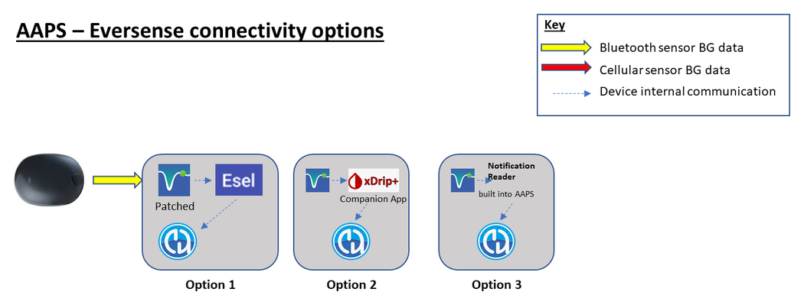

# Προετοιμασία για την έναρξη με το AAPS

Καλώς ήρθατε. Αυτή η τεκμηρίωση θέλει να καθοδηγήσει τους χρήστες που προετοιμάζονται να ρυθμίσουν και να αρχίσουν να χρησιμοποιούν το Android Artificial Pancreas System (**AAPS**).

## Πώς να βρίσκετε τον δρόμο σας στην τεκμηρίωση

Ένα **ευρετήριο** και εξήγηση της δομής της τεκμηρίωσης θα βρείτε [εδώ](../index.md). Μπορείτε να φτάσετε εκεί και πατώντας το σύμβολο του **AAPS** πάνω αριστερά στην τεκμηρίωση. Εκεί θα βρείτε μια επισκόπηση του σκοπού των διάφορων ενοτήτων της τεκμηρίωσης. Μπορείτε επίσης να χρησιμοποιήσετε τις επικεφαλίδες στα αριστερά αυτής της σελίδας για να κινηθείτε στην τεκμηρίωση. Τέλος, υπάρχει μια πρακτική λειτουργία αναζήτησης, ακριβώς κάτω από το σύμβολο του **AAPS**.

Θέλουμε να είναι εύκολο να καταλάβετε τόσο τις δυνατότητες όσο και τους περιορισμούς του **AAPS**. Μπορεί να είναι απογοητευτικό να ανακαλύψετε, αφού αφιερώσατε χρόνο στο διάβασμα της τεκμηρίωσης, ότι μπορεί να μην έχετε συμβατή αντλία ινσουλίνης ή CGM, ή ότι το **AAPS** προσφέρει διαφορετικές λειτουργίες από αυτές που περιμένατε.

Πολλές λεπτομέρειες στην τεκμηρίωση του **AAPS** που αφορούν την εμπειρία βγάζουν περισσότερο νόημα όταν χρησιμοποιείτε πραγματικά το **AAPS** στην καθημερινότητα. Όπως είναι δύσκολο να μάθετε ένα άθλημα μόνο διαβάζοντας τους κανόνες, χρειάζεται συνδυασμός: πρώτα μαθαίνετε τις βασικές αρχές για την ασφαλή λειτουργία του **AAPS** και μετά μαθαίνετε πώς να τις εφαρμόζετε καλύτερα καθώς αρχίζετε να χρησιμοποιείτε το **AAPS**.

(preparing-safety-first)=

## Πρώτα η ασφάλεια
«Η μεγάλη δύναμη φέρνει μεγάλη ευθύνη…»

### Τεχνική ασφάλεια
Το **AAPS** έχει πολλές λειτουργίες ασφάλειας. Αυτές βάζουν περιορισμούς, που αφαιρούνται σταδιακά καθώς ολοκληρώνετε με τη σειρά μια σειρά από [Βήματα](../SettingUpAaps/CompletingTheObjectives.md). Τα Βήματα περιλαμβάνουν δοκιμή συγκεκριμένων παραμέτρων και απαντήσεις σε ερωτήσεις πολλαπλής επιλογής. Οι λειτουργίες του **AAPS** ξεκλειδώνουν καθώς ολοκληρώνετε με επιτυχία τα Βήματα. Έτσι ο χρήστης περνά με ασφάλεια, σε στάδια, από το Ανοιχτό Κύκλωμα στο Κλειστό Κύκλωμα, ενώ μαθαίνει τις διάφορες λειτουργίες του **AAPS**.

Τα [Βήματα](../SettingUpAaps/CompletingTheObjectives.md) σχεδιάστηκαν για την καλύτερη δυνατή εισαγωγή στο **AAPS**, με βάση τα συνηθισμένα λάθη και τις γενικές τάσεις που έχουν δει οι προγραμματιστές του **AAPS** στους νέους χρήστες. Λάθη μπορεί να συμβούν επειδή ο αρχάριος δεν έχει εμπειρία και βιάζεται πολύ να ξεκινήσει με το **AAPS**, ή επειδή δεν πρόσεξε σημαντικά σημεία. Τα [Βήματα](../SettingUpAaps/CompletingTheObjectives.md) θέλουν να περιορίσουν αυτά τα προβλήματα.

### Ιατρική ασφάλεια
```{admonition} Avoid permanent and painful damage to your eyes and nerves
:class: danger
Προσοχή στις γρήγορες βελτιώσεις στον έλεγχο της γλυκόζης αίματος και στη μείωση της HbA1c 
```

Ένα σημαντικό θέμα ασφάλειας είναι ότι **η γρήγορη μείωση της HbA1c και ο βελτιωμένος έλεγχος της γλυκόζης αίματος σε άτομα που είχαν αυξημένη γλυκόζη για αρκετό καιρό μπορεί να προκαλέσουν μόνιμη βλάβη**. Πολλά άτομα με διαβήτη δεν το γνωρίζουν αυτό, και δεν ενημερώνουν όλοι οι γιατροί τους ασθενείς τους για αυτό το θέμα.

Αυτή η βλάβη μπορεί να περιλαμβάνει **απώλεια όρασης και μόνιμη νευροπάθεια (πόνο)**. Μπορείτε να αποφύγετε αυτή τη βλάβη αν μειώνετε πιο αργά τα μέσα επίπεδα γλυκόζης. Αν τώρα έχετε αυξημένη HbA1c και περνάτε στο **AAPS** (ή σε οποιοδήποτε άλλο σύστημα κλειστού κυκλώματος), _παρακαλούμε_ συζητήστε αυτόν τον πιθανό κίνδυνο με την ιατρική σας ομάδα πριν ξεκινήσετε, και συμφωνήστε μαζί τους ένα χρονοδιάγραμμα με σταδιακά χαμηλότερους, ασφαλείς στόχους γλυκόζης. Μπορείτε εύκολα να ορίσετε στην αρχή υψηλότερους στόχους γλυκόζης στο **AAPS** (σήμερα ο υψηλότερος στόχος που μπορείτε να επιλέξετε είναι 11,1 mmol/l, αλλά αν χρειάζεται μπορείτε επίσης να κρατήσετε σκόπιμα ένα αδύναμο προφίλ) και μετά να μειώνετε τον στόχο καθώς περνούν οι μήνες.

#### Πόσο γρήγορα μπορώ να μειώσω την HbA1c χωρίς κίνδυνο για μόνιμη βλάβη;

Μια αναδρομική [μελέτη](https://pubmed.ncbi.nlm.nih.gov/1464975/) σε 76 ασθενείς ανέφερε ότι ο κίνδυνος εξέλιξης της αμφιβληστροειδοπάθειας αυξανόταν 1,6 φορές, 2,4 φορές και 3,8 φορές αν η HbA1c έπεφτε 1%, 2% ή 3% αντίστοιχα μέσα σε 6 μήνες. Πρότειναν ότι **«η μείωση της τιμής HbA1c σε οποιοδήποτε διάστημα 6 μηνών πρέπει να περιορίζεται σε λιγότερο από 2%, ώστε να αποφεύγεται η εξέλιξη της αμφιβληστροειδοπάθειας.... Πολύ γρήγορη μείωση στην αρχή του γλυκαιμικού ελέγχου θα μπορούσε να προκαλέσει σοβαρή ή παροδική επιδείνωση της εξέλιξης της αμφιβληστροειδοπάθειας.»**

Σημείωση: Αν χρησιμοποιείτε άλλες μονάδες για την HbA1c (mmol/mol αντί για %), πατήστε [εδώ](https://www.diabetes.co.uk/hba1c-units-converter.html) για ένα εργαλείο μετατροπής HbA1c.

Σε μια άλλη αναδρομική [αξιολόγηση](https://academic.oup.com/brain/article/138/1/43/337923) 954 ασθενών, οι ερευνητές σημείωσαν ότι:

**«Με μείωση της HbA1c κατά 2–3 ποσοστιαίες μονάδες μέσα σε 3 μήνες, υπήρχε απόλυτος κίνδυνος 20% για ανάπτυξη νευροπάθειας από τη θεραπεία στον διαβήτη. Με μείωση της HbA1c κατά >4 ποσοστιαίες μονάδες μέσα σε 3 μήνες, ο απόλυτος κίνδυνος για ανάπτυξη νευροπάθειας από τη θεραπεία στον διαβήτη ξεπερνούσε το 80%.»**

Ένα [σχόλιο](https://academic.oup.com/brain/article/138/1/2/340563) σε αυτή την εργασία συμφώνησε ότι, για να αποφευχθούν επιπλοκές, **ο στόχος πρέπει να είναι μείωση της A1c κατά <2% μέσα σε 3 μήνες.** Μπορείτε να διαβάσετε άλλες ανασκοπήσεις για το θέμα [εδώ](https://www.ncbi.nlm.nih.gov/pmc/articles/PMC6587545/pdf/DOM-21-454.pdf) και [εδώ](https://www.mdpi.com/1999-4923/15/7/1791).

Είναι γενικά αποδεκτό ότι οι _νεοδιαγνωσμένοι_ με διαβήτη τύπου 1 (που συχνά έχουν πολύ υψηλή HbA1c κατά τη διάγνωση, πριν αρχίσουν θεραπεία με ινσουλίνη) φαίνεται ότι μπορούν να μειώσουν γρήγορα την HbA1c αμέσως μετά τη διάγνωση χωρίς να αντιμετωπίζουν αυτούς τους κινδύνους στον ίδιο βαθμό, επειδή δεν είχαν αυξημένη γλυκόζη αίματος για τόσο μεγάλο διάστημα. Ωστόσο, παραμένει ένα θέμα που πρέπει να συζητήσετε με τον γιατρό σας.

(PreparingForAaps-no-sglt-2-inhibitors)=
### Όχι αναστολείς SGLT-2

```{admonition} NO SGLT-2 inhibitors
:class: danger
Οι αναστολείς SGLT-2, που λέγονται και γλιφλοζίνες, εμποδίζουν την επαναρρόφηση της γλυκόζης στα νεφρά. Οι γλιφλοζίνες μειώνουν τη γλυκόζη αίματος με τρόπο που δεν μπορεί να υπολογιστεί, γι' αυτό ΔΕΝ ΠΡΕΠΕΙ να τις παίρνετε όσο χρησιμοποιείτε σύστημα κλειστού κυκλώματος όπως το AAPS! Θα υπήρχε σοβαρός κίνδυνος κετοξέωσης και/ή υπογλυκαιμίας! Ο συνδυασμός αυτού του φαρμάκου με ένα σύστημα που μειώνει τον βασικό ρυθμό για να αυξήσει τη γλυκόζη αίματος (BG) είναι ιδιαίτερα επικίνδυνος. 

In a nutshell:
- **Example 1: risk of Hypo**
>During lunch, you use **AAPS** to bolus based on consuming 45 g of carbs. Το πρόβλημα είναι ότι, χωρίς να το ξέρει το AAPS, οι αναστολείς κάνουν τον οργανισμό να αποβάλλει ένα μέρος των υδατανθράκων. Έτσι στον οργανισμό σας μένει πολύ ινσουλίνη σε σχέση με τους υδατάνθρακες που απορροφήθηκαν, και αυτό προκαλεί υπογλυκαιμία.

- **Παράδειγμα 2: κίνδυνος κετοξέωσης**
>Οι αναστολείς αποβάλλουν ένα μέρος των υδατανθράκων στο παρασκήνιο, και αυτό μειώνει τη γλυκόζη αίματος (BG). Το **AAPS** θα δώσει αυτόματα εντολή στην αντλία να μειώσει την ινσουλίνη, και τον βασικό ρυθμό. Με τον καιρό η γλυκόζη αίματος (BG) μπορεί να μένει κάτω από τον στόχο, μέχρι το σημείο που ο οργανισμός δεν έχει αρκετή βασική ινσουλίνη για να απορροφήσει υδατάνθρακες, και αυτό προκαλεί κετοξέωση. Συνήθως η κετοξέωση εμφανίζεται σε ασθενείς με ΣΔ1 όταν χαλάσει η αντλία τους. Αυτό θα έβγαζε ειδοποιήσεις στο τηλέφωνο και θα φαινόταν από την υψηλή τιμή γλυκόζης αίματος. Όμως ο κίνδυνος με τις γλιφλοζίνες είναι ότι δεν θα υπήρχαν ειδοποιήσεις από το AAPS, επειδή η αντλία λειτουργεί κανονικά και η γλυκόζη αίματος (BG) μπορεί να μένει μέσα στον στόχο.

Συνηθισμένες εμπορικές ονομασίες αναστολέων SGLT-2 είναι: Invokana, Farxiga, Jardiance, Glyxambi, Synjardy, Steglatro και Xigduo XR, και άλλες.
```


### Βασικές αρχές του κυκλώματος με το AAPS

Πρέπει να κατανοήσετε τις βασικές αρχές και έννοιες του κυκλώματος πριν χρησιμοποιήσετε το **AAPS**. Αυτό το πετυχαίνετε αν αφιερώσετε προσωπικό χρόνο στο διάβασμα της τεκμηρίωσης του **AAPS** και ολοκληρώσετε τα Βήματα, που σκοπό έχουν να σας δώσουν μια σταθερή βάση για ασφαλή και αποτελεσματική χρήση του **AAPS**. Ο όγκος της τεκμηρίωσης του **AAPS** μπορεί στην αρχή να φαίνεται πολύ μεγάλος, αλλά να είστε υπομονετικοί και να εμπιστευτείτε τη διαδικασία - με τη σωστή προσέγγιση θα τα καταφέρετε!

Η ταχύτητα της προόδου εξαρτάται από τον καθένα, αλλά να ξέρετε ότι η ολοκλήρωση όλων των Βημάτων συνήθως παίρνει 6–9 εβδομάδες. Πολλοί άνθρωποι αρχίζουν να δημιουργούν, να εγκαθιστούν και να ρυθμίζουν το **AAPS** αρκετά πριν αρχίσουν να το χρησιμοποιούν. Για να σας βοηθήσει σε αυτό, το σύστημα έχει μια «εικονική αντλία», που μπορείτε να χρησιμοποιήσετε στα πρώτα Βήματα. Έτσι εξοικειώνεστε με το **AAPS** χωρίς να το χρησιμοποιείτε πραγματικά για χορήγηση ινσουλίνης. Παρακάτω υπάρχει αναλυτικό χρονοδιάγραμμα. Να ξέρετε ότι στο Βήμα 7 του **AAPS** έχετε ήδη κλειστό κύκλωμα. Τα επόμενα Βήματα προσθέτουν επιπλέον λειτουργίες, όπως **SMB** και **αυτοματισμούς**, που είναι χρήσιμες για κάποιους χρήστες, αλλά δεν είναι απαραίτητες για τη βασική λειτουργία του **AAPS**.

Η επιτυχία με το **AAPS** χρειάζεται ενεργή στάση, διάθεση να σκέφτεστε τα δεδομένα γλυκόζης αίματος (BG) και ευελιξία για να κάνετε τις απαραίτητες αλλαγές στο **AAPS**, ώστε να βελτιώσετε τα αποτελέσματά σας. Όπως είναι σχεδόν αδύνατο να μάθετε ένα άθλημα μόνο διαβάζοντας τους κανόνες, το ίδιο ισχύει και για το **AAPS**.

#### Υπολογίστε καθυστερήσεις και μικρά προβλήματα μέχρι να ρυθμιστούν και να λειτουργήσουν όλα

Στα πρώτα στάδια με το **AAPS**, μπορεί να έχετε δυσκολίες ώστε όλα τα μέρη του κυκλώματος να επικοινωνούν σωστά μεταξύ τους (και με πιθανούς ακόλουθους), καθώς και όταν βελτιώνετε τις ρυθμίσεις σας. Κάποια προβλήματα λύνονται μόνο όταν το **AAPS** χρησιμοποιείται στην καθημερινή ζωή, αλλά υπάρχει πολλή βοήθεια στην ομάδα του Facebook και στο Discord. Προγραμματίστε ανάλογα και επιλέξτε «καλές» ώρες για να εντοπίσετε και να λύσετε προβλήματα, όπως ένα ήσυχο πρωινό Σαββατοκύριακου (δηλαδή όχι αργά το βράδυ ή όταν είστε κουρασμένοι, ούτε πριν από μια σημαντική συνάντηση ή ένα ταξίδι).

#### Συμβατότητα τεχνολογίας

Το **AAPS** είναι συμβατό μόνο με ορισμένους τύπους αντλιών ινσουλίνης, CGM και τηλεφώνων, και κάποιες συσκευές μπορεί να μην είναι διαθέσιμες σε όλες τις χώρες. Για να αποφύγετε απογοήτευση, διαβάστε τις ενότητες για [CGM](../Getting-Started/CompatiblesCgms.md), [αντλίες](../Getting-Started/CompatiblePumps.md) και [τηλέφωνα](../Getting-Started/Phones.md).

#### Χρόνος δημιουργίας της εφαρμογής και πορεία μέχρι το πλήρες κύκλωμα

The time to build the **AAPS** app depends on your level of expertise and technical ability. Συνήθως, για χρήστες χωρίς εμπειρία, η δημιουργία του **AAPS** μπορεί να πάρει από μισή έως μία ολόκληρη ημέρα (με βοήθεια από την κοινότητα). Η διαδικασία θα γίνεται πολύ πιο γρήγορα στις νεότερες εκδόσεις του **AAPS**, καθώς θα αποκτάτε εμπειρία.

Αρκετά μέρη αυτής της τεκμηρίωσης σας βοηθούν στη διαδικασία δημιουργίας:

- Η [Δημιουργία του AAPS](../SettingUpAaps/BuildingAaps.md) σας οδηγεί βήμα προς βήμα στη δημιουργία της εφαρμογής και στην εγκατάστασή της στο τηλέφωνό σας·

- οι [Συχνές Ερωτήσεις](../UsefulLinks/FAQ.md) απαντούν σε συνηθισμένες ερωτήσεις και εξηγούν τα λάθη που εμφανίζονται πιο συχνά· και

- η σελίδα [Αντιμετώπιση προβλημάτων](../GettingHelp/GeneralTroubleshooting.md) συγκεντρώνει λύσεις για τα πιο συχνά προβλήματα, οργανωμένες ανά θέμα.

Ο χρόνος μέχρι το κλειστό κύκλωμα εξαρτάται από τον καθένα. Ένα κατά προσέγγιση χρονοδιάγραμμα για το πλήρες κύκλωμα με το **AAPS** υπάρχει [παρακάτω](#preparing-how-long-will-it-take).


#### Keystore και αρχείο εξαγωγής ρυθμίσεων διαμόρφωσης

Το «keystore» (αρχείο .jks) είναι ένα αρχείο κρυπτογραφημένο με κωδικό, μοναδικό για το δικό σας αντίγραφο του **AAPS**. Το τηλέφωνό σας Android το χρησιμοποιεί για να βεβαιωθεί ότι κανείς άλλος δεν μπορεί να ενημερώσει το δικό σας αντίγραφο χωρίς το keystore. Με λίγα λόγια, κατά τη δημιουργία του **AAPS** πρέπει:

1.  Να αποθηκεύσετε το αρχείο keystore (αρχείο .jks που υπογράφει την εφαρμογή σας) σε ασφαλές μέρος·

2.  Να σημειώσετε τον κωδικό του αρχείου keystore.

Ο τρόπος που αποθηκεύετε το keystore εξαρτάται από τη μέθοδο δημιουργίας:

- **Δημιουργία με Android Studio (υπολογιστής)**: το keystore δημιουργείται κατά τη δημιουργία της εφαρμογής — δείτε [Δημιουργία υπογεγραμμένου APK](#Building-APK-generate-signed-apk) για οδηγίες για το πού να το αποθηκεύσετε.
- **AAPS Builder**: κρατήστε το αρχείο αντιγράφου ασφαλείας `aaps-keystore.jks` που σας πρόσφερε η σελίδα ρύθμισης όταν δημιουργήσατε το κλειδί σας, μαζί με τον κωδικό και το alias του. Αν ανεβάσατε το δικό σας keystore, κρατήστε εκείνο το αρχείο.
- **Δημιουργία μέσω browser με fork**: χρησιμοποιήστε το ειδικό workflow [Export keystore](#ci-keystore-export) για να κατεβάσετε ένα αντίγραφο στο Google Drive σας.

Έτσι θα μπορείτε να χρησιμοποιείτε ακριβώς το ίδιο αρχείο keystore κάθε φορά που δημιουργείται μια νέα έκδοση του **AAPS**. Κατά μέσο όρο χρειάζονται 2 ενημερώσεις του **AAPS** κάθε χρόνο.

Επιπλέον, το **AAPS** σας δίνει τη δυνατότητα να [εξάγετε όλες τις ρυθμίσεις διαμόρφωσης](../Maintenance/ExportImportSettings.md). Έτσι μπορείτε να επαναφέρετε με ασφάλεια το σύστημά σας όταν αλλάζετε τηλέφωνο ή όταν ενημερώνετε/επανεγκαθιστάτε την εφαρμογή, με τη μικρότερη δυνατή αναστάτωση. 

#### Αντιμετώπιση προβλημάτων

Μη διστάσετε να απευθυνθείτε στην κοινότητα του AAPS αν δεν είστε σίγουροι για κάτι - δεν υπάρχει ανόητη ερώτηση! Ενθαρρύνουμε όλους τους χρήστες, με κάθε επίπεδο εμπειρίας, να κάνουν ερωτήσεις. Οι απαντήσεις έρχονται συνήθως γρήγορα, χάρη στον μεγάλο αριθμό χρηστών του **AAPS**.

##### [ρωτήστε στην ομάδα του AAPS στο Facebook](https://www.facebook.com/groups/AndroidAPSUsers/)

##### [ρωτήστε στο κανάλι του AAPS στο Discord](https://discord.gg/4fQUWHZ4Mw)


#### [Πού να βρείτε βοήθεια](../GettingHelp/WhereCanIGetHelp.md);

Αυτή η ενότητα δίνει στους νέους χρήστες συνδέσμους σε πηγές βοήθειας, μαζί με την υποστήριξη της κοινότητας. Η κοινότητα αποτελείται από νέους και έμπειρους χρήστες, που μπορούν να απαντήσουν σε ερωτήσεις και να λύσουν τα συνηθισμένα προβλήματα που έρχονται με το AAPS.

#### [Ενότητα για γιατρούς](../UsefulLinks/ClinicianGuideToAaps.md)

Αυτή είναι μια [ενότητα ειδικά για γιατρούς](../UsefulLinks/ClinicianGuideToAaps.md) που θέλουν να μάθουν περισσότερα για το AAPS και την τεχνολογία τεχνητού παγκρέατος ανοιχτού κώδικα. Υπάρχουν επίσης οδηγίες για το [πώς να μιλήσετε με την ιατρική σας ομάδα](#introduction-how-can-i-approach-discussing-aaps-with-my-clinical-team) στην Εισαγωγή.

## Τι θα δημιουργήσουμε και θα εγκαταστήσουμε;

Αυτό το διάγραμμα δίνει μια επισκόπηση των βασικών μερών (υλικό και λογισμικό) του συστήματος **AAPS**:


Εκτός από τα τρία βασικά μέρη υλικού (τηλέφωνο, αντλία, αισθητήρας γλυκόζης), χρειαζόμαστε επίσης: 1) Την εφαρμογή **AAPS** 2) Έναν διακομιστή αναφορών και 3) Μια εφαρμογή για τον συνεχή μετρητή γλυκόζης (CGM)

### 1) Μια εφαρμογή για τηλέφωνο Android: **AAPS**

Το **AAPS** είναι μια εφαρμογή που τρέχει σε smartphone και συσκευές Android. Θα δημιουργήσετε μόνοι σας την εφαρμογή **AAPS** (ένα αρχείο apk) με έναν οδηγό βήμα προς βήμα: θα κατεβάσετε τον πηγαίο κώδικα του **AAPS** από το GitHub, θα εγκαταστήσετε τα απαραίτητα προγράμματα (Android Studio, GitHub desktop) στον υπολογιστή σας και θα δημιουργήσετε το δικό σας αντίγραφο της εφαρμογής **AAPS**. Μετά θα μεταφέρετε την εφαρμογή **AAPS** στο smartphone σας (με email, καλώδιο USB _κ.λπ._) και θα την εγκαταστήσετε.

### 2) Ένας διακομιστής αναφορών: Nightscout (Tidepool*)

Για να εκμεταλλευτείτε πλήρως το **AAPS**, πρέπει να ρυθμίσετε έναν διακομιστή Nightscout. Μπορείτε να [το κάνετε μόνοι σας](https://nightscout.github.io/nightscout/new_user/#free-diy) ή να πληρώσετε ένα μικρό ποσό για μια [διαχειριζόμενη υπηρεσία Nightscout](https://nightscout.github.io/#nightscout-as-a-service) που θα το ρυθμίσει για εσάς. Το Nightscout συλλέγει δεδομένα από το **AAPS** με την πάροδο του χρόνου και μπορεί να δημιουργεί αναλυτικές αναφορές που συσχετίζουν τα μοτίβα του CGM και της ινσουλίνης. Οι φροντιστές μπορούν επίσης να χρησιμοποιούν το Nightscout για να επικοινωνούν από απόσταση με την εφαρμογή **AAPS** και να παρακολουθούν τη διαχείριση του διαβήτη του παιδιού τους. Αυτές οι λειτουργίες απομακρυσμένης επικοινωνίας περιλαμβάνουν παρακολούθηση της γλυκόζης και της ινσουλίνης σε πραγματικό χρόνο, απομακρυσμένο bolus ινσουλίνης (με μήνυμα SMS) και ανακοινώσεις γευμάτων. Αν προσπαθείτε να αναλύσετε τη διαχείριση του διαβήτη σας κοιτάζοντας τα δεδομένα του CGM χωριστά από τα δεδομένα της αντλίας, είναι σαν να οδηγείτε ένα αυτοκίνητο όπου ο οδηγός είναι τυφλός και ο συνοδηγός περιγράφει τον δρόμο. Το Tidepool είναι επίσης διαθέσιμο ως εναλλακτική λύση στο Nightscout.

### 3) Εφαρμογή για τον αισθητήρα CGM

Ανάλογα με τον αισθητήρα γλυκόζης/CGM σας, θα χρειαστείτε μια συμβατή εφαρμογή που λαμβάνει τις μετρήσεις γλυκόζης και τις στέλνει στο **AAPS**. Οι διάφορες επιλογές φαίνονται παρακάτω, και περισσότερες πληροφορίες θα βρείτε στην [ενότητα συμβατών CGM](../Getting-Started/CompatiblesCgms.md):

  

### Συντήρηση του συστήματος **AAPS**

Και το **Nightscout** και το **AAPS** πρέπει να ενημερώνονται περίπου μία φορά τον χρόνο, όταν βγαίνουν βελτιωμένες εκδόσεις. Σε κάποιες περιπτώσεις η ενημέρωση μπορεί να περιμένει, σε άλλες συνιστάται έντονα ή θεωρείται απαραίτητη για την ασφάλεια. Οι ενημερώσεις ανακοινώνονται στις ομάδες του Facebook και στους διακομιστές Discord. Οι σημειώσεις έκδοσης θα εξηγούν καθαρά ποια είναι η περίπτωση. Την περίοδο των ενημερώσεων πολλοί άνθρωποι θα κάνουν ερωτήσεις παρόμοιες με τις δικές σας, και θα έχετε υποστήριξη για να κάνετε τις ενημερώσεις.

(preparing-how-long-will-it-take)=
## Πόσο χρόνο θα πάρει να ρυθμιστούν όλα;

Όπως είπαμε πριν, η χρήση του **AAPS** είναι περισσότερο ένα «ταξίδι» που χρειάζεται προσωπικό χρόνο. Δεν είναι μια ρύθμιση που γίνεται μία φορά. Σύμφωνα με τις τρέχουσες εκτιμήσεις, η δημιουργία του **AAPS**, η εγκατάσταση και η ρύθμιση του λογισμικού του **AAPS** και του **CGM**, και η μετάβαση από το ανοιχτό κύκλωμα στο υβριδικό κλειστό κύκλωμα με το **AAPS** παίρνουν συνολικά περίπου 4 έως 6 μήνες. Γι' αυτό προτείνουμε να δώσετε προτεραιότητα στη δημιουργία της εφαρμογής **AAPS** και στα πρώτα Βήματα όσο πιο νωρίς γίνεται, ακόμα κι αν χρησιμοποιείτε ακόμη άλλο σύστημα χορήγησης ινσουλίνης (μπορείτε να χρησιμοποιείτε εικονική αντλία μέχρι το Βήμα 5).

Κάποια Βήματα χρειάζονται να περάσει ένας ορισμένος αριθμός ημερών, για να βεβαιωθείτε ότι κατανοείτε τις νέες λειτουργίες. Δεν μπορείτε να παρακάμψετε αυτόν τον χρόνο αναμονής· αυτοί οι ελάχιστοι χρόνοι αναμονής υπάρχουν για τη δική σας ασφάλεια.

Ένα κατά προσέγγιση χρονοδιάγραμμα:

| Εργασίες                                                                       |       Κατά προσέγγιση χρόνος        |
| ------------------------------------------------------------------------------ |:-----------------------------------:|
| Πρώτη ανάγνωση της τεκμηρίωσης                                                 |             1–2 ημέρες              |
| Ρύθμιση του GitHub για τη δημιουργία μέσω browser                              |              1–4 ώρες               |
| Ρύθμιση ενός διακομιστή αναφορών                                               |                1 ώρα                |
| Εγκατάσταση εφαρμογής CGM (xDrip, BYODA, …)                                    |                1 ώρα                |
| Αρχική ρύθμιση CGM → xDrip → AAPS                                              |                1 ώρα                |
| Αρχική ρύθμιση AAPS → αντλία                                                   |                1 ώρα                |
| Ρύθμιση AAPS → Nightscout/Tidepool (μόνο για αναφορές)                         |                1 ώρα                |
| Προαιρετικά: Ρύθμιση Nightscout ↔ **AAPS** και NSFollowers                     |                1 ώρα                |
| Βήμα 1: Ρύθμιση απεικόνισης και παρακολούθησης                                 |                1 ώρα                |
| Βήμα 2: Μάθετε πώς να χειρίζεστε το AAPS                                       |               2 ώρες                |
| Βήμα 3: Αποδείξτε τις γνώσεις σας                                              |            Έως 14 ημέρες            |
| Βήμα 4: Ξεκινήστε σε ανοιχτό κύκλωμα                                           |        Τουλάχιστον 7 ημέρες         |
| Βήμα 5: Κατανοήστε το ανοιχτό κύκλωμα                                          |              7 ημέρες               |
| Βήμα 6: Ξεκινήστε να κλείσετε το κύκλωμα (Αναστολή Χαμηλής Γλυκόζης)           |    Τουλάχιστον 5, έως 14 ημέρες     |
| Βήμα 7: Ρύθμιση του κλειστού κυκλώματος                                        |  Τουλάχιστον 1 ημέρα, έως 7 ημέρες  |
| Βήμα 8: Ρυθμίστε τον βασικό ρυθμό και τις αναλογίες, ενεργοποιήστε το Autosens | Τουλάχιστον 7 ημέρες, έως 14 ημέρες |
| Βήμα 9: Ενεργοποίηση του Super Micro Bolus (SMB)                               |        Τουλάχιστον 28 ημέρες        |
| Βήμα 10: Αυτοματισμός                                                          |        Τουλάχιστον 28 ημέρες        |

Ακόμα και όταν το **AAPS** λειτουργεί πλήρως, θα χρειάζεται να βελτιώνετε τακτικά τις ρυθμίσεις σας, για να βελτιώσετε συνολικά τη διαχείριση του διαβήτη σας.

## Απαιτήσεις

### Ιατρικά θέματα

Εκτός από τις ιατρικές προειδοποιήσεις στην [ενότητα ασφάλειας](#preparing-safety-first), υπάρχουν και διαφορετικές παράμετροι, ανάλογα με την ινσουλίνη που χρησιμοποιείτε στην αντλία.

#### Επιλογή ινσουλίνης

Οι υπολογισμοί του **AAPS** βασίζονται σε συγκέντρωση ινσουλίνης 100U/ml (το ίδιο με το πρότυπο των αντλιών). Ρυθμίζετε την ινσουλίνη σας στο **Διαχείριση → Ρυθμίσεις ινσουλίνης**: ορίστε την **Κορυφή** και τη **DIA**, ή χρησιμοποιήστε το **Φόρτωση κορυφής από** για να συμπληρώσετε τον τυπικό χρόνο κορυφής μιας από τις προεπιλογές:

- **Novorapid** (και για Humalog και NovoLog)
- **Fiasp**
- **Lyumjev**

Οι προχωρημένοι χρήστες μπορούν να εισάγουν απευθείας οποιονδήποτε χρόνο κορυφής (35 έως 120 λεπτά), για παράδειγμα για μείγμα ινσουλινών. Δείτε [Ρυθμίσεις ινσουλίνης](#Config-Builder-insulin).


### Τεχνικά

Αυτή η τεκμηρίωση έχει στόχο να μειώσει στο απόλυτο ελάχιστο τις τεχνικές γνώσεις που χρειάζονται. Για να δημιουργήσετε την εφαρμογή **AAPS**, έχετε διάφορες επιλογές — δείτε τη [Δημιουργία του AAPS](../SettingUpAaps/BuildingAaps.md) για μια επισκόπηση:

- **Δημιουργία μέσω browser** (προτείνεται): δημιουργήστε την εφαρμογή απευθείας από το smartphone σας με το GitHub Actions, χωρίς υπολογιστή ή Android Studio. Με το [AAPS Builder](../SettingUpAaps/BrowserBuildAapsBuilder.md) χρειάζεστε μόνο λογαριασμό GitHub: κατεβάζετε την εφαρμογή απευθείας από το GitHub. Η μέθοδος με fork χρειάζεται επίσης λογαριασμό Google, για να αποθηκεύει την εφαρμογή στο Google Drive σας.
- **Δημιουργία με Android Studio**: δημιουργήστε την εφαρμογή στον υπολογιστή σας με το Android Studio. Αυτή τη μέθοδο τη χρησιμοποιούν κυρίως προγραμματιστές που θέλουν να κάνουν αλλαγές στον κώδικα.
- **Δημιουργία από τη γραμμή εντολών**: για χρήστες που προτιμούν να δημιουργούν την εφαρμογή τοπικά χωρίς να εγκαταστήσουν το Android Studio.

Εκτός από τη δημιουργία της εφαρμογής, πρέπει επίσης να ρυθμίσετε έναν διακομιστή αναφορών, να ρυθμίσετε αρκετές εφαρμογές στο τηλέφωνο Android και να αποκτήσετε γνώσεις στη διαχείριση του διαβήτη. Αυτό μπορείτε να το πετύχετε αν προχωράτε βήμα προς βήμα, με υπομονή και με βοήθεια από την κοινότητα του **AAPS**. Αν ήδη μπορείτε να χρησιμοποιείτε το internet και να διαχειρίζεστε τα email σας στο Gmail, η δημιουργία του **AAPS** είναι κάτι που μπορείτε να κάνετε. Απλώς πάρτε τον χρόνο σας.

### Smartphone

#### AAPS και εκδόσεις Android

Η τρέχουσα έκδοση του **AAPS** (4.0) απαιτεί smartphone Android με Google **Android 12.0 ή νεότερο**. Αν σκέφτεστε να αγοράσετε νέο τηλέφωνο (στοιχεία Ιανουαρίου 2026), προτιμάται το Android 16.<br/> Για λόγους ασφάλειας, συνιστούμε έντονα στους χρήστες να έχουν πάντα ενημερωμένη την έκδοση του **AAPS** που χρησιμοποιούν. Ωστόσο, για χρήστες που δεν μπορούν να χρησιμοποιήσουν συσκευή με Android 12.0 ή νεότερο, παραμένουν διαθέσιμες παλαιότερες εκδόσεις του **AAPS** που είναι συμβατές με παλαιότερες εκδόσεις Android. Δείτε: [Σημειώσεις έκδοσης](#maintenance-android-version-aaps-version).

#### Επιλογή μοντέλου smartphone
Το ακριβές μοντέλο που θα αγοράσετε εξαρτάται από τις λειτουργίες που θέλετε. Στη [σελίδα Τηλέφωνα](../Getting-Started/Phones.md) θα βρείτε προτάσεις και εμπειρίες χρηστών για συνδυασμούς που λειτουργούν.

Ενθαρρύνουμε τους χρήστες να έχουν ενημερωμένη την έκδοση Android του τηλεφώνου τους, μαζί με τις ενημερώσεις ασφαλείας. Ωστόσο, αν είστε νέοι στο **AAPS** ή δεν είστε τεχνικά έμπειροι, ίσως θέλετε να περιμένετε με την ενημέρωση του τηλεφώνου σας μέχρι να την κάνουν άλλοι και να επιβεβαιώσουν στα διάφορα φόρουμ μας ότι είναι ασφαλής.

```{admonition} Delaying Samsung phone updates
:class: warning
Η Samsung έχει δυστυχώς ιστορικό με αναγκαστικές ενημερώσεις στα τηλέφωνά της, που μπορεί να προκαλέσουν προβλήματα στη σύνδεση Bluetooth. Για να απενεργοποιήσετε αυτές τις αναγκαστικές ενημερώσεις, πρέπει να βάλετε το τηλέφωνο σε «λειτουργία προγραμματιστή»:

1. Πηγαίνετε στο **Ρυθμίσεις** (Settings) > **Πληροφορίες τηλεφώνου** (About phone) > **Πληροφορίες λογισμικού** (Software information) και πατήστε επανειλημμένα το **Αριθμός έκδοσης** (Build number) μέχρι να επιβεβαιωθεί ότι ξεκλειδώσατε τη λειτουργία προγραμματιστή.
2. Επιστρέψτε στο κύριο μενού **Ρυθμίσεις**, όπου θα δείτε ένα νέο στοιχείο μενού **Επιλογές προγραμματιστή** (Developer options).
3. Ανοίξτε τις **Επιλογές προγραμματιστή**, βρείτε το **Αυτόματη ενημέρωση συστήματος** (Auto system update) και απενεργοποιήστε το.
```

```{admonition} Google Play Protect potential issue
:class: warning
Υπάρχουν αρκετές αναφορές ότι το Google Play Protect κλείνει χωρίς λόγο το **AAPS** κάθε πρωί. Αν συμβεί αυτό, πρέπει να πάτε στις επιλογές του Google Play και να απενεργοποιήσετε το **Google Play Protect**. Δεν επηρεάζονται όλα τα μοντέλα τηλεφώνων ούτε όλες οι εκδόσεις Android.
```

```{admonition} Android developer verification
:class: note
Από τον Σεπτέμβριο του 2026, η Google εισάγει σταδιακά την [επαλήθευση προγραμματιστών Android](#android-developer-verification), που αλλάζει τον τρόπο που εγκαθίσταται στο τηλέφωνο μια εφαρμογή που δημιουργήσατε μόνοι σας. Η δημιουργία του **AAPS** δεν επηρεάζεται, και παραμένουν διαθέσιμοι δωρεάν τρόποι εγκατάστασης — δείτε τη συνδεδεμένη σελίδα για λεπτομέρειες.
```

