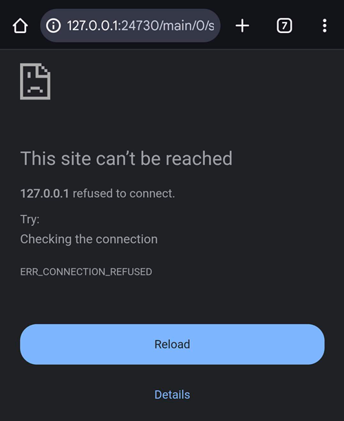

(aaps-ci-troubleshooting)=

# Δημιουργία μέσω browser: αντιμετώπιση προβλημάτων

```{note}
Αυτή η σελίδα συγκεντρώνει συμβουλές για την αντιμετώπιση προβλημάτων στη [Δημιουργία μέσω browser](../SettingUpAaps/BrowserBuild.md).

Χρησιμοποιείτε το **AAPS Builder**; Ξεκινήστε από τη δική του [ενότητα αντιμετώπισης προβλημάτων](#aaps-builder-troubleshooting). Οι παρακάτω ενότητες για το Google Drive ισχύουν και για αυτό.
```

## Αντιμετώπιση προβλημάτων AAPS-CI

(aaps-ci-read-the-logs)=
### Πρώτα: βρείτε τι πήγε στραβά

Όταν ένα build αποτυγχάνει, το GitHub κρατά ένα αρχείο καταγραφής (log) για κάθε βήμα. Το log σάς λέει ποιο βήμα απέτυχε και γιατί. Διαβάστε το πριν δοκιμάσετε οτιδήποτε άλλο: το μήνυμα σφάλματος είναι αυτό που ψάχνετε σε αυτή τη σελίδα, και αυτό που θα σας ζητήσουν όσοι σας βοηθούν.

1. Στο αντίγραφο του AndroidAPS στο GitHub σας, ανοίξτε το **Actions**. Ένα build που απέτυχε έχει κόκκινο σταυρό. Πατήστε το όνομά του.

   

2. Η σύνοψη της εκτέλεσης δείχνει **Failure** (αποτυχία) και, από κάτω, την εργασία που απέτυχε (**Build AAPS**, με κόκκινο σταυρό).

   

3. Κάντε κύλιση προς τα κάτω στο **Annotations** και πατήστε την κόκκινη γραμμή **Build AAPS**.

   

4. Η εργασία ανοίγει. Τα βήματα με γκρι τικ πέτυχαν. Το βήμα με τον κόκκινο σταυρό είναι αυτό που απέτυχε: το GitHub το ανοίγει για εσάς. Τα βήματα μετά από αυτό παραλείφθηκαν (γκρι κύκλος).

   

5. Διαβάστε τις γραμμές ακριβώς πάνω από το `Error: Process completed with exit code 1.`: εξηγούν το πρόβλημα. Σε αυτό το παράδειγμα, το βήμα **Retrieving Google Drive access token** απέτυχε με `invalid_grant` και `Token has been expired or revoked.`, δείτε [Το Google Refresh Token έληξε](#aaps-ci-google-token-expired).

   

```{tip}
Ζητάτε βοήθεια; Δώστε το όνομα του βήματος που απέτυχε και τις γραμμές του σφάλματος (ένα στιγμιότυπο οθόνης όπως το παραπάνω είναι αρκετό). Μη μοιράζεστε ποτέ το περιεχόμενο των secrets σας.
```

(aaps-ci-update-secret)=
#### Ενημέρωση ενός secret

Πολλές διορθώσεις σημαίνουν ότι αντικαθιστάτε την τιμή ενός secret. Στο αντίγραφο του AndroidAPS στο GitHub σας, πηγαίνετε στο **Settings** → **Secrets and variables** → **Actions** και πατήστε το μολύβι δίπλα στο secret.


Καταχωρήστε ή επικολλήστε τη νέα τιμή και πατήστε **Update secret**. Το GitHub δεν δείχνει ποτέ την παλιά τιμή: το πεδίο είναι πάντα κενό.


(aaps-ci-rerun)=
#### Τρέξτε ξανά το build μετά από μια διόρθωση

Όταν διορθώσετε την αιτία, δεν χρειάζεται να ξεκινήσετε από την αρχή: ανοίξτε την εκτέλεση που απέτυχε, πατήστε **...** (πάνω δεξιά) και μετά **Re-run failed jobs**.


Πατήστε **Re-run jobs**. Μπορείτε επίσης να ξεκινήσετε ένα νέο build από το **Run workflow** όπως συνήθως.


(aaps-ci-preparation-web)=
### Η ιστοσελίδα aaps-ci-preparation
  - Η σελίδα προετοιμασίας εμφανίζεται από έναν προσωρινό τοπικό διακομιστή (για παράδειγμα το Simple Web Server σε υπολογιστή), ο οποίος λαμβάνει επίσης το Google refresh token.
  - Αν δείτε την παρακάτω οθόνη, ο τοπικός διακομιστής έχει σταματήσει ή δεν είναι προσβάσιμος.
  - Κλείστε τη σελίδα προετοιμασίας, ελέγξτε ότι ο τοπικός διακομιστής τρέχει, μετά ανοίξτε ξανά το aaps-ci-preparation.html με τον ίδιο τρόπο όπως στο Βήμα 2 και ολοκληρώστε τα υπόλοιπα βήματα. Αυτό χρειάζεται κυρίως όταν δημιουργείτε την πρώτη σύνδεση με τη Google κατά τη ρύθμιση.

  

(aaps-ci-google-token-expired)=
### Το Google Refresh Token έληξε
  - Τα refresh token του Google OAuth2 λήγουν αν δεν χρησιμοποιηθούν για 6 μήνες, και μπορεί επίσης να γίνουν άκυρα και σε άλλες περιπτώσεις (π.χ. αν αλλάξατε τον κωδικό του λογαριασμού σας Google ή αφαιρέσατε χειροκίνητα την πρόσβαση). Για περισσότερες πληροφορίες, δείτε την [τεκμηρίωση του Google OAuth2](https://developers.google.com/identity/protocols/oauth2).
  - Στο [log του build](#aaps-ci-read-the-logs), το βήμα **Retrieving Google Drive access token** αποτυγχάνει με `invalid_grant` και `Token has been expired or revoked.`:

  

  - Αν το build σας αποτυγχάνει επειδή το Google refresh token έληξε ή ανακλήθηκε, πρέπει να κάνετε ξανά τα βήματα [Google Drive Auth](#aaps-ci-google-drive-auth) για να πάρετε ένα νέο token `GDRIVE_OAUTH2`, να [ενημερώσετε το secret](#aaps-ci-update-secret) στο αποθετήριό σας στο GitHub και μετά να [τρέξετε ξανά το build](#aaps-ci-rerun).
  - Αν η εξουσιοδότηση αποτύχει ξανά ή η Google δεν σας ζητά πια τη συγκατάθεσή σας, αφαιρέστε πρώτα την υπάρχουσα πρόσβαση του AAPS από τον λογαριασμό σας Google, δείτε [παρακάτω](#aaps-ci-google-remove-access).

(aaps-ci-google-remove-access)=
### Αφαιρέστε την πρόσβαση του AAPS από τον λογαριασμό σας Google και ξεκινήστε ξανά την εξουσιοδότηση
  - Αν η εξουσιοδότηση του Google Drive συνεχίζει να αποτυγχάνει ή θέλετε να ξεκινήσετε ξανά από την αρχή, αφαιρέστε πρώτα την πρόσβαση που είχατε δώσει στο AAPS και μετά κάντε ξανά την εξουσιοδότηση.
  - Στο τηλέφωνό σας, ανοίξτε το [https://myaccount.google.com](https://myaccount.google.com), πατήστε **Security** (Ασφάλεια), κάντε κύλιση προς τα κάτω στο **Your connections to third-party apps & services** (Οι συνδέσεις σας με εφαρμογές και υπηρεσίες τρίτων) και ανοίξτε τη λίστα με τις συνδεδεμένες εφαρμογές. Μπορείτε επίσης να πάτε απευθείας στο [https://myaccount.google.com/connections](https://myaccount.google.com/connections).
  - Πατήστε **AAPS** στη λίστα.

  

  - Η σελίδα δείχνει την πρόσβαση που δώσατε στο AAPS (τα αρχεία του Google Drive που χρησιμοποιούνται με την εφαρμογή). Πατήστε **Delete all** (Διαγραφή όλων) για να αφαιρέσετε τη σύνδεση ή πατήστε **See details** (Προβολή λεπτομερειών) για να τη δείτε πρώτα.

  

  - Στη σελίδα λεπτομερειών, πατήστε **Remove all access** (Κατάργηση όλης της πρόσβασης).

  

  - Πατήστε **Confirm** (Επιβεβαίωση).

  

  - Η Google επιβεβαιώνει ότι το AAPS δεν έχει πια πρόσβαση. Το AAPS δεν εμφανίζεται πια στη λίστα με τις συνδεδεμένες εφαρμογές.

  

  - Τώρα ξεκινήστε ξανά την εξουσιοδότηση από την αρχή: κλείστε **και** τη σελίδα προετοιμασίας και την εφαρμογή διαχείρισης αρχείων, ανοίξτε ξανά το aaps-ci-preparation.html από τη διαχείριση αρχείων και κάντε ξανά τα βήματα [Google Drive Auth](#aaps-ci-google-drive-auth). Η Google θα σας ζητήσει να δώσετε ξανά πρόσβαση και η σελίδα θα σας δώσει ένα νέο token `GDRIVE_OAUTH2`.
  - [Ενημερώστε το secret `GDRIVE_OAUTH2`](#aaps-ci-update-secret) στο αποθετήριό σας στο GitHub με το νέο token και μετά [τρέξτε ξανά το build](#aaps-ci-rerun).

(aaps-ci-disable-software)=
### Disable Software That May Interfere With OAuth Verification
  - Disable any VPN or security app (firewall, antimalware,...) on the phone before trying to get the OAuth key.

(aaps-ci-actions-permission)=
### Ελέγξτε τις ρυθμίσεις αδειών του GitHub Actions
  - Βεβαιωθείτε ότι οι πολιτικές του GitHub Actions είναι ρυθμισμένες σε “Allow all actions and reusable workflows” (Settings → Actions → General). Αν το αλλάξετε, πατήστε **Save** κάτω από τις επιλογές.

  

`actions/checkout@v4` and `actions/setup-java@v4` are not allowed to be used in `xxxxx/AndroidAPS`. Actions in this workflow must be: within a repository owned by `xxxxx`

(aaps-ci-workflow-permissions)=
### Ελέγξτε τις ρυθμίσεις Workflow permissions του GitHub
  - Αν το build αποτύχει αμέσως με ένα σφάλμα "Invalid workflow file" όπως το παρακάτω, τότε οι προεπιλεγμένες άδειες workflow του αποθετηρίου σας είναι πολύ αυστηρές:

```
Invalid workflow file
The workflow is not valid. .github/workflows/aaps-ci.yml (Line: 361, Col: 3):
Error calling workflow 'xxxxx/AndroidAPS/.github/workflows/cleanup-workflow-runs.yml@...'.
The nested job 'cleanup' is requesting 'actions: write', but is only allowed 'actions: none'.
```

  - Βεβαιωθείτε ότι τα Workflow permissions είναι ρυθμισμένα σε “Read and write permissions” (Settings → Actions → General → Workflow permissions), μετά αποθηκεύστε και τρέξτε ξανά το workflow του build.

  

(aaps-ci-password-special-characters)=
### Το build αποτυγχάνει στον έλεγχο του κωδικού του keystore
  - Στο [log του build](#aaps-ci-read-the-logs), το βήμα **Validating keystore, alias and password** αποτυγχάνει με `Either KEYSTORE_BASE64, KEYSTORE_PASSWORD, KEY_PASSWORD, or KEY_ALIAS is incorrect` και μετά `Keystore was tampered with, or password was incorrect`. Το build σταματά εκεί: το keystore και οι κωδικοί ελέγχονται πριν γίνει το build του AAPS.

  

  - Το workflow του build κρατά κάθε χαρακτήρα των κωδικών σας ακριβώς όπως είναι. Καταχωρήστε τα `KEYSTORE_PASSWORD` και `KEY_PASSWORD` ακριβώς όπως είναι, χωρίς να προσθέσετε ανάποδη κάθετο (backslash) ή άλλο χαρακτήρα διαφυγής. Αν προσθέσατε backslash, [ενημερώστε τα secrets](#aaps-ci-update-secret) με τον κωδικό ακριβώς όπως είναι. Το παρακάτω παράδειγμα είναι λάθος: ο κωδικός είναι `Example2026` και το backslash προστέθηκε.

  

  - Αν το build αποτυγχάνει ακόμα κατά την υπογραφή του APK, αν και ο κωδικός σας είναι σωστός, και ο κωδικός περιέχει `$`, backtick, `"` ή `\`, τότε το αρχείο workflow στο fork σας είναι παλιότερο από τον Σεπτέμβριο του 2026 και ακόμα επεξεργάζεται αυτούς τους χαρακτήρες. [Συγχρονίστε το fork σας](#Update-to-new-version-update-your-repo) με το πιο πρόσφατο dev και μετά τρέξτε ξανά το workflow του build.
  - Η κάθετη γραμμή `|` είναι ειδική περίπτωση. Η σελίδα προετοιμασίας της [Επιλογής 1](#aaps-ci-option1) ενώνει το keystore, τους κωδικούς και το alias σε ένα secret `KEYSTORE_SET`, χωρισμένα με `|`, και το workflow τα χωρίζει ξανά σε αυτόν τον χαρακτήρα. Ο κωδικός που δημιουργεί η σελίδα προετοιμασίας περιέχει μόνο γράμματα και ψηφία, οπότε αυτό δεν μπορεί να συμβεί με την Επιλογή 1. Μπορεί να συμβεί μόνο αν φτιάξατε μόνοι σας ένα secret `KEYSTORE_SET` με κωδικό που περιέχει `|`. Σε αυτή την περίπτωση, διαγράψτε το `KEYSTORE_SET` και καταχωρήστε αντί για αυτό τα ξεχωριστά secrets της [Επιλογής 2](#aaps-ci-option2).
