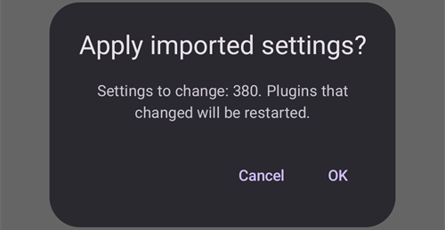

(reinstall-aaps)=
# Επανεγκατάσταση του AAPS με νέο keystore

Κάθε apk του **AAPS** είναι υπογεγραμμένο με ένα **keystore**. Μια ενημέρωση εγκαθίσταται πάνω στο τρέχον **AAPS** μόνο αν είναι υπογεγραμμένη με το **ίδιο keystore**: τότε κρατιούνται όλες οι ρυθμίσεις και τα δεδομένα σας. Γι' αυτό συνιστάται να φυλάτε το keystore και τον κωδικό του σε ασφαλές μέρος.

Αν προσπαθήσετε να εγκαταστήσετε ένα apk υπογεγραμμένο με διαφορετικό keystore από πριν, θα δείτε ένα μήνυμα σφάλματος ότι η εγκατάσταση απέτυχε!

(reinstall-aaps-when)=
## Πότε χρειάζεται επανεγκατάσταση;

Πρέπει να απεγκαταστήσετε και να εγκαταστήσετε ξανά το **AAPS** όταν το νέο σας apk είναι υπογεγραμμένο με διαφορετικό keystore, για παράδειγμα:

- Δεν μπορείτε να βρείτε το παλιό σας keystore ή τον κωδικό του.
- Δημιουργήσατε νέο keystore, για παράδειγμα με την [Επιλογή 1 της δημιουργίας μέσω browser](../SettingUpAaps/BrowserBuildKeystore.md) ή με το **Create a new key** (δημιουργία νέου κλειδιού) στο [AAPS Builder](../SettingUpAaps/BrowserBuildAapsBuilder.md).
- Κάνετε build σε νέο υπολογιστή και δεν αντιγράψατε το keystore σας σε αυτόν.

Αν έχετε ακόμη το keystore σας, δεν χρειάζεστε αυτή τη σελίδα: χρησιμοποιήστε το ξανά και [ενημερώστε το **AAPS**](../Maintenance/UpdateToNewVersion.md) χωρίς απεγκατάσταση.

(reinstall-aaps-before)=
## Πριν ξεκινήσετε

- Η απεγκατάσταση του **AAPS** διαγράφει όλες τις ρυθμίσεις του, τα [Βήματα](../SettingUpAaps/CompletingTheObjectives.md) σας και την τρέχουσα σύνδεση με την αντλία. Τα παίρνετε πίσω με εισαγωγή του **αρχείου ρυθμίσεων** σας, οπότε βεβαιωθείτε ότι έχετε ένα πρόσφατο.
- Το αρχείο ρυθμίσεων δεν περιέχει το ιστορικό θεραπειών και γλυκόζης σας. Αν ανεβάζετε δεδομένα στο [Nightscout](../SettingUpAaps/SettingUpTheReportingServer.md), μπορείτε να το φορτώσετε ξανά μετά την επανεγκατάσταση (βήμα 8).
- Χρειάζεστε τον [**κύριο κωδικό**](#Preferences-master-password) σας: το αρχείο ρυθμίσεων είναι κρυπτογραφημένο με αυτόν.
- **Χρήστες Omnipod και Medtrum:** διαβάστε πρώτα την ενότητα [Αντλίες χωρίς σωληνάκι](#ExportImportSettings-tubeless-pumps). Το αρχείο ρυθμίσεων πρέπει να έχει εξαχθεί κατά τη διάρκεια του pod ή του patch που φοράτε τώρα.
- Αν χρειάζεται, [ρυθμίστε τον δέκτη της πηγής CGM/BG](../Getting-Started/CompatiblesCgms.md) πριν ξεκινήσετε.

(reinstall-aaps-steps)=
## Βήματα

Οι εικόνες δείχνουν τη μετάβαση από το **AAPS** 3.4 (βήματα 1 έως 3) στο **AAPS** 4 (βήματα 6 έως 8). Άλλες εκδόσεις φαίνονται λίγο διαφορετικές.

(reinstall-aaps-export)=
### 1. Εξαγωγή των ρυθμίσεων

Εξάγετε τις ρυθμίσεις σας με το **AAPS** που είναι τώρα εγκατεστημένο στο τηλέφωνό σας. Δείτε την ενότητα [Εξαγωγή ρυθμίσεων](#ExportImportSettings-Settings-Export) για λεπτομέρειες.

Στο **AAPS** 3.4: ανοίξτε τη **Συντήρηση** και πατήστε **Export options** (επιλογές εξαγωγής). Στο **User Settings** (ρυθμίσεις χρήστη), επιλέξτε **Local Storage** (τοπική αποθήκευση) και πατήστε **OK**.

*Σημείωση: μπορείτε επίσης να χρησιμοποιήσετε την [αποθήκευση cloud](#preferences-maintenance-cloud) για ένα επιπλέον αντίγραφο ασφαλείας: είναι καλή ιδέα, αλλά κρατήστε την τοπική αποθήκευση για γρήγορη επαναφορά των ρυθμίσεων.*

Το κουμπί γράφει τώρα **Export settings (local)** (εξαγωγή ρυθμίσεων, τοπικά). Πατήστε το.

Το **AAPS** δείχνει το όνομα του αρχείου που θα δημιουργήσει. Πατήστε **OK**, πληκτρολογήστε τον κύριο κωδικό σας και πατήστε **OK**.

Στο **AAPS** 4: ανοίξτε τη **Συντήρηση**, επιλέξτε το chip **Τοπικά** δίπλα στο **Εξαγωγή ρυθμίσεων** και πατήστε **Εξαγωγή ρυθμίσεων**.

(reinstall-aaps-copy)=
### 2. Αντιγράψτε το αρχείο ρυθμίσεων έξω από το τηλέφωνό σας

Το αρχείο βρίσκεται στον φάκελο **preferences** του [φακέλου **AAPS**](#SetupWizard-StoragePermission) σας, με όνομα όπως `2026-10-13_222735_full.json`. Αντιγράψτε το ή ανεβάστε το σε εξωτερικό μέρος (π.χ. τον υπολογιστή σας, μια υπηρεσία αποθήκευσης cloud...). Το αρχείο κανονικά μένει στο τηλέφωνό σας μετά την απεγκατάσταση, αλλά για κάθε περίπτωση κρατήστε ένα αντίγραφο και αλλού.

(reinstall-aaps-nightscout-before)=
### 3. Συγχρονισμός με το Nightscout

Αυτό το βήμα δεν είναι υποχρεωτικό, αλλά συνιστάται αν χρησιμοποιείτε [DynISF](#Open-APS-features-DynamicISF): έτσι συνεχίζετε αμέσως με τις τρέχουσες ρυθμίσεις, αντί να περιμένετε 5 ημέρες μέχρι να συγκεντρωθούν τα δεδομένα που χρειάζεται το πρόσθετο. Το NSClient V3 πρέπει να είναι [ενεργό και ρυθμισμένο](../SettingUpAaps/SettingUpTheReportingServer.md).

Βεβαιωθείτε ότι το Nightscout έχει όλα τα δεδομένα σας πριν από την απεγκατάσταση.

Ανοίξτε το **NSClient**, πατήστε το κουμπί **Πλήρης συγχρονισμός** στο κάτω μέρος της οθόνης και μετά **OK**.

*Σημείωση: ο χρόνος που χρειάζεται εξαρτάται από την υπηρεσία φιλοξενίας του Nightscout σας.*

Το **AAPS** στη συνέχεια προτείνει να καθαρίσει τη βάση δεδομένων του. Το **OK** διαγράφει από το τηλέφωνο τα δεδομένα που είναι παλαιότερα από 3 μήνες, και έτσι ο συγχρονισμός γίνεται πολύ πιο γρήγορα. Η **Ακύρωση** κάνει συγχρονισμό χωρίς καθαρισμό. Η βάση δεδομένων του τηλεφώνου διαγράφεται έτσι κι αλλιώς με την απεγκατάσταση, οπότε και τα δύο είναι εντάξει.

Αφήστε το **AAPS** να λειτουργεί μέχρι να τελειώσει ο συγχρονισμός.

(reinstall-aaps-build)=
### 4. Δημιουργήστε το νέο apk

[Δημιουργήστε](../SettingUpAaps/BuildingAaps.md) ένα νέο υπογεγραμμένο apk με το νέο σας keystore και μεταφέρετέ το στο τηλέφωνό σας.

(reinstall-aaps-uninstall)=
### 5. Απεγκατάσταση του AAPS

Στο τηλέφωνό σας, στις **Ρυθμίσεις** > **Εφαρμογές** > **AAPS**, πατήστε **Απεγκατάσταση** και επιβεβαιώστε με **OK**.

(reinstall-aaps-install)=
### 6. Εγκατάσταση και εκκίνηση του νέου AAPS

[Εγκαταστήστε](../SettingUpAaps/TransferringAndInstallingAaps.md) το νέο apk και ξεκινήστε το **AAPS**. Ο [οδηγός εγκατάστασης](../SettingUpAaps/SetupWizard.md) ζητά τις άδειες που χρειάζεται το **AAPS**: πατήστε **Παραχώρηση** για καθεμία. Έτσι απενεργοποιείται ξανά και η [βελτιστοποίηση μπαταρίας](#setup-wizard-bluetooth-battery-optimisation).

Για τον **Φάκελο AAPS**, επιλέξτε τον ίδιο φάκελο **AAPS** όπως πριν (αυτόν που περιέχει τον φάκελο **preferences**), πατήστε **Χρήση αυτού του φακέλου** και **Να επιτραπεί**.

Όταν το **AAPS** βρει τις ρυθμίσεις που εξαγάγατε, ο οδηγός εγκατάστασης δείχνει την οθόνη [Βρέθηκαν αποθηκευμένες ρυθμίσεις](#setup-wizard-import-settings), όπου μπορείτε να τις εισαγάγετε. Μπορείτε επίσης να κλείσετε τον οδηγό και να κάνετε εισαγωγή από τη **Συντήρηση**, όπως περιγράφεται παρακάτω.

(reinstall-aaps-import)=
### 7. Εισαγωγή των ρυθμίσεών σας

Αν το αρχείο ρυθμίσεων δεν υπάρχει πια στο τηλέφωνό σας, αντιγράψτε το ξανά στον φάκελο **preferences** του φακέλου **AAPS** σας.

Ανοίξτε το μενού (☰) > **Συντήρηση**, επιλέξτε το chip **Τοπικά** δίπλα στο **Εισαγωγή ρυθμίσεων** και πατήστε **Εισαγωγή ρυθμίσεων**.

Η λίστα δείχνει κάθε αρχείο με την έκδοση του **AAPS** και πόσο παλιό είναι. Επιλέξτε το αρχείο που εξαγάγατε στο βήμα 1.

Δεν χρειάζεται να ορίσετε πρώτα κύριο κωδικό στο νέο **AAPS**. Πληκτρολογήστε τον κύριο κωδικό που χρησιμοποιήσατε στην εξαγωγή στο πεδίο **Κωδικός αποκρυπτογράφησης** και πατήστε **Αποκρυπτογράφηση**. Το μήνυμα **Το αρχείο κρυπτογραφήθηκε με διαφορετικό κωδικό** είναι αναμενόμενο: το νέο **AAPS** δεν ξέρει ακόμη τον κωδικό σας. Η εισαγωγή τον επαναφέρει μαζί με τις άλλες ρυθμίσεις σας.

Επιλέξτε **Αντικατάσταση και των ρυθμίσεων αντλίας**: χωρίς αυτό, η αντλία σας και οι ρυθμίσεις της δεν επανέρχονται. Χρήστες Omnipod και Medtrum: επιλέξτε το μόνο αν το αρχείο εξήχθη κατά τη διάρκεια του τρέχοντος pod ή patch σας (δείτε [Αντλίες χωρίς σωληνάκι](#ExportImportSettings-tubeless-pumps)).

Πατήστε **Εισαγωγή**, μετά **OK** για να εφαρμοστούν οι ρυθμίσεις, και ξανά **OK** στο **Οι ρυθμίσεις εφαρμόστηκαν**.

(reinstall-aaps-nightscout-after)=
### 8. Ανάκτηση του ιστορικού σας από το Nightscout

Ανοίξτε το μενού (☰) > [**Διαμόρφωση**](../SettingUpAaps/ChangeAapsConfiguration.md) > **Επικοινωνία** και πατήστε **Άνοιγμα πρόσθετου** κάτω από το **NSClientV3**. Ελέγξτε ότι η κατάσταση δείχνει **Συνδέθηκε**. Αν όχι, δείτε [Αντιμετώπιση προβλημάτων του NSClient](TroubleshootingNsClient.md).

Πατήστε το κουμπί **Πλήρης συγχρονισμός** στο κάτω μέρος της οθόνης και **OK**. Η βάση δεδομένων είναι νέα, οπότε στην ερώτηση για τον καθαρισμό μπορείτε να απαντήσετε όπως θέλετε.

Το **AAPS** φορτώνει τα δεδομένα σας από το Nightscout. Όταν τελειώσει, το αρχείο καταγραφής δείχνει **Full sync finished** (ο πλήρης συγχρονισμός ολοκληρώθηκε).

(reinstall-aaps-check)=
### 9. Έλεγχος και συνέχεια του κυκλώματος

Ελέγξτε ότι η αντλία σας είναι συνδεδεμένη και ότι οι τιμές του CGM φτάνουν, και μετά συνεχίστε το κύκλωμα.

(reinstall-aaps-afterwards)=
## Μετά

Από εδώ και πέρα χρησιμοποιείτε πάντα το νέο σας keystore, και φυλάξτε το μαζί με τον κωδικό του σε ασφαλές μέρος, έξω από το τηλέφωνό σας. Δείτε [Δημιουργία αντιγράφων ασφαλείας](../Maintenance/ExportImportSettings.md).
