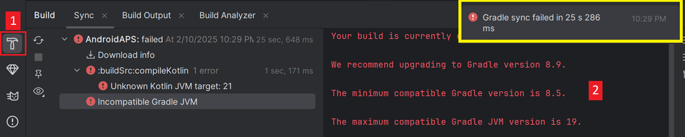
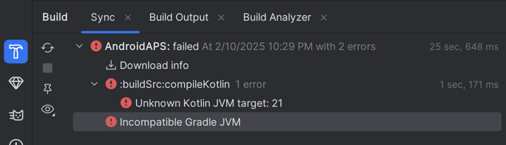

(troubleshooting_androidstudio-troubleshooting-android-studio)=

# Αντιμετώπιση προβλημάτων του Android Studio

```{contents} List of common issues
:depth: 2
:local: true
```

(troubleshooting_androidstudio-lost-keystore)=
## Χαμένο keystore
Αν χάσατε το keystore σας ή τον κωδικό του, ένα apk υπογεγραμμένο με νέο keystore δεν μπορεί να ενημερώσει το τρέχον **AAPS** σας: πρέπει να το απεγκαταστήσετε και να το εγκαταστήσετε ξανά. Δείτε [Επανεγκατάσταση του AAPS με νέο keystore](#reinstall-aaps).

## Gradle Sync failed (αποτυχία συγχρονισμού Gradle)
Το Gradle Sync μπορεί να αποτύχει για διάφορους λόγους. Όταν δείτε ένα μήνυμα που λέει 'gradle sync failed', ανοίξτε την καρτέλα "Build" (1) στο κάτω μέρος του Android Studio και δείτε ποιο μήνυμα σφάλματος (2) εμφανίζεται.



```{contents} Likely reasons for gradle sync failures are:
:depth: 1
:local: true
```

*Σημαντικό*: Αφού ακολουθήσετε τις οδηγίες για το δικό σας πρόβλημα, πρέπει να ξεκινήσετε ξανά τον [συγχρονισμό gradle](#gradle-resync).

(troubleshooting_androidstudio-uncommitted-changes)=
### Μη δεσμευμένες αλλαγές

Αν δείτε ένα μήνυμα αποτυχίας όπως αυτό:


```
Build file 'C:\Data\50-Android\AndroidAPS\app\build.gradle.kts' line: 243

There are uncommitted changes.
Κατεβάστε ξανά τον κώδικα (clone) όπως περιγράφεται στο wiki και μην επιτρέψετε ενημέρωση του gradle
```

#### Βήμα 1 - Ελέγξτε την εγκατάσταση του git
  * Ανοίξτε την καρτέλα terminal (1) στο κάτω μέρος του Android Studio, αντιγράψτε το παρακάτω κείμενο και επικολλήστε ή πληκτρολογήστε το στο τερματικό (2).
    ```
    git --version
    ```

    

    Σημείωση: Ανάμεσα στο Git και στο version υπάρχει ένα κενό και δύο παύλες!

  * Πρέπει να δείτε ένα μήνυμα που λέει ποια έκδοση του Git είναι εγκατεστημένη, όπως φαίνεται στο παραπάνω στιγμιότυπο. Σε αυτή την περίπτωση, πηγαίνετε στο [Βήμα 2](#troubleshooting-android-studio-check-for-uncommitted-changes).

  * Αν δείτε ένα μήνυμα που λέει
    ```
    Git: command not found
    ```
    η εγκατάσταση του Git δεν είναι σωστή.

  * [Έλεγχος της εγκατάστασης του git](#BuildingAaps-steps-for-installing-git)

  * Αν έχετε Windows και μόλις εγκαταστήσατε το Git, πρέπει να επανεκκινήσετε τον υπολογιστή σας, ώστε το Git να είναι διαθέσιμο παντού μετά την εγκατάσταση

  * Αν το Git είναι εγκατεστημένο, έχετε κάνει επανεκκίνηση (σε Windows) και το Git ακόμη δεν βρίσκεται:

  * Αναζητήστε στον υπολογιστή σας ένα αρχείο "git.exe".

    Σημειώστε σε ποιον φάκελο είναι αποθηκευμένο.

  * Μεταβείτε στις μεταβλητές περιβάλλοντος (Environment variables) των Windows, επιλέξτε τη μεταβλητή "PATH" και πατήστε edit (επεξεργασία). Προσθέστε τον φάκελο όπου βρήκατε την εγκατάσταση του Git.

  * Αποθηκεύστε και κλείστε.

  * Επανεκκινήστε το Android Studio.

(troubleshooting-android-studio-check-for-uncommitted-changes)=
#### Βήμα 2: Ελέγξτε για αλλαγές χωρίς commit.

  * Στο Android Studio, ανοίξτε την καρτέλα 'Commit' (1) στην αριστερή πλευρά. 
  * Θα δείτε είτε "Changes" (σε παλαιότερες εκδόσεις του Android Studio λέγεται "Default changeset") (2) είτε "Unversioned Files" (3):

    * Για τα "Changes", πιθανότατα ενημερώσατε το 'Gradle' ή αλλάξατε κατά λάθος το περιεχόμενο κάποιων αρχείων.

    * Κάντε δεξί κλικ στο "Changes" και επιλέξτε "Rollback…" (1)

      

    * Τα αρχεία κατεβαίνουν ξανά από τον διακομιστή Git. Αν δεν υπάρχουν άλλες αλλαγές στην καρτέλα commit, πηγαίνετε στο [Βήμα 3](#gradle-resync).

  * Αν βλέπετε "Unversioned Files", ίσως αποθηκεύσατε κατά λάθος αρχεία στον φάκελο του πηγαίου κώδικα. Ίσως είναι σημαντικά αρχεία, όπως το αρχείο keystore σας, που πρέπει να μετακινηθούν αλλού. Αν δεν ξέρετε τι είναι αυτά τα αρχεία και δεν τα δημιουργήσατε εσείς, μπορείτε να τα διαγράψετε.

    * Με τον συνηθισμένο διαχειριστή αρχείων του υπολογιστή σας, μετακινήστε (ή αποκόψτε και επικολλήστε) αυτό το αρχείο σε ασφαλές μέρος.

    * Επιστρέψτε στο Android Studio και πατήστε το κουμπί Refresh (4) στην καρτέλα Commit, για να βεβαιωθείτε ότι το αρχείο δεν βρίσκεται πια στον φάκελο του **AAPS**.

      Αν δεν υπάρχουν άλλες αλλαγές στην καρτέλα Commit, πηγαίνετε στο [Βήμα 3](#gradle-resync).


#### Βήμα 3: Συγχρονίστε ξανά το Gradle (ξανά)

Ακολουθήστε τις οδηγίες στην ενότητα [Επανασυγχρονισμός Gradle](#gradle-resync).

### Git Pull Failed - Please tell me who you are

Αν δείτε αυτό το μήνυμα, το Git χρειάζεται να δηλώσετε ποιος είστε.


Ανοίξτε το τερματικό και πληκτρολογήστε τις δύο παρακάτω εντολές, τη μία μετά την άλλη.

```
git config --global user.name "Your name here"
git config --global user.email your.email@here.com
```

Το όνομά σας πρέπει να γραφτεί μέσα σε εισαγωγικά.


(troubleshooting_androidstudio-android-gradle-plugin-requires-java-11-to-run)=

(incompatible-gradle-jvm)=
### Μη συμβατό Gradle JVM



```
Your build is currently configured to use incompatible Java 21.0.3 and Gradle 8.2.
Cannot sync the project.

We recommend upgrading to Gradle version 8.9.

The minimum compatible Gradle version is 8.5.

The maximum compatible Gradle JVM version is 19.
```

ή:

```
Cause: error: invalid source release: 21
```

Αν δείτε το παραπάνω μήνυμα σφάλματος, πρέπει να κατεβάσετε μια σωστή έκδοση JVM πριν δοκιμάσετε ξανά το build:

1.  Ελέγξτε στον [πίνακα απαιτήσεων](#Building-APK-recommended-specification-of-computer-for-building-apk-file) ποια έκδοση JVM χρειάζεστε για την έκδοση του **AAPS** που δημιουργείτε, και σημειώστε την.

2. Ανοίξτε την προβολή Gradle πατώντας τον ελέφαντα (1) στη δεξιά πλευρά του Android Studio, ανοίξτε τις ρυθμίσεις (2) και επιλέξτε **Gradle Settings** (3):


3.  Στο πεδίο **Gradle JDK**, ελέγξτε αν είναι επιλεγμένη η σωστή έκδοση (1). Αν όχι, πατήστε στο πεδίο και δείτε αν υπάρχει ήδη στη λίστα. Το παρακάτω παράδειγμα δείχνει ότι το JVM 21 εμφανίζεται ως “jbr-21”. Αν το βρείτε, απλά επιλέξτε το και τελειώσατε. Αν δεν υπάρχει, επιλέξτε **Download JDK** (2).


4. Στο Version (1), επιλέξτε το JDK που χρειάζεται η έκδοση του **AAPS** σας (αυτό που σημειώσατε όταν ελέγξατε τον πίνακα απαιτήσεων). Στο Vendor (2) επιλέξτε οποιονδήποτε προμηθευτή. Location (3): μην το αλλάξετε. Πατήστε **Download** (4).


5.  Κλείστε το παράθυρο **Settings** με **OK**.
6. Τώρα πρέπει να ξεκινήσετε ξανά το Gradle Sync. Ακολουθήστε τις οδηγίες στην ενότητα [Επανασυγχρονισμός Gradle](#gradle-resync).

(incompatible-version-of-android-gradle-plugin)=
### Μη συμβατή έκδοση του Android Gradle plugin

  Αν δείτε το παρακάτω μήνυμα σφάλματος

`The project is using an incompatible version (AGP x.x.x) of the Android Gradle plugin. Latest supported version is AGP x.x.x`

  

  Χρησιμοποιείτε μια παλιά έκδοση του Android Studio. Στο μενού, μεταβείτε στο Help > Check for updates και εγκαταστήστε όσες ενημερώσεις βρεθούν για το Android Studio και τα plugins του.

(troubleshooting_androidstudio-could-not-resolve-no-cached-version)=
### Could not resolve/No cached version

  Μπορεί να δείτε αυτό το μήνυμα σφάλματος:


  * Στη δεξιά πλευρά, ανοίξτε την καρτέλα Gradle (1).

    Βεβαιωθείτε ότι το κουμπί που φαίνεται στο (2) *ΔΕΝ* είναι επιλεγμένο.

    

  * Τώρα πρέπει να ξεκινήσετε έναν [Επανασυγχρονισμό Gradle](#gradle-resync)

(troubleshooting_androidstudio-unable-to-start-daemon-process)=
### Unable to start daemon process

  Αν δείτε ένα μήνυμα σφάλματος όπως το παρακάτω, πιθανότατα χρησιμοποιείτε σύστημα Windows 10 32-bit. Αυτό δεν υποστηρίζεται από το Android Studio 3.5.1 και νεότερο, και δυστυχώς οι προγραμματιστές του **AAPS** δεν μπορούν να κάνουν τίποτα γι' αυτό!

  Στο διαδίκτυο υπάρχουν πληροφορίες για το πώς να δείτε αν έχετε λειτουργικό σύστημα 32-bit ή 64-bit, π.χ. [αυτές εδώ](https://support.microsoft.com/en-us/windows/32-bit-and-64-bit-windows-frequently-asked-questions-c6ca9541-8dce-4d48-0415-94a3faa2e13d).

  

(gradle-resync)=
### Επανασυγχρονισμός Gradle

  Αν βλέπετε ακόμη το μήνυμα ότι ο συγχρονισμός gradle απέτυχε, επιλέξτε τώρα τον σύνδεσμο **Try again** (1). 


  Αν δεν βλέπετε πια το μήνυμα, μπορείτε να το ξεκινήσετε και χειροκίνητα:

  * Ανοίξτε την καρτέλα Gradle (1) στο δεξί άκρο του Android Studio.

    

  * Δεξί κλικ στο AAPS (2)

  * Πατήστε "Reload Gradle Project" (3)

## Generate Signed APK: η δημιουργία ολοκληρώθηκε με 0 build variants

Όταν δημιουργείτε το υπογεγραμμένο apk, μπορεί να δείτε ειδοποίηση ότι η δημιουργία ήταν επιτυχής αλλά ότι δημιουργήθηκαν '0 build variants':


Αυτή είναι μια ψευδής προειδοποίηση. Ελέγξτε τον φάκελο που επιλέξατε ως "Destination folder" για τη δημιουργία (βήμα [Generate Signed APK](#Building-APK-generate-signed-apk)) και θα βρείτε εκεί το apk που δημιουργήθηκε!


## Η εφαρμογή δημιουργήθηκε με προειδοποιήσεις του μεταγλωττιστή/kotlin

Αν το build ολοκληρώθηκε με επιτυχία αλλά βλέπετε προειδοποιήσεις του μεταγλωττιστή ή του kotlin (με κίτρινο ή μπλε θαυμαστικό), μπορείτε απλά να τις αγνοήσετε.

 

Το apk σας δημιουργήθηκε με επιτυχία και μπορείτε να το μεταφέρετε στο τηλέφωνό σας!


## Το AAPS δεν λαμβάνει δεδομένα CGM

* Αν χρησιμοποιείτε την τροποποιημένη εφαρμογή Dexcom G6: αυτή η εφαρμογή είναι παλιά. Χρησιμοποιήστε την εφαρμογή [BYODA](#DexcomG6-if-using-g6-with-build-your-own-dexcom-app).

* Αν χρησιμοποιείτε xDrip: δηλώστε τον δέκτη όπως περιγράφεται στη [σελίδα ρυθμίσεων του xDrip](#xdrip-identify-receiver).


## Το apk δεν εγκαταστάθηκε


* Βεβαιωθείτε ότι έχετε μεταφέρει το αρχείο "app-full-release.apk" στο τηλέφωνό σας.
* Αυτό το σφάλμα συνήθως σημαίνει ότι το νέο apk είναι υπογεγραμμένο με διαφορετικό keystore από το εγκατεστημένο **AAPS** σας. Αν έχετε ακόμη το προηγούμενο keystore σας, επιλέξτε το και κάντε ξανά build. Αλλιώς, δείτε [Επανεγκατάσταση του AAPS με νέο keystore](#reinstall-aaps).
* Εάν στο τηλέφωνό σας εμφανίζεται "Δεν έχει εγκατασταθεί η εφαρμογή", ακολουθήστε αυτά τα βήματα:

1. [Εξαγωγή ρυθμίσεων](../Maintenance/ExportImportSettings.md) (στην έκδοση του AAPS που είναι ήδη εγκατεστημένη στο τηλέφωνό σας)
2. Απεγκαταστήστε το **AAPS** από το τηλέφωνό σας.
3. Ενεργοποιήστε τη λειτουργία πτήσης και απενεργοποιήστε το Bluetooth.
4. Εγκατάσταση νέας έκδοσης ("app-full-release.apk")
5. [Εισαγωγή ρυθμίσεων](../Maintenance/ExportImportSettings.md)
6. Ενεργοποιήστε ξανά το Bluetooth και απενεργοποιήστε τη λειτουργία πτήσης

## Το apk εγκαταστάθηκε, αλλά με την παλιά έκδοση

Αν δημιουργήσατε την εφαρμογή με επιτυχία, τη μεταφέρατε στο τηλέφωνό σας και την εγκαταστήσατε με επιτυχία, αλλά ο αριθμός έκδοσης έμεινε ίδιος, τότε ίσως ξεχάσατε να [ενημερώσετε το τοπικό σας αντίγραφο](#Update-to-new-version-update-your-local-copy)

## Τίποτα από τα παραπάνω δεν βοήθησε

Αν καμία από τις παραπάνω συμβουλές δεν βοήθησε, μπορείτε να δημιουργήσετε το apk από την αρχή:

1. [Εξαγωγή ρυθμίσεων](../Maintenance/ExportImportSettings.md) (στην έκδοση του AAPS που είναι ήδη εγκατεστημένη στο τηλέφωνό σας)

2. Έχετε έτοιμο τον κωδικό του κλειδιού (key password) και τον κωδικό του keystore (key store password).

    Ή απλά χρησιμοποιήστε ένα νέο keystore.

3. Δημιουργήστε το apk από την αρχή, όπως περιγράφεται [εδώ](#Building-APK-download-AAPS-code).

4. Όταν δημιουργήσετε το apk με επιτυχία, διαγράψτε το υπάρχον apk στο τηλέφωνό σας, μεταφέρετε το νέο apk στο τηλέφωνο και εγκαταστήστε το.
5. Κάντε ξανά [Εισαγωγή ρυθμίσεων](../Maintenance/ExportImportSettings.md) για να επαναφέρετε τα Βήματα και τις ρυθμίσεις σας.
6. Ελέγξτε τις επιλογές βελτιστοποίησης μπαταρίας και απενεργοποιήστε τις ξανά.

## Στη χειρότερη περίπτωση

Αν τα παραπάνω δεν λύνουν το πρόβλημα με το build, μπορείτε να δοκιμάσετε να απεγκαταστήσετε εντελώς το Android Studio και να κάνετε build από την αρχή.  Κάποιοι χρήστες βρίσκουν ότι αυτό λύνει το πρόβλημα με το build.  Όταν διαγράφετε το Android Studio, μη διαγράψετε τις ρυθμίσεις χρήστη του Android και **βεβαιωθείτε ότι απεγκαθιστάτε όλα τα αρχεία που σχετίζονται με το Android Studio.** Αν δεν αφαιρέσετε εντελώς το Android Studio μαζί με όλα τα κρυφά αρχεία, η απεγκατάσταση μπορεί να δημιουργήσει νέα προβλήματα αντί να λύσει τα υπάρχοντα. Οδηγίες για πλήρη απεγκατάσταση θα βρείτε στο διαδίκτυο, π.χ.

[https://stackoverflow.com/questions/39953495/how-to-completely-uninstall-android-studio-from-windowsv10](https://stackoverflow.com/questions/39953495/how-to-completely-uninstall-android-studio-from-windowsv10).

Εγκαταστήστε το Android Studio από την αρχή, όπως περιγράφεται [εδώ](#Building-APK-install-android-studio).
