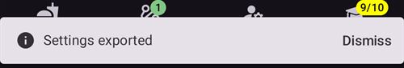

# Δημιουργία και επαναφορά αντιγράφων ασφαλείας

Όταν εγκαθιστάτε το AAPS στο τηλέφωνό σας, αυτό γίνεται μια «ιατρική συσκευή» στην οποία βασίζεστε κάθε μέρα. Συνιστάται έντονα να έχετε ένα σχέδιο έκτακτης ανάγκης για την περίπτωση που το τηλέφωνό σας χαλάσει, κλαπεί ή χαθεί. Γι' αυτό είναι σημαντικό να προετοιμαστείτε, ρωτώντας τον εαυτό σας: «Τι γίνεται αν...;»

Για να επαναφέρετε τη ρύθμιση του AAPS σε υπάρχον ή νέο τηλέφωνο, είναι σημαντικό να κρατάτε τα παρακάτω σε ασφαλές μέρος (δηλαδή: όχι στο τηλέφωνό σας). Η καλύτερη πρακτική είναι να κρατάτε τουλάχιστον δύο ξεχωριστά αντίγραφα ασφαλείας: σε τοπικό σκληρό δίσκο, σε USB stick και (καλύτερα) σε αποθήκευση cloud, όπως το Google Drive ή το Microsoft 365 OneDrive. Αν αποθηκεύετε τα αντίγραφα ασφαλείας στο cloud, θα έχετε πάντα όλα όσα χρειάζεστε διαθέσιμα από το τηλέφωνό σας, για να επαναφέρετε τη ρύθμισή σας οπουδήποτε και οποτεδήποτε.

Σκεφτείτε να αποκτήσετε ένα δεύτερο εφεδρικό τηλέφωνο και να κάνετε δοκιμαστική επαναφορά του AAPS, ώστε να βεβαιωθείτε ότι το εφεδρικό τηλέφωνο λειτουργεί όπως περιμένετε. Αυτό το βήμα θα σας δώσει σιγουριά ότι το σχέδιο έκτακτης ανάγκης σας λειτουργεί και ότι μπορείτε να συνεχίσετε χωρίς διακοπή να χρησιμοποιείτε το AAPS, αν το κύριο τηλέφωνό σας δεν είναι διαθέσιμο.

```{admonition} Android backups and phone-transfer tools do not carry your AAPS settings
:class: warning
Since **AAPS** 4.0 the settings are kept in an encrypted store on the phone, and they are left out of the Google backup and of the phone-to-phone transfer of a new phone. A settings export, as described on this page, is the only way to carry them over.
```

Για να μπορείτε να κάνετε επαναφορά, είναι σημαντικό να έχετε διαθέσιμα τα παρακάτω:

- Το **αρχείο keystore του Android Studio** και τον σχετικό **κωδικό**: Χρειάζονται για να κάνετε (ξανά) build το αρχείο εγκατάστασης .APK του AAPS.
- Ένα πρόσφατο αντίγραφο του **αρχείου εγκατάστασης .APK του AAPS**
- Ένα πρόσφατο αρχείο **εξαγωγής ρυθμίσεων**: Για την επαναφορά σημαντικών ρυθμίσεων (μαζί με τα Βήματά σας!).
- Τον **Κύριο κωδικό του AAPS**
- Αντίγραφα ασφαλείας άλλων βοηθητικών εφαρμογών: Όπως BYODA και/ή xDrip.
- Προσωπικές σημειώσεις για τη ρύθμισή σας.

Παρακάτω είναι τα στοιχεία για τα οποία συνιστάται να κρατάτε αντίγραφα ασφαλείας.

## Δημιουργία αντιγράφων ασφαλείας

### Το αρχείο keystore από τον υπολογιστή που χρησιμοποιήσατε για να κάνετε build το APK
Όταν κάνετε build το αρχείο εγκατάστασης .APK με το Android Studio, χρησιμοποιείται το **αρχείο keystore και ο κωδικός για την υπογραφή του αρχείου εγκατάστασης .APK**. Για να ενημερώσετε την τρέχουσα εγκατάσταση του AAPS, το αρχείο εγκατάστασης .APK της ενημέρωσης πρέπει να υπογραφεί με το ίδιο keystore που χρησιμοποιήθηκε στην αρχική εγκατάσταση. Κατά την ενημέρωση διατηρούνται όλες οι ρυθμίσεις και η βάση δεδομένων του AAPS. Χωρίς αυτό, πρέπει πρώτα να απεγκαταστήσετε την τρέχουσα εφαρμογή και μετά να [επανεγκαταστήσετε](#reinstall-aaps) και να ρυθμίσετε ξανά το AAPS.

Αν κρατάτε το keystore και τον κωδικό του, οι μελλοντικές ενημερώσεις του APK θα είναι πολύ πιο απλές, ιδιαίτερα αν χρειαστεί να κάνετε build την εφαρμογή σε νέο υπολογιστή. Δείτε την ενότητα [Ενημέρωση σε νέα έκδοση ή κλάδο](../Maintenance/UpdateToNewVersion.md) για λεπτομέρειες σχετικά με τη χρήση του keystore όταν κάνετε build ένα νέο APK.

**Πότε να κάνετε αντίγραφο ασφαλείας:** Κάντε αντίγραφο ασφαλείας του keystore αφού κάνετε build για πρώτη φορά το αρχείο εγκατάστασης .APK του **AAPS**.

**Πώς να κάνετε αντίγραφο ασφαλείας:** Βρείτε τη διαδρομή του keystore σας. Αν δεν το θυμάστε, μπορείτε να το βρείτε στο Android Studio επιλέγοντας **Build > APK > Next**. Η διαδρομή εμφανίζεται στο πεδίο “Key store path”. Με τον διαχειριστή αρχείων, πηγαίνετε σε αυτή τη διαδρομή και δημιουργήστε ένα αντίγραφο του αρχείου keystore (με κατάληξη αρχείου `.jks`). Αποθηκεύστε το σε ασφαλές μέρος στο cloud, για την περίπτωση που ο υπολογιστής σας δεν θα είναι διαθέσιμος. Σημειώστε επίσης τον κωδικό του keystore (key store password), το ψευδώνυμο κλειδιού (key alias) και τον κωδικό κλειδιού (key password).

### Αντίγραφα του πιο πρόσφατου APK
Αν το κύριο τηλέφωνο του **AAPS** χαθεί ή χαλάσει, με ένα αντίγραφο του APK θα μπορείτε να συνεχίσετε γρήγορα να χρησιμοποιείτε το **AAPS** σε νέο τηλέφωνο. Σημείωση: θα χρειαστείτε επίσης αντίγραφο ασφαλείας των ρυθμίσεων, όπως περιγράφεται παρακάτω.

**Πότε να κάνετε αντίγραφο ασφαλείας:** Κρατάτε αντίγραφο ασφαλείας του πιο πρόσφατου APK που εγκαταστήσατε στο κύριο τηλέφωνο του **AAPS**. Καλό είναι να κρατάτε και μία παλαιότερη έκδοση, για την περίπτωση που χρειαστεί για οποιονδήποτε λόγο να επιστρέψετε σε αυτήν.

**Πώς να κάνετε αντίγραφο ασφαλείας:** Κρατήστε ένα αντίγραφο στον υπολογιστή όπου κάνατε build το APK με το Android Studio. Επιπλέον, συνιστάται να αποθηκεύετε ένα αντίγραφο του APK εγκατάστασης σε μια πλατφόρμα cloud. Βεβαιωθείτε ότι ξέρετε πού θα βρείτε και τα δύο αντίγραφα ασφαλείας όταν τα χρειαστείτε. Σκεφτείτε να δημιουργήσετε ξεχωριστούς φακέλους για αυτά τα αντίγραφα ασφαλείας.

### Αρχείο ρυθμίσεων του AAPS (λέγεται επίσης 'Preferences')

```{admonition} Where are preferences stored on my phone?
:class: tip
Θα βρείτε τις ρυθμίσεις σας στον **Φάκελο AAPS** που επιλέξατε κατά τη [ρύθμιση του AAPS](#SetupWizard-StoragePermission).</br>
Μπορείτε επίσης να αλλάξετε τον **Φάκελο AAPS** στην οθόνη **Συντήρηση** (**μενού** (☰) > **Συντήρηση**), δείτε [Ορισμός του τοπικού φακέλου AAPS](#preferences-maintenance-logdirectory).
```

Με ένα αντίγραφο του αρχείου εγκατάστασης APK (δείτε παραπάνω) και το αρχείο **Ρυθμίσεων**, μπορείτε γρήγορα να ξεκινήσετε σε υπάρχον ή νέο τηλέφωνο.

Το αρχείο **Ρυθμίσεων** χρησιμοποιείται για να προσαρμόσει την εφαρμογή AAPS στη δική σας ρύθμιση. Περιλαμβάνουν στοιχεία όπως τις ρυθμίσεις της **Διαμόρφωσης**, την κατάσταση των Βημάτων, τις ρυθμίσεις επικοινωνίας με τρίτες υπηρεσίες (π.χ. Nightscout, Tidepool), τους αυτοματισμούς και τα προφίλ.

Με την εξαγωγή των ρυθμίσεων του AAPS σε αρχείο μπορείτε να επαναφέρετε τη διαμόρφωσή του όπως ήταν σε μια συγκεκριμένη χρονική στιγμή. Όπως αναφέρθηκε, εκτός από όλες τις ρυθμίσεις διαμόρφωσης, το αρχείο εξαγωγής περιέχει και την κατάσταση των Βημάτων σας, την οποία πρέπει να επαναφέρετε όταν **(επαν)εγκαθιστάτε** το AAPS. Χωρίς αυτό θα πρέπει να κάνετε ξανά όλα τα Βήματα από την αρχή για να ενεργοποιήσετε το κλειστό κύκλωμα. Τα αρχεία ρυθμίσεων σας επιτρέπουν επίσης να επαναφέρετε τις «τελευταίες γνωστές καλές» ρυθμίσεις, για να αναιρέσετε αλλαγές στη διαμόρφωση.

**Πότε να κάνετε αντίγραφο ασφαλείας των ρυθμίσεων του AAPS:**
* Κάθε φορά που ολοκληρώνετε ένα Βήμα, ώστε να μη χάσετε την πρόοδό σας. _Χωρίς αντίγραφο των **Ρυθμίσεών** σας θα πρέπει να ολοκληρώσετε ξανά όλα τα Βήματα, αν χρειαστεί να επανεγκαταστήσετε το AAPS ή να αλλάξετε τηλέφωνο._

* Κάθε φορά που σκοπεύετε να κάνετε σημαντικές αλλαγές στη διαμόρφωσή σας (αλλαγή ρυθμίσεων SMB, αλλαγή τύπου ινσουλίνης, αλλαγή αντλίας, αλλαγές σε αυτοματισμούς), πρέπει να κάνετε αντίγραφο ασφαλείας των **Ρυθμίσεων** πριν και μετά τις αλλαγές. Έτσι έχετε τις πιο πρόσφατες ρυθμίσεις σας και επίσης ένα αντίγραφο των ρυθμίσεων πριν από τις αλλαγές, για την περίπτωση που χρειαστεί να επιστρέψετε σε αυτές.

* Tubeless pumps (Such as Omnipod and Medtrum) users only: the **Settings** file contains connection details on your current pod and can be used to restore connection to that pod with a new phone. Αν δεν έχετε αντίγραφο των ρυθμίσεων που εξάγατε αφού ξεκινήσατε το τρέχον pod, θα πρέπει να ξεκινήσετε νέο pod σε περίπτωση που χρειαστεί να αντικαταστήσετε το τρέχον τηλέφωνό σας.

**Πώς να κάνετε αντίγραφο ασφαλείας χειροκίνητα:**

1. If this is your first time importing or exporting **Settings** you will need to set a master password in [Settings > Protection](#Preferences-master-password). Ορίστε έναν κωδικό και σημειώστε τον σε ασφαλές μέρος. _Χωρίς αυτόν τον κωδικό δεν θα έχετε πρόσβαση στα αντίγραφα ασφαλείας των **Ρυθμίσεων**._

2. Από την κύρια οθόνη του **AAPS**, ανοίξτε το **μενού** (☰) > **Συντήρηση**. Επιλέξτε πού θα αποθηκευτεί το αρχείο με τα chips **Τοπικά** και **Cloud** δίπλα στο **Εξαγωγή ρυθμίσεων** (δείτε **Εξαγωγή ή εισαγωγή ρυθμίσεων** παρακάτω) και μετά πατήστε **Εξαγωγή ρυθμίσεων**. Το **AAPS** δείχνει πού θα αποθηκευτεί το αρχείο: το όνομα αρχείου για το **Τοπικά**, **Google Drive** για το **Cloud**. Πατήστε **ΟΚ**.

   

   

   Πληκτρολογήστε τον Κύριο κωδικό που ορίσατε παραπάνω και πατήστε **ΟΚ**.

   

   Το μήνυμα **Έγινε εξαγωγή ρυθμίσεων** (τοπικά) ή **Η εξαγωγή στο cloud έγινε με επιτυχία** (cloud) επιβεβαιώνει την εξαγωγή.

   

   

3. Με τον διαχειριστή αρχείων του τηλεφώνου σας (συνήθως λέγεται “Αρχεία” ή “Τα αρχεία μου”) πηγαίνετε στο Εσωτερικός χώρος αποθήκευσης > AAPS > preferences. Εδώ θα δείτε ένα αντίγραφο όλων των αρχείων ρυθμίσεων που έχουν εξαχθεί. Το όνομα αρχείου πρέπει να είναι `YYYY-MM-DD_Time_appname.json`. Ανεβάστε αυτό το αρχείο στην πλατφόρμα cloud της επιλογής σας. Στη συνέχεια, από την πλατφόρμα cloud, κατεβάστε ένα αντίγραφο και στον υπολογιστή σας.

(ExportImportSettings-Settings-Export)=

## Εξαγωγή ρυθμίσεων

```{admonition} Where are preferences stored on my phone?
:class: tip
Θα βρείτε τις ρυθμίσεις σας στον **Φάκελο AAPS** που επιλέξατε κατά τη [ρύθμιση του AAPS](#SetupWizard-StoragePermission).</br>
Μπορείτε επίσης να αλλάξετε τον **Φάκελο AAPS** στην οθόνη **Συντήρηση** (**μενού** (☰) > **Συντήρηση**), δείτε [Ορισμός του τοπικού φακέλου AAPS](#preferences-maintenance-logdirectory).
```

Συνιστάται να κάνετε τακτικά εξαγωγή ρυθμίσεων, ιδιαίτερα πριν και μετά από αλλαγές στη διαμόρφωση. Μπορείτε να κάνετε τις εξαγωγές **χειροκίνητα ή (καλύτερα) με αυτοματισμό**. Σημειώστε τον Κύριο κωδικό του AAPS και κάντε αντίγραφο ασφαλείας των αρχείων ρυθμίσεων, αντιγράφοντάς τα έξω από το τηλέφωνο, για παράδειγμα σε αποθήκευση cloud.

**Σημείωση**: _Οι ρυθμίσεις που εξάγονται κρυπτογραφούνται με τον Κύριο κωδικό του AAPS: χωρίς τον Κύριο κωδικό που χρησιμοποιήθηκε για την εξαγωγή δεν θα μπορείτε να κάνετε εισαγωγή του αρχείου ρυθμίσεων!_

### Εξαγωγή ή εισαγωγή ρυθμίσεων
Για εξαγωγή ή εισαγωγή ρυθμίσεων, ανοίξτε το **μενού** (☰) και επιλέξτε **Συντήρηση**. Στην ενότητα **Διαχείριση αρχείων**, τα chips **Τοπικά** και **Cloud** δίπλα στα **Εξαγωγή ρυθμίσεων** και **Εισαγωγή ρυθμίσεων** ορίζουν πού αποθηκεύεται ή από πού διαβάζεται το αρχείο ρυθμίσεων: **Τοπικά** είναι ο φάκελος AAPS στο τηλέφωνό σας, το **Cloud** είναι διαθέσιμο όταν έχει ρυθμιστεί ένας [Φάκελος cloud](#preferences-maintenance-cloud). Με ένα πάτημα σε ένα chip το ενεργοποιείτε ή το απενεργοποιείτε· τουλάχιστον ένα μένει πάντα επιλεγμένο και οι δύο γραμμές έχουν την ίδια επιλογή. Μετά πατήστε το ίδιο το **Εξαγωγή ρυθμίσεων** ή **Εισαγωγή ρυθμίσεων** για να ξεκινήσει.


(ExportImportSettings-Automating-Settings-Export)=
### Αυτόματη εξαγωγή ρυθμίσεων

To automate settings exports [(**see Automation**)](../DailyLifeWithAaps/Automations.md#automating-preference-settings-export) open [**Settings** > **Maintenance**](#preferences-maintenance-settings), expand **Unattended Settings Export** and switch on **Enable automated settings export**.

Μπορείτε πλέον να ρυθμίσετε έναν [Αυτοματισμό](../DailyLifeWithAaps/Automations.md#automating-preference-settings-export) για την εξαγωγή ρυθμίσεων, είτε σε τακτική βάση (_π.χ._ κάθε εβδομάδα) είτε μετά από αλλαγή pod.

_**Σημείωση:** Κατά την εισαγωγή ρυθμίσεων, ο χρήστης πρέπει πάντα να πληκτρολογεί τον Κύριο κωδικό του AAPS!_


(ExportImportSettings-restoring-from-your-backups-on-a-new-phone-or-fresh-installation-of-aaps)=
## Επαναφορά από τα αντίγραφα ασφαλείας σε νέο τηλέφωνο ή σε νέα εγκατάσταση του AAPS

```{admonition} Where are preferences stored on my phone?
:class: tip
Θα βρείτε τις ρυθμίσεις σας στον **Φάκελο AAPS** που επιλέξατε κατά τη [ρύθμιση του AAPS](#SetupWizard-StoragePermission).</br>
Μπορείτε επίσης να αλλάξετε τον **Φάκελο AAPS** στην οθόνη **Συντήρηση** (**μενού** (☰) > **Συντήρηση**), δείτε [Ορισμός του τοπικού φακέλου AAPS](#preferences-maintenance-logdirectory).</br>
Αν το **AAPS** χάσει την πρόσβαση σε αυτόν τον φάκελο (μπορεί να συμβεί μετά από επανεγκατάσταση ή μετά από διαγραφή του χώρου αποθήκευσης της εφαρμογής), εμφανίζει την ειδοποίηση **Χάθηκε η πρόσβαση στον φάκελο AAPS** και σταματά να αποθηκεύει ρυθμίσεις στο τηλέφωνο, μέχρι να [επιλέξετε ξανά τον φάκελο](#preferences-maintenance-logdirectory).
```

Χρησιμοποιήστε αυτές τις οδηγίες αν έχετε αντίγραφο ασφαλείας του APK και των **Ρυθμίσεων** που θέλετε να φορτώσετε σε νέο τηλέφωνο ή αν χρειάστηκε για οποιονδήποτε λόγο να διαγράψετε και να εγκαταστήσετε ξανά το APK στο υπάρχον τηλέφωνό σας.

_Αν ενημερώνετε το **AAPS** με ένα APK που έγινε build με το ίδιο keystore, δεν χρειάζεται να ακολουθήσετε αυτή τη διαδικασία. Ωστόσο, συνιστάται να δημιουργήσετε ένα αντίγραφο ασφαλείας πριν εφαρμόσετε την ενημέρωση._

Αν ενημερώνετε το **AAPS** αφού χάσατε ή αντικαταστήσατε το αρχικό σας keystore (π.χ. με νέο υπολογιστή για build χωρίς να μεταφέρετε το keystore), βεβαιωθείτε ότι έχετε κάνει αντίγραφο ασφαλείας όλων των ρυθμίσεων όπως περιγράφεται παραπάνω και μετά απεγκαταστήστε την υπάρχουσα έκδοση του **AAPS** από το τηλέφωνό σας. Δείτε [Επανεγκατάσταση του AAPS με νέο keystore](#reinstall-aaps) για όλη τη διαδικασία.

Αν χρειάζεται, [ρυθμίστε τον δέκτη της πηγής CGM/BG](../Getting-Started/CompatiblesCgms.md) πριν από τα παρακάτω βήματα

(ExportImportSettings-tubeless-pumps)=
```{admonition} Tubeless pumps (Omnipod and Medtrum) users
:class: warning
Το αρχείο **Ρυθμίσεων** περιέχει τη συνεδρία του pod ή του patch που ήταν ενεργό όταν κάνατε την εξαγωγή.
- **Κάντε εξαγωγή αμέσως μετά από κάθε ενεργοποίηση pod ή patch** και αντιγράψτε το αρχείο έξω από το τηλέφωνό σας.
- **Ίδιο τηλέφωνο, το pod λειτουργεί ακόμα:** αφήστε το **Αντικατάσταση και των ρυθμίσεων αντλίας** χωρίς τσεκ. Το τρέχον pod σας διατηρείται και εισάγονται μόνο οι υπόλοιπες ρυθμίσεις.
- **Νέο τηλέφωνο που αναλαμβάνει το pod:** τσεκάρετε το **Αντικατάσταση και των ρυθμίσεων αντλίας** και χρησιμοποιήστε μόνο αρχείο που εξήχθη κατά τη διάρκεια του pod που φοράτε τώρα. Ένα αρχείο από προηγούμενο pod αντικαθιστά τη συνεδρία του τρέχοντος pod σας και θα χρειαστεί να ξεκινήσετε νέο pod.
- **Έγινε κατά λάθος εισαγωγή μιας παλιάς συνεδρίας pod:** το **AAPS** προσπαθεί συνέχεια να συνδεθεί με εκείνο το pod και δεν μπορείτε να ενεργοποιήσετε νέο. Απενεργοποιήστε το· αν αυτό αποτύχει, απορρίψτε το (δείτε για παράδειγμα [Απόρριψη pod](#omnipod-dash-discard-pod) για το Omnipod DASH).
```

```{admonition} Pump settings are kept unless you say otherwise
:class: note
Από προεπιλογή, μια εισαγωγή δεν αλλάζει τις ρυθμίσεις της αντλίας: η αντλία που έχει επιλεγεί στη **Διαμόρφωση**, η σύζευξή της και όλες οι άλλες ρυθμίσεις της μένουν όπως είναι σε αυτό το τηλέφωνο. Τσεκάρετε το **Αντικατάσταση και των ρυθμίσεων αντλίας** στην οθόνη εισαγωγής μόνο όταν κάνετε επαναφορά σε νέο τηλέφωνο που πρέπει να αναλάβει την ίδια αντλία. Οι ρυθμίσεις που δεν υπάρχουν στο αρχείο δεν διαγράφονται ποτέ από μια εισαγωγή.
```

1. Με το αντίγραφο ασφαλείας του APK από παραπάνω, ακολουθήστε τις οδηγίες για [νέα εγκατάσταση](../SettingUpAaps/TransferringAndInstallingAaps.md)

2. Ανοίξτε το **AAPS** και δώστε όλες τις άδειες που ζητούνται

3. Βγείτε από τον Οδηγό εγκατάστασης. Θα κάνουμε εισαγωγή όλων των απαραίτητων ρυθμίσεων από το αντίγραφο ασφαλείας των **Ρυθμίσεων**

4. Από την κύρια οθόνη του **AAPS** πατήστε **Παραχώρηση** και δώστε όλες τις άδειες που εμφανίζονται στο πλαίσιο **Απαιτούνται άδειες** στο πάνω μέρος

5. Από την κύρια οθόνη του **AAPS**, ορίστε τον Κύριο κωδικό στο [Ρυθμίσεις > Προστασία](#Preferences-master-password) στον ίδιο κωδικό που χρησιμοποιήσατε για τα αντίγραφα ασφαλείας σας.

6. Αν δεν το έχετε κάνει ακόμα, [ορίστε τον **Φάκελο AAPS**](#preferences-maintenance-logdirectory): από την κύρια οθόνη του **AAPS**, ανοίξτε το **μενού** (☰) > **Συντήρηση** > **Φάκελος AAPS**.

7. Από την κύρια οθόνη του **AAPS**, ανοίξτε το **μενού** (☰) > **Συντήρηση** > **Εξαγωγή ρυθμίσεων** > πληκτρολογήστε τον Κύριο κωδικό που ορίσατε παραπάνω > **ΟΚ**. Έτσι δημιουργείται ο φάκελος preferences, αν δεν υπάρχει ήδη στο τηλέφωνό σας.

8. Κατεβάστε το αντίγραφο ασφαλείας του αρχείου **Ρυθμίσεων** από την πλατφόρμα cloud σας.

9. Με τον διαχειριστή αρχείων (συνήθως λέγεται “Αρχεία” ή “Τα αρχεία μου”) μετακινήστε το αρχείο από τις λήψεις στο `/internal storage/AAPS/preferences`, αν ο **Φάκελος AAPS** έχει οριστεί σε `/internal storage/AAPS`

10. Από την κύρια οθόνη του **AAPS**, ανοίξτε το **μενού** (☰) > **Συντήρηση** και πατήστε **Εισαγωγή ρυθμίσεων**. Επιλέξτε το αρχείο ρυθμίσεων από το οποίο θέλετε να κάνετε επαναφορά (το νεότερο είναι στην κορυφή). Βεβαιωθείτε ότι επιλέγετε το σωστό αρχείο ρυθμίσεων· εμφανίζονται όλα τα αρχεία .json από τον φάκελο preferences (ή από τον φάκελο cloud, με το **Cloud**).

    

    Το **AAPS** δείχνει τα στοιχεία του αρχείου. Πληκτρολογήστε τον Κύριο κωδικό που ορίσατε παραπάνω και πατήστε **Αποκρυπτογράφηση & Έλεγχος**.

11. Όταν το αρχείο αποκρυπτογραφηθεί, αποφασίστε τι θα γίνει με τις ρυθμίσεις της αντλίας. Σε νέο τηλέφωνο που αναλαμβάνει την ίδια αντλία, τσεκάρετε το **Αντικατάσταση και των ρυθμίσεων αντλίας**, ώστε η σύζευξη και οι ρυθμίσεις της αντλίας να έρθουν από το αρχείο. Αφήστε το κουτί χωρίς τσεκ για να κρατήσετε την αντλία με την οποία είναι ήδη συζευγμένο αυτό το τηλέφωνο. Μετά πατήστε **Εισαγωγή**.

    

12. Το **AAPS** ρωτά **Εφαρμογή των ρυθμίσεων που εισήχθησαν;** και σας λέει πόσες ρυθμίσεις θα αλλάξουν και, αν αφήσατε το κουτί χωρίς τσεκ, πόσες ρυθμίσεις αντλίας διατηρούνται. Δεν έχει γραφτεί τίποτα ακόμα, οπότε με το **Ακύρωση** το τηλέφωνό σας μένει ακριβώς όπως ήταν. Πατήστε **ΟΚ** για εφαρμογή.

    

13. Το **AAPS** εφαρμόζει αμέσως τις ρυθμίσεις που εισήχθησαν, χωρίς επανεκκίνηση. Επανεκκινούνται μόνο τα πρόσθετα (plugins) των οποίων οι ρυθμίσεις άλλαξαν. Όσο γίνεται αυτό, το **AAPS** δείχνει **Εφαρμογή ρυθμίσεων…**· αν η αντλία είναι απασχολημένη, δείχνει **Αναμονή για την αντλία…** και εφαρμόζει τις ρυθμίσεις μόλις η αντλία είναι ελεύθερη. Αν η αντλία είναι ακόμα απασχολημένη μετά από ένα λεπτό, το **AAPS** προτείνει να δοκιμάσετε ξανά. Το μήνυμα **Οι ρυθμίσεις εφαρμόστηκαν** επιβεβαιώνει ότι χρησιμοποιούνται οι ρυθμίσεις που εισήχθησαν. Κάθε θεραπεία που ήταν στην ουρά όσο γινόταν η εισαγωγή ακυρώνεται και το **AAPS** σας ενημερώνει ότι ακυρώθηκε, ώστε να μη σταλεί τίποτα δύο φορές στην αντλία.

    

Αν το αρχείο είχε επιλεγμένη μια αντλία που δεν υπάρχει σε αυτή την έκδοση του **AAPS**, το **AAPS** επιστρέφει στην **Εικονική Αντλία** και σας ενημερώνει. Επιλέξτε ξανά την αντλία σας στη **Διαμόρφωση** και ελέγξτε τις ρυθμίσεις της.

14. Μόνο για χρήστες αντλιών χωρίς σωληνάκι (Omnipod και Medtrum) - αν τσεκάρατε το **Αντικατάσταση και των ρυθμίσεων αντλίας** και οι **Ρυθμίσεις** σας δεν εξήχθησαν κατά τη διάρκεια του pod που χρησιμοποιείτε τώρα, θα πρέπει να ξεκινήσετε νέο pod για να αρχίσει η χορήγηση ινσουλίνης.

**Αντιμετώπιση προβλημάτων:** αν δεν μπορείτε να ορίσετε ενεργό προφίλ, από την κύρια οθόνη του **AAPS** ανοίξτε το **μενού** (☰) πάνω αριστερά > **Διαμόρφωση** > **Αντλία** > αλλάξτε σε **Εικονική Αντλία** > μετά αλλάξτε ξανά στον τύπο της αντλίας σας

### Σημείωση για τους χρήστες της Dana RS

- Αν τσεκάρατε το **Αντικατάσταση και των ρυθμίσεων αντλίας**, εισάγονται και οι ρυθμίσεις σύνδεσης της αντλίας: το **AAPS** στο νέο σας τηλέφωνο θα «γνωρίζει» ήδη την αντλία και γι' αυτό δεν θα ξεκινήσει αναζήτηση Bluetooth.
- Συνδέστε (pair) χειροκίνητα το νέο τηλέφωνο με την αντλία.