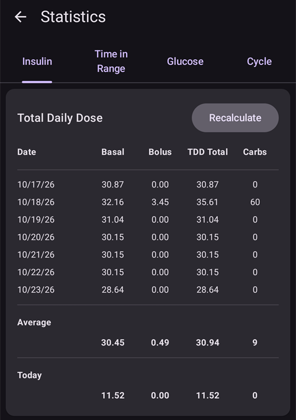
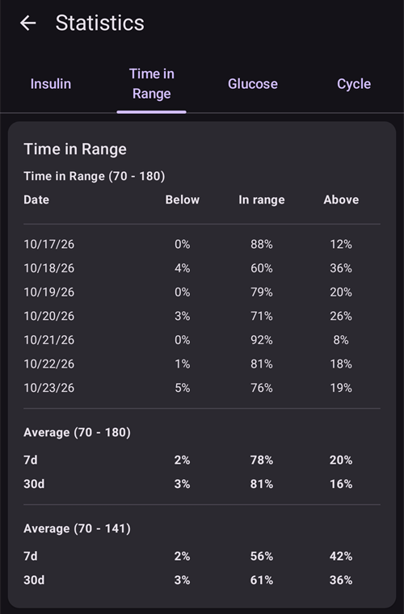
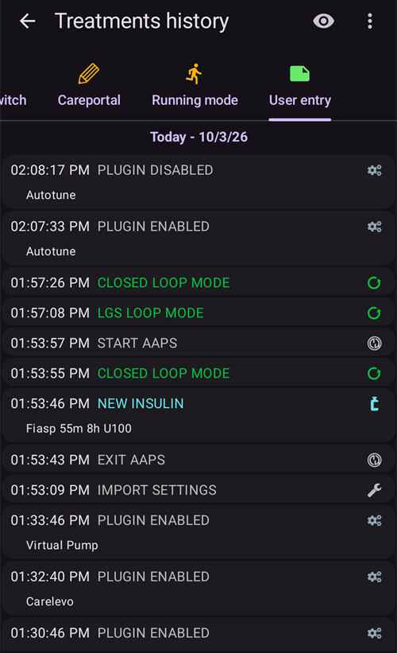

# Έλεγχος των δεδομένων σας

## Εξερεύνηση ιστορικού του AAPS

Το **AAPS** κρατά όλο το ιστορικό σας (**γλυκόζη αίματος (BG)**, θεραπείες, βασικός ρυθμός, στόχοι, **Αλλαγή Προφίλ**, …) σε μια τοπική βάση δεδομένων στο τηλέφωνο. Αυτή η βάση δεδομένων δεν είναι μέρος της [εξαγωγής ρυθμίσεων](../Maintenance/ExportImportSettings.md). Μπορείτε να την ελέγξετε μέσα στο ίδιο το **AAPS** με την **Εξερεύνηση ιστορικού** και την οθόνη **Στατιστικά** που περιγράφονται παρακάτω. Για μακροχρόνιους ελέγχους και αναφορές, ανεβάστε τα δεδομένα σας στο [Nightscout](../SettingUpAaps/Nightscout.md) ή στο [Tidepool](../SettingUpAaps/Tidepool.md).

Το ιστορικό του **AAPS** μπορεί να ελεγχθεί στην **Εξερεύνηση ιστορικού**: ανοίξτε το **μενού** (☰) και επιλέξτε **Εξερεύνηση ιστορικού**.

- Πατήστε την **κάρτα ημερομηνίας** για να διαλέξετε την ημέρα που θέλετε να ελέγξετε.
- Τα γραφήματα ανοίγουν με σμίκρυνση, ώστε να δείχνουν **ολόκληρη την επιλεγμένη ημέρα**. Κάντε τσίμπημα με δύο δάχτυλα για να μεγεθύνετε ένα μέρος της.
- Χρησιμοποιήστε τα βέλη **<** και **>** για να πάτε μία ημέρα πίσω ή μπροστά και το **Τώρα** για να επιστρέψετε στην τρέχουσα ημέρα.
- Τα γραφήματα δείχνουν τα ίδια δεδομένα με τα γραφήματα της κύριας οθόνης (BG, θεραπείες, βασικός ρυθμός, IOB, COB, δράση, αποκλίσεις...).

(reviewing-statistics)=
## Στατιστικά του AAPS

Το **AAPS** παρέχει βασικά στατιστικά παρακολούθησης.

Οι περισσότερες τιμές βασίζονται στις [συστάσεις](https://diabetesjournals.org/care/article/46/Supplement_1/S97/148053/6-Glycemic-Targets-Standards-of-Care-in-Diabetes) της ADA 2023.

Για να τα ανοίξετε, ανοίξτε το **μενού** (☰) και επιλέξτε **Στατιστικά**.

Η οθόνη **Στατιστικά** έχει τέσσερις καρτέλες: **Ινσουλίνη**, **Χρόνος εντός στόχου**, **Γλυκόζη** και **Κύκλος**. Πατήστε μια καρτέλα ή σύρετε αριστερά ή δεξιά για να πάτε από τη μία στην άλλη.

(reviewing-tdd)=
### Καρτέλα Ινσουλίνη: Συνολική ημερήσια δόση

Η κάρτα **Συνολική ημερήσια δόση** δείχνει μία γραμμή για κάθε προηγούμενη ημέρα (έως μία εβδομάδα) για την οποία το **AAPS** έχει δεδομένα ινσουλίνης, μετά τη **Μέση** τιμή τους και μετά το **Σήμερα** μέχρι τώρα. Αμέσως μετά την εγκατάσταση του **AAPS**, εμφανίζεται μόνο το **Σήμερα**. Οι στήλες είναι:

- **Βασικός Ρυθμός**: μόνο ο βασικός ρυθμός.
- **Bolus**: το άθροισμα των bolus και των SMB.
- **TDD σύνολο**: η συνολική ημερήσια δόση ινσουλίνης (**TDD**), το άθροισμα της ινσουλίνης bolus και βασικού ρυθμού που χορηγήθηκε μέσα στην ημέρα.
- **Υδατάνθρακες**: οι υδατάνθρακες και τα eCarbs που καταχωρήθηκαν.

Το τμήμα **TDD** υπολογίζεται όταν ανοίγετε τη σελίδα και ο υπολογισμός διαρκεί λίγα δευτερόλεπτα. Πατήστε **Επανυπολογισμός** για να γίνει ξανά ο υπολογισμός.

Η **TDD** είναι η ινσουλίνη bolus και βασικού ρυθμού ανά ημέρα. Κάποιοι γιατροί χρησιμοποιούν - ειδικά για όσους ξεκινούν με αντλία - αναλογία βασικού ρυθμού προς bolus 50:50: τότε ο συνολικός βασικός ρυθμός (**TBB**, το άθροισμα των βασικών ρυθμών σας σε 24 ώρες) πρέπει να είναι περίπου το μισό της TDD. Άλλοι προτιμούν TBB από 32 % έως 37 % της TDD.

Όπως οι περισσότεροι πρακτικοί κανόνες, αυτός έχει περιορισμένη πραγματική αξία. Ο διαβήτης σας μπορεί να είναι διαφορετικός!

### Καρτέλα Χρόνος εντός στόχου

Χρόνος εντός στόχου (**TIR**): 70-180 mg/dl ή 3,9-10 mmol/l.

Οι πληροφορίες **TIR** είναι διαθέσιμες για 7 και 30 ημέρες, ανάλογα με το πόσα δεδομένα υπάρχουν στη βάση δεδομένων του **AAPS**.

Τα στατιστικά για τον χρόνο εντός στενού στόχου (TITR) 70-140 mg/dl ή 3,9-7,8 mmol/l είναι διαθέσιμα παρακάτω (η οθόνη δείχνει αυτό το εύρος ως 70-141).

**Συζητήστε τους στόχους με τον ενδοκρινολόγο σας**

Ο διαβήτης σας μπορεί να είναι διαφορετικός. Κάθε προτεινόμενος στόχος πρέπει να συζητηθεί με τον ενδοκρινολόγο σας ή με την ιατρική ομάδα που σας υποστηρίζει. Αν χρησιμοποιούνται σωστά, τα στατιστικά του AAPS μπορούν να είναι ένα χρήσιμο εργαλείο για να παρακολουθείτε τις τάσεις της __γλυκόζης αίματος (BG)__ και την πρόοδό σας.

Παρακάτω, η κάρτα **Dexcom TIR** δείχνει αναλυτικά στατιστικά **TIR** για 14 ημέρες.

**SD**: τυπική απόκλιση, ένας [δείκτης](https://www.ncbi.nlm.nih.gov/pmc/articles/PMC3125941/) της διακύμανσης της γλυκόζης (η υψηλότερη τιμή = η χειρότερη).

HbA1c: η εκτίμηση της γλυκοζυλιωμένης αιμοσφαιρίνης, με βάση τον μέσο όρο των μετρήσεων του CGM. Είναι μια ενδεικτική τιμή και μπορεί να μην ταιριάζει με τις εξετάσεις HbA1c αίματος.

(reviewing-statistics-agp)=
### Καρτέλα Γλυκόζη: Περιπατητικό προφίλ γλυκόζης (AGP)

Το **Περιπατητικό προφίλ γλυκόζης** (**AGP**) δείχνει πώς κινείται συνήθως η γλυκόζη σας μέσα στην ημέρα. Επιλέξτε την περίοδο με τα κουμπιά στο πάνω μέρος: **Σήμερα**, **24ώ**, **7ημ**, **30ημ** ή **90ημ**.

- **Το γράφημα**: μία ημέρα από μεσάνυχτα σε μεσάνυχτα. Η γραμμή είναι ο **Διάμεσος** (οι μισές μετρήσεις σας εκείνη την ώρα ήταν χαμηλότερες και οι μισές υψηλότερες). Γύρω της, μια ζώνη περιέχει το μεσαίο μισό των μετρήσεών σας (**25–75%**) και μια πιο φαρδιά ζώνη τις περισσότερες από αυτές (**10–90%**). Μια στενή ζώνη σημαίνει ότι η γλυκόζη σας είναι παρόμοια από μέρα σε μέρα εκείνη την ώρα. Οι διακεκομμένες γραμμές δείχνουν το **ΧΑΜΗΛΟ σημείο**, τα 140 mg/dl (7,8 mmol/l) και το **ΥΨΗΛΟ σημείο** σας.
- **Γλυκαιμική επισκόπηση**: ο χρόνος μέσα στο εύρος σας, μέσα στο στενό εύρος (70–140 mg/dl ή 3,9–7,8 mmol/l), πάνω και κάτω από το εύρος σας, και μετά ο **Μέσος όρος** και ο **Διάμεσος** της γλυκόζης σας. Το εύρος σας είναι το **ΧΑΜΗΛΟ σημείο** και το **ΥΨΗΛΟ σημείο** που ορίζονται στο [Εύρος εμφάνισης](#Preferences-range-for-visualization).
- **eA1c** και **GMI**: δύο εκτιμήσεις της HbA1c που υπολογίζονται από τις μετρήσεις του CGM σας. Όπως η HbA1c παραπάνω, μπορεί να μην ταιριάζουν με τις εξετάσεις HbA1c αίματος.
- **SD** (τυπική απόκλιση) και **CV** (συντελεστής μεταβλητότητας): πόσο μεταβάλλεται η γλυκόζη σας. Μια χαμηλότερη τιμή σημαίνει πιο σταθερή γλυκόζη.
- **Ημέρες**: πόσες ημέρες δεδομένων CGM χρησιμοποιήθηκαν.

 

Κάτω από το AGP, η κάρτα **Πεντάγωνο γλυκόζης (CGP)** δείχνει πέντε μετρήσεις της γλυκόζης σας των τελευταίων 14 ημερών ως πεντάγωνο. Ένα μικρότερο πεντάγωνο σημαίνει καλύτερο έλεγχο της γλυκόζης.

### Καρτέλα Κύκλος: Κυκλικό μοτίβο TDD

Το **Κυκλικό μοτίβο TDD** δείχνει τις ημερήσιες ποσότητες ινσουλίνης σας τη μία πάνω στην άλλη σε κύκλους 28 ημερών, για να σας βοηθήσει να βρείτε μοτίβα που επαναλαμβάνονται. Κάθε κύκλος σχεδιάζεται ως γραμμή (**Μεμονωμένοι κύκλοι**), μαζί με τον μέσο όρο τους.

- **Ακατέργαστο TDD** / **Καθαρό TDD**: επιλέξτε τη συνολική ημερήσια δόση όπως χορηγήθηκε ή την TDD χωρίς την ινσουλίνη για τους υδατάνθρακες.
- **Μετατόπιση κύκλου**: μετακινεί την αρχή του κύκλου (0 έως 27 ημέρες).

Χρειάζονται τουλάχιστον 56 ημέρες δεδομένων (2 κύκλοι). Με λιγότερα δεδομένα, η κάρτα δείχνει **Δεν υπάρχουν αρκετά δεδομένα (χρειάζονται τουλάχιστον 56 ημέρες για 2 κύκλους)**. Το μοτίβο υπολογίζεται μόνο όταν ανοίγετε την καρτέλα **Κύκλος**, γιατί διαβάζει δεδομένα 168 ημερών.

(aaps-screens-treatments)=
## Ιστορικό θεραπειών

Ανοίξτε το **μενού** (☰) πάνω αριστερά στην κύρια οθόνη και επιλέξτε **Ιστορικό θεραπειών**. Σε αυτή την προβολή μπορείτε να δείτε και να αλλάξετε το ιστορικό των παρακάτω θεραπειών, καθεμία στη δική της καρτέλα (σύρετε τη σειρά καρτελών για να τις δείτε όλες):

* Υδατάνθρακες και bolus
* [Εκτεταμένο bolus](#Extended-Carbs-extended-bolus-and-switch-to-open-loop-dana-and-insight-pump-only)
* Προσωρινός βασικός ρυθμός
* [Προσωρινός στόχος](../DailyLifeWithAaps/TempTargets.md)
* [Αλλαγή Προφίλ](../DailyLifeWithAaps/ProfileSwitch-ProfilePercentage.md)
* Careportal: σημειώσεις και καταχωρήσεις careportal
* Τρόπος λειτουργίας: ιστορικό της κατάστασης του κυκλώματος
* Καταχώρηση χρήστη: άλλες σημειώσεις που δεν στέλνονται στο Nightscout

Στο τέλος κάθε γραμμής, μικρά εικονίδια δείχνουν από πού προέρχονται τα δεδομένα ή πού έχουν σταλεί:
* Εικονίδιο **Nightscout** (το λογότυπο του Nightscout): τα δεδομένα προέρχονται από το Nightscout ή έχουν καταγραφεί στο Nightscout
* Εικονίδιο **αντλίας**: τα δεδομένα προέρχονται από το ιστορικό της αντλίας (έχουν επεξεργαστεί από την αντλία)
* Εικονίδιο **κάδου**: η καταχώρηση έχει διαγραφεί (εμφανίζεται μόνο όταν εμφανίζετε τις διαγραμμένες καταχωρήσεις με το εικονίδιο **ματιού** πάνω δεξιά)

(screens-bolus-carbs)=
### Υδατάνθρακες και bolus

Σε αυτή την καρτέλα μπορείτε να δείτε το ιστορικό bolus και υδατανθράκων. Κάθε bolus (γραμμή **1**) δείχνει το IOB που απομένει από αυτό δίπλα στην ποσότητα ινσουλίνης. Η προέλευση του bolus μπορεί να είναι:
* Γεύμα (καταχωρημένο χειροκίνητα με τα κουμπιά Ινσουλίνη, Γρήγορος Οδηγός ή Οδηγός Bolus)
* SMB, όταν χρησιμοποιείτε τη λειτουργία SMB

Οι καταχωρήσεις υδατανθράκων (γραμμή **2**) εμφανίζονται με την ποσότητά τους σε γραμμάρια.

Αν χρησιμοποιήσατε τον [Οδηγό Bolus](#aaps-screens-bolus-wizard) για να υπολογίσετε τη δόση ινσουλίνης, μπορείτε να πατήσετε το κείμενο «Υπολογ» στη γραμμή του bolus για να δείτε πώς υπολογίστηκε το bolus.

Ανάλογα με την αντλία, η ινσουλίνη και οι υδατάνθρακες μπορεί να εμφανίζονται σε μία γραμμή ή σε πολλές γραμμές: μία για τις λεπτομέρειες του υπολογισμού, μία για τους υδατάνθρακες και μία για το ίδιο το bolus.

Το Ιστορικό θεραπειών μπορεί να χρησιμοποιηθεί για να διορθώσετε λάθος καταχωρήσεις υδατανθράκων (_π.χ._ υπερεκτιμήσατε ή υποεκτιμήσατε τους υδατάνθρακες). Σημειώστε ότι δεν μπορείτε να αλλάξετε μια υπάρχουσα καταχώρηση. Πρέπει να ακολουθήσετε την παρακάτω διαδικασία:

1. Ελέγξτε και θυμηθείτε τα τρέχοντα COB και IOB στην κύρια οθόνη.
2. Ανάλογα με την αντλία, οι υδατάνθρακες μπορεί να εμφανίζονται μαζί με την ινσουλίνη σε μία γραμμή ή ως ξεχωριστή καταχώρηση (π.χ. με το Dana RS).
3. Διαγράψτε την καταχώρηση με τη λάθος ποσότητα υδατανθράκων: πατήστε το εικονίδιο του κάδου, επιλέξτε τις γραμμές που θέλετε να διαγράψετε και μετά πατήστε ξανά το εικονίδιο του κάδου για να ολοκληρώσετε.
4. Βεβαιωθείτε ότι οι υδατάνθρακες διαγράφηκαν σωστά, ελέγχοντας ξανά το COB στην κύρια οθόνη.
5. Κάντε το ίδιο για το IOB αν υπάρχει μόνο μία γραμμή με υδατάνθρακες και ινσουλίνη.

   → Αν οι υδατάνθρακες δεν διαγραφούν όπως πρέπει και προσθέσετε επιπλέον υδατάνθρακες όπως εξηγείται εδώ (6.), το COB θα είναι πολύ υψηλό και αυτό μπορεί να οδηγήσει σε υπερβολική χορήγηση ινσουλίνης.

6. Καταχωρήστε ξανά τη σωστή ποσότητα υδατανθράκων (**Θεραπείες → Υδατάνθρακες** στην κάτω γραμμή πλοήγησης ή ένα κουμπί **Υδατάνθρακες** του [QuickLaunch](#quicklaunch)) και βεβαιωθείτε ότι ορίσατε τη σωστή ώρα του συμβάντος.
7. Αν υπάρχει μόνο μία γραμμή με υδατάνθρακες και ινσουλίνη, πρέπει να προσθέσετε και την ποσότητα ινσουλίνης. Βεβαιωθείτε ότι ορίσατε τη σωστή ώρα του συμβάντος και ελέγξτε το IOB στην κύρια οθόνη αφού επιβεβαιώσετε τη νέα καταχώρηση.

### Προσωρινός βασικός ρυθμός

Οι **προσωρινοί βασικοί ρυθμοί** που εφαρμόστηκαν από το κύκλωμα εμφανίζονται εδώ. Όταν μια καταχώρηση έχει ακόμη επίδραση στο IOB, η πληροφορία εμφανίζεται δίπλα στον ρυθμό (γραμμή **1**). Μπορεί να είναι:
* Θετικό IOB, αν ο προσωρινός βασικός ρυθμός ήταν υψηλότερος από αυτόν που ορίζει το προφίλ
* Αρνητικό IOB για μηδενικό προσωρινό ρυθμό (όπως στη γραμμή **1**) ή αν ο προσωρινός βασικός ρυθμός ήταν χαμηλότερος από αυτόν που ορίζει το προφίλ

Η διαγραφή των καταχωρήσεων επηρεάζει μόνο τις αναφορές σας στο Nightscout και πιθανότατα θα αλλοιώσει το πραγματικό σας IOB - δεν συνιστάται.

Στα αριστερά μιας γραμμής, ένα κόκκινο S σημαίνει «Αναστολή»: συμβαίνει όταν ο βασικός ρυθμός δεν χορηγείται εκείνη τη στιγμή. Αυτό είναι φυσιολογικό, για παράδειγμα κατά την αλλαγή ενός pod.

### Προσωρινός στόχος

Εδώ μπορείτε να δείτε το ιστορικό των προσωρινών στόχων.

### Αλλαγή Προφίλ

Εδώ μπορείτε να δείτε το ιστορικό των αλλαγών προφίλ. Μπορεί να δείτε πολλές καταχωρήσεις κάθε φορά που αλλάζετε προφίλ: η γραμμή **1**, αποθηκευμένη και στο NS και στο ιστορικό της αντλίας, αντιστοιχεί στην πραγματική αλλαγή. Η γραμμή **2**, αποθηκευμένη στο Nightscout αλλά όχι στο ιστορικό της αντλίας, αντιστοιχεί στο αίτημα αλλαγής προφίλ που έκανε ο χρήστης.

Η διαγραφή των καταχωρήσεων επηρεάζει μόνο τις αναφορές σας στο Nightscout και δεν αλλάζει ποτέ το τρέχον προφίλ.

Μπορείτε να χρησιμοποιήσετε το κουμπί **Κλώνος** στη γραμμή **2** για να δημιουργήσετε ένα αντίγραφο μιας **Αλλαγής Προφίλ**. Δείτε [Το προφίλ σας στο AAPS > Διαχείριση των προφίλ σας](#your-aaps-profile-clone-profile-switch) για περισσότερες πληροφορίες.

### Careportal

Αυτή η καρτέλα δείχνει όλες τις σημειώσεις και τις καταχωρήσεις careportal που έχουν καταγραφεί στο Nightscout.

(AapsScreens-running-mode)= (aaps-screens-running-mode)=
### Τρόπος λειτουργίας

Αυτή η καρτέλα δείχνει το ιστορικό των αλλαγών της [κατάστασης του κυκλώματος](#AapsScreens-loop-status): ανοιχτό, κλειστό, LGS, αναστολή, αποσύνδεση.

### Καταχώρηση χρήστη

Αυτή η καρτέλα δείχνει τις ενέργειες που έγιναν στο **AAPS** από τον χρήστη ή από έναν **Αυτοματισμό** (αλλαγές τρόπου λειτουργίας κυκλώματος, αλλαγές προφίλ, θεραπείες, εξαγωγές ρυθμίσεων...). Αυτές οι καταχωρήσεις δεν στέλνονται στο Nightscout.

------

## Ποια είναι η διαφορά ανάμεσα στο Nightscout και στο Tidepool;

Το Nightscout μπορεί να αποθηκεύει τα δεδομένα του **AAPS** του χρήστη και προσφέρει μεγάλη ποικιλία από [εργαλεία αναφορών](https://nightscout.github.io/nightscout/reports/).

Το Tidepool, από την άλλη, επιτρέπει στον χρήστη να [ελέγχει τα δεδομένα του](https://www.tidepool.org/viewing-your-data) και προσφέρει [απλή κοινή χρήση με την ιατρική σας ομάδα](https://www.tidepool.org/providers/how-it-works#tidepool-data-platform).