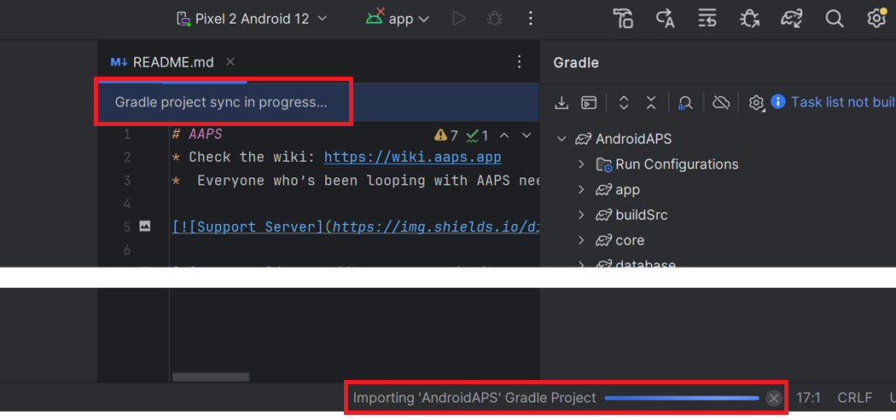

# Ενημέρωση στο AAPS 3.2.0.4

(update-aaps-3204)=

## Φτιάξτε το μόνοι σας, αντί να το κατεβάσετε

**Η εφαρμογή AAPS (ένα αρχείο apk) δεν είναι διαθέσιμη για λήψη, λόγω των κανονισμών για τις ιατρικές συσκευές. Είναι νόμιμο να κάνετε build της εφαρμογής για δική σας χρήση, αλλά δεν πρέπει να δίνετε αντίγραφο σε άλλους!**

Δείτε τη σελίδα [Συχνές Ερωτήσεις](../UsefulLinks/FAQ.md) για λεπτομέρειες.

## Προδιαγραφές υπολογιστή και λογισμικού για το build του AAPS 3.2.0.4

* Για το build του apk μπορεί να χρειάζεται μια συγκεκριμένη έκδοση του **[Android Studio](https://developer.android.com/studio/)**.

| Έκδοση AAPS             | Προτεινόμενη<br/>έκδοση<br/>Android Studio | Εναλλακτική<br/>έκδοση<br/>Android Studio | Gradle | JVM |
| ----------------------- | ------------------------------------------------------ | ----------------------------------------------------- | ------ |:--- |
| [3.2.0.4](#version3200) | Hedgehog (2023.1.1)                                    | έως Meerkat                                           | 8.2    | 17  |

Η «προτεινόμενη έκδοση» περιέχει ήδη την κατάλληλη έκδοση JVM. Η προτεινόμενη έκδοση είναι επίσης η ελάχιστη έκδοση που μπορείτε να χρησιμοποιήσετε για το build του **AAPS**. **ΔΕΝ** θα μπορείτε να κάνετε build με έκδοση παλαιότερη από την «προτεινόμενη». Αν χρησιμοποιείτε άλλη έκδοση, μπορεί να έχετε προβλήματα που σχετίζονται με την έκδοση του JVM. Δείτε τη σελίδα [Αντιμετώπιση προβλημάτων του Android Studio](#incompatible-gradle-jvm) για να λύσετε αυτά τα προβλήματα. Αν η τρέχουσα έκδοση του Android Studio δεν υπάρχει στον πίνακα, πρέπει πρώτα να την ενημερώσετε.

Η έκδοση του Gradle συνδέεται με τον πηγαίο κώδικα. Θα παίρνετε πάντα τη σωστή έκδοση του Gradle όταν κατεβάζετε / ενημερώνετε τον πηγαίο κώδικα. Αναφέρεται εδώ μόνο για πληροφόρηση. Δεν χρειάζεται να κάνετε κάτι γι' αυτό.

* Τα [συστήματα Windows 32-bit](#troubleshooting_androidstudio-unable-to-start-daemon-process) δεν υποστηρίζονται από το Android Studio. Να θυμάστε ότι **και CPU 64 bit και λειτουργικό σύστημα 64 bit είναι υποχρεωτική προϋπόθεση.** Αν το σύστημά σας ΔΕΝ πληροί αυτή την προϋπόθεση, πρέπει να αλλάξετε το υλικό ή το λογισμικό που δεν την πληροί ή όλο το σύστημα.

<table class="tg">
<tbody>
  <tr>
    <th class="tg-baqh">Λειτουργικό σύστημα (μόνο 64 bit)</th>
    <td class="tg-baqh">Windows 8 ή νεότερα</td>
    <td class="tg-baqh">Mac OS 10.14 ή νεότερο</td>
    <td class="tg-baqh">Οποιοδήποτε Linux που υποστηρίζει Gnome, KDE ή Unity DE,&nbsp;&nbsp;GNU C Library 2.31 ή νεότερη</td>
  </tr>
  <tr>
    <th class="tg-baqh"><p align="center">CPU (μόνο 64 bit)</th>
    <td class="tg-baqh">Αρχιτεκτονική CPU x86_64, Intel Core 2ης γενιάς ή νεότερο, ή CPU AMD με υποστήριξη για <br><a href="https://developer.android.com/studio/run/emulator-acceleration#vm-windows" target="_blank" rel="noopener noreferrer"><span style="text-decoration:var(--devsite-link-text-decoration,none)">Windows Hypervisor</span></a></td>
    <td class="tg-baqh">Chip με αρχιτεκτονική ARM, ή Intel Core 2ης γενιάς ή νεότερο με υποστήριξη για <br><a href="https://developer.android.com/studio/run/emulator-acceleration#vm-mac" target="_blank" rel="noopener noreferrer"><span style="text-decoration:var(--devsite-link-text-decoration,none)">Hypervisor.Framework</span></a></td>
    <td class="tg-baqh">Αρχιτεκτονική CPU x86_64, Intel Core 2ης γενιάς ή νεότερο, ή επεξεργαστής AMD με υποστήριξη για AMD Virtualization (AMD-V) και SSSE3</td>
  </tr>
  <tr>
    <th class="tg-baqh"><p align="center">RAM</th>
    <td class="tg-baqh" colspan="3"><p align="center">8GB ή περισσότερο</td>
  </tr>
  <tr>
    <th class="tg-baqh"><p align="center">Δίσκος</th>
    <td class="tg-baqh" colspan="3"><p align="center">Τουλάχιστον 30GB ελεύθερος χώρος. Συνιστάται SSD.</td>
  </tr>
  <tr>
    <th class="tg-baqh"><p align="center">Ανάλυση οθόνης</th>
    <td class="tg-baqh" colspan="3"><p align="center">1280 x 800 τουλάχιστον<br></td>
  </tr>
  <tr>
    <th class="tg-baqh"><p align="center">Internet</th>
    <td class="tg-baqh" colspan="3"><p align="center">Ευρυζωνική σύνδεση</td>
  </tr>
</tbody>
</table>

**Συνιστάται έντονα (δεν είναι υποχρεωτικό) να χρησιμοποιείτε SSD (Solid State Disk) αντί για HDD (Hard Disk Drive), γιατί το build του αρχείου apk του AAPS θα διαρκεί λιγότερο.**  Μπορείτε όμως να χρησιμοποιήσετε και HDD για το build του αρχείου apk του **AAPS**. Αν το κάνετε, το build μπορεί να διαρκέσει πολύ. Όμως, όταν ξεκινήσει, μπορείτε να το αφήσετε να τρέχει χωρίς επίβλεψη.

## Βοήθεια και υποστήριξη κατά το build της 3.2.0.4

Αν έχετε δυσκολίες κατά το build της εφαρμογής **AAPS**, υπάρχει ειδική ενότητα [**αντιμετώπισης προβλημάτων του Android Studio**](https://androidaps.readthedocs.io/en/3.2/GettingHelp/TroubleshootingAndroidStudio.html). Διαβάστε την πρώτα.

Αν πιστεύετε ότι κάτι στις οδηγίες build είναι λάθος, λείπει ή δεν είναι σαφές, ή αν συνεχίζετε να έχετε δυσκολίες, επικοινωνήστε με την ομάδα χρηστών του **AAPS** στο [Facebook](https://www.facebook.com/groups/AndroidAPSUsers) ή στο [Discord](https://discord.gg/4fQUWHZ4Mw). Αν θέλετε να αλλάξετε κάτι μόνοι σας (ενημέρωση στιγμιότυπων οθόνης _κ.λπ._), υποβάλετε ένα [pull request (PR)](../SupportingAaps/HowToEditTheDocs.md).

```{note}
Αυτή η σελίδα δείχνει παραδείγματα εικόνων και για το **νέο** (New) και για το παλιό (**Classic**) περιβάλλον χρήσης του Android Studio.
```

## Επισκόπηση της ενημέρωσης από 3.2.0.x σε 3.2.0.4

```{contents} Steps for updating to 3.2.0.4
:depth: 1
:local: true
```

### Εξαγωγή των τρεχουσών ρυθμίσεων

Εξαγάγετε τις ρυθμίσεις από την υπάρχουσα έκδοση του **AAPS** στο τηλέφωνό σας. Ίσως να μην τις χρειαστείτε, αλλά είναι καλύτερα να είστε ασφαλείς.

Δείτε τη σελίδα [Δημιουργία και επαναφορά αντιγράφων ασφαλείας](ExportImportSettings.md), αν δεν θυμάστε πώς γίνεται.

### Ενημέρωση του τοπικού αντιγράφου του AAPS

* Ανοίξτε το υπάρχον έργο (project) του AAPS στο Android Studio. Ίσως χρειαστεί να επιλέξετε το έργο σας. Κάντε (διπλό) κλικ στο έργο του AAPS.


<br>


* Στη γραμμή μενού του Android Studio, επιλέξτε Git -> Fetch


<br>


* Κάτω δεξιά θα δείτε ένα μήνυμα ότι το Fetch έγινε με επιτυχία.


<br>


* Τώρα στη γραμμή μενού επιλέξτε Git -> Pull


<br>


* Αφήστε όλες τις επιλογές όπως είναι (origin/master) και επιλέξτε Pull


<br>


* Περιμένετε όσο γίνεται η λήψη. Θα το βλέπετε ως πληροφορία στην κάτω γραμμή. Όταν τελειώσει, θα δείτε ένα μήνυμα επιτυχίας.

  ```{note}
  Τα αρχεία που ενημερώθηκαν μπορεί να διαφέρουν! Αυτό δεν σημαίνει ότι υπάρχει πρόβλημα.
  ```


<br>


* Θα τρέξει το Gradle Sync για να κατεβάσει κάποιες εξαρτήσεις (dependencies). Περιμένετε μέχρι να τελειώσει.



<br>


### Επιλογή έκδοσης JVM 17

- Ανοίξτε την προβολή Gradle πατώντας τον ελέφαντα (1) στη δεξιά πλευρά του Android Studio, ανοίξτε τις ρυθμίσεις (2) και επιλέξτε **Gradle Settings** (3):


<br>


- Στο πεδίο **Gradle JDK** (1), ελέγξτε αν είναι επιλεγμένη η κατάλληλη έκδοση: **jbr-17**. Αν όχι, κάντε κλικ στο πεδίο και δείτε αν υπάρχει ήδη στη λίστα. Αν δεν υπάρχει στη λίστα (η παρακάτω εικόνα δείχνει έναν υπολογιστή όπου υπάρχει μόνο το **jbr-21**), επιλέξτε **Download JDK...** (2).


- Στο Version (1), επιλέξτε **17**. Στο Vendor (2), επιλέξτε JetBrains Runtime ή οποιονδήποτε Vendor. Location (3): μην το αλλάξετε.


- Κλείστε το παράθυρο **Settings** με **OK**.

### Επιλογή του κλάδου AAPS 3.2.0.4

- Κάτω αριστερά, επιλέξτε το σύμβολο του Git, κάντε δεξί κλικ στο 3.2.0.4 και επιλέξτε Checkout.


<br>


### Συγχρονισμός του έργου με το Gradle

```{admonition} WARNING!
:class: warning
**Μην ενημερώνετε ποτέ το Gradle.** Να το συγχρονίζετε πάντα με το έργο.
```

Για το νέο περιβάλλον χρήσης, χρησιμοποιήστε το εικονίδιο με τον ελέφαντα και το Sync Project with Gradle Files (ή ακολουθήστε [αυτό](#gradle-resync)).


Ή ([αυτό](https://androidaps.readthedocs.io/en/3.2/GettingHelp/TroubleshootingAndroidStudio.html#gradle-resync)) για το κλασικό περιβάλλον χρήσης.


### Build του υπογεγραμμένου APK 3.2.0.4

Ο πηγαίος κώδικάς σας είναι τώρα η τρέχουσα έκδοση που έχει κυκλοφορήσει και όλες οι προϋποθέσεις έχουν ελεγχθεί. Ήρθε η ώρα να κάνετε build του υπογεγραμμένου apk, όπως περιγράφεται στην [ενότητα build υπογεγραμμένου apk](#Building-APK-generate-signed-apk).

### Μεταφορά και εγκατάσταση του APK 3.2.0.4

Πρέπει να μεταφέρετε το apk στο τηλέφωνό σας για να το εγκαταστήσετε.

```{note}
Αν κάνατε το build με το ίδιο υπάρχον keystore στο Android Studio, δεν χρειάζεται να αφαιρέσετε την υπάρχουσα εφαρμογή από το τηλέφωνό σας. Όταν εγκαθιστάτε το apk, ακολουθήστε τις οδηγίες στην οθόνη για να εγκαταστήσετε την ενημέρωση.
Σε άλλες περιπτώσεις, όπως όταν δημιουργείτε νέο keystore στο Android Studio για το υπογεγραμμένο apk, πρέπει να διαγράψετε την παλιά εφαρμογή πριν εγκαταστήσετε το apk. **Μην ξεχάσετε να εξαγάγετε τις ρυθμίσεις σας!**
```

Δείτε τις οδηγίες για τη [μεταφορά και εγκατάσταση του AAPS](../SettingUpAaps/TransferringAndInstallingAaps.md)

### Έλεγχος της έκδοσης AAPS 3.2.0.4 στο τηλέφωνο

Αφού εγκαταστήσετε το νέο apk, μπορείτε να ελέγξετε την έκδοση του AAPS στο τηλέφωνό σας: πατήστε το μενού με τις τρεις τελείες πάνω δεξιά και μετά Σχετικά. Θα πρέπει να δείτε την τρέχουσα έκδοση.

