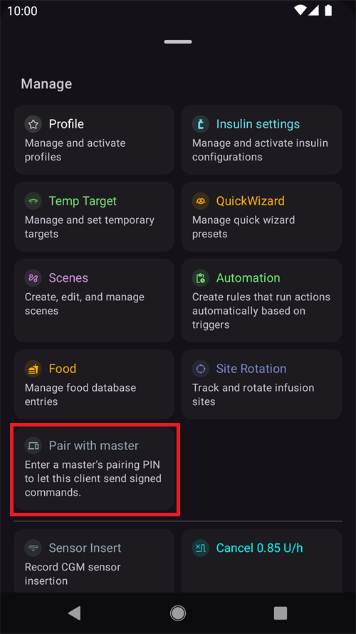

(aapsclient-app)=
# Η εφαρμογή AAPSClient

Το **AAPSClient** είναι η βοηθητική εφαρμογή του **AAPS**: μια συνοδευτική εφαρμογή για ένα δεύτερο τηλέφωνο — συνήθως του φροντιστή — που **παρακολουθεί** το άτομο που χρησιμοποιεί το **AAPS**. Από την έκδοση 4 του **AAPS**, ο φροντιστής μπορεί επίσης να **ελέγχει** το κύκλωμα από απόσταση με υπογεγραμμένες εντολές. Τα δύο τηλέφωνα επικοινωνούν μέσω του ιστότοπου **Nightscout** σας. Δεν χρειάζεται απευθείας σύνδεση μεταξύ των τηλεφώνων.

```{admonition} Wording used on this page
:class: note
- **Client** (πελάτης) = ένα τηλέφωνο με το **AAPSClient**.
- **Master** (κύρια συσκευή) = το κύριο τηλέφωνο με το **AAPS**, που ελέγχει την αντλία και εκτελεί το κύκλωμα.
```

```{admonition} iPhone version in development
:class: note
Το **AAPSClient** λειτουργεί προς το παρόν σε τηλέφωνα Android. Μια έκδοση του **AAPSClient** για iPhone αναπτύσσεται και είναι σε πρώιμες δοκιμές. Δεν έχει κυκλοφορήσει ακόμα: δεν υπάρχει στο App Store και δεν υπάρχει τίποτα για λήψη. Αυτή η σελίδα θα ενημερωθεί όταν γίνει διαθέσιμη.
```

```{contents} Table of contents
:depth: 2
:local: true
```

## Τι είναι (και τι δεν είναι) το AAPSClient

Το **AAPSClient** μοιάζει με το **AAPS** στην εμφάνιση και στη χρήση, αλλά **δεν έχει δικό του κύκλωμα**:

- Δεν περιέχει **αλγόριθμο APS**, ούτε **Βήματα**, ούτε **οδηγούς αντλιών** — δεν χορηγεί ποτέ ινσουλίνη μόνο του.
- Δεν περιλαμβάνονται επίσης τα πρόσθετα που χρησιμοποιεί μόνο η κύρια εφαρμογή (**Επικοινωνία με SMS**, **Tidepool**, **Open Humans**).
- Τι *περιέχει*: συγχρονισμό **NSClientV3**, τα πρόσθετα πηγής BG, εκπομπή δεδομένων στο **xDrip+** και τις συνδέσεις για **Wear OS** / **Garmin** — όλα όσα χρειάζονται για την παρακολούθηση και για τη μεταβίβαση εντολών. Ένα ρολόι **Garmin** συνδεδεμένο σε έναν πελάτη μπορεί να δείχνει τα δεδομένα, αλλά οι υδατάνθρακες που στέλνει δεν καταχωρίζονται και δεν μπορεί να συνδέσει ή να αποσυνδέσει την αντλία: ο πελάτης δείχνει ένα μήνυμα, και τα καταχωρίζετε στο **AAPS**.

Ό,τι ξεκινάτε από το **AAPSClient** ελέγχεται, περιορίζεται στα όρια, επιβεβαιώνεται και **εκτελείται από την κύρια συσκευή** (το τηλέφωνο με την αντλία). Η ειδική σελίδα [Έλεγχος κύριας συσκευής ↔ πελάτη](ClientMasterControl.md) εξηγεί πώς λειτουργεί αυτό: πώς κάνετε σύζευξη των δύο τηλεφώνων, πώς η κύρια συσκευή γράφει το κείμενο επιβεβαίωσης που βλέπετε, πώς χορηγείται ένα bolus που ξεκίνησε στον πελάτη, και τι γίνεται όταν η κύρια συσκευή είναι εκτός σύνδεσης.

## Εκδόσεις: AAPSClient, AAPSClient2 και AAPSClient3

Μέχρι τρεις εφαρμογές πελάτη μπορούν να εγκατασταθούν δίπλα-δίπλα στο ίδιο τηλέφωνο ακολούθου, και η καθεμία παρακολουθεί ένα **διαφορετικό** άτομο: **AAPSClient** (εικονίδιο κίτρινης κουκουβάγιας), **AAPSClient2** (μπλε κουκουβάγια) και — νέο στην έκδοση 4 του **AAPS** — **AAPSClient3** (πράσινη κουκουβάγια). Λειτουργούν ακριβώς με τον ίδιο τρόπο. Διαφέρουν μόνο στο όνομα και στο χρώμα (εικονίδιο εφαρμογής, φόντο του widget και ενότητα κατάστασης στην αρχική οθόνη), ώστε να τις ξεχωρίζετε. Κάθε εφαρμογή έχει σύζευξη με τη δική της κύρια συσκευή. Δείτε [Σχετικά με τα AAPSClient, AAPSClient2 και AAPSClient3](#remotecontrol-aapsclient-versions) για λεπτομέρειες.

## Πώς να αποκτήσετε την εφαρμογή

Το **AAPSClient** το αποκτάτε με τον ίδιο τρόπο όπως το **AAPS** — δείτε [Λήψη και εγκατάσταση του AAPSClient](#RemoteControl_aapsclient) — και το εγκαθιστάτε όπως την κύρια εφαρμογή ([Μεταφορά και εγκατάσταση](../SettingUpAaps/TransferringAndInstallingAaps.md)).

## Πρώτη εκκίνηση: ένας συντομότερος Οδηγός εγκατάστασης

Στην πρώτη εκκίνηση το **AAPSClient** εκτελεί τον ίδιο **Οδηγό εγκατάστασης** που ξέρετε από το **AAPS**, αλλά με πολύ λιγότερα βήματα — σε έναν ακόλουθο δεν ρυθμίζετε προφίλ, ινσουλίνη, αντλία, APS ή Βήματα:

1. **Καλώς ήρθατε**, **άδεια χρήσης**, **Άδειες** και **Κύριος κωδικός** — ίδια με την κύρια εφαρμογή, δείτε [Οδηγός εγκατάστασης του AAPS](../SettingUpAaps/SetupWizard.md).
2. Ο πελάτης **δεν** ζητά **Μονάδες** ή το **χαμηλό/υψηλό σημείο**: τα παίρνει από το κύριο τηλέφωνο μόλις συνδεθεί στο Nightscout. Μπορείτε να τα δείτε αργότερα στις **Ρυθμίσεις**, όπου ένα μικρό **εικονίδιο τηλεφώνου** δείχνει ότι [συγχρονίζονται με το κύριο τηλέφωνο](#client-master-config-prefs). Μπορείτε να τα αλλάξετε μόνο όταν η κύρια συσκευή είναι προσβάσιμη.
3. **Ρύθμιση από την κύρια συσκευή** — στην κύρια συσκευή, ανοίξτε **Διαχείριση → Εξουσιοδοτημένοι πελάτες**, προσθέστε αυτό το τηλέφωνο με **κωδικό QR** και πατήστε εδώ **Σάρωση του κωδικού QR**. Μία σάρωση ρυθμίζει το Nightscout με ένα δικό του διακριτικό για αυτό το τηλέφωνο και, αν ο κωδικός περιέχει σύζευξη, κάνει και τη σύζευξη του τηλεφώνου. Το τηλέφωνο παίρνει επίσης ως όνομα εγκατάστασης το όνομα με το οποίο προστέθηκε στην κύρια συσκευή (τα γράμματα με τόνους ή σημεία γίνονται απλά γράμματα: το «Miloš» γίνεται «Milos»). **Μετά τη σάρωση, η ρύθμιση έχει τελειώσει**: ο οδηγός κλείνει, γιατί τα επόμενα βήματα θα έδειχναν μόνο αυτό που έκανε ήδη ο κωδικός. Χωρίς κωδικό QR, παραλείψτε αυτό το βήμα. (Μόνο Android: ο σαρωτής δεν είναι ακόμα διαθέσιμος στο iOS.)

   

4. **Επικοινωνία** — η λίστα προσθέτων δείχνει μόνο ό,τι χρειάζεται ένας ακόλουθος (NSClientV3, xDrip+, Wear, Εξωτερικές συνοδευτικές εφαρμογές, Garmin). Αν δεν σαρώσατε κωδικό QR, ενεργοποιήστε το **NSClientV3** και εισάγετε την **ίδια Διεύθυνση Nightscout** όπως στο κύριο τηλέφωνο και ένα διακριτικό πρόσβασης (access token), με ενεργοποιημένα τα **websockets** — ακριβώς όπως περιγράφεται στο [Συγχρονισμός](#RemoteControl_aapsclient).

   

5. **Σύζευξη με κύρια συσκευή** — αυτό το βήμα υπάρχει **μόνο** στον πελάτη. Συνδέει αυτή τη συσκευή με την κύρια συσκευή μέσω του ασφαλούς καναλιού εντολών, με το PIN, και παίρνει το όνομα με το οποίο προστέθηκε το τηλέφωνο στην κύρια συσκευή, όπως και με τον κωδικό QR. **Μετά τη σύζευξη, η ρύθμιση έχει τελειώσει.** Μπορείτε επίσης να το παραλείψετε και να κάνετε τη σύζευξη αργότερα, οποιαδήποτε στιγμή, από **Διαχείριση → Σύζευξη με κύρια συσκευή**.

   

6. **Ποιος χρησιμοποιεί αυτό το τηλέφωνο;** — μόνο αν δεν κάνατε σύζευξη στον οδηγό: το όνομα του ατόμου που χρησιμοποιεί αυτό το τηλέφωνο. Ξεχωρίζει αυτή την εγκατάσταση στις αναφορές και στον συγχρονισμό.

(aapsclient-pairing-with-the-master)=

## Σύζευξη με την κύρια συσκευή

Στην **κύρια συσκευή**, ανοίξτε **Διαχείριση → Εξουσιοδοτημένοι πελάτες** και προσθέστε έναν πελάτη. Υπάρχουν δύο τρόποι σύζευξης:

- **Με κωδικό QR** (ο πιο γρήγορος, αν το τηλέφωνο έχει κάμερα): σαρώστε τον κωδικό στο βήμα του οδηγού «**Ρύθμιση από την κύρια συσκευή**» ή από **Διαχείριση → Σύζευξη με κύρια συσκευή → Σάρωση κωδικού QR**, και επιβεβαιώστε με «**Χρήση**». Ρυθμίζει και το Nightscout.
- **Με το PIN**: στον **πελάτη**, ανοίξτε το παραπάνω βήμα του οδηγού (ή **Διαχείριση → Σύζευξη με κύρια συσκευή**), γράψτε το PIN μίας χρήσης που δείχνει η κύρια συσκευή και πατήστε «**Σύζευξη**». Ο πελάτης δείχνει τότε ποια συσκευή πρόκειται να εμπιστευτεί — επιβεβαιώστε με «**Σύζευξη**»:


Από τον οδηγό, μια επιτυχημένη σύζευξη ολοκληρώνει τη ρύθμιση και ανοίγει την αρχική οθόνη. Στην κύρια συσκευή ο πελάτης εμφανίζεται ως **Ενεργός** στη λίστα [Εξουσιοδοτημένοι πελάτες](#client_master_master_setup). Μετά, το **Διαχείριση → Σύζευξη με κύρια συσκευή** δείχνει «*Υπάρχει ήδη σύζευξη*», τον ρόλο του τηλεφώνου και αν η ενισχυμένη λειτουργία είναι ενεργή:

 Η πλήρης διαδικασία σύζευξης, οι λεπτομέρειες ασφαλείας και η αντιμετώπιση προβλημάτων βρίσκονται στη σελίδα [Έλεγχος κύριας συσκευής ↔ πελάτη](#client_master_client_setup).

Μετά τη σύζευξη, ο πελάτης παίρνει από την κύρια συσκευή ένα δικό του διακριτικό Nightscout (αν η κύρια συσκευή έχει admin token), μόνο με τα δικαιώματα που χρειάζεται ένας πελάτης, και σταματά να χρησιμοποιεί το διακριτικό που ίσως είχατε εισάγει. Το **AAPSClient** δεν γράφει ποτέ το ίδιο θεραπείες ή BG στο Nightscout: ό,τι κάνει στέλνεται στην κύρια συσκευή, που το γράφει. Δείτε [Το δικό του διακριτικό Nightscout του πελάτη](#client-master-control-own-token).

Η κύρια συσκευή αποφασίζει τι μπορεί να κάνει αυτό το τηλέφωνο με τον **[ρόλο](#client-master-control-roles)** του (Μόνο ανάγνωση, Γεύματα, Φροντιστής ή Διαχειριστής). Το **Διαχείριση → Σύζευξη με κύρια συσκευή** δείχνει τον ρόλο του τηλεφώνου.

## Η αρχική οθόνη

Η αρχική οθόνη του πελάτη δείχνει το κύκλωμα που παρακολουθεί:


- **BG, γραφήματα, IOB/COB και προφίλ** έρχονται από το Nightscout, όπως ακριβώς τα ανέβασε η κύρια συσκευή.
- Η **κατάσταση κυκλώματος** που φαίνεται είναι **της κύριας συσκευής** (ένας πελάτης δεν έχει δικό του κύκλωμα). Μέχρι ο πελάτης να λάβει από το Nightscout τον τρόπο λειτουργίας της κύριας συσκευής, η ένδειξη τρόπου λειτουργίας δείχνει ένα **ερωτηματικό** (άγνωστο).
- Η **κάρτα κατάστασης** δείχνει τη δεξαμενή και την μπαταρία της **αντλίας που παρακολουθείται** και την μπαταρία του uploader, από την κατάσταση συσκευής (device status) του Nightscout — ένας πελάτης δεν έχει αντλία, οπότε δεν υπάρχει τοπική κατάσταση αντλίας ούτε διαχείριση αντλίας πουθενά στην εφαρμογή.
- Η κάτω γραμμή δίνει **Θεραπείες**, **Σενάρια** και **Διαχείριση** μόλις ο πελάτης έχει σύζευξη (μόνο **Διαχείριση** πριν από τη σύζευξη) — δεν υπάρχουν καρτέλες για αντλία ή Βήματα.

## Θεραπείες και ενέργειες

Όλα στη **Διαχείριση** λειτουργούν όπως στην κύρια εφαρμογή, με μία σημαντική διαφορά: σε έναν πελάτη, οι ενέργειες που θα άλλαζαν τη θεραπεία (bolus, υδατάνθρακες, προσωρινοί στόχοι, σενάρια…) είναι **κρυμμένες μέχρι να γίνει σύζευξη της συσκευής**, και μετά τη σύζευξη **μεταβιβάζονται στην κύρια συσκευή** για επιβεβαίωση και εκτέλεση — δείτε [Χρήση του απομακρυσμένου ελέγχου](#client-master-control).

Η εξαίρεση είναι το **Προφίλ**: φαίνεται ακόμα και σε πελάτη **χωρίς σύζευξη**, αλλά ανοίγει **μόνο για προβολή** — ο πελάτης δείχνει τα προφίλ που λαμβάνει μέσω του Nightscout (τα χρειάζεται για τους δικούς του υπολογισμούς), χωρίς κουμπιά επεξεργασίας ή ενεργοποίησης. Μόλις ο πελάτης έχει **σύζευξη**, η λίστα προφίλ συγχρονίζεται με την κύρια συσκευή και μπορείτε να επεξεργάζεστε και να ενεργοποιείτε προφίλ από τον πελάτη, όπως κάθε άλλη απομακρυσμένη ενέργεια.

Σε πελάτη **χωρίς σύζευξη**, η **Διαχείριση** δίνει μόνο **Προφίλ** και **Σύζευξη με κύρια συσκευή**:


Το κόκκινο πλαίσιο «*Η κύρια συσκευή δεν είναι προσβάσιμη. Η επεξεργασία είναι απενεργοποιημένη μέχρι να αποκατασταθεί η σύνδεση.*» εμφανίζεται και σε πελάτη χωρίς σύζευξη. Αυτό είναι αναμενόμενο: δεν υπάρχει ακόμα κύρια συσκευή για σύνδεση. Το πλαίσιο εξαφανίζεται μόλις ο πελάτης έχει σύζευξη και η κύρια συσκευή είναι συνδεδεμένη.

Μόλις ο πελάτης έχει σύζευξη, εμφανίζονται οι ενέργειες θεραπείας:



Δεν υπάρχει **καταχώριση Αντλία** — ένας πελάτης δεν έχει αντλία.

Αν η κύρια συσκευή δεν είναι προσβάσιμη, το ίδιο πλαίσιο εμφανίζεται και σε πελάτη με σύζευξη: οι ενέργειες θεραπείας είναι γκριζαρισμένες, και ό,τι δοκιμάσετε μπλοκάρεται πριν σταλεί. Ο πελάτης καταλαβαίνει ότι η κύρια συσκευή είναι εκτός σύνδεσης όταν δοκιμάσετε μια ενέργεια, και ενεργοποιεί ξανά τις ενέργειες μόλις η κύρια συσκευή συνδεθεί ξανά.


## Ρυθμίσεις που συγχρονίζονται με την κύρια συσκευή

Η ενεργή **διαμόρφωση** προσθέτων και πολλές **ρυθμίσεις** μένουν συγχρονισμένες μεταξύ της κύριας συσκευής και των πελατών της με σύζευξη. Τα συγχρονισμένα στοιχεία έχουν ένα μικρό **εικονίδιο τηλεφώνου** και είναι απενεργοποιημένα (με το πλαίσιο «*Η κύρια συσκευή δεν είναι προσβάσιμη*») όσο η κύρια συσκευή δεν είναι προσβάσιμη. Αυτό περιγράφεται στο [Αλλαγή διαμόρφωσης και ρυθμίσεων](#client-master-config-prefs).

## Το AAPSClient σε έξυπνο ρολόι

Ένα ρολόι Wear OS μπορεί να συνδεθεί με το τηλέφωνο του **πελάτη**. Οι ενέργειές του μεταβιβάζονται μέσω του πελάτη στην κύρια συσκευή. Δείτε [Wear OS](../WearOS/WearOsSmartwatch.md) και τις [επιλογές για έξυπνα ρολόγια στον Απομακρυσμένο έλεγχο](#RemoteControl_smartwatches).
