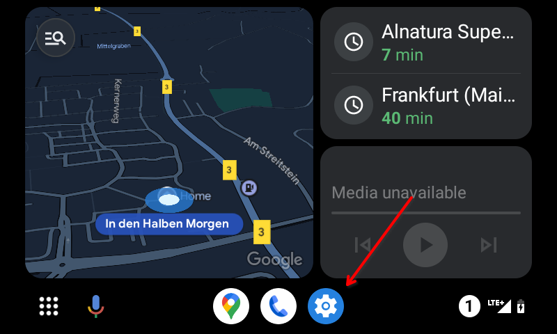
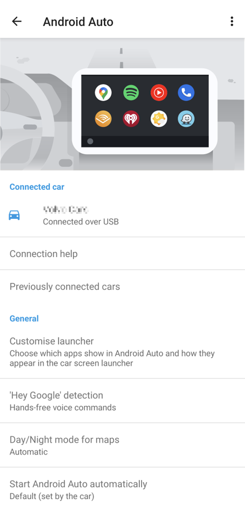
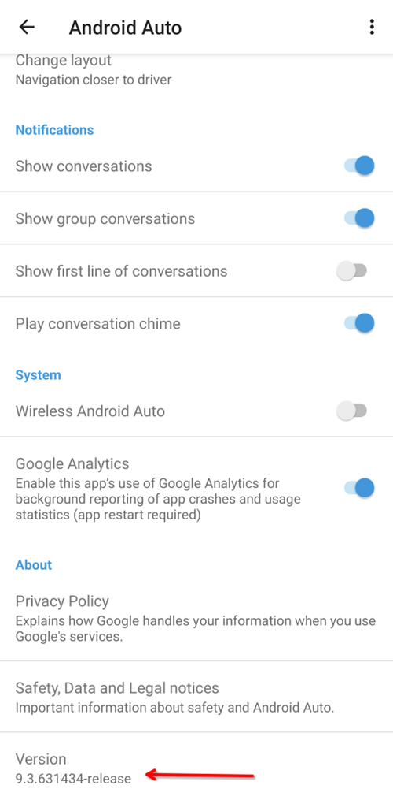

# Android Auto

Το **AAPS** μπορεί να σας στέλνει πληροφορίες για την τρέχουσα κατάστασή σας ως μήνυμα, απευθείας στο Android Auto του αυτοκινήτου σας.

## Απαιτήσεις

**AAPS** uses a feature of Android Auto which allows messages from apps on the mobile to be routed to the display of the car audio system.

Αυτό σημαίνει ότι:

* Το Android πρέπει να επιτρέπει στο **AAPS** να εμφανίζει ειδοποιήσεις και
* Επειδή το **AAPS** είναι ανεπίσημη εφαρμογή, επιτρέψτε τη χρήση «άγνωστων πηγών» στο Android Auto.

(androidauto-check-that-aaps-can-show-notifications)=

## Ελέγξτε ότι το AAPS μπορεί να εμφανίζει ειδοποιήσεις

Το **AAPS** εμφανίζει πάντα μια ειδοποίηση κατάστασης με την τρέχουσα γλυκόζη, το IOB και το COB. Αυτή είναι η ειδοποίηση που δείχνει το Android Auto στο αυτοκίνητο. Δεν χρειάζεται να ενεργοποιήσετε τίποτα στο **AAPS**, αλλά το Android πρέπει να επιτρέπει στο **AAPS** να εμφανίζει ειδοποιήσεις.

Στο τηλέφωνό σας, ανοίξτε **Ρυθμίσεις** > **Εφαρμογές** > **AAPS** > **Ειδοποιήσεις** και βεβαιωθείτε ότι το **Όλες οι ειδοποιήσεις AAPS** είναι ενεργό.

Κάντε κύλιση προς τα κάτω και βεβαιωθείτε ότι το **Τρέχουσα κατάσταση** είναι ενεργό: αυτό είναι το κανάλι της ειδοποίησης κατάστασης.

Ελέγξτε τώρα ότι βλέπετε την ειδοποίηση κατάστασης του **AAPS** στο τηλέφωνο, πριν πάτε στο αυτοκίνητό σας!

(androidauto-allow-the-use-of-unknown-sources-with-android-auto)=

## Επιτρέψτε τη χρήση «άγνωστων πηγών» στο Android Auto.

Επειδή το **AAPS** δεν είναι επίσημη εφαρμογή του Android Auto, οι ειδοποιήσεις πρέπει να ενεργοποιηθούν για «άγνωστες πηγές» στο Android Auto. Αυτό γίνεται με τη λειτουργία προγραμματιστή, που θα σας δείξουμε εδώ.

Go to your car and connect your mobile with the car's audio system.

Τώρα θα δείτε μια οθόνη παρόμοια με αυτήν.

Πατήστε το εικονίδιο **ρυθμίσεων** για να ξεκινήσει η διαμόρφωση.

Κάντε κύλιση μέχρι το τέλος της σελίδας και επιλέξτε **see more in the phone** (δείτε περισσότερα στο τηλέφωνο).

Τώρα θα ενεργοποιήσουμε τη λειτουργία προγραμματιστή στο κινητό.

Η πρώτη οθόνη μοιάζει με αυτήν. Κάντε κύλιση μέχρι το τέλος της σελίδας.

Εκεί βλέπετε την έκδοση του Android Auto. Πατήστε 10 φορές (δέκα) πάνω στην έκδοση του Android Auto. Με αυτόν τον κρυφό συνδυασμό έχετε τώρα ενεργοποιήσει τη λειτουργία προγραμματιστή.

Επιβεβαιώστε ότι θέλετε να ενεργοποιήσετε τη λειτουργία προγραμματιστή στο παράθυρο «Allow development settings?» (Να επιτραπούν οι ρυθμίσεις ανάπτυξης;).

Στις **ρυθμίσεις προγραμματιστή** ενεργοποιήστε τις «Άγνωστες πηγές».

Τώρα μπορείτε να βγείτε από τη λειτουργία προγραμματιστή, αν θέλετε. Πατήστε το μενού με τρία σημεία στην επάνω δεξιά γωνία για να το κάνετε.

## Εμφάνιση ειδοποιήσεων στο αυτοκίνητο

Πατήστε το **εικονίδιο με τον αριθμό** κάτω δεξιά στο Android Auto στο αυτοκίνητό σας.

Τα δεδομένα CGM θα εμφανίζονται ως εξής:

(android-auto-troubleshooting)=

## Αντιμετώπιση προβλημάτων:

* Αν δεν βλέπετε την ειδοποίηση, ελέγξτε αν [επιτρέψατε στο AAPS να εμφανίζει ειδοποιήσεις](#androidauto-check-that-aaps-can-show-notifications) στο Android και αν [το Android Auto έχει δικαίωμα πρόσβασης στις ειδοποιήσεις](#androidauto-allow-the-use-of-unknown-sources-with-android-auto).