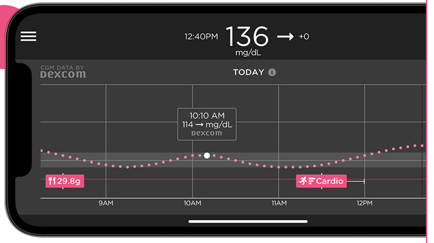

# Παρακολούθηση του AAPS (χωρίς αλληλεπίδραση με το σύστημα AAPS)

Εκτός από τις πολλές δυνατότητες για απομακρυσμένο έλεγχο _και_ παρακολούθηση του **AAPS**, που περιγράφονται στον [απομακρυσμένο έλεγχο](../RemoteFeatures/RemoteControl.md), υπάρχουν αρκετές ακόμη εφαρμογές και συσκευές που έχει φτιάξει η κοινότητα, για να παρακολουθείτε απλώς τις τιμές (επίπεδα γλυκόζης και άλλες πληροφορίες), χωρίς αλληλεπίδραση με το **AAPS**.

Μια καλή επισκόπηση των πολλών επιλογών για την παρακολούθηση του **AAPS** θα βρείτε στη σελίδα [Nightscout follower](https://nightscout.github.io/nightscout/downloaders/#).

```{contents} Table of contents
:depth: 1
:local: true
```

Οι πιο συνηθισμένες λύσεις που χρησιμοποιούνται μαζί με το **AAPS** εξηγούνται αναλυτικά παρακάτω.

## Εφαρμογές για smartphone

```{contents} These are some of the main “follower” apps used by **AAPS** users. All of these apps are “free”: 
:depth: 1
:local: true
```

### Dexcom Follow ([Android](https://play.google.com/store/apps/details?id=com.dexcom.follow.region2.mgdl) και [iOS](https://apps.apple.com/fr/app/dexcom-follow-mg-dl-dxcm2/id1032203080))


* Το Dexcom Follow είναι συμβατό με πολλά τηλέφωνα (Android και iPhone). Το Dexcom Follow μπορεί να χρησιμοποιηθεί ακόμη κι αν δεν χρησιμοποιείτε την επίσημη εφαρμογή της Dexcom για να λαμβάνετε τα δεδομένα του αισθητήρα.

* Πολλοί φροντιστές γνωρίζουν το Dexcom Follow και προτιμούν την καθαρή του εμφάνιση από κάτι πιο περίπλοκο.

* Το Dexcom Follow είναι πολύ καλό για δασκάλους, παππούδες και γιαγιάδες και ανθρώπους που ξέρουν πολύ λίγα για τον διαβήτη και τα επίπεδα γλυκόζης. Έχει συναγερμούς που μπορείτε να προσαρμόσετε (επίπεδο γλυκόζης, ποιος ήχος παίζει κ.λπ.). Οι συναγερμοί μπορούν να απενεργοποιηθούν εντελώς αν χρειάζεται. Αυτό είναι πολύ χρήσιμο αν έχετε έναν αισθητήρα που ακόμη σταθεροποιείται και δίνει πολλές ψεύτικες χαμηλές τιμές.

#### Ρύθμιση του Dexcom Follow: οδηγός

Αν χρησιμοποιείτε την ανεπίσημη εφαρμογή Dexcom BYODA για να λαμβάνετε τα δεδομένα του αισθητήρα, ίσως μπορείτε να στέλνετε προσκλήσεις σε ακόλουθους μέσα από την εφαρμογή BYODA.

Δεν μπορείτε πια να στέλνετε email πρόσκλησης σε ακόλουθους της Dexcom από εφαρμογές τρίτων. Στο xDrip το αίτημα πρόσκλησης θα δώσει μόνο το μήνυμα «invite not sent» (η πρόσκληση δεν στάλθηκε).

Πρέπει να εγκαταστήσετε την επίσημη εφαρμογή της Dexcom, να στείλετε την πρόσκληση και μετά να απεγκαταστήσετε την επίσημη εφαρμογή.

Τα βήματα είναι τα εξής:

1)  Εγκαταστήστε την επίσημη εφαρμογή «Dexcom» σε _οποιοδήποτε_ smartphone (Android/iPhone). Μπορεί να είναι και το τηλέφωνο του ακόλουθου, αν σας βολεύει. 2)  Συνδεθείτε με το όνομα χρήστη και τον κωδικό σας στη Dexcom. Είναι τα ίδια στοιχεία σύνδεσης που χρησιμοποιείτε για το Dexcom Clarity, αν είστε ήδη πελάτης της Dexcom/Clarity. Αν δεν έχετε λογαριασμό Dexcom, σε αυτό το σημείο μπορείτε να δημιουργήσετε έναν νέο.   
3)  Περάστε (σύροντας) τις οθόνες εισαγωγής. 4)  Επιλέξτε «no code» (χωρίς κωδικό) για τον κωδικό του αισθητήρα. 5)  Στο Transmitter SN (σειριακός αριθμός πομπού) επιλέξτε «enter manually» (χειροκίνητη εισαγωγή) και γράψτε έναν οποιονδήποτε έγκυρο κωδικό πομπού. Χρησιμοποιήστε έναν από τους κωδικούς των παλιών πομπών σας, αν ξέρετε κάποιον, ώστε να μην επηρεάσει τη λειτουργία του τωρινού πομπού σας. Οι κωδικοί έχουν συγκεκριμένη μορφή από αριθμούς και γράμματα: «NLNNNL» και χρησιμοποιούν μόνο ορισμένους συνδυασμούς, οπότε είναι πιο εύκολο να χρησιμοποιήσετε έναν που ξέρετε ήδη ότι είναι έγκυρος. 6)  Όταν η εφαρμογή προσπαθεί να βρει τον πομπό και τον αισθητήρα, θα μπορείτε να προσκαλέσετε ακόλουθους (followers): πατήστε τις τρεις μικρές τελείες πάνω αριστερά στην εφαρμογή και προσθέστε νέο ακόλουθο. Μπορείτε να το χρησιμοποιήσετε και όταν ένας ακόλουθός σας έχει αλλάξει τηλέφωνο και χρειάζεται νέα πρόσκληση. Εδώ μπορείτε να τον διαγράψετε από τη λίστα ακολούθων και να στείλετε ξανά email πρόσκλησης για να το χρησιμοποιήσει στο νέο του τηλέφωνο. 7)  Στο τηλέφωνο του ακόλουθου, εγκαταστήστε το Dexcom Follow από το App Store (iPhone) ή το Play (Android). Ρυθμίστε την εφαρμογή Dexcom Follow. Θα σας ζητηθεί να ανοίξετε το email σας για να βρείτε την πρόσκληση να γίνετε ακόλουθος.    
8)  Τώρα μπορείτε να διαγράψετε την επίσημη εφαρμογή Dexcom G6.

Για το Dexcom Follow, τα δεδομένα του αισθητήρα στέλνονται από το τηλέφωνο του **AAPS** είτε απευθείας από το BYODA είτε από το xDrip, ανάλογα με την εφαρμογή που χρησιμοποιείτε.


### [Nightguard](https://apps.apple.com/fr/app/nightguard/id1116430352) (iOS)


Πλεονεκτήματα (σύμφωνα με χρήστες):

* Διαθέσιμο στο [App Store](https://apps.apple.com/us/app/nightguard/id1116430352), με απλή και εύκολη εμφάνιση.

* Σύρετε το κουμπί ή κουνήστε το τηλέφωνο για αναβολή των συναγερμών για διάφορα διαστήματα, από 5 λεπ. έως 24 ώρες

* Προσαρμογή συναγερμών (υψηλή, χαμηλή τιμή, χαμένες μετρήσεις όταν δεν υπάρχουν δεδομένα για 15–45 λεπτά).

* Γρήγορη άνοδος/πτώση σε 2–5 διαδοχικές μετρήσεις (το επιλέγετε εσείς). Μπορείτε επίσης να επιλέξετε τη διαφορά (delta) ανάμεσα σε δύο διαδοχικές μετρήσεις

* Έξυπνη αναβολή, ώστε να μην ειδοποιεί αν τα επίπεδα κινούνται προς τη σωστή κατεύθυνση

* Υπάρχει μια καρτέλα Care που φαίνεται να σας επιτρέπει να ορίσετε νέο προσωρινό στόχο για ορισμένη διάρκεια, να διαγράψετε τον προσωρινό στόχο ή να καταχωρίσετε υδατάνθρακες.

Μειονεκτήματα (σύμφωνα με χρήστες)

* Διαθέσιμο μόνο για iOS

* Ο προσωρινός στόχος (TT) εμφανίζεται ως 5 mmol, όποιο επίπεδο TT κι αν έχει οριστεί

* Δεν δείχνει ποτέ την τιμή του προσωρινού βασικού ρυθμού, αν και δείχνει TB

### [Nightwatch](https://play.google.com/store/apps/details?id=se.cornixit.nightwatch) (Android)


* Το Nightwatch παρουσιάζεται ως πελάτης (client) του Nightscout και παρακολουθεί τα επίπεδα γλυκόζης του χρήστη στο Nightscout σε τηλέφωνο ή tablet Android.

* Η εφαρμογή μπορεί να εγκατασταθεί από το [Google Play](https://play.google.com/store/apps/details?id=se.cornixit.nightwatch) και δείχνει τα δεδομένα γλυκόζης αίματος σε πραγματικό χρόνο.

* Ο χρήστης μπορεί να ειδοποιείται με δυνατούς, προσαρμοσμένους συναγερμούς για χαμηλή και υψηλή τιμή.

* Τα δεδομένα γλυκόζης αίματος εμφανίζονται σε mmol/l ή mg/dl.

* Χρειάζεται Android 5.0 ή νεότερο.

* Έχει σκούρα εμφάνιση, μεγάλες τιμές και κουμπιά, σχεδιασμένα για χρήση τη νύχτα.

### xDrip (Android)

Μπορείτε να χρησιμοποιήσετε το xDrip ως ακόλουθο.

#### Με Nightscout

Ρυθμίστε το xDrip ως Nightscout Follower. Θα λαμβάνετε γλυκόζη αίματος (BG) και θεραπείες, όχι βασικό ρυθμό.


#### Χωρίς Nightscout - πηγή δεδομένων γλυκόζης xDrip

Αν η πηγή δεδομένων του **AAPS** σας είναι το xDrip (ή αν το xDrip μπορεί επίσης να λαμβάνει γλυκόζη από άλλη εφαρμογή, όπως BYODA, Juggluco, ...), μπορείτε να το χρησιμοποιήσετε από το κύριο τηλέφωνο για να μοιράζεστε δεδομένα με ακόλουθους xDrip. Θα βλέπουν γλυκόζη, θεραπείες και βασικούς ρυθμούς.


#### Χωρίς Nightscout - συνοδευτική εφαρμογή γλυκόζης xDrip

Αν η πηγή δεδομένων του **AAPS** σας δεν είναι το xDrip, αλλά μπορείτε να δείχνετε δεδομένα γλυκόζης από την πηγή δεδομένων Companion App, μπορείτε να το χρησιμοποιήσετε από το κύριο τηλέφωνο για να μοιράζεστε δεδομένα με ακόλουθους xDrip. Θα βλέπουν γλυκόζη, θεραπείες και βασικούς ρυθμούς.


### xDrip4iOS (iOS)


xDripSwift was created from porting the original xDrip app to iOS and evolved into "xDrip for iOS", written as **xDrip4iOS**.

```{admonition} Further detail about how to attempt to obtain the original **xDrip4iOS** app
:class: dropdown
Η [ομάδα xDrip4iOS στο Facebook](https://www.facebook.com/groups/853994615056838/announcements) είναι η κύρια κοινότητα υποστήριξης για το xDrip4iOS και το Shuggah. Το **xDrip4iOS** μπορεί να συνδεθεί με πολλά διαφορετικά συστήματα CGM και πομπούς και να δείχνει τιμές γλυκόζης αίματος, γραφήματα και στατιστικά, καθώς και να δίνει συναγερμούς. Μπορεί επίσης να ανεβάζει δεδομένα στο Nightscout ή να λειτουργεί ως [εφαρμογή ακόλουθου για το Nightscout](https://xdrip4ios.readthedocs.io/en/latest/connect/follower/). 

«Πώς μπορώ να αποκτήσω το **xDrip4iOS** στο iPhone μου;»
Υπάρχουν δύο επιλογές:

1. Αν έχετε Mac και λογαριασμό Apple Developer (99 EUR/USD τον χρόνο), μπορείτε να κάνετε build το δικό σας xDrip4iOS [ακολουθώντας τις οδηγίες](https://xdrip4ios.readthedocs.io/en/latest/install/build/).

Αν θέλετε, μπορείτε μετά να γίνετε «releaser» και να [μοιραστείτε ένα προσωπικό Testflight του xDrip4iOS](https://xdrip4ios.readthedocs.io/en/latest/install/personal_testflight/) με έως 100 άλλα άτομα για να τα βοηθήσετε.

2. Γίνετε μέλος της [ομάδας xDrip4iOS στο Facebook](https://www.facebook.com/groups/853994615056838/announcements) και διαβάστε τις καρφιτσωμένες αναρτήσεις για τους τωρινούς τρόπους να αποκτήσετε την εφαρμογή. **Μη ζητάτε πρόσκληση για την εφαρμογή** (διαβάστε τους κανόνες της ομάδας).
```


«Τι είναι το **Shuggah**;» Μια ομάδα Ουκρανών προγραμματιστών αντέγραψε τον κώδικα του xDrip4iOS (που είναι δημόσιος στο GitHub) και τον κυκλοφόρησε στο App Store με επαγγελματικό λογαριασμό. Η έκδοση Shuggah δεν τη διαχειρίζονται με κανέναν τρόπο οι προγραμματιστές του xDrip4iOS.

Η [ομάδα xDrip4iOS στο Facebook](https://www.facebook.com/groups/853994615056838/announcements) υποστηρίζει το xDrip4iOS και τις αντίστοιχες εφαρμογές για Apple Watch.

### [Sugarmate](https://apps.apple.com/fr/app/sugarmate/id1111093108) (iOS)





Το [Sugarmate](https://sugarmate.io/) μπορεί να εγκατασταθεί σε iPhone από το App Store. Το Sugarmate είναι συμβατό με:
* Apple iPhone (χρειάζεται έκδοση λογισμικού 13.0 ή νεότερη)
* Apple iPad (χρειάζεται έκδοση λογισμικού 13.0 ή νεότερη)
* Google Android (αποθηκεύστε την εφαρμογή web στην αρχική σας οθόνη)

Χρήστες του Sugarmate αναφέρουν ότι μπορεί να χρησιμοποιηθεί με το Apple CarPlay στις ΗΠΑ για να δείχνει τις τιμές γλυκόζης όταν οδηγείτε. Δεν είναι ακόμη γνωστό αν αυτό είναι δυνατό σε χώρες εκτός των ΗΠΑ. If you know more about this, please add details in here to the documentation by completing a [pull request](../SupportingAaps/HowToEditTheDocs.md), which is quick and easy to do.


### [Spike](https://spike-app.com/) (iOS)


Το Spike μπορεί να χρησιμοποιηθεί ως κύριος δέκτης ή ως εφαρμογή ακόλουθου και δίνει γλυκόζη αίματος, συναγερμούς, IOB και άλλα.

Ο ιστότοπος και η εφαρμογή δεν αναπτύσσονται πια. Υποστήριξη θα βρείτε στο [Facebook](https://www.facebook.com/groups/1973791946274873) και στο [Gitter](https://gitter.im/SpikeiOS/Lobby).

## Έξυπνα ρολόγια για **παρακολούθηση του AAPS** (πλήρη δεδομένα προφίλ ή μόνο γλυκόζη), όταν το **AAPS** τρέχει σε ένα τηλέφωνο.

Δείτε [εδώ](../Getting-Started/Watches.md).


## Συσκευές για την παρακολούθηση του AAPS

```{contents} Devices include:
:depth: 1
:local: true
```

### M5Stack


Το M5Stack είναι ένα μικρό κουτί που μπορεί να προγραμματιστεί για πολλές εφαρμογές. Το έργο του Martin [M5Stack NightscoutMon](https://github.com/mlukasek/M5_NightscoutMon/wiki) δείχνει τις τιμές γλυκόζης του αισθητήρα και τις τάσεις, το IOB και το COB. Είναι σε ένα πλαστικό κουτί, με έγχρωμη οθόνη, υποδοχή κάρτας micro SD, 3 κουμπιά, ηχείο και εσωτερική μπαταρία. Είναι μια πολύ καλή οθόνη γλυκόζης αίματος και ρυθμίζεται σχετικά εύκολα αν έχετε λογαριασμό Nightscout. Οι χρήστες συνήθως το χρησιμοποιούν με το Wi-Fi του σπιτιού τους, αλλά κάποιοι το χρησιμοποιούν ως οθόνη όταν οδηγούν μοτοσικλέτα, με σύνδεση στο hotspot Wi-Fi του τηλεφώνου.

### SugarPixel

Το SugarPixel είναι μια συσκευή που λειτουργεί ως δεύτερη οθόνη γλυκόζης με συναγερμούς για συνεχή παρακολούθηση γλυκόζης. Συνδέεται με την εφαρμογή Dexcom ή με το Nightscout στο smartphone του χρήστη. Η συσκευή δείχνει τις τιμές γλυκόζης αίματος σε πραγματικό χρόνο. Αυτή η συσκευή παρακολούθησης CGM έχει ηχητικούς συναγερμούς με τυχαίους τόνους (που είναι πάρα πολύ δυνατοί), συναγερμούς με δόνηση για άτομα με προβλήματα ακοής, προσαρμόσιμες επιλογές οθόνης και ενσωματωμένη παρακολούθηση από πολλούς χρήστες.


* Το SugarPixel έχει πολλές επιλογές οθόνης σε mg/dl και mmol/l για τις ανάγκες του χρήστη, με τιμές γλυκόζης σε διαφορετικά χρώματα.
* Η βασική οθόνη δείχνει γλυκόζη αίματος (BG), βέλος τάσης και διαφορά (delta). Η διαφορά (delta) είναι η αλλαγή + ή - από την προηγούμενη μέτρηση.
* Το SugarPixel μπορεί να ρυθμιστεί για χαμηλή φωτεινότητα με την οθόνη BG and Time, ώστε ο χρήστης να βλέπει την τιμή γλυκόζης και την τρέχουσα ώρα στο κομοδίνο του.
* Η χρωματική οθόνη του SugarPixel χρησιμοποιεί όλη την οθόνη για να δείξει ένα χρώμα που αντιστοιχεί στην τιμή γλυκόζης. Έτσι ο χρήστης μπορεί να βλέπει τις τιμές γλυκόζης από απόσταση μέσα από το παράθυρο, όταν παίζει έξω στην αυλή, στη βεράντα ή στην πισίνα.
* Η οθόνη Big BG (μεγάλη τιμή γλυκόζης) είναι χρήσιμη για όσους το έχουν στο κομοδίνο και φορούν γυαλιά ή φακούς επαφής.

### Nightscout Clock στο Ulanzi TC001

Το **Nightscout Clock** είναι λογισμικό ανοιχτού κώδικα που τρέχει στη συσκευή **Ulanzi TC001**. Συνδέεται με τους διακομιστές της Dexcom ή με το Nightscout και δείχνει τις τιμές γλυκόζης αίματος σε πραγματικό χρόνο.


* Το ρολόι υποστηρίζει μονάδες mmol/l και mg/dl και έχει ηχητικούς συναγερμούς.
* Υπάρχουν διάφορες οθόνες. Δείτε το [Github nightscout-clock](https://github.com/ktomy/nightscout-clock?tab=readme-ov-file#more-information-for-people-who-needs-it) για μια επισκόπηση.
* Η ρύθμιση της συσκευής χρειάζεται μόνο λίγα απλά βήματα. Μετά τη ρύθμιση, χρειάζεται μόνο ρεύμα και Wi-Fi για να λειτουργεί.
* Η συσκευή Ulanzi TC001 είναι πολύ φθηνότερη από το SugarPixel.
* Το λογισμικό και οι οδηγίες εγκατάστασης βρίσκονται στο [Github nightscout-clock](https://github.com/ktomy/nightscout-clock?tab=readme-ov-file).
* Το αναπτύσσει και το συντηρεί ο Artiom Kenibasov, που δίνει υποστήριξη στην [ομάδα Facebook AAPS Users](https://www.facebook.com/groups/cgminthecloud/posts/8776932509094594/).

### PC (TeamViewer)
Ορισμένοι χρήστες βρίσκουν χρήσιμο ένα πλήρες εργαλείο απομακρυσμένης πρόσβασης, όπως το [TeamViewer](https://www.teamviewer.com/), για προχωρημένη απομακρυσμένη αντιμετώπιση προβλημάτων.
