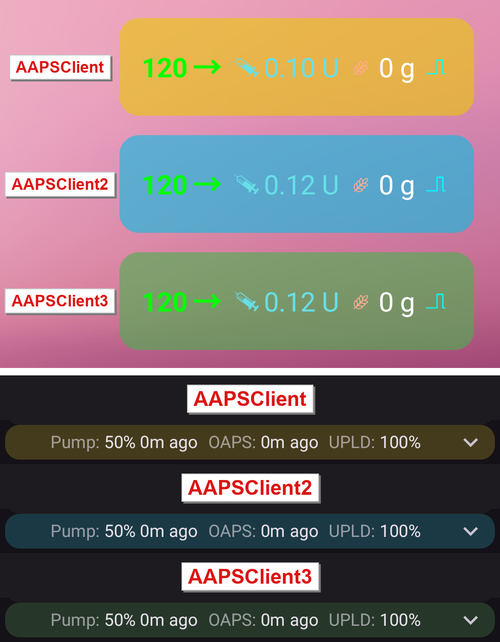
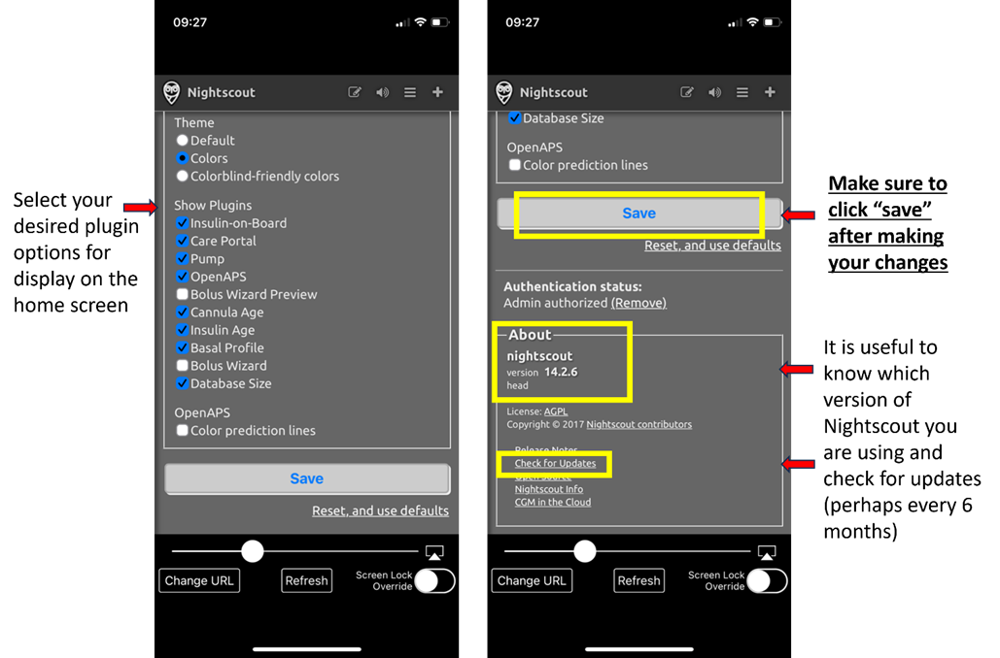

# Απομακρυσμένος έλεγχος του AAPS

```{contents} In this page
:backlinks: entry
:depth: 2
```

Υπάρχουν τέσσερα πολύ αποτελεσματικά εργαλεία για την απομακρυσμένη διαχείριση του **AAPS**:

1) [Εντολές SMS](#RemoteControl_SMS-Commands) (το τηλέφωνο του ακόλουθου μπορεί να είναι Android ή iOS), 2) [AAPSClient](#RemoteControl_aapsclient) (το τηλέφωνο του ακόλουθου είναι Android· μια έκδοση για iPhone είναι υπό ανάπτυξη) 3) [Nightscout](#RemoteControl_nightscout) (Android, iOS ή άλλος υπολογιστής/συσκευή), κυρίως για παρακολούθηση: δείτε τη σημείωση για τον [έλεγχο από πελάτη](#client-master-control) σε εκείνη την ενότητα.  
4) [Έξυπνα ρολόγια](#RemoteControl_smartwatches) (Android)

Τα τρία πρώτα ταιριάζουν κυρίως σε φροντιστές/γονείς, αλλά τα έξυπνα ρολόγια είναι πολύ χρήσιμα για φροντιστές/γονείς **και** για τους ίδιους τους ενήλικες με διαβήτη.


(RemoteControl_SMS-Commands)=

## 1) Εντολές SMS

Δείτε την ειδική σελίδα [Εντολές SMS](../RemoteFeatures/SMSCommands.md).

(RemoteControl_aapsclient)=
## 2) AAPSClient

Το **AAPSClient** μοιάζει πολύ στην εμφάνιση με το ίδιο το **AAPS** και δίνει στον φροντιστή τις ίδιες οθόνες και τα ίδια κουμπιά για να στέλνει εντολές από απόσταση στο **AAPS**:


(remotecontrol-aapsclient-versions)=
### Για τα AAPSClient, AAPSClient2 και AAPSClient3

Υπάρχουν 3 εκδόσεις της εφαρμογής πελάτη: **AAPSClient**, **AAPSClient2** και **AAPSClient3**. Λειτουργούν με τον ίδιο τρόπο. Η μόνη διαφορά είναι ότι μπορούν να εγκατασταθούν μαζί στο ίδιο τηλέφωνο ακόλουθου.

Ένας φροντιστής που παρακολουθεί ένα άτομο χρειάζεται μόνο το **AAPSClient**. Για να παρακολουθείτε και να ελέγχετε από απόσταση ένα δεύτερο άτομο (με δικό του ιστότοπο **Nightscout** και δικό του τηλέφωνο **AAPS**), εγκαταστήστε επίσης το **AAPSClient2**, και το **AAPSClient3** για ένα τρίτο άτομο. Κάθε εφαρμογή ρυθμίζεται και [κάνει σύζευξη](#aapsclient-pairing-with-the-master) ξεχωριστά, με τον ιστότοπο **Nightscout** και το τηλέφωνο **AAPS** του ατόμου που παρακολουθεί.

Για να ξεχωρίζετε τις εφαρμογές, ορισμένα στοιχεία έχουν διαφορετικό χρώμα: κίτρινο για το **AAPSClient**, μπλε για το **AAPSClient2** και πράσινο για το **AAPSClient3**. Αυτά τα στοιχεία είναι το εικονίδιο της εφαρμογής, το φόντο του widget και η ενότητα κατάστασης του **AAPS** στην αρχική οθόνη της εφαρμογής. <br/> Σημείωση: η αδιαφάνεια του φόντου του widget ρυθμίζεται στη διαμόρφωση του widget. Με χαμηλή αδιαφάνεια το χρώμα φαίνεται δύσκολα.



### Λήψη και εγκατάσταση

Το **AAPSClient** μπορεί να εγκατασταθεί σε ένα τηλέφωνο ή σε πολλά τηλέφωνα ακολούθων (π.χ. το τηλέφωνο του γονέα 1 και το τηλέφωνο του γονέα 2), ώστε και οι δύο φροντιστές να έχουν πρόσβαση και να ελέγχουν από απόσταση το τηλέφωνο **AAPS** του ασθενούς.

To download **AAPSClient**, navigate to the [GitHub repository](https://github.com/nightscout/AndroidAPS/releases/) and click on the asset **“app-AAPSClient-release_x.x.x.x”** (it may be a newer version to that shown in the screenshot below):


Μετά πηγαίνετε στις _λήψεις_ (downloads) στον υπολογιστή σας. Στα Windows, οι _λήψεις_ (downloads) εμφανίζονται στη δεξιά πλευρά:


Μόλις γίνει η λήψη, πατήστε _show in folder_ (εμφάνιση στον φάκελο) για να βρείτε το αρχείο.

Το apk του **AAPSClient** μπορεί τώρα είτε:

Να μεταφερθεί με καλώδιο USB στο τηλέφωνο του ακόλουθου· ή Να μπει σε φάκελο του Google Drive και μετά να εγκατασταθεί στο τηλέφωνο του ακόλουθου πατώντας το αρχείο "app-AAPSClient-release".

Should you be needing **AAPS** for yourself, and **AAPSClient** for monitoring someone else, you will need to build **AAPSClient** yourself instead of downloading it from the GitHub repository as described above. Ο λόγος είναι ότι δεν μπορείτε να εγκαταστήσετε το **AAPS** και το **AAPSClient** στο ίδιο τηλέφωνο αν είναι υπογεγραμμένα με διαφορετικό κλειδί. <br/> Για να κάνετε build το **AAPSClient** μόνοι σας, ακολουθήστε την ίδια διαδικασία με την [κανονική δημιουργία του AAPS](../SettingUpAaps/BuildingAaps.md). Στη σελίδα **Generate signed App Bundle or APK** επιλέξτε **aapsclientRelease** αντί για **fullRelease**.

Ο ίδιος κανόνας ισχύει όταν εγκαθιστάτε πολλές εφαρμογές πελάτη (**AAPSClient**, **AAPSClient2**, **AAPSClient3**) σε ένα τηλέφωνο ακόλουθου: πρέπει όλες να είναι υπογεγραμμένες με το **ίδιο κλειδί**. Αλλιώς το Android δεν εγκαθιστά τη δεύτερη (σφάλμα `INSTALL_FAILED_DUPLICATE_PERMISSION`).

### Συγχρονισμός: ρύθμιση του AAPSClient και του AAPS

Μόλις εγκατασταθεί το apk του __AAPSClient__ στο τηλέφωνο του ακόλουθου, βεβαιωθείτε ότι το **NSClientV3** είναι ρυθμισμένο με τον ίδιο τρόπο και στα δύο τηλέφωνα για το Nightscout 15 (δείτε τις [σημειώσεις ενημέρωσης](../Maintenance/UpdateToNewVersion.md)). Το παράδειγμα παρακάτω δείχνει τη ρύθμιση συγχρονισμού με NSClientV3 και Nightscout 15. Στο __AAPS__ υπάρχουν και άλλες πηγές δεδομένων (π.χ. xDrip).

Στο **Διαμόρφωση** > **Επικοινωνία**, ο χρήστης συγχρονίζει τα δεδομένα του με το Nightscout μέσω του __NSClientV3__ (με το v3 API), με την ίδια ρύθμιση στο __AAPS__ και στο τηλέφωνο του ακόλουθου.


Ο χρήστης πρέπει να βεβαιωθεί ότι __και τα δύο__ τηλέφωνα, AAPS και AAPS Client, συγχρονίζονται μεταξύ τους, ρυθμίζοντας το NSClientV3 σε καθένα. Στο τηλέφωνο του ακόλουθου αυτό μπορεί να γίνει και με σάρωση ενός κωδικού QR που δείχνει το **AAPS**. Δείτε παρακάτω τη [Σύζευξη του AAPSClient με το AAPS](#remotecontrol-pairing):

- Γράψτε τη **Διεύθυνση Nightscout** στις **Ρυθμίσεις** του NSClientV3

- Γράψτε το **Διακριτικό πρόσβασης Nightscout** στις ίδιες ρυθμίσεις. Ακολουθήστε τις οδηγίες [εδώ](https://nightscout.github.io/nightscout/security/#create-a-token). Στο τηλέφωνο **AAPS** χρησιμοποιήστε ένα **admin token** (διακριτικό διαχειριστή): με αυτό το **AAPS** φτιάχνει δικό του διακριτικό για κάθε τηλέφωνο ακόλουθου.

- Ενεργοποιήστε το **Χρήση websockets** **και στα δύο** τηλέφωνα. Στο τηλέφωνο **AAPS** τα websockets είναι **απαραίτητα** για τον απομακρυσμένο έλεγχο: χωρίς αυτά, το **AAPS** δεν μπορεί να λάβει εντολές από το **AAPSClient**. Και στα δύο τηλέφωνα κάνουν επίσης τον συγχρονισμό πιο γρήγορο, με λίγο μεγαλύτερη κατανάλωση μπαταρίας.


Ο χρήστης πρέπει να βεβαιωθεί ότι και το __AAPSClient__ και το __AAPS__ δείχνουν «connected» (συνδεδεμένο) στην οθόνη **NSClientV3** του κάθε τηλεφώνου. Σε αυτό το σημείο το **AAPSClient** παρακολουθεί το **AAPS** (γλυκόζη, θεραπείες, προφίλ), αλλά δεν μπορεί ακόμη να το ελέγχει: κάντε σύζευξη των δύο τηλεφώνων όπως περιγράφεται παρακάτω.

(remotecontrol-pairing)=
### Σύζευξη του AAPSClient με το AAPS (απομακρυσμένος έλεγχος)

Από την έκδοση 4 του **AAPS**, το **AAPSClient** ελέγχει το **AAPS** μέσω ασφαλούς σύνδεσης με **σύζευξη**. Ο συγχρονισμός μόνος του δεν αρκεί: μέχρι να γίνει σύζευξη των τηλεφώνων, το **AAPSClient** δείχνει μόνο το **Διαχείριση** με **Προφίλ** μόνο για προβολή και το **Σύζευξη με κύρια συσκευή**.

1. Στο τηλέφωνο **AAPS** ανοίξτε το **Διαχείριση → Εξουσιοδοτημένοι πελάτες** και ενεργοποιήστε το **Να επιτρέπεται ο έλεγχος από πελάτες** (από προεπιλογή είναι απενεργοποιημένο, και σε Απλή λειτουργία είναι πάντα ενεργό).
2. Πατήστε **+**, γράψτε ένα όνομα για το τηλέφωνο του ακόλουθου, επιλέξτε πώς θα ρυθμιστεί και επιλέξτε τον **ρόλο** του:
   - **Κωδικός QR: Nightscout και σύζευξη** — το **AAPS** δείχνει έναν κωδικό QR που ρυθμίζει το Nightscout στο τηλέφωνο του ακόλουθου και κάνει τη σύζευξη, με μία σάρωση. Αυτό χρειάζεται ένα admin token (διακριτικό διαχειριστή) στις ρυθμίσεις NSClientV3 του τηλεφώνου **AAPS**.
   - **PIN** — για τηλέφωνο ακόλουθου χωρίς κάμερα, που είναι ήδη συνδεδεμένο στο Nightscout: σημειώστε το **PIN** μίας χρήσης (ισχύει για περίπου δύο λεπτά).
3. Στο τηλέφωνο με το **AAPSClient**, σαρώστε τον κωδικό (στον Οδηγό εγκατάστασης ή στο **Διαχείριση → Σύζευξη με κύρια συσκευή → Σάρωση κωδικού QR**), ή ανοίξτε το **Διαχείριση → Σύζευξη με κύρια συσκευή** και γράψτε το PIN. Επιβεβαιώστε.

Μετά το τηλέφωνο του ακόλουθου εμφανίζεται ως **Ενεργός** στη λίστα **Εξουσιοδοτημένοι πελάτες**, και το **AAPSClient** δείχνει **Θεραπείες**, **Σενάρια** και **Διαχείριση**. Το τηλέφωνο του ακόλουθου παίρνει δικό του διακριτικό Nightscout, μόνο με τα δικαιώματα που χρειάζεται. Η πλήρης διαδικασία, με εικόνες και αντιμετώπιση προβλημάτων, βρίσκεται στο [Έλεγχος κύριας συσκευής ↔ πελάτη](#client_master_master_setup).

Ελέγξτε ότι η ρύθμιση λειτουργεί: καταχωρίστε υδατάνθρακες στο **AAPSClient**, επιβεβαιώστε την ποσότητα που εμφανίζεται και ελέγξτε ότι η καταχώριση εμφανίζεται στις **Θεραπείες** και στα δύο τηλέφωνα.

(remotecontrol-nightscout-access-token)=

### Αντιμετώπιση προβλημάτων με τη ρύθμιση του «Διακριτικό πρόσβασης Nightscout»

Η ακριβής ρύθμιση του «Διακριτικό πρόσβασης Nightscout» μπορεί να διαφέρει ανάλογα με το αν ο πάροχος του Nightscout σας είναι πληρωμένη υπηρεσία φιλοξενίας ή όχι.

Αν το **AAPS** δεν δέχεται το «Διακριτικό πρόσβασης Nightscout» και χρησιμοποιείτε πληρωμένη υπηρεσία φιλοξενίας Nightscout, ίσως είναι καλό να επικοινωνήσετε πρώτα με τον πάροχο του Nightscout σας για να λύσετε το πρόβλημα. Αλλιώς, απευθυνθείτε στην ομάδα του **AAPS**, αλλά πρώτα ελέγξτε ξανά ότι ακολουθήσατε σωστά τις οδηγίες [εδώ](https://nightscout.github.io/nightscout/security/#create-a-token).

### Τι προσφέρει το AAPSClient

Μετά τη σύζευξη, το **AAPSClient** δίνει στον φροντιστή σχεδόν τις ίδιες οθόνες με το ίδιο το **AAPS**:

- **Θεραπείες**: bolus ινσουλίνης, υδατάνθρακες και ο οδηγός bolus.
- **Σενάρια**: έναρξη και διακοπή [σεναρίων](../DailyLifeWithAaps/Scenes.md).
- **Διαχείριση**: προφίλ, ρυθμίσεις ινσουλίνης, προσωρινοί στόχοι, Γρήγορος Οδηγός, αυτοματισμοί, τρόφιμα, εναλλαγή σημείων έγχυσης, σύζευξη και ο τρέχων προσωρινός βασικός ρυθμός.
- **Κύριο μενού**: ιστορικό θεραπειών, εξερεύνηση ιστορικού, στατιστικά, συντήρηση, διαμόρφωση.

Στο **AAPSClient** δεν υπάρχει αντλία και δεν υπάρχουν βήματα (objectives). Δείτε το [Η εφαρμογή AAPSClient](AapsClient.md) για αναλυτική περιγραφή.

Το **AAPSClient** επιτρέπει στον φροντιστή να κάνει από απόσταση, μέσω του δικτύου κινητής ή του internet, τις περισσότερες ρυθμίσεις που επιτρέπονται απευθείας στο **AAPS**, **μαζί με bolus ινσουλίνης**. Κάθε εντολή υπογράφεται και στέλνεται μέσω του Nightscout στο τηλέφωνο **AAPS**. Αυτό την ελέγχει με τα δικά του δεδομένα, της βάζει όρια, σας δείχνει δική του επιβεβαίωση και μόνο τότε την εκτελεί. Το **AAPSClient** _μπορεί_ να είναι πολύ πιο γρήγορο από τις [Εντολές SMS](../RemoteFeatures/SMSCommands.md), ειδικά για εντολές που θα χρειάζονταν πιστοποίηση.

Θεραπείες που καταχωρίζονται στο Nightscout με άλλους τρόπους (για παράδειγμα από τον ιστότοπο του Nightscout) δεν εφαρμόζονται όσο ο έλεγχος από πελάτες είναι ενεργός: το **AAPS** είναι τότε σε [ενισχυμένη λειτουργία ασφαλείας (hardened mode)](#client-master-control-hardened-mode) και δέχεται αλλαγές μόνο από πελάτες με σύζευξη. Όταν ο έλεγχος από πελάτες είναι απενεργοποιημένος, εφαρμόζονται μόνο αν είναι ενεργές οι αντίστοιχες επιλογές **Λήψη** στην [ενότητα Συγχρονισμός των ρυθμίσεων του NSClient](#Preferences-nsclient-synchronization).

Ο απομακρυσμένος έλεγχος μέσω του **AAPSClient** συνιστάται μόνο αν ο συγχρονισμός σας λειτουργεί καλά (_δηλ._ δεν βλέπετε ανεπιθύμητες αλλαγές δεδομένων, όπως αλλαγή TT, TBR κ.λπ. από μόνες τους).

### AAPSClient με επιλογές για έξυπνο ρολόι

Ένα έξυπνο ρολόι μπορεί να είναι πολύ χρήσιμο εργαλείο για τη διαχείριση του **AAPS** σε παιδιά. Είναι δυνατές μερικές διαφορετικές διαμορφώσεις. Αν το **AAPSClient** είναι εγκατεστημένο στο τηλέφωνο του φροντιστή, η [εφαρμογή **AAPSClient WearOS**](https://github.com/nightscout/AndroidAPS/releases/) μπορεί να εγκατασταθεί σε ένα συμβατό έξυπνο ρολόι που είναι συνδεδεμένο με το τηλέφωνο του γονέα. Αυτό θα δείχνει την τρέχουσα γλυκόζη και την κατάσταση του κυκλώματος. Μόλις γίνει σύζευξη του **AAPSClient** με το **AAPS**, οι ενέργειες του ρολογιού (μαζί με bolus, υδατάνθρακες, προσωρινούς στόχους και αλλαγές προφίλ) περνούν μέσω του **AAPSClient** στο **AAPS**, που τις επιβεβαιώνει και τις εκτελεί: δείτε [Wear OS σε πελάτη](#clientmastercontrol-wear-os-on-a-client). Μπορείτε να διαβάσετε περισσότερα για τα έξυπνα ρολόγια [εδώ](#remotecontrol-smartwatches).

(RemoteControl_nightscout)=
## 3) Nightscout

Εκτός από το ότι το Nightscout είναι διακομιστής στο «σύννεφο» (cloud), υπάρχει και ειδική εφαρμογή **Nightscout**, που μπορείτε να κατεβάσετε απευθείας από το App Store στο iPhone σας. If you have an Android follower phone, there is not a dedicated Nightscout app and it is better to use [**AAPSClient**](#RemoteControl_aapsclient), or, if you only want to follow, and not send treatments you can download and install the [Nightwatch](https://play.google.com/store/apps/details?id=se.cornixit.nightwatch) app from the Playstore.

Αφού εγκαταστήσετε την εφαρμογή **Nightscout** στο iPhone σας, ανοίξτε την και ακολουθήστε τις οδηγίες ρύθμισης. Γράψτε τη διεύθυνση του Nightscout σας (δείτε παρακάτω, αριστερά). Η μορφή της μπορεί να διαφέρει ανάλογα με το πού φιλοξενείται το Nightscout σας. (_π.χ._ http://youraddresshere.herokuapp.com). Μετά γράψτε το API secret του Nightscout σας (δείτε παρακάτω, δεξιά). Αν δεν σας ζητηθεί ο κωδικός API, πρέπει να τον γράψετε πατώντας το λουκέτο στο πάνω μέρος της εφαρμογής:


Περισσότερες πληροφορίες για τη ρύθμιση θα βρείτε απευθείας στο [Nightscout](https://nightscout.github.io/nightscout/discover/)

Όταν συνδεθείτε για πρώτη φορά, θα δείτε μια πολύ απλή οθόνη. Προσαρμόστε τις επιλογές εμφάνισης: πατήστε το μενού «hamburger» (τρεις γραμμές) πάνω δεξιά και κάντε κύλιση προς τα κάτω:


Κάντε κύλιση προς τα κάτω μέχρι το «Settings». Ίσως θέλετε να αλλάξετε το «scale» σε «linear», γιατί η προεπιλογή για την εμφάνιση της γλυκόζης είναι λογαριθμική. Στο «render basal» επιλέξτε «default», ώστε να εμφανίζεται ο βασικός ρυθμός της αντλίας.


Επιλέξτε τις επιλογές που θέλετε. Αποεπιλέξτε τους συναγερμούς αν χρησιμοποιείτε άλλη εφαρμογή για συναγερμούς.


Συνεχίστε την κύλιση προς τα κάτω μέχρι το «show plugins».

Βεβαιωθείτε ότι το «careportal» είναι επιλεγμένο. Μπορείτε να επιλέξετε και διάφορες άλλες τιμές (οι πιο χρήσιμες είναι: IOB, care portal, pump, cannula age, insulin age, basal profile και OpenAPS).

Σημαντικό: τώρα πρέπει να πατήσετε «save» στο κάτω μέρος για να ισχύσουν οι αλλαγές.



Μετά το «save» η εφαρμογή επιστρέφει στην κύρια οθόνη του Nightscout, που μοιάζει κάπως έτσι:

1. Τρέχουσα τιμή γλυκόζης
2. Πληροφορίες για την κατάσταση του συστήματος AAPS - πατήστε τις καρτέλες στην οθόνη για περισσότερες λεπτομέρειες. Προσθέστε ή αφαιρέστε αυτές τις επιλογές εμφάνισης από το μενού hamburger.
3. Πρόσφατη καμπύλη γλυκόζης με τις θεραπείες (υδατάνθρακες, bolus)
4. Καμπύλη γλυκόζης για μεγαλύτερο διάστημα
5. Μενού «hamburger» για επιλογές εμφάνισης, δημιουργία αναφορών, επεξεργασία προφίλ και εργαλεία διαχείρισης του Nightscout
6. Μενού «**+**» για καταχώριση θεραπειών (δείτε [παρακάτω](#RemoteControl_nightscout-treatments) πότε τις εφαρμόζει το **AAPS**).
7. Επιλογή διαφορετικής χρονικής περιόδου για εμφάνιση
8. Προφίλ βασικής ινσουλίνης
9. Πράσινη γραμμή = γλυκόζη μέχρι τώρα Μπλε γραμμές = προβλεπόμενη γλυκόζη


Πιο αναλυτικά, το μενού πάνω αριστερά στην εφαρμογή Nightscout:

1. Εκ των υστέρων επεξεργασία στο Careportal
2. Ενεργοποίηση/απενεργοποίηση συναγερμών
3. Hamburger - για τις ρυθμίσεις
4. Careportal - καταγραφή θεραπείας (δείτε [παρακάτω](#RemoteControl_nightscout-treatments) πότε τις εφαρμόζει το **AAPS**)


Στις γκρι καρτέλες αυτής της οθόνης υπάρχουν πάρα πολλές πληροφορίες για την κατάσταση του συστήματος **AAPS** (και ακόμη περισσότερες αν πατήσετε την καρτέλα):

1. Τάση γλυκόζης 5 λεπ.
2. Προεπισκόπηση οδηγού bolus (Bolus wizard preview)
3. Πατήστε το Basal για να δείτε το τρέχον προφίλ σας και πληροφορίες για τον βασικό ρυθμό
4. Χρόνος από την τελευταία μέτρηση CGM στο AAPS
5. **Αντλία**: ινσουλίνη, μπαταρία % και πότε συνδέθηκε τελευταία φορά το AAPS μαζί της
6. Τελευταία ανανέωση του AAPS - αν είναι πάνω από 5 λεπ., μπορεί να σημαίνει πρόβλημα σύνδεσης ανάμεσα στο τηλέφωνο AAPS και την αντλία/το CGM
7. Πατήστε το IOB για να δείτε πώς χωρίζεται σε βασική ινσουλίνη και ινσουλίνη bolus
8. Ηλικία ινσουλίνης στη δεξαμενή
9. Ηλικία καθετήρα
10. Κατάσταση μπαταρίας του τηλεφώνου AAPS
11. Μέγεθος της βάσης δεδομένων σας. Αν γεμίσει πολύ (μόνο για DIY Nightscout - οι υπηρεσίες φιλοξενίας απλώς το αγνοούν), μπορεί να αρχίσετε να έχετε προβλήματα σύνδεσης. Μπορείτε να διαγράψετε δεδομένα για να μειώσετε αυτόν τον αριθμό από το μενού Admin tools (μέσω του hamburger).


Πατήστε «refresh» στο κάτω μέρος της σελίδας για να κλείσετε το αναδυόμενο παράθυρο.

(RemoteControl_nightscout-treatments)=
### Αποστολή θεραπειών στο AAPS μέσω της εφαρμογής Nightscout

In **AAPS** 4 the supported way to control **AAPS** remotely is a **paired AAPSClient**, see [Master ↔ Client control](#client-master-control): each client has a [role](#client-master-control-roles) that limits what it may do, and every command is signed by the client, then checked and confirmed by the **AAPS** phone. Όσο ο έλεγχος από πελάτες είναι ενεργός, το τηλέφωνο **AAPS** είναι σε [ενισχυμένη λειτουργία ασφαλείας (hardened mode)](#client-master-control-hardened-mode): θεραπείες, προσωρινοί στόχοι και αλλαγές προφίλ που καταχωρίζονται στον ιστότοπο ή στην εφαρμογή Nightscout **δεν** εφαρμόζονται. Η εφαρμογή Nightscout είναι τότε εργαλείο μόνο για παρακολούθηση.

```{admonition} Only when client control is off
:class: warning
Αν το **Να επιτρέπεται ο έλεγχος από πελάτες** είναι απενεργοποιημένο στο **Διαχείριση → Εξουσιοδοτημένοι πελάτες** (και η Απλή λειτουργία είναι απενεργοποιημένη), το **AAPS** εφαρμόζει καταχωρίσεις careportal από το Nightscout μόνο για τους τύπους δεδομένων που ενεργοποιήσατε στο **Λήψη** στην [ενότητα Συγχρονισμός των ρυθμίσεων του NSClientV3](#Preferences-nsclient-synchronization): υδατάνθρακες, προσωρινοί στόχοι, αλλαγές προφίλ και οι άλλες καταχωρίσεις careportal. Ινσουλίνη δεν χορηγείται ποτέ με αυτόν τον τρόπο: ένα «Correction bolus» που καταχωρίζεται στο Nightscout είναι μόνο *ανακοίνωση*, και το **AAPS** το μετράει ως ενεργή ινσουλίνη (IOB) χωρίς να το χορηγήσει. Αυτή η ρύθμιση δεν συνιστάται για απομακρυσμένο έλεγχο· χρησιμοποιήστε αντί γι' αυτό ένα **AAPSClient** με σύζευξη.
```

Διαβάστε περισσότερα για τις επιλογές του **Nightscout** [εδώ](https://nightscout.github.io/)

### Συμβουλές για να αξιοποιήσετε στο έπακρο την εφαρμογή Nightscout

1). Αν «κολλήσετε» σε μια σελίδα και θέλετε να δείτε ξανά την κύρια οθόνη, απλώς πατήστε «refresh» (κάτω στη μέση). Θα επιστρέψετε στην αρχική σελίδα του **Nightscout** με το γράφημα γλυκόζης.

Για να δείτε το τρέχον προφίλ που τρέχει στο τηλέφωνο, πατήστε τα διάφορα εικονίδια στην οθόνη πάνω από το γράφημα. Περισσότερες πληροφορίες (τρέχουσα αναλογία υδατανθράκων, ευαισθησία, ζώνη ώρας κ.λπ.) θα δείτε αν πατήσετε «basal». Το «OpenAPS» δίνει πληροφορίες για το προφίλ, τον τρέχοντα στόχο κ.λπ. Μπορείτε επίσης να παρακολουθείτε την μπαταρία % του τηλεφώνου και την μπαταρία % της αντλίας. Το BWP δίνει πληροφορίες για το τι πιστεύει ο αλγόριθμος ότι θα γίνει στο μέλλον, με βάση το IOB και το COB.

#### Άλλα εικονίδια στο μενού: τι σημαίνει το μολύβι (επεξεργασία);

Μπορείτε (τεχνικά) να χρησιμοποιήσετε το μολύβι επεξεργασίας για να μετακινήσετε ή να διαγράψετε θεραπείες bolus ή διόρθωσης των τελευταίων 48 ωρών.

Περισσότερα για αυτό [εδώ](https://nightscout.github.io/nightscout/discover/#edit-mode-edit)

Αυτό θα μπορούσε να είναι χρήσιμο για να διαγράψετε υδατάνθρακες που καταχωρίσατε (αλλά δεν κάνατε bolus γι' αυτούς). Στην πράξη όμως τώρα δεν λειτουργεί καλά με το **AAPS**, και προτείνουμε να κάνετε τέτοιες αλλαγές απευθείας στην εφαρμογή **AAPS**.

(RemoteControl_smartwatches)= (remotecontrol-smartwatches)=

## 4) Έξυπνα ρολόγια

### Επιλογή 1) Έλεγχος του AAPS από ρολόι Wear OS


Αφού [ρυθμίσετε το **AAPS** στο ρολόι σας](../WearOS/BuildingAapsWearOS.md), αναλυτικές πληροφορίες για τα watchface και τις λειτουργίες τους θα βρείτε στη σελίδα [Ρύθμιση του AAPS στο ρολόι Wear OS σας](../WearOS/WearOsSmartwatch.md).

Με λίγα λόγια, οι παρακάτω λειτουργίες μπορούν να ξεκινήσουν από το έξυπνο ρολόι:

* ορισμός προσωρινού στόχου

* χρήση του υπολογιστή bolus (οι παράμετροι του υπολογισμού ορίζονται στις ρυθμίσεις του τηλεφώνου)

* χορήγηση eCarbs

* χορήγηση bolus (ινσουλίνη + υδατάνθρακες)

* ρυθμίσεις ρολογιού

* κατάσταση

* έλεγχος κατάστασης αντλίας

* έλεγχος κατάστασης κυκλώματος

* έλεγχος και αλλαγή προφίλ, CPP (Circadian Percentage Profile = χρονική μετατόπιση + ποσοστό)

* εμφάνιση TDD (Total daily dose, συνολική ημερήσια δόση = bolus + βασικός ρυθμός ανά ημέρα)

* Απομακρυσμένο bolus όταν ο φροντιστής και το παιδί με διαβήτη τύπου 1 είναι σε διαφορετικά μέρη (αυτό είναι δυνατό για το ρολόι **AAPS** και το τηλέφωνο **AAPS**, αρκεί και οι δύο συσκευές να είναι συνδεδεμένες στο δίκτυο)

#### Επικοινωνία από τους φροντιστές στο ρολόι με άλλες εφαρμογές (όπως το WhatsApp)

Μπορείτε να προσθέσετε κι άλλες εφαρμογές στο ρολόι, όπως το WhatsApp, για μηνύματα (για παράδειγμα) ανάμεσα σε φροντιστές και παιδιά. Είναι σημαντικό να υπάρχει μόνο ΕΝΑΣ λογαριασμός Google συνδεδεμένος με το τηλέφωνο, αλλιώς το ρολόι δεν θα φέρει αυτά τα δεδομένα. Για λογαριασμό Samsung πρέπει να είστε 13 ετών ή μεγαλύτεροι, και πρέπει να ρυθμιστεί με την ίδια διεύθυνση email που χρησιμοποιείται στο τηλέφωνο Android.

Ένα βίντεο που εξηγεί πώς ρυθμίζεται το WhatsApp για μηνύματα στο ρολόι Galaxy 4 (δεν έχετε όλες τις λειτουργίες του WhatsApp) θα βρείτε [εδώ](https://gorilla-fitnesswatches.com/how-to-get-whatsapp-on-galaxy-watch-4/)

Με ρυθμίσεις στην εφαρμογή **Galaxy wearable** στο τηλέφωνο **AAPS** και στο ρολόι, τα μηνύματα WhatsApp μπορούν να ειδοποιούν με μια ελαφριά δόνηση και να εμφανίζονται πάνω από το τρέχον watchface.

### Επιλογή 2) **AAPS** στο ρολόι, για απομακρυσμένο έλεγχο του **AAPS** σε ένα τηλέφωνο

Όπως με ένα τηλέφωνο ακόλουθου με **AAPSClient** ή με εντολές SMS (δείτε τις ενότητες παραπάνω), ένα έξυπνο ρολόι μπορεί να χρησιμοποιηθεί για απομακρυσμένο έλεγχο του **AAPS** και να δίνει πλήρη δεδομένα προφίλ. Μια βασική διαφορά από το τηλέφωνο ακόλουθου είναι ότι το ρολόι συνδέεται με το τηλέφωνο **AAPS** μέσω Bluetooth και δεν χρειάζεται ούτε Nightscout ούτε κωδικό πιστοποίησης. Επιπλέον, αν το ρολόι και το τηλέφωνο **AAPS** που συνδέονται με Bluetooth είναι επίσης σε δίκτυο Wi-Fi/κινητής, το ρολόι θα επικοινωνεί με το τηλέφωνο **AAPS** και από μεγαλύτερη απόσταση. Αυτό περιλαμβάνει απομακρυσμένη χορήγηση bolus όταν ο φροντιστής με το ρολόι **AAPS** και το παιδί με διαβήτη τύπου 1 (με το τηλέφωνο **AAPS**) είναι σε διαφορετικά μέρη. Αυτό μπορεί να είναι χρήσιμο, για παράδειγμα όταν το παιδί είναι στο σχολείο.

Γι' αυτό ένα έξυπνο ρολόι για απομακρυσμένο έλεγχο είναι συχνά χρήσιμο σε κάθε περίπτωση όπου:

α)  το **AAPSClient** ή οι εντολές **SMS** δεν μπορούν να λειτουργήσουν· ή

β)  ο χρήστης θέλει να μη γράφει κωδικό πιστοποίησης (όπως χρειάζεται για τις εντολές SMS).

Ένα έξυπνο ρολόι χρειάζεται **Wear OS 3 ή νεότερο** για να μπορεί να ελέγχει το **AAPS**. Ελέγξτε τα τεχνικά χαρακτηριστικά του ρολογιού και δείτε τη σελίδα [Έξυπνα ρολόγια και AAPS](../Getting-Started/Watches.md). Search, or ask in the **AAPS** Facebook/Discord groups if unsure.

Παρακάτω υπάρχουν ειδικοί οδηγοί για τη ρύθμιση του **AAPS** στο δημοφιλές Samsung Galaxy Watch 4 (40mm). Το ρολόι [Garmin](https://apps.garmin.com/en-US/apps/a2eebcac-d18a-4227-a143-cd333cf89b55?fbclid=IwAR0k3w3oes-OHgFdPO-cGCuTSIpqFJejHG-klBTm_rmyEJo6gdArw8Nl4Zc#0) είναι επίσης δημοφιλής επιλογή. Αν έχετε εμπειρία με τη ρύθμιση ενός άλλου έξυπνου ρολογιού που πιστεύετε ότι θα βοηθούσε άλλους, προσθέστε το σε αυτές τις σελίδες ([επεξεργασία της τεκμηρίωσης](../SupportingAaps/HowToEditTheDocs.md)) για να μοιραστείτε όσα βρήκατε με την ευρύτερη κοινότητα του **AAPS**.

### Επιλογή 3) AAPSClient σε ρολόι για απομακρυσμένο έλεγχο του **AAPS** σε ένα τηλέφωνο


The software for the watch, **AAPSClient** Wear apk, can be downloaded directly from [GitHub](https://github.com/nightscout/AndroidAPS/releases/).

Για να κατεβάσετε το λογισμικό, πατήστε την εφαρμογή ρολογιού που ταιριάζει με την εφαρμογή πελάτη στο τηλέφωνο: το **wear-aapsclient-release_**_έκδοση_ πάει με το **AAPSClient**, το **wear-aapsclient2-release_**_έκδοση_ πάει με το **AAPSClient2** (δείτε [Για τα AAPSClient, AAPSClient2 και AAPSClient3](#remotecontrol-aapsclient-versions)):


Μετά επιλέξτε «save as» (αποθήκευση ως) και αποθηκεύστε το αρχείο σε ένα βολικό σημείο στον υπολογιστή σας:


Το **AAPSClient** wear apk μπορεί να μεταφερθεί στο τηλέφωνό σας και να εγκατασταθεί χειροκίνητα (side-load) στο ρολόι με τον ίδιο τρόπο όπως η εφαρμογή **AAPS** Wear, όπως περιγράφεται στο [Μεταφορά της εφαρμογής Wear στο τηλέφωνο AAPS σας](#remote-control-transferring-the-aaps-wear-app-onto-your-aaps-phone)  


